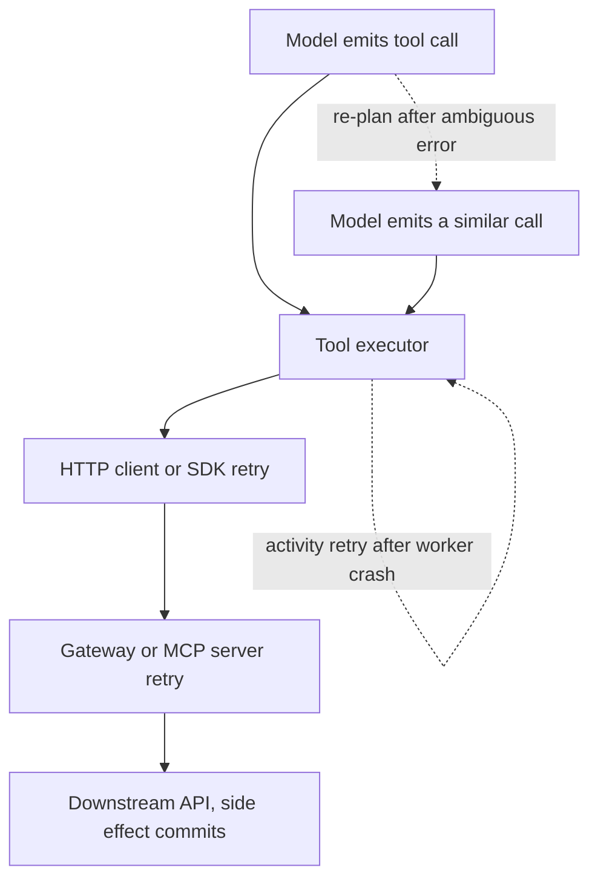
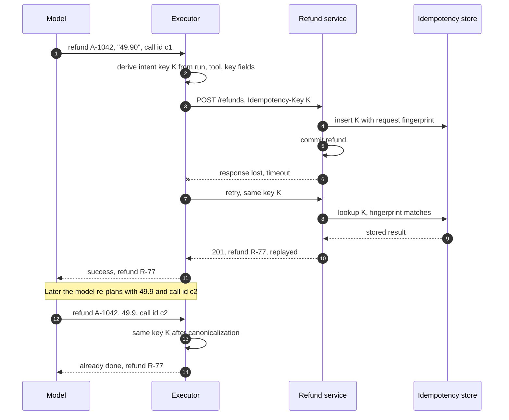
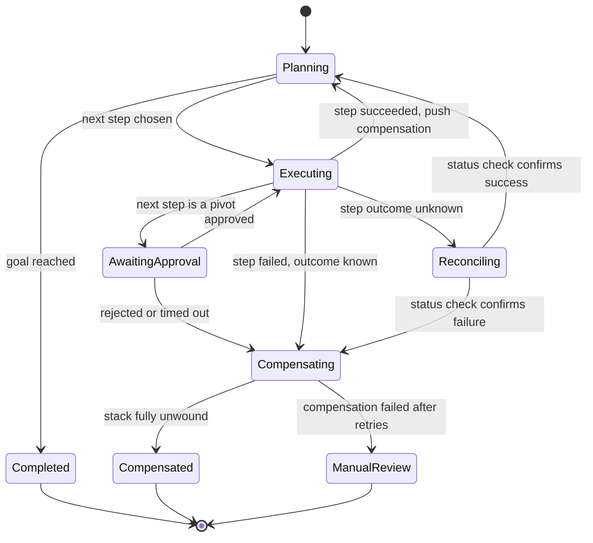
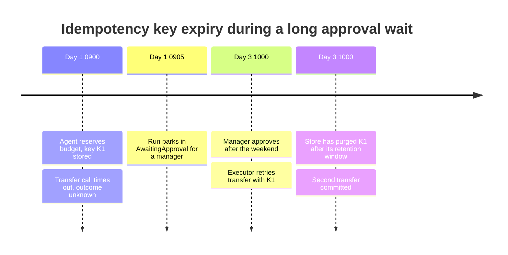

A tool call is the point where an agent stops producing text and starts changing the world: a payment is initiated, a ticket is opened, an email leaves the building. Everything that makes distributed side effects hard applies here unchanged. A request can time out after the server committed it, a client can retry it, and a multi-step operation can fail halfway with some steps applied and others not. The classical answers are idempotent operations, so a retry cannot apply an effect twice, and compensation, so a partially applied sequence can be driven back to a consistent state. Both are explained in the Distributed Systems Handbook: [Idempotency and Safe HTTP Methods](https://gorkemsari.github.io/distributed-systems/en/communication/api-gateway/idempotency/) and [The Saga Pattern](https://gorkemsari.github.io/distributed-systems/en/coordination/distributed-transactions/saga-pattern/).

An agent adds a source of duplicates that those mechanisms were not designed for: the planner itself. When a tool returns an ambiguous error, or when its result is dropped from the context, the model may issue the same action again with different wording, a reformatted amount, or a new call identifier. To a key-based deduplication layer, that second call is a new request. The effect is applied twice, and nothing in the infrastructure retried anything. The same planner also builds the multi-step sequence at run time, so the set of steps that may need compensation is not known when the system is designed.

The core trade-off is where the identity of an action is anchored. Anchored to the attempt (the HTTP request, the provider's call ID), deduplication is mechanical and exact but blind to re-planned duplicates. Anchored to the intent (this run, this step of the plan, these normalized business arguments), it catches re-planned duplicates, but it requires a stable notion of "step" and a canonical form for arguments, and a wrong canonicalization can merge two actions the user genuinely wanted. Compensation has a parallel trade-off: letting the model decide how to undo a step is flexible and unsafe, while a fixed registry of compensating actions is safe and only covers the tools someone anticipated.


*Five places that can send the same side effect twice. Solid arrows are one attempt; dotted arrows are the two retry loops specific to agent execution.*

The three solid layers are ordinary infrastructure retries, and an idempotency key passed through all of them removes their duplicates. The two dotted loops are different. The executor loop appears when the agent runs on a durable workflow engine that retries a step after a worker crash, which is correct behavior and the reason step identity must survive process restarts. The re-planning loop is the one with no infrastructure equivalent: it produces a call that shares the intent of the first one but not its bytes.

## Where Duplicate Side Effects Come From in an Agent Loop

Infrastructure duplicates follow the familiar pattern. The executor sends `create_transfer`, the downstream bank API commits it, and the response is lost to a timeout or a dropped connection. The client cannot distinguish "never arrived" from "arrived and committed", so it retries. This is the at-least-once delivery problem, analyzed in [At-Least-Once, At-Most-Once, and Exactly-Once Semantics](https://gorkemsari.github.io/distributed-systems/en/communication/async-messaging/delivery-semantics/), and the effect is exactly-once only if the receiver deduplicates.

Engine duplicates come from durable execution. A workflow engine records that a step was scheduled, a worker picks it up, performs the call, and crashes before reporting completion. The engine schedules the step again. Temporal, for example, retries a failed Activity by default with exponential backoff starting at one second, a coefficient of 2.0, a maximum interval of 100 seconds, and no limit on attempts (per its documentation as of November 2026). The engine guarantees the step eventually completes; it explicitly does not guarantee the step runs once. The agent-specific design of such engines is covered in [Durable Execution: Running Agents as Workflows](/ai-systems-architecture/en/agents/reliable-execution/durable-execution/).

Planner duplicates have no counterpart in classical systems. Consider a support agent that issues `refund(order_id="A-1042", amount="49.90", reason="damaged item")`. The refund service commits the refund and then fails while serializing its response, returning a generic 500. The model reads "the refund tool failed" and, reasonably, tries again, this time as `refund(order_id="A-1042", amount=49.9, reason="Item arrived damaged")`. Each call carries a fresh call identifier assigned by the provider, the amount is a number rather than a string, and the reason is reworded. A key derived from the request body, or from the call identifier, sees two unrelated requests. The customer receives two refunds.

The planner loop also produces the opposite error. If the model is told a call failed when it actually succeeded, its picture of the world is now wrong, and every later step is planned on that wrong picture. A duplicate effect is visible in a ledger; a wrong belief inside the run can surface as a nonsensical final answer three steps later, with no error logged anywhere.

:::caution[A provider call ID is not an idempotency key]
Tool-calling APIs attach an identifier to every tool call so the result can be matched to the request in the next turn. That identifier is unique per emission: when the model re-issues an action, the new call gets a new identifier. Using it as the idempotency key deduplicates nothing that matters. Use it for tracing and result correlation only.
:::

## Deriving Idempotency Keys from Intent, Not from Text

An intent key identifies "this action, in this run, at this point of the plan" in a form that every retry path reproduces. It is built from three parts. The run identifier scopes the key to one execution, so a user who genuinely asks for two refunds in two conversations gets two. The step identity anchors the key to a position in the plan; on a durable workflow engine that is the step or activity identifier, which the engine reproduces deterministically on replay. The canonical business arguments distinguish two different actions inside the same step, such as refunds for two different orders.

```text
intent_key = sha256(run_id | tool_name | step_scope | canonical(args, key_fields))

canonical():  keep only key_fields declared by the tool (e.g. order_id, amount, currency)
              numbers -> fixed decimal string ("49.9" and 49.90 -> "49.90")
              ids     -> trimmed, case-normalized
              drop free text (reason, memo, message body)
```

The step scope deserves the most care. A fixed workflow step gives a stable scope for free. An open agent loop does not have fixed steps, so the scope is the logical action: the tool plus the key fields, inside the run. That choice merges a re-planned refund for order `A-1042` with the original, which is the goal, but it also merges a deliberate second refund for the same order in the same run. Whether that is acceptable is a business rule, not a technical one, and the tool must declare it. A refund tool can declare that one run may refund an order once; a tool that sends status messages cannot, because two messages to the same recipient in one run are often both intended.

Free text is excluded on purpose. Models paraphrase, and a reason field that changes from "damaged item" to "Item arrived damaged" must not create a new action. The cost is that two actions differing only in free text become one, which is acceptable for refunds and wrong for, say, a tool that posts comments. Again, the tool's declaration decides.


*An infrastructure retry (steps 7-10) and a planner duplicate (steps 12-14) resolved by the same intent key. The provider call IDs c1 and c2 differ; the key does not.*

Two details in this exchange carry the correctness argument. In steps 4 and 5 the service records the key and commits the refund in the same transaction, which is what makes the replay in step 9 trustworthy: if the key exists, the effect exists. A key written after the commit reopens the duplicate window it was meant to close. In steps 13 and 14 the executor answers the re-planned call from its own record of completed intents without calling the service at all, and it returns the original result. The model learns that the refund exists and what its identifier is, which repairs its picture of the world instead of only suppressing the side effect.

The service also stores a fingerprint of the request, so that the same key arriving with different key fields is rejected rather than replayed. Stripe's API, for instance, saves the status code and body of the first request for a key, and rejects reuse of a key with different parameters; its documentation states that keys are retained for at least 24 hours on API v1, while API v2 uses a 30-day window (as of November 2026). That rejection must reach the model as a structured, non-retryable error that explains what happened, because a model shown a bare 400 will often retry with yet another variation.

### Worked Example: How Many Duplicates a Day

Assume, for illustration, an agent platform running 50,000 runs a day with an average of 12 side-effecting tool calls per run, 600,000 effectful calls in total. Assume 0.2% of calls hit a timeout after the downstream commit, and that the client retries each of those once. Without any deduplication, that is 600,000 times 0.002, or 1,200 duplicate effects a day from the infrastructure layers alone.

Now assume the model re-issues an action after 1% of ambiguous or unclear tool results, and that 3% of all calls return such a result. That adds 600,000 times 0.03 times 0.01, about 180 planner duplicates a day. Attempt-scoped keys (derived from the request body or the call ID) remove the 1,200 infrastructure duplicates and none of the 180 planner duplicates. Intent keys remove both, at the price of a lookup per effectful call. At 600,000 calls a day, roughly 7 per second on average, the store's load is negligible; its retention is the real constraint, as the failure section shows.

The numbers are illustrative, but the structure of the calculation holds for real systems: infrastructure duplicates scale with the timeout-after-commit rate, planner duplicates scale with how often tool results are ambiguous, and the second number is controlled by tool design rather than by infrastructure. A tool that returns "refund R-77 created" in every success path and "outcome unknown, check status with refund_status(order_id)" in every ambiguous path drives the planner rate toward zero. That design discipline is covered in [Tool Design: Granularity, Descriptions, and Error Semantics](/ai-systems-architecture/en/agents/tools-and-protocols/tool-design/).

## Classifying Tools by Side-Effect Semantics

Retry policy should be a property of the tool, decided once in the tool registry, not a decision the model makes per call. Four classes cover almost every tool an agent uses, and each maps to a different policy.

| Class | Examples | Retry policy | Duplicate protection | When to prefer this classification |
|---|---|---|---|---|
| Read-only | search, get_balance, list_orders | Retry freely with backoff | None needed | The tool changes no state anywhere, including audit side effects that matter |
| Naturally idempotent | set_status, upsert_profile, cancel_order | Retry with backoff | Absolute-state arguments ("set to X", never "add Y") | The operation can be phrased as a target state |
| Idempotent with key | create_refund, open_ticket, create_transfer | Retry with the same intent key | Service-side key store, committed with the effect | The downstream API supports idempotency keys or can be wrapped by one that does |
| Irreversible, not deduplicable | send_email, call_external_partner, sign_document | No automatic retry; reconcile status first | Outbox or status check before any repeat | The effect leaves your control and the receiver offers no deduplication |

The fourth class is where most production incidents start. An email provider that accepts a message cannot take it back, and many partner APIs offer no idempotency key. For these tools, an ambiguous result becomes a status check: query whether the message was accepted, and act on the answer. If the receiver cannot be queried either, record the intent in an outbox inside your own transaction and let a single dispatcher send it, as described in [The Outbox Pattern](https://gorkemsari.github.io/distributed-systems/en/coordination/distributed-transactions/outbox-pattern/), so that at least your side sends it once.

The Model Context Protocol lets a server describe these properties. The MCP specification defines optional tool annotations, including `readOnlyHint`, `destructiveHint`, `idempotentHint`, and `openWorldHint` (present in the 2025-06-18 revision and later). The specification also states that clients must treat annotations as untrusted unless they come from a trusted server. They are useful as defaults for retry policy and approval prompts, and they are not a safety mechanism.

```json
{
  "name": "create_refund",
  "description": "Refund an order. Returns refund_id. On timeout, call refund_status before retrying.",
  "inputSchema": {
    "type": "object",
    "properties": {
      "order_id": { "type": "string" },
      "amount": { "type": "string", "description": "Decimal, e.g. 49.90" },
      "reason": { "type": "string" }
    },
    "required": ["order_id", "amount", "reason"]
  },
  "annotations": { "readOnlyHint": false, "destructiveHint": true, "idempotentHint": true }
}
```

The description carries operational instructions for the model, and the annotations carry defaults for the client. Note what is not here: the intent key. The model never sees or produces it. The executor derives it, which keeps a correctness property out of the probabilistic component and out of reach of a prompt injection that might try to reuse or forge keys; the broader authorization concern is in [Agent Identity and Delegated Authorization](/ai-systems-architecture/en/security/defenses/agent-authorization/).

:::tip[Return an explicit "unknown" outcome]
Teach tools three outcomes, not two: succeeded (with the resulting identifiers), failed (nothing was applied), and unknown (the effect may have been applied). Map timeouts and connection resets after the request was sent to unknown, and make the tool description name the status-check tool to call next. Most planner duplicates disappear once the model is never told "failed" about an effect that may exist.
:::

## Compensation When a Multi-Step Plan Fails Midway

A saga splits a long operation into local steps, each paired with a compensating action that semantically undoes it; when a step fails, the compensations of the completed steps run in reverse order. The mechanics, including orchestration and choreography, are in [The Saga Pattern](https://gorkemsari.github.io/distributed-systems/en/coordination/distributed-transactions/saga-pattern/) and [Compensating Transactions](https://gorkemsari.github.io/distributed-systems/en/coordination/distributed-transactions/compensating-transactions/). An agent changes three assumptions behind that design.

First, the sequence is not known in advance. A classical saga is a fixed definition; an agent decides its next step after seeing the result of the previous one. The compensation stack must therefore be built at execution time: every time an effectful step completes, the executor pushes that step's compensating action, with the identifiers the step returned, onto a durable stack owned by the run. If the run fails, the executor unwinds the stack. Nothing about the undo path needs to be predicted when the agent is designed.

Second, the compensating action must not be authored by the model. It is tempting to ask the model "the plan failed, undo what you did". The model would then generate effectful calls based on its own, possibly wrong, account of what it did, and an injected instruction in a retrieved document could shape those calls. Compensations come from the tool registry: `create_refund` declares `void_refund(refund_id)`, `reserve_seat` declares `release_seat(reservation_id)`. The executor fills them with identifiers from recorded results, not from model output. The model may be asked to explain the failure to the user; it does not drive the rollback.

Third, many agent tools have no real inverse. An email cannot be unsent; the semantic compensation is a correction email, which is a new effect with its own cost. A message to a partner system may trigger work there that cannot be recalled. In saga terms, these are pivot steps: once they succeed, backward recovery is no longer possible and the only path is forward. The practical rule is to place every pivot step as late in the plan as possible and to put a human approval gate immediately before it, as described in [Human-in-the-Loop: Approval Gates and Escalation](/ai-systems-architecture/en/agents/reliable-execution/human-in-the-loop/).


*Lifecycle of an agent run with compensation. Unknown outcomes go through reconciliation before the run decides whether to continue or unwind.*

The `Reconciling` state is the agent-specific addition. A classical saga step either commits or aborts from the orchestrator's point of view, because the orchestrator owns the timeout semantics. An agent run frequently ends a step with "unknown", and both continuing and compensating are wrong until the status is known. Compensating a refund that does not exist fails; continuing past a transfer that does not exist builds on nothing. The run waits for a status check, which is itself a read-only tool and safe to retry.

Compensations are effects too, so they need the same protection. Each compensating call carries its own intent key, derived from the run and the forward step it undoes, because the executor that unwinds a stack can itself crash halfway and replay. A compensation that fails after its retry budget sends the run to `ManualReview` with the stack state attached: an operator sees which forward steps were applied, which were compensated, and which remain.

## Failure Modes and Operations

Duplicates and unbalanced compensations rarely raise errors. They show up in ledgers, customer complaints, and reconciliation reports, often days later. Each failure mode below needs a metric that detects it before a customer does.


*An illustrative incident timeline. The run outlived the downstream service's key retention, so a correct retry became a duplicate.*

This is the failure most specific to agents. Infrastructure retries happen within seconds, comfortably inside any key retention window. Agent runs pause for approvals, wait on users, or sit in a queue during an outage, and the pause can exceed the window, such as the 24-hour minimum that Stripe documents for API v1. The retry is correct by every local rule and still duplicates. The mitigation is to resolve unknown outcomes before a run parks, never after; to keep your own record of completed intents with a retention at least as long as the maximum run duration; and to alert when a run resumes after a pause longer than the shortest retention of the tools it has used.

| Failure | Trigger | Symptom | Detection | Mitigation and recovery |
|---|---|---|---|---|
| Timeout-after-commit duplicate | Response lost after downstream commit | Double charge, duplicate ticket | Replayed-key ratio near zero while timeouts are non-zero | Intent keys through every retry layer; refund the duplicate via its compensation |
| Planner duplicate | Ambiguous tool error, model re-issues | Two effects with different call IDs, same order | Executor-side intent hits; per-run count of effects per entity | Three-outcome tool results; intent-scoped keys; review tool error texts |
| False failure belief | Tool reports failed after a partial or full commit | Wrong final answer, no error logged | Reconciliation job diffs agent claims against system of record | Unknown outcome plus status check before re-planning |
| Key expiry | Run pause longer than key retention | Duplicate after resume | Resume-after-pause duration versus tool retention | Resolve unknowns before parking; own intent store with long retention |
| Fingerprint conflict loop | Same key, changed key fields, raw 400 shown to model | Model retries variations until budget is exhausted | Conflict rate per tool; repeated conflicts per run | Structured non-retryable conflict error; budget limits from [Stopping Conditions and Budget Control](/ai-systems-architecture/en/agents/reliable-execution/stopping-budget/) |
| Stuck compensation | Compensation fails repeatedly | Run in ManualReview, partial state | Count and age of runs in ManualReview | Per-compensation retry budget, operator runbook with stack state |
| Retry storm on a degraded tool | Many runs retrying a slow dependency | Rising latency, rate-limit errors, cost spike | Retries per tool per minute | Backoff with jitter and retry budgets, see [Retry Storms and Metastable Failures](https://gorkemsari.github.io/distributed-systems/en/resilience/flow-control/retry-storms-metastable-failures/) |

The detection column depends on telemetry that standard request logs do not contain. Every effectful call needs the run ID, the intent key, the provider call ID, the outcome class (succeeded, failed, unknown), and whether the result was replayed. With those fields on each tool span, the replayed-key ratio, the planner-duplicate rate, and the unknown-outcome rate become ordinary dashboards; the span model is described in [LLM Observability Fundamentals: Traces, Tokens, and Cost](/ai-systems-architecture/en/llmops/observability/llm-observability/). A reconciliation job that compares what agent runs reported doing with what the systems of record show is the only reliable detector of false failure beliefs, because by definition they leave no error behind.

:::danger[Never let a compensation run on a guessed identifier]
If a forward step's outcome is unknown and its result identifiers were never recorded, the compensation has nothing safe to act on. Searching for "the most recent refund for this order" and voiding it can void a refund issued by a human agent or by another run. Reconcile first and compensate only identifiers the run itself recorded.
:::

## Choosing Between Keys, Status Checks, Compensation, and Approval

The mechanisms on this page layer rather than compete, and the choice is per tool, made from two questions: can the receiver deduplicate, and can the effect be undone.

Use intent-scoped idempotency keys for every effectful tool whose receiver accepts a key or can be wrapped by a service you own that stores one. This is the default for anything that creates records: refunds, tickets, orders, transfers. Anchor the key to the run and the logical action, and derive it in the executor. Do not use attempt-scoped keys alone in an agent: they solve the infrastructure half of the problem and leave the half that is specific to agents.

Use status checks instead of retries when the receiver cannot deduplicate. Pair every such tool with a read-only status tool, return "unknown" on ambiguous results, and make the description name the status tool. Do not retry these tools automatically under any policy.

Use runtime-built compensation stacks when a run performs more than one effectful step and a later failure would leave a state the business cannot accept. Do not use compensation as a substitute for prevention: a refund voided after the fact still appears on a statement and in the audit trail, and its own call can fail.

Use an approval gate before pivot steps, the effects with no compensation. If a plan contains more than one pivot, reorder it so they come last, or split the run so each pivot is approved on its own. Do not put approval gates before every step to compensate for missing idempotency: reviewers approve dozens of low-risk steps by reflex, and the gate stops protecting the one step that needs it.

Do not build any of this for a read-only agent. An assistant that only searches and summarizes needs backoff and budgets, not keys and stacks. The cost of this machinery belongs where the effects are.

## Further Reading

- Hector Garcia-Molina and Kenneth Salem, *Sagas*, Proceedings of ACM SIGMOD, 1987.
- Pat Helland, *Idempotence Is Not a Medical Condition*, ACM Queue, 2012.
- Stripe, *Idempotent requests* and *Advanced error handling*, Stripe API documentation.
- Temporal Technologies, *What is a Temporal Retry Policy?*, Temporal documentation.
- Model Context Protocol, *Tools* (tool annotations), MCP specification, 2025-06-18 revision.
