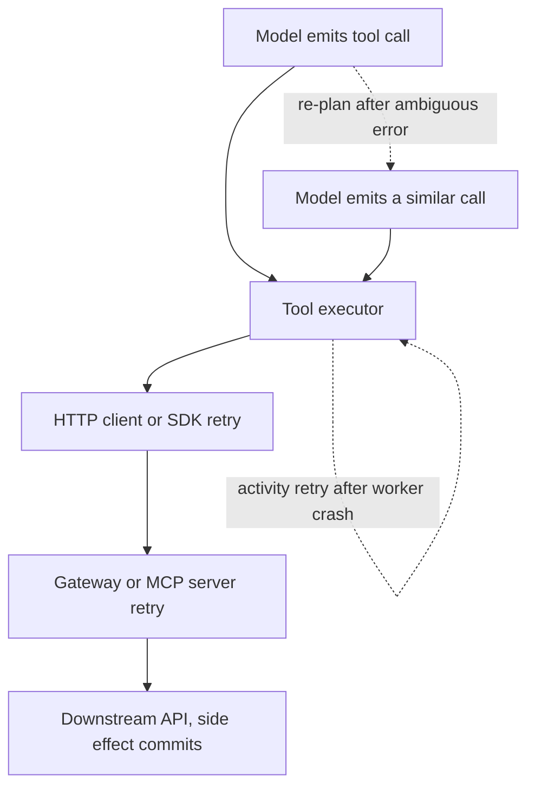
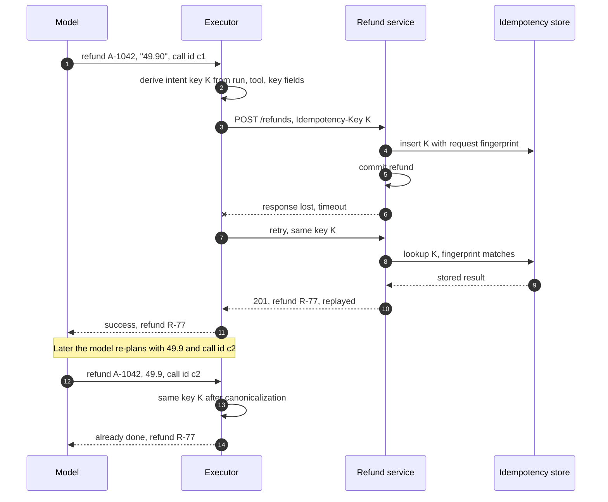
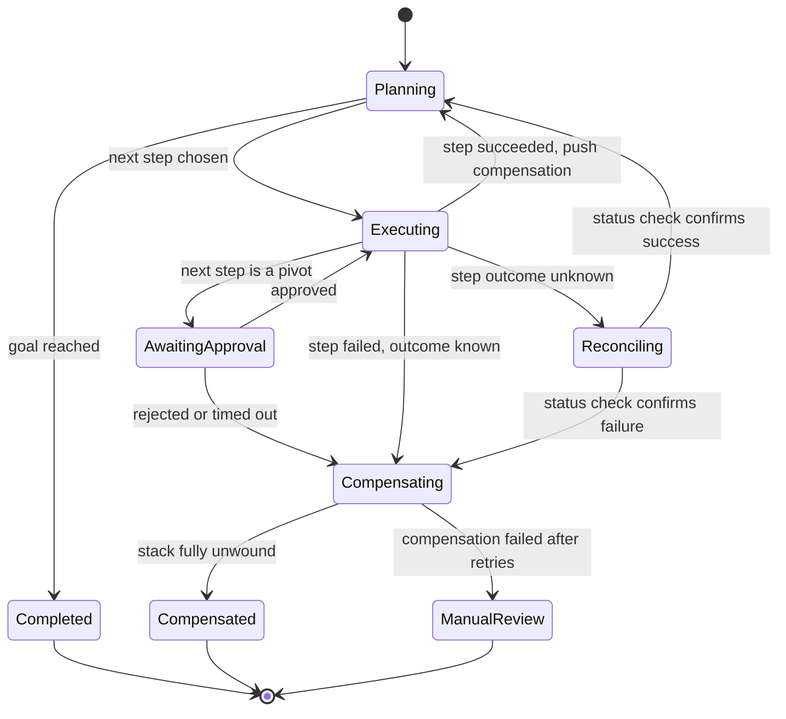
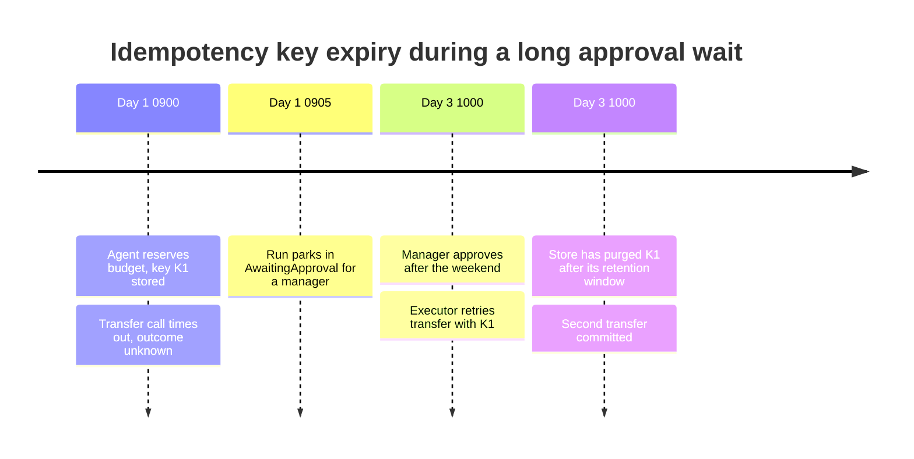

Tool call, bir agent'ın metin üretmeyi bırakıp dünyayı değiştirmeye başladığı noktadır: bir ödeme başlatılır, bir ticket açılır, bir e-posta kurumun dışına çıkar. Dağıtık yan etkileri zorlaştıran her şey burada da aynen geçerlidir. Bir istek, sunucu onu commit ettikten sonra timeout'a düşebilir; istemci onu tekrar gönderebilir; çok adımlı bir işlem bazı adımları uygulanmış, bazıları uygulanmamış halde yarıda kalabilir. Klasik cevaplar iki tanedir: bir retry'ın etkiyi iki kez uygulayamayacağı idempotent işlemler ve kısmen uygulanmış bir diziyi tutarlı bir duruma geri götüren compensation. İkisi de Distributed Systems Handbook'ta anlatılır: [Idempotency ve Güvenli HTTP Metotları](https://gorkemsari.github.io/distributed-systems/tr/communication/api-gateway/idempotency/) ve [Saga Deseni](https://gorkemsari.github.io/distributed-systems/tr/coordination/distributed-transactions/saga-pattern/).

Agent, bu mekanizmaların hesaba katmadığı bir kopya kaynağı ekler: planlayıcının kendisi. Bir tool belirsiz bir hata döndürdüğünde ya da sonucu context'ten düştüğünde model aynı aksiyonu farklı bir ifadeyle, yeniden biçimlendirilmiş bir tutarla veya yeni bir call kimliğiyle tekrar gönderebilir. Key tabanlı bir tekilleştirme katmanı için bu ikinci çağrı yeni bir istektir. Etki iki kez uygulanır ve altyapıda hiçbir şey retry yapmamıştır. Aynı planlayıcı çok adımlı diziyi de çalışma anında kurar; dolayısıyla compensation gerektirebilecek adımların kümesi sistem tasarlanırken bilinmez.

Temel trade-off, bir aksiyonun kimliğinin neye bağlandığıdır. Denemeye (HTTP isteğine, provider'ın call kimliğine) bağlandığında tekilleştirme mekanik ve kesindir, ama yeniden planlanmış kopyaları göremez. Niyete (bu çalıştırma, planın bu adımı, bu normalize edilmiş iş argümanları) bağlandığında yeniden planlanmış kopyaları yakalar; ancak kararlı bir "adım" kavramı ve argümanlar için kanonik bir biçim gerektirir, yanlış bir kanonikleştirme de kullanıcının gerçekten istediği iki aksiyonu tek aksiyona indirebilir. Compensation'da da paralel bir trade-off vardır: bir adımın nasıl geri alınacağına modelin karar vermesi esnektir ama güvensizdir; sabit bir compensation registry'si ise güvenlidir ama yalnızca birinin önceden düşündüğü tool'ları kapsar.


*Aynı yan etkiyi iki kez gönderebilecek beş nokta. Düz oklar tek bir denemeyi, noktalı oklar agent yürütmeye özgü iki retry döngüsünü gösterir.*

Düz çizilmiş üç katman sıradan altyapı retry'larıdır ve hepsinden geçirilen bir idempotency key bunların ürettiği kopyaları ortadan kaldırır. Noktalı iki döngü farklıdır. Executor döngüsü, agent bir worker çöktüğünde adımı yeniden deneyen durable bir workflow engine üzerinde çalıştığında ortaya çıkar; bu doğru bir davranıştır ve adım kimliğinin process yeniden başlatmalarından sağ çıkması gerekmesinin sebebidir. Yeniden planlama döngüsünün ise altyapıda bir karşılığı yoktur: ilk çağrıyla aynı niyeti taşıyan ama aynı byte'ları taşımayan bir çağrı üretir.

## Bir Agent Döngüsünde Kopya Yan Etkiler Nereden Gelir

Altyapı kaynaklı kopyalar bilinen kalıbı izler. Executor `create_transfer` gönderir, downstream banka API'si commit eder ve yanıt bir timeout'ta ya da kopan bir bağlantıda kaybolur. İstemci "hiç ulaşmadı" ile "ulaştı ve commit edildi" durumlarını ayırt edemez ve retry yapar. Bu, [En Az Bir Kez, En Fazla Bir Kez ve Tam Olarak Bir Kez Semantiği](https://gorkemsari.github.io/distributed-systems/tr/communication/async-messaging/delivery-semantics/) sayfasında incelenen at-least-once teslimat problemidir; etki ancak alıcı tekilleştirme yaparsa exactly-once olur.

Engine kaynaklı kopyalar durable execution'dan gelir. Bir workflow engine bir adımın zamanlandığını kaydeder, bir worker adımı alır, çağrıyı yapar ve tamamlandığını bildirmeden çöker. Engine adımı yeniden zamanlar. Örneğin Temporal, başarısız bir Activity'yi varsayılan olarak bir saniyeden başlayan, 2.0 katsayılı, en fazla 100 saniye aralıklı ve deneme sayısı sınırsız bir exponential backoff ile yeniden dener (Kasım 2026 itibarıyla dokümantasyonuna göre). Engine adımın eninde sonunda tamamlanacağını garanti eder; adımın bir kez çalışacağını açıkça garanti etmez. Bu tür engine'lerin agent'a özgü tasarımı [Durable Execution: Agent'ları Workflow Olarak Çalıştırmak](/ai-systems-architecture/tr/agents/reliable-execution/durable-execution/) sayfasında ele alınır.

Planlayıcı kaynaklı kopyaların klasik sistemlerde bir karşılığı yoktur. `refund(order_id="A-1042", amount="49.90", reason="damaged item")` çağrısı yapan bir destek agent'ı düşünün. Refund servisi iadeyi commit eder, ardından yanıtını serialize ederken hata verir ve genel bir 500 döndürür. Model "refund tool'u başarısız oldu" diye okur ve makul bir şekilde yeniden dener, bu sefer `refund(order_id="A-1042", amount=49.9, reason="Item arrived damaged")` olarak. Her çağrı provider'ın atadığı taze bir call kimliği taşır, tutar string yerine sayıdır ve gerekçe başka kelimelerle yazılmıştır. İstek gövdesinden ya da call kimliğinden türetilen bir key iki ilgisiz istek görür. Müşteri iki iade alır.

Planlayıcı döngüsü tersi yönde bir hata da üretir. Model, aslında başarılı olan bir çağrının başarısız olduğunu duyarsa dünya hakkındaki resmi artık yanlıştır ve sonraki her adım bu yanlış resim üzerine planlanır. Kopya bir etki ledger'da görünür; çalıştırmanın içindeki yanlış bir inanç ise üç adım sonra, hiçbir yerde hata loglanmadan anlamsız bir nihai yanıt olarak ortaya çıkabilir.

:::caution[Provider'ın call kimliği bir idempotency key değildir]
Tool calling API'leri her tool call'a bir kimlik ekler; böylece sonuç, bir sonraki turda isteğe eşlenebilir. Bu kimlik her üretimde benzersizdir: model bir aksiyonu yeniden gönderdiğinde yeni çağrı yeni bir kimlik alır. Bu kimliği idempotency key olarak kullanmak önemli olan hiçbir şeyi tekilleştirmez. Onu yalnızca tracing ve sonuç eşleştirme için kullanın.
:::

## Idempotency Key'i Metinden Değil, Niyetten Türetmek

Niyet key'i, "bu çalıştırmada, planın bu noktasındaki bu aksiyonu" her retry yolunun yeniden üretebileceği bir biçimde tanımlar. Üç parçadan kurulur. Çalıştırma kimliği key'i tek bir yürütmeyle sınırlar; böylece iki ayrı konuşmada gerçekten iki iade isteyen kullanıcı iki iade alır. Adım kimliği key'i plandaki bir konuma bağlar; durable bir workflow engine üzerinde bu, engine'in replay sırasında deterministik olarak yeniden ürettiği step ya da activity kimliğidir. Kanonik iş argümanları aynı adım içindeki iki farklı aksiyonu, örneğin iki farklı siparişin iadesini, birbirinden ayırır.

```text
intent_key = sha256(run_id | tool_name | step_scope | canonical(args, key_fields))

canonical():  keep only key_fields declared by the tool (e.g. order_id, amount, currency)
              numbers -> fixed decimal string ("49.9" and 49.90 -> "49.90")
              ids     -> trimmed, case-normalized
              drop free text (reason, memo, message body)
```

En çok özen isteyen kısım adım kapsamıdır. Sabit bir workflow adımı kararlı bir kapsamı bedavaya verir. Açık bir agent döngüsünün sabit adımları yoktur; bu durumda kapsam mantıksal aksiyondur, yani çalıştırma içinde tool ve key alanları. Bu tercih `A-1042` siparişi için yeniden planlanmış iadeyi orijinaliyle birleştirir; amaç da budur. Ancak aynı çalıştırmada aynı sipariş için bilerek yapılmış ikinci bir iadeyi de birleştirir. Bunun kabul edilebilir olup olmadığı teknik değil, iş kuralıdır ve tool bunu beyan etmelidir. Bir refund tool'u, bir çalıştırmanın bir siparişi yalnızca bir kez iade edebileceğini beyan edebilir; durum mesajı gönderen bir tool bunu beyan edemez, çünkü aynı çalıştırmada aynı alıcıya giden iki mesajın ikisi de çoğu zaman kastedilmiştir.

Serbest metin bilerek dışarıda bırakılır. Modeller yeniden ifade eder ve "damaged item" iken "Item arrived damaged" olan bir gerekçe alanı yeni bir aksiyon yaratmamalıdır. Bedeli şudur: yalnızca serbest metinde farklılaşan iki aksiyon tek aksiyon olur. Bu, iadeler için kabul edilebilir; yorum gönderen bir tool içinse yanlıştır. Burada da karar tool'un beyanındadır.


*Aynı niyet key'iyle çözülen bir altyapı retry'ı (adım 7-10) ve bir planlayıcı kopyası (adım 12-14). Provider call kimlikleri c1 ve c2 farklıdır; key ise aynıdır.*

Bu alışverişteki iki ayrıntı doğruluk argümanını taşır. 4. ve 5. adımlarda servis key'i kaydeder ve iadeyi aynı transaction içinde commit eder; 9. adımdaki replay'i güvenilir kılan budur: key varsa etki de vardır. Commit'ten sonra yazılan bir key, kapatması gereken kopya penceresini yeniden açar. 13. ve 14. adımlarda executor yeniden planlanmış çağrıyı servisi hiç çağırmadan, tamamlanmış niyetlere ait kendi kaydından yanıtlar ve orijinal sonucu döndürür. Model iadenin var olduğunu ve kimliğini öğrenir; bu, yalnızca yan etkiyi bastırmakla kalmaz, modelin dünya resmini de onarır.

Servis ayrıca isteğin bir parmak izini de saklar; böylece aynı key farklı key alanlarıyla geldiğinde replay edilmek yerine reddedilir. Örneğin Stripe API'si bir key için ilk isteğin durum kodunu ve gövdesini saklar ve key'in farklı parametrelerle yeniden kullanılmasını reddeder; dokümantasyonuna göre key'ler API v1'de en az 24 saat tutulur, API v2 ise 30 günlük bir pencere kullanır (Kasım 2026 itibarıyla). Bu ret, modele ne olduğunu açıklayan yapılandırılmış ve yeniden denenemez bir hata olarak ulaşmalıdır; çünkü çıplak bir 400 gören model çoğu zaman bir varyasyonla daha yeniden dener.

### Hesaplı Örnek: Günde Kaç Kopya

Örnek olarak, günde 50.000 çalıştırma yürüten ve çalıştırma başına ortalama 12 yan etkili tool call yapan bir agent platformu varsayalım; toplam 600.000 etkili çağrı eder. Çağrıların %0,2'sinin downstream commit'ten sonra timeout'a düştüğünü ve istemcinin bunların her birini bir kez yeniden denediğini varsayalım. Hiç tekilleştirme yoksa yalnızca altyapı katmanlarından günde 600.000 çarpı 0,002, yani 1.200 kopya etki çıkar.

Şimdi modelin belirsiz ya da anlaşılmaz tool sonuçlarının %1'inden sonra aksiyonu yeniden gönderdiğini ve tüm çağrıların %3'ünün böyle bir sonuç döndürdüğünü varsayalım. Bu, günde 600.000 çarpı 0,03 çarpı 0,01, yaklaşık 180 planlayıcı kopyası ekler. Deneme kapsamlı key'ler (istek gövdesinden ya da call kimliğinden türetilenler) 1.200 altyapı kopyasını ortadan kaldırır, 180 planlayıcı kopyasının ise hiçbirini kaldırmaz. Niyet key'leri her etkili çağrı başına bir lookup bedeliyle ikisini de ortadan kaldırır. Günde 600.000 çağrı, ortalama saniyede yaklaşık 7 çağrı eder; store üzerindeki yük önemsizdir. Asıl kısıt, hata bölümünde görüleceği gibi, saklama süresidir.

Rakamlar örnek amaçlıdır, ama hesabın yapısı gerçek sistemlerde de geçerlidir: altyapı kopyaları commit sonrası timeout oranıyla, planlayıcı kopyaları ise tool sonuçlarının ne sıklıkla belirsiz olduğuyla ölçeklenir ve ikinci rakamı altyapı değil, tool tasarımı belirler. Her başarı yolunda "refund R-77 created", her belirsiz yolda "outcome unknown, check status with refund_status(order_id)" döndüren bir tool, planlayıcı oranını sıfıra yaklaştırır. Bu tasarım disiplini [Tool Tasarımı: Granularity, Açıklamalar ve Hata Semantiği](/ai-systems-architecture/tr/agents/tools-and-protocols/tool-design/) sayfasında ele alınır.

## Tool'ları Yan Etki Semantiğine Göre Sınıflandırmak

Retry politikası, modelin her çağrıda verdiği bir karar değil, tool registry'de bir kez kararlaştırılan bir tool özelliği olmalıdır. Bir agent'ın kullandığı tool'ların neredeyse tamamını dört sınıf kapsar ve her biri farklı bir politikaya karşılık gelir.

| Sınıf | Örnekler | Retry politikası | Kopya koruması | Bu sınıflandırma ne zaman tercih edilir |
|---|---|---|---|---|
| Salt okunur | search, get_balance, list_orders | Backoff ile serbestçe yeniden dene | Gerekmez | Tool hiçbir yerde durum değiştirmiyorsa, önemli audit yan etkileri dahil |
| Doğası gereği idempotent | set_status, upsert_profile, cancel_order | Backoff ile yeniden dene | Mutlak durum argümanları ("X yap", asla "Y ekle") | İşlem bir hedef durum olarak ifade edilebiliyorsa |
| Key ile idempotent | create_refund, open_ticket, create_transfer | Aynı niyet key'iyle yeniden dene | Etkiyle birlikte commit edilen servis tarafı key store | Downstream API idempotency key destekliyor ya da destekleyen bir katmanla sarılabiliyorsa |
| Geri alınamaz, tekilleştirilemez | send_email, call_external_partner, sign_document | Otomatik retry yok; önce durumu doğrula | Tekrardan önce outbox ya da durum kontrolü | Etki kontrolünüzden çıkıyor ve alıcı tekilleştirme sunmuyorsa |

Production incident'larının çoğu dördüncü sınıfta başlar. Bir mesajı kabul eden e-posta provider'ı onu geri alamaz ve birçok partner API'si idempotency key sunmaz. Bu tool'larda belirsiz bir sonuç bir durum kontrolüne dönüşür: mesajın kabul edilip edilmediğini sorgulayın ve cevaba göre davranın. Alıcı sorgulanamıyorsa niyeti kendi transaction'ınız içinde bir outbox'a kaydedin ve tek bir dispatcher'ın göndermesine izin verin; [Outbox Deseni](https://gorkemsari.github.io/distributed-systems/tr/coordination/distributed-transactions/outbox-pattern/) sayfasında anlatıldığı gibi, böylece en azından sizin tarafınız onu bir kez gönderir.

Model Context Protocol, bir sunucunun bu özellikleri tarif etmesine izin verir. MCP spesifikasyonu, aralarında `readOnlyHint`, `destructiveHint`, `idempotentHint` ve `openWorldHint` bulunan isteğe bağlı tool annotation'ları tanımlar (2025-06-18 revizyonunda ve sonrasında mevcut). Spesifikasyon ayrıca istemcilerin, güvenilir bir sunucudan gelmedikçe annotation'ları güvenilmez kabul etmesi gerektiğini belirtir. Annotation'lar retry politikası ve onay istemleri için varsayılan değer olarak işe yarar; bir güvenlik mekanizması değildir.

```json
{
  "name": "create_refund",
  "description": "Refund an order. Returns refund_id. On timeout, call refund_status before retrying.",
  "inputSchema": {
    "type": "object",
    "properties": {
      "order_id": { "type": "string" },
      "amount": { "type": "string", "description": "Decimal, e.g. 49.90" },
      "reason": { "type": "string" }
    },
    "required": ["order_id", "amount", "reason"]
  },
  "annotations": { "readOnlyHint": false, "destructiveHint": true, "idempotentHint": true }
}
```

Açıklama model için operasyonel talimatları, annotation'lar ise istemci için varsayılanları taşır. Burada olmayana dikkat edin: niyet key'i. Model onu ne görür ne de üretir. Key'i executor türetir; bu, bir doğruluk özelliğini olasılıksal bileşenin dışında ve key'leri yeniden kullanmaya ya da sahtesini üretmeye çalışabilecek bir prompt injection'ın erişiminin dışında tutar. Daha geniş yetkilendirme meselesi [Agent Kimliği ve Delegated Authorization](/ai-systems-architecture/tr/security/defenses/agent-authorization/) sayfasındadır.

:::tip[Açıkça "bilinmiyor" sonucu döndürün]
Tool'lara iki değil üç sonuç öğretin: başarılı (oluşan kimliklerle birlikte), başarısız (hiçbir şey uygulanmadı) ve bilinmiyor (etki uygulanmış olabilir). İstek gönderildikten sonra yaşanan timeout'ları ve bağlantı kopmalarını "bilinmiyor"a eşleyin ve tool açıklamasında bir sonraki adımda çağrılacak durum kontrolü tool'unu adıyla belirtin. Model, var olabilecek bir etki için asla "başarısız" duymadığında planlayıcı kopyalarının çoğu ortadan kalkar.
:::

## Çok Adımlı Bir Plan Yarıda Kaldığında Compensation

Saga, uzun bir işlemi her biri onu anlamsal olarak geri alan bir compensating aksiyonla eşleştirilmiş yerel adımlara böler; bir adım başarısız olduğunda tamamlanmış adımların compensation'ları ters sırayla çalışır. Orchestration ve choreography dahil mekanikler [Saga Deseni](https://gorkemsari.github.io/distributed-systems/tr/coordination/distributed-transactions/saga-pattern/) ve [Compensating Transaction'lar](https://gorkemsari.github.io/distributed-systems/tr/coordination/distributed-transactions/compensating-transactions/) sayfalarındadır. Agent, bu tasarımın arkasındaki üç varsayımı değiştirir.

Birincisi, dizi önceden bilinmez. Klasik bir saga sabit bir tanımdır; agent ise bir sonraki adımına bir öncekinin sonucunu gördükten sonra karar verir. Bu nedenle compensation yığını çalışma anında kurulmalıdır: etkili bir adım her tamamlandığında executor, o adımın compensating aksiyonunu, adımın döndürdüğü kimliklerle birlikte, çalıştırmaya ait durable bir yığına iter. Çalıştırma başarısız olursa executor yığını geri sarar. Agent tasarlanırken geri alma yoluna dair hiçbir şeyin öngörülmesi gerekmez.

İkincisi, compensating aksiyonu model yazmamalıdır. Modele "plan başarısız oldu, yaptıklarını geri al" demek caziptir. Bu durumda model, ne yaptığına dair kendi ve muhtemelen yanlış anlatımına dayanarak etkili çağrılar üretir; retrieve edilmiş bir dokümana enjekte edilmiş bir talimat da bu çağrıları şekillendirebilir. Compensation'lar tool registry'den gelir: `create_refund`, `void_refund(refund_id)` beyan eder; `reserve_seat`, `release_seat(reservation_id)` beyan eder. Executor bunları model çıktısından değil, kaydedilmiş sonuçlardaki kimliklerle doldurur. Modelden hatayı kullanıcıya açıklaması istenebilir; geri almayı o yönetmez.

Üçüncüsü, birçok agent tool'unun gerçek bir tersi yoktur. Bir e-posta geri gönderilemez; anlamsal compensation bir düzeltme e-postasıdır ve bu, kendi maliyeti olan yeni bir etkidir. Bir partner sisteme giden mesaj orada geri çağrılamayacak bir işi tetikleyebilir. Saga terimleriyle bunlar pivot adımlardır: başarılı olduklarında geriye doğru kurtarma artık mümkün değildir ve tek yol ileriye doğrudur. Pratik kural, her pivot adımı planda olabildiğince geç konumlandırmak ve hemen önüne, [Human-in-the-Loop: Onay Kapıları ve Escalation](/ai-systems-architecture/tr/agents/reliable-execution/human-in-the-loop/) sayfasında anlatıldığı gibi bir insan onay kapısı koymaktır.


*Compensation içeren bir agent çalıştırmasının yaşam döngüsü. Bilinmeyen sonuçlar, çalıştırma devam etmeye ya da geri sarmaya karar vermeden önce mutabakattan geçer.*

`Reconciling` durumu agent'a özgü eklemedir. Klasik bir saga adımı orchestrator'ın bakış açısından ya commit olur ya da abort olur, çünkü timeout semantiği orchestrator'a aittir. Bir agent çalıştırması ise bir adımı sık sık "bilinmiyor" ile bitirir ve durum bilinene kadar hem devam etmek hem de compensation yapmak yanlıştır. Var olmayan bir iadeyi compensate etmek başarısız olur; var olmayan bir transferin ötesine geçmek hiçliğin üzerine inşa etmektir. Çalıştırma, kendisi de salt okunur ve yeniden denenmesi güvenli bir tool olan durum kontrolünü bekler.

Compensation'lar da birer etkidir; dolayısıyla aynı korumaya ihtiyaç duyarlar. Bir yığını geri saran executor da yarıda çöküp replay yapabileceği için her compensating çağrı, çalıştırmadan ve geri aldığı ileri adımdan türetilmiş kendi niyet key'ini taşır. Retry bütçesini tükettikten sonra başarısız olan bir compensation, çalıştırmayı yığın durumu ekli halde `ManualReview`'a gönderir: operatör hangi ileri adımların uygulandığını, hangilerinin compensate edildiğini ve hangilerinin kaldığını görür.

## Hata Türleri ve Operasyon

Kopyalar ve dengesiz compensation'lar nadiren hata fırlatır. Ledger'larda, müşteri şikayetlerinde ve mutabakat raporlarında, çoğu zaman günler sonra ortaya çıkarlar. Aşağıdaki her hata türü, onu müşteriden önce tespit eden bir metriğe ihtiyaç duyar.


*Örnek amaçlı bir incident zaman çizelgesi. Çalıştırma downstream servisin key saklama süresinden uzun yaşadı; doğru bir retry kopyaya dönüştü.*

Agent'lara en özgü hata budur. Altyapı retry'ları saniyeler içinde, herhangi bir key saklama penceresinin rahatça içinde gerçekleşir. Agent çalıştırmaları ise onay için durur, kullanıcıyı bekler ya da bir kesinti sırasında kuyrukta bekler; bu duraklama, Stripe'ın API v1 için belgelediği 24 saatlik minimum gibi pencereleri aşabilir. Retry her yerel kurala göre doğrudur ve yine de kopya üretir. Çözüm şudur: bilinmeyen sonuçları çalıştırma park edilmeden önce çözün, asla sonra değil; tamamlanmış niyetlerin kaydını, saklama süresi en az azami çalıştırma süresi kadar olan kendi store'unuzda tutun; ve bir çalıştırma, kullandığı tool'ların en kısa saklama süresinden uzun bir duraklamanın ardından devam ettiğinde alarm üretin.

| Hata | Tetikleyici | Belirti | Tespit | Azaltma ve kurtarma |
|---|---|---|---|---|
| Commit sonrası timeout kopyası | Yanıt downstream commit'ten sonra kaybolur | Çift ödeme, kopya ticket | Timeout'lar sıfırdan büyükken replay edilen key oranının sıfıra yakın olması | Her retry katmanında niyet key'i; kopyayı compensation'ı ile iade etmek |
| Planlayıcı kopyası | Belirsiz tool hatası, model yeniden gönderir | Farklı call kimlikli, aynı siparişe ait iki etki | Executor tarafı niyet isabetleri; çalıştırma başına varlık başına etki sayısı | Üç sonuçlu tool yanıtları; niyet kapsamlı key'ler; tool hata metinlerinin gözden geçirilmesi |
| Yanlış başarısızlık inancı | Tool kısmi ya da tam commit sonrası "başarısız" der | Yanlış nihai yanıt, loglanmış hata yok | Agent beyanlarını kayıt sistemiyle karşılaştıran mutabakat job'ı | Yeniden planlamadan önce "bilinmiyor" sonucu ve durum kontrolü |
| Key süresinin dolması | Key saklama süresinden uzun çalıştırma duraklaması | Devam sonrası kopya | Duraklama sonrası devam süresinin tool saklama süresiyle karşılaştırılması | Park etmeden önce bilinmeyenleri çözmek; uzun saklamalı kendi niyet store'u |
| Parmak izi çakışma döngüsü | Aynı key, değişmiş key alanları, modele çıplak 400 gösterilmesi | Model bütçe bitene kadar varyasyonları dener | Tool başına çakışma oranı; çalıştırma başına tekrarlanan çakışmalar | Yapılandırılmış, yeniden denenemez çakışma hatası; [Durma Koşulları ve Bütçe Kontrolü](/ai-systems-architecture/tr/agents/reliable-execution/stopping-budget/) sayfasındaki bütçe limitleri |
| Takılı compensation | Compensation tekrar tekrar başarısız olur | ManualReview'da çalıştırma, kısmi durum | ManualReview'daki çalıştırmaların sayısı ve yaşı | Compensation başına retry bütçesi, yığın durumunu içeren operatör runbook'u |
| Bozulmuş bir tool'a retry storm | Yavaş bir bağımlılığı yeniden deneyen çok sayıda çalıştırma | Artan latency, rate limit hataları, maliyet sıçraması | Tool başına dakika başına retry sayısı | Jitter'lı backoff ve retry bütçeleri, bkz. [Retry Storm'ları ve Metastable Hatalar](https://gorkemsari.github.io/distributed-systems/tr/resilience/flow-control/retry-storms-metastable-failures/) |

Tespit sütunu, standart istek loglarında bulunmayan telemetriye dayanır. Her etkili çağrının çalıştırma kimliğine, niyet key'ine, provider call kimliğine, sonuç sınıfına (başarılı, başarısız, bilinmiyor) ve sonucun replay edilip edilmediğine ihtiyacı vardır. Bu alanlar her tool span'ında bulunduğunda replay edilen key oranı, planlayıcı kopya oranı ve bilinmeyen sonuç oranı sıradan dashboard'lara dönüşür; span modeli [LLM Observability Temelleri: Trace, Token ve Maliyet](/ai-systems-architecture/tr/llmops/observability/llm-observability/) sayfasında anlatılır. Agent çalıştırmalarının yaptığını söylediği şeyleri kayıt sistemlerinin gösterdiğiyle karşılaştıran bir mutabakat job'ı, yanlış başarısızlık inançlarının tek güvenilir dedektörüdür; çünkü bunlar tanımları gereği arkalarında hata bırakmaz.

:::danger[Bir compensation'ı asla tahmin edilmiş bir kimlik üzerinde çalıştırmayın]
Bir ileri adımın sonucu bilinmiyorsa ve sonuç kimlikleri hiç kaydedilmediyse, compensation'ın güvenle üzerinde işlem yapabileceği hiçbir şey yoktur. "Bu siparişin en son iadesini" aramak ve onu iptal etmek, bir insan temsilcinin ya da başka bir çalıştırmanın yaptığı iadeyi iptal edebilir. Önce mutabakat yapın ve yalnızca çalıştırmanın kendisinin kaydettiği kimlikleri compensate edin.
:::

## Key, Durum Kontrolü, Compensation ve Onay Arasında Seçim Yapmak

Bu sayfadaki mekanizmalar birbiriyle yarışmaz, üst üste katmanlanır ve seçim tool bazında, iki soruya göre yapılır: alıcı tekilleştirme yapabiliyor mu ve etki geri alınabiliyor mu?

Alıcısı bir key kabul eden ya da key saklayan, size ait bir servisle sarılabilen her etkili tool için niyet kapsamlı idempotency key kullanın. Kayıt oluşturan her şey için varsayılan budur: iadeler, ticket'lar, siparişler, transferler. Key'i çalıştırmaya ve mantıksal aksiyona bağlayın ve executor'da türetin. Bir agent'ta yalnızca deneme kapsamlı key'leri kullanmayın: problemin altyapı yarısını çözerler ve agent'a özgü yarısını açıkta bırakırlar.

Alıcı tekilleştirme yapamıyorsa retry yerine durum kontrolü kullanın. Bu tür her tool'u salt okunur bir durum tool'uyla eşleştirin, belirsiz sonuçlarda "bilinmiyor" döndürün ve açıklamada durum tool'unu adıyla belirtin. Bu tool'ları hiçbir politika altında otomatik olarak yeniden denemeyin.

Bir çalıştırma birden fazla etkili adım yürütüyorsa ve sonraki bir hata, işin kabul edemeyeceği bir durum bırakacaksa çalışma anında kurulan compensation yığınları kullanın. Compensation'ı önlemenin yerine koymayın: sonradan iptal edilmiş bir iade yine de ekstrede ve audit kaydında görünür, iptal çağrısının kendisi de başarısız olabilir.

Pivot adımların, yani compensation'ı olmayan etkilerin önüne bir onay kapısı koyun. Bir plan birden fazla pivot içeriyorsa onları sona alacak şekilde yeniden sıralayın ya da çalıştırmayı her pivot kendi başına onaylanacak şekilde bölün. Eksik idempotency'yi telafi etmek için her adımın önüne onay kapısı koymayın: inceleyenler düzinelerce düşük riskli adımı refleksle onaylar ve kapı, korunmaya ihtiyacı olan tek adımı korumayı bırakır.

Salt okunur bir agent için bunların hiçbirini kurmayın. Yalnızca arama yapıp özetleyen bir asistan key'lere ve yığınlara değil, backoff'a ve bütçelere ihtiyaç duyar. Bu mekanizmanın maliyeti etkilerin olduğu yere aittir.

## İleri Okuma

- Hector Garcia-Molina and Kenneth Salem, *Sagas*, Proceedings of ACM SIGMOD, 1987.
- Pat Helland, *Idempotence Is Not a Medical Condition*, ACM Queue, 2012.
- Stripe, *Idempotent requests* and *Advanced error handling*, Stripe API documentation.
- Temporal Technologies, *What is a Temporal Retry Policy?*, Temporal documentation.
- Model Context Protocol, *Tools* (tool annotations), MCP specification, 2025-06-18 revision.
