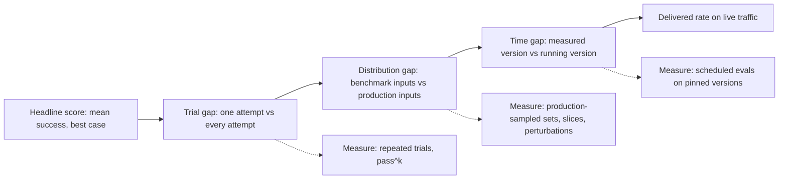
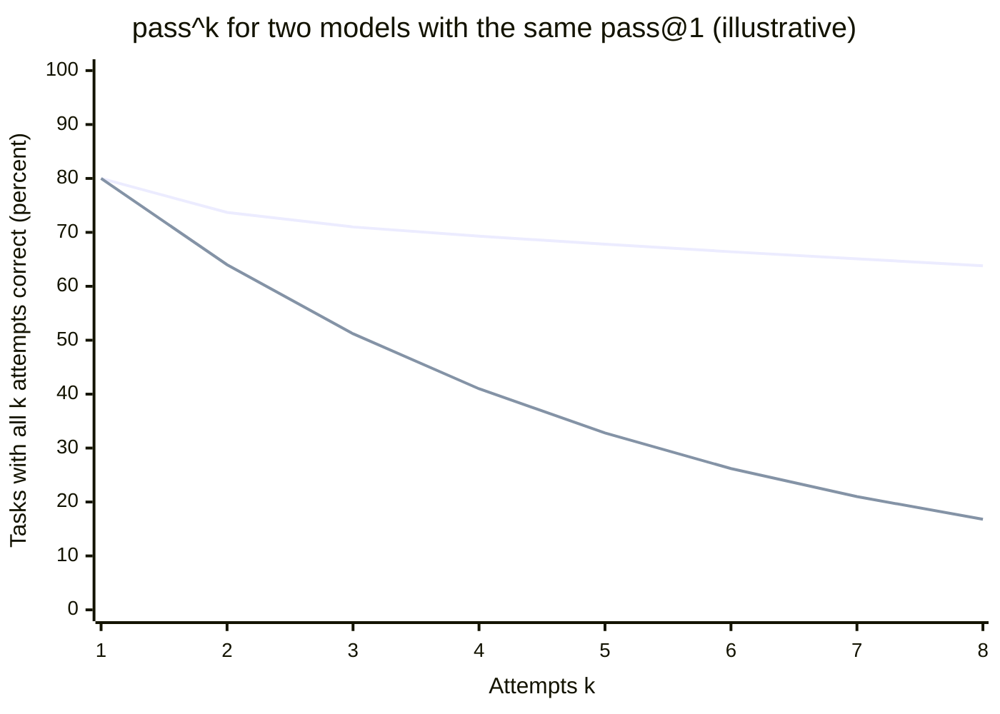
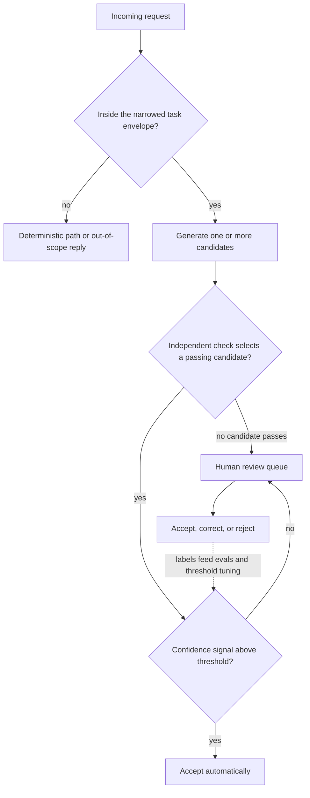
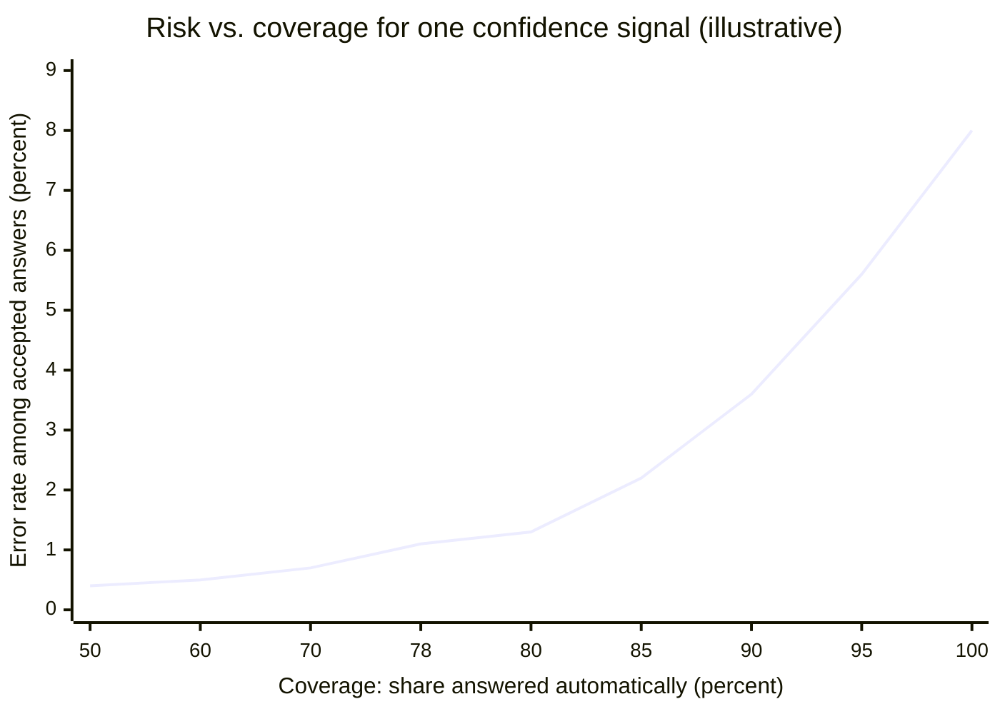
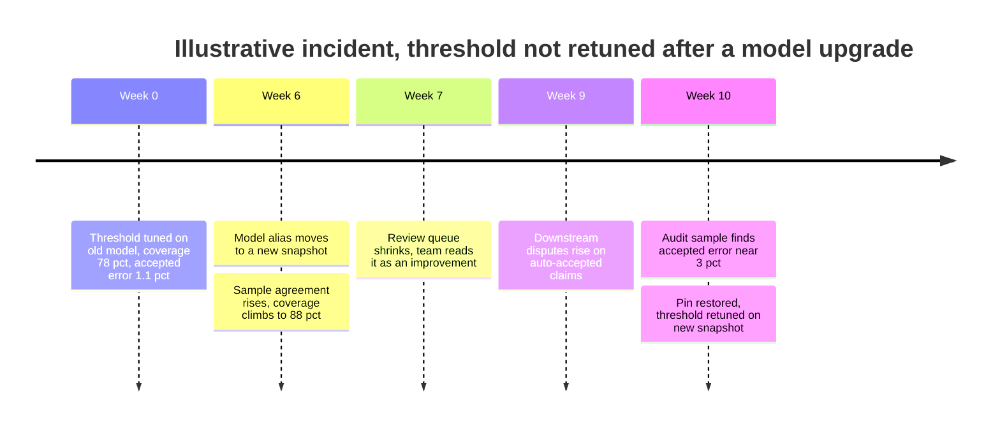

Capability is the probability that a model can produce an acceptable output for a task: on some attempt, for some phrasing, on the inputs someone chose to test. Reliability is the probability that the system produces an acceptable output every time the business depends on it, across the inputs users actually send, for as long as the system runs. The first is what benchmarks, leaderboards, and demos measure. The second is what a service level agreement (SLA), an auditor, or a customer experiences. ISO/IEC TS 5723:2022, whose definition the NIST AI Risk Management Framework (AI RMF) adopts, makes the distinction precise: reliability is the "ability of an item to perform as required, without failure, for a given time interval, under given conditions". Every qualifier in that sentence (as required, without failure, over time, under given conditions) is something a capability score leaves out.

The two numbers diverge for structural reasons, not because benchmarks are dishonest. A capability score averages success over tasks and often counts a task solved if any of several attempts succeeds. Production needs every attempt to succeed, on a different and wider input distribution, under a model version that changes over time. A model that solves 80% of a benchmark can deliver anything from 80% down to well under half of that rate on repeated production use, depending on how its failures are distributed.

The core trade-off is that reliability is bought from capability, never added to it. The four levers that close the gap all spend something: narrowing the task spends scope, verification spends latency and cost, abstention spends coverage (the share of requests the system answers on its own), and human review spends people. None of them raises the ceiling of what the model can do; each converts part of that ceiling into a dependable floor. The design question for any model-backed feature is how much of its capability must become reliability, and which of those four currencies the business can afford to spend.

Why a model's correctness is a rate, how per-step rates compose, and how a deterministic shell enforces hard constraints are covered in [Deterministic vs. Probabilistic Systems](/ai-systems-architecture/en/foundations/ai-component-model/deterministic-vs-probabilistic/). This page is about the distance between the rate someone measured and the rate the system delivers.

## Three Gaps Between a Capability Score and a Delivered Rate

A headline capability number, say "80% on a tool-use benchmark", passes through three filters before it becomes the rate a production user sees. Each filter has a different cause, a different measurement, and a different remedy.


*The path from a capability score to a delivered rate. Each gap has its own measurement; skipping one leaves that loss invisible until users report it.*

The order matters for diagnosis. The trial gap exists on the benchmark's own inputs and can be measured before any production data exists. The distribution gap needs production-like inputs, usually available only after a pilot. The time gap opens after launch, whenever the provider, the prompt, or the retrieval index changes.

### The Trial Gap: Best-of-k Is Not Every-Time

The `pass@k` metric, introduced with the HumanEval code benchmark by Chen et al. in 2021, counts a task as solved if at least one of k sampled attempts passes its unit tests. It is the right metric for its original purpose: a developer looking at several suggestions and keeping the one that works. It is the wrong metric for a system that acts on a single attempt, because it measures the probability that a good output exists, not the probability that the one you got is good.

The τ-bench benchmark (Yao, Shinn, Razavi, and Narasimhan, 2024) defined the complementary metric, `pass^k`: the probability that all k independent attempts at the same task succeed. It models what a customer-facing agent faces when the same kind of request arrives again and again. The paper reported that state-of-the-art function-calling agents, gpt-4o among them, succeeded on fewer than 50% of tasks, and were inconsistent enough that `pass^8` fell below 25% in the retail domain. Those numbers describe mid-2024 models and are now dated; the structural result is not. Whenever per-task success probability is below 1, `pass^k` decays with k, and it decays at a rate set by how failures are spread across tasks rather than by the average.

Both metrics come from the same per-task success probabilities. If task i succeeds on a single attempt with probability p_i, then `pass@1` is the mean of p_i, `pass@k` is the mean of one minus the probability that all k attempts fail, and `pass^k` is the mean of p_i raised to the power k. The average hides which tasks carry the failures, and that distribution decides everything downstream.

### Worked Example: Same Average, Opposite Architectures

Assume, for illustration, two candidate models evaluated on the same 400 tasks, each with eight trials per task. Both score 80% on single attempts. Model A is uniformly mediocre: every task succeeds 80% of the time. Model B is bimodal: on 75% of tasks it succeeds 98% of the time, and on the remaining 25% it succeeds only 26% of the time. Its average is 0.75 times 0.98 plus 0.25 times 0.26, which is also 0.80.

On `pass@4`, Model A looks far better: the chance that four attempts all fail on a task is 0.2 to the fourth, so `pass@4` is 99.8%. Model B reaches only 92.5%, because on its weak tasks four attempts still all fail about 30% of the time. On `pass^4`, the order reverses: Model A gives 0.8 to the fourth, 41.0%, while Model B gives 0.75 times 0.98 to the fourth plus 0.25 times 0.26 to the fourth, about 69.3%.


*Upper line: bimodal Model B. Lower line: uniform Model A. Both start at 80% single-attempt success; their consistency differs by a factor of almost four at k = 8.*

The chart does not say Model B is better. It says the two models need different architectures. Model A's failures are spread evenly and look independent across attempts, which is exactly the condition under which a verifier plus resampling works: if a check can recognize a good answer, a few draws reach a very high rate, which is what its 99.8% `pass@4` promises. Without a verifier, Model A is unusable for repeated unattended work. Model B's failures are concentrated on a quarter of the tasks, where resampling buys little, because those failures are correlated across draws, as [Deterministic vs. Probabilistic Systems](/ai-systems-architecture/en/foundations/ai-component-model/deterministic-vs-probabilistic/) shows with its correlated-error arithmetic. The remedy for Model B is to identify the weak task class and route it elsewhere: to abstention, to a human, or to a different model. A single headline score cannot tell a team which of these two systems it is building.

### The Distribution Gap: The Inputs You Did Not Test

A capability score is a rate on a fixed set of inputs. Production inputs differ in phrasing, formatting, language, length, noise, and the share of hard cases, and model performance is sensitive to differences a human would call irrelevant. Sclar, Choi, Tsvetkov, and Suhr (2023) measured accuracy differences of up to 76 points for LLaMA-2-13B across semantically equivalent few-shot prompt formats: separators, casing, and spacing, nothing about meaning. Mirzadeh et al. (2024) built GSM-Symbolic by templating grade-school math questions and found that all evaluated models lost accuracy when only the numbers in a question changed, and that adding one plausible but irrelevant clause reduced performance by up to 65% across state-of-the-art models. Newer models may be less sensitive than the ones tested; the size of the effect has to be measured for each model on its own inputs, not assumed away.

Benchmark contamination widens the gap from the other side. When benchmark items, or near copies of them, are in the training data, the score partly measures recall of seen items, and inputs the model never saw perform worse. Since a hosted model's training data cannot be audited, treat public benchmark scores as upper bounds for private tasks.

The distribution gap is closed only by measuring on production-shaped data: a golden set sampled from real traffic and maintained as traffic changes, described in [Designing and Maintaining Golden Datasets](/ai-systems-architecture/en/evaluation/measuring-quality/golden-datasets/), sliced by the segments that matter, and extended with perturbations (paraphrases, format variants, irrelevant additions) generated from real inputs.

### The Time Gap: Reliability Over an Interval

The ISO definition includes "for a given time interval" because reliability is a property of a period, not of an evaluation day. A rate measured in March describes the March model, prompt, and index. Provider updates behind aliases, serving changes, prompt edits, and index refreshes each change the function, as described in [Deterministic vs. Probabilistic Systems](/ai-systems-architecture/en/foundations/ai-component-model/deterministic-vs-probabilistic/). The time gap is managed by pinning versions and by running the same reliability measurement on a schedule, which [Quality Monitoring and Drift Detection](/ai-systems-architecture/en/llmops/observability/quality-drift/) develops.

Task length interacts with all three gaps. METR's 2025 study of software tasks (Kwa, West, et al.) measured the task length, in human working time, at which models succeed with a given probability. For Claude 3.7 Sonnet, the 50% time horizon was about 59 minutes but the 80% horizon only about 15 minutes, and across models the paper found 80% horizons roughly five times shorter than 50% horizons. The paper's own reading is that models that sometimes succeed on hard tasks still cannot reliably perform tasks of moderate length. For architecture, the corollary is that the unit of delegation must be sized to the reliability horizon, not the capability horizon: a task the model completes "sometimes" at one hour should be decomposed until each delegated piece sits where its success rate is acceptable.

## Measuring Reliability Instead of Capability

Reliability measurement differs from a capability eval in four ways: it repeats each task, uses production-shaped inputs, reports the worst relevant slice, and attaches a confidence interval. General eval methodology is in [Why Evals](/ai-systems-architecture/en/evaluation/testing-foundations/why-evals/) and [Metric Design](/ai-systems-architecture/en/evaluation/measuring-quality/metric-design/).

Repetition is what turns an eval from a capability measurement into a reliability measurement. Run n attempts per task, with n at least as large as the largest k you will report, count c successes per task, and compute the per-task estimate of `pass^k` without bias from the counts rather than by raising the mean to a power:

```text
for each task i with n attempts and c_i successes:
    pass_at_k_i  = 1 - C(n - c_i, k) / C(n, k)   # at least one of k succeeds
    pass_hat_k_i = C(c_i, k) / C(n, k)           # all k succeed
pass@k = mean(pass_at_k_i)     pass^k = mean(pass_hat_k_i)
# C(a, b) = binomial coefficient, 0 when b > a
# Report the distribution of c_i / n too: it shows A-type vs B-type failure
```

The histogram of per-task success rates is the most informative output of the run. A spike near 1 with a second cluster near 0 is Model B: identify the weak cluster and route it. A broad hump around the mean is Model A: invest in verification.

The second dimension is the slice. A mean over a golden set weights each segment by its share of the set, while the business usually cares about the worst segment that carries consequences: Turkish inputs in a bilingual product, scanned documents in an extraction pipeline, the high-value customer tier, the ticket category with legal exposure. Report the rate per slice, and set the release gate on the worst slice that matters, not on the average. The third dimension is perturbation: for each production input, generate a few variants that should not change the answer, and report the share of tasks where all variants agree with the reference. This is `pass^k` over phrasings instead of over samples, and it exposes the input sensitivity that repeated sampling of one phrasing hides.

Confidence intervals come last, and they are where small eval sets mislead. Repeated trials per task reduce the noise in each task's estimate, but not the uncertainty from having sampled only some tasks. With 400 tasks and a measured rate of 75%, a normal-approximation 95% interval is about plus or minus 4.2 points; distinguishing 75% from 78% needs well over a thousand tasks. A slice with 40 tasks has an interval near plus or minus 13 points and supports only coarse statements.

Measurement cost is rarely the obstacle teams expect. Assume, for illustration, 400 tasks at eight trials each, 3,200 calls of roughly 6,000 input and 800 output tokens, at illustrative prices of 3 and 15 dollars per million input and output tokens. Each call costs about 1.8 cents for input and 1.2 cents for output, so the full run costs about 96 dollars. That is negligible next to one production incident, and it is the reason to run reliability evals on every model, prompt, or index change rather than once before launch.

| Metric | Question it answers | Hides | When to prefer |
|---|---|---|---|
| `pass@1` (mean accuracy) | How often is one attempt right, on average? | Which tasks fail, consistency, slices | Comparing candidates quickly on the same set |
| `pass@k` | Does a good output exist among k attempts? | Whether you can pick it; cost of k attempts | A verifier or a human selects from k candidates |
| `pass^k` | Do k attempts at the same task all succeed? | Input variation across phrasings | Unattended repeated use: agents, automation, SLAs |
| Perturbation consistency | Does the answer survive irrelevant input changes? | Sampling variation within one phrasing | Open-ended user input, prompts that will be edited |
| Worst-slice rate | How bad is the worst segment that matters? | Overall average | Regulated, multilingual, or tiered-customer products |
| Accuracy at coverage | How accurate are the answers the system chose to give? | What happens to the abstained share | Systems with abstention or human escalation |

A production reliability report typically carries `pass^k` at the k that matches repeated use, the worst-slice rate, and, once abstention exists, accuracy at the operating coverage.

## Four Levers That Convert Capability Into Reliability

Narrowing shrinks the model's failure region, verification selects good outputs with an independent check, abstention declines inputs where failure is likely, and human review handles what remains. They compose in a fixed order, because each one hands the next a smaller and better-understood residue.


*The reliability envelope around a model-backed decision. Each diamond removes a class of likely failures before the next one runs.*

The scope check runs first because it is the cheapest and the most predictable: a classifier or a rule that rejects requests outside the envelope the evals covered keeps the distribution gap from opening at all. Verification runs before the confidence threshold because a hard check that fails is a certain signal, while a confidence score is a probabilistic one. The human queue receives two kinds of residue, outputs that failed checks and outputs that passed checks but scored low confidence, and the dotted edge is what keeps the whole envelope calibrated: every human decision is a labeled example for the next eval run and the next threshold adjustment.

### Narrowing the Task

The most reliable way to raise the delivered rate is to give the model a smaller decision. Extracting six fields from a known document type is more reliable than "process this document"; choosing one of twelve categories is more reliable than writing a free-text classification; one model step between deterministic stages is more reliable than an open agent loop that plans its own steps. Narrowing works because it removes failure modes rather than catching them: fewer output degrees of freedom, fewer steps to compound errors, and a smaller input space that an eval set can actually cover. The cost is scope: users get a feature that does less, and someone has to build the deterministic stages around it. The architectural spectrum from fixed workflows to autonomous agents, and when each end pays off, is covered in [Workflow vs. Agent: The Autonomy Spectrum](/ai-systems-architecture/en/agents/tools-and-protocols/autonomy-spectrum/).

### Verification: Making pass@k Reachable

A system can deliver its `pass@k` rate only if something can identify which of the k candidates is good. That is the precise role of verification in closing the gap. With a perfect verifier and independent errors, delivered reliability approaches `pass@k` at the cost of up to k generations; with no verifier, delivered reliability is `pass@1` no matter how many candidates are drawn. Between those extremes, the verifier's own error rates set the ceiling: a check that accepts 5% of bad outputs caps the improvement, and a check that rejects 10% of good ones raises cost and escalations.

Verifiers differ by how independent they are from the generator, and independence is what makes them work. Deterministic checks (schemas, checksums, recomputation, test execution, citation lookup) are fully independent, and the deterministic-shell pattern that applies them is described in [Deterministic vs. Probabilistic Systems](/ai-systems-architecture/en/foundations/ai-component-model/deterministic-vs-probabilistic/) and [Output Validation and Repair Loops](/ai-systems-architecture/en/reliability/output-reliability/output-validation/). Agreement across samples, the idea behind self-consistency (Wang et al., 2022), is a weak verifier for tasks with one correct answer: if five independent samples converge on the same extracted amount, it is more likely right than any single sample. It fails exactly where Model B fails, on inputs where the model is consistently wrong, because agreement then certifies the wrong answer. A second model used as a judge sits in between; its blind spots overlap with the generator's to an extent that has to be measured, as described in [LLM-as-Judge: Use, Bias, and Calibration](/ai-systems-architecture/en/evaluation/measuring-quality/llm-as-judge/).

### Abstention: Trading Coverage for Accuracy

Selective prediction, formalized for neural classifiers by Geifman and El-Yaniv (2017), gives a system the option to decline. Each output gets a confidence score; outputs above a threshold are answered automatically, the rest are deferred. Lowering coverage removes the least confident outputs first, so the error rate among accepted outputs, the risk, falls. The curve of risk against coverage is the instrument for choosing the operating point.


*An illustrative risk-coverage curve. At full coverage the system's error rate is the model's; giving up the least confident 22% cuts the accepted error rate from 8% to about 1.1%.*

Assume, for illustration, an insurance-claim triage feature with 92% single-attempt accuracy, 20,000 claims a day, and a business requirement of at most about 1% errors among automatically handled claims. The confidence signal is agreement: five samples per claim, accepted automatically when at least four agree. Suppose the evaluation shows this rule accepts 78% of claims with 1.1% errors among them, close to target. The cost appears on the other side of the curve. The remaining 22%, about 4,400 claims a day, go to human review. At an assumed two minutes per review, that is about 147 review hours a day, roughly 18 full-time reviewers at eight productive hours each, plus five generations per claim instead of one. The deferred share is also hard: about 7.1 points of the original 8% errors are concentrated in it, so the model is right on only about two thirds of deferred claims, and reviewers cannot treat its suggestion as a default.

The curve is only as good as the confidence signal ranking outputs correctly. A signal that does not separate right from wrong produces a flat curve: abstaining reduces coverage without reducing risk. Usable signals, roughly in decreasing order of reliability, are verifier outcomes, agreement across independent samples, a trained classifier on output features, token log-probabilities where the API exposes them, and, last, a confidence the model writes into its own output.

:::caution[A confidence the model writes is not a calibrated probability]
Asking a model to output "confidence: 0.92" produces text, generated the same way as every other token. Kadavath et al. (2022) found that large pretrained models can be reasonably calibrated in specific formats, while the GPT-4 Technical Report (OpenAI, 2023) showed calibration on a multiple-choice benchmark degrading after post-training. Treat any confidence signal as an uncalibrated score until a risk-coverage curve on your own labeled data shows that it ranks outputs, and recalibrate after every model or prompt change.
:::

### Human Review as Capacity, Not as a Guarantee

Human review is the lever of last resort, and it is a capacity resource with its own error rate. The review queue's size is the volume times one minus coverage, so every abstention threshold is also a staffing decision, as the worked example shows. Reviewers' accuracy depends on time per item and on how often the model is right on what they see: when most items in a queue are correct, reviewers drift toward approving by default, a pattern known as automation bias. A queue that is right 95% of the time trains its reviewers to stop checking. The design of approval gates and escalation paths is covered in [Human-in-the-Loop: Approval Gates and Escalation](/ai-systems-architecture/en/agents/reliable-execution/human-in-the-loop/); the part specific to closing the reliability gap is that reviewer accuracy must itself be measured, typically by seeding the queue with items whose correct answer is known.

| Lever | What it removes | Cost axis | Typical effect on delivered rate | When to prefer |
|---|---|---|---|---|
| Narrow the task | Failure regions, compounding steps, unevaluated inputs | Scope, engineering of deterministic stages | Largest and most durable | Rules or structure exist around the decision |
| Deterministic verification | Outputs that violate checkable properties | Latency, extra generations on failure | Near `pass@k` on checked properties | A cheap, independent check exists |
| Sample agreement | Random, uncorrelated errors | k times generation cost | Strong for Model A, weak for Model B | One correct answer, independent-looking errors |
| Abstention threshold | Low-confidence outputs | Coverage, review load | Set by the risk-coverage curve | A confidence signal that ranks outputs |
| Human review | Residual cases the other levers deferred | People, queue latency, reviewer error | Bounded by reviewer accuracy | Consequences justify staffing; volume is bounded |

The rows are in the order to reach for them. A design that starts with human review pays the highest price for a problem that narrowing would have shrunk.

## Failure Modes When Capability Is Mistaken for Reliability

Every dashboard built from capability metrics looks healthy while these failures happen. The demo-to-launch collapse is covered in [From Demo to Production: Why AI Prototypes Mislead](/ai-systems-architecture/en/foundations/failure-and-fit/demo-to-production/); the failures below happen after launch, inside systems designed to close the gap.

Silent coverage erosion is the most common. An abstention threshold is tuned once, against one model version. After a model or prompt change, the confidence signal's distribution shifts. If the new model is more confident, more outputs cross the threshold and the accepted error rate rises with no change in coverage alerts; if it is less confident, coverage falls and the review queue grows without any quality gain.


*A shift in the confidence signal raises coverage and hides an error-rate increase. Nothing in the timeline produces an error log.*

The decisive moment is week 7. Rising coverage looks like success, and the only contradicting signal, the error rate among accepted outputs, is not measured because accepted outputs receive no review by design. The defense is to audit a random sample of automatically accepted outputs every week, independent of their confidence, and to treat any model, prompt, or alias change as an event that requires re-running the risk-coverage evaluation before the threshold is trusted again.

| Failure | Trigger | Symptom | Detection | Mitigation and recovery |
|---|---|---|---|---|
| Sizing from `pass@k` | Benchmark or demo with best-of-k selection, no verifier in production | Delivered rate near `pass@1` or lower | `pass^k` and per-task success histogram before launch | Re-plan around verification or narrowing; do not launch on `pass@k` |
| Silent coverage erosion | Model or prompt change shifts confidence scores | Coverage changes, accepted error moves unseen | Weekly audit of a random sample of auto-accepted outputs | Re-run risk-coverage curve on every change; pin versions |
| Confidently wrong agreement | Correlated errors on a hard input class | High sample agreement on a wrong answer | Agreement-versus-correctness on labeled data, per slice | Route the class to review or a different path; add an independent check |
| Average hides a slice | One segment underrepresented in the eval set | Complaints concentrated in one language, tier, or format | Per-slice rates with confidence intervals | Gate releases on the worst slice that matters |
| Reviewer rubber-stamping | High model accuracy in the queue, time pressure | Review approval rate near 100%, errors pass review | Catch rate on seeded known-wrong items | Limit queue size, rotate reviewers, show evidence instead of the model's answer first |
| Over-length delegation | Task larger than the reliability horizon | Agent runs that succeed in demos, fail in volume | Success rate by task length or step count | Decompose into steps sized to an acceptable per-step rate |

:::tip[Audit what the system accepted, not only what it deferred]
Reviewed items generate labels automatically; accepted items generate none. Without a deliberate random audit of automatically accepted outputs, the most important number in an abstention design, the error rate among accepted answers, is never measured after launch. Budget for the audit from the start, sized so that its confidence interval can detect the error rate the business has said it cannot accept.
:::

### Security and Governance Implications

Reliability on natural traffic says nothing about reliability under adversarial input: an attacker picks inputs from the worst tail on purpose. Adversarial reliability is measured separately, through red teaming, as described in [Red Teaming and Jailbreak Testing](/ai-systems-architecture/en/security/defenses/red-teaming/). The levers on this page also create attack surface. An abstention path can be abused in both directions: inputs crafted to always defer turn the review queue into a denial-of-service target, and inputs crafted to raise the confidence signal, for example by inducing consistent agreement, push wrong outputs past the threshold. Defenses belong in the deterministic parts of the envelope, scope checks and independent verification, because those do not move when the input distribution is manipulated.

Governance frameworks ask for reliability in the ISO sense, not capability. The NIST AI RMF names "valid and reliable" as a trustworthiness characteristic. The EU AI Act's Article 15 requires high-risk AI systems to achieve an appropriate level of accuracy and robustness, to perform consistently throughout their lifecycle, and to declare their accuracy levels and the relevant metrics in their instructions for use. A declared accuracy that was measured as `pass@1` on a benchmark-like set is precisely the number that will not hold. As of November 2026, the Digital Omnibus amendment has reportedly moved the application of the high-risk obligations to 2 December 2027 for Annex III systems and 2 August 2028 for systems covered by Annex I; the full framework is in [International Frameworks](/ai-systems-architecture/en/governance/regulation/international-frameworks/), and the validation practice in [Model Risk Management for LLM Systems](/ai-systems-architecture/en/governance/risk-management/model-risk-management/).

:::caution[Declare the rate you measured, on the population you measured]
A reliability number without its population, its metric, and its model version is not a claim anyone can check. When a rate enters a contract, an SLA, or regulatory documentation, state the metric (`pass^k` at a given k, or accuracy at a given coverage), the evaluation set and its slices, the confidence interval, and the pinned versions. Anything less makes the next model change a silent breach.
:::

## Deciding How Much Reliability a Use Case Needs

The reliability target follows from the consequence of a single error and the volume of decisions, in the same way an availability target follows from the cost of downtime. The SLO and error-budget method from the Distributed Systems Handbook applies directly once the indicator is a quality rate instead of a success-response rate: set an objective on the accepted-output error rate, spend the budget on change, and freeze changes when it is exhausted, as described in [Error Budget: Balancing Innovation and Reliability](https://gorkemsari.github.io/distributed-systems/en/observability/slo-sla-error-budgets/error-budget/). The arithmetic of chaining components is the same multiplication described in [RPO, RTO, and Availability Math](https://gorkemsari.github.io/distributed-systems/en/resilience/multi-region-dr/availability-math-rpo-rto/), with one difference: model errors on the same input are correlated across attempts, so redundancy by repetition buys far less than redundancy across independent replicas does.

Accept capability-level performance when a person reviews every output as part of their normal work and a bad one costs a few seconds: drafting, autocomplete, search suggestions. Here `pass@k` is the right metric, because the user is the verifier.

Invest in measurement and verification when outputs are consumed without per-item review but errors are detectable and reversible: extraction into a system with downstream checks, classification that routes work, summaries that a reader can trace to sources. Measure `pass^k` and worst-slice rates, build the independent checks, and set an error budget on the accepted rate.

Require the full envelope, with narrowing, verification, abstention with an audited threshold, and staffed review, when errors are costly, hard to detect, or regulated: credit and claims decisions, actions that move money, medical or legal triage, anything an auditor will sample. Size the review queue from the risk-coverage curve before committing to launch, because a target that needs 40% abstention is a staffing plan, not a model feature.

Do not deploy the model on the decision when the required rate is above the lower confidence bound of the measured `pass^k` on the worst relevant slice, no independent check exists, and no confidence signal produces a curve that reaches the target at an affordable coverage. More prompting will not close that gap; a different design will, or the decision should stay deterministic, as worked through in [When AI Is the Wrong Solution](/ai-systems-architecture/en/foundations/failure-and-fit/when-not-to-use-ai/). Do not plan on the next model generation closing it either: a higher `pass@1` on a new model is a new measurement to make, not a reliability result to assume.

Several concepts are routinely confused with this page's subject. Provider availability, whether the API answers at all, is an infrastructure property covered in [LLM Provider Failure Modes](/ai-systems-architecture/en/reliability/provider-failures/provider-failure-modes/); a model can be fully available and unreliable. Determinism is about reproducing the same output, not producing a correct one, as [Determinism Control](/ai-systems-architecture/en/reliability/output-reliability/determinism/) explains. Hallucination is one failure class that lowers reliability, with its own mitigations in [Hallucination Mitigation](/ai-systems-architecture/en/reliability/output-reliability/hallucination-mitigation/). The classification of what goes wrong, as opposed to how often, is in [A Taxonomy of AI Failure Modes](/ai-systems-architecture/en/foundations/failure-and-fit/failure-mode-taxonomy/), and how to present residual uncertainty to users is in [Communicating Uncertainty and Sources](/ai-systems-architecture/en/product-integration/product-surface/uncertainty-sources/).

## Further Reading

- Mark Chen et al., *Evaluating Large Language Models Trained on Code*, arXiv:2107.03374, 2021.
- Shunyu Yao, Noah Shinn, Pedram Razavi, and Karthik Narasimhan, *τ-bench: A Benchmark for Tool-Agent-User Interaction in Real-World Domains*, ICLR, 2025.
- Thomas Kwa, Ben West, et al., *Measuring AI Ability to Complete Long Tasks*, METR, arXiv:2503.14499, 2025.
- Melanie Sclar, Yejin Choi, Yulia Tsvetkov, and Alane Suhr, *Quantifying Language Models' Sensitivity to Spurious Features in Prompt Design*, ICLR, 2024.
- Yonatan Geifman and Ran El-Yaniv, *Selective Classification for Deep Neural Networks*, Advances in Neural Information Processing Systems (NeurIPS), 2017.
- National Institute of Standards and Technology, *Artificial Intelligence Risk Management Framework (AI RMF 1.0)*, NIST AI 100-1, 2023.
