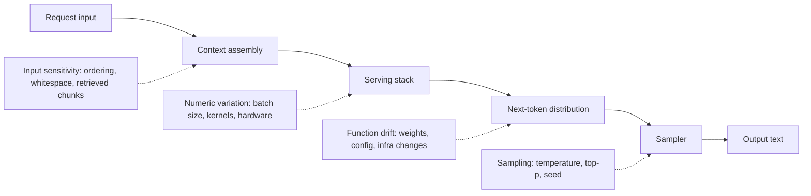
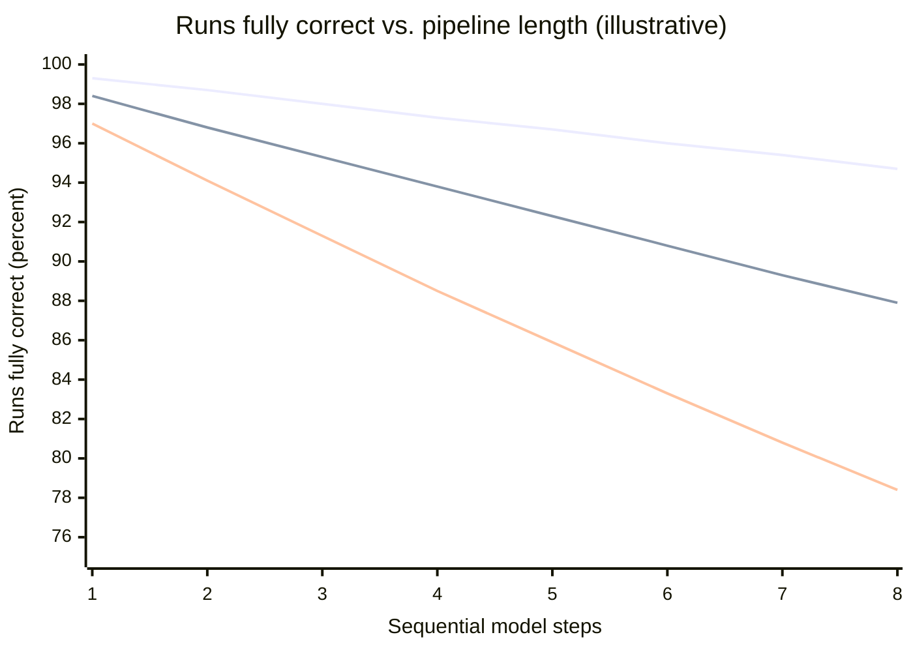
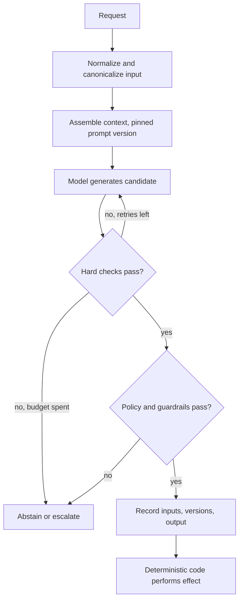
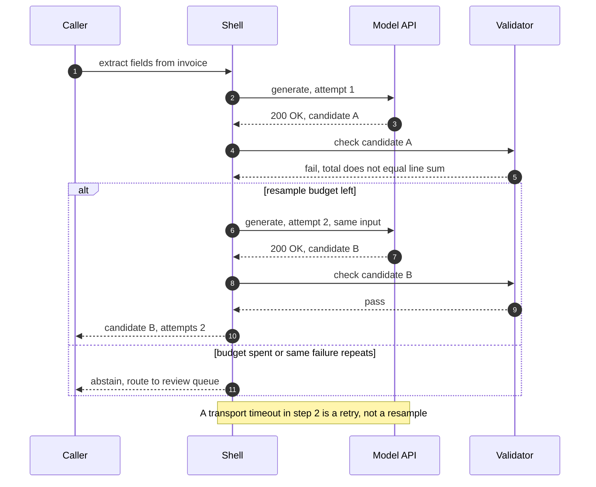
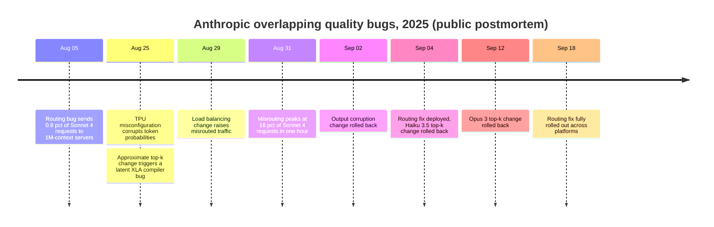

A deterministic component maps an input and its state to one output, and its correctness is a property of every individual call: if `transfer(a, b, 100)` is correct, it is correct each time it runs. A probabilistic component maps an input to a distribution over outputs and returns one draw from it. Its correctness is a property of the distribution, stated as a rate over a population of inputs: "the extracted IBAN matches the document in 98.7% of invoices from this supplier mix". A large language model (LLM) is the second kind, and so is every system that puts one on its request path, whatever the rest of the code looks like.

Most of the habits of backend engineering silently assume the first kind. A unit test asserts equality. A retry repeats the same computation and expects the same answer. A cache returns a stored result that is, by construction, the one a fresh call would produce. An error is an exception with a stack trace. A dependency that keeps its API keeps its behavior. Every one of these assumptions fails for a model, and most fail without raising anything: the system keeps returning well-formed responses while the fraction of wrong ones moves.

The core trade-off is capability against per-call guarantees. A model handles inputs no one enumerated, such as free-text complaints, scanned contracts, or questions about a codebase, which deterministic code cannot do at any price. In exchange, no individual output is guaranteed, and the architecture has to convert a per-call error rate into a system-level risk the business can accept. That conversion is paid for in latency (verification and retries), cost (extra calls), and complexity (validators, eval suites, version pinning, decision records), or avoided by narrowing what the model is allowed to decide. This page explains where the variation comes from, what a contract looks like when outputs are samples, how error rates compose, and which architectural mechanisms change as a result.

The Distributed Systems Handbook's [Deterministic vs. Probabilistic Failure Models](https://gorkemsari.github.io/distributed-systems/en/foundations/system-models/deterministic-vs-probabilistic/) is about how faults are modeled: a bound of `f` failures versus failure rates. Here the subject is the component's normal output. A model is probabilistic even when no hardware fails, because a correct model still returns wrong answers at some rate.

## Where the Variation Comes From

"The model is nondeterministic" bundles four separate mechanisms. They have different causes and different remedies, and confusing them leads to fixes that do not work, such as setting temperature to zero and expecting reproducible audits.


*Four sources of variation along one generation path. Only the last one is controlled by request parameters.*

Sampling variation is the intended one. At each step the model computes a probability distribution over the next token, and the sampler draws from it; temperature and nucleus (top-p) parameters reshape that distribution before the draw. The mechanics are covered in [Anatomy of an LLM as a System Component](/ai-systems-architecture/en/foundations/ai-component-model/llm-anatomy/), and the controls in [Determinism Control: Temperature, Seeds, and Caching](/ai-systems-architecture/en/reliability/output-reliability/determinism/). Greedy decoding, always taking the most probable token, removes this source in principle.

Numeric variation comes from the serving stack. Floating-point addition is not associative, so the result of a reduction depends on the order in which partial sums are combined. Inference kernels choose different reduction strategies depending on the batch size, and the batch a request lands in depends on what other traffic arrived at the same moment. A request's logits therefore depend on its neighbors. When two candidate tokens are nearly tied, a difference in the last bits flips the choice, and every later token is generated from a different prefix. Thinking Machines Lab demonstrated this in September 2025: 1,000 greedy completions of the same prompt on Qwen3-235B served with vLLM produced 80 distinct outputs, identical for the first 102 tokens and diverging afterwards. Their fix, batch-invariant kernels, made all 1,000 identical at a throughput cost, and vLLM has since shipped a batch-invariant mode as a beta feature (as of November 2026). Hosted APIs generally do not offer this guarantee; OpenAI's `seed` parameter, for example, is documented as best-effort, with a `system_fingerprint` field to reveal backend changes that break reproducibility.

Function drift is the model itself changing behind a stable name. Providers update weights behind aliases, change serving configuration, and ship infrastructure changes that alter outputs without any model change. Chen, Zaharia, and Zou measured large behavior differences between the March and June 2023 versions of the same named GPT-4 and GPT-3.5 endpoints on tasks such as code generation and math questions. Drift is the variation that most resembles a dependency upgrade, except that it arrives without a changelog entry in your repository.

Input sensitivity is not randomness at all. A model evaluated deterministically is still a function whose output can change discontinuously under input changes that look irrelevant to a human: the order of retrieved passages, a trailing space, a date in the system prompt, a different but equivalent phrasing of the question. This source matters most architecturally, because it survives every determinism fix. A perfectly reproducible model is reproducible only for byte-identical inputs, and production inputs are almost never byte-identical.

The consequence is a distinction that runs through the rest of this page. Reproducibility, getting the same output for the same bytes, is a debugging and testing property. Correctness, getting an acceptable output for the inputs users actually send, is a statistical property. Engineering effort spent on the first does not buy the second.

:::caution[Temperature zero is not a determinism guarantee]
Greedy decoding removes sampling variation and nothing else. Numeric variation from batching, provider-side drift, and input sensitivity remain. Some reasoning-model APIs also restrict or ignore sampling parameters; OpenAI's GPT-5 reasoning models, for example, have been reported to reject non-default temperature values since 2025. Do not design an audit, a test oracle, or a cache-consistency argument on the assumption that the same prompt at temperature zero returns the same text.
:::

## Contracts as Distributions: Hard Constraints and Measured Rates

A deterministic component's contract is a postcondition that holds on every call. A probabilistic component's contract splits into two layers that must be designed separately.

The hard layer contains properties that hold on every call because deterministic code enforces them. The output parses as JSON matching a schema; an enum field holds one of five values; a referenced document identifier exists in the retrieved set; an amount is within the customer's limit; the caller is authorized for the action. Some of these can be enforced during generation: constrained decoding masks tokens that would violate a grammar, so the output is guaranteed to be syntactically valid, as described in [Structured Output](/ai-systems-architecture/en/context-engineering/production-prompting/structured-output/). The rest are enforced after generation by validators. Either way, the guarantee comes from code, not from the model.

The soft layer contains everything about meaning: the extracted amount is the one on the invoice, the summary does not omit the cancellation clause, the chosen category is the right one. No mechanism enforces these per call. They are stated as a rate, on a defined input population, measured by an evaluation, with a threshold and a confidence: "category accuracy at least 95% on the 2,000-ticket golden set, lower bound of the 95% confidence interval". Without the input population the number means nothing, because the same model can be 99% accurate on clean invoices and 70% on handwritten ones.

```yaml
# Illustrative contract declaration for one model-backed component
component: invoice-extractor
hard:                      # enforced on every call; violation = rejected output
  schema: invoice_v3.json
  invariants: [total_equals_sum_of_lines, currency_in_iso4217, iban_checksum_valid]
soft:                      # measured, never enforced per call
  field_accuracy: { min: 0.97, eval_set: invoices-golden-2026q3, n: 1500 }
  abstain_rate:   { max: 0.05 }
pinned:
  model: provider-model-2026-08-snapshot   # never a moving alias
  prompt: invoice-extract@14
on_hard_violation: resample_once_then_queue_for_review
```

The format above is not a standard; it shows what a team has to write down somewhere. The hard section is executable. The soft section is a promise backed by an eval set, and it is only as valid as the match between that set and production traffic. The pinned section exists because the soft numbers were measured against one specific function, and a different model or prompt version is a different function whose rates are unknown until measured again. The abstention rate is part of the contract because a component that may say "I cannot determine this" turns some silent errors into explicit, routable outcomes.

The split also defines failure. Violating the hard layer is a detectable event, equivalent to an exception: the system knows the output is unusable. Violating the soft layer on one call is usually undetectable at that moment; it shows up only as a rate, in an eval run or in a sample of production outputs reviewed later. Architecture for probabilistic components is largely the work of moving checks from the soft layer into the hard layer wherever a deterministic check exists.

### Worked Example: How Per-Step Error Rates Compose

Assume, for illustration, a document-processing pipeline with five sequential model steps: classify the document, extract fields, normalize them, match them to a customer record, and draft a response. Each step produces an acceptable output 97% of the time on the target population, and a run is correct only if all five steps are.

If errors were independent, the end-to-end rate would be 0.97 to the fifth power, or 85.9%. One run in seven contains at least one wrong step, although every component "works 97% of the time". The same arithmetic at 99% per step gives 95.1%. Long chains of individually good model steps produce mediocre systems, and the effect grows with every step an agent adds.

Now add a deterministic validator after each step that detects 80% of that step's errors (schema violations, checksum failures, a customer match whose name does not appear in the document), and one resample when it fires. Per step, 3% of outputs are wrong; 0.6% pass the validator undetected, and 2.4% are caught and resampled. If the resample is an independent draw, it is wrong 3% of the time, and the validator again catches 80% of those, sending them to a human queue. Silent errors per step are 0.6% plus 0.2 times 0.072%, about 0.61%, and the step succeeds 99.33% of the time. Five steps give 96.7% fully correct runs, about 3.0% of runs with a silent error, and about 0.3% escalated. The expected cost is 1.024 generations per step plus validation.


*From top: 97% steps with validation and one independent resample; the same with correlated failures; 97% steps with no validation. All three series use the illustrative rates from the text.*

The independence assumption is the weak point, and the middle line shows why. Model errors are not coin flips; they cluster on hard inputs, such as a blurred scan or an ambiguous ticket, where every draw from the distribution is likely to be wrong. Assume half of the 3% errors come from such inputs, where a resample fails 80% of the time, and the other half are random, where a resample fails 3% of the time. Retried outputs are now wrong about 41.5% of the time instead of 3%. The step succeeds 98.4% of the time, five steps give 92.3%, silent errors rise to 3.9% of runs, and escalations rise from 0.3% to 3.9%. The resample bought much less than the independent model predicted, while the validator still did most of the work.

Two conclusions carry over to real systems whatever the actual rates are. The validator's detection rate bounds the silent error rate, because a resample only runs after something detected an error. And resampling helps only the random part of the error; the correlated part has to be handled by a different path, such as a stronger model, a different prompt, extra context, or a human. Measuring which part dominates, by resampling known failures offline and counting how often the second draw is right, is cheap and should precede any decision to rely on retries.

## A Deterministic Shell Around a Probabilistic Core

The shape that follows from the contract split is a deterministic shell: code that prepares the model's input, constrains what it may produce, checks what it did produce, and alone performs any effect. The model proposes; the shell decides what is accepted.


*The shell around one model call. Every guarantee the system offers is produced by a rectangle or diamond that is not the model.*

Each stage of the shell exists to handle one of the variation sources. Normalization addresses input sensitivity: sorting retrieved passages by a stable key, stripping irrelevant whitespace, fixing date formats, and removing per-request noise such as request IDs from the prompt make semantically equal inputs byte-equal more often. That improves consistency between users and is the precondition for any useful cache. Pinning the prompt and model versions addresses drift by making the function explicit. The hard checks convert as many soft properties as possible into enforced ones, and the resample loop spends extra generations only on detected failures. The policy stage applies the checks described in [Policy and Quality Guardrails](/ai-systems-architecture/en/reliability/output-reliability/guardrails/). Recording happens before the effect so that the evidence of what was decided exists even if the effect fails.

The correctness argument rests on an asymmetry between generating and checking. For many tasks, verifying an output is far cheaper and more reliable than producing it: a SQL query can be parsed and run against a read replica, code can be compiled and tested, a citation can be looked up in the retrieved set, an extracted total can be recomputed from extracted line items, an IBAN has a checksum. Where such a check exists, the shell turns "possibly wrong" into "valid or rejected" for the checked property, and the model's error rate on that property becomes a cost (more resamples) rather than a risk. Where no cheap check exists, as with the faithfulness of a summary or the tone of a reply, the property stays in the soft layer, and the remaining options are to measure it statistically, have a human review it, or narrow the task until a check exists. [Capability vs. Reliability](/ai-systems-architecture/en/foundations/ai-component-model/capability-vs-reliability/) treats that choice in depth.

The effect boundary is the most important line in the diagram. The model never performs an action; it emits a proposal that deterministic code validates against authorization rules and executes with idempotency protection, as covered in [Tool Call Idempotency, Retry, and Compensation](/ai-systems-architecture/en/agents/reliable-execution/idempotency-compensation/). This is what keeps a probabilistic error, or a prompt injection that shifts the output distribution on purpose, from becoming an irreversible one.

:::tip[Decide once, then pass the decision along]
If two parts of a system call the model on the same input, such as a frontend that classifies a ticket to show a hint and a backend that classifies it again to route it, they will sometimes disagree, and the user sees a system that contradicts itself. Make one call, store the result with its identifier, and let every consumer read it. Consistency between components is a data-flow property you can guarantee; consistency between two samples is not.
:::

### Retries Become Resampling

In a deterministic system, a retry repeats the same computation and is useful only against transient faults: timeouts, dropped connections, an overloaded dependency. The mechanics of doing that safely are in the Distributed Systems Handbook's [Retry with Exponential Backoff and Jitter](https://gorkemsari.github.io/distributed-systems/en/resilience/protection-patterns/retry-exponential-backoff/). A model call has those transient faults too, and they are handled the same way. But a model call can also return successfully with a wrong or invalid answer, and repeating it then means drawing again from the distribution, which is a different operation with different properties.


*A resample loop. The provider reports success in steps 3 and 7; only the validator knows that step 3 produced an unusable answer.*

The sequence shows why resampling needs its own policy separate from transport retries. The trigger in step 5 is a validation failure, which no HTTP client or gateway can see, so the loop lives in the shell, not in infrastructure. Its budget must be small, because the correlated-failure arithmetic above shows that most of the benefit comes from the first resample. Each attempt is billed in full, so a resample loop running on every request during a model regression multiplies cost exactly when quality is lowest. And step 7 returning a different answer than step 3 is the point: if the shell runs greedy decoding on a provider that is reproducible at that moment, the resample returns candidate A again, and the loop burns its budget for nothing. Some teams change the input slightly on resample, for example by appending the validator's error message, which turns blind resampling into a repair loop; that technique is covered in [Output Validation and Repair Loops](/ai-systems-architecture/en/reliability/output-reliability/output-validation/).

### Caching, Versioning, Testing, and Monitoring

Caching changes meaning. A cache in front of a deterministic function is semantically transparent: a hit returns what a miss would have computed, and the only concerns are staleness and invalidation, as discussed in [Cache Strategies](https://gorkemsari.github.io/distributed-systems/en/data-management/distributed-caching/cache-strategies/). A cache in front of a model freezes one sample. Every later hit serves that draw, including when it was one of the wrong ones, and the error is now served at the hit rate instead of the model's error rate. The frozen sample also hides drift: a cache populated before a model change keeps serving the old function's outputs while new misses come from the new one. Caching model outputs is still useful, for cost and for consistency between users, but it is a decision to serve a chosen sample, and caches should be keyed on the pinned model and prompt versions and invalidated when either changes. [Semantic Caching](/ai-systems-architecture/en/platform/ai-gateway/semantic-caching/) adds a second probabilistic step, a similarity match on the key. [Prompt Caching](/ai-systems-architecture/en/context-engineering/production-prompting/prompt-caching/) is different again: it reuses the computation of a prompt prefix inside the provider and does not freeze outputs.

Versioning changes scope. A library dependency that keeps its API and passes its tests is, for practical purposes, the same dependency. A model behind an unchanged API can behave differently in ways no contract test detects, because the contract that matters is the soft layer. The model identifier, the prompt version, the sampling parameters, and the retrieval configuration together define the function, and a change to any of them is a change to production behavior that needs an eval before rollout. That process is described in [Model Versioning, Deprecation, and Migration](/ai-systems-architecture/en/model-strategy/lifecycle-and-adaptation/versioning-migration/).

Testing splits in two. Code around the model is still deterministic and is tested with ordinary tests against recorded or mocked model responses, described in [The Deterministic Test Layer](/ai-systems-architecture/en/evaluation/testing-foundations/deterministic-tests/). The model-backed behavior is tested statistically: run a dataset, compute a rate, and compare it to a threshold with a confidence interval. An equality assertion on generated text produces a flaky test, and flaky tests get disabled. [Why Evals](/ai-systems-architecture/en/evaluation/testing-foundations/why-evals/) develops the statistical side.

Monitoring changes signal. A deterministic service signals failure through errors, latencies, and saturation, and its service level indicators (SLIs) are mostly counts of failed requests, as described in [Service Level Indicators](https://gorkemsari.github.io/distributed-systems/en/observability/slo-sla-error-budgets/sli/). A model-backed service can be fully healthy on all of those while its outputs get worse. Quality needs its own indicators, sampled and scored from production outputs: validator rejection rate, resample rate, abstention rate, user correction rate, and eval scores on sampled traffic. [Quality Monitoring and Drift Detection](/ai-systems-architecture/en/llmops/observability/quality-drift/) covers how to build them.

| Concern | Deterministic component | Probabilistic component | When the deterministic habit still applies |
|---|---|---|---|
| Unit of correctness | Each call | A rate over an input population | Hard-layer properties enforced by code |
| Test oracle | Equality assertion | Dataset, metric, threshold, confidence | Code around the model, with recorded responses |
| Retry | Repeats the computation | Draws a new sample | Transport faults: timeouts, 429, 5xx |
| Cache hit | Equals a fresh result | Serves one frozen sample | Outputs that passed hard checks and are keyed on versions |
| Dependency upgrade | API compatibility suffices | Behavior can change under a stable API | Never for the model; still for SDKs and clients |
| Failure signal | Exception, status code | Wrong but well-formed output | Hard-check violations and provider errors |
| Debugging | Re-run to reproduce | Read the recorded inputs and output | Only with batch-invariant self-hosted serving |

## Failure Modes Specific to Probabilistic Components

The failures below rarely produce an error log. Each one needs a signal that someone looks at, because nothing will page on its own.

The clearest public example of silent degradation in a probabilistic component is Anthropic's postmortem of three overlapping infrastructure bugs in August and September 2025. None changed the model weights; all three changed the output distribution for a fraction of traffic.


*Six weeks from the first bug to the last fix, as described in Anthropic's postmortem. Dates are from the postmortem; symptoms varied by platform and model.*

The postmortem's account of why detection was slow is the part to learn from. The provider's evaluations did not capture the degradation, partly because the model often recovered from isolated wrong tokens. Each bug produced different symptoms on different platforms at different rates, so user reports looked contradictory. Privacy controls limited engineers' access to the affected conversations. The remediation list reads as a description of probabilistic-system operations: run quality evaluations continuously on production systems rather than only before deployment, add checks for specific symptoms such as unexpected scripts in output, and build tooling to examine user feedback without breaking privacy. For a team consuming a hosted model, the lesson is that the provider's evaluation is not yours; your own quality signals on your own traffic are the only detector that covers your use case.

| Failure | Trigger | Symptom | Detection | Mitigation and recovery |
|---|---|---|---|---|
| Silent distribution shift | Provider update, serving change, alias moved | Well-formed but worse outputs, rising complaints | Scheduled eval on pinned set; quality SLIs on sampled traffic; `system_fingerprint` or model ID change | Pin snapshots; canary new versions; roll back the pin |
| Correlated retry amplification | Hard inputs or a regression make every draw fail | Resample rate and cost climb, quality does not recover | Resample rate per route; second-draw success rate | Cap resamples at one or two; route repeated failures to a different path |
| Frozen wrong answer | Cache stores a sample that was wrong | Same wrong answer for every user with that input | Corrections clustered on one cache key | Cache only outputs that passed hard checks; version-keyed invalidation |
| Self-contradiction | Two components sample the same decision | UI and backend disagree | Disagreement rate between consumers of the same input | Decide once, store, propagate |
| Flaky test suite | Equality assertions on generated text | Tests fail randomly, then get disabled | Test pass rate below 100% on unchanged code | Mock the model in unit tests; move semantic checks into evals |
| Irreproducible incident | Debugging relies on re-running a prompt | Re-run looks fine, incident cannot be explained | Incidents closed as "could not reproduce" | Record full inputs, versions, parameters, and output at decision time |

The irreproducible incident deserves its own note. When an operator re-runs the prompt from a complaint and gets a good answer, that proves nothing about what the user saw: a different batch, a later model revision, or a slightly different context produced a different draw. The only reliable evidence of what the system did is what it recorded at the time it did it. The span model and fields for that record are described in [LLM Observability Fundamentals](/ai-systems-architecture/en/llmops/observability/llm-observability/), and the privacy constraints on storing prompts in [Prompt and Response Logging Under Privacy Constraints](/ai-systems-architecture/en/llmops/observability/logging-privacy/).

:::danger[A re-run is not an audit trail]
In a regulated decision, such as a credit pre-screen or a suspicious-transaction flag, an auditor asking "why was this customer declined" cannot be answered by running the model again. The answer may differ from the one that drove the decision, which silently replaces the evidence. Persist the exact context, the pinned versions, the parameters, the raw output, and the checks it passed, at decision time and in tamper-evident storage.
:::

### Security and Governance Implications

A probabilistic component changes two things about security reasoning. First, there is no proof of absence for bad behavior: a deterministic parser either accepts a malicious input or it does not, while a model may follow an injected instruction in one draw and ignore it in the next, so a red-team pass that found nothing establishes a rate on the tested inputs, not a guarantee. Defenses therefore belong in the deterministic shell, in authorization at the effect boundary and in limiting what a compromised output can reach, as covered in [Prompt Injection](/ai-systems-architecture/en/security/threats/prompt-injection/). Second, governance frameworks that expect explainable, reproducible decisions have to be met through recording and statistical validation rather than re-execution. Model risk management for a probabilistic component means validating the measured rates on representative data and monitoring them, which is the subject of [Model Risk Management for LLM Systems](/ai-systems-architecture/en/governance/risk-management/model-risk-management/) and [Explainability and Auditability](/ai-systems-architecture/en/governance/regulation/explainability-auditability/).

## Deciding Where the Probabilistic Boundary Goes

The useful architectural question is not whether a system uses a model but which decisions are delegated to one, and how much of each decision the deterministic shell can check.

Put a model on the path when the input space is open-ended and the task cannot be specified as rules at acceptable cost: free text, unstructured documents, natural-language queries, and code. Put it there when an error is either cheap (a suggestion a user can ignore), detectable by a deterministic check (an extraction with checksums and totals), or caught by a human before it has effect (a draft that someone approves). Under those conditions the per-call error rate becomes a cost or a review load, both of which can be measured and budgeted.

Keep a decision deterministic when the rules are known and stable, when the inputs are already structured, when the same input must always yield the same outcome for legal or fairness reasons, or when an error is irreversible and no check can catch it before it takes effect. Computing interest, applying a published fee table, checking a sanctions list match on exact identifiers, and enforcing an authorization policy are all in this category. A model may still assist around them, for example by extracting the inputs to a deterministic rule, but the rule itself stays in code. [When AI Is the Wrong Solution](/ai-systems-architecture/en/foundations/failure-and-fit/when-not-to-use-ai/) turns these conditions into a decision procedure.

Between the two extremes, move the boundary by moving checks. Every property that can be turned into a validator moves from the soft layer to the hard layer and shrinks the part of the decision that is genuinely probabilistic. Every model call that can be removed from a chain improves the end-to-end rate multiplicatively, which is why a workflow with one or two model steps between deterministic stages often outperforms an open agent loop with a stronger model on the same task; the trade-offs of that choice are covered in [Workflow vs. Agent: The Autonomy Spectrum](/ai-systems-architecture/en/agents/tools-and-protocols/autonomy-spectrum/).

Do not chase bit-level determinism as a substitute for this work. Batch-invariant serving is worth enabling when you self-host and need reproducible evals, regression replays, or reinforcement learning runs, and its throughput cost is acceptable. It does not make outputs correct, it does not survive a model or prompt change, and it does nothing about input sensitivity, which is where most production variation between users comes from.

The concepts most often confused with this page's topic are covered elsewhere: the mechanics of sampling in [Anatomy of an LLM as a System Component](/ai-systems-architecture/en/foundations/ai-component-model/llm-anatomy/), the specific determinism controls in [Determinism Control](/ai-systems-architecture/en/reliability/output-reliability/determinism/), the classification of what goes wrong in [A Taxonomy of AI Failure Modes](/ai-systems-architecture/en/foundations/failure-and-fit/failure-mode-taxonomy/), and probabilistic fault models in the Distributed Systems Handbook page linked at the top.

## Further Reading

- Horace He and Thinking Machines Lab, *Defeating Nondeterminism in LLM Inference*, Thinking Machines Lab: Connectionism, 2025.
- Anthropic, *A Postmortem of Three Recent Issues*, Anthropic Engineering, 2025.
- Lingjiao Chen, Matei Zaharia, and James Zou, *How Is ChatGPT's Behavior Changing over Time?*, Harvard Data Science Review, 2024.
- D. Sculley et al., *Hidden Technical Debt in Machine Learning Systems*, Advances in Neural Information Processing Systems (NeurIPS), 2015.
- OpenAI, *Reproducible Outputs with the Seed Parameter*, OpenAI Cookbook.
