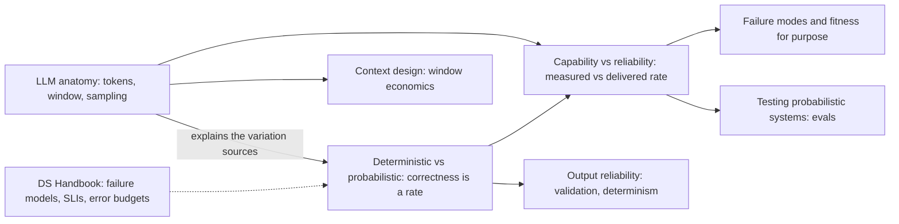
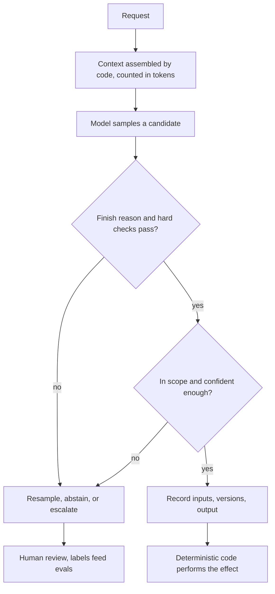

Every architectural decision about an AI system depends on what kind of component the model is, and the usual answer, "an API that takes a prompt and returns text", leaves out the three properties that matter. The component's correctness is a rate over a population of inputs, never a property of one call. Its only input is a bounded sequence of tokens that the caller rebuilds on every request, with no memory and no privilege separation inside it. And the rate someone measured for it, on a benchmark, in a demo, or on last quarter's model version, is not the rate it delivers on live traffic. This chapter defines the component along those three lines so that the rest of the handbook can build on a shared model of it.

The tension that runs through all three topics is capability against guarantees. A model handles open-ended inputs that no deterministic code can, and it pays for that by giving up per-call correctness, reproducibility, and the error signals backend engineers rely on: a model-backed service fails by returning HTTP 200 with a well-formed wrong answer. Each page in the chapter shows one side of how architecture recovers guarantees without giving up the capability: by enforcing in code what can be checked, by treating the context window as a designed and budgeted artifact, and by converting a measured capability into a delivered reliability through narrowing, verification, abstention, and review.

The chapter is deliberately about the component, not about any particular model. Model names, prices, and window sizes appear in the topic pages as dated examples; the properties defined here hold for the LLMs in production use as of November 2026 and are what the later chapters assume.

## How the Three Topics Build on Each Other

The topics form a short chain plus one cross-link. The first defines the vocabulary, the second supplies the mechanism behind it, and the third turns both into a design method.

*Dependencies inside the chapter and its main exits. Solid edges mean "uses the concepts of"; the dotted edge marks assumed knowledge from the companion handbook.*

Read the diagram from the middle. The probabilistic contract is the idea the other two pages lean on: the anatomy page explains where the distribution of outputs physically comes from, and the reliability page assumes that correctness is already understood as a rate. The anatomy page also has its own exit into context design, because the token and window arithmetic it introduces is what every budgeting decision in that chapter starts from. The reliability page exits into the next chapter, which classifies what goes wrong and decides when a model should not be used at all, and into evaluation, which owns the measurement methods the reliability page only frames.

## The Topics

[Deterministic vs. Probabilistic Systems: What Changes for Architecture](/ai-systems-architecture/en/foundations/ai-component-model/deterministic-vs-probabilistic/) answers what happens to backend engineering habits when a component returns a draw from a distribution instead of a computed result. It separates the four sources of output variation, splits a component's contract into a hard layer that code enforces on every call and a soft layer that is only ever measured as a rate, and shows how retries, caches, tests, versioning, and monitoring each change meaning as a result. It matters because most silent production failures in AI systems come from a deterministic assumption applied to a probabilistic part, such as a cache that freezes a wrong sample or an audit that relies on re-running a prompt.

[Anatomy of an LLM as a System Component: Tokens, Context, Sampling](/ai-systems-architecture/en/foundations/ai-component-model/llm-anatomy/) answers what actually happens inside one API call, at the level an architect needs. Tokens are the unit of every price, limit, and latency, and their count depends on the tokenizer and the language; the context window is the whole input, rebuilt and re-billed on every call; the sampling loop and its finish reason decide what text the caller receives and whether that text is complete. It matters because the numbers behind capacity, cost, and quota planning, and a class of failures such as truncated outputs and instructions trimmed out of long sessions, follow directly from this mechanism.

[Capability vs. Reliability: Closing the Production Gap](/ai-systems-architecture/en/foundations/ai-component-model/capability-vs-reliability/) answers why a model that scores well on a benchmark or in a demo delivers less in production, and what it costs to close the difference. It names three gaps between a capability score and a delivered rate (repeated trials, input distribution, and time), shows how to measure reliability instead of capability, and orders the four levers that convert one into the other by cost. It matters because a feature sized on a capability number is sized on the wrong number, and the error usually surfaces only after launch.

| Topic | Question it answers | Open it when |
|---|---|---|
| Deterministic vs. Probabilistic Systems | What changes when correctness is a rate rather than a per-call property? | Designing contracts, retries, caches, or tests around a model; explaining an incident that "could not be reproduced" |
| Anatomy of an LLM | What does one call consume, compute, and return, token by token? | Estimating cost or capacity; debugging truncation, context overflow, or tokenizer-driven cost jumps |
| Capability vs. Reliability | How far is the measured rate from the delivered rate, and what closes the gap? | Sizing a feature from a benchmark or pilot; setting release gates, abstention thresholds, or review staffing |

## Ideas That Run Through the Chapter

Several rules recur across the three pages, each stated in full where it originates and applied in the others. They are worth holding together, because together they describe the shape of a model-backed decision that the rest of the handbook refines.

*One model-backed decision as the chapter describes it. The anatomy page owns the first three boxes, the probabilistic contract owns the hard checks, recording, and effect boundary, and the reliability page owns scope, confidence, and review.*

The diagram makes the first recurring rule visible: every guarantee the system offers comes from a box that is not the model. Schemas, checksums, authorization, the finish-reason gate, and the record written before the effect are deterministic and hold on every call; the model's contribution is a candidate whose quality is known only statistically. The second rule is that success responses carry no quality signal. Every failure in the chapter's failure tables, from silent truncation to drift behind a model alias to an abstention threshold that stopped meaning anything, arrives as a normal response, so detection depends on indicators someone deliberately built: finish-reason shares, validator rejection rates, audited samples of accepted outputs, and scheduled evals on pinned versions.

The third rule is that a number about a model is meaningless without its population, its metric, and its version. An accuracy measured on clean English invoices says nothing about scanned Turkish ones; a token budget measured with one tokenizer is wrong after a migration; a rate measured as best-of-k says nothing about single unattended attempts. The fourth is that the context window is the unit of both capability and risk: the model can use only what is in it, everything in it can steer the output with no privilege boundary, and it is the exact record an auditor needs to explain an output later. These rules are why later chapters keep returning to pinned versions, recorded contexts, and evals on production-shaped data.

## Suggested Reading Order

Read the three pages in sidebar order. The probabilistic contract comes first because it introduces the vocabulary the other two use without redefining: the hard and soft layers, the deterministic shell, error-rate composition, and resampling as distinct from retrying. The anatomy page comes second because it grounds that vocabulary in the mechanism, and its worked examples on token growth and sampling probabilities make the abstractions concrete. The reliability page comes last because it depends on both: its `pass^k` arithmetic assumes rates, and its levers assume the shell and the window.

Two shortcuts are reasonable. A reader new to how LLMs work at the request level can start with the anatomy page and then read the other two in order; nothing in it depends on the first page's terminology. A reader who arrives with a concrete problem should go straight to the page that owns it: a cost or truncation question to the anatomy page, a flaky test or irreproducible incident to the probabilistic contract, and a launch decision based on a pilot score to the reliability page, following its links backward only where needed.

## Prerequisites and Where the Chapter Leads

The chapter assumes the distributed-systems background the whole handbook assumes, and three companion pages are worth having in mind before starting. [Deterministic vs. Probabilistic Failure Models](https://gorkemsari.github.io/distributed-systems/en/foundations/system-models/deterministic-vs-probabilistic/) covers how faults are modeled as rates, which is a different question from this chapter's, where a correct component still returns wrong outputs at some rate. [Service Level Indicators](https://gorkemsari.github.io/distributed-systems/en/observability/slo-sla-error-budgets/sli/) and [Error Budget](https://gorkemsari.github.io/distributed-systems/en/observability/slo-sla-error-budgets/error-budget/) supply the method the reliability page reuses once the indicator is a quality rate instead of a success-response rate.

The direct continuation is [Failure Modes and Fitness for Purpose](/ai-systems-architecture/en/foundations/failure-and-fit/), which classifies what goes wrong in model-backed systems and turns this chapter's conditions into a decision on whether a model belongs on a given decision at all. From there the component model is applied in four places. [Context Design](/ai-systems-architecture/en/context-engineering/context-design/) builds on the window and token arithmetic, starting with [Context Window Economics](/ai-systems-architecture/en/context-engineering/context-design/context-window-economics/). [Output Reliability](/ai-systems-architecture/en/reliability/output-reliability/) builds the deterministic shell in detail, including [Output Validation and Repair Loops](/ai-systems-architecture/en/reliability/output-reliability/output-validation/) and [Determinism Control](/ai-systems-architecture/en/reliability/output-reliability/determinism/). [Testing Probabilistic Systems](/ai-systems-architecture/en/evaluation/testing-foundations/) owns the statistical measurement the reliability page frames, beginning with [Why Evals](/ai-systems-architecture/en/evaluation/testing-foundations/why-evals/). And [Quality Monitoring and Drift Detection](/ai-systems-architecture/en/llmops/observability/quality-drift/) covers the time gap after launch, where the provider, the prompt, or the index changes underneath a running system.
