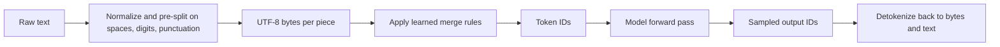
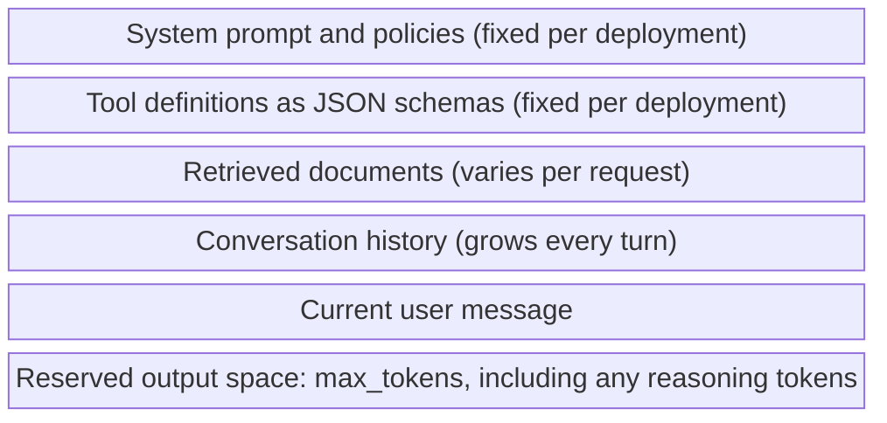
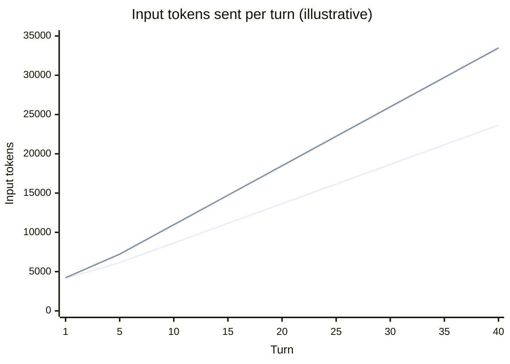
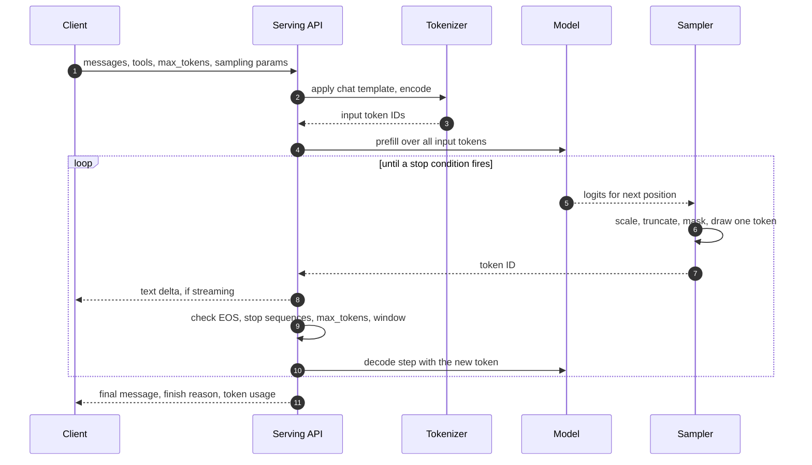
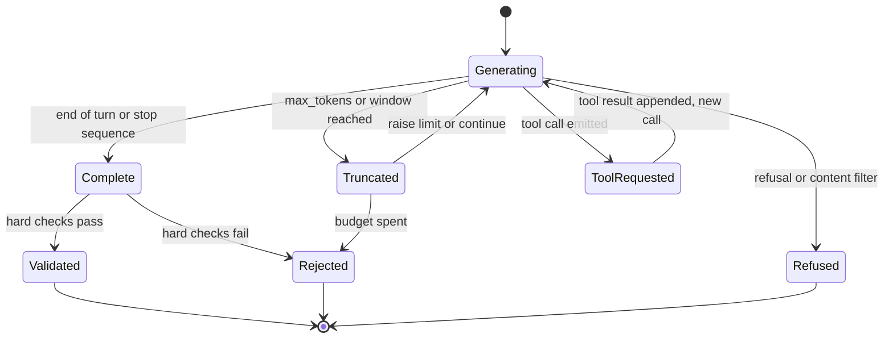
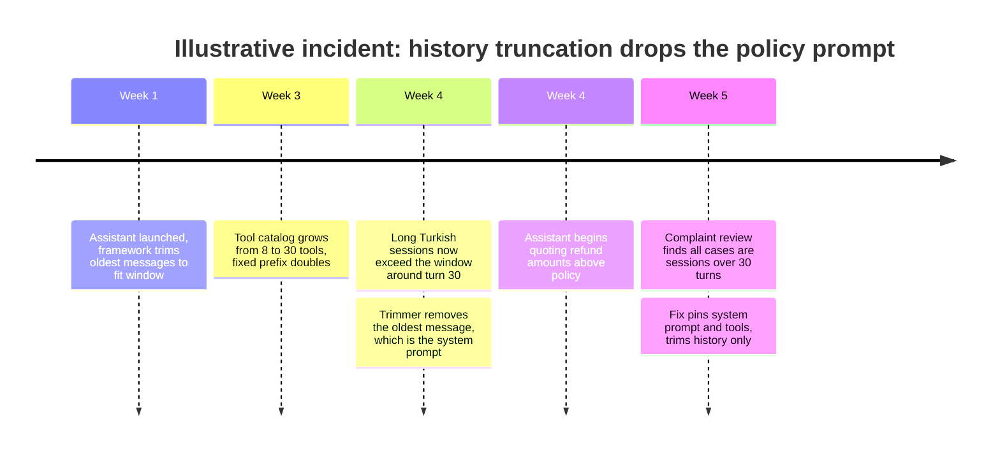

Seen from the system around it, a large language model (LLM) is a function with an unusual shape. Its only input is a sequence of integers, called tokens, of bounded length. Its only direct output is a probability distribution over which token comes next. Everything an API call appears to do, such as answering a question, calling a tool, or emitting JSON, is produced by a loop outside that function: draw one token from the distribution, append it to the input, run the function again, and stop when a stop condition fires. Three properties of this shape determine almost every architectural number: tokens are the unit of price, latency, and limits; the context window is the entire input and is rebuilt on every call; and sampling decides which of many possible outputs the caller receives.

None of this is visible in a typical SDK. A chat API accepts a list of messages with roles, returns a message, and hides the tokenizer, the serialization of roles into tokens, the reserved output space, and the reason the generation ended. Each hidden step is a place where production systems fail in ways that look unrelated to the model: a bill that grows with the square of conversation length, a Turkish deployment that costs a third more than its English pilot, a JSON parser that receives half an object, a policy instruction that silently falls out of the window on turn forty.

The core trade-off is that the component has no memory and no side channel: everything it should take into account must be inside the window, as tokens, on every call. Context buys capability, because the model can only use what it is given, and it is paid for in input tokens, in prefill latency, in a smaller output reserve, and in a larger attack surface, since everything in the window is the same kind of thing to the model. Sampling carries a second, smaller trade-off between diversity and consistency, which this page treats at the mechanism level; the reasons a model is a probabilistic component at all are covered in [Deterministic vs. Probabilistic Systems](/ai-systems-architecture/en/foundations/ai-component-model/deterministic-vs-probabilistic/).

## Tokens: The Unit of Every Price, Limit, and Latency

A tokenizer maps text to a sequence of integer IDs drawn from a fixed vocabulary, typically between tens of thousands and a few hundred thousand entries. Most current tokenizers are variants of byte-pair encoding (BPE): starting from individual bytes, a training procedure repeatedly merges the most frequent adjacent pair into a new vocabulary entry, so common words become single tokens and rare words are spelled out of several fragments. Because the base alphabet is bytes, any input can be encoded, including emoji, binary-looking strings, and languages the vocabulary was never tuned for. What varies is how many tokens they cost.


*The tokenizer sits on both sides of the model. Its vocabulary and merge rules are fixed per model version and are not configurable by the caller.*

Two points in this pipeline have operational consequences. The merge rules are learned from a training corpus, so the vocabulary encodes that corpus's statistics: frequent English words compress to one token each, while a morphologically rich language such as Turkish, where suffixes stack onto stems, splits into more fragments for the same meaning. And detokenization works on bytes, not characters: a single output token can hold part of a multi-byte UTF-8 character, which matters to anyone streaming raw tokens from a self-hosted engine, because a naive decoder emits replacement characters at chunk boundaries. Serving engines and hosted APIs buffer incomplete byte sequences before sending text deltas; custom streaming code has to do the same.

### Measured Example: The Same Sentence in English and Turkish

The following counts were measured for this page in November 2026 with the `o200k_base` encoding that OpenAI introduced with GPT-4o, using the open-source `gpt-tokenizer` package. Other models use other tokenizers and give other counts; the ratio, not the absolute number, is the point.

| Text | Words | Characters | Tokens | Tokens per word |
|---|---|---|---|---|
| The customer's refund request for the damaged product needs to be evaluated. | 12 | 76 | 14 | 1.17 |
| Müşterinin hasarlı ürün için yaptığı iade talebinin değerlendirilmesi gerekmektedir. | 9 | 84 | 21 | 2.33 |

The Turkish sentence carries the same meaning in fewer words and 50% more tokens. The tokenizer split `değerlendirilmesi` into three pieces and `gerekmektedir` into three, and even `Müşterinin` into four. Petrov and colleagues measured this effect systematically across many languages and tokenizers in 2023 and found that some languages need several times as many tokens as English for parallel text. For an architect the consequences are direct. Every per-token price is higher per unit of meaning; every context window holds less conversation; every output takes longer to generate, because generation time scales with output tokens; and rate limits expressed in tokens per minute admit fewer requests, which is why token-based quotas behave differently from request-based ones, as covered in [Token-Based Rate Limiting and Quotas](/ai-systems-architecture/en/platform/ai-gateway/token-rate-limiting/).

Tokenization also explains a class of model errors that look like reasoning failures. A model that sees `değerlendirilmesi` as three opaque IDs has no direct access to its letters, so tasks such as counting characters, reversing strings, enforcing exact character lengths, or comparing long digit strings are harder than their difficulty for code suggests. Numbers are split by digit-grouping rules that differ between tokenizers. Where exactness on characters or digits matters, the right component is deterministic code, with the model producing or extracting the input to it.

The tokenizer is part of the model version. A provider that changes it changes your bill at an unchanged per-token price. When Anthropic introduced a new tokenizer with Claude Opus 4.7, it disclosed that the same text could produce roughly 1.0 to 1.35 times as many tokens depending on content type, and OpenRouter's April 2026 analysis measured native token counts for production-scale prompts rising by 32-34% against Opus 4.6. Token-denominated budgets, quotas, and context-fit checks all need re-measuring at a model migration, which belongs in the checklist of [Model Versioning, Deprecation, and Migration](/ai-systems-architecture/en/model-strategy/lifecycle-and-adaptation/versioning-migration/).

:::caution[Count tokens with the model's own tokenizer]
Heuristics such as "four characters per token" are calibrated on English prose and are wrong by large factors for Turkish, code, JSON, base64, and tables. A context-fit check based on the wrong tokenizer either rejects requests that would fit or sends requests the provider rejects as too long. Count with the exact tokenizer for self-hosted models and with the provider's token-counting endpoint or usage fields for hosted ones, and record the provider-reported counts on every call.
:::

## The Context Window: One Bounded Buffer, Rebuilt on Every Call

The context window is the maximum number of tokens the model processes in one call, and it is shared between input and output: the prompt plus every token generated must fit. As of November 2026, hosted frontier models commonly advertise windows from around 200,000 to over a million tokens, while self-hosted deployments are often configured far smaller to bound GPU memory. The advertised size is a hard limit, not a quality guarantee; how reliably a model uses information at different positions and lengths, and how to budget the window, are the subject of [Context Window Economics](/ai-systems-architecture/en/context-engineering/context-design/context-window-economics/).

A chat API does not send "messages" to the model. It serializes the system prompt, tool definitions, every prior message, and the new user message into one flat token sequence, using a chat template that wraps each part in special tokens the model was trained to recognize. The template is fixed by the model family; open-weight models ship it with the tokenizer, and hosted APIs apply it server-side.

```text
<|im_start|>system
You are a refund assistant. Never promise amounts above policy.<|im_end|>
<|im_start|>tools
[{"name": "get_order", "parameters": {...}}]<|im_end|>
<|im_start|>user
Where is my refund for A-1042?<|im_end|>
<|im_start|>assistant
```

The snippet is a simplified ChatML-style layout, illustrative rather than any one provider's exact format. Two things follow from it. First, tool definitions and the system prompt are ordinary input tokens, billed and counted against the window on every call; a large tool catalog can cost more tokens than the user's question. Second, roles are formatting. The model was trained to weight text after a system marker differently from text after a user marker, and that training is the only thing separating them. There is no privilege boundary inside the window: a retrieved document that contains instructions is processed by the same function as the system prompt, which is the root cause of [Prompt Injection](/ai-systems-architecture/en/security/threats/prompt-injection/).


*One call's context window, top to bottom in serialization order. Every region competes for the same token budget; only the last one is output.*

The bottom region is the one most often forgotten. A request whose input fills the window leaves no room to generate, and the output reserve set by `max_tokens` must include tokens the caller never sees: reasoning models generate hidden reasoning tokens that are billed as output and consume the same budget, as described in [Reasoning Models and Test-Time Compute](/ai-systems-architecture/en/model-strategy/model-landscape/reasoning-models/). Images and documents in multimodal calls are also converted into tokens and occupy the same window.

The model keeps no state between calls. A "conversation" exists only because the client, or a framework acting for it, resends the full history every turn, and the model computes over all of it again. Provider-side prompt caching and the serving engine's key-value (KV) cache reduce the cost of recomputing an identical prefix, as covered in [Prompt Caching](/ai-systems-architecture/en/context-engineering/production-prompting/prompt-caching/) and [Prefill, Decode, and the KV Cache](/ai-systems-architecture/en/inference/fundamentals/prefill-decode-kv-cache/); neither is memory, since both are invalidated by any change in the prefix and neither lets the model see anything the request did not contain. Statelessness is also an advantage: any replica can serve any turn, and a request is reproducible as data, because the full input is in the request.

### Worked Example: What a Twenty-Turn Conversation Costs

Assume, for illustration, a support assistant with a 1,500-token system prompt and 2,500 tokens of tool definitions, 4,000 fixed tokens in total. Each turn adds a 150-token user message and a 350-token assistant reply in English. Assume an illustrative price of 3 USD per million input tokens and 15 USD per million output tokens, with no prompt caching.

Turn 1 sends 4,150 input tokens. Turn 10 sends the fixed 4,000 plus nine prior exchanges of 500 tokens plus the new message, 8,650 tokens. Turn 20 sends 13,650. Summed over twenty turns the conversation consumes 178,000 input tokens and 7,000 output tokens: about 0.53 USD of input and 0.11 USD of output. The user typed about 3,000 tokens and read 7,000, yet the system processed more than 25 times the user's own text, because every turn reprocesses all earlier ones. Total input grows with the square of the number of turns.

Now run the same conversation in Turkish, applying the 1.5 ratio measured above to the conversational content only, with the system prompt and tool definitions kept in English: 225 tokens per user message and 525 per reply. The conversation now consumes 227,000 input and 10,500 output tokens, about 0.84 USD, 31% more than in English. The context limit moves as well. On a self-hosted model configured, for illustration, with a 32,768-token window and a 4,096-token output reserve, the English conversation stops fitting at turn 51, the Turkish one at turn 34.


*Lower line: English; upper line: the same conversation in Turkish. Per-turn input grows linearly, so cumulative input grows quadratically. A 32,768-token window minus a 4,096-token output reserve is crossed by the Turkish line between turns 30 and 35.*

The calculation shows where the levers are. Prompt caching removes most of the cost of the fixed 4,000-token prefix but not the growth. Summarization and truncation bound the growth, at the price of losing detail, as covered in [Managing Conversation Context](/ai-systems-architecture/en/context-engineering/production-prompting/conversation-context/). Keeping fixed instructions in English reduces the language premium, but whether instructions in one language and conversation in another changes answer quality is a question for an eval on your own traffic, not an assumption. The pricing side of the arithmetic is developed in [Token Economics](/ai-systems-architecture/en/economics/understanding-cost/token-economics/).

## The Generation Loop: Distribution, Sample, Append, Repeat

One API call runs the model many times. The first pass, prefill, processes all input tokens in parallel and produces the distribution for the first output token. Every later pass, decode, processes one new token and reuses cached intermediate results for everything before it. Prefill cost grows with input length and dominates time to first token (TTFT); decode runs once per output token and dominates total latency for long answers. The GPU-level mechanics are in [Prefill, Decode, and the KV Cache](/ai-systems-architecture/en/inference/fundamentals/prefill-decode-kv-cache/), and the latency metrics in [Latency Optimization](/ai-systems-architecture/en/inference/fundamentals/latency-optimization/). For capacity planning, the useful approximation is that latency is a fixed overhead plus a term proportional to input tokens plus a larger term proportional to output tokens, so a request that asks for a shorter answer usually saves more time than one that sends a shorter prompt.


*One call as seen inside the serving stack. Steps 5 to 10 repeat once per output token; the finish reason in the last step records which check in step 9 ended the loop.*

The order of steps 6 and 9 explains several behaviors that surprise callers. The sampler commits each token before the stop checks run, so the model never "plans" to fit inside `max_tokens`; it generates as if unlimited and is cut off. A stop sequence is matched against generated text, which may span several tokens, so a streaming client can receive the beginning of a stop sequence before the API recognizes it and suppresses the rest. And streaming delivers tokens as they are sampled, which improves perceived latency but means the client sees the output before any validation or moderation that runs on the complete response; the operational side is covered in [Timeouts, Streaming, and Cancellation](/ai-systems-architecture/en/reliability/provider-failures/timeouts-streaming/), and the general timeout reasoning in the Distributed Systems Handbook's [Timeouts](https://gorkemsari.github.io/distributed-systems/en/resilience/protection-patterns/timeouts/).

### Inside the Sampler

The model outputs one score, a logit, for every vocabulary entry. The sampler turns logits into a choice in a fixed sequence. Temperature divides every logit by a constant before the softmax that converts them to probabilities: below 1 it sharpens the distribution toward the top candidate, above 1 it flattens it. Truncation then removes unlikely candidates: top-k keeps the k highest, top-p (nucleus sampling) keeps the smallest set whose cumulative probability reaches p, and min-p, offered by several open-source engines, keeps candidates whose probability is at least a fraction of the top one. Masks and biases follow: constrained decoding sets the probability of every grammar-violating token to zero, which is how [Structured Output](/ai-systems-architecture/en/context-engineering/production-prompting/structured-output/) guarantees syntax, and logit bias or repetition penalties shift specific tokens. Finally one token is drawn from what remains.

Assume, for illustration, that after the text `Refund status:` the model's four leading candidates have logits 4.0, 3.0, 2.0, and 0.5 for `approved`, `pending`, `rejected`, and `unknown`, and ignore the rest of the vocabulary.

| Temperature | approved | pending | rejected | unknown | Kept by top-p 0.9 |
|---|---|---|---|---|---|
| 0.5 | 86.6% | 11.7% | 1.6% | 0.1% | approved, pending |
| 1.0 | 65.2% | 24.0% | 8.8% | 2.0% | approved, pending, rejected |
| 1.5 | 53.4% | 27.4% | 14.1% | 5.2% | approved, pending, rejected |

At temperature 1.0, one call in three returns something other than the most probable status. At 0.5, about one in eight still does. Greedy decoding, the limit of temperature toward zero, always takes `approved`. The table shows why temperature is not a correctness control: if the right answer for this order is `pending`, low temperature makes the system confidently and consistently wrong, and high temperature makes it right a quarter of the time. The sampling parameters move probability mass around the model's distribution; they cannot put mass where the model put none. Getting the distribution right is a matter of context, model choice, and evaluation.

Truncation exists because of a documented property of the tail. Holtzman and colleagues showed in 2019 that pure sampling from the full distribution produces incoherent text, because thousands of individually unlikely tokens add up to substantial probability, while greedy and beam search produce repetitive, degenerate text. Nucleus sampling was their remedy: cut the tail adaptively, sample from the head. That is why production defaults combine a moderate temperature with top-p, and why greedy decoding on long open-ended outputs is prone to repetition loops.

| Parameter | Effect on the distribution | Production guidance | Caveat |
|---|---|---|---|
| `temperature` | Sharpens below 1, flattens above 1 | Low for extraction and classification, moderate for drafting | Some models ignore or reject it |
| `top_p` | Drops the tail beyond cumulative mass p | Leave at default or tune it, not both it and temperature | Some APIs reject both together |
| `top_k` | Keeps only the k most likely tokens | Rarely needed with top-p | Not offered by every API |
| `max_tokens` | Caps output length, not quality | Set from the measured output distribution plus margin | Includes hidden reasoning tokens on reasoning models |
| `stop` | Ends generation at a matched string | Use for delimiting, not for safety | Stop text is usually not returned |
| `seed` | Fixes the random draw | Useful in evals, not a guarantee | Best-effort on hosted APIs |
| Logit bias, penalties | Raise or lower specific tokens | Narrow uses such as banning a token | Token-level, so tokenizer-dependent |

Provider support for these parameters changes across model generations, which makes them part of the model contract rather than a stable API. OpenRouter's migration guide for Claude Opus 4.7 states that `temperature`, `top_p`, and `top_k` are no longer supported and are silently ignored, and several earlier Claude models have been reported to reject requests that set `temperature` and `top_p` together (both as of 2026). OpenAI's reasoning models have also been reported to restrict sampling parameters. The reproducibility side of these controls, seeds and the limits of temperature zero, is covered in [Determinism Control](/ai-systems-architecture/en/reliability/output-reliability/determinism/).

## Finish Reasons: The Part of the Output Contract Callers Ignore

Every response records why the loop ended, and that field changes what the caller is allowed to do with the text. The model emitting its end-of-turn token means the output is complete as far as the model is concerned. A stop sequence means the caller's delimiter ended it. Reaching `max_tokens` or the context window means the output was cut off mid-stream, whatever it looks like. A tool-call ending means the text is a request for the caller to act, not an answer. A refusal or content-filter ending means a policy layer intervened.

| Ending | Anthropic `stop_reason` | OpenAI Chat Completions `finish_reason` | What the caller must do |
|---|---|---|---|
| Natural end of turn | `end_turn` | `stop` | Validate and use |
| Caller's stop sequence | `stop_sequence` | `stop` | Validate; stop text not included |
| Output cap reached | `max_tokens` | `length` | Treat as truncated; never parse as complete |
| Window filled | `model_context_window_exceeded` | `length` | Treat as truncated; shrink input |
| Tool requested | `tool_use` | `tool_calls` | Execute tool, send result, call again |
| Policy intervention | `refusal` | `content_filter` | Do not retry blindly; route or explain |
| Server-tool loop paused | `pause_turn` | none | Resend to continue |

The Anthropic values are from its stop-reason documentation as of November 2026; the OpenAI values are those of the Chat Completions API. The mapping is approximate, which matters to any abstraction layer that normalizes providers: OpenAI's `stop` covers two Anthropic cases, and `length` covers two. A gateway that flattens these into a boolean "success" discards the signal the rest of this section depends on.


*How a caller should treat a response by its finish reason. Only the Complete path can reach Validated; a truncated response is never passed to a parser as if it were whole.*

The diagram encodes one rule that prevents a large class of silent failures: the finish reason gates validation. A truncated JSON response usually fails to parse and gets caught, but a truncated prose answer, a truncated list of action items, or a truncated SQL statement that happens to be valid passes every syntactic check. The loop from `ToolRequested` back to `Generating` is also worth noticing: one user-visible turn of a tool-using assistant is several API calls, each resending the full context, so the arithmetic of the worked example applies per call, not per turn. The protocol of that loop is in [Tool Calling Mechanics](/ai-systems-architecture/en/agents/tools-and-protocols/tool-calling/).

:::tip[Make the finish reason a first-class field]
Log the finish reason and the provider-reported input and output token counts on every call, and alert on the share of `max_tokens` or `length` endings per route. That single ratio catches output caps set too low, prompts that grew, model migrations that changed verbosity or tokenization, and reasoning models that spend the budget before answering.
:::

## Failure Modes at the Token, Context, and Sampling Layers

These failures rarely raise an exception. The provider returns HTTP 200 and well-formed text; the defect is in what was cut, dropped, or drawn.


*An illustrative sequence, not a specific public incident. Each change was safe on its own; the failure appeared only where window growth, language, and a naive trimming rule met.*

The incident pattern generalizes. A framework that enforces the window by dropping the oldest messages treats the system prompt as just another message unless told otherwise, and nothing in the response indicates that the instructions are gone. Its detection signal is context utilization per call compared with the window, broken down by session length and language, together with a check, in the code that assembles context, that the policy prefix is present in every outgoing request.

| Failure | Trigger | Symptom | Detection | Mitigation and recovery |
|---|---|---|---|---|
| Silent output truncation | `max_tokens` too low, longer inputs, verbose model version | Cut-off prose, partial lists, unparseable JSON | Share of `max_tokens`/`length` endings per route | Gate validation on finish reason; size the cap from measured output lengths |
| Instructions trimmed out | History-trimming that does not pin the prefix | Policy violations in long sessions only | Utilization near the window; prefix-presence check | Pin system prompt and tools; summarize or trim history only |
| Token-count mismatch | Estimating with a different tokenizer or a heuristic | Provider rejects requests as too long, or budgets overrun | Rejections for context length; estimate vs. reported count drift | Count with the model's tokenizer or the provider's counting endpoint |
| Tokenizer change at migration | New model version with a new vocabulary | Cost and quota usage jump at unchanged traffic | Tokens per request per route before and after migration | Re-measure budgets and quotas as part of migration evals |
| Repetition loop | Greedy or very low temperature on long open outputs | Output repeats a phrase until the cap | Repeated n-gram ratio; `length` endings on short tasks | Moderate temperature with top-p; repetition penalty where supported; output cap |
| Ignored sampling parameters | Model generation that drops support silently | Determinism or creativity settings have no effect | Output diversity unchanged after parameter change | Treat parameters as part of the model contract; verify per version |
| Stop-sequence collision | Stop string occurs naturally in valid output | Answers end early, mid-sentence | `stop_sequence` endings with short outputs | Use delimiters that cannot occur in content, or structured output |
| Mid-character stream split | Raw token streaming from a self-hosted engine | Replacement characters in streamed Turkish or emoji text | Invalid UTF-8 count at the stream layer | Buffer incomplete byte sequences before emitting |

Measuring whether the component behaves as designed needs signals most request logs lack. Per call, record input tokens, output tokens, reasoning tokens where reported, finish reason, the model version, and context utilization as a fraction of the window. Per route, watch the distribution of each, not only the mean: a p99 input size creeping toward the window is the leading indicator of the trimming failure, and a rising `length` share is the leading indicator of truncation. Per language, track tokens per character, because a deployment that adds a language changes its cost and capacity curve without any code change. Where these feed dashboards and cost attribution is described in [LLM Observability Fundamentals](/ai-systems-architecture/en/llmops/observability/llm-observability/).

:::caution[Retrying a refusal or a truncation is not a fix]
A transport error is retried with backoff, as in any distributed system. A `max_tokens` ending retried with the same limit is truncated again, at full cost; a refusal retried unchanged is usually refused again, and resending variations until one passes is behavior a reviewer will read as an attempt to evade a policy layer. Each finish reason gets its own handling path, decided in code.
:::

### Security and Governance Implications

The anatomy defines three security properties that later chapters build on. The window has no privilege separation, so any text that reaches it, whether user input, retrieved documents, tool results, or memory, can steer the output; defenses have to sit outside the model. The window is also the full record of what the model was given, which makes it the unit of auditability: logging the exact serialized context, not only the user's message, is the only way to explain an output later, and that log contains whatever personal data entered the window, which brings the privacy obligations described in [Prompt and Response Logging Under Privacy Constraints](/ai-systems-architecture/en/llmops/observability/logging-privacy/). Finally, everything sent to a hosted model is processed on the provider's infrastructure, including system prompts and tool schemas that may describe internal systems; what may leave your boundary is a data-residency decision, covered for Turkish regulation in [KVKK and BDDK](/ai-systems-architecture/en/governance/regulation/turkish-regulation/).

## Designing With the Anatomy in Mind

Reason in tokens from the first design document. Budgets, quotas, and capacity plans written in requests or words are wrong for any system whose traffic mix changes in language, document type, or conversation length. Estimate the fixed prefix, the per-turn growth, and the output distribution for each route, as in the worked example, before choosing a model or a context strategy.

Treat the window as a designed artifact, assembled by code in a known order with explicit priorities, not as an append-only log of everything that happened. Pin what must always be present, bound what grows, and keep the output reserve explicit. Use a long window when the task needs a large body of information at once and the per-call cost is acceptable; do not use it as a substitute for selecting what is relevant, which is the trade-off analyzed in [Long Context vs. Retrieval](/ai-systems-architecture/en/context-engineering/context-design/long-context-vs-retrieval/).

Set sampling parameters per task and keep them in the versioned configuration that also pins the model and prompt. Low temperature suits extraction and classification where the answer is one of a few strings; moderate temperature with top-p suits drafting. Do not use sampling parameters to fix wrong answers, enforce formats, or obtain determinism: the first needs better context or a different model, the second needs constrained decoding or validation, and the third is limited by the serving stack, not the sampler.

Handle finish reasons in code, before any parsing, and make truncation, tool requests, and refusals distinct outcomes in every abstraction layer you build over providers. Do not adopt a gateway or SDK wrapper that collapses them.

Several concepts are routinely confused with this page's subject. The context window is not memory; persistent memory is an application feature built on retrieval, covered in [Agent State and Memory Management](/ai-systems-architecture/en/agents/agent-patterns/state-and-memory/). The KV cache and prompt caching are recomputation optimizations, not state. Temperature zero is not determinism. `max_tokens` is an output cap, not the context window. Tokens are not words, and their ratio is a property of the tokenizer and the language, not a constant. What the model's error rate means for system design, once this anatomy is understood, is the subject of [Capability vs. Reliability](/ai-systems-architecture/en/foundations/ai-component-model/capability-vs-reliability/).

## Further Reading

- Rico Sennrich, Barry Haddow, and Alexandra Birch, *Neural Machine Translation of Rare Words with Subword Units*, Proceedings of ACL, 2016.
- Ari Holtzman, Jan Buys, Li Du, Maxwell Forbes, and Yejin Choi, *The Curious Case of Neural Text Degeneration*, International Conference on Learning Representations (ICLR), 2020.
- Aleksandar Petrov, Emanuele La Malfa, Philip H. S. Torr, and Adel Bibi, *Language Model Tokenizers Introduce Unfairness Between Languages*, Advances in Neural Information Processing Systems (NeurIPS), 2023.
- Nelson F. Liu et al., *Lost in the Middle: How Language Models Use Long Contexts*, Transactions of the Association for Computational Linguistics, 2024.
- Anthropic, *Handling stop reasons*, Claude API documentation.
- Hugging Face, *Chat Templates*, Transformers documentation.
