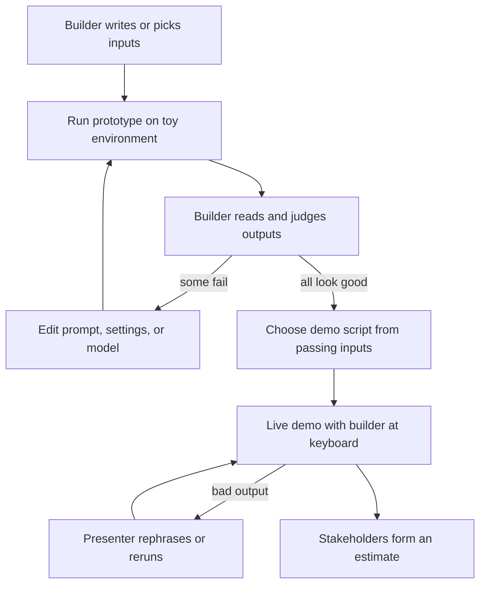
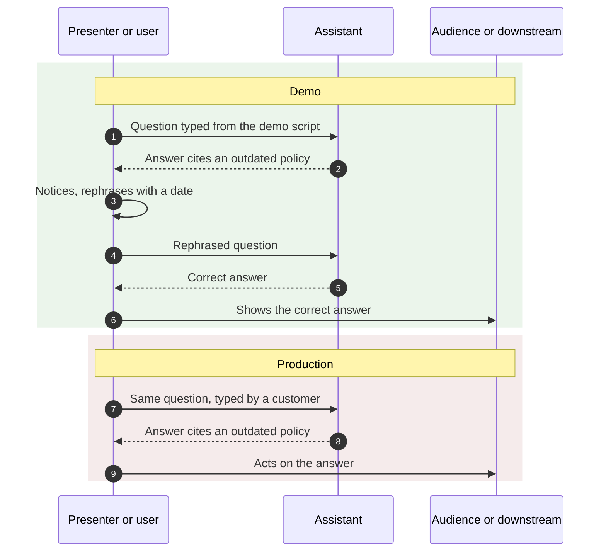
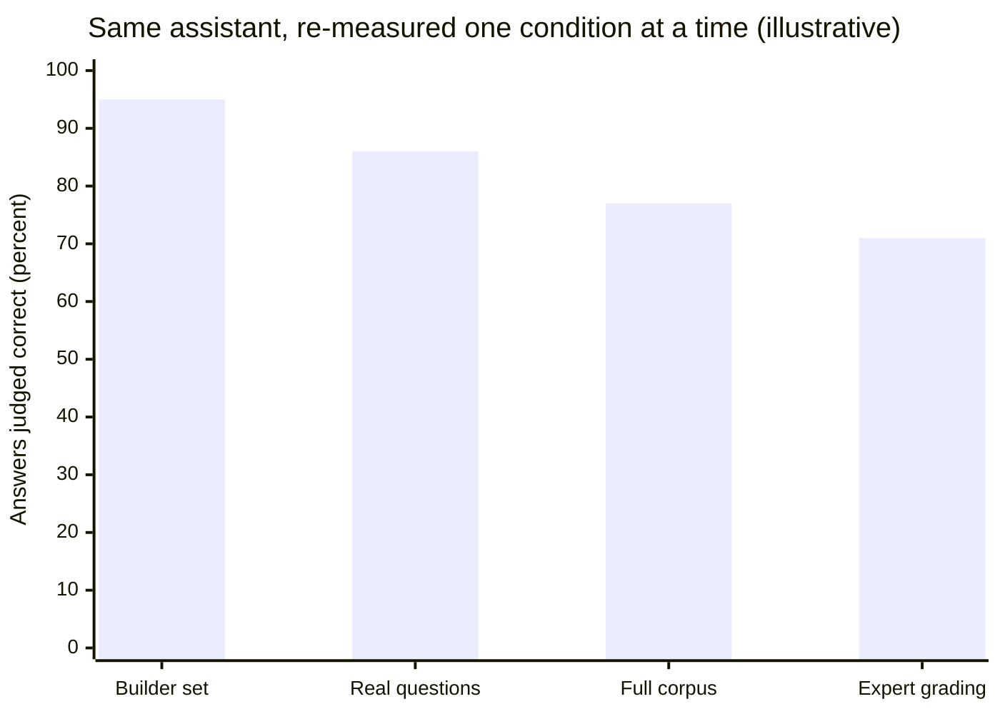
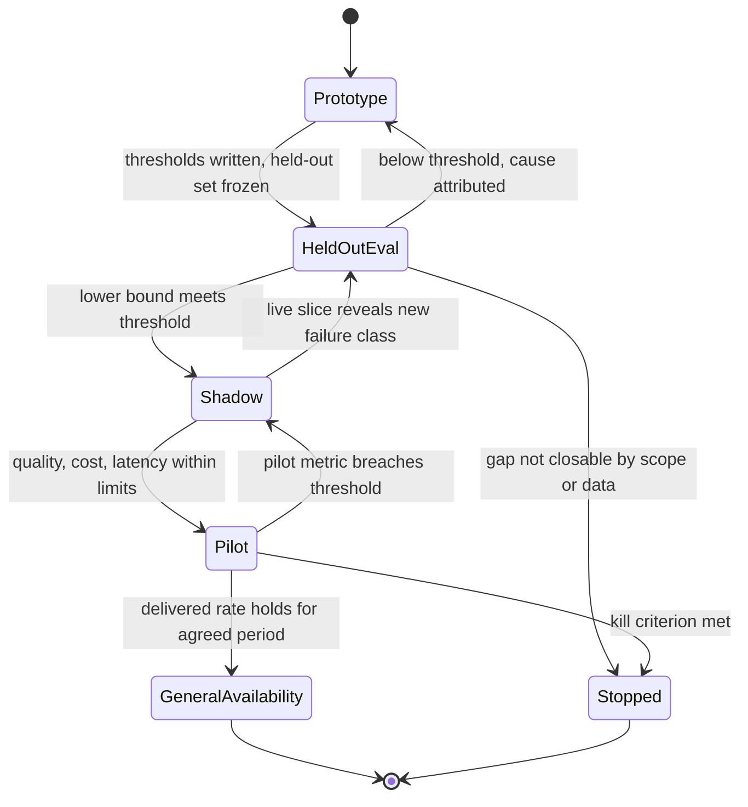
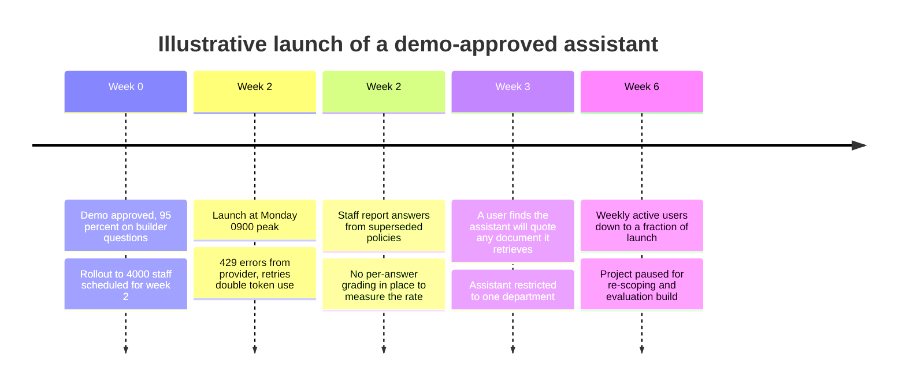

An AI prototype is a working model-backed system built quickly to show that a task can be done: a retrieval assistant over a few hundred documents, an agent that completes a booking in a sandbox, an extractor that reads twenty sample invoices. It is usually convincing, because it was built to be. The problem is not that prototypes are dishonest. It is that the process which produces a prototype also produces the evidence for it, and every step of that process pushes the evidence in the same direction: the builders choose the inputs, tune the prompt until those inputs pass, judge the outputs themselves, run against a simplified environment, and present the result with a person at the keyboard who quietly recovers from failures. The resulting number, or the resulting impression, is an upper bound that nobody labeled as one.

In conventional software a prototype misleads mostly about effort: the happy path works, and the error handling, scale, and security are missing but known to be missing. An AI prototype misleads about the property itself. Whether the system answers correctly is a rate over an input distribution, as [Deterministic vs. Probabilistic Systems](/ai-systems-architecture/en/foundations/ai-component-model/deterministic-vs-probabilistic/) establishes, and a prototype measures that rate on the wrong distribution, with the wrong grader, under the wrong conditions. A team can therefore look at a working demo and be wrong not only about how long production will take, but about whether production is reachable at all.

The core trade-off is between speed of learning and validity of evidence. A fast prototype learns quickly whether a task is plausible, and a task the model cannot do even on chosen inputs is not worth pursuing. Turning it into evidence that the task can be done reliably requires separating who builds from who measures, freezing inputs before tuning on them, and reproducing production conditions, which costs the time the prototype was built to save. How a capability score differs from a delivered rate in general, including the `pass^k` metric and the drift of a rate over time, is covered in [Capability vs. Reliability](/ai-systems-architecture/en/foundations/ai-component-model/capability-vs-reliability/). This page covers the specific way the prototyping process creates that gap, and what evidence replaces it.

## How a Prototype Manufactures Optimistic Evidence

A prototype is built in a loop: a builder writes a handful of inputs, runs the system, reads the outputs, changes the prompt, retrieval settings, or model, and runs again until the outputs look good. Then the system is shown to stakeholders, often live, on inputs drawn from the same handful.


*The prototype loop. Every edge that closes a loop (D back to B, G back to F) removes a failure from the evidence without removing it from the system.*

Four distinct biases sit in this loop: the builders choose the inputs, tune the system on exactly those inputs, grade the outputs themselves, and run in an environment, including the person at the keyboard, that production will not provide. Each has its own mechanism and remedy.

### Chosen Inputs: The Builder's Distribution

A builder writes inputs the way a builder thinks about the task: well-formed, in the vocabulary of the documentation, one question at a time, about the topics the builder knows the system covers. Real users write fragments, mix languages, paste screenshots of text, ask two questions in one message, refer to internal nicknames for products, and ask about things the system was never meant to cover. A prototype evaluated on builder-written inputs measures the rate on the builder's distribution, which is the easiest distribution the system will ever see.

The effect exists even when the builders try to be representative. Recht, Roelofs, Schmidt, and Shankar (2019) re-collected new test sets for CIFAR-10 and ImageNet by carefully replicating the original collection process, and found accuracy drops of 3% to 15% on CIFAR-10 and 11% to 14% on ImageNet across a broad range of models. Their analysis attributes the drop not to overfitting through repeated test-set reuse but to the models' inability to generalize to slightly harder images than those in the original sets. If a deliberate, careful replication of a sampling process produces a double-digit drop, an informal set of forty questions typed by the team that built the system should be expected to produce a larger one. The study concerns image classifiers in 2019, not LLMs; the transferable result is that small, unmeasured differences in how inputs are gathered move the measured rate by more than most teams' margin for error.

### Tuning on the Test: Adaptive Overfitting

The loop in the diagram above iterates until the chosen inputs pass. Every prompt edit is a decision made after looking at the outputs on those inputs, so the final prompt is fitted to them. Statisticians call this adaptive data analysis: when the choice of what to do next depends on results from the same data, the data can no longer serve as an unbiased test. Dwork, Feldman, Hardt, Pitassi, Reingold, and Roth (2015) formalized the problem and showed that even a holdout set loses its validity when it is queried adaptively without safeguards.

In a prompt-engineering loop, the effect is concrete. A builder sees that question 17 fails because the model ignores a date, adds "pay close attention to effective dates" to the prompt, and question 17 passes. The instruction may help in general, or it may only help on question 17, or it may help on question 17 and hurt on a class of questions not in the set. The builder cannot tell, because the only measurement available is the set that motivated the change. After thirty such edits, the set measures how well the prompt was fitted to the set.

:::caution[The development set becomes training data]
Any input a builder has looked at while editing the prompt is no longer a test input; it is part of the specification the prompt was fitted to. Freeze a held-out set before the first prompt edit, keep it out of the builders' view, and report the prototype's rate on that set, not on the inputs used to build it. The procedure for building and maintaining such a set is in [Designing and Maintaining Golden Datasets](/ai-systems-architecture/en/evaluation/measuring-quality/golden-datasets/).
:::

### Lenient Grading: The Builder as Judge

In a prototype, the grader is usually the builder, who knows what the system was supposed to say, reads charitably, and counts a mostly right answer as right. Partial answers, answers that are correct but cite the wrong document, answers that are correct for last year's policy, and answers that are technically accurate but would mislead a customer are all easy to pass when the reader wants the system to work. A domain expert who must sign off on the answer as if it went to a customer applies a stricter standard, and the two standards can differ by many points on the same outputs.

Grading leniency is invisible in the prototype's evidence because the grading criteria were never written down. The remedy is to write the acceptance criteria before grading, have someone other than the builder apply them, and measure agreement between graders, as described in [Human Evaluation and Annotation](/ai-systems-architecture/en/evaluation/measuring-quality/human-evaluation/). If an automated judge replaces the human, its own bias and calibration become part of the measurement, which [LLM-as-Judge](/ai-systems-architecture/en/evaluation/measuring-quality/llm-as-judge/) covers.

### The Toy Environment and the Hidden Operator

The fourth bias is in everything around the model. A prototype typically runs against a small, clean corpus instead of the full document estate; uses the builder's credentials, which can read everything, instead of per-user authorization; calls mocked or sandboxed tools instead of real systems with real latency and real failures; serves one user at a time with no rate limits; and faces no adversary. Each simplification raises the measured quality or lowers the measured cost. A retrieval system over 300 hand-picked documents has few near-duplicate distractors; over 120,000 documents with five versions of the same policy, the retriever returns the wrong version more often. A system reading with administrator credentials never fails because the answer is in a document the user cannot see, and never leaks one either.

The most consequential simplification is the person at the keyboard. In a live demo, the presenter decides which inputs to type, sees each output before the audience interprets it, and recovers from failures by rephrasing, rerunning, or moving on. That person is a human verifier inside the loop, and the audience does not count them as part of the system.


*The hidden operator. In the demo, steps 2 to 4 are a human verification and retry that the audience never sees; in production, the same failure in step 8 goes straight to step 9.*

The demo shows a system with a verifier; production ships one without. A presenter who rephrases one question in five has hidden a 20% first-attempt failure rate, and the same holds for agent demos in which the builder approves or retries steps.

:::tip[Count the reruns]
Log every prototype and demo interaction with the session, the input, the output, and whether the operator rephrased, retried, or skipped. The ratio of first-attempt successes to final successes is the share of quality the operator supplied. If it is far from one, the delivered rate in production, where nobody reruns, will be closer to the first-attempt number.
:::

### Why the Biases Compound

The four biases do not substitute for one another; each removes a different set of failures from the evidence. Chosen inputs remove the hard and unusual cases, tuning removes failures one prompt change could fix, lenient grading relabels some of the rest as successes, and the environment and operator remove failures that depend on scale, permissions, real tools, or the absence of a second attempt. Because they act on different failures, their losses multiply like per-stage success rates in a pipeline, and a system can lose a quarter of its measured quality before it meets its first user.

## Worked Example: Re-Measuring a Policy Assistant

Assume, for illustration, a bank's operations team prototypes an internal assistant that answers staff questions about procedures, with retrieval over policy documents. The prototype runs over 300 documents the team selected, uses one service account with access to all of them, and is graded by the two engineers who built it. On a set of 40 questions the engineers wrote, it produces 38 answers they judge correct, 95%. Leadership sees a live demo and approves a rollout to 4,000 staff.

Before rollout, a second team re-measures under production conditions, one change at a time, so that each loss can be attributed. All numbers below are illustrative assumptions, not measurements of any real system or model.

The first issue is statistical. Thirty-eight of 40 is 95%, but the 95% Wilson confidence interval for that result runs from about 83.5% to 98.6%. Forty questions cannot distinguish a system that is right 85% of the time from one that is right 98% of the time, and nothing in the demo suggested that the interval existed.

The second team then replaces the 40 builder-written questions with 400 questions sampled from the last quarter's internal help-desk tickets, rewritten only to remove personal data, and runs them on the same 300-document corpus with the same lenient grading. The rate falls to 86%: real questions are vaguer, refer to internal product nicknames, and ask about topics the 300 documents do not cover. Next, the corpus grows to the full 120,000 documents, including superseded versions of policies, with retrieval filtered by each asker's permissions. The rate falls to 77%, mostly because the retriever returns an older version of a policy and the model answers faithfully from it. Finally, two compliance staff grade the outputs against written criteria: correct, current, cited to the governing document, and not misleading. The rate falls to 71%, with a 95% interval of about 66% to 75% on 400 questions.


*Each bar changes one condition from the bar before it. None of the four steps changed the model, the prompt, or the code.*

The decomposition is diagnostic. The drop from 95 to 86 says the task definition is wider than the team assumed, and the fix is scope: decide which question types the assistant answers and route the rest. The drop from 86 to 77 is a retrieval and data problem, version control of policy documents, which no prompt change will fix; it belongs to [Freshness and Incremental Indexing](/ai-systems-architecture/en/retrieval/ingestion-indexing/incremental-indexing/) and to the data owners. The drop from 77 to 71 says the system's notion of a correct answer differs from the business's, and the fix is a written grading rubric that the builders iterate against. A team that saw only "95% in the demo, 71% in the pilot" would start comparing models, which addresses none of the three causes.

### Cost and Throughput Under Real Load

The same re-measurement applies to cost and capacity. In the prototype, a typical request carried about 4,000 input tokens (system prompt, question, four retrieved chunks) and produced about 300 output tokens. Assume illustrative prices of $3 per million input tokens and $15 per million output tokens, which are placeholders rather than any provider's list price as of November 2026. A prototype request then costs 0.012 plus 0.0045, about $0.0165.

The production configuration that reached 71% retrieves twelve chunks to compensate for the larger corpus, adds a query-rewriting call of about 1,500 input and 100 output tokens, and produces longer answers with citations, about 500 output tokens. The main call now carries about 12,000 input tokens. The request costs 0.036 plus 0.0075 for the main call and 0.0045 plus 0.0015 for the rewrite, about $0.0495, three times the prototype's figure. At an assumed 20,000 questions per working day, the daily cost is about $990 rather than the $330 that a demo-based estimate would produce. Why output tokens, retries, and hidden calls dominate such budgets is covered in [Token Economics](/ai-systems-architecture/en/economics/understanding-cost/token-economics/).

Throughput changes in the same direction. If the 20,000 questions arrive mostly in an eight-hour day with a peak of three times the average, the peak is about 2 questions per second. Each carries about 13,500 input tokens across its two calls, so the peak demand is about 1.6 million input tokens per minute. A prototype that ran comfortably on a single API key with, say, a one-million-tokens-per-minute limit will be throttled at the first busy hour, and the throttling arrives as HTTP 429 errors that the prototype never produced. The provider-side mechanics are in [LLM Provider Failure Modes](/ai-systems-architecture/en/reliability/provider-failures/provider-failure-modes/), and enforcing token budgets on the consumer side is in [Token-Based Rate Limiting and Quotas](/ai-systems-architecture/en/platform/ai-gateway/token-rate-limiting/).

Latency follows the token count, and a demo measured with one user at a quiet hour reports none of the tail, where provider queueing adds to generation time. The general method for load testing a distributed system under realistic concurrency is in [Load and Performance Testing](https://gorkemsari.github.io/distributed-systems/en/deployment/distributed-testing/load-performance-testing/); for an LLM system, the load profile must reproduce the token distribution of real requests, not only the request rate.

## Evidence That Survives Contact With Production

Each bias has a matching kind of evidence that removes it, at a cost and at a stage of the project. The task is to know which question each kind answers, and to stop treating the cheapest one as an answer to all of them.

| Evidence | What it can show | What it cannot show | Relative cost | When to prefer |
|---|---|---|---|---|
| Live demo | The task is plausible on chosen inputs | Any rate; the operator is hidden | Very low | Securing time to build a real evaluation, nothing more |
| Builder development set | Whether prompt edits help on known cases | An unbiased rate; it was tuned on | Low | During iteration, as a regression check |
| Frozen held-out set, sampled from real inputs, graded by experts | A rate with a confidence interval on production-shaped inputs | Behavior under load, real tools, adversaries, drift | Medium | The first go or no-go decision |
| Shadow mode on live traffic | Quality and cost on the real distribution, with no user impact | User reaction; effects of acting on outputs | Medium to high | Before any user sees outputs, when outputs can be logged and graded |
| Limited pilot or canary | Delivered rate, user behavior, operational load, adversarial use | Long-term drift; rare-slice behavior at small volume | High | Final gate before general availability |

The frozen held-out set is the turning point. It is the first evidence that addresses the first three biases at once: the inputs are sampled rather than chosen, the builders never saw them while tuning, and the graders apply written criteria. It still runs in an offline environment, so the toy-environment bias is only removed to the extent that the evaluation harness uses the real corpus, real permissions, and real tool behavior. A harness that does is worth building early, because every later stage reuses it.

Shadow mode removes the environment bias without user risk. The candidate system receives a copy of live traffic, its outputs are logged and graded but never shown, and its cost and latency are measured at real load. The pattern is the same as in conventional systems, described in [Shadow Deployment](https://gorkemsari.github.io/distributed-systems/en/deployment/deployment-patterns/shadow-deployment/); what differs is that the outputs must be graded, which means a sample is sent to expert review or a calibrated judge, since there is no response code that says an answer was wrong. Shadow mode does not reveal how users react to answers, and it is not possible for agents whose value lies in side effects: a shadow agent cannot execute a real transfer, so its trajectory can be graded only up to the first effectful step.

A limited pilot, exposed to a small fraction of users through a [Canary Release](https://gorkemsari.github.io/distributed-systems/en/deployment/deployment-patterns/canary-release/), is the only stage at which adversarial users, real follow-up behavior, and the operational burden of the review queue appear. Its weakness is statistical: at small volume, rare slices contribute too few examples to measure. The AI-specific design of these online stages is in [Online Experimentation: A/B Tests, Shadow Mode, Canary](/ai-systems-architecture/en/evaluation/evals-in-delivery/online-experimentation/).


*The evidence path as a state machine. Every forward transition is gated by a threshold written before the stage began; every backward transition carries an attributed cause.*

Two properties make this path produce sound decisions where the prototype loop does not. First, the thresholds are written before the stage that tests them, so the result cannot be reinterpreted after the fact. A team that sets "at least 85% on the held-out set" before seeing 71% must either fix the attributed causes or stop; a team that sets no threshold will find a reason why 71% is acceptable. The EU AI Act encodes the same principle for high-risk systems: Article 9(8) requires that testing be carried out "against prior defined metrics and probabilistic thresholds" appropriate to the intended purpose, and Article 9(7) allows testing in real-world conditions under the conditions of Articles 57 or 60. Second, the backward transitions are part of the design. A shadow run that reveals a new failure class sends the system back to the held-out stage with that class added to the set, which is how the set stays representative as the team learns what production looks like.

```yaml
# Illustrative readiness gate, written before the held-out evaluation starts
use_case: internal-policy-assistant
held_out_set:
  source: helpdesk tickets, last full quarter, sampled
  size: 400
  frozen_on: 2026-11-02        # before the first prompt edit on it
  graders: compliance staff, written rubric v3
gate_heldout:
  metric: correct_current_cited   # all three criteria per answer
  threshold_lower_bound_95: 0.85  # Wilson lower bound, not point estimate
  worst_slice_min: 0.75           # per question category with n >= 40
gate_shadow:
  cost_per_request_p95_usd: 0.08
  latency_p95_seconds: 12
kill_criteria:
  - lower bound below 0.80 after two attributed fix rounds
```

Naming the source and freeze date of the held-out set makes the adaptivity bias auditable. Stating the threshold as a lower confidence bound rather than a point estimate prevents a small set from passing by luck. A worst-slice minimum prevents a good average from hiding a category that fails, and the kill criterion makes stopping a planned outcome rather than a political event. How these gates become automated checks in a delivery pipeline is in [Evals in CI/CD](/ai-systems-architecture/en/evaluation/evals-in-delivery/evals-in-cicd/).

### Estimating the Work the Prototype Did Not Do

The prototype also misleads about effort, and that misjudgment shapes budgets and deadlines before any evaluation runs. Sculley et al. (2015) observed for classical machine-learning systems that only a small fraction of a real-world system is the model code; the rest is data collection, verification, serving, monitoring, and configuration. An LLM system has the same structure, with its own components: the evaluation harness and held-out set, ingestion and versioning for the corpus, authorization at retrieval time, the deterministic checks around the model, the review queue for abstained or flagged outputs, observability that records prompts, retrieved context, and costs per request, a gateway that enforces quotas, and change management for prompts and model versions. A prototype contains almost none of these.

A practical estimate starts from that list rather than from the prototype. For each component, the team states whether it exists on the organization's platform, needs configuration, or must be built. Where an internal AI platform provides the gateway, the tracing, and the evaluation harness, the remaining work is mostly data and evaluation; where it does not, the platform components dominate the schedule. [The Paved Road](/ai-systems-architecture/en/platform/internal-platform/paved-road/) describes what such a platform should provide so that each new use case does not rebuild it.

## Failure Modes When the Demo Sets the Plan

The failures below happen when decisions are taken on prototype evidence. They surface as a missed launch, a public incident, or a system that ships and is quietly abandoned. Gartner predicted in July 2024 that at least 30% of generative AI projects would be abandoned after proof of concept by the end of 2025, citing poor data quality, inadequate risk controls, escalating costs, or unclear business value, and predicted in June 2025 that over 40% of agentic AI projects would be canceled by the end of 2027. These are analyst predictions, not measured outcomes, and their methodology is not public; they are cited here because the causes they name are the ones a prototype does not measure.

| Failure | Trigger | Symptom | Detection | Mitigation and recovery |
|---|---|---|---|---|
| Anchored launch date | Plan and budget set from the demo | Pilot quality far below demo; schedule slips repeatedly | Held-out rate with interval reported against the demo figure | Gate commitments on held-out results; re-plan from the attributed gap |
| Overfitted prompt | Prompt edited against the evaluation set | Held-out and shadow rates well below development rate | Gap between development-set and frozen-set rates | Freeze sets before edits; rotate fresh samples in each release |
| Model shopping | Gap blamed on the model rather than data or scope | Several model swaps, little improvement | Per-condition decomposition shows losses outside generation | Attribute losses by condition before changing the model |
| Capacity surprise | Token volume estimated from prototype requests | 429 errors and latency spikes at the first busy hour | Tokens per minute at peak versus provider limits | Load test with real token distributions; quotas and queueing at the gateway |
| Permission gap | Prototype read with an all-access identity | Answers based on documents the user cannot see, or new "cannot find" failures | Retrieval audit of the documents cited per user | Per-user retrieval authorization from the first held-out run |
| Adversarial first contact | No adversary in the prototype | Public screenshots of the system promising, swearing, or leaking | Red-team findings; spike in flagged outputs after launch | Red teaming before the pilot; output policies; scoped capabilities |
| Silent abandonment | System ships at a rate users do not trust | Usage drops after launch without any incident | Active users, repeat usage, and escalation rate per week | Treat adoption as a pilot gate, not a post-launch hope |

The adversarial row has public examples. In December 2023, a ChatGPT-based sales chatbot on the website of a Chevrolet dealership in Watsonville, California, was prompted by a user into agreeing to sell a 2024 Tahoe for $1 and calling it "a legally binding offer"; the AI Incident Database records it as incident 622. In January 2024, the parcel company DPD disabled the AI element of its customer-service chat after a customer got it to swear and criticize the company; DPD attributed it to "an error" that "occurred after a system update". Neither case needed a sophisticated attack, and neither behavior would appear in a demo, because nobody in a demo audience tries to make the system misbehave. The DPD case also shows the time dimension: a system that behaved acceptably was changed and the change was not re-evaluated, the drift that [Capability vs. Reliability](/ai-systems-architecture/en/foundations/ai-component-model/capability-vs-reliability/) calls the time gap.


*An illustrative failure timeline. Every event in it was predictable from the conditions the prototype did not reproduce.*

The capacity failure at launch comes from the token arithmetic above; the retry behavior that doubles token use is the retry-storm dynamic described in [Retry Storms and Metastable Failures](https://gorkemsari.github.io/distributed-systems/en/resilience/flow-control/retry-storms-metastable-failures/). The stale-policy complaints are the full-corpus drop, arriving as anecdotes because no grading pipeline exists to turn them into a rate. The disclosure in week 3 is the permission gap. The decline in week 6 is the least visible ending: no incident, only a system staff stopped using because checking it took longer than not using it. Detecting it requires adoption metrics defined before launch, such as weekly active users and the share of answers followed by an escalation to a human.

:::danger[A prototype identity must never reach a pilot]
Prototypes commonly retrieve with a service account that can read every document in the corpus. If that identity survives into a pilot, every user can receive content from documents they are not authorized to see, and the leak looks like a correct, well-cited answer. Enforce per-user authorization at retrieval time before any user outside the team touches the system, as described in [Retrieval Authorization and Tenant Isolation](/ai-systems-architecture/en/retrieval/rag-architecture/retrieval-authorization/).
:::

### Security and Governance Implications

A prototype has no threat model, and its evidence says nothing about adversarial behavior. The step from prototype to pilot is the point at which prompt injection through user input and retrieved content, data exfiltration through tool calls, and policy-violating outputs become possible, and each needs its own testing before exposure, as covered in [Prompt Injection: Direct and Indirect](/ai-systems-architecture/en/security/threats/prompt-injection/) and [Red Teaming and Jailbreak Testing](/ai-systems-architecture/en/security/defenses/red-teaming/). Prototypes also tend to be built on real data because it makes the demo convincing; copying production documents or customer records into a prototype environment is itself a data-handling event that needs the same approval as any other use, and in a regulated institution it may require a documented legal basis under KVKK or the GDPR before the first prototype run.

On the governance side, the demo figure tends to become the number in the approval document, so a risk committee approving "95% accuracy in testing" has approved a description of the builders' inputs and grading. The approval record should carry the held-out rate, its interval, the population and grading criteria it was measured on, and the date, so that the claim can be checked later; the broader practice is in [Model Risk Management for LLM Systems](/ai-systems-architecture/en/governance/risk-management/model-risk-management/).

## Deciding What a Prototype Is Allowed to Prove

Use a prototype to answer feasibility: can the model, with reasonable effort, produce acceptable outputs for this task on inputs the team understands. A prototype that fails on its own chosen inputs is strong evidence, because every bias favored it. Use it also to discover what the production system needs, such as which documents are missing, which questions are ambiguous, and which tools return confusing errors, and write those discoveries down as requirements.

Do not use a prototype to answer reliability, cost, capacity, or safety. Those questions need, in order, a frozen held-out set sampled from real inputs and graded against written criteria, a load profile with real token distributions, and adversarial testing, and they need thresholds written before the measurement. Do not let a demo set a launch date, a budget, or a headcount; commit to the next evidence stage instead, with its own threshold and kill criterion. Do not respond to a gap between demo and held-out results by changing the model until the loss has been attributed to inputs, data, grading, or generation, because in most re-measurements a large share of the loss lies outside the model.

Skip the staged path only when errors are cheap and visible. An internal drafting tool whose every output is read and edited by its user before use can go from prototype to limited release with lighter evidence, because the user is the verifier by design and the review step is part of the product, not a hidden operator. That exception does not extend to systems that act on outputs without review, answer customers, or touch regulated decisions; whether such systems should use a model at all is the question in [When AI Is the Wrong Solution](/ai-systems-architecture/en/foundations/failure-and-fit/when-not-to-use-ai/).

Several adjacent concepts are commonly confused with this page's subject. The general gap between a capability score and a delivered rate, including repeated-trial metrics and drift after launch, is [Capability vs. Reliability](/ai-systems-architecture/en/foundations/ai-component-model/capability-vs-reliability/). Classifying the failures that the evaluation finds is [A Taxonomy of AI Failure Modes](/ai-systems-architecture/en/foundations/failure-and-fit/failure-mode-taxonomy/). The discipline of building the evaluation first and iterating against it is [Eval-Driven Development](/ai-systems-architecture/en/evaluation/testing-foundations/eval-driven-development/). The general question of how closely a test environment must match production, for any distributed system, is [Staging Fidelity](https://gorkemsari.github.io/distributed-systems/en/deployment/distributed-testing/staging-fidelity/).

## Further Reading

- Benjamin Recht, Rebecca Roelofs, Ludwig Schmidt, and Vaishaal Shankar, *Do ImageNet Classifiers Generalize to ImageNet?*, Proceedings of ICML, 2019.
- Cynthia Dwork, Vitaly Feldman, Moritz Hardt, Toniann Pitassi, Omer Reingold, and Aaron Roth, *The Reusable Holdout: Preserving Validity in Adaptive Data Analysis*, Science, 2015.
- D. Sculley et al., *Hidden Technical Debt in Machine Learning Systems*, Advances in Neural Information Processing Systems (NeurIPS), 2015.
- Regulation (EU) 2024/1689 (Artificial Intelligence Act), Article 9, Risk management system, Official Journal of the European Union, 2024.
- Gartner, *Gartner Predicts 30% of Generative AI Projects Will Be Abandoned After Proof of Concept By End of 2025*, press release, July 2024.
