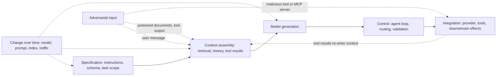
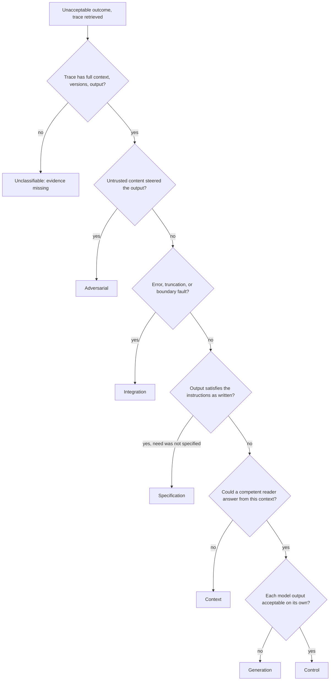
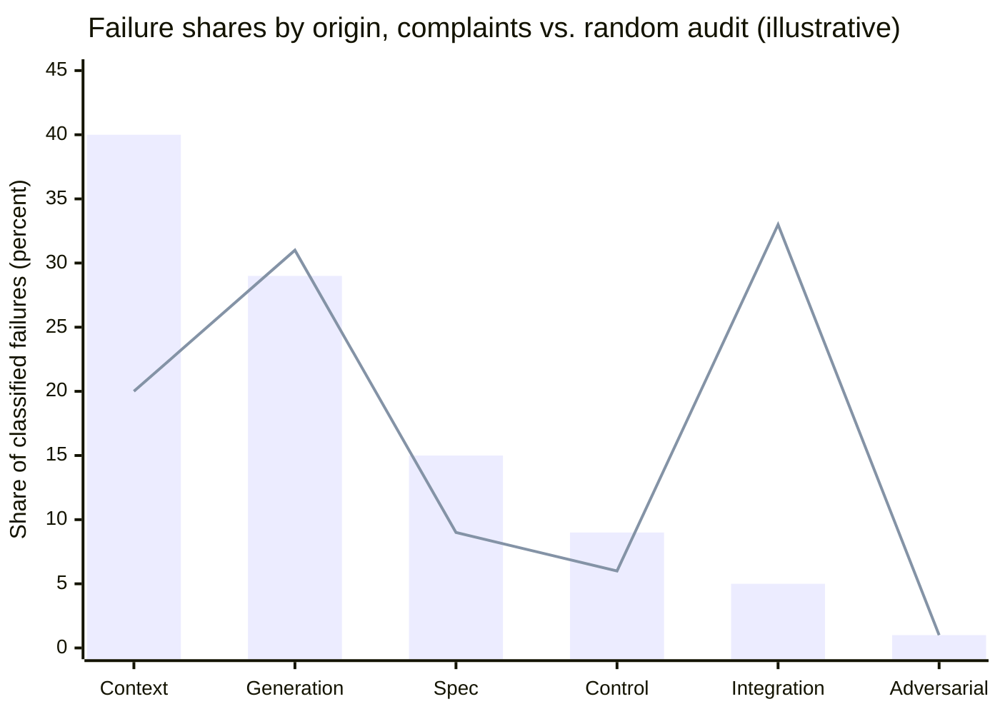
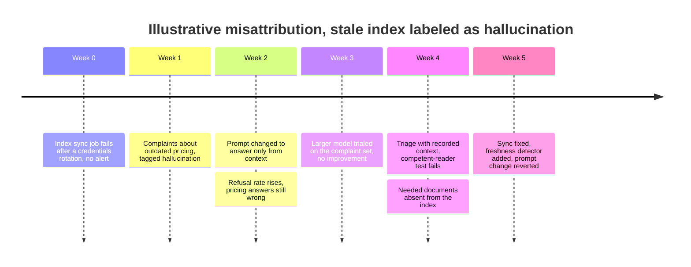

A failure-mode taxonomy for an AI system is a classification of the ways a model-backed system produces an unacceptable outcome, built so that every class answers two operational questions: which signal detects it, and which layer of the system owns the fix. The problem it solves is mundane and expensive. Without one, every bad answer gets the same label, usually "hallucination", and the remedy goes to the most visible layer, usually the prompt or the model choice. A team that rewrites prompts for three weeks while the retrieval index has silently stopped syncing has not lacked effort; it has lacked a way to tell a model that invented a fact apart from a model that was never shown the fact.

Distributed systems engineering has had such a vocabulary for decades. Crash, omission, timing, and arbitrary failures, described in the Distributed Systems Handbook's [Failure Models: Crash-Stop, Crash-Recovery, Omission](https://gorkemsari.github.io/distributed-systems/en/foundations/system-models/failure-models/), tell an engineer what an algorithm must tolerate. A model's typical failure fits none of the benign models: the component keeps running, responds on time, and returns a well-formed output that is wrong. That is closest to the arbitrary behavior of [Byzantine Faults](https://gorkemsari.github.io/distributed-systems/en/foundations/system-models/byzantine-faults/), but without an adversary and without replicas to vote against, so the classical tolerance techniques do not transfer. The AI system needs its own classification, organized around where in the request path the defect sits and how it becomes visible.

The core trade-off is resolution against agreement. A coarse taxonomy, such as "model error versus system error", is applied consistently by any reviewer and routes nothing, because both buckets contain failures with opposite fixes. A fine one, with forty mechanisms, routes precisely in principle and fails in practice: reviewers disagree on which leaf applies, counts per leaf are too small to trend, and the taxonomy ends up applied by whoever has the strongest opinion. A second trade-off runs across the first. Classifying by symptom (what the user saw) is possible at triage time from the output alone; classifying by cause (which layer was defective) requires the recorded inputs and context, and is the only label that tells anyone what to change. A usable taxonomy carries both, as separate fields.

## Origin Layers: Where in the Request Path the Defect Sits

Every model-backed request passes through the same sequence of layers, whatever the product: a specification says what the system should do, context assembly decides what the model sees, the model generates, control logic decides what to do with the output, and an integration layer carries calls to providers, tools, and downstream systems. An adversary can enter at several of these points. The primary axis of the taxonomy is the layer at which the defect originated.


*The five origin layers of a model-backed request, the points where adversarial input enters, and the layers that change over time. Every failure is assigned to exactly one origin.*

The diagram is drawn left to right because the order is the order of evidence. A defect in an upstream layer contaminates everything downstream: a model given an incomplete context produces an incomplete answer that looks exactly like a generation failure. Two things are deliberately not layers. Adversarial input is a separate origin because the input distribution was chosen by someone trying to cause the failure, which changes who responds and how. Change over time is an attribute rather than an origin: a retrieval regression after an index rebuild is still a context failure, and the fact that a change introduced it is recorded in a separate onset field.

### The Six Origin Classes

Specification failures are those in which the system did what it was told and what it was told was wrong or incomplete. The prompt never stated that refunds above a threshold need approval; the output schema has no way to express "not found", so the model fills a field with a plausible value; the scope admits questions the system was never designed or evaluated to answer. The model behaved as specified. This class is the one most often blamed on the model, and the one that a stronger model fixes least, because a stronger model follows the wrong instructions more faithfully. MAST, an empirically derived taxonomy of multi-agent failures discussed below, places its largest category at the specification and system-design level, which matches what production triage usually finds.

Context failures are those in which the information needed for a correct output was not in the context window as sent, or was present in a form that no reader could use. Retrieval returned the wrong passages or none; the index was stale; the conversation history was truncated and dropped the constraint the user stated in turn three; a tool result was cut off at a size limit; two retrieved documents contradicted each other with no signal about which is current. The budgeting and ordering decisions that cause many of these are covered in [Context Window Economics](/ai-systems-architecture/en/context-engineering/context-design/context-window-economics/), and the retrieval-side diagnosis in [Diagnosing RAG Failures: Retrieval or Generation?](/ai-systems-architecture/en/retrieval/rag-architecture/rag-failure-diagnosis/).

Generation failures are those in which a correct specification and a sufficient context still produced an unacceptable output. The subclasses differ in what the output is measured against. An unfaithful output contradicts or goes beyond the context it was given. An unsupported output asserts something that no source in or outside the context supports; this is the narrow meaning of fabrication, mitigated as described in [Hallucination Mitigation](/ai-systems-architecture/en/reliability/output-reliability/hallucination-mitigation/). A reasoning failure applies correct facts and gets a calculation, comparison, or inference wrong. Instruction non-adherence ignores a stated constraint, such as length, language, or a prohibited topic. Format violation breaks the output contract, the class that [Structured Output](/ai-systems-architecture/en/context-engineering/production-prompting/structured-output/) can eliminate for syntax. Refusal errors come in both directions: declining a legitimate request and answering one that policy required declining. The last subclass, instability, is a different answer to the same input across draws or across equivalent phrasings, the property that [Capability vs. Reliability](/ai-systems-architecture/en/foundations/ai-component-model/capability-vs-reliability/) measures with repeated trials.

Control failures are those in which each model output was acceptable on its own and the logic around it composed them into a wrong outcome. In an agent loop this means selecting the wrong tool, passing arguments the model was never shown, looping without progress, stopping before the goal or declaring success without checking it, and issuing the same effect twice after an ambiguous result. In a workflow it means routing to the wrong branch, or a validator that accepted an output it should have rejected. In multi-agent systems it includes one agent ignoring or overwriting another's output. The mechanisms are owned by [Agent Loop Patterns](/ai-systems-architecture/en/agents/agent-patterns/agent-loops/), [Stopping Conditions and Budget Control](/ai-systems-architecture/en/agents/reliable-execution/stopping-budget/), and [Tool Call Idempotency, Retry, and Compensation](/ai-systems-architecture/en/agents/reliable-execution/idempotency-compensation/).

Integration failures are those at the boundary with providers, tools, and downstream systems: rate limits and overload, timeouts, a stream cut off mid-answer, a response truncated by the output token cap, a model alias moved to a new snapshot, a serving-side bug that changes the output distribution, and output that a downstream system interprets unsafely, such as generated text rendered as HTML. Most of these are loud and familiar; their AI-specific shapes are in [LLM Provider Failure Modes](/ai-systems-architecture/en/reliability/provider-failures/provider-failure-modes/) and, for finish reasons that callers ignore, in [Anatomy of an LLM as a System Component](/ai-systems-architecture/en/foundations/ai-component-model/llm-anatomy/). The silent ones are the dangerous ones: Anthropic's 2025 postmortem of three overlapping infrastructure bugs, discussed in [Deterministic vs. Probabilistic Systems](/ai-systems-architecture/en/foundations/ai-component-model/deterministic-vs-probabilistic/), produced symptoms that users experienced as generation failures, while the defect sat in routing and compilation.

Adversarial failures are those in which someone shaped the input to cause the outcome: direct and indirect prompt injection, jailbreaks, poisoning of retrieval sources or agent memory, exfiltration through tool calls or rendered links, and inputs crafted to exhaust tokens or budgets. The mechanisms belong to the security chapter, starting with [AI Threat Modeling](/ai-systems-architecture/en/security/threats/threat-modeling/) and [Prompt Injection: Direct and Indirect](/ai-systems-architecture/en/security/threats/prompt-injection/). In this taxonomy they are one origin class, kept separate so that a successful attack is never counted, trended, and prioritized as a quality defect.

:::caution[Hallucination names a symptom, not a cause]
"The model made it up" describes what the output looks like, and at least four origins produce it: a specification that forced an answer where none existed, a context that lacked or misordered the fact, a generation that went beyond a sufficient context, and a poisoned source. Each has a different fix and a different owner. Record the symptom if it helps triage, but never close an incident with "hallucination" as its cause.
:::

### Attributes That Cut Across Origins

Origin says where the defect is. Four further attributes say how the failure behaves, and each one changes the response. Detectability has three values: loud failures raise an error or fail a check that runs on every call; checkable failures could be caught by a check that exists but does not run per call, such as an offline groundedness eval; silent failures are well-formed, plausible, and wrong, and surface only through sampled audits or user reports. Consequence records what the failure reached: information shown to a person, a decision recorded in a system, or an effect performed in the world, and whether that effect is reversible. Correlation records whether the failure recurs on resampling the same input. A failure that disappears on a second draw is random and resampling helps; one that repeats is tied to the input and needs a different path, as the correlated-error arithmetic in [Deterministic vs. Probabilistic Systems](/ai-systems-architecture/en/foundations/ai-component-model/deterministic-vs-probabilistic/) shows. Onset records whether the failure is latent in the design, was introduced by a change, or appeared through drift in traffic or data.

These attributes are what make the taxonomy operational. A silent, input-correlated context failure with an irreversible consequence, such as an agent acting on a stale policy document, needs a freshness detector and an approval gate. A loud, random generation failure with an informational consequence, such as a malformed JSON draft, needs a validator and one resample. Both could be called "the model got it wrong", and they share nothing in their remedy.

## Triage: Assigning an Origin From the Recorded Trace

The value of a taxonomy depends on the classification procedure, not on the list of classes. Two engineers looking at the same bad answer must arrive at the same origin, and they must arrive there from evidence rather than intuition. The procedure below asks questions in the order of the request path, and each question is answered from the trace recorded at the time of the request, never by re-running it, because a re-run draws a new sample from a possibly different model version and proves nothing about what happened.


*The triage procedure. Each diamond is answered from recorded evidence; the order rules out upstream causes before a failure is attributed to the model.*

The first gate is about evidence. A trace without the assembled context, the pinned model and prompt versions, and the raw output cannot be classified by cause, and forcing a label on it produces confident noise. Those traces get their own label, and their rate measures the observability gap, which [LLM Observability Fundamentals](/ai-systems-architecture/en/llmops/observability/llm-observability/) shows how to close.

The adversarial question comes next because its answer changes the process, not only the label: a successful injection goes to security response with its own urgency and confidentiality. The question is answerable from the trace: did the context contain instructions from a source the system does not trust (a retrieved document, a tool result, an email body), and does the output or the action follow them? Integration comes before the semantic questions because it is cheap and mechanical to check: a non-`stop` finish reason, a provider error, a cut stream, or a model identifier that differs from the pinned one settles the case.

The specification question is the one teams skip. It asks whether the output, read against the instructions exactly as they were written, is compliant. If it is, and the user still got the wrong outcome, the requirement was never stated, and no change to the model or the context will fix it.

The context question uses what can be called the competent-reader test: give the exact assembled context, and nothing else, to a person who knows the domain but not the answer, and ask whether they could produce a correct output from it. If they could not, because the fact is absent, stale, truncated, or contradicted without resolution, the origin is context. If they could, the context was sufficient and the model's failure to use it is a generation failure. The test is a thought experiment in most triage and an actual annotation step in high-stakes reviews. It deliberately classifies a fact that was present but buried in the middle of a long context as a generation failure, because the information was there; the record can still note that the cheapest mitigation is reordering the context. The label says where the defect is, not where the cheapest fix is, and the two are recorded separately.

The last split separates generation from control for multi-step runs. If some individual model output in the trace was unacceptable, the earliest such output is the origin. If every step was locally reasonable and the composition was wrong, for example a correct tool result that the loop discarded, or a run that stopped after a step reported "done" without verification, the origin is control.

### Why This Order Gives Stable Labels

The procedure is ordered so that each label is conditional on every upstream layer being ruled out, which makes the classes mutually exclusive by construction. Without that ordering, a single failure legitimately belongs to several classes: a stale document caused a wrong answer that the validator also failed to catch, inside a loop that then acted on it. Assigning the failure to the earliest defective layer gives it exactly one origin, and the downstream layers that also failed to stop it become secondary findings about defense depth. This mirrors the root-cause and contributing-factor split in blameless incident analysis, described in [Blameless Postmortems](https://gorkemsari.github.io/distributed-systems/en/observability/alerting-incident-response/blameless-postmortems/).

The ordering also aligns labels with causal leverage. A generation label assigned only after specification and context were shown to be sufficient is a statement about the model that a model change could plausibly fix. A generation label assigned without those checks mostly measures how often upstream defects were mistaken for model behavior.

```yaml
# Illustrative failure record attached to a trace; field names are not a standard
failure:
  trace_id: 7f3c-...            # links to the recorded context, versions, output
  symptom: unsupported_claim     # what the user saw
  origin: context                # spec | context | generation | control | integration | adversarial | unclassifiable
  mechanism: stale_index         # leaf within the origin, from a controlled list
  detectability: silent          # loud | checkable | silent
  consequence: decision_recorded # information | decision_recorded | effect_reversible | effect_irreversible
  correlated: true               # failed again on resample of the recorded input
  onset: regression              # latent | regression | drift
  change_ref: index-sync-2026-10 # the change that introduced it, if onset = regression
  detected_by: user_report       # which signal found it
  labeled_by: [reviewer_a, reviewer_b]
  agreement: true
```

The record keeps symptom and origin as separate fields, which lets the complaint dashboard keep its user-facing categories while engineering trends causes. The `mechanism` field draws from a controlled list per origin, which keeps the leaf level from fragmenting into free text. The `detected_by` field is the one most teams omit, and it is the field that reveals coverage gaps: an origin whose failures are always detected by user reports has no detector of its own.

## Worked Example: What the Labels Change

Assume, for illustration, a customer-support assistant over a product knowledge base, handling 40,000 conversations a week. The team has two data sources. User complaints arrive at about 210 a week, tagged by support staff. Separately, a weekly audit samples 1,500 conversations at random, and two reviewers classify every failure with the triage procedure. The audit finds 96 unacceptable outputs, a failure rate of 6.4%.

The two sources disagree sharply about what goes wrong.


*Bars: the random audit; line: complaint-tagged failures. Shares are rounded and illustrative; the audit excludes its two unclassifiable cases.*

The audit's 96 failures break down as 38 context, 27 generation, 14 specification, 9 control, 5 integration, 1 adversarial, and 2 unclassifiable. Complaints look nothing like this, because complaints are sampled by visibility. A cut-off answer or a timeout is obvious to every user and is reported; a fluent answer built on a stale document is believed and is not. Integration failures make up a third of complaints and about 5% of audited failures. Context failures, almost all silent, are the largest audited class and are underrepresented among complaints by half. A team prioritizing from complaints would harden the provider integration first, which matters, and leave the largest source of wrong answers untouched.

The labels also change the forecast for the obvious remedy. Suppose a stronger model is expected to halve generation failures, an optimistic assumption. Generation is 27 of 96 failures, about 28.1%, so the failure rate falls from 6.4% to 6.4 times one minus 0.141, about 5.5%. Halving context failures through retrieval work instead removes 19 of 96, about 19.8%, and the rate falls to about 5.1%, usually at a lower recurring cost than a larger model. Neither estimate is visible without origin labels, and both are bounded by the specification failures, about 15% of the total, that neither change touches.

The precision of these shares is limited by the number of failures, not the number of conversations audited. With 96 failures, the context share of 39.6% has a normal-approximation 95% interval of about plus or minus 9.8 points, roughly 30% to 49%, and the generation share of 28.1% about plus or minus 9.0 points, roughly 19% to 37%. The intervals overlap: one week of audit supports "context and generation are the two largest classes" but not a confident ranking between them. Halving the interval width needs four times as many failures, about 6,000 audited conversations at this failure rate, or four weekly audits pooled, which is the usual compromise.

Agreement between reviewers is the second number the audit must report. Suppose the two reviewers assigned the same origin to 78 of the 96 failures, an observed agreement of 81.3%. Chance agreement, computed from the label shares as the sum of their squares, is about 26.9%, so Cohen's kappa is 0.813 minus 0.269, divided by one minus 0.269, about 0.74. That is usable, and below the 0.88 that the MAST authors reported after iterating their definitions. The disagreements are diagnostic: if most of the 18 sit on the context-generation boundary, the competent-reader test is being applied inconsistently and needs worked examples in the labeling guide, not more classes.

:::tip[Keep an unclassifiable label and watch its rate]
Forcing every failure into a cause class makes the taxonomy look complete and makes its counts wrong. A visible unclassifiable label, reserved for traces with missing evidence, measures the observability gap directly. When that share exceeds a few percent, the next investment is in recording context and versions, not in refining the class list.
:::

## Published Taxonomies and What Each One Covers

Several public taxonomies exist, and none was built to be the engineering index of a production system. Each is organized around a different question, which determines what it sees and what it misses.

Kumar, O'Brien, Albert, Viljöen, and Snover's *Failure Modes in Machine Learning* (Microsoft, 2019) introduced the top-level split this page keeps: intentional failures, caused by an adversary, and unintentional failures, in which a system produces a formally correct but unsafe outcome. It predates LLM systems, and its unintentional class covers classical ML problems such as reward hacking and distributional shift.

The OWASP Top 10 for LLM Applications is a ranked list of security risk categories. The 2025 edition runs from Prompt Injection to Unbounded Consumption; an updated edition published by the OWASP GenAI Security Project in August 2026 reportedly keeps the same ten categories, reorders them, and broadens System Prompt Leakage into Hidden Context Exposure (as reported by secondary sources as of November 2026). The OWASP Top 10 for Agentic Applications, released in December 2025, adds agent-specific risks such as goal hijacking, tool misuse, memory and context poisoning, and cascading failures. Both lists are adversarial by design. Misinformation appears as a category, but the OWASP lists do not separate a retrieval miss from a fabrication, because security is not their question. MITRE ATLAS complements them as a knowledge base of adversary tactics and techniques against AI systems, modeled on MITRE ATT&CK, and is organized by the attacker's lifecycle rather than by the system's layers. Mapping these to architecture is the subject of [AI Threat Modeling](/ai-systems-architecture/en/security/threats/threat-modeling/).

NIST AI 600-1, the Generative AI Profile of the AI Risk Management Framework (July 2024), lists twelve risks that generative AI creates or exacerbates, including confabulation, data privacy, information integrity, information security, and value chain and component integration. It is a governance instrument: its categories describe harms to people and organizations, which is what a risk register needs, and they do not say which layer of a system to change.

Microsoft's AI Red Team published a *Taxonomy of Failure Modes in Agentic AI Systems* in April 2025, organized along two pillars, security and safety, and split into novel failure modes unique to agents and existing ones that agents amplify. A June 2026 update grounded in a year of red-team engagements added seven categories, among them agentic supply chain compromise, goal hijacking, inter-agent trust escalation, and session context contamination, and its authors describe it as a threat modeling tool, not a compliance checklist.

MAST, from Cemri et al.'s *Why Do Multi-Agent LLM Systems Fail?* (arXiv, 2025), is the closest to an engineering taxonomy. Its authors derived 14 failure modes in three categories, system design issues, inter-agent misalignment, and task verification, from 150 traces of seven multi-agent frameworks, reached a Cohen's kappa of 0.88 between annotators, and later released a dataset of more than 1,600 annotated traces. Its scope is multi-agent runs; it maps to this page's specification and control origins and says little about retrieval or integration.

Hallucination taxonomies subdivide one origin. Ji et al.'s survey (ACM Computing Surveys, 2023) split hallucinations into intrinsic, contradicting the source, and extrinsic, unverifiable from the source; Huang et al.'s survey (ACM Transactions on Information Systems, 2025) distinguishes factuality from faithfulness hallucinations. These map onto the unsupported and unfaithful subclasses of generation and are the right vocabulary for designing groundedness evals.

| Taxonomy | Scope | Organizing question | Blind spot | When to prefer |
|---|---|---|---|---|
| Origin layers (this page) | Any model-backed system | Which layer is defective, how does it surface? | Societal harm categories | Engineering triage, incident trends, eval design |
| Kumar et al. 2019 | ML systems | Was there an adversary? | LLM-specific layers | The top-level intentional/unintentional split |
| OWASP LLM and Agentic Top 10 | LLM apps and agents | What can an attacker exploit? | Non-adversarial quality failures | Security reviews, audit mapping |
| MITRE ATLAS | AI systems under attack | What does the attacker do, in which stage? | Anything without an adversary | Red-team planning, detection engineering |
| NIST AI 600-1 | Generative AI deployments | Which harms must governance manage? | Which component to change | Risk registers, policy, regulatory mapping |
| Microsoft agentic taxonomy | Agent systems | Security or safety, novel or amplified? | Retrieval and integration defects | Threat modeling for agent designs |
| MAST | Multi-agent runs | Where does coordination break down? | Retrieval, serving, adversarial | Diagnosing multi-agent traces |
| Hallucination surveys | Generation output | How does the output relate to its source? | Every other origin | Groundedness eval design |

The position this handbook takes is to run one origin-based taxonomy as the primary index, because it is the only kind that routes a failure to an owner, and to carry the external frameworks as secondary tags. An adversarial failure is tagged with its OWASP category; a failure with harm to people is tagged with its NIST AI 600-1 risk. The tags let security, governance, and audit consume the same failure records without forcing engineers to triage in a vocabulary built for a different question.

## Failure Modes of the Taxonomy Itself

A taxonomy fails silently in the same way the system it describes does: the dashboards stay populated while the labels stop meaning anything. The most common pattern is a misattribution that sends a team to the wrong layer.


*Four weeks spent on the generation layer for a context failure. The evidence that would have settled it on day one, the recorded context, existed throughout.*

The prompt change in week 2 made things worse in a way the labels could not show: instructing the model to answer only from context turned some wrong answers into refusals, which looks like progress on a "hallucination" metric and is a new failure for users. The model trial in week 3 is the costly step, and it failed for the reason the worked example predicts: a model cannot use documents that are not in its context. The resolution came from the first question of the triage procedure that the team skipped, whether a reader could answer from what the model was given.

| Failure | Trigger | Symptom | Detection | Mitigation and recovery |
|---|---|---|---|---|
| Symptom collapse | One label ("hallucination", "model error") for all bad answers | Fixes target prompts and models regardless of cause | Share of failures labeled by symptom only | Separate symptom and origin fields; require trace evidence for origin |
| Visibility-sampled counts | Class shares computed from complaints | Loud classes dominate, silent ones invisible | Compare complaint shares with a random audit | Random audit as the source of shares; complaints as a detection channel |
| Label drift | New reviewers, vague class definitions | Class trends move with staffing, not with the system | Kappa on double-labeled samples over time | Labeling guide with worked boundary cases; periodic recalibration |
| Evidence gap | Traces without context or versions | Reviewers guess; unclassifiable hidden in other classes | Unclassifiable rate; traces missing context | Record context and versions at decision time |
| Detector gap | Origins without a detector of their own | Class only ever found by users | `detected_by` equals user report for a class | Add a per-class detector, such as an index freshness check |
| Over-granular leaves | Dozens of mechanisms per origin | Low agreement, single-digit counts per leaf | Kappa per level; leaves with fewer than a handful of cases a quarter | Merge leaves; classify origin first, mechanism second |
| Security in the quality backlog | Injection labeled as a generation error | Attack trended as a defect, no security response | Adversarial origin rate near zero despite red-team findings | Adversarial question first in triage; route to security on match |

The detector gap deserves a specific practice. For each origin, list the signal that catches its failures without a user: validator rejection and finish-reason rates for integration and format, retrieval recall and index freshness for context, groundedness evals on sampled traffic for generation, step and loop counters for control, injection classifiers and canary tokens for adversarial, and specification failures largely through audit, since nothing automated knows what was never written down. Any origin whose `detected_by` distribution is mostly user reports is a gap, and the taxonomy is the tool that makes it visible. Building those signals is covered in [Quality Monitoring and Drift Detection](/ai-systems-architecture/en/llmops/observability/quality-drift/), and the incident process that consumes the labels in [AI Incident Management](/ai-systems-architecture/en/llmops/operations/incident-management/).

:::danger[A successful injection is a security incident, not a quality defect]
When the adversarial question is skipped, an indirect prompt injection that made an agent send data to an external address is labeled "the model ignored instructions", trended alongside formatting errors, and fixed with a prompt edit. Data may already have left the system, and the same attack will work again with different wording. Ask the adversarial question before any quality question, and on a match route the trace to security response with its full context preserved.
:::

### Security and Governance Implications

The taxonomy creates obligations of its own. Failure records attach to traces that contain prompts, retrieved documents, and outputs, often with personal data, so the triage workflow inherits the access and retention rules described in [Prompt and Response Logging Under Privacy Constraints](/ai-systems-architecture/en/llmops/observability/logging-privacy/). Reviewers applying the competent-reader test see real customer content and need the same authorization as anyone else who does.

On the governance side, classification is a precondition for reporting. The EU AI Act's Article 73 requires providers of high-risk AI systems to report serious incidents to market surveillance authorities no later than 15 days after becoming aware of them, with shorter deadlines of two days for widespread infringements and serious disruption of critical infrastructure, and ten days in the event of a death. The high-risk obligations are reported to apply from December 2027 or August 2028 depending on the system category, after the Digital Omnibus amendment (as of November 2026), and the full framework is in [International Frameworks](/ai-systems-architecture/en/governance/regulation/international-frameworks/). Deciding within those windows whether an outcome was caused by the AI system, and how, is not possible without a consistent classification and recorded evidence. Model risk management functions in banking ask the same question for internal validation, as described in [Model Risk Management for LLM Systems](/ai-systems-architecture/en/governance/risk-management/model-risk-management/).

## Choosing the Taxonomy's Depth for a System

Adopt the origin layer as a mandatory field on every failure record from the first production week of any model-backed feature. Six origins plus an unclassifiable label are coarse enough for any engineer to apply after reading this page, and they already separate the failures with opposite fixes. Add the detectability, consequence, correlation, and onset attributes as soon as failures are reviewed at all, because they decide the response and cost one field each.

Add mechanism leaves per origin when an origin carries enough failures to trend, roughly when it produces dozens of audited failures a quarter, and when the leaves would route to different owners or mitigations. Context failures split naturally into retrieval miss, staleness, truncation, and conflict, because each has its own fix. Do not add leaves that no decision depends on.

Use double labeling with an agreement measurement whenever labels drive prioritization, release gates, or regulatory reporting. A kappa that falls below about 0.6 means the taxonomy is producing opinions; fix the definitions before trusting the trends. For agent and multi-agent systems, borrow MAST's categories as mechanism leaves under the specification and control origins rather than adopting it as a second taxonomy. For security reviews, use OWASP and ATLAS directly, and carry their identifiers as tags on adversarial records.

Do not build a detailed taxonomy for a prototype without traces. Classification by cause requires the recorded context, and a team that cannot retrieve it should spend the effort on recording first. Do not classify by model or vendor name: "a GPT failure" or "a Claude failure" is not a cause, survives no migration, and hides the fact that most failures in the worked example would recur on any model. Do not let the taxonomy become a scoreboard for blaming teams; once origins map to owners, the temptation to argue labels rather than fix defects is real, and the blameless practice of separating root cause from contributing factors is what prevents it.

Several adjacent subjects are commonly confused with this one. The taxonomy of evals, by scope and timing, is a different classification, covered in [A Taxonomy of Evals: Component, End-to-End, Offline, Online](/ai-systems-architecture/en/evaluation/testing-foundations/eval-taxonomy/); this page's origins tell that one what to measure. Architecture-level anti-patterns, which are design decisions that make failures likely, are catalogued in the [AI Architecture Anti-Pattern Catalog](/ai-systems-architecture/en/reference/catalogs/anti-pattern-catalog/). How often failures happen, as opposed to what kind they are, is the subject of [Capability vs. Reliability](/ai-systems-architecture/en/foundations/ai-component-model/capability-vs-reliability/), and deciding that a task should not use a model at all, because its failure classes cannot be detected or tolerated, is the subject of [When AI Is the Wrong Solution](/ai-systems-architecture/en/foundations/failure-and-fit/when-not-to-use-ai/).

## Further Reading

- Ram Shankar Siva Kumar, David O'Brien, Kendra Albert, Salomé Viljöen, and Jeffrey Snover, *Failure Modes in Machine Learning*, Microsoft, 2019.
- Mert Cemri, Melissa Z. Pan, Shuyi Yang, et al., *Why Do Multi-Agent LLM Systems Fail?*, arXiv:2503.13657, 2025.
- Microsoft AI Red Team, *Taxonomy of Failure Modes in Agentic AI Systems*, Microsoft, 2025 (updated 2026).
- National Institute of Standards and Technology, *Artificial Intelligence Risk Management Framework: Generative Artificial Intelligence Profile*, NIST AI 600-1, 2024.
- OWASP GenAI Security Project, *OWASP Top 10 for LLM Applications* and *OWASP Top 10 for Agentic Applications*, OWASP Foundation, 2025-2026.
- Lei Huang et al., *A Survey on Hallucination in Large Language Models: Principles, Taxonomy, Challenges, and Open Questions*, ACM Transactions on Information Systems, 2025.
