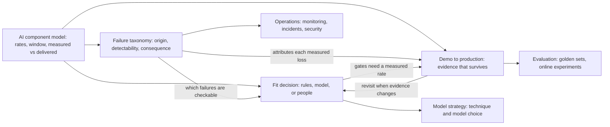
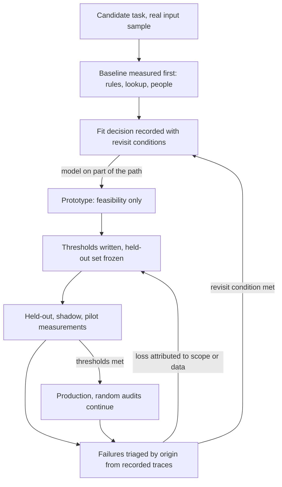

Before a model goes onto a production decision, three questions have to be answered with evidence rather than impression: what kinds of failure the system will produce and where each one originates, whether the task should use a model at all, and whether the evidence that it works says what it appears to say. This chapter answers them. The previous chapter defined the component, a part whose correctness is a rate, whose input is a rebuilt token sequence, and whose measured rate is not its delivered rate. This chapter applies that definition to the decisions a team makes before and around a launch, where the cost of a wrong answer is not one bad output but months of work aimed at the wrong layer, the wrong technique, or the wrong number.

The tension running through all three topics is between the confidence a team forms and the evidence it actually holds. A model-backed system fails by returning a fluent, well-formed wrong answer, so its failures are easy to misread; a demo shows that a model can perform a task, so the alternatives are rarely evaluated against it; and a prototype is measured by the people who built it, on inputs they chose and tuned against, so its result is an unlabeled upper bound. Each page in the chapter replaces one kind of confidence with a procedure that produces evidence: a triage order that assigns every failure to the layer that caused it, a gated decision that puts the burden of proof on the model, and a staged evidence path whose thresholds are written before the measurement.

The chapter is about decisions and evidence, not about any provider. Products, regulations, and incidents appear in the topic pages as dated examples; the procedures themselves hold for LLM-based systems as of November 2026 and are what later chapters assume when they refer to a failure origin, a fit decision, or a readiness gate.

## How the Three Topics Depend on Each Other

The topics are not a chain in which each one finishes before the next begins. They share inputs, and two of them feed the third.

*Dependencies among the chapter's topics and its main exits. Edge labels name what one page supplies to the other.*

The taxonomy sits upstream of both other pages. The fit decision needs it at the checkability gate, because whether an independent check can catch a model's errors depends on which failure classes the task produces and how detectable each one is. The demo-to-production page needs it to attribute each loss in a re-measurement to a cause, since a drop that is labeled only as "the model got worse" leads to swapping models instead of fixing scope, data, or grading. The fit decision and the evidence path form a loop: the decision's reliability and cost gates can be answered only with production-shaped evidence, and when that evidence changes, the decision's recorded revisit conditions reopen it. The three exits lead to the parts of the handbook that act on each answer.

## The Topics

[A Taxonomy of AI Failure Modes](/ai-systems-architecture/en/foundations/failure-and-fit/failure-mode-taxonomy/) answers how to classify an unacceptable outcome so that the classification tells someone what to change. It assigns every failure to one of six origin layers through a triage order applied to the recorded trace, carries detectability, consequence, correlation, and onset as separate attributes, and positions the published taxonomies from OWASP, NIST, MITRE, Microsoft, and the MAST authors against the questions each one was built for. It matters because "hallucination" names a symptom that at least four different origins produce, and a team that cannot tell them apart spends its effort on the most visible layer rather than the defective one.

[When AI Is the Wrong Solution: A Decision Framework](/ai-systems-architecture/en/foundations/failure-and-fit/when-not-to-use-ai/) answers whether a task should use a model, rules, classical machine learning, or people, and if a model, on which part of the decision. It derives the answer from six properties of the task, asks them as gates in a fixed order, and treats hybrid designs, such as rules first with a model on the residue, or a model that extracts inputs for a deterministic rule, as the common outcome rather than a compromise. It matters because the decision is usually never made explicitly: a capability shown in a demo is taken as a solution, and the cheaper, more predictable design is never measured against it.

[From Demo to Production: Why AI Prototypes Mislead](/ai-systems-architecture/en/foundations/failure-and-fit/demo-to-production/) answers why a prototype that works convincingly produces evidence that does not transfer, and which evidence replaces it. It identifies four biases in the prototype loop, chosen inputs, tuning on the test, lenient grading, and a toy environment with a hidden operator, and lays out a staged path from a frozen held-out set to shadow mode and a limited pilot, each stage gated by thresholds written in advance. It matters because a launch date, a budget, or an approval document anchored on a demo figure is anchored on a description of the builders' process, and the error surfaces only after commitments have been made.

| Topic | Question it answers | Open it when |
|---|---|---|
| A Taxonomy of AI Failure Modes | Which layer caused this failure, and which signal should have caught it? | Triaging bad outputs or incidents; setting up failure labels, audits, or detectors; mapping findings to OWASP or NIST |
| When AI Is the Wrong Solution | Should this decision use a model, rules, classical ML, or people? | Scoping a new AI feature; reviewing a design that may not need a model; volume, scope, or obligations have changed |
| From Demo to Production | Does the evidence we have support a launch, and what evidence would? | A demo or pilot result is about to set a date, a budget, or an approval; planning the evaluation path for a prototype |

## One Discipline Across Three Pages

The three pages apply the same discipline to different objects, and holding it together explains why later chapters keep asking for recorded traces, baselines, and written thresholds. Each page fully develops its own version; the summary here only shows how they connect across the life of a feature.

*The chapter's procedures over the life of one feature. Every arrow back to an earlier box carries an attributed cause or a recorded condition, never a fresh impression.*

The first shared rule is that evidence comes from records, not from re-running or remembering. The taxonomy classifies a failure from the context, versions, and output recorded at request time, because a re-run draws a new sample; the fit decision is a written record whose gates cite a sample, a measured rate, and a cost model; and the readiness gate names the source and freeze date of its held-out set. A team that does not record these things cannot apply any of the three pages, which is why the observability chapter treats recording as a precondition rather than a feature.

The second rule is that the comparison comes before the conclusion. The fit decision runs the deterministic baseline before judging the model, because a 94% model can lose to a 97% rule on the traffic the rule covers. The prototype page requires a threshold before the measurement it gates, because a number seen first is always reinterpreted. The taxonomy's worked audit compares complaint shares with a random sample before prioritizing, because complaints are sampled by visibility and systematically hide silent failures.

The third rule is that every number carries its population and its cause. A failure share without a random sample, a rate without its interval and grading criteria, and a cost estimate without real token distributions are each statements about a process rather than the system. Taken together, the pages make one argument: a model belongs on a decision only when its failures are classified, its alternatives are measured, and its rate is known on production-shaped inputs, and each of those conditions expires when the system, the traffic, or the model changes.

## Suggested Reading Order

Read the pages in sidebar order. The taxonomy comes first because both other pages use its vocabulary: the fit decision's checkability gate depends on detectability and consequence, and the prototype page's re-measurement attributes each loss to an origin. The fit decision comes second because it frames what a prototype is for: once a team knows which part of a decision a model should own, the prototype tests feasibility for that part only. The demo-to-production page comes last because its evidence path supplies the measured rates that the fit decision's later gates require, closing the loop shown in the dependency diagram.

Three shortcuts are reasonable. A reader scoping a new feature can start with the fit decision and read the taxonomy when the checkability gate becomes the hard question. A reader holding a demo result and a launch request should start with the demo-to-production page, whose worked re-measurement is self-contained. A reader triaging an incident or setting up a failure audit needs only the taxonomy, and its triage procedure can be applied without the other two.

## Prerequisites and Where the Chapter Leads

The chapter builds directly on [The AI Component Model](/ai-systems-architecture/en/foundations/ai-component-model/), and two of its pages are prerequisites in a strict sense. [Deterministic vs. Probabilistic Systems](/ai-systems-architecture/en/foundations/ai-component-model/deterministic-vs-probabilistic/) defines the deterministic shell that the fit decision places around a model and the correlated-error arithmetic that the taxonomy uses for its correlation attribute. [Capability vs. Reliability](/ai-systems-architecture/en/foundations/ai-component-model/capability-vs-reliability/) defines the repeated-trial rate and the time gap that the fit decision's reliability gate and the prototype page both rely on. From the companion handbook, [Failure Models: Crash-Stop, Crash-Recovery, Omission](https://gorkemsari.github.io/distributed-systems/en/foundations/system-models/failure-models/) is the classification the taxonomy departs from, [Blameless Postmortems](https://gorkemsari.github.io/distributed-systems/en/observability/alerting-incident-response/blameless-postmortems/) supplies the root-cause and contributing-factor split its triage order mirrors, and [Shadow Deployment](https://gorkemsari.github.io/distributed-systems/en/deployment/deployment-patterns/shadow-deployment/) is the pattern both the baseline comparison and the evidence path reuse.

The chapter's decisions are acted on in four places. Once a model is on the path, [Model Strategy & Selection](/ai-systems-architecture/en/model-strategy/) decides which technique and which model, starting with [Prompting vs. RAG vs. Fine-Tuning](/ai-systems-architecture/en/model-strategy/lifecycle-and-adaptation/prompting-rag-finetuning/). The evidence path is implemented in [Testing Probabilistic Systems](/ai-systems-architecture/en/evaluation/testing-foundations/) and [Evals in the Delivery Pipeline](/ai-systems-architecture/en/evaluation/evals-in-delivery/), where held-out sets, online experiments, and release gates get their full treatment. The adversarial origin is owned by [Threats and Attack Surfaces](/ai-systems-architecture/en/security/threats/), beginning with [AI Threat Modeling](/ai-systems-architecture/en/security/threats/threat-modeling/). And the taxonomy's labels are consumed in operations, by [Quality Monitoring and Drift Detection](/ai-systems-architecture/en/llmops/observability/quality-drift/) for detectors per origin and by [AI Incident Management](/ai-systems-architecture/en/llmops/operations/incident-management/) for the response process, with the approval of regulated deployments in [Model Risk Management for LLM Systems](/ai-systems-architecture/en/governance/risk-management/model-risk-management/).
