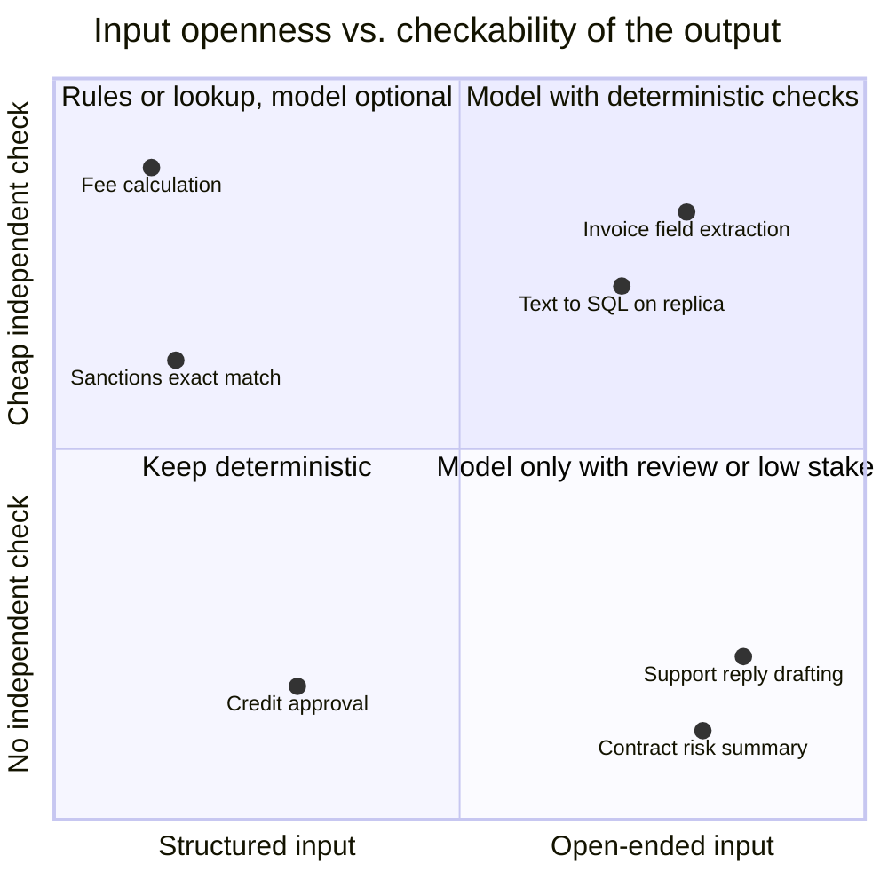
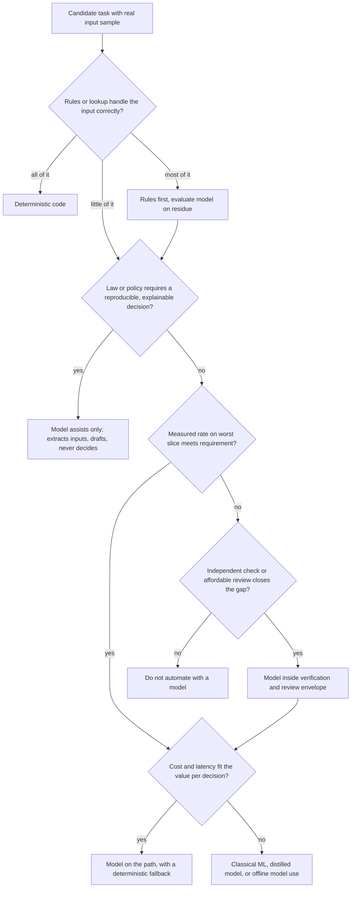
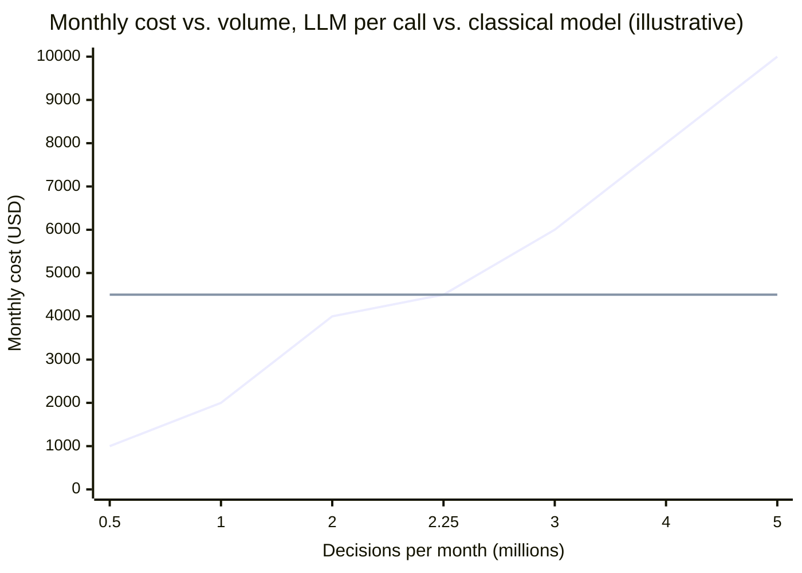
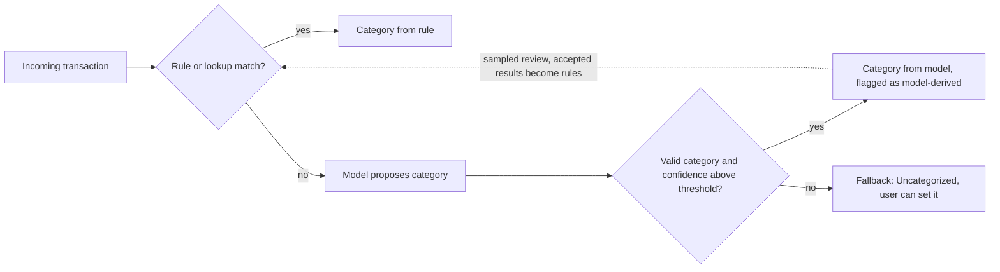
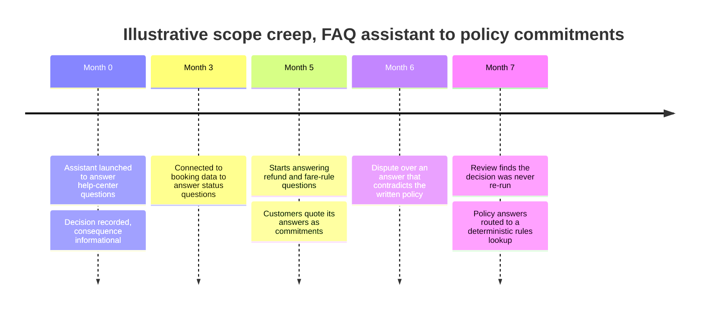

Deciding that a task should not use a language model is an architectural decision with the same standing as choosing a database: it follows from properties of the task that can be stated and checked, not from enthusiasm or from a mandate to "add AI". A model earns its place on a request path when the input is open-ended enough that rules cannot cover it at acceptable cost, and when the system can afford the model's error rate, either because errors are cheap, because something independent catches them, or because a person reviews every output. When neither condition holds, the model adds variance, cost, latency, an attack surface, and an audit problem to a task that a lookup table, a rules engine, a classical classifier, or a form would have handled deterministically.

The problem this page addresses is that the decision is usually never made explicitly. A demo shows that a model can perform the task, the capability looks like a solution, and the alternatives are not evaluated against it. Months later the team discovers that 85% of the traffic matched a handful of rules, that the remaining 15% needed human review anyway, and that the model's answers on the rule-shaped part were less consistent than the rules would have been. Nothing failed loudly. The system simply cost more, behaved less predictably, and was harder to explain than the design that was never considered.

The core trade-off is coverage of open input against guarantees. A model handles inputs nobody anticipated and accepts natural language, at the price of a measured error rate instead of a guaranteed outcome, per-call cost that scales with volume, and a decision path that cannot be fully explained. Deterministic code offers the opposite: exact, reproducible, auditable behavior on the inputs it was written for, and nothing useful on the rest. Most production designs end up in between, and the useful question is not "AI or not" but which part of the decision the model owns and which part stays in code.

## The Six Properties That Decide Fit

Whether a model belongs on a task follows from six properties of the task, and each can be assessed before any prompt is written. Two of them argue for a model, three argue against, and one is economic.

Input openness is the first argument for a model. A task whose inputs are free text, unstructured documents, images, or arbitrary user phrasing has an input space that rules cannot enumerate; a task whose inputs are already structured fields, codes, or a finite set of options does not need a model to interpret them. The test is concrete: take a week of real inputs and ask what share a reasonably sized rule set or lookup would handle correctly. If it is most of them, the model is a candidate only for the remainder.

Rule stability is the second. Where the correct output follows from rules that are known, written down, and stable, such as a fee schedule, a tax table, an eligibility policy, or an authorization matrix, the rules are the specification, and implementing them in code produces exactly the specified behavior. A model trained on general text and prompted with the policy produces an approximation of it, with an error rate. The model becomes attractive only when the rules are unknown, tacit, or so numerous that writing and maintaining them costs more than tolerating model errors: tone classification, intent detection across hundreds of phrasings, summarization.

The three properties that argue against a model all concern errors. Required reliability is the rate the business needs, measured on the worst relevant slice of traffic; [Capability vs. Reliability](/ai-systems-architecture/en/foundations/ai-component-model/capability-vs-reliability/) explains why the rate a model delivers repeatedly on production inputs sits below its benchmark or demo rate, often far below. Checkability is whether an independent, cheaper procedure can tell a correct output from a wrong one: an extracted total can be recomputed, a SQL query can be executed against a replica, a citation can be looked up, while the fairness of a credit decision or the faithfulness of a summary has no cheap check. Consequence is what a single undetected error reaches, from information a person reads and can ignore, through a recorded decision, to an irreversible effect on money, health, or legal position.

The economic property is cost per decision against value per decision, together with the latency budget. A model call costs tokens and hundreds of milliseconds to seconds; a rule costs microseconds. That gap is irrelevant for a drafting assistant used a few hundred times a day and decisive for a fraud check on every card authorization.

These properties interact, and one of them rarely decides alone. The interaction that matters most is between input openness and checkability, because together they determine whether the model's errors can be contained.


*Example tasks positioned by how open their input is and whether a cheap independent check exists. Positions are illustrative and depend on the specific system.*

The upper right is where a model fits best: the input needs interpretation, and a check turns the model's errors into retries rather than incidents, as the deterministic-shell pattern in [Deterministic vs. Probabilistic Systems](/ai-systems-architecture/en/foundations/ai-component-model/deterministic-vs-probabilistic/) describes. The upper left holds tasks that are checkable because they are fully specified, which is exactly why code can perform them; a model there could at most help by extracting inputs. The lower left is the clearest "do not use" region: structured input, no check, and typically a decision that must be explainable, such as credit approval. The lower right is the contested region. Drafting a support reply or summarizing a contract needs a model, and nothing cheap verifies the result, so the model is acceptable only when a person reads every output before it takes effect, or when the consequence of an error is small.

## A Gated Decision Procedure

The six properties become a procedure when they are asked in a fixed order, with each gate able to end the evaluation. The order matters because the early gates are cheap to answer and eliminate the cases where a model is unnecessary, while the later gates require measurement and apply only to tasks that survived.


*The decision procedure. Each gate is answered from evidence: a sample of real inputs, a written list of obligations, a measured rate, a cost model.*

The first gate is answered by running candidate rules over a sample of real inputs and counting, not by intuition. Its middle branch is the most common outcome in practice: a lookup or a set of rules handles the bulk of the traffic, and the model is evaluated only for what remains. That branch changes every later gate, because the model's measured rate, cost, and review load now apply to a residue that is smaller and harder than the whole.

The second gate checks obligations before measuring quality, because no measured rate satisfies an obligation of the wrong kind. If a regulation, a contract, or an internal policy requires that the same inputs always produce the same decision and that the decision can be explained factor by factor, a sampled output does not qualify, however accurate it is. The model can still help, by turning a scanned document into the structured inputs of a scoring rule or by drafting the explanation that a person approves, but the decision stays in code or with a person.

The third and fourth gates are the reliability test. The measured rate is `pass^k` or an equivalent repeated-trial rate on the worst slice of traffic that matters, with a confidence interval, as defined in [Capability vs. Reliability](/ai-systems-architecture/en/foundations/ai-component-model/capability-vs-reliability/). When it falls short, the question is whether a verifier or a review queue can make up the difference at a cost the business accepts. "No" at that gate is the clearest negative answer the procedure gives: the task needs a reliability the model does not deliver, nothing independent can catch its errors, and reviewing everything costs as much as doing the task by hand.

The fifth gate is economic, and it runs last because it is meaningless until the review and verification costs from gate four are known. A design that passes on quality only by sending 30% of decisions to people has a cost per decision dominated by people, not tokens.

### Why the Order Produces Sound Decisions

The procedure places the burden of proof on the model. Deterministic code is the default because its properties, reproducibility, exact compliance with a written specification, negligible marginal cost, and complete explainability, are guarantees, while a model's are measurements that must be repeated after every model, prompt, or traffic change. A design choice that requires continuous re-measurement to stay valid has to justify that ongoing cost against an alternative that does not.

The ordering also prevents the most common reasoning error, which is evaluating the model against nothing. A model that is 94% accurate sounds good until the rule-based baseline on the same sample turns out to be 97% accurate on the 85% of traffic it covers. Running the baseline first establishes what the model must beat, and on which part of the traffic. The same idea underlies Martin Zinkevich's first rule in Google's *Rules of Machine Learning*, which advises launching without machine learning when heuristics will do, and it applies with more force to LLMs, whose errors are less predictable than those of a trained classifier with a fixed output space.

Finally, the order separates questions that need different owners. Gates one and five are engineering questions. Gate two belongs to legal, compliance, or risk functions and must be answered from written obligations, not engineering judgment. Gates three and four need an evaluation set and a measured rate, which is why the [Demo to Production](/ai-systems-architecture/en/foundations/failure-and-fit/demo-to-production/) gap so often invalidates a decision made before they were asked.

Recording the answers makes the decision reviewable later, when the model, the price, or the traffic has changed.

```yaml
# Illustrative decision record; field names are not a standard
decision: transaction-categorization
evaluated: 2026-11-16
sample: 20000 production transactions, 4 weeks, all channels
gate_rules_coverage: 0.88          # share handled by MCC map + merchant table
gate_rules_accuracy: 0.995         # on the covered share, audited sample
gate_obligations: none_binding     # informational feature, no decision on customer
gate_model_rate_residue: 0.93      # worst slice: card-not-present, foreign merchants
gate_review_needed: false          # errors user-correctable, low consequence
gate_cost_per_month_usd: 70        # residue calls only, illustrative prices
outcome: hybrid_rules_then_model
fallback: category "Uncategorized" on model timeout or low confidence
revisit_when: [rules_coverage < 0.80, model_or_prompt_change, volume x2]
```

The `revisit_when` field matters as much as the outcome. A decision taken under one set of measurements expires when those measurements change, and the record states in advance which changes should reopen it.

## Worked Example: Categorizing Card Transactions

Assume, for illustration, a retail bank that wants to show customers their spending by category. It processes 3,000,000 card transactions a month that need one of 40 categories. Each transaction carries a merchant category code (MCC) assigned by the card network, a raw merchant descriptor string, an amount, and a country. A model seems an obvious fit, because descriptors are messy text.

The first gate is answered by measurement. Assume the team maps MCCs to categories and adds a table of the most frequent merchants, and that on a four-week sample this covers 88% of transactions with an audited accuracy of 99.5%. The remaining 12%, about 360,000 transactions a month, have generic MCCs, unknown merchants, or descriptors from marketplaces and payment facilitators that hide the real merchant.

Now compare three designs on the same assumptions.

The model-only design sends every transaction to a small model. Assume 350 input tokens per call (instructions, the category list, the transaction) and 10 output tokens, at an illustrative price of 0.50 USD per million input tokens and 2.00 USD per million output tokens. A call costs 350 times 0.0000005 plus 10 times 0.000002, about 0.000195 USD, and the month costs about 585 USD. Cost is not the problem. Quality is: assume the model is 96% accurate on the rule-shaped 88% and 93% on the hard residue. Errors are 2,640,000 times 0.04 plus 360,000 times 0.07, which is 105,600 plus 25,200, or 130,800 a month, an error rate of about 4.4%.

The hybrid design runs the rules first and calls the model only on the residue. Errors are 2,640,000 times 0.005 plus 25,200, which is 13,200 plus 25,200, or 38,400 a month, about 1.3%. The model bill falls to 360,000 calls, about 70 USD. The hybrid is better than model-only on every axis, and the reason is structural rather than an artifact of the numbers chosen: on inputs that rules cover, the rules are more accurate than the model, so every such input routed to the model adds errors.

The third design moves the model off the request path. Most of the residue comes from merchants seen repeatedly. Assume 40,000 distinct new descriptors a month. The model categorizes each distinct descriptor once, a sample of the results is reviewed, and accepted results are written into the merchant table as rules. Calls fall to 40,000, about 8 USD a month, and every later transaction from that merchant is categorized by lookup in microseconds. Consistency improves too: in the hybrid design, the same coffee shop can be categorized as "Coffee" one week and "Restaurants" the next, because each transaction is a new sample, while a learned rule gives the same answer every time. The model is now a tool for writing rules, which is one of the most effective ways to use it.

:::tip[Use the model at design time when the input repeats]
When the same inputs recur, such as merchants, product names, document templates, or error messages, run the model once per distinct input, review a sample of its outputs, and store the accepted outputs as data that deterministic code reads. The per-request path becomes a lookup, consistency between requests becomes guaranteed, and the model's error rate is paid once per distinct input instead of once per request.
:::

### When Volume Changes the Answer

The economics flip at different volumes for different alternatives. A classical classifier, trained on labeled examples, has a fixed cost to build and operate and a marginal cost per prediction that rounds to zero; an LLM call has no build cost and a marginal cost per call. Assume, for illustration, a classical model that costs 30,000 USD to build, amortized over 12 months, plus 2,000 USD a month to operate and retrain, about 4,500 USD a month in total. Assume a larger LLM is needed for the task at 0.002 USD per call. Monthly LLM cost is volume times 0.002, so the two cross at 4,500 divided by 0.002, or 2,250,000 calls a month.


*The rising line is the LLM at an assumed 0.002 USD per call; the flat line is a classical model at an assumed 4,500 USD a month. They cross at about 2.25 million decisions a month.*

Below the crossing, the LLM is cheaper and faster to deliver, and it needs no labeled training data. Above it, the classical model is cheaper by a margin that grows with every additional decision, and its latency is typically single-digit milliseconds rather than hundreds. The crossing point moves with both assumptions, and two effects push it in opposite directions over a system's life. Falling token prices push it to the right. Growing traffic moves the system past it from the left. The classical model also needs labels, which a model can produce: labeling a training set with an LLM and training a smaller model on it is a form of the distillation discussed in [Fine-Tuning and Distillation](/ai-systems-architecture/en/model-strategy/lifecycle-and-adaptation/finetuning-distillation/). A decision recorded at 500,000 decisions a month needs to be reopened at 3,000,000, which is why volume belongs in the record's revisit conditions. How per-call prices are composed, including the costs that do not appear on the price sheet, is in [Token Economics](/ai-systems-architecture/en/economics/understanding-cost/token-economics/).

:::caution[The review queue is part of the AI option's cost]
A design that meets its quality target only because people review a share of outputs has a per-decision cost that is mostly labor. At an assumed 2 minutes per review and 20% of 100,000 daily decisions deferred, the review queue needs about 667 hours a day, which is a department, not a line item. Price the queue before comparing the AI option with the alternatives, and compare it with the cost of people doing the whole task, which is sometimes lower once error correction is included.
:::

## The Alternatives and When Each Wins

"Not a model" is not one alternative. Each option below has its own guarantees, cost profile, and failure behavior, and most production systems combine two or three of them on different parts of the same decision.

| Option | Guarantee | Marginal cost and latency | Main weakness | When to prefer |
|---|---|---|---|---|
| Rules, lookups, decision tables | Exact, reproducible, explainable | Negligible, microseconds | Covers only anticipated inputs; rule sets grow hard to maintain | Rules are known and stable; inputs are structured; decisions must be explained |
| Full-text or structured search | Returns existing records, never invents | Low, milliseconds | Returns documents, not answers | Users need to find something that already exists |
| Classical ML classifier or ranker | Fixed output space, measurable, stable between retrains | Near zero per call, milliseconds | Needs labeled data and retraining; fails on new classes | High volume, narrow task, labels available or obtainable |
| Forms and structured UI | Input validated at entry | None | Users must fit the structure | The input is finite and the "AI" was there only to parse free text |
| LLM extracts, code decides | Decision exact on extracted inputs | Per call for extraction only | Extraction errors propagate into a correct rule | Inputs are unstructured; the decision is rule-governed |
| LLM on the request path | Measured rate, bounded by checks | Tokens per call, hundreds of ms to seconds | Variance, drift, injection surface | Open input, tolerable or checkable errors, value per decision exceeds cost |
| People | Judgment, accountability | Minutes per decision | Throughput, consistency between reviewers | Low volume, high consequence, or no other option meets the bar |

The "LLM extracts, code decides" row is the one most often missed, and it is usually the right answer for regulated decisions on unstructured input. A loan application arrives as scanned payslips and bank statements. A model extracts income, employer, and recurring obligations into structured fields; a deterministic, documented scoring rule computes the decision from those fields; a person or a deterministic check confirms the extracted values that move the decision most. The model handles the open input, the code handles the obligation, and the audit trail shows exactly which extracted value led to which outcome. The extraction step still has an error rate, and an extraction error now flows into a decision that looks rigorous, so the extracted fields need their own validation, as described in [Output Validation and Repair Loops](/ai-systems-architecture/en/reliability/output-reliability/output-validation/).

Once a model is on the path, the remaining architectural choices belong to other pages. Whether to use prompting, retrieval, or fine-tuning is decided in [Prompting vs. RAG vs. Fine-Tuning](/ai-systems-architecture/en/model-strategy/lifecycle-and-adaptation/prompting-rag-finetuning/); whether a fixed workflow or an autonomous agent should drive the steps is decided in [Workflow vs. Agent: The Autonomy Spectrum](/ai-systems-architecture/en/agents/tools-and-protocols/autonomy-spectrum/); which model to use is decided in [Model Selection Criteria](/ai-systems-architecture/en/model-strategy/selection-and-deployment/selection-criteria/). This page decides only whether the model belongs on the decision at all, and if so, on which part.


*The hybrid path from the worked example. The model sees only the residue, its output is validated, and accepted outputs migrate into the deterministic layer over time.*

Three properties of this shape carry over to other tasks. The deterministic path runs first and is authoritative when it matches, so the model never overrides a rule. The model's output is marked as model-derived wherever it is stored, which keeps the audit trail honest and lets a later reviewer find every decision a model influenced. The dotted edge shrinks the model's share over time: as reviewed outputs become rules, the residue narrows, and the system becomes more deterministic as it matures rather than less. The fallback is a defined, safe value rather than an error, which follows the general pattern in [Fallback Strategies](https://gorkemsari.github.io/distributed-systems/en/resilience/protection-patterns/fallback-strategies/); the difference here is that the fallback is triggered by low confidence as well as by failure.

## Failure Modes of the Decision Itself

The decision to use a model, or not, fails in characteristic ways, and most are invisible on system dashboards because the system keeps working while the decision behind it stops being true.

The most damaging pattern is scope creep: a model approved for a low-consequence task gradually takes on a higher-consequence one, without the decision being re-run. Each step is small and reasonable, and the final state is one that the procedure would have rejected.


*Each step widened the assistant's consequence class from information to commitment. The original decision record would have flagged month 5 if anyone had checked it.*

The public precedent for this pattern is *Moffatt v. Air Canada* (2024 BCCRT 149). The British Columbia Civil Resolution Tribunal held Air Canada liable for negligent misrepresentation after its website chatbot told a customer he could apply for a bereavement fare retroactively, contrary to the airline's published policy, and rejected the argument that the chatbot was responsible for its own statements; the customer was awarded CA$650.88 in damages plus interest and fees. A month later, in March 2024, The Markup reported that New York City's MyCity business chatbot, built on Microsoft's Azure AI services, told business owners they could take a cut of workers' tips, go cash-free, and refuse Section 8 housing vouchers, all contrary to city law. In both cases a model answered questions whose correct answer was a written rule, which is the upper-left quadrant of the fit diagram: a lookup of the policy text, or a deterministic decision table, would have given the right answer every time.

| Failure | Trigger | Symptom | Detection | Mitigation and recovery |
|---|---|---|---|---|
| Model where rules suffice | Decision never evaluated against a baseline | Higher error rate and cost than rules on rule-shaped traffic | Shadow-run rules on the same traffic, compare per slice | Route rule-covered inputs to code; model on residue only |
| Scope creep | New intents, tools, or data connected without re-review | Model answers questions whose answer is a policy or a commitment | Intent mix drift; share of answers on regulated topics | Revisit conditions in the decision record; route policy intents to lookup |
| Hidden review cost | Quality met only through human review | Review backlog grows, reviewers approve by default | Queue size, time per item, seeded-error catch rate | Price the queue up front; narrow scope or use deterministic checks |
| Stale economics | Volume grew or prices changed since the decision | Bill dominated by one high-volume task | Cost per decision trend versus classical baseline | Distill or train a classical model past the crossing point |
| Over-rejection | Model ruled out by habit on an open-input task | Rule set grows unmaintainable, coverage keeps falling | Rule count growth; share of inputs with no rule match | Re-run gate one; add model on the residue |
| Obligation discovered late | Explainability or contestation requirement found after launch | Model-made decisions cannot be explained to an auditor | Compliance review against decision log | Move the decision into code; model extracts inputs only |

Two of these deserve a note on detection. "Model where rules suffice" is detected by running the baseline in shadow on production traffic, the technique described in [Shadow Deployment](https://gorkemsari.github.io/distributed-systems/en/deployment/deployment-patterns/shadow-deployment/), and comparing error rates per slice; without a baseline nobody can see that the model is losing. Over-rejection is the mirror failure and is equally real: a team that refuses models on principle maintains a rule set of thousands of entries for free-text intents, with coverage that falls every month as users phrase things in new ways. The rule-count growth rate and the no-match share are its signals.

:::danger[Untrusted input plus private data plus an outbound channel]
Simon Willison's "lethal trifecta" (June 2025) names the combination that makes an LLM feature exploitable by design: access to private data, exposure to untrusted content, and the ability to communicate externally. A model that reads customer emails, can see account data, and can send messages or fetch URLs can be steered by an injected instruction to send that data out, and no prompt reliably prevents it. If a task needs all three, either remove one of them architecturally or treat the task as unsuitable for a model; see [Prompt Injection: Direct and Indirect](/ai-systems-architecture/en/security/threats/prompt-injection/).
:::

### Security and Governance Implications

Putting a model on a decision creates obligations that a deterministic implementation does not. The attack surface is the first: any untrusted text that reaches the context can shift the output distribution, which is why the trifecta above is a fit criterion and not only a security control. Mapping that surface is the subject of [AI Threat Modeling](/ai-systems-architecture/en/security/threats/threat-modeling/).

Liability is the second. *Moffatt* establishes, at least for one Canadian tribunal, that a company answers for what its chatbot says as it answers for the rest of its website. A model answering questions about prices, contracts, or eligibility is making statements on the company's behalf with a measured error rate.

Automated decision rules are the third, and in some jurisdictions they rule a model out of the decision role altogether. Article 22 of the GDPR gives individuals the right not to be subject to a decision based solely on automated processing that produces legal or similarly significant effects, and the Court of Justice of the EU held in *SCHUFA* (C-634/21, 7 December 2023) that an automatically generated credit score can itself be such a decision when a lender relies on it decisively. Turkey's personal data protection law (KVKK, Law No. 6698) gives data subjects, in Article 11(1)(g), the right to object to an outcome against them that arises from analysis of their data exclusively through automated systems. The EU AI Act prohibits a set of practices outright under Article 5, applicable since 2 February 2025, including social scoring and emotion recognition in workplaces and education with narrow exceptions; its high-risk obligations, which cover credit scoring and employment decisions among others, are reported to apply from December 2027 or August 2028 depending on the category, after the Digital Omnibus amendment (as of November 2026). Each of these is a gate-two answer: it does not say a model performs badly, it says a sampled, hard-to-explain output cannot carry the decision. The regulatory detail is in [International Frameworks](/ai-systems-architecture/en/governance/regulation/international-frameworks/), [Turkish Regulation](/ai-systems-architecture/en/governance/regulation/turkish-regulation/), and [Explainability and Auditability](/ai-systems-architecture/en/governance/regulation/explainability-auditability/). This summary is not legal advice; the binding reading for a specific system comes from counsel.

## Applying the Framework: Use, Do Not Use, Revisit

Put a model on the path when the input is open-ended, a measured baseline of rules covers too little of it, no obligation requires a reproducible and explainable decision, and the model's measured rate on the worst slice, possibly lifted by deterministic checks, meets the requirement at a cost per decision below the value of the decision. Drafting, summarization for a reader who checks sources, triage that routes work to people, extraction with checksums and recomputation, search query interpretation, and code generation with tests all typically qualify.

Use a model to assist a deterministic decision when the input is unstructured but the decision is rule-governed or regulated. The model extracts, classifies, or drafts; code applies the rule; a person or a check confirms the inputs that move the outcome. This is the default for credit, claims, eligibility, and compliance workflows.

Use a model offline when inputs repeat: to write rules, label training data, categorize a catalog, or generate test cases, with the results reviewed and stored. The model's flexibility is used once and its variance is never seen by users.

Do not put a model on the decision when the rules are known and stable and the input is structured; when the same input must always produce the same outcome for legal, fairness, or contractual reasons and no assisting role is needed; when an error is irreversible, no independent check exists, and reviewing every output costs as much as doing the work; when the latency budget is a few milliseconds; or when the task combines private data, untrusted input, and an outbound channel that cannot be separated. Do not use a model as a parser for input that a form could have collected in structured form; that replaces a validation guarantee with an error rate.

Revisit the decision when any condition it rested on changes: rule coverage drops, a new intent or tool is connected, the model or prompt changes, volume crosses the break-even point with a classical alternative, or a new obligation applies. A decision with no revisit conditions is a decision that will silently go out of date. Make reverting cheap, too: keeping the deterministic path deployable behind a flag, as in [Feature Flags](https://gorkemsari.github.io/distributed-systems/en/deployment/deployment-patterns/feature-flags/), turns "the model was the wrong choice" from a rewrite into a configuration change.

Several adjacent questions are often confused with this one. Which AI technique to use once a model is chosen is [Prompting vs. RAG vs. Fine-Tuning](/ai-systems-architecture/en/model-strategy/lifecycle-and-adaptation/prompting-rag-finetuning/). How much autonomy a model-backed process should have is [Workflow vs. Agent](/ai-systems-architecture/en/agents/tools-and-protocols/autonomy-spectrum/). Why a prototype that passes every gate in a demo fails them in production is [From Demo to Production](/ai-systems-architecture/en/foundations/failure-and-fit/demo-to-production/). What kinds of failures a model-backed system produces, which gate four needs in order to judge checkability, is [A Taxonomy of AI Failure Modes](/ai-systems-architecture/en/foundations/failure-and-fit/failure-mode-taxonomy/). The organizational question of who approves a decision to deploy a model on a regulated process is part of [Model Risk Management for LLM Systems](/ai-systems-architecture/en/governance/risk-management/model-risk-management/).

## Further Reading

- Martin Zinkevich, *Rules of Machine Learning: Best Practices for ML Engineering*, Google, 2017.
- D. Sculley, Gary Holt, Daniel Golovin, et al., *Hidden Technical Debt in Machine Learning Systems*, Advances in Neural Information Processing Systems (NeurIPS), 2015.
- Civil Resolution Tribunal of British Columbia, *Moffatt v. Air Canada*, 2024 BCCRT 149, 2024.
- Court of Justice of the European Union, *OQ v Land Hessen (SCHUFA Holding)*, Case C-634/21, judgment of 7 December 2023.
- Simon Willison, *The lethal trifecta for AI agents: private data, untrusted content, and external communication*, simonwillison.net, 2025.
- European Parliament and Council, *Regulation (EU) 2024/1689 (Artificial Intelligence Act)*, Official Journal of the European Union, 2024.
