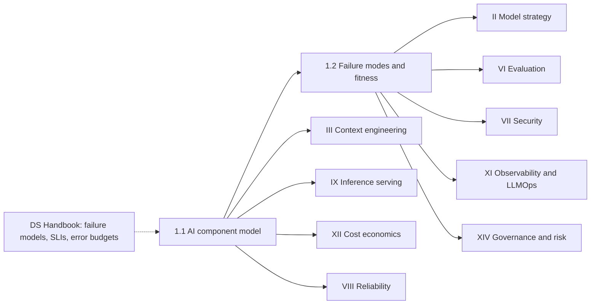
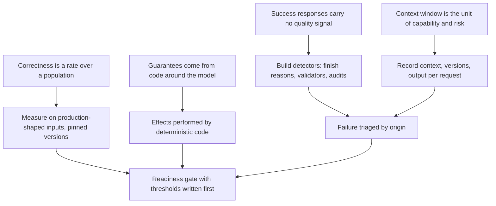

This part defines what an architect is integrating when a system calls a large language model (LLM), and what has to be decided before that model is put on a production decision. It is the shortest part of the handbook and the one every other part depends on, because the rest of the book takes three things as settled here: that a model-backed component is correct at a rate over a population of inputs rather than on each call, that its failures arrive as normal responses and must be attributed to a layer before anything can be fixed, and that the evidence for putting a model on a task has to be produced deliberately, on production-shaped inputs, against a measured alternative.

The tension the part resolves is between what a model can do and what a system can promise. The capability is real: a model handles open-ended inputs that deterministic code cannot. The cost is equally real: no per-call correctness, no reproducibility by re-running, no error signal on a wrong answer, and a measured quality figure that describes the conditions of the measurement more than the system in production. Later parts recover guarantees through validation, retrieval, evaluation, isolation, and governance; this part establishes why each of those mechanisms is needed and what it can and cannot restore.

The part sits first because its vocabulary is used everywhere without being redefined: the hard and soft layers of a component contract, the deterministic shell around a model, the measured rate versus the delivered rate, the failure origin, the fit decision, and the readiness gate. A reader who skips it can still use any later page, but will meet these terms as links back here. Products, models, and regulations appear in the topic pages only as dated examples; the properties and procedures defined in this part hold for the LLM-based systems in production use as of November 2026.

## How the Part Connects to the Rest of the Handbook

The part has two chapters. The first describes the component; the second applies that description to the decisions made before and around a launch. Every later part consumes one or both.

*The part's two chapters and the parts that build directly on each. The dotted edge marks knowledge assumed from the companion handbook.*

The split in the diagram follows what each chapter supplies. The component model is mechanical: tokens, the context window, sampling, and the probabilistic contract. It therefore feeds the parts that deal with what one call consumes and returns, which are context engineering, inference serving, cost economics, and output reliability. The failure and fitness chapter is about decisions and evidence: classifying failures by origin, choosing between a model and its alternatives, and producing evidence that transfers to production. It therefore feeds the parts that decide, measure, defend, operate, and approve. The edges are the strongest dependencies, not the only ones; almost every page in the handbook refers back to the probabilistic contract at some point.

## The Chapters

[The AI Component Model](/ai-systems-architecture/en/foundations/ai-component-model/) answers what kind of component an LLM is, at the level an architect needs to reason about contracts, cost, and failure. It shows that correctness is a rate rather than a per-call property and splits a component's contract into a hard layer that code enforces on every call and a soft layer that is only measured; it walks through one API call in tokens, context, and sampling, including how the finish reason decides whether the returned text is complete; and it separates a capability score from the delivered reliability, naming the repeated-trial, distribution, and time gaps between them. It matters because nearly every silent failure later in the book begins with a deterministic assumption applied to this component, or with a feature sized on the wrong number.

[Failure Modes and Fitness for Purpose](/ai-systems-architecture/en/foundations/failure-and-fit/) answers three questions that have to be settled with evidence before a launch: which layer caused a given failure, whether a task should use a model, rules, classical machine learning, or people, and whether a convincing prototype says what it appears to say. It supplies a failure taxonomy with a triage order over recorded traces, a gated fit decision that puts the burden of proof on the model and treats hybrid designs as the usual result, and a staged evidence path from a frozen held-out set through shadow mode to a limited pilot, with thresholds written before the measurement. It matters because the costliest mistakes in AI projects are not bad outputs but months spent on the wrong layer, the wrong technique, or a demo figure taken as a production rate.

| Chapter | Question it answers | Open it when |
|---|---|---|
| The AI Component Model | What does a model-backed component guarantee, consume, and deliver? | Designing contracts, retries, caches, or tests around a model; estimating cost or capacity; sizing a feature from a benchmark |
| Failure Modes and Fitness for Purpose | What went wrong, should a model be used here, and does the evidence support a launch? | Triaging bad outputs or incidents; scoping a new AI feature; a demo or pilot result is about to set a date or a budget |

## Ideas the Rest of the Book Builds On

Four ideas from this part recur in nearly every later chapter. Each is developed fully on its canonical page; they are collected here so that a reader can recognize them when a later page uses them in one sentence and a link.

*The part's four recurring ideas and the practices they force. The practices on the right are what later parts implement in detail.*

The first idea, that correctness is a rate, is why later parts insist on evaluation sets that resemble live traffic, on pinned model versions, and on statistical rather than single-example tests. The second, that success responses carry no quality signal, is why monitoring in this handbook means quality indicators someone built on purpose, such as finish-reason shares, validator rejection rates, and audited samples of accepted outputs, rather than error rates and latency alone. The third, that the context window is both what the model can use and what can steer it, is why context assembly is treated as an engineered and budgeted artifact, why retrieved content is treated as untrusted input, and why the context of each request is recorded for audit and triage. The fourth, that every guarantee comes from deterministic code rather than from the model, is why schemas, authorization checks, and side effects stay outside the model in every reference design.

The diagram also shows how the ideas converge. Triage by origin needs the recorded context, and the readiness gate needs both triaged failures and measurements taken on pinned versions. This is why the failure and fitness chapter comes after the component model: its procedures cannot be applied by a team that does not record what each request saw and which version produced the output.

## Reading the Part

Read the two chapters in order. The component model introduces the vocabulary that the failure and fitness chapter uses without redefining, and its three topic pages are short enough to read in one sitting. Within each chapter, the chapter overview suggests an order and names the shortcuts that are reasonable for a reader who arrives with a specific problem.

Three entry points are worth knowing for readers who will not read the whole part. A reader estimating cost, capacity, or quota needs can start with [Anatomy of an LLM as a System Component](/ai-systems-architecture/en/foundations/ai-component-model/llm-anatomy/), whose token and window arithmetic stands on its own. A reader triaging an incident or setting up failure labels can start with [A Taxonomy of AI Failure Modes](/ai-systems-architecture/en/foundations/failure-and-fit/failure-mode-taxonomy/). A reader holding a pilot result and a launch request should read [From Demo to Production](/ai-systems-architecture/en/foundations/failure-and-fit/demo-to-production/) and follow its links back to [Capability vs. Reliability](/ai-systems-architecture/en/foundations/ai-component-model/capability-vs-reliability/) where the arithmetic needs it.

## Prerequisites and Where the Ideas Are Applied

The part has no prerequisites inside this handbook. It assumes the distributed-systems background the whole book assumes, and three companion pages are directly relevant. [Deterministic vs. Probabilistic Failure Models](https://gorkemsari.github.io/distributed-systems/en/foundations/system-models/deterministic-vs-probabilistic/) covers faults modeled as rates, which differs from this part's subject, a correct component that still returns wrong outputs at some rate. [Failure Models: Crash-Stop, Crash-Recovery, Omission](https://gorkemsari.github.io/distributed-systems/en/foundations/system-models/failure-models/) is the classification the failure taxonomy departs from. [Service Level Indicators](https://gorkemsari.github.io/distributed-systems/en/observability/slo-sla-error-budgets/sli/) supplies the method the reliability page reuses once the indicator becomes a quality rate.

The ideas are applied in almost every later part, and five continuations are the most direct. [Model Strategy & Selection](/ai-systems-architecture/en/model-strategy/) acts on the fit decision once a model is on the path, starting with [Prompting vs. RAG vs. Fine-Tuning](/ai-systems-architecture/en/model-strategy/lifecycle-and-adaptation/prompting-rag-finetuning/). [Context Engineering](/ai-systems-architecture/en/context-engineering/) builds on the window and token arithmetic, beginning with [Context Window Economics](/ai-systems-architecture/en/context-engineering/context-design/context-window-economics/). [Reliability & Resilience](/ai-systems-architecture/en/reliability/) builds the deterministic shell, including [Output Validation and Repair Loops](/ai-systems-architecture/en/reliability/output-reliability/output-validation/). [Evaluation & Quality Engineering](/ai-systems-architecture/en/evaluation/) owns the measurement that turns a capability into a known delivered rate, beginning with [Why Evals](/ai-systems-architecture/en/evaluation/testing-foundations/why-evals/). And [Observability & LLMOps](/ai-systems-architecture/en/llmops/) operates what the taxonomy classifies, through [Quality Monitoring and Drift Detection](/ai-systems-architecture/en/llmops/observability/quality-drift/) and [AI Incident Management](/ai-systems-architecture/en/llmops/operations/incident-management/).

Two further parts depend on the failure and fitness chapter in a stricter sense. [AI Security](/ai-systems-architecture/en/security/) treats the adversarial failure origin, starting with [AI Threat Modeling](/ai-systems-architecture/en/security/threats/threat-modeling/), and its defenses assume the rule that no privilege boundary exists inside the context window. [Governance, Risk & Compliance](/ai-systems-architecture/en/governance/) turns the fit decision and the readiness gate into approval artifacts for regulated deployments, through [Model Risk Management for LLM Systems](/ai-systems-architecture/en/governance/risk-management/model-risk-management/).
