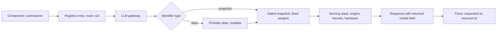
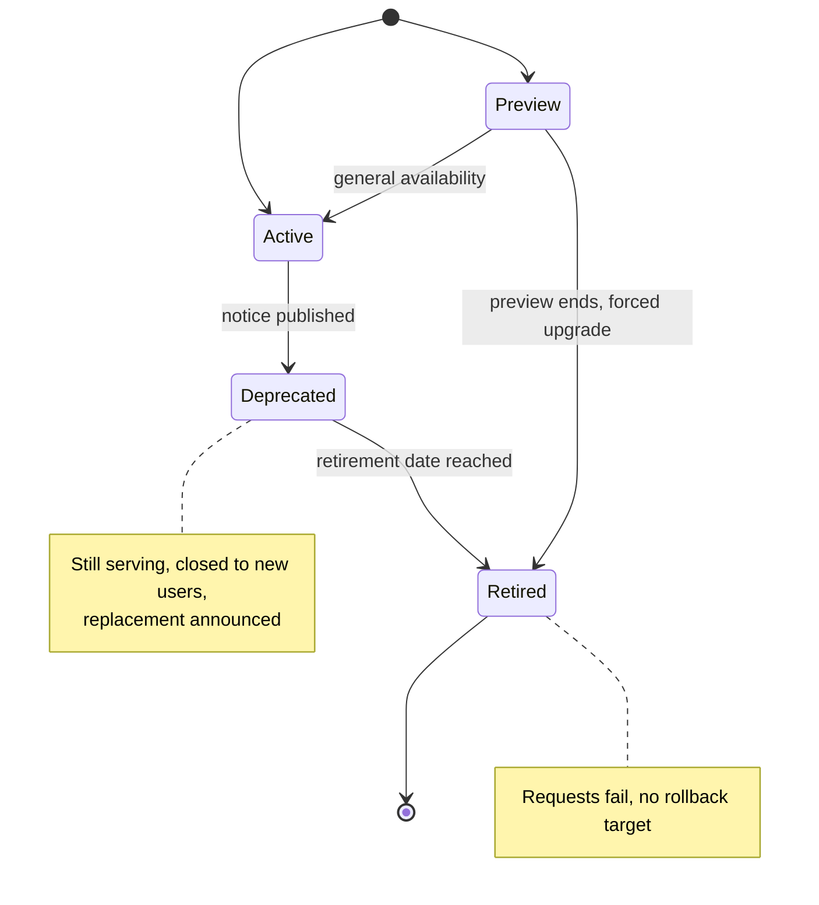
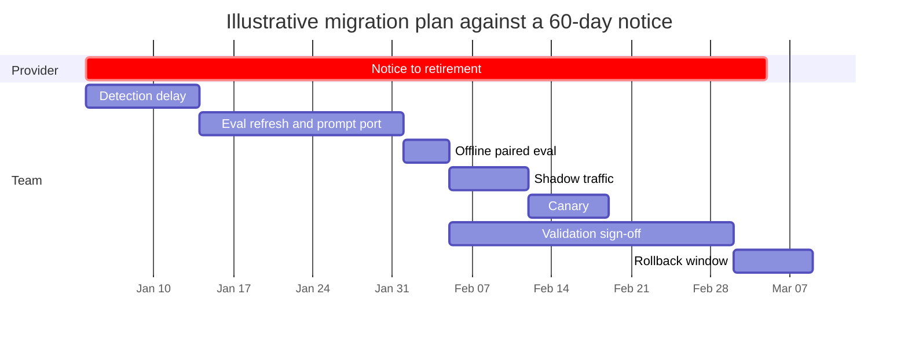
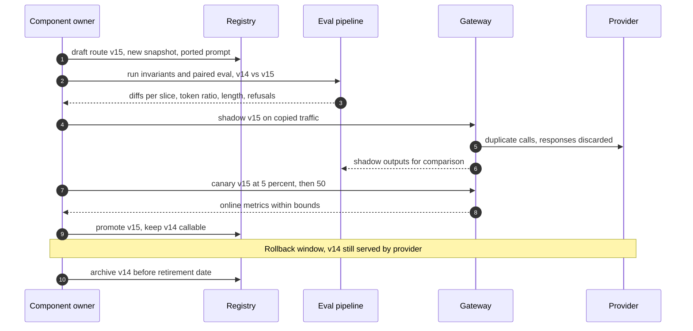
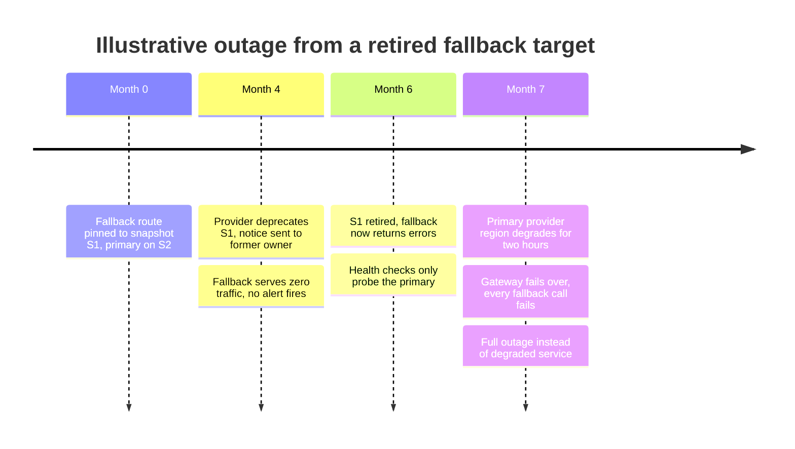

A model version is the identifier that determines which trained weights, tokenizer, and default behavior answer a request. Hosted providers expose it at two levels: a dated or numbered snapshot, which names one fixed release, and an alias, a shorter name that the provider points at whichever snapshot it currently considers the default. Deprecation is the provider's announcement that a snapshot will stop serving on a stated date; retirement is the date itself, after which requests fail. Migration is the work of moving a component from one model configuration to another without breaking the behavior that the rest of the system was built around.

The problem is that the model is the one dependency in an AI system whose behavior can change while its interface stays identical, and whose end of life is scheduled by someone else. A library upgrade happens when you merge it. An alias move happens when the provider decides, and a retirement happens on the provider's date whether or not your evals are ready. Without explicit version management, a production component changes behavior with no deploy on your side, or stops working on a date that nobody in the team had in a calendar.

The core trade-off is who owns the timing of change. Pinning a snapshot makes every behavior change a deliberate release that you test, but it obliges you to migrate on the provider's clock, at a pace set by its notice period rather than by your release cycle. Following an alias removes the migration work and gives you improvements automatically, but every alias move is an untested production change. Self-hosting open weights takes the clock back entirely, at the price of owning the serving stack and the security patching of the model's runtime. No option removes migration; each one decides whether migration is scheduled, forced, or silent.

## What a Model Identifier Pins, and What It Leaves Free

A request to a hosted model passes through several layers of naming before any GPU runs. The application asks for a logical capability, such as "the summarizer". A registry or configuration maps that to a provider model identifier. If the identifier is an alias, the provider resolves it to a snapshot. The snapshot then runs on a serving stack (inference engine, hardware, numerical kernels, sampling implementation) that the provider operates and changes on its own schedule.


*Resolution of a model call. Everything to the left of the snapshot is under your control; the alias pointer and the serving stack are not.*

Three things in this path change behavior, and each needs its own control. The registry entry changes when your team changes it, which is the normal release path covered in [Prompt and Model Registry](/ai-systems-architecture/en/platform/internal-platform/prompt-model-registry/). The alias pointer changes when the provider moves it; pinning a snapshot removes this source. The serving stack changes underneath a pinned snapshot, and no identifier you control removes it. Anthropic's September 2025 postmortem, discussed in [Hosted API vs. Self-Hosted vs. Hybrid Deployment](/ai-systems-architecture/en/model-strategy/selection-and-deployment/hosted-vs-self-hosted/), described infrastructure bugs that degraded output quality for some requests with no model change at all. A pin therefore guarantees that the weights and tokenizer are the ones you tested; it does not guarantee that the output distribution is the one you tested.

The logged pair of requested and returned identifiers is what makes the first two sources observable. Most provider APIs return the resolved model name in the response body. A component that logs only what it asked for cannot tell, after an incident, whether the provider served the snapshot it expected. A component that logs both can alert on the first response whose returned identifier differs from the pinned one, which turns a silent alias move into a page within minutes.

The evidence that behavior moves behind a stable name is not anecdotal. Chen, Zaharia, and Zou compared the March 2023 and June 2023 versions of GPT-4 served under the same product name and found that accuracy on identifying prime versus composite numbers fell from 84% to 51%, that both GPT-4 and GPT-3.5 made more formatting mistakes in generated code in June, and that GPT-4 followed chain-of-thought prompting less reliably (arXiv 2307.09009, v3 of October 2023). Some tasks improved over the same interval. The lesson is not that new versions are worse; it is that a version change moves many behaviors at once, in different directions, and a single aggregate score does not show which ones moved.

### Three Contracts You Can Buy

Providers offer different contracts for what an identifier means, and the contract decides how much of the change control is yours.

A floating alias guarantees an interface and the provider's current recommended model. It does not guarantee stability of any behavior across days. A pinned snapshot guarantees fixed weights until a published retirement date, after which it guarantees failure. Some platforms add a third, managed option: the deployment is pinned, and the platform upgrades it under a stated policy. Azure OpenAI, for example, exposes a `versionUpgradeOption` on a deployment with three values: `OnceNewDefaultVersionAvailable` upgrades when a new default version is set, `OnceCurrentVersionExpired` upgrades only when the current version retires, and `NoAutoUpgrade` never upgrades, so the deployment stops working at retirement. Standard deployments are upgraded on a rolling, region-by-region schedule; provisioned deployments are not auto-upgraded (per Microsoft's model-retirements documentation, updated 24 July 2026).

`OnceCurrentVersionExpired` is often chosen as a safe middle ground and is the worst of the three for a component with a quality contract. It keeps behavior stable until the retirement date and then changes it on that date, with no eval in between, at exactly the moment the team was supposed to have finished a migration it now has no reason to start. If it is used at all, it should be a last-resort safety net behind a migration that is planned to finish well before the date.

## Deprecation Lifecycles and the Migration Clock

Every hosted provider runs some version of the same state machine: a model becomes available, is later marked as no longer recommended or closed to new users, and is finally removed. The names and the guaranteed durations differ, and those durations are the inputs to your migration plan.


*A generalized provider lifecycle. The interval between `Deprecated` and `Retired` is the only time you can run old and new snapshots side by side.*

The diagram hides the property that matters most: once a snapshot is retired, it cannot be a rollback target. Every safe migration technique (shadow traffic, canary, instant rollback) needs the old and new snapshots to be callable at the same time. The deprecation window is therefore not "time until the old one breaks" but "time during which a safe migration is possible". A migration that starts in the last week of that window is a migration without rollback.

The table below records three providers' documented lifecycles. These are examples of the mechanism and change over time; check the current documentation before planning against them.

| Provider (as of November 2026) | States | Guaranteed notice and lifetime | After retirement | Notable constraint |
|---|---|---|---|---|
| Anthropic API | Active, deprecated, retired | At least 60 days' notice before retiring a publicly released model | Requests fail | Deprecated means still functional but no longer recommended, with a retirement date assigned |
| Azure OpenAI | Preview, GA, deprecated, optional legacy, retired | GA retirement set at launch to 18 months out (12 months for some partner models); closed to new customers at 12 months; at least 60 days' notice for GA, at least 30 days for preview | Requests return `410 Gone` | Retirement dates are not extendable; emergency retirement with shortened notice is possible for security or compliance reasons |
| Amazon Bedrock (models launched on or after 7 September 2026) | Active, Legacy, End-of-Life | Model card shows an "EOL no sooner than" date; Legacy period of 6 months for most models, 45 days for some | Model removed from all Regions, requests fail, no automatic migration | In Legacy, existing customers may lose access after 15 days of inactivity; no new Provisioned Throughput or fine-tuning jobs |

Sources: Anthropic model-deprecations documentation, Microsoft Azure OpenAI model deprecations and retirements (updated 24 July 2026), AWS Bedrock User Guide "Model lifecycle". Older Bedrock models follow a separate legacy lifecycle page that is not summarized here.

Two rows deserve a second reading. Azure's statement that retirement dates are not extendable means that a negotiation with an account team is not a migration plan. Bedrock's inactivity rule means that a Legacy model used only as a fallback target, which by design receives no traffic for weeks, can lose access before its end-of-life date; the failure appears on the day the primary fails and the fallback is finally called.

:::caution[An idle fallback can be the first thing to break]
Fallback routes, disaster-recovery regions, and batch jobs that run quarterly call their models rarely. Lifecycle rules keyed to activity, emergency retirements, and notices sent only to subscriptions with active deployments all hit these routes first. Inventory every route, including the ones that served zero requests last month, and send a synthetic request through each fallback target on a schedule so that a retired or inaccessible target fails a health check instead of a real incident.
:::

### The Lead-Time Inequality

A migration is safe when it finishes, including its rollback window, before the old snapshot retires. Write the provider's guaranteed notice as `N`, the time between the notice being published and someone who owns the component acting on it as `D` (detection delay), the migration lead time as `L`, and the rollback window you want after cutover as `R`. The condition is `D + L + R <= N`. Every term except `N` is yours, and `N` is the provider's minimum, not its typical value.

The inequality explains why model selection treats version lifetime as a gate, as described in [Model Selection Criteria: A Multi-Criteria Method](/ai-systems-architecture/en/model-strategy/selection-and-deployment/selection-criteria/): if your honest `L` is longer than the provider's minimum `N`, every forced migration will be rushed, and the only fixes are to shorten `L`, to start migrations before any notice arrives, or to choose a provider or deployment option with a longer guaranteed lifetime. It also explains why `D` matters. A notice that goes to a shared mailbox nobody reads, or to the subscription owner rather than the component owner, can consume a third of a 60-day window before work starts.

### Worked Example: Is Sixty Days Enough?

Assume, for illustration, a document-summarization component in a bank, pinned to a snapshot whose provider publishes the minimum 60-day notice. The team estimates its lead time from the steps it actually runs: refreshing the eval set with recent production samples (5 working days), porting and tuning the prompt for the replacement model (8), offline paired evaluation and review (3), shadow traffic for a week of business cycles (7 calendar days), a staged canary (7 calendar days), and the model risk validation sign-off required for a model change in this institution, which takes 25 calendar days. In calendar days, with the 16 working days counting as about 22, `L` is about 22 + 7 + 7 + 25 = 61 days, already longer than the notice. The team wants a rollback window `R` of 7 days after full cutover.


*The plan does not fit: validation runs in parallel with shadow and canary, yet the rollback window still ends after the retirement date.*

Running validation in parallel with shadow and canary, which is usually acceptable because the validator reviews the offline results and the shadow data as it arrives, brings the critical path to 18 + 4 + 25 = 47 days after work starts. With a detection delay of 10 days, cutover lands on day 57 and the 7-day rollback window ends on day 64, four days after retirement. With `D` at 2 days, achieved by routing provider lifecycle notices to the component owner and polling lifecycle status programmatically, cutover lands on day 49, the window ends on day 56, and the plan fits with four days of slack. The numbers are illustrative; the structure is general. In a regulated institution validation usually dominates `L`, it cannot be compressed by engineering effort, and the only reliable lever left is `D`, or starting the migration when the replacement becomes available rather than when the notice arrives.

The same component shows why a migration is more than an eval score. Assume the replacement model's tokenizer produces about 1.2 times as many tokens for the bank's Turkish and English documents (illustrative; the real ratio must be measured, as explained in [Anatomy of an LLM as a System Component](/ai-systems-architecture/en/foundations/ai-component-model/llm-anatomy/)). The context budget is 120,000 input tokens, and the 99th percentile of assembled inputs is 104,000 tokens today. Under the new tokenizer that becomes about 125,000, so roughly the top 1-2% of requests now exceed the budget and are either rejected by the provider or truncated by the context assembler, losing the end of the document. At an unchanged per-token price, the same traffic also costs about 20% more. Neither effect appears in an offline eval whose items are shorter than the production tail, and both are found by re-measuring the component's invariants rather than its quality score.

## Running a Model Change as a Release

A migration has the same shape whether it is forced by a retirement or chosen because a better model arrived: establish what the component depends on, measure the candidate against it, expose it to production gradually while the old snapshot still exists, and record what changed. The generic change process for prompts, models, and configuration is owned by [Change Management for Prompts, Models, and Configuration](/ai-systems-architecture/en/llmops/operations/change-management/); this section covers what is specific to replacing the model itself.


*A migration as a sequence of gated steps. Steps 4-8 are only possible while the provider still serves the old snapshot.*

Step 1 creates a new route version rather than editing the existing one. The route bundles the snapshot, the prompt version, sampling and effort parameters, output limits, and any tool schemas, because a new model rarely runs well on the old prompt and a rollback must restore all of them together. Prompts are tuned against a specific model's tendencies: emphasis that one model needed to follow a format can make the next one rigid, and examples that corrected one model's habit can be redundant or harmful for another. Porting the prompt is part of the migration, and the old and new prompts are versioned as a pair with their snapshots.

Step 2 measures two different things. The invariants are the properties the rest of the system assumes: token counts per request under the new tokenizer, context fit at the high percentiles, output length and reasoning-token distributions (which drive latency, timeouts, and cost, as the reasoning-length incident in [Reasoning Models and Test-Time Compute](/ai-systems-architecture/en/model-strategy/model-landscape/reasoning-models/) shows), structured-output validity, tool-call argument formats, refusal rate, and language behavior. These are checked against budgets, not compared for preference. The quality comparison is a paired evaluation of old and new routes on the same items, broken down by slice, because a version change moves different behaviors in different directions. The statistics of a paired comparison and of quality gates are covered in [Evals in CI/CD: Regression Suites and Quality Gates](/ai-systems-architecture/en/evaluation/evals-in-delivery/evals-in-cicd/).

Steps 4 to 8 apply the deployment patterns that the Distributed Systems Handbook describes in [Shadow Deployment](https://gorkemsari.github.io/distributed-systems/en/deployment/deployment-patterns/shadow-deployment/) and [Canary Release](https://gorkemsari.github.io/distributed-systems/en/deployment/deployment-patterns/canary-release/). Two things differ for a model. Shadow traffic costs real money, because every duplicated call is a billed inference, so shadow is usually sampled rather than full. And shadow outputs cannot be compared by equality; they are compared by the same judges and checks the offline eval uses, plus the invariants, which is why the gateway sends them back to the eval pipeline. Online comparison methods and their statistics are owned by [Online Experimentation: A/B Tests, Shadow Mode, Canary](/ai-systems-architecture/en/evaluation/evals-in-delivery/online-experimentation/).

Step 9 promotes the new route without removing the old one. The rollback window is real only if v14 remains callable, which the provider guarantees only until retirement. Step 10 archives the old route explicitly, so that no fallback, batch job, or forgotten environment still references a snapshot that is about to stop serving.

### What Else Is Pinned to the Old Model

A model change invalidates more than the route. Several artifacts are silently bound to the snapshot that produced them, and a migration checklist that covers only the route leaves them behind.

Response caches keyed without the model version serve old-model outputs after cutover, mixing two behaviors in one component and hiding the migration from monitoring; caches are keyed on the pinned model and prompt versions and are flushed or namespaced at cutover, as [Semantic Caching](/ai-systems-architecture/en/platform/ai-gateway/semantic-caching/) describes. Fine-tuned models are derived from a specific base snapshot, and when the base is retired the fine-tune usually goes with it; the replacement is a new training run on a new base, with its own eval, covered in [Fine-Tuning and Distillation: An Integration Perspective](/ai-systems-architecture/en/model-strategy/lifecycle-and-adaptation/finetuning-distillation/). Embedding models are a different case entirely: vectors produced by two embedding models are not comparable, so replacing one means re-embedding the corpus, which is a re-indexing project rather than a route change, owned by [Embedding Model Selection and Re-Indexing Cost](/ai-systems-architecture/en/retrieval/ingestion-indexing/embedding-models/). LLM-as-judge evaluators are models too; if the judge's snapshot changes during a migration, the eval no longer measures only the candidate.

:::tip[Migrate the judge separately from the candidate]
When the evaluation judge and the production model share a provider, both may be deprecated in the same notice. Pin the judge to its own snapshot, migrate it in a separate change with its own agreement check against human labels, and never change the judge and the judged model in the same release: a moved score could come from either, and the release cannot tell you which.
:::

## Pinning Strategies Compared

The choice of versioning contract is made per component, from its quality sensitivity, its change-control obligations, and the team's ability to keep `L` short.

| Strategy | Behavior stability | Who sets the timing of change | Ongoing work | What happens at end of life | When to prefer |
|---|---|---|---|---|---|
| Floating alias | None across days; every alias move is a change | Provider | None until something breaks | Alias moves on; no hard failure | Prototypes, internal tools with no quality contract, components where the newest model is the requirement |
| Pinned snapshot, planned migration | Fixed weights until retirement | You, within the provider's notice | Inventory, lifecycle monitoring, a migration per retirement | Hard failure if migration is late | Any production component with a quality, safety, or compliance contract |
| Pinned with auto-upgrade at expiry | Fixed until retirement, then changed without an eval | Provider's retirement date | Low | Untested behavior change on the retirement date | Only as a safety net behind a planned migration, never as the plan |
| Pinned with auto-upgrade on new default | Changes whenever the provider sets a new default | Provider | Low | Upgraded long before retirement | Same cases as a floating alias, where the platform offers no alias |
| Self-hosted open weights | Weights fixed indefinitely; serving engine and drivers still change | You | Serving stack, security patches, capacity | No external retirement; you choose when to replace | Long validation cycles, residency constraints, or components that must stay unchanged for years |

The self-hosted row is not free of migration. Open weights do not retire, but serving-engine upgrades change numerics and parameter handling, and the hardware generation the weights were validated on eventually leaves the fleet. The difference is that you choose the timing, which can be worth the operational cost when validation takes a quarter; the economics are in [Self-Hosted vs. API: Total Cost of Ownership](/ai-systems-architecture/en/economics/understanding-cost/tco/).

### Recording the Lifecycle in the Route

The fields that make a migration plannable belong in the route definition, next to the snapshot they describe, rather than in a spreadsheet. A minimal shape:

```yaml
route: summarizer
version: 15
model:
  provider: vendor-a
  snapshot: model-b-2026-10-01      # never an alias in production
  retires_no_earlier_than: 2028-04-01
  lifecycle_source: provider_api    # polled daily, not read from email
rollback:
  route_version: 14                 # must stay callable during the window
  window_days: 7
prompt_version: summarizer-prompt-31  # ported for model-b, paired with snapshot
invariants:
  p99_input_tokens_max: 115000      # measured with the new tokenizer
  p95_output_tokens_max: 1200
  refusal_rate_max: 0.01
owner: team-docs-ai                 # receives lifecycle notices
eval_suite: summarizer-golden-v9
```

Each field closes one of the gaps from the worked example. `retires_no_earlier_than` lets a scheduled job compute `N` minus elapsed time for every route and alert when the remaining window falls below the team's recorded `L`. `lifecycle_source` reflects that some providers expose lifecycle state programmatically, which shortens `D` from "whenever someone reads the email" to a day. `owner` routes notices to the people who will do the work. The `invariants` block is what step 2 of the migration checks, with thresholds measured on the new model's tokenizer. The field names are illustrative; the registry that stores them is described in [Prompt and Model Registry](/ai-systems-architecture/en/platform/internal-platform/prompt-model-registry/), and the provider-neutral interface that keeps a migration a configuration change is the subject of [Vendor Lock-in and the Abstraction Layer](/ai-systems-architecture/en/model-strategy/lifecycle-and-adaptation/vendor-lock-in/).

Version identifiers also matter for audit. A regulated system must be able to say which snapshot produced a given output months later, so the returned model identifier and the route version go into the trace and the output record, as described in [Data Lineage and Provenance for AI Outputs](/ai-systems-architecture/en/data-governance/quality-provenance/lineage-provenance/). In institutions that treat an LLM as a model under model risk governance, a snapshot change is a validation event, and the migration evidence (paired eval, invariant checks, shadow results) is the validation file, as [Model Risk Management for LLM Systems](/ai-systems-architecture/en/governance/risk-management/model-risk-management/) describes. Safety behavior is part of what moves: refusal boundaries, resistance to prompt injection, and handling of personal data can all shift between snapshots, so the red-team and injection suites from [Red Teaming and Jailbreak Testing](/ai-systems-architecture/en/security/defenses/red-teaming/) run on the candidate before canary, not after.

## Failure Modes and Operations

Version failures split into two groups. Hard failures happen on a date: a retired snapshot returns an error and the component stops. Soft failures happen whenever behavior moves: nothing errors, and quality, cost, or latency drifts. The hard ones are easy to detect and expensive when missed; the soft ones are cheap per request and can run for weeks.


*An illustrative incident in which a correct fallback design fails because its target retired while idle.*

The chain has three links, and breaking any of them prevents the outage. The notice reached a person who no longer owned the route, so `D` was unbounded. The fallback served no traffic, so retirement produced no errors in normal operation. The health checks probed only the primary, so the broken fallback was discovered by the incident it was built to absorb. The fallback design itself is covered in [Fallback Chains and Graceful Degradation](/ai-systems-architecture/en/reliability/provider-failures/fallback-degradation/); the version-specific defenses are route-level ownership, programmatic lifecycle polling across every route including idle ones, and synthetic probes through each fallback target.

Soft failures have a public example that shows why a provider's own testing does not replace yours. On 24-25 April 2025 OpenAI rolled out an update to GPT-4o in ChatGPT that made the model noticeably sycophantic; it began rolling the update back on 28 April, and the full rollback took around 24 hours. In its follow-up, OpenAI wrote that its offline evaluations, especially those testing behavior, had generally looked good, that its A/B tests had indicated that the small number of users who tried the model liked it, and that its offline evals were not broad or deep enough to catch the behavior; it announced, among other changes, that behavior issues would be treated as launch-blocking and that sycophancy evaluations would be added to deployment (OpenAI, "Expanding on what we missed with sycophancy", 2 May 2025). The write-up concerns ChatGPT, not a pinned API snapshot, but the lesson transfers: a provider's evals measure the provider's priorities, and only your eval suite measures the behavior your component depends on.

| Failure | Trigger | Symptom | Detection | Mitigation and recovery |
|---|---|---|---|---|
| Silent alias move | Provider repoints an alias | Quality, length, or refusal shift with no local deploy | Returned model id differs from expected; continuous evals | Pin snapshots; treat the move as a migration; [Quality Monitoring and Drift Detection](/ai-systems-architecture/en/llmops/observability/quality-drift/) |
| Missed retirement | Notice not seen or not acted on | Sudden hard errors on one route | Error rate by route and model id; remaining-window alert | Lifecycle polling; owner per route; emergency migration with reduced shadow |
| Retired or inaccessible fallback | Idle target retired or lost access | Failover fails during a provider incident | Synthetic probes through every fallback | Probe on schedule; migrate fallbacks with primaries |
| Tokenizer inflation | New snapshot tokenizes differently | Context overflow on long inputs; cost rise at unchanged price | Token ratio on replayed traffic; p99 input tokens | Re-measure budgets; adjust context assembly before cutover |
| Output-length shift | Different verbosity or reasoning length | Timeouts, truncated JSON, cost spike | p95 output and reasoning tokens per route | Invariant budgets in the migration gate; adjust limits and timeouts |
| Prompt not ported | Old prompt reused on new model | Regressions on specific slices, format drift | Paired eval by slice | Version prompt with snapshot; port and tune before canary |
| Mixed-version cache | Cache key lacks model version | Old and new outputs served side by side | Cache hit share after cutover; output-version tags | Key caches on model and prompt version; flush at cutover |
| Orphaned fine-tune | Base snapshot retires | Fine-tuned endpoint fails or is scheduled for removal | Lifecycle of base models in inventory | Retrain on the new base early; keep training data and eval ready |
| No rollback target | Migration finished near retirement | Regression found after the old snapshot is gone | Rollback window shorter than `R` | Start migrations at replacement availability; fall back to another provider's route |
| Serving-side change under a pin | Provider infrastructure change | Quality shift with unchanged model id | Continuous evals on production samples | Escalate to provider with evidence; route around via fallback while it lasts |

The detection column relies on two signals that ordinary service telemetry does not carry: the model identifier the provider returned on each response, and a continuous evaluation of sampled production traffic. With both, a version change is visible on the first affected request and its quality impact within a day. Without them, the first signal is usually a user complaint or a finance report.

:::danger[A retired snapshot cannot be restored]
Retirement removes the rollback target permanently. If a migration's regression is found after the old snapshot retires, there is no version to return to, and every option left (a hurried prompt fix, a different provider, disabling the feature) is a new untested change. Finish cutover, including the full rollback window, before the retirement date, and if that is impossible, prepare an alternative route on another model before the date rather than after.
:::

## When to Pin, When to Float, and When to Migrate Early

Pin a dated snapshot for every production component whose output feeds a decision, a customer, a downstream parser, or an audit record. The cost is a migration per retirement; the benefit is that every behavior change is one you tested. Do not pin and forget: a pin without lifecycle monitoring converts a silent change into a hard failure on a date, which is better only if someone is watching the date.

Float an alias only where the newest model is the requirement and nothing depends on stable behavior: prototyping, exploratory internal assistants, and offline jobs whose outputs a human reviews before use. Do not float in a component with structured outputs, tool calls, or regulated decisions; the first alias move becomes an unplanned release.

Use platform auto-upgrade at expiry only as a net behind a planned migration. Do not use it as the plan: it guarantees that the behavior change happens on the retirement date with no eval, which is the outcome pinning was meant to prevent.

Migrate early, when the replacement becomes available rather than when the deprecation notice arrives, if the component's lead time is close to or longer than the provider's guaranteed notice, if the component has a validation cycle you cannot shorten, or if it shares a provider with its fallback and its judge. Early migration spends effort before it is forced, in exchange for a rollback window that the provider's schedule cannot take away.

Prefer self-hosted open weights for components that must stay unchanged for longer than any hosted provider guarantees, or whose validation cycle exceeds the provider's notice period by a wide margin, provided the team can own the serving stack. Do not self-host only to avoid migrations: the serving engine, drivers, and hardware still change, and those changes need the same eval gate.

Some neighboring concerns are often confused with this one. Versioning your own API for clients, so that callers can move between contract versions, is a different problem, covered in [API Versioning Strategies](https://gorkemsari.github.io/distributed-systems/en/communication/synchronous-protocols/api-versioning/); a model migration should be invisible to your API's clients. Choosing the replacement model is a selection decision, owned by [Model Selection Criteria](/ai-systems-architecture/en/model-strategy/selection-and-deployment/selection-criteria/), and this page assumes that decision has been made. Detecting drift in production quality, regardless of its cause, belongs to [Quality Monitoring and Drift Detection](/ai-systems-architecture/en/llmops/observability/quality-drift/).

## Further Reading

- Lingjiao Chen, Matei Zaharia, and James Zou, *How Is ChatGPT's Behavior Changing over Time?*, arXiv:2307.09009, 2023.
- OpenAI, *Expanding on what we missed with sycophancy*, OpenAI blog, 2025.
- Microsoft, *Azure OpenAI model deprecations and retirements*, Microsoft Learn documentation, 2026.
- Amazon Web Services, *Model lifecycle*, Amazon Bedrock User Guide.
- Anthropic, *Model deprecations*, Claude platform documentation.
- D. Sculley et al., *Hidden Technical Debt in Machine Learning Systems*, Advances in Neural Information Processing Systems (NeurIPS), 2015.
