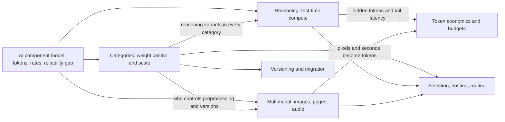
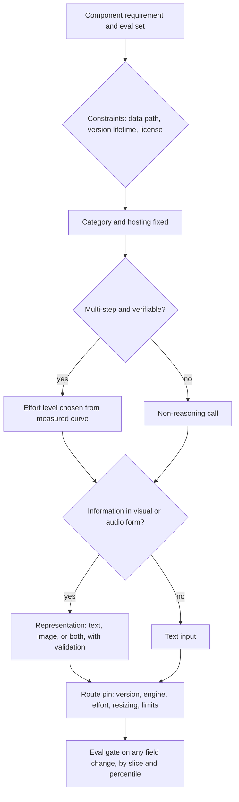

Before a team can choose a model for a component, it has to know what kind of component each family of models is: who controls it, what a call costs and how long it takes, what can enter it, and where its errors appear. This chapter answers that question along three axes that are independent of one another. The first is who holds the weights and how large the model is, which decides version control, the data path, and the cost structure. The second is how much computation the model spends per request before it answers, which decides latency and cost per call. The third is which modalities enter the token sequence, which decides where perception errors live and what an input costs. Every production model is a point on all three axes at once: a small open-weight model can be multimodal, a closed frontier model can be run with or without extended reasoning, and a reasoning variant exists in every category.

The tension running through the chapter is between the label under which a model is sold and the contract it actually offers. "Frontier", "reasoning", and "multimodal" read as capability claims, and teams choose on capability. Each label, however, also changes something an architect has to budget, monitor, and defend: a vendor that can move an alias under a stable name, hidden output tokens that make visible answer length a poor predictor of cost and latency, and image tokens that scale with pixels rather than information while a misread digit comes back as fluent, schema-valid text. Each page in the chapter replaces the label with the contract: what the category, the reasoning mode, or the modality guarantees, what it does not, and which measurement shows whether it holds on your traffic.

The chapter describes model families, not a ranking of products. Specific models, prices, and provider limits appear in the topic pages as dated examples verified at writing time; the axes and the reasoning built on them hold for LLM-based systems as of November 2026 and are what the rest of the model-strategy part assumes when it refers to a category, an effort level, or an input representation.

## How the Three Topics Relate

The three pages are parallel rather than sequential: each covers one axis and can be read without the others. They draw on the same foundations and feed the same decisions.

*How the chapter's topics connect to the foundations and to the chapters that act on them. Edge labels name what one page supplies to another.*

The categories page sits slightly upstream of the other two, because the control facts it establishes apply to every reasoning or multimodal model as well. Whether you can pin a reasoning model's exact behavior, or stop a provider from changing how it resizes images, depends on which category the model belongs to; the reasoning and multimodal pages each end up recommending version pinning for exactly this reason. Reasoning and multimodal input share an exit into cost management, because both break the assumption that a call's cost is visible in its prompt and answer: one through tokens the caller never sees, the other through tokens counted in pixels and seconds. All three exit into the next chapter, where a concrete model is selected, hosted, and routed, and the categories page also exits into the lifecycle chapter, because version control is the property that differs most between categories.

## The Topics

[Frontier, Open-Weight, and Small Language Models](/ai-systems-architecture/en/model-strategy/model-landscape/model-categories/) answers what each category hands over and what it withholds. It separates the two axes the three labels conflate, weight control and scale, and works through who operates each stage of the request path, how GPU memory turns parameter count and context length into throughput and unit cost, what licenses and the EU AI Act attach to downloaded weights, and how each category fails. It matters because the category decision fixes constraints that no prompt or eval can undo later: whether data may leave the network, whether a version can be pinned past a vendor's retirement date, and whether cost scales with traffic or with idle GPUs.

[Reasoning Models and Test-Time Compute](/ai-systems-architecture/en/model-strategy/model-landscape/reasoning-models/) answers when spending more computation per request buys accuracy, and what that spending does to the rest of the system. It distinguishes sequential reasoning from parallel sampling with a vote or verifier, explains why longer generations help on multi-step verifiable tasks and stop helping on recall, describes the request contract of effort controls, hidden tokens, and opaque reasoning state in tool loops, and prices reasoning against the errors it removes. It matters because every timeout, quota, and cost estimate derived from visible output length is wrong for these models, and the failure appears in the tail of the reasoning-length distribution rather than as an error.

[Multimodal Models: Vision, Documents, and Audio](/ai-systems-architecture/en/model-strategy/model-landscape/multimodal-models/) answers when an image, a document page, or an audio stream should go to the model directly instead of through an OCR or ASR (automatic speech recognition) stage. It explains how encoders turn pixels and waveforms into tokens, how providers account for them differently, why vision is reliable for gist and unreliable for exact small print, and how native and chained voice architectures trade latency against an auditable transcript. It matters because moving perception inside the model removes the intermediate artifact that could be validated, so a misread amount becomes silent data corruption unless a model-independent check exists.

| Topic | Question it answers | Open it when |
|---|---|---|
| Frontier, Open-Weight, and Small Language Models | Which category of model may this component use, and what control and cost structure does it bring? | Data may not leave the network; a version must be pinned for years; deciding whether a small model or self-hosting is viable; reviewing a model license |
| Reasoning Models and Test-Time Compute | Does extra per-request computation pay for itself on this route, and how is it bounded? | A route fails on multi-step tasks; costs or latency rise with no traffic change; setting timeouts, quotas, or effort levels for a reasoning model |
| Multimodal Models: Vision, Documents, and Audio | Should this input reach the model as pixels or audio, as extracted text, or as both? | Designing document extraction or voice flows; image token costs surprise; accuracy shifts for one input source after a model update |

## One Contract Behind Three Labels

Read together, the three pages make the same argument about what a "model" is in production, and each develops its own part of it in full. The summary here only shows how the parts combine into one route configuration.

*One route's configuration across the chapter's three axes. Constraints come first, then optimizations, and everything chosen ends up in one pinned record.*

The first shared conclusion is that a model's identity is more than its name. The categories page shows that the same open weights behave differently under another serving engine, quantization, or chat template; the reasoning page adds the effort level and output limit; the multimodal page adds the image dimensions and resolution setting the provider actually received. Each of these fields changes outputs, so each belongs in the pinned route record, and a change to any of them is a release that runs the eval again.

The second is that the characteristic failure of every axis is a silent shift after a version change. All three pages show the same shape of incident: a vendor moves an alias or a route moves to a newer version, no error is raised, and the damage surfaces later as truncated summaries, a reasoning-length increase that becomes timeouts, retries, and quota exhaustion, or a misread rate confined to phone photos. The common defense is to call pinned versions, log the version and token counts each response reports, and treat a migration as a deliberate release.

The third is that the average hides the failure. A small model fails at the edge of its input distribution, a reasoning model's cost and latency problems live at p95 and p99 of reasoning tokens, and a vision regression can be confined to one input source while the suite average stays flat. Each page therefore asks for measurement by slice and by percentile, and the selection method in the next chapter inherits that requirement.

## Suggested Reading Order

Read the pages in sidebar order. The categories page comes first because it supplies the control and cost vocabulary that the other two use: the reasoning page's advice on pinning snapshots and the multimodal page's advice on owning preprocessing both assume the reader knows who controls a model's versions in each category. Reasoning comes second because its central lesson, that visible output does not predict cost or latency, generalizes to the multimodal page's observation that image and audio tokens scale with media size rather than with content. The multimodal page comes last because it combines both: category determines who controls resizing, and token accounting determines what a page or a minute of audio costs.

Two shortcuts are reasonable. A reader designing document extraction or a voice agent can go straight to the multimodal page; its worked cost example and failure table are self-contained. A reader investigating a sudden rise in cost or latency on a route that uses a reasoning model needs only the reasoning page, starting with its failure section.

## Prerequisites and Where the Chapter Leads

The chapter builds on [Foundations](/ai-systems-architecture/en/foundations/). [Anatomy of an LLM as a System Component: Tokens, Context, Sampling](/ai-systems-architecture/en/foundations/ai-component-model/llm-anatomy/) defines the token sequence that every category, reasoning mode, and modality ultimately feeds, and [Capability vs. Reliability: Closing the Production Gap](/ai-systems-architecture/en/foundations/ai-component-model/capability-vs-reliability/) explains why a benchmark score or a capability label says little about the repeated-trial rate each page asks you to measure. [Prefill, Decode, and the KV Cache](/ai-systems-architecture/en/inference/fundamentals/prefill-decode-kv-cache/) is useful background for the memory arithmetic in the categories page and for why reasoning tokens lengthen latency linearly. From the companion handbook, [Retry Storms and Metastable Failures](https://gorkemsari.github.io/distributed-systems/en/resilience/flow-control/retry-storms-metastable-failures/) describes the amplification pattern behind the reasoning page's incident timeline.

The chapter's facts are acted on in three places. [Model Selection and Deployment Models](/ai-systems-architecture/en/model-strategy/selection-and-deployment/) turns category, effort, and modality into a concrete choice: [Model Selection Criteria: A Multi-Criteria Method](/ai-systems-architecture/en/model-strategy/selection-and-deployment/selection-criteria/) measures candidates on your data, [Hosted API vs. Self-Hosted vs. Hybrid Deployment](/ai-systems-architecture/en/model-strategy/selection-and-deployment/hosted-vs-self-hosted/) owns the operational side of the categories, and [Multi-Model Strategy and Model Routing](/ai-systems-architecture/en/model-strategy/selection-and-deployment/model-routing/) sends each request to the model or effort level that fits it. [Model Lifecycle and Adaptation](/ai-systems-architecture/en/model-strategy/lifecycle-and-adaptation/) handles the silent-shift failure through [Model Versioning, Deprecation, and Migration](/ai-systems-architecture/en/model-strategy/lifecycle-and-adaptation/versioning-migration/). And the cost consequences of hidden reasoning tokens and media tokens are owned by [Token Economics: Pricing, Reasoning Tokens, and Hidden Costs](/ai-systems-architecture/en/economics/understanding-cost/token-economics/), with the high-volume document case worked out end to end in [Reference Architecture: High-Volume Document Processing](/ai-systems-architecture/en/reference/reference-architectures/document-processing/).
