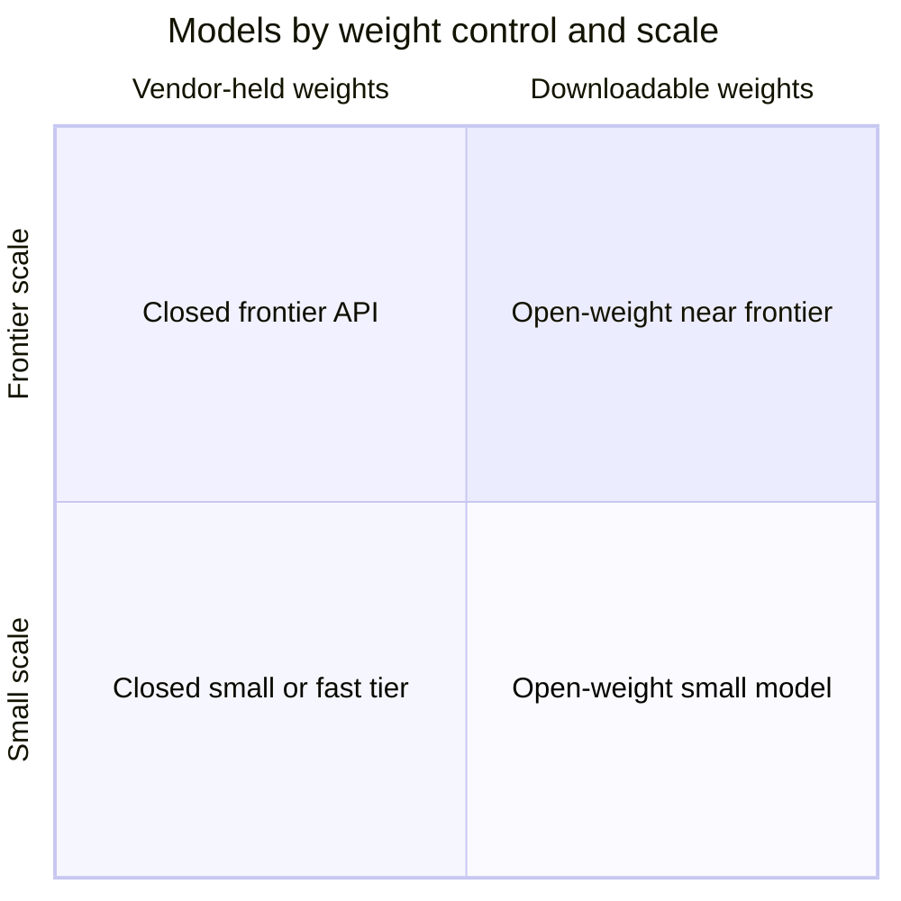
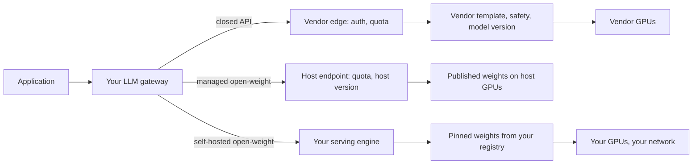
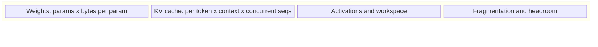
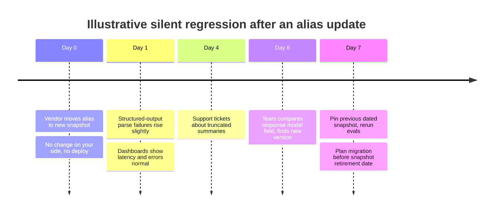
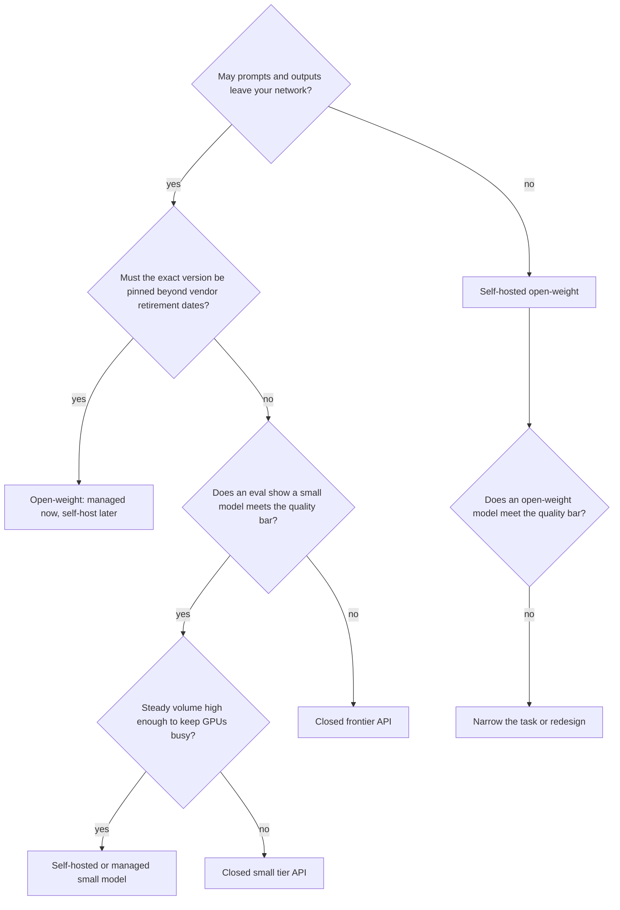

The three labels in this page's title are used as if they were one taxonomy, and they are not. "Frontier" describes a position on the capability curve: the most capable models available at a given moment, a set that changes every few months. "Open-weight" describes a distribution model: the trained parameters are published as a downloadable artifact that anyone can run, under some license. "Small language model" (SLM) describes scale: a model small enough, typically a few billion to roughly fifteen billion parameters, to run on one commodity GPU, a CPU server, or a device. A model can sit in any combination. A hosted closed model can be small; an open-weight model can be near the frontier; a frontier model can be served by its vendor only through an API.

For an architect the distinction that matters is not the label but what each category hands over and what it withholds. A closed frontier model reached through an API gives the highest capability ceiling and takes away control: the vendor owns the weights, the serving stack, the safety layer, the version lifecycle, and the data path. An open-weight model gives back that control, including the right to pin a version forever and to keep every token inside your own network, and charges for it in operational responsibility and, usually, some capability. A small model trades breadth of knowledge and reasoning for cost and latency that can be one or two orders of magnitude lower, which only pays off when the task is narrow enough that breadth was not needed.

The core trade-off is therefore control and unit cost against capability ceiling and operational simplicity. Choosing a specific model for a specific workload is a separate, multi-criteria procedure covered in [Model Selection Criteria: A Multi-Criteria Method](/ai-systems-architecture/en/model-strategy/selection-and-deployment/selection-criteria/); this page supplies the category-level facts that procedure starts from.

## Two Axes, Three Labels

The first axis is who holds the weights. A closed model's weights never leave the vendor; you send tokens to an endpoint and receive tokens back, and everything between those two events is the vendor's business. An open-weight model's weights are a file you can download, hash, store in your artifact registry, and load into a serving engine of your choice. Between the two sits a common hybrid: open-weight models served as a managed endpoint by a cloud provider or inference company. As of November 2026, for example, OpenAI's open-weight gpt-oss-120b is listed both as a downloadable model on Hugging Face and as a managed model in Google Cloud's Vertex AI, Microsoft's Azure AI model catalog, and NVIDIA's NIM catalog. The weights are open, but if you call one of those endpoints, the operational contract is the hosting provider's, not yours.

The second axis is scale. Parameter count drives three things an architect cares about: the GPU memory needed to hold the weights, the compute per generated token, and, loosely, the breadth of knowledge and the reliability on long, open-ended tasks. "Frontier" is a statement about the top of this axis at a point in time; "small" is a statement about the bottom. Neither has a fixed numeric boundary, and both drift: a model that was frontier two years ago is often matched today by a model a fraction of its size.


*The two independent axes. Each quadrant is a real category of product; the labels "frontier", "open-weight", and "small" each describe only one axis.*

Read the chart as a map of control surfaces, not of quality. The upper-left quadrant is where new capability appears first. The lower-left quadrant, the small or fast tiers of closed vendors, gives small-model economics without small-model control: you still cannot pin weights or run them on your own hardware. Only the lower-right quadrant can run on a laptop, a phone, or an air-gapped server with no GPU cluster.

:::note[Open-weight is not open source]
The Open Source Initiative's Open Source AI Definition 1.0 (October 2024) requires access to the weights, the code used to train and run the model, and sufficiently detailed information about the training data to allow a skilled person to build a substantially equivalent system. Most "open" LLMs publish only the weights and inference code, and many use licenses with field-of-use or scale restrictions. "Open-weight" is the accurate term for what you get; the license, not the label, defines what you may do with it.
:::

### Where Small Models Stop Losing

Parameter count matters less than intuition suggests for a large class of production tasks. A model's parameters store two kinds of things: general skills (parsing, following instructions, transforming text, producing valid structured output) and memorized knowledge about the world. Classification, extraction, routing, reformatting, and summarizing a supplied document use mostly the first kind, because the information the answer needs is in the context, not in the weights. Open-ended question answering, multi-step planning across unfamiliar domains, and long agentic tasks use both, and they compound errors over many steps, which is where additional scale shows up most clearly.

That is the intuition behind the common production pattern of using a small model for narrow, high-volume components and a frontier model for the open-ended ones. Two pieces of evidence support it. The scaling-law literature (Hoffmann et al., 2022) showed that models trained on far more data than earlier practice assumed reach a given loss at much smaller sizes, which is why recent small models outperform much larger older ones. And published small-model reports (for example Microsoft's Phi-3 report, 2024) attribute much of their performance to curated and synthetic training data rather than scale. The evidence is weaker than vendors suggest on one point: benchmark scores on short, well-specified tasks overstate how a small model behaves on the long tail of real inputs, a gap discussed in [Capability vs. Reliability: Closing the Production Gap](/ai-systems-architecture/en/foundations/ai-component-model/capability-vs-reliability/). A small model's failure on an out-of-distribution input is often more abrupt than a large model's.

Mixture-of-experts (MoE) architectures blur the scale axis further. An MoE layer contains many expert sub-networks and a router that sends each token through only a few of them, so the model has a large total parameter count but a small number of active parameters per token. gpt-oss-120b, released in August 2025 under Apache 2.0, has 117 billion total and 5.1 billion active parameters per its model card; gpt-oss-20b has 21 billion total and 3.6 billion active. For serving, the two numbers mean different things: memory scales with total parameters, because every expert must be resident, while compute per token scales roughly with active parameters. An MoE model therefore has the memory footprint of a large model and decode cost closer to that of a small one.

## What Each Category Hands You

Every LLM call passes through the same stages: authentication and quota, a chat template that serializes messages into tokens (described in [Anatomy of an LLM as a System Component: Tokens, Context, Sampling](/ai-systems-architecture/en/foundations/ai-component-model/llm-anatomy/)), the forward passes on an accelerator, a sampler, and usually a safety or moderation layer. Who operates each stage is what the category decides.


*The same call through three operating models. The further down the diagram, the more stages of the request path are under your control and on your pager.*

On the closed path, the vendor decides which exact model version answers a request sent to a model alias, what the chat template is, what the safety layer refuses, how logs are retained, and in which region the GPUs sit, within whatever contractual options the vendor offers. The vendor also absorbs the hardest operational problems: capacity planning, GPU failures, and serving-engine upgrades. On the managed open-weight path, the weights are fixed by their publication, so the model itself cannot silently change, but the host still controls quantization, serving-engine version, context limits, and endpoint lifetime, and two hosts serving the "same" model can return measurably different outputs. On the self-hosted path every stage is yours, including the ones you would rather not own; the operational side is the subject of [Hosted API vs. Self-Hosted vs. Hybrid Deployment](/ai-systems-architecture/en/model-strategy/selection-and-deployment/hosted-vs-self-hosted/).

### The Contract Each Category Offers

A closed API guarantees an interface and, in a service agreement, availability and data-handling terms. It does not guarantee that the same prompt returns the same distribution of outputs over time. Behavior behind a floating alias can change when the vendor moves the alias; a dated or versioned snapshot is stable only until its published retirement date, after which you must migrate. It does not guarantee access to internals such as full token log-probabilities or hidden reasoning, which vendors expose selectively.

An open-weight artifact guarantees that the bytes you hashed are the bytes you serve, forever, and that nobody can retire the model out from under you. It does not guarantee identical behavior across serving engines, quantization levels, or hardware: numerical differences in kernels and batching change outputs, as [Determinism Control: Temperature, Seeds, and Caching](/ai-systems-architecture/en/reliability/output-reliability/determinism/) explains. It does not come with a safety layer beyond whatever was trained into the weights, and it gives no capacity guarantee at all: throughput is whatever your GPUs deliver.

A small model guarantees nothing by virtue of being small. What it offers is a cost and latency profile that makes certain architectures possible, such as running a classifier on every message, or keeping inference on a device that never connects to the internet. Its quality on your task is a measured rate, not a property of the category.

### How Large Is the Capability Gap

The open-versus-closed gap is narrower than it was and highly variable. Epoch AI, which tracks models on its Epoch Capabilities Index (ECI), a composite of many benchmarks, reported in May 2026 that since January 2026 the best open-weight models have lagged the best closed models by an average of about four months, or roughly 8 ECI points; an October 2025 analysis by the same group put the lag at around three months. Epoch also notes that the gap varies considerably and has at times closed entirely. Two caveats apply before using such numbers in a decision. A composite index averages over tasks, and the gap on your task may be zero or much larger. And "the best open-weight model" may be one with hundreds of billions of total parameters, which is open in license but not small in cost.

The practical reading for architecture is that the capability argument for closed models is strongest at the leading edge, for the hardest open-ended and agentic tasks, and for the first months after a new capability appears. For a component whose task is well-specified and whose inputs are bounded, the category decision is usually dominated by cost, latency, data location, and lifecycle control, not by capability, and it should be settled by an eval on your own data rather than by a leaderboard.

## Memory, Throughput, and Unit Cost by Scale

Scale turns into money through GPU memory first. To serve a model you must hold its weights and, for every concurrent sequence, its KV cache: the attention keys and values for every token in that sequence's context, explained in [Prefill, Decode, and the KV Cache](/ai-systems-architecture/en/inference/fundamentals/prefill-decode-kv-cache/). Weight memory is the parameter count times the bytes per parameter; KV cache memory is, per token, two (keys and values) times the number of layers, times the number of key-value heads, times the head dimension, times the bytes per value.


*GPU memory on an inference server. Weights are fixed per model; the KV cache grows with context length and concurrency and is what limits throughput once the weights fit.*

The layout explains why the scale axis matters twice. A larger model consumes more memory for weights, which leaves less room for KV cache, which caps how many sequences can be decoded concurrently, which lowers throughput per GPU and raises cost per token. Quantization, storing weights in fewer bits, attacks the first block directly; its quality trade-offs are covered in [Quantization and Model Compression](/ai-systems-architecture/en/inference/fundamentals/quantization/).

### Worked Example: Three Sizes on One 80 GB GPU

Assume an 80 GB accelerator, and assume about 10% of memory is lost to activations, workspace, and fragmentation, leaving roughly 72 GB for weights and KV cache. All model configurations below are illustrative unless attributed.

A 70-billion-parameter dense model in 16-bit precision needs 70 × 10⁹ × 2 bytes = 140 GB for weights alone. It does not fit on one GPU; it needs at least two, in practice more to leave room for KV cache. Quantized to 4 bits (0.5 bytes per parameter) its weights shrink to about 35 GB, leaving about 37 GB for KV cache, at the quality cost of the quantization.

An 8-billion-parameter dense model in 16-bit precision needs 16 GB for weights, leaving about 56 GB for KV cache. Assume a configuration of 32 layers, 8 key-value heads, and a head dimension of 128, a common shape for models of this size. The KV cache per token is 2 × 32 × 8 × 128 × 2 bytes = 131,072 bytes, or 128 KiB. A sequence with an 8,000-token context therefore holds about 1 GiB of KV cache, and 56 GB supports roughly 50 such sequences concurrently. At a 32,000-token context, each sequence needs about 4 GiB, and concurrency falls to about 13. Context length, not parameter count, has become the limit.

gpt-oss-120b, per its model card, fits on a single 80 GB GPU because its MoE weights are stored in MXFP4, a 4-bit format, while other weights remain in 16-bit. It has the memory footprint of a model with 117 billion parameters and the per-token compute of roughly 5 billion active ones, so on one GPU it can approach the decode speed of a much smaller dense model while carrying far more parameters.

Now turn memory into unit cost. Assume, for illustration only, that a GPU costs $3 per hour and that the 8B model sustains an aggregate output of 2,500 tokens per second across its concurrent sequences under your traffic shape. That is 9 million output tokens per hour, about $0.33 per million output tokens at full utilization. At 30% average utilization, which is common for spiky interactive traffic, the effective cost is about $1.11 per million. Compare a hypothetical hosted small-tier API priced at $0.60 per million output tokens: self-hosting wins at high, steady utilization and loses at low utilization, before counting engineering and on-call time. The structure of this calculation, not its numbers, is the lesson: self-hosted cost per token is dominated by utilization, and hosted cost per token is constant. The full comparison, including staff, redundancy, and idle capacity, is in [Self-Hosted vs. API: Total Cost of Ownership](/ai-systems-architecture/en/economics/understanding-cost/tco/), and how to size a fleet is in [GPU Capacity Planning](/ai-systems-architecture/en/inference/production-serving/gpu-capacity-planning/).

## Comparing the Categories in Production

The trade-offs land differently on each axis. The table summarizes them for the four practical operating points; "managed open-weight" is listed separately because its properties are a mix and teams often assume it has the properties of self-hosting.

| Operating point | Capability ceiling | Version control | Data path | Unit cost and latency | Operational burden | When to prefer |
|---|---|---|---|---|---|---|
| Closed frontier API | Highest, first to get new capabilities | Vendor-controlled; snapshots retire on a schedule | Leaves your network; vendor terms and regions | Highest per token; no idle cost | Lowest | Hardest open-ended or agentic tasks; low or unpredictable volume; fast iteration |
| Closed small tier API | Moderate | Vendor-controlled | Leaves your network | Low per token; no idle cost | Lowest | High-volume narrow tasks where data may leave and control is not required |
| Managed open-weight endpoint | Model-dependent, typically months behind the frontier | Weights fixed; host controls engine, quantization, endpoint lifetime | Leaves your network to the host | Low to moderate; no idle cost | Low | Portability between hosts, a path to self-hosting later, a second source for fallback |
| Self-hosted open-weight (any size) | Model-dependent; small models narrow | Fully yours, pinned by hash | Stays in your network, including air-gapped | Utilization-dependent; idle GPUs cost money | High: capacity, upgrades, on-call | Data that must not leave, regulatory residency, steady high volume, need to pin indefinitely |

The managed open-weight endpoint is often the best first step for a team that expects to self-host later: prompts and evals are built against the exact weights that will later run in-house, and the self-hosting decision waits until volume justifies it. The self-hosted row is the only one that satisfies a hard requirement that no prompt or completion ever leave the organization's network, which in banking and public-sector systems is sometimes a requirement rather than a preference; the regulatory side for Turkey is covered in [Turkish Regulation and Data Residency: KVKK and BDDK](/ai-systems-architecture/en/governance/regulation/turkish-regulation/).

### Licenses and Regulation Attached to Weights

Downloading weights means accepting a license, and the licenses differ in ways that matter for architecture. As of their releases, gpt-oss and the Qwen3 family were published under Apache 2.0, and DeepSeek-R1 under the MIT license: permissive licenses with no field-of-use or user-count restrictions. Meta's Llama 4 Community License (effective April 2025) is a custom license: a licensee whose products had more than 700 million monthly active users in the preceding calendar month must request a separate license, which Meta may grant at its sole discretion; derivative models must include "Llama" at the beginning of their name; and products must prominently display "Built with Llama". It also incorporates an acceptable use policy by reference, so permitted uses can change without the license file changing. Custom licenses are not unusable, but they need legal review, and a fine-tuned derivative inherits its base model's license.

Regulation attaches to the model as well. Under the EU AI Act, obligations for providers of general-purpose AI models apply from 2 August 2025, and the European Commission states that it enforces them, including with fines, from 2 August 2026. Models trained with more than 10²⁵ floating-point operations are presumed to have systemic risk, a threshold the Commission describes as under review. Providers releasing models under a free and open-source license with public weights are exempt from some documentation duties, but not from the copyright policy and training-data summary, and not at all if the model has systemic risk. The Commission's guidelines (July 2025, not legally binding) state that a downstream company that modifies or fine-tunes a model becomes its provider only when the modification uses more than one third of the original model's training compute. For most enterprises that integrate or lightly fine-tune models, the GPAI provider obligations therefore sit with the model's publisher; the obligations that reach them come through the system they build, as described in [International Frameworks: EU AI Act, NIST AI RMF, ISO/IEC 42001](/ai-systems-architecture/en/governance/regulation/international-frameworks/).

### Security Implications of Each Category

Each category moves the attack surface. With a closed API, the main new exposure is the data path: prompts and completions, which may contain personal or confidential data, cross a trust boundary into a vendor's systems, and the controls are contractual (retention, training use, region) plus whatever you redact before sending, described in [PII and Sensitive Data: Masking, Tokenization, Redaction](/ai-systems-architecture/en/security/defenses/pii-handling/).

With open weights, the data path stays home and a supply chain appears. Model files are artifacts that someone else built, and they are a code-execution risk if they use formats such as Python pickle, which can run arbitrary code when loaded; the safetensors format exists specifically to store tensors without executable content. Some models also ship custom model code that a loader executes when explicitly allowed to run remote code. Weights should therefore enter the organization like any other third-party artifact: from a verified source, scanned, hashed, and stored in your own registry, following the practices in [Supply Chain Security: The SLSA Framework and Sigstore](https://gorkemsari.github.io/distributed-systems/en/security/secrets-management/supply-chain-security/) and [Artifact Management: OCI Registry and Helm Charts](https://gorkemsari.github.io/distributed-systems/en/deployment/gitops-cicd/artifact-management/). The AI-specific part, including poisoned or backdoored weights whose behavior a file scan cannot detect, is covered in [AI Supply Chain Security: Models, Datasets, MCP Servers](/ai-systems-architecture/en/security/defenses/supply-chain/).

:::caution[Load weights only from your own registry]
A deployment that pulls a model by repository name from a public hub at startup has no pinned version, no integrity check, and a hard dependency on a third-party service. Mirror the exact files into your artifact registry, record their SHA-256 hashes, prefer safetensors, keep remote-code execution disabled, and make the serving engine load by hash. The same record is what an auditor needs to establish which model produced a given answer.
:::

A small amount of configuration captures the pin. The point of the record is that every field, including the serving engine and quantization, is part of the model's identity: change any of them and the eval must run again.

```yaml
# Illustrative model pin record; field names are not a standard
model_id: summarizer-small
weights:
  source: internal-registry/models/example-8b-instruct
  revision: 3f9c2a1            # upstream commit the files were mirrored from
  sha256: 9b1e...c04d          # hash of each file is recorded; one shown
  format: safetensors
  license: apache-2.0
serving:
  engine: vllm
  engine_version: pinned       # record the exact version in use
  quantization: none           # any change here requires a new eval run
  max_context_tokens: 16384
eval:
  suite: summarizer-golden-v12
  last_pass: 2026-11-12
```

## How Each Category Fails

The failures specific to model categories rarely produce errors; they produce answers that are a little worse, a little different, or legally exposed.

A hosted model changes behind a stable name. A closed vendor moves an alias to a newer snapshot, or retires a snapshot and the client falls back to the alias. Latency and error rates are unchanged, but output length, refusal rate, formatting, or tool-calling behavior shifts. The symptom is a quality regression with no deploy on your side. Detection requires logging the model version string the API returns on every response and alerting on changes, plus continuous evals, as covered in [Quality Monitoring and Drift Detection](/ai-systems-architecture/en/llmops/observability/quality-drift/). Mitigation is to call dated snapshots, never aliases, in production and to treat a snapshot change as a release; the migration process is in [Model Versioning, Deprecation, and Migration](/ai-systems-architecture/en/model-strategy/lifecycle-and-adaptation/versioning-migration/).


*An illustrative incident timeline. The gap between day 0 and day 6 is the time the system ran on a model nobody had evaluated; logging the returned model version closes most of it.*

The change happens at the vendor, and the first signals are statistical rather than errors. With the returned version string logged and an alert on its change, detection moves to day 0; with a nightly eval on the golden set, the regression is quantified by day 1. Pinning the previous snapshot is a recovery only until that snapshot's retirement date, so the incident ends with a scheduled migration, not with the pin.

A small model hits its capability cliff. The model passed the eval on the inputs the team collected and fails sharply on inputs outside them: longer documents, another language, a new product line. Unlike a large model, which tends to degrade gradually, a small model often produces confident, well-formatted, wrong output. Detection needs slice-level metrics (by language, length, and input source) and a production sample graded continuously; mitigation is to route out-of-distribution inputs, detected by a cheap classifier or by confidence signals, to a larger model, as in [Multi-Model Strategy and Model Routing](/ai-systems-architecture/en/model-strategy/selection-and-deployment/model-routing/).

A "same model" is not the same. A team evaluates an open-weight model on one host and deploys it on another, or switches from 16-bit to a 4-bit quantized build, or upgrades the serving engine. The weights' name is unchanged; the behavior is not, especially on long contexts, arithmetic, and structured output. A chat template mismatch, where the serving stack formats messages differently from the template the model was trained with, is the extreme case: the model still responds, but instruction following and tool calling degrade badly. Detection is an eval gate on any change to the pin record; recovery is reverting to the evaluated configuration.

A license constraint is discovered late. A model with a custom license is adopted for a prototype, the product grows, and a legal review before a launch or an acquisition finds a naming, attribution, user-count, or acceptable-use condition the product does not meet. Detection belongs at intake: the license is a field in the pin record and in the model registry described in [Prompt and Model Registry](/ai-systems-architecture/en/platform/internal-platform/prompt-model-registry/), reviewed before the first production use.

| Failure | Category | Symptom | Detection | Mitigation and recovery |
|---|---|---|---|---|
| Alias moved or snapshot retired | Closed API | Quality shift with no local deploy | Returned model version logged and alerted; continuous evals | Pin dated snapshots; treat changes as releases; migrate before retirement |
| Capability cliff | Small model | Confident wrong output on new input types | Slice metrics; graded production sample | Route out-of-distribution inputs to a larger model; expand training or eval data |
| Configuration drift | Open-weight (hosted or self) | Subtle differences in long-context, math, structured output | Eval gate on any change to weights, engine, quantization, template | Revert to evaluated configuration; re-baseline |
| Template mismatch | Open-weight | Poor instruction following, broken tool calls | Tokenized prompt inspection; tool-call validity rate | Use the template shipped with the model; test it in CI |
| Tampered or unsafe artifact | Open-weight | Code execution at load, or hidden behavior | Hash verification; format and remote-code policy; red-team evals | Registry-only loading; safetensors; disable remote code |
| License breach | Open-weight | Legal finding, forced re-platforming | License field in registry; review at intake | Choose permissive licenses for core paths; plan replacement |
| Capacity exhaustion | Self-hosted | Queueing, timeouts at peak | Queue depth, KV cache utilization, time to first token | Capacity headroom; overflow to a hosted endpoint |

:::tip[Keep a second category as a fallback]
The categories fail independently. A vendor outage does not affect your self-hosted model, and your GPU shortage does not affect the vendor. A component designed from the start to run on either a closed API or a managed open-weight model, with prompts and evals maintained for both, has a tested fallback that costs little to keep warm; the mechanics are in [Fallback Chains and Graceful Degradation](/ai-systems-architecture/en/reliability/provider-failures/fallback-degradation/).
:::

## Choosing a Category per Component

The category is chosen per component, not per organization: one product may use a closed frontier model for its planning agent, a closed small tier for summarization, and a self-hosted small model to classify data that may not leave the network. The early questions are constraints and the later ones are optimizations.


*A per-component decision order. Data location and version control are constraints and come first; quality and cost are optimized within them.*

Reversing the order produces the classic failure: a team picks the leaderboard leader, builds the product, and then learns that the data may not leave the network or that the model retires in a year. The final node is the honest outcome when the constraints exclude every model that meets the quality bar: the task must be narrowed, decomposed, or reconsidered with [When AI Is the Wrong Solution: A Decision Framework](/ai-systems-architecture/en/foundations/failure-and-fit/when-not-to-use-ai/).

Use a closed frontier API when the task is open-ended, long-horizon, or agentic and an eval shows smaller models fall short; when volume is low or unpredictable so that idle GPUs would dominate cost; and when the team needs to iterate quickly and the data may leave. Do not use it as the default for every component: high-volume narrow tasks on a frontier model are a common source of cost explosions in LLM systems, analyzed in [Token Economics: Pricing, Reasoning Tokens, and Hidden Costs](/ai-systems-architecture/en/economics/understanding-cost/token-economics/).

Use open-weight models when data must stay in your network, when you need to pin a version longer than any vendor's support window (as model risk management in regulated industries often demands, see [Model Risk Management for LLM Systems](/ai-systems-architecture/en/governance/risk-management/model-risk-management/)), when you need to fine-tune and own the result, or when you want two hosts for the same model. Do not self-host because it looks cheaper per token without a utilization estimate and an on-call plan, and do not adopt a custom-licensed model on a core path without legal review.

Use a small model when the task is narrow, its inputs are bounded and monitored, and an eval on your data shows it meets the bar, especially for classification, extraction, routing, and guardrail checks that run on every request. Small models are also the usual target for distillation from a larger one, described in [Fine-Tuning and Distillation: An Integration Perspective](/ai-systems-architecture/en/model-strategy/lifecycle-and-adaptation/finetuning-distillation/). Do not use a small model for a task whose input distribution you cannot bound, and do not accept a small model's benchmark score in place of slice-level evals on your traffic.

Two adjacent topics are often confused with this one. Reasoning models, which spend additional generated tokens before answering, are a capability and cost profile that cuts across all three categories and is covered in [Reasoning Models and Test-Time Compute](/ai-systems-architecture/en/model-strategy/model-landscape/reasoning-models/). And dependence on a single vendor's API shape, rather than on its model, is a portability problem addressed in [Vendor Lock-in and the Abstraction Layer](/ai-systems-architecture/en/model-strategy/lifecycle-and-adaptation/vendor-lock-in/).

## Further Reading

- Open Source Initiative, *The Open Source AI Definition 1.0*, 2024.
- Jordan Hoffmann et al., *Training Compute-Optimal Large Language Models*, NeurIPS, 2022.
- Marah Abdin et al., *Phi-3 Technical Report: A Highly Capable Language Model Locally on Your Phone*, Microsoft, 2024.
- OpenAI, *gpt-oss-120b and gpt-oss-20b Model Card*, arXiv 2508.10925, 2025.
- Epoch AI, *Open models lag state-of-the-art closed models by 4 months*, Epoch AI data insight, 2026.
- European Commission, *Guidelines on the scope of obligations for providers of general-purpose AI models under the AI Act*, 2025.
