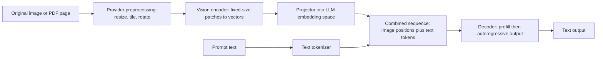
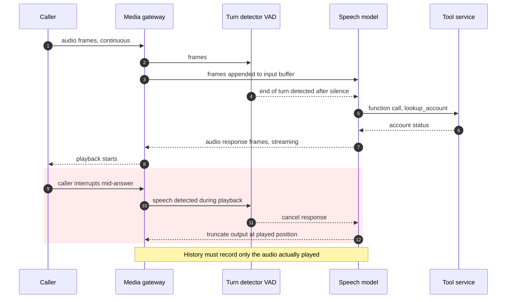
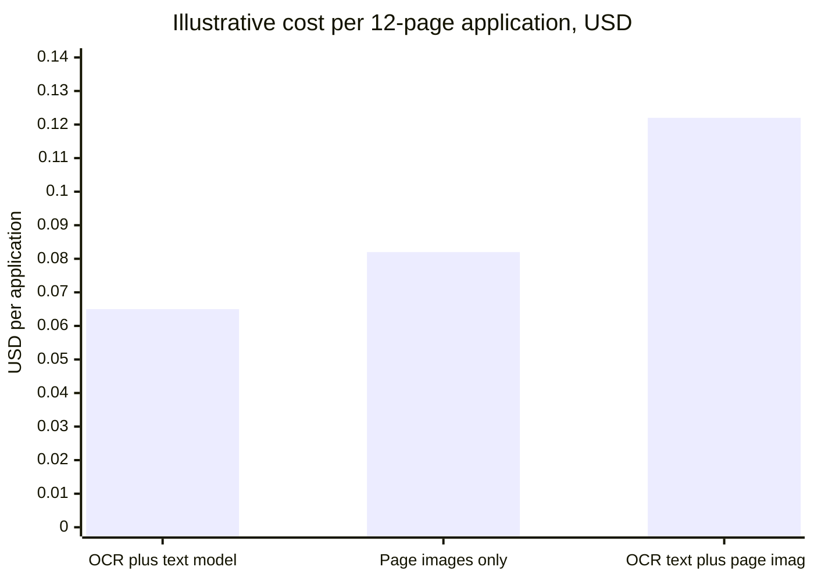
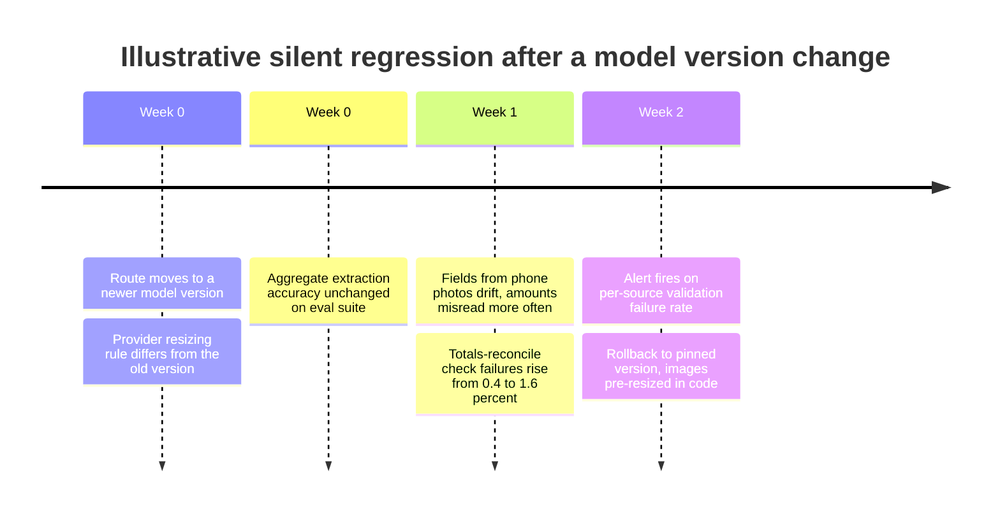

A multimodal model accepts inputs other than text, typically images, document pages, audio, and sometimes video, and in some cases emits audio as well as text. Architecturally it is still a sequence model: every non-text input is converted by a dedicated encoder into a run of embedding vectors that sit in the same sequence as the text tokens, and the decoder generates from that combined sequence exactly as it would from text alone. Nothing about sampling, context limits, or probabilistic output changes; what changes is that a scanned invoice, a phone screenshot, or a customer call now enters the model directly instead of through an OCR (optical character recognition) or ASR (automatic speech recognition) service that first turns it into text.

The problem this solves is that much of the information enterprises process was never text. Contracts arrive as scans, claims arrive as photos, support arrives as calls, and an operations dashboard is a screenshot. The classical answer is a pipeline: a specialized perception component (OCR, a layout parser, an ASR engine) produces text, and a text model reasons over it. That pipeline loses whatever the text representation cannot carry, such as the layout that tells you which number belongs to which column, a checkbox that is ticked, a signature that is missing, or the hesitation in a caller's voice. A native multimodal model sees the raw signal and keeps that information.

The core trade-off is where perception errors live and whether you can see them. In a pipeline, perception produces an inspectable intermediate artifact: a transcript or an OCR text layer, often with per-word confidence, that can be validated, logged, and corrected before any reasoning happens. In a native multimodal call, perception and reasoning happen inside one probabilistic component, and a misread digit comes out as fluent, confident text with no intermediate to check. Native input preserves information and simplifies the architecture; pipelines preserve auditability and let each stage be measured and replaced on its own. Cost is a third axis that is less obvious than it looks: image and audio tokens scale with pixels and seconds, not with how much information the input carries, so a blank page can cost as much as a dense one.

## How Pixels, Pages, and Waveforms Become Tokens

Every major vision-language model follows the same broad recipe, described in the original Vision Transformer work (Dosovitskiy et al., 2021) and in open designs such as LLaVA (Liu et al., 2023). The image is first resized and possibly split into tiles by a preprocessing step. A vision encoder cuts each tile into a grid of fixed-size patches, for example 14 to 32 pixels square, and turns each patch into a vector. A small projection network maps those vectors into the embedding space of the language model, and the projected vectors are inserted into the token sequence at the position where the image appeared in the prompt. From that point on, the decoder attends over image positions and text positions alike.


*The input path of a vision-language model. The preprocessing box runs before the model and is usually controlled by the provider, not by the caller.*

Three properties of this path drive almost every production decision. First, the model never sees your original image; it sees the output of the preprocessing step. If that step downscales a 3,000-pixel-wide scan to fit a token budget, text that was legible to a human at full size may span only a few pixels per character by the time it reaches the encoder. Second, the number of image positions is a function of the resized pixel dimensions and nothing else. A white page and a page of six-point footnotes at the same size cost the same. Third, image positions are ordinary context positions: they consume the context window, they lengthen prefill (the phase in which the model processes the whole input before emitting the first token, covered in [Prefill, Decode, and the KV Cache](/ai-systems-architecture/en/inference/fundamentals/prefill-decode-kv-cache/)), and they are billed as input tokens.

### Token Accounting Differs by Provider

The conversion from pixels to billed tokens is a provider-specific formula, and the formulas change with model generations. As of November 2026, the three largest API providers document the following.

OpenAI documents two methods. Newer models use patch-based accounting: the image is divided into 32-pixel patches, the patch count is `ceil(width/32) x ceil(height/32)`, the image is scaled down if it exceeds the model's patch budget for the chosen detail level (2,500 patches at `high` detail on several current models), and the patch count is multiplied by a per-model factor (1.2 for most current models, higher for some smaller ones). Older models such as GPT-4o use tile-based accounting: the image is scaled to fit 2,048 by 2,048, then its shortest side is scaled to 768 pixels, and the cost is 85 base tokens plus 170 tokens per 512-pixel tile. A `detail` parameter selects `low`, `high`, `auto`, or, on models that support it, `original`; the documentation warns that on some models `low` does not use fewer tokens than `high`.

Anthropic documents patch-based accounting with 28-pixel patches, so an image costs `ceil(width/28) x ceil(height/28)` visual tokens, and images above a model's limits are downscaled with the aspect ratio preserved. For PDFs, each page is converted to an image and its extracted text is supplied alongside it; the documentation estimates 1,500 to 3,000 text tokens per page and caps each page image at 1,568 visual tokens. Google documents for Gemini that an image with both dimensions at most 384 pixels costs 258 tokens, larger images are cropped and scaled into 768-by-768 tiles of 258 tokens each, PDF pages are tokenized like images, audio costs 32 tokens per second, and video 263 tokens per second; newer Gemini generations add a `media_resolution` setting that changes these budgets.

The architectural consequence is that "how many tokens is this page" has no portable answer. A routing or fallback layer that moves a document workload between providers, as described in [Multi-Model Strategy and Model Routing](/ai-systems-architecture/en/model-strategy/selection-and-deployment/model-routing/), changes the effective resolution the model sees, and with it the error rate on small text, even when the prompt is identical. How these input tokens are priced relative to text and output tokens is covered in [Token Economics: Pricing, Reasoning Tokens, and Hidden Costs](/ai-systems-architecture/en/economics/understanding-cost/token-economics/).

### Why Vision Works for Gist and Fails at Exactness

A vision encoder is trained on very large collections of image and text pairs to produce patch vectors that align with how images are described in language. That objective rewards capturing what an image is about: the layout of a form, the kind of chart, the gist of a screenshot, the reading of clear printed text. It does not directly reward exact spatial bookkeeping. Counting many small objects, reading coordinates off an axis, telling which of two nearly identical lines is longer, or following a thin connector across a diagram all depend on fine positional detail that patch embeddings blur. Provider documentation lists these weaknesses openly as of November 2026: OpenAI names small text, rotated text, non-Latin scripts, spatial reasoning, counting, and graphs with varied line styles; Anthropic names low-quality, rotated, or very small images, approximate counting, and approximate localization. Independent work such as Rahmanzadehgervi et al. (2024), *Vision Language Models Are Blind*, showed that strong models of that period failed simple geometric tasks such as counting line intersections that humans solve trivially.

The failure shape matters more than the failure rate. When a region is illegible after preprocessing, the decoder does not emit an error; it continues generating the most plausible continuation, which for a blurred invoice total is a plausible-looking number. Perception failures therefore surface as fabricated content, the same silent failure class described in [Hallucination Mitigation: Grounding, Verification, Abstention](/ai-systems-architecture/en/reliability/output-reliability/hallucination-mitigation/), not as exceptions. A text pipeline has the mirror-image property: an OCR engine that cannot read a region usually outputs garbage characters or low confidence, which a validator can catch.

### Documents: Text Layer, Page Image, or Both

A PDF can reach a model in three ways, and they fail differently. Text-layer extraction reads the characters embedded in a digitally generated PDF; it is exact where it exists, cheap, and blind to anything drawn rather than typed, including scanned pages, which have no text layer at all, and charts. Page-image input renders each page and sends it through the vision path; it sees layout, stamps, checkboxes, and handwriting, at the resolution the token budget allows. The combined mode, which Anthropic uses for PDFs as of November 2026, sends both the extracted text and the page image, so the model can read exact characters from the text layer and use the image for structure. The combined mode costs the most tokens and gives the best results on mixed documents, but it also creates a new failure: when the text layer and the image disagree, for example after a scan was overlaid with a bad OCR layer by an upstream system, the model may follow either one.

How documents are parsed and enriched for retrieval indexes is a separate concern with its own canonical page, [Ingestion Pipelines: Parsing, OCR, Cleaning, and Enrichment](/ai-systems-architecture/en/retrieval/ingestion-indexing/ingestion-pipeline/). This page covers the model-side decision of what representation to send at inference time.

### Audio: Chained Pipelines and Native Speech

Audio enters in one of two architectures. The chained architecture runs ASR to produce a transcript, a text model to produce a reply, and TTS (text-to-speech) to speak it. Each stage is replaceable and observable, the transcript is an audit artifact, and the text model can be any model. The cost is latency, since the stages run in sequence and each adds its own delay, and the loss of everything the transcript does not carry: tone, emphasis, overlapping speech, and background events. The native architecture, offered for example by OpenAI's Realtime API (generally available since August 2025, with WebRTC, WebSocket, and SIP telephony connections), feeds audio tokens into a model that emits audio tokens directly. It can respond while the user is still finishing a sentence, handle interruptions, and condition on prosody. Its transcript, if you want one, is a side output that may not match exactly what the model heard.


*One turn of a native speech-to-speech session with a barge-in. Turn detection, cancellation, and truncation are part of the protocol, not of the model.*

Steps 4 and 11 to 13 carry the architectural weight. A voice activity detector (VAD) decides when the caller has finished, and its silence threshold trades responsiveness against cutting people off mid-sentence. When the caller interrupts, the system must cancel generation and record in the conversation history only the portion of the answer that was actually played; otherwise the model's next turn assumes the caller heard a sentence they never heard. The transport underneath is a long-lived bidirectional stream, whose general properties are covered in [WebSockets and Server-Sent Events](https://gorkemsari.github.io/distributed-systems/en/communication/synchronous-protocols/websocket-sse/); the product-side streaming concerns are in [Streaming Infrastructure: SSE, WebSockets, and Proxies](/ai-systems-architecture/en/product-integration/product-surface/streaming-infrastructure/).

## Worked Example: Resolution, Tokens, and Money

Assume a lender extracts twelve fields from loan applications that arrive as 12-page scans at 200 DPI on A4 paper, roughly 1,650 by 2,340 pixels per page, and processes 200,000 applications a month. All prices below are illustrative assumptions for the arithmetic, not any provider's list price: input at 3 dollars and output at 15 dollars per million tokens, and a managed OCR service at 1.50 dollars per 1,000 pages.

Under 28-pixel patch accounting, a full-resolution page would be `ceil(1650/28) x ceil(2340/28)`, which is 59 by 84, or 4,956 patches. With a cap of 1,568 visual tokens per page, the page is downscaled by a linear factor of about the square root of 1,568 divided by 4,956, or 0.56, to roughly 930 by 1,320 pixels. A line of 9-point body text, about 25 pixels tall at 200 DPI, becomes about 14 pixels; a 6-point footnote with the APR disclosure, about 17 pixels tall, becomes about 9 pixels, which is the range where provider documentation warns about small text. Twelve pages cost about 18,800 image tokens. Add 1,000 tokens of instructions and schema and 1,500 output tokens: input is about 19,800 tokens, or 0.059 dollars, output 0.023 dollars, for about 0.082 dollars per application.

The pipeline alternative runs OCR on all 12 pages for 0.018 dollars and sends the text, assume 600 tokens per page, to a text model: 7,200 plus 1,000 input tokens cost 0.025 dollars and the same 1,500 output tokens cost 0.023 dollars, for about 0.065 dollars in total. The combined mode, OCR text plus page images, costs roughly the sum of both inputs, about 27,000 input tokens plus OCR, around 0.12 dollars.


*Cost per application for the three representations under the illustrative prices above. At 200,000 applications a month the spread is roughly 13,000 to 24,400 dollars.*

The chart's lesson is that the cost differences are modest and the error differences are not. At 200,000 applications, the most expensive option costs about 11,000 dollars a month more than the cheapest. If the image-only route misreads the APR footnote on even 0.5% of applications (an assumed rate for illustration), that is 1,000 applications a month with a wrong regulated figure, each of which is a compliance incident rather than a cost line. The decision is therefore made on measured field-level error by field type, and cost is a tiebreaker. Two cheap improvements change the arithmetic more than the choice of representation: crop and send only the pages that hold the twelve fields (often three or four of the twelve), and send the footnote region as a separate high-resolution crop instead of a downscaled full page.

Latency moves the same way. Nearly 20,000 input tokens of images lengthen prefill and therefore time to first token, which matters little for a back-office batch and a great deal for an interactive upload flow. Audio follows the same per-second logic: at 32 tokens per second, a 10-minute call is 19,200 tokens of input before a single word of instructions, so long calls can exhaust a session's context budget well before the conversation ends. OpenAI's own developer notes, at the time of writing, describe a context window of roughly 32,000 tokens for its realtime model and automatic dropping of older messages when it fills, which is a conversation-memory concern of the kind covered in [Managing Conversation Context: Summarization, Truncation, Sliding Windows](/ai-systems-architecture/en/context-engineering/production-prompting/conversation-context/).

## Native Multimodal Input Versus Specialized Pipelines

The options are not one model versus many; they are a set of representations, each with a different place where errors appear.

| Approach | What the model sees | Strengths | Weaknesses | When to prefer |
|---|---|---|---|---|
| Text-layer extraction | Exact embedded characters | Cheapest, exact, auditable | Blind to scans, charts, checkboxes, layout | Born-digital PDFs where layout carries no meaning |
| OCR or layout parser, then text model | Recognized text with structure markup | Per-word confidence, replaceable stages, strong on clean print | Loses visual cues, table structure errors compound | High-volume forms with stable templates and strict audit needs |
| Native page images | Downscaled pixels | Reads layout, stamps, handwriting, charts | Silent misreads, resolution capped by provider | Varied, unstructured documents and screenshots |
| Text layer or OCR plus page image | Both, side by side | Best accuracy on mixed documents, enables cross-checks | Highest token cost, conflicts between the two | Regulated extraction where both cost and error matter |
| ASR, text model, TTS | Transcript | Transcript as audit record, any text model, cheaper per minute | Added latency per stage, loses tone and overlap | Call analytics, compliance recording, non-interactive audio |
| Native speech-to-speech | Audio tokens | Lowest conversational latency, barge-in, prosody | Harder to audit, fewer model choices, context fills fast | Interactive voice agents where latency defines the product |

Two rows deserve a position. For document extraction where a wrong number has a cost, the combined representation is the right default: send the text layer or OCR output together with the page image, and require the model to cite which source each field came from. The overlap gives a cross-check that neither representation has alone. For voice, the chained architecture remains the right default for anything regulated, because the transcript is the record that audit, dispute handling, and quality review need; native speech-to-speech earns its place when conversational latency is the product, and then it should still produce a separate ASR transcript for the record.

:::tip[Send both and use their disagreement as a signal]
When the OCR text and the model's reading of the page image disagree on a field, that disagreement is the cheapest high-precision error detector you have. Route disagreeing fields to a second pass or a human queue, and track the disagreement rate per field and per document source. A sudden change in that rate is often the first sign that an upstream scanner, a template, or a provider's resizing changed.
:::

Security changes with the modality too. Every image, page, and audio clip is untrusted input that can carry instructions: text rendered into an image, white-on-white text on a PDF page, or a spoken instruction in a recorded call. Trail of Bits showed in August 2025 that an image can be crafted so that a prompt injection appears only after the provider's downscaling step, invisible to a human looking at the full-resolution upload, and demonstrated data exfiltration through Gemini CLI and other Google products; their mitigations are to limit upload dimensions, show users a preview of what the model actually receives, and never let content inside an image trigger a sensitive tool call without explicit confirmation. The general defense design is in [Prompt Injection: Direct and Indirect](/ai-systems-architecture/en/security/threats/prompt-injection/). Images and audio also carry personal data that text redaction does not see: faces, ID cards, signatures, voices, and screenshots with secrets on screen. Masking must happen on pixels or audio before the model call, as covered in [PII and Sensitive Data: Masking, Tokenization, Redaction](/ai-systems-architecture/en/security/defenses/pii-handling/), and logged inputs need the same retention rules as text prompts, covered in [Prompt and Response Logging Under Privacy Constraints](/ai-systems-architecture/en/llmops/observability/logging-privacy/). In regulated settings, voice and face data can be biometric or special-category data under KVKK and GDPR, and the EU AI Act has prohibited emotion-recognition systems in workplaces and educational institutions, outside medical and safety uses, since February 2025; a voice agent that scores agent or caller emotion needs a legal review before it ships (see [Turkish Regulation and Data Residency: KVKK and BDDK](/ai-systems-architecture/en/governance/regulation/turkish-regulation/)).

## Configuring Multimodal Routes in Production

The parameters that matter are those that control what the model actually sees, and most of them belong in your code rather than in the provider's defaults. Resize and crop images yourself, to a size you have measured, so that the provider's preprocessing becomes a no-op and a provider-side change in resizing rules cannot silently change your accuracy. Apply EXIF orientation before sending, because a phone photo stored sideways with a rotation flag may reach the encoder rotated. Select pages before sending: a classifier or a cheap text-layer search that picks the three relevant pages of a twelve-page document cuts cost and removes distractors. Send high-resolution crops of known small-print regions instead of raising the resolution of every page. Put images before the question in the prompt when the provider recommends it; Anthropic's documentation, for example, states that its models work best with images placed before text.

```yaml
# Illustrative route policy; field names are this platform's, not a provider's
route: loan-application-extract
input:
  pages: classify-and-select      # send only pages that hold target fields
  representation: text-plus-image # OCR text and page image together
  image:
    resize_to_long_edge_px: 1560  # pre-resize so provider resizing is a no-op
    apply_exif_rotation: true
    crops:
      - region: apr-footnote      # small print sent as a separate crop
        min_px_per_text_line: 20
  max_images_per_request: 8
validation:
  cross_check: ocr-vs-model       # field disagreement goes to review
  checks: [iban_checksum, totals_reconcile, date_range]
pin:
  model_version: pinned           # resolution rules change with versions
```

The validation block is where multimodal extraction earns trust. Many document fields have structure that can be checked without a model: IBAN and card checksums, line items that must sum to a total, dates that must fall in a range, an ID number with a check digit. These checks catch exactly the misreads that the model presents as confident text. The broader mechanics of schema-constrained extraction and repair are covered in [Structured Output: JSON Schema, Constrained Decoding, and Tool-Based Extraction](/ai-systems-architecture/en/context-engineering/production-prompting/structured-output/) and [Output Validation and Repair Loops](/ai-systems-architecture/en/reliability/output-reliability/output-validation/).

Measurement needs its own eval set. Collect real documents or audio from production sources, stratified by quality (clean digital, good scan, phone photo, skewed, faxed; for audio, quiet line, noisy line, accented speech, overlapping speakers), and label ground truth at field level. Report exact-match accuracy per field type rather than an aggregate, because a model can be 99% accurate on names and 94% accurate on amounts, and the amounts are what matter. For audio, measure word error rate and, separately, insertion of content that was not spoken, since aggregate word error rate hides hallucinated sentences. A regression looks like a drop in one stratum, often the low-quality one, while the overall average barely moves. Dataset design is covered in [Designing and Maintaining Golden Datasets](/ai-systems-architecture/en/evaluation/measuring-quality/golden-datasets/) and metric choice in [Metric Design: Task Metrics and RAG Metrics](/ai-systems-architecture/en/evaluation/measuring-quality/metric-design/).

For self-hosted vision models, serving engines such as vLLM run the vision encoder as an extra stage before prefill and cap the number of images per prompt with configuration; encoder compute and the extra prefill length both reduce throughput per GPU compared with text-only traffic of the same request rate, which must be reflected in capacity planning (see [GPU Capacity Planning](/ai-systems-architecture/en/inference/production-serving/gpu-capacity-planning/)). Large document batches belong on asynchronous batch interfaces where providers offer discounted rates, as discussed in [Online vs. Async and Batch Inference Workloads](/ai-systems-architecture/en/inference/production-serving/online-vs-batch/); a document that repeatedly fails processing, for example an encrypted or corrupt PDF, should be parked rather than retried indefinitely, following the [dead-letter queue and poison message](https://gorkemsari.github.io/distributed-systems/en/communication/async-messaging/dlq-poison-messages/) pattern.

## How Multimodal Systems Fail

Most multimodal failures produce plausible output. They show up in reconciliation reports, customer disputes, and audit samples, not in error logs, so each needs a detector designed in advance.


*An illustrative incident. The eval suite average hid a regression confined to one input stratum; a structural validation metric caught it.*

The timeline shows why aggregate accuracy is the wrong guardrail for vision workloads. The new version saw phone photos at a different effective resolution, which affected only one input source. The eval suite was dominated by clean digital PDFs, so its average stayed flat. The totals-reconcile check, a model-independent rule, rose fourfold in one source and was the only signal. The recovery had two parts: roll back to the pinned version, and remove the dependency on provider preprocessing by resizing in code. Version pinning and migration testing are covered in [Model Versioning, Deprecation, and Migration](/ai-systems-architecture/en/model-strategy/lifecycle-and-adaptation/versioning-migration/).

| Failure | Trigger | Symptom | Detection | Mitigation and recovery |
|---|---|---|---|---|
| Silent misread | Small, blurred, or rotated text after downscaling | Confident wrong digit or name | Checksum and reconciliation failures; OCR-versus-model disagreement rate | Pre-resize, crops for small print, combined representation, human review on disagreement |
| Fabricated content in illegible regions | Region unreadable at the delivered resolution | Plausible value where a human sees a smudge | Fields filled where OCR confidence is low | Require an explicit "unreadable" value in the schema; reject fills below an OCR confidence floor |
| Table and layout scrambling | Multi-column pages, merged cells, rotated tables | Values shifted to wrong row or column | Row totals that do not reconcile | Table-specific crops; layout parser for known templates |
| Provider resizing change | Model or API version update | Accuracy drop confined to one input source | Per-source validation rates, not suite averages | Pin versions; resize in code; per-stratum eval gates |
| Image-borne prompt injection | Instructions rendered in an image or revealed by downscaling | Tool calls or outputs the user did not request | Tool-call anomaly alerts; content scans on rendered input | Treat images as untrusted data; confirm sensitive tool calls; preview what the model sees |
| ASR hallucination | Silence, long pauses, noise | Sentences in the transcript that were never spoken | Inserted-word rate on labeled audio; transcript length versus speech duration | Trim silence with VAD before ASR; flag transcripts with high text per second of speech |
| Turn-taking errors | VAD threshold too short or echo of the model's own voice | Agent cuts users off or answers itself | Interruption rate, overlapping-speech rate per call | Tune silence threshold per channel; echo cancellation; record only played audio in history |
| Cost blow-up | Unbounded image counts, full-length video, multi-hour audio | Token spend per request jumps | Image tokens per request, seconds of media per request | Per-route caps on images, pages, and media seconds; budgets in the gateway |

The ASR row has strong public evidence. Koenecke et al. (2024), *Careless Whisper*, found that roughly 1% of transcriptions produced by OpenAI's Whisper in their study contained entire hallucinated phrases or sentences absent from the audio, that 38% of those hallucinations contained explicit harms such as invented violence or false authority, and that hallucinations occurred disproportionately for speakers with longer non-vocal durations, a common symptom of aphasia. The mechanism generalizes beyond one model: a generative decoder given silence or noise still emits the most plausible text, so the transcript fills gaps with fluent invention. In a chained voice system, that invented sentence becomes the input the text model reasons over and the record an auditor reads.

:::danger[A misread number in an extraction pipeline is silent data corruption]
A vision model that reads 8 as 3 in an amount field produces a well-formed, schema-valid record. If that record flows into a ledger, a credit decision, or a regulatory report without a model-independent check, the error is indistinguishable from correct data until a customer or auditor finds it. Every numeric field extracted from images or audio needs a structural validation (checksum, reconciliation, range, or cross-source agreement) before it is written to a system of record.
:::

Cost blow-ups deserve a separate operational note because they arrive through users rather than code. A user who uploads a 40-page scanned contract or a one-hour meeting recording into a chat flow designed for single screenshots can multiply request cost by two orders of magnitude, and a retry after a timeout doubles it again. Media caps belong in the gateway, enforced before the model call, alongside the token-based limits described in [Token-Based Rate Limiting and Quotas](/ai-systems-architecture/en/platform/ai-gateway/token-rate-limiting/).

:::caution[Do not trust the provider to tell you what the model saw]
Providers resize, tile, and sometimes crop images before the encoder, and the rules differ by model version and detail setting. Log the dimensions you sent, the detail or resolution setting, and the reported input token count per image; a change in tokens per image with unchanged inputs is a resizing change. If accuracy depends on resolution, do the resizing yourself and make it part of the versioned route configuration.
:::

## When a Multimodal Model Is the Right Component

Use native image or page input when the information lives in the visual form itself: layout that assigns meaning (which box is ticked, which column a number is in), handwriting, stamps and signatures, charts, and screenshots of user interfaces. Use it when document formats are too varied for templates, so a per-template OCR configuration would never be finished. Use it with a validation layer for every field that has structure, and with the combined text-plus-image representation when a wrong value has a cost.

Do not use native image input for born-digital documents whose text layer already holds the information; extraction from the text layer is exact and an order of magnitude cheaper. Do not use it as the only reader of small print, dense tables, or numbers that feed money or regulatory decisions without a model-independent check. Do not use it for counting, measuring, or precise localization tasks where documented weaknesses apply; use classical computer vision or deterministic parsing there, following the logic in [When AI Is the Wrong Solution: A Decision Framework](/ai-systems-architecture/en/foundations/failure-and-fit/when-not-to-use-ai/). Do not use it for medical image interpretation; provider documentation explicitly excludes diagnostic scans as of November 2026.

Use native speech-to-speech when conversational latency defines the product, as in an interactive phone agent, and still capture a separate ASR transcript for audit. Use the chained ASR, text model, TTS architecture when the transcript is the record, when you need a specific text model for reasoning or compliance, or when the audio is not interactive at all, such as call analytics. Do not feed long recordings into a native session as one input; segment them, transcribe them, and reason over the text.

The categories of models that offer these modalities, and the control each category gives over versions and data paths, are covered in [Frontier, Open-Weight, and Small Language Models](/ai-systems-architecture/en/model-strategy/model-landscape/model-categories/); choosing among concrete models for a multimodal route follows the method in [Model Selection Criteria: A Multi-Criteria Method](/ai-systems-architecture/en/model-strategy/selection-and-deployment/selection-criteria/), and a full high-volume document architecture is laid out in [Reference Architecture: High-Volume Document Processing](/ai-systems-architecture/en/reference/reference-architectures/document-processing/).

## Further Reading

- Alexey Dosovitskiy et al., *An Image is Worth 16x16 Words: Transformers for Image Recognition at Scale*, ICLR, 2021.
- Haotian Liu, Chunyuan Li, Qingyang Wu, and Yong Jae Lee, *Visual Instruction Tuning*, NeurIPS, 2023.
- Alec Radford et al., *Robust Speech Recognition via Large-Scale Weak Supervision*, ICML, 2023.
- Allison Koenecke, Anna Seo Gyeong Choi, Katelyn X. Mei, Hilke Schellmann, and Mona Sloane, *Careless Whisper: Speech-to-Text Hallucination Harms*, ACM FAccT, 2024.
- Trail of Bits, *Weaponizing Image Scaling Against Production AI Systems*, Trail of Bits Blog, 2025.
- OpenAI, *Images and vision*; Anthropic, *Vision* and *PDF support*, official API documentation.
