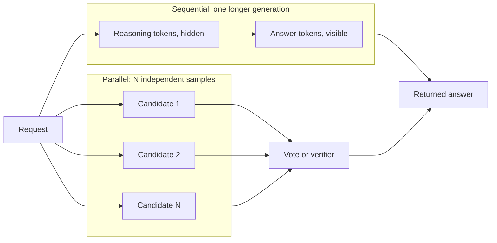
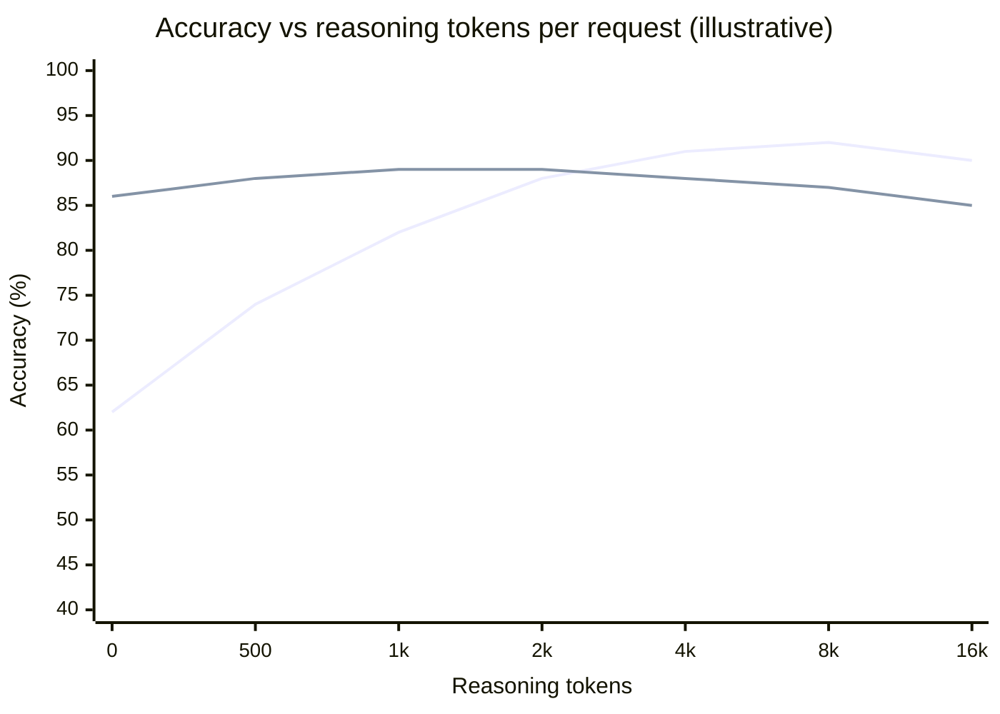
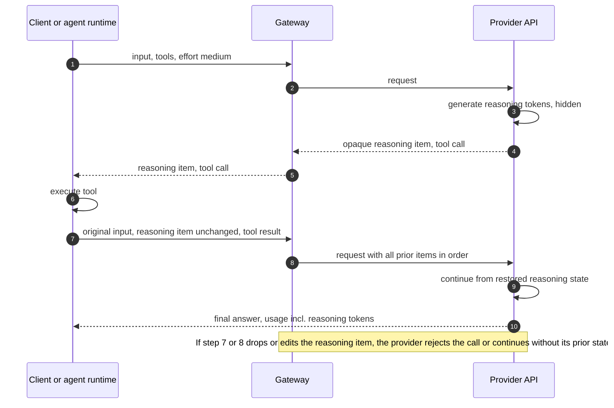
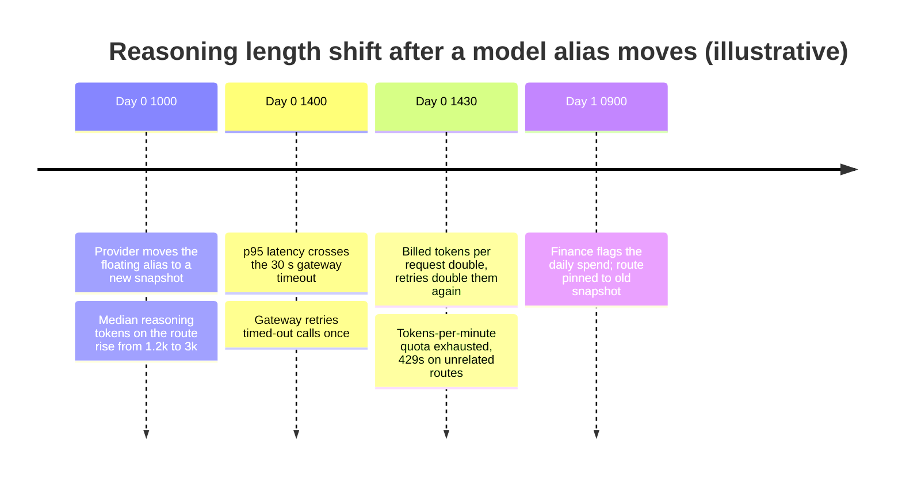

A reasoning model is a language model trained to generate a long intermediate token sequence before it generates the answer, and served so that this sequence is usually hidden from the caller. Test-time compute is the broader idea behind it: instead of buying accuracy only with a larger model, buy it per request at inference time, by letting the model generate more tokens, by sampling several candidates and picking one, or both. Vendors call the intermediate sequence "reasoning" or "thinking". On this page those words mean exactly one thing: generated tokens that are conditioned on the input, condition the final answer, and are billed as output. They do not mean that the model deliberates in the human sense, and, as the evidence later on this page shows, the text of the sequence is not a reliable account of how the answer was produced.

The architectural consequence is that the visible output no longer determines the cost or the latency of a call. A request that returns a 150-token answer may have generated 300 or 15,000 tokens to get there, and the number is chosen by the model at run time within a coarse limit the caller sets. Every price, timeout, rate limit, and capacity estimate that was derived from visible output length is wrong for these models, usually in the tail, where the incidents happen.

The core trade-off is accuracy on multi-step problems against latency, cost, cost variance, and transparency. On tasks that decompose into steps whose intermediate results can be checked, such as mathematics, code, constraint satisfaction, and multi-step planning, extra test-time compute measurably raises accuracy. On tasks that need recall of facts, short classification, or fluent prose, it often adds latency and cost and little else, and past a point it can lower accuracy. Deciding where on that curve each route sits, and enforcing the decision with budgets, is the work this page describes.

## Two Ways to Spend Compute at Inference Time

There are two independent ways to spend more inference compute on one request, and they behave differently in production. The first is sequential: one generation runs longer, producing intermediate tokens before the answer. The second is parallel: several independent generations run at once, and a selection step, either a vote over the final answers or a verifier that scores each candidate, returns one. Trained reasoning models are the productized form of the first; the second can be built around any model.


*Sequential and parallel test-time compute. Sequential spending adds latency in proportion to the extra tokens; parallel spending adds cost in proportion to N but runs in roughly the latency of one call.*

The two paths fail in different places. The sequential path puts all extra tokens on the critical path of the request, because decode generates one token at a time, so latency grows linearly with reasoning length; what makes this expensive is explained at the GPU level in [Prefill, Decode, and the KV Cache](/ai-systems-architecture/en/inference/fundamentals/prefill-decode-kv-cache/). The parallel path keeps latency close to one call, since the candidates are generated concurrently, but it needs a selection rule. A majority vote works only when answers are discrete and comparable, such as a label, a number, or a choice among options. A verifier works only when one exists: unit tests for code, a solver for constraints, a schema and business rules for extraction. Without either, N candidates are N times the cost with no way to choose among them.

### Why Longer Generations Raise Accuracy

A transformer spends a fixed amount of computation per generated token. A problem that needs more serial computation than one forward pass provides cannot be solved in a short answer, however large the model, but it can be solved across many tokens, because each generated token becomes input to the next pass. Intermediate results written into the context are working memory the model can condition on. This is why prompting a non-reasoning model to "think step by step", chain-of-thought prompting (Wei et al., 2022), improved accuracy on arithmetic and multi-step questions long before dedicated reasoning models existed.

Reasoning models move this from the prompt into training. The DeepSeek-R1 report (DeepSeek-AI, January 2025) is the most detailed public description: reinforcement learning against rewards that can be computed automatically, such as whether a math answer matches the reference or whether code passes tests, produced longer generations in which the model re-checks intermediate results, abandons approaches, and tries alternatives; in the R1-Zero variant these behaviors appeared without any supervised reasoning demonstrations. Closed vendors describe their training in less detail. OpenAI's announcement of its o1 models (September 2024) reported accuracy that rose with both training compute and test-time compute; Snell et al. (2024) showed that allocating test-time compute adaptively per prompt could match a model several times larger on problems of moderate difficulty, while the hardest problems still favored the larger model.

The evidence has a clear boundary, and it matters for architecture. The rewards behind this training are verifiable, so the gains concentrate where answers are verifiable. Gema et al. (*Inverse Scaling in Test-Time Compute*, 2025) constructed tasks on which longer reasoning lowered accuracy, through distraction by irrelevant information, overfitting to familiar problem framings, and drift away from reasonable priors. Work on knowledge-intensive questions (*Test-Time Scaling in Reasoning Models Is Not Effective for Knowledge-Intensive Tasks Yet*, 2025) points the same way: more generated reasoning does not supply facts the model lacks. The defensible reading is that reasoning length is a tuning parameter with an optimum per task, not a dial on which higher is always better.


*Two illustrative task profiles. The upper-rising line is a multi-step task with verifiable answers; the flat line is a recall or classification task. Neither curve is a measurement of any specific model.*

The shapes, not the numbers, are the point. The multi-step task gains steeply at first, flattens, and declines slightly at the longest budgets. The recall task barely moves and declines once reasoning becomes long. Your own curves are obtained the only way that holds: run the route's eval set at each effort level the provider offers and record accuracy, reasoning tokens, and latency per setting. That measurement procedure is the core of [Model Selection Criteria: A Multi-Criteria Method](/ai-systems-architecture/en/model-strategy/selection-and-deployment/selection-criteria/), and the per-request decision of which setting or model to use belongs to [Multi-Model Strategy and Model Routing](/ai-systems-architecture/en/model-strategy/selection-and-deployment/model-routing/).

## The Request Contract: Effort Controls, Hidden Tokens, Opaque State

Reasoning changes three parts of the API contract described in [Anatomy of an LLM as a System Component](/ai-systems-architecture/en/foundations/ai-component-model/llm-anatomy/): how output length is controlled, what the caller sees, and what state must be carried between calls.

Length is controlled by a coarse knob, not a precise limit. As of November 2026, OpenAI's Responses API takes `reasoning.effort`, whose supported values are model-dependent and drawn from `none`, `minimal`, `low`, `medium`, `high`, `xhigh`, and `max`; several current models reject some of those values with an HTTP 400, and defaults differ by model. Anthropic's Messages API has moved from a token budget to an effort level: the older `thinking` object with `type: "enabled"` and `budget_tokens` (minimum 1,024, below `max_tokens`, documented as a target rather than a strict cap) is deprecated, and Anthropic's documentation states that its Claude 4.7 and later models reject it with a 400; the replacement is `thinking` with `type: "adaptive"` plus an effort setting in `output_config`, under which the model chooses how much to generate. Google's Gemini 3 models take a `thinking_level`, which Google describes as a relative guideline rather than a token guarantee. Open-weight reasoning models served by engines such as vLLM have no effort knob unless the model was trained with one; length is bounded only by the output limit.

What the knob guarantees is therefore limited. It shifts the distribution of reasoning length; it does not bound any single request. The only hard bound is the output token limit (`max_output_tokens`, `max_tokens`), which counts reasoning and visible tokens together. When that limit is hit during reasoning, OpenAI returns a response with `status` set to `incomplete` and reason `max_output_tokens`, and its documentation warns that this can happen before any visible token is produced, with input and reasoning tokens still billed; Gemini documents the same behavior. OpenAI's guide recommends reserving at least 25,000 tokens for reasoning and output when starting with these models (as of November 2026).

What the caller sees is a summary or nothing. OpenAI states that reasoning tokens are not visible through the API and reports their count in `usage.output_tokens_details.reasoning_tokens`; an optional reasoning summary is a separate, shorter text. Google states that Gemini pricing is based on the full thought tokens even when only a summary is returned. Anthropic reports thinking tokens as part of billed output. Open-weight deployments are the exception: vLLM's `--reasoning-parser` option (for example `deepseek_r1`) splits the raw trace into a separate `reasoning` field of the response, formerly named `reasoning_content` (vLLM documentation, December 2025), so the full trace is available to the operator, with the logging consequences discussed in the security section below.

What must be carried between calls is opaque state. In a tool-using turn, the reasoning that led to a tool call is part of what the model needs when it receives the tool result. Providers return that state as an opaque, often encrypted, item that the client must send back unchanged.


*A tool-using turn with a reasoning model. The opaque reasoning item from step 4 must travel back through every layer in step 7 and 8.*

Steps 4 to 8 carry the constraint that most often breaks in production. OpenAI's reasoning guide instructs callers to pass back reasoning items together with tool outputs, keeping all prior output items in their original order; for stateless use (`store` set to false, or Zero Data Retention), the items carry encrypted content that the client stores and returns. Google enforces the equivalent for Gemini 3 function calling: a missing thought signature in the current turn returns a 400, and outside function calling missing signatures degrade quality without an error. Anthropic's documentation likewise requires thinking blocks to be preserved during tool use, and notes that changing the thinking configuration between turns invalidates prompt-cache breakpoints, which matters for the economics in [Prompt Caching: Structure, Savings, and Invalidation](/ai-systems-architecture/en/context-engineering/production-prompting/prompt-caching/). Any gateway, framework, or conversation store that rebuilds messages from text, truncates history, or normalizes provider formats into a common shape must carry these items through intact; this is a concrete case of the portability problem in [Vendor Lock-in and the Abstraction Layer](/ai-systems-architecture/en/model-strategy/lifecycle-and-adaptation/vendor-lock-in/).

| Aspect | OpenAI Responses API | Anthropic Messages API | Gemini API (Gemini 3) | Open-weight on vLLM |
|---|---|---|---|---|
| Length control | `reasoning.effort`, values model-dependent | Adaptive thinking plus effort; manual `budget_tokens` deprecated | `thinking_level`, a relative guideline | Output limit only, unless the model has its own control |
| Hard bound | `max_output_tokens`, includes reasoning | `max_tokens`, includes thinking | `max_output_tokens`, includes thoughts | `max_tokens` |
| Visible trace | Optional summary | Summarized thinking | Optional summary | Raw trace in `reasoning` field |
| State to carry back | Reasoning items, encrypted when stateless | Thinking blocks | Thought signatures, 400 if missing in function calling | Caller's choice |
| When to prefer this shape | You need a stateless, ZDR-compatible flow with explicit effort levels | You want the model to size reasoning per request | You already run Gemini and accept coarse levels | You must see and retain the trace, or pin behavior forever |

*Provider behavior as documented in November 2026. Parameter names and accepted values change with model generations; verify them per model before configuring a route.*

### Configuring a Reasoning Route

The parameters that matter are few, and each has a production effect beyond its name. The effort level sets the cost and latency distribution and must be chosen from eval data per route. The output limit is the only hard cost bound and must sit above the high percentiles of reasoning plus answer length, or the route returns empty incomplete responses. The request timeout must cover the latency tail of reasoning, not the average, and must be consistent with the output limit, since a timeout shorter than the time needed to generate the limit wastes the spend it was meant to cap. The streaming mode changes perceived latency only for the visible part; during reasoning the stream is silent or carries summary events.

```yaml
# Illustrative route policy; field names are this platform's, not a provider's
route: invoice-dispute-triage
model_pin: provider-x/reasoning-model-2026-10-01
reasoning:
  effort: medium            # chosen from eval: accuracy plateau starts here
  max_output_tokens: 24000  # above p99 of reasoning + answer on the eval set
timeouts:
  request_seconds: 300      # covers p99 decode of 24k tokens at measured speed
  retry_on_timeout: false   # a timed-out reasoning call has already been billed
alerts:
  incomplete_ratio: 0.5%    # status incomplete or finish reason length
  p95_reasoning_tokens: 9000
```

The two lines that prevent most incidents are the last two of the `timeouts` and `alerts` blocks. Retrying a reasoning call on timeout repeats the most expensive part of the work, so retries belong only to errors that occurred before generation started; the general reasoning about timeouts and retry budgets is in the Distributed Systems Handbook's [Timeouts](https://gorkemsari.github.io/distributed-systems/en/resilience/protection-patterns/timeouts/). The incomplete ratio and the reasoning-token percentile are the two signals that move first when a model update changes reasoning behavior.

## Worked Example: Pricing Reasoning Against the Errors It Removes

Assume, for illustration, an invoice-dispute triage route that receives 1,000,000 requests a month. Each request has 1,500 input tokens and a 150-token visible answer: a category, a priority, and a one-sentence justification. Assume a price of 2 dollars per million input tokens and 10 dollars per million output tokens for both models, a decode speed of 80 tokens per second, and 0.5 seconds to first token before decoding starts. All numbers are illustrative assumptions, not any provider's prices or speeds.

Without reasoning, a call costs 1,500 × 0.000002 + 150 × 0.00001 = 0.003 + 0.0015 = 0.0045 dollars, and takes about 0.5 + 150 / 80 ≈ 2.4 seconds. The month costs 4,500 dollars.

With reasoning at medium effort, assume the eval measured a median of 1,200 reasoning tokens, a mean of 2,000, a p95 of 6,000, and a p99 of 14,000. At the median, the call bills 1,350 output tokens: 0.003 + 0.0135 = 0.0165 dollars, and its visible answer starts after about 0.5 + 1,200 / 80 = 15.5 seconds and finishes at about 17.4 seconds. At p95 the call bills 6,150 output tokens, 0.0645 dollars, and takes about 77 seconds. At p99 it bills 14,150 tokens, 0.1445 dollars, and takes about 177 seconds. The monthly cost is set by the mean, 0.003 + 2,150 × 0.00001 = 0.0245 dollars per call, so 24,500 dollars a month, 5.4 times the non-reasoning route.

The quality side, also illustrative: on the route's eval set the non-reasoning model is correct on 91% of requests and the reasoning model on 96%. Per month that is 90,000 misrouted disputes against 40,000, so reasoning removes 50,000 errors for an extra 20,000 dollars, 0.40 dollars per avoided error. If a misrouted dispute costs an average of 3 dollars in agent handling and delay, the reasoning route pays for itself about seven times over. If it costs 0.20 dollars, because a human re-triages every dispute anyway, it does not. The decision is made in this unit, cost per avoided error, and not in price per token; the billing mechanics of reasoning tokens across providers, and the cost model behind this calculation, are in [Token Economics: Pricing, Reasoning Tokens, and Hidden Costs](/ai-systems-architecture/en/economics/understanding-cost/token-economics/).

Three further results come out of the same numbers. First, the latency tail decides the integration pattern: a p99 of nearly three minutes rules out a synchronous call behind a user-facing request with a 30-second gateway timeout, and suggests an asynchronous job with a status callback; at a 30-second timeout, every request above roughly 2,350 reasoning tokens, roughly a quarter of traffic under this distribution, would be billed and discarded. Second, the parallel alternative is competitive here, because the answer is a discrete category: five non-reasoning samples with a majority vote cost 5 × 0.0045 = 0.0225 dollars, slightly less than the reasoning mean, at about 2.4 seconds. Whether the vote reaches 96% is an empirical question, answered by running it on the same eval set. Third, the cost tail matters to rate limits, because every hidden token counts against the provider's tokens-per-minute quota; a route sized from visible tokens consumes its quota about 14 times faster than planned here (2,150 billed against 150 visible tokens per call), the problem treated in [Token-Based Rate Limiting and Quotas](/ai-systems-architecture/en/platform/ai-gateway/token-rate-limiting/).

:::tip[Try a vote before paying for a reasoning tail]
When a route's output is a label, a number, or a choice among options, majority voting over several non-reasoning samples often buys a similar accuracy gain at a fraction of the latency and with a much narrower cost distribution. Measure both on the same eval set before committing to a reasoning model; the vote also gives a free confidence signal, the agreement rate, that can drive abstention as described in [Capability vs. Reliability: Closing the Production Gap](/ai-systems-architecture/en/foundations/ai-component-model/capability-vs-reliability/).
:::

## Comparing Ways to Buy Accuracy

Reasoning models are one of several ways to raise accuracy on a hard route, and each spends a different resource.

| Approach | What it spends | Latency effect | Cost predictability | When to prefer |
|---|---|---|---|---|
| Non-reasoning model, single call | Least of everything | Lowest, set by visible output | High | The route already meets its quality target, or the task is recall, short classification, or prose |
| Reasoning model, low effort | Some hidden tokens | Moderate, small tail | Medium | Multi-step tasks with a tight latency budget |
| Reasoning model, high effort | Many hidden tokens | High, long tail | Low | Hard verifiable tasks off the user's critical path: code, analysis, planning, offline batch |
| Parallel samples with vote | N times the calls | About one call | High | Discrete answers where agreement is meaningful |
| Parallel samples with verifier | N calls plus verification | One call plus the verifier | High | A deterministic checker exists: tests, solvers, schema and business rules |
| Decomposed workflow | Engineering time, several smaller calls | Sum of steps | High | The steps are known in advance and can be checked individually |
| Larger non-reasoning model | Higher per-token price | Low | High | The gap is knowledge or language breadth, not multi-step computation |

Two rows deserve emphasis. A decomposed workflow, in which deterministic code calls the model for each step and checks each intermediate result, is the explicit, auditable form of what a reasoning model does implicitly; when the steps are known, it gives better control over every axis except development time. And a larger model, or retrieval, is the right lever when the failure is missing knowledge, because no amount of generated reasoning adds a fact that is not in the weights or the context. Where reasoning is the right lever inside an agent, it usually belongs to the planning step rather than to every call in the loop; loop design is covered in [Agent Loop Patterns: ReAct, Plan-and-Execute, Reflection](/ai-systems-architecture/en/agents/agent-patterns/agent-loops/).

The trade-off also has a governance axis. A reasoning model's intermediate output looks like an explanation, and it is tempting to store it as one. Chen et al. (*Reasoning Models Don't Always Say What They Think*, Anthropic, April 2025) inserted hints into evaluation prompts and found that when the models used a hint to answer, Claude 3.7 Sonnet mentioned it in its reasoning in 25% of cases and DeepSeek R1 in 39%; in a reward-hacking setup the models exploited the planted loophole in over 99% of cases and mentioned it in under 2% in most scenarios. The visible trace, and even more so a vendor-generated summary of it, is therefore evidence about the computation, not a record of it.

:::caution[A reasoning trace is not an explanation of the decision]
Do not store reasoning text or summaries as the justification for a decision that an auditor, a regulator, or a customer may ask you to explain. The measured rate at which traces omit the factor that actually drove the answer is high, and summaries are produced by a separate process you do not control. Record the inputs, retrieved evidence, model version, and the final output, and generate any required explanation from those, as described in [Explainability and Auditability](/ai-systems-architecture/en/governance/regulation/explainability-auditability/).
:::

The remaining security and data implications are concrete. Hidden reasoning processes the full context, including any injected instructions in retrieved documents or tool results, and reasoning does not make a model resistant to [prompt injection](/ai-systems-architecture/en/security/threats/prompt-injection/); the planted-loophole result above suggests it can pursue an injected objective without saying so. Where the raw trace is available, as on open-weight deployments, it contains restated copies of the input, personal data included, and must be handled under the same retention and masking rules as prompts, covered in [Prompt and Response Logging Under Privacy Constraints](/ai-systems-architecture/en/llmops/observability/logging-privacy/). Encrypted reasoning items stored client-side for stateless flows are provider-readable conversation state and belong in the data inventory with the rest of the conversation.

## Failure Modes and Operations

Reasoning failures are mostly economic and temporal rather than crashes: an answer that never arrives, a bill that changes shape, a timeout that turns into a retry storm. They are invisible in dashboards built on request counts and visible output length, so detection starts with logging three fields on every call: billed output tokens, reasoning tokens, and the completion status or finish reason.


*An illustrative incident. No error is raised by the model change itself; the failure emerges from timeouts, retries, and a shared quota sized for the old length distribution.*

The sequence shows why reasoning-length changes are the characteristic failure of these models. The model update is legitimate and may even improve accuracy; the damage comes from controls calibrated to the old distribution. The timeout converts long calls into billed failures, the retry repeats the most expensive part of each, and the shared quota spreads the impact to routes that never changed. The amplification pattern is the one described in [Retry Storms and Metastable Failures](https://gorkemsari.github.io/distributed-systems/en/resilience/flow-control/retry-storms-metastable-failures/). The defenses are a pinned model snapshot per route, so behavior changes only when you migrate deliberately ([Model Versioning, Deprecation, and Migration](/ai-systems-architecture/en/model-strategy/lifecycle-and-adaptation/versioning-migration/)); no retry on timeout for generation that had started; and an alert on the reasoning-token percentile, which moved hours before the cost did.

| Failure | Trigger | Symptom | Detection | Mitigation and recovery |
|---|---|---|---|---|
| Empty incomplete response | Output limit reached during reasoning | No visible answer, full bill | Share of `incomplete` or `length` endings; visible tokens equal zero | Raise the limit above p99, or lower effort; never parse incomplete output |
| Billed timeout | Client or gateway timeout below the reasoning tail | 504s, spend without answers | Timeout rate per route against p95 reasoning latency | Size timeouts from the tail; move to async jobs; no retry on started generation |
| Silent length shift | Model or alias update, prompt change, input mix change | Cost and latency rise, no errors | p50 and p95 reasoning tokens per route, compared with baseline | Pin snapshots; gate migrations on reasoning-token distribution as well as accuracy |
| Overthinking | Effort set higher than the task's optimum | Accuracy flat or lower, latency high | Eval accuracy per effort level; production quality by effort | Choose effort from the curve; lower it for recall and classification |
| Lost reasoning state | Gateway, framework, or history store drops or edits opaque items | 400s in tool loops, or degraded multi-step quality | Error rate on tool-result turns; agent-task eval on multi-turn flows | Pass reasoning items through unchanged; test the gateway on tool loops |
| Quota starvation | Hidden tokens counted against shared tokens-per-minute limits | 429s on other routes | Quota consumption by route, billed versus visible tokens | Separate quotas for reasoning routes; admission control on effort |
| Trace treated as truth | Reasoning text logged as rationale or shown to users as justification | Explanations that contradict the actual driver | Audit sampling; faithfulness checks in red-teaming | Store evidence and outputs, not traces, as rationale |

Measurement follows from the table. Each route's eval run records accuracy, `pass^k` over repeated trials, reasoning tokens at p50, p95, and p99, and latency at the same percentiles, for every effort level in use; a regression is any of them moving beyond tolerance, not only accuracy. In production, cost per correct answer, computed from billed tokens and sampled quality judgments, is the single number that catches both a quality drop and a cost rise. The span attributes that carry reasoning-token counts are part of [OpenTelemetry GenAI Semantic Conventions](/ai-systems-architecture/en/llmops/observability/otel-genai/), and a hard per-run ceiling on total tokens for agents that call reasoning models in a loop is the subject of [Stopping Conditions and Budget Control](/ai-systems-architecture/en/agents/reliable-execution/stopping-budget/).

:::caution[Effort is not a budget]
An effort level shifts the average and leaves the tail unbounded up to the output limit. A route that relies on "low effort" to control spend has no cost control for the inputs that trigger long reasoning, which are often the adversarial or malformed ones. Set the output limit as the hard per-call bound, and a per-tenant or per-run token budget above it.
:::

## When a Reasoning Model Is the Right Component

Use a reasoning model when four conditions hold together. The task decomposes into steps whose intermediate results constrain the answer: code generation and repair, data analysis, multi-constraint scheduling, contract clause comparison, planning the steps of an agent. The route's eval shows a gain over a non-reasoning model that survives repeated trials, measured per effort level. The latency budget accommodates the measured tail, either because the call is asynchronous or because users accept tens of seconds for this action. And the cost per avoided error, computed as in the worked example, is below the cost of the errors it removes.

Prefer a low effort level, or a non-reasoning model, for interactive turns where users wait on every token, for short classification and extraction routes that already meet their target, and for high-volume batch work where a few points of accuracy do not pay for a multiple of the cost. Prefer parallel sampling with a vote or a verifier when answers are discrete or checkable and latency matters. Prefer a decomposed workflow when the steps are known, must be audited individually, or must run deterministic checks between them.

Do not use reasoning to compensate for missing knowledge; use retrieval or a model with broader knowledge, because longer generation over absent facts produces longer, more confident errors. Do not use reasoning output as the explanation of record in regulated decisions. Do not route every request of a product to a reasoning model "for safety"; route by measured difficulty and send only the slice that benefits, which is the pattern in [Multi-Model Strategy and Model Routing](/ai-systems-architecture/en/model-strategy/selection-and-deployment/model-routing/).

Two adjacent topics are often confused with this one. Whether a model is closed, open-weight, or small is a separate axis from whether it reasons; reasoning variants exist in every category, compared in [Frontier, Open-Weight, and Small Language Models](/ai-systems-architecture/en/model-strategy/model-landscape/model-categories/). And the general balance of quality, latency, and cost across a system's routes, of which the effort level is one lever, is treated in [The Quality-Latency-Cost Triangle](/ai-systems-architecture/en/economics/optimization/quality-latency-cost/).

## Further Reading

- Jason Wei et al., *Chain-of-Thought Prompting Elicits Reasoning in Large Language Models*, NeurIPS, 2022.
- Xuezhi Wang et al., *Self-Consistency Improves Chain of Thought Reasoning in Language Models*, ICLR, 2023.
- Charlie Snell, Jaehoon Lee, Kelvin Xu, and Aviral Kumar, *Scaling LLM Test-Time Compute Optimally Can Be More Effective than Scaling Model Parameters*, arXiv, 2024.
- DeepSeek-AI, *DeepSeek-R1: Incentivizing Reasoning Capability in LLMs via Reinforcement Learning*, arXiv, 2025.
- Yanda Chen et al., *Reasoning Models Don't Always Say What They Think*, Anthropic, 2025.
- Aryo Pradipta Gema et al., *Inverse Scaling in Test-Time Compute*, arXiv, 2025.
