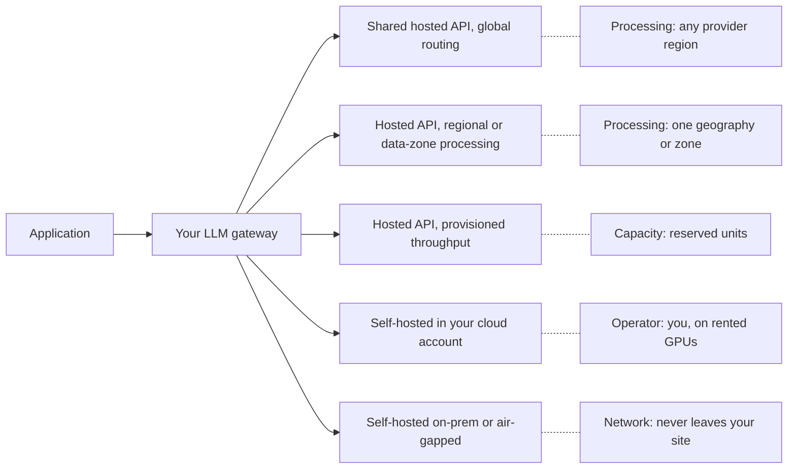
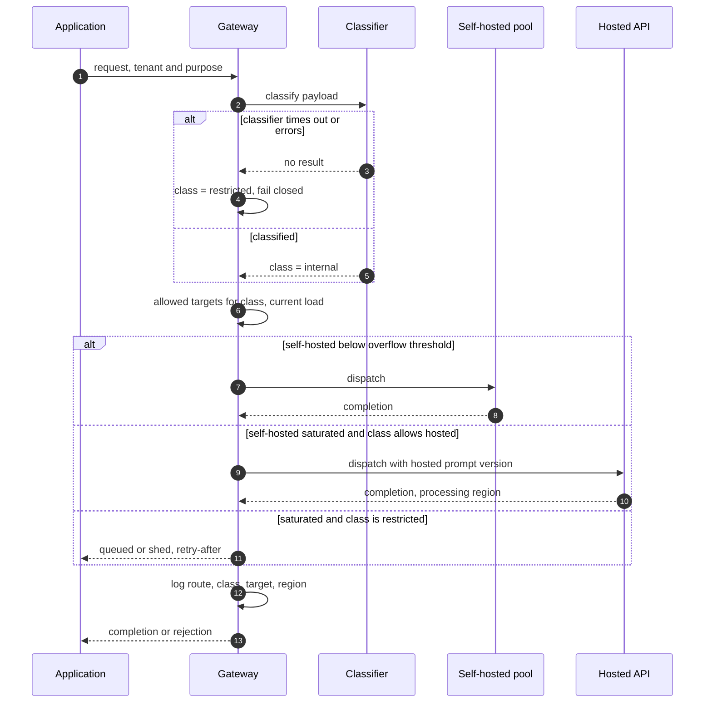
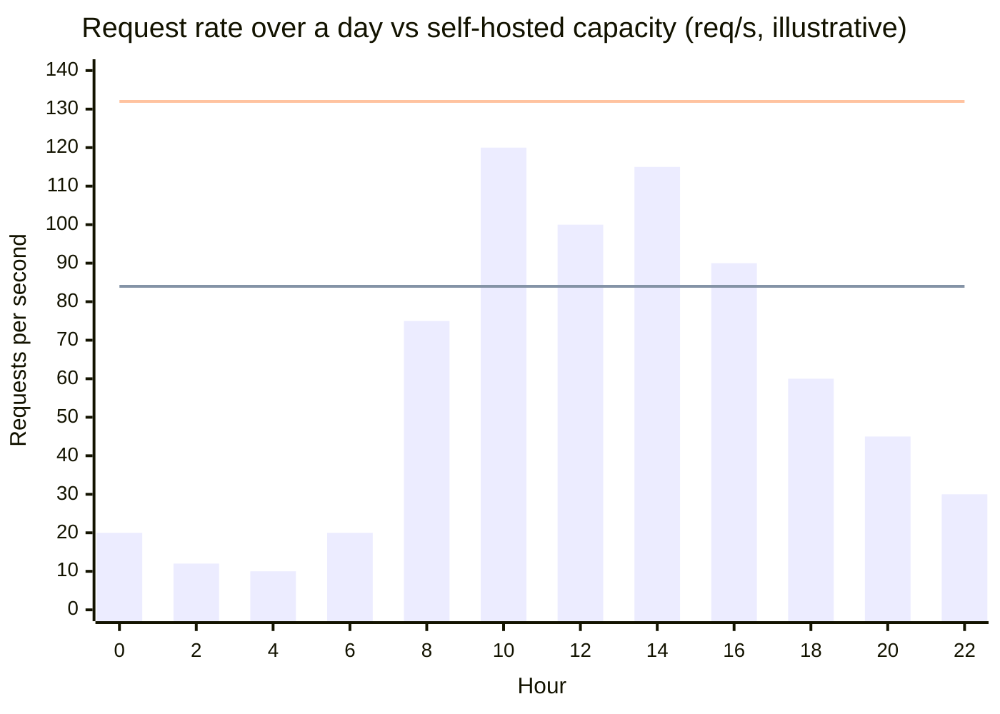
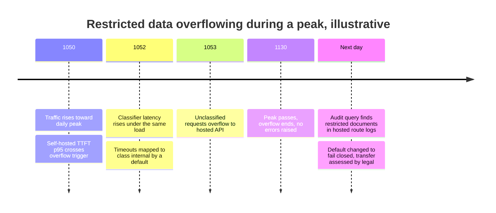

A deployment model decides three things about an LLM component that the choice of model does not: where the bytes of each prompt and completion are processed, who operates the stack that processes them, and what kind of capacity stands behind the endpoint. A hosted API sends requests to a provider that runs the model on shared or reserved capacity in its own data centers. A self-hosted deployment runs open weights on accelerators that you operate, in your cloud account or your own data center. A hybrid deployment uses both for the same product, and the interesting engineering lives in the rules that decide which request goes where.

The choice is usually framed as cost per token, and that framing hides the decision. Cost is owned by [Self-Hosted vs. API: Total Cost of Ownership](/ai-systems-architecture/en/economics/understanding-cost/tco/); this page is about the properties that cost cannot buy back. Hosted shared capacity is elastic and operated by people who do nothing else, but it is best-effort, rate-limited per account, and its failures, including quality bugs, are invisible until the provider discloses them. Owned capacity keeps every byte inside your boundary and every version under your control, but it is a fixed number of requests per second that you must size, patch, and page someone for at 3 a.m.

The core trade-off is therefore control and data locality against elasticity and operational load. A second trade-off appears as soon as both options are in use: a hybrid gains independent failure domains and burst capacity, and it pays for them with two configurations that must be evaluated, a routing policy that must never send a request to a target its data is not allowed to reach, and a capacity contract on the hosted side that is sized for the day the self-hosted side fails, not for an average day.


*Five operating points behind one gateway. Moving down the list, more of the processing boundary, the capacity, and the pager move to your side.*

The list is not a single scale. Regional processing narrows where data goes without changing who operates the model. Provisioned throughput changes the capacity contract without changing either the location or the operator. Self-hosting in a cloud account moves the operator to you while the hardware, and the cloud provider's own processing guarantees, still belong to someone else. Only the last row satisfies a requirement that no prompt ever leave a network you control. Teams that collapse these dimensions into "API versus self-hosted" routinely pay for control they did not need or assume a guarantee they did not get.

## Three Boundaries That Define a Deployment Model

### The Processing Boundary: Where Prompts Are Decrypted

Data-residency rules are usually phrased in terms of where personal or confidential data is processed and stored. For an LLM call, processing means the place where the request is decrypted, tokenized, held in accelerator memory as a KV cache, and turned into output, plus wherever the provider writes logs, abuse-monitoring records, or cached prompts. The endpoint's hostname says little about that place, because large providers route inference across regions to balance load.

Microsoft's Azure documentation for model deployments makes the distinction explicit (page last updated August 2026). Global deployment types "may be processed in any Azure region"; Data Zone types are processed only within a Microsoft-specified zone (US, EU, or Asia Pacific); Standard and Regional Provisioned types are processed within the customer-specified Azure geography; and for all types, data stored at rest remains in the designated geography. The same model is therefore available under three different processing boundaries, and the documentation describes the global and data-zone standard types as the highest-quota, lowest-price options, which is exactly why the broadest scope tends to become the default in a quick setup.

Amazon Bedrock offers the same choice through inference profiles (per its user guide as of November 2026). A geographic cross-Region profile routes requests among a listed set of Regions within one geography such as the US or the EU; a global profile may process requests in any supported commercial Region worldwide, at roughly 10% lower token prices than the geographic profile. CloudTrail and CloudWatch records stay in the source Region, and CloudTrail records the Region that actually processed each request in an `inferenceRegion` field. That field is the evidence an auditor will ask for, and it shows the general rule: the processing boundary must be verified per request from the provider's own telemetry, not inferred from configuration.

The contract side completes the boundary. Retention periods, abuse-monitoring access, training use, and sub-processors are terms of the agreement, not properties of the endpoint, and they differ between consumer products, standard API terms, and enterprise agreements. The regulatory consequences for Turkey, including cross-border transfer of personal data, are covered in [Turkish Regulation and Data Residency: KVKK and BDDK](/ai-systems-architecture/en/governance/regulation/turkish-regulation/).

### The Operational Boundary: Who Sees the Failure First

A hosted API transfers the operation of the serving stack: accelerator failures, serving-engine upgrades, kernel and compiler changes, load balancing, and capacity planning. It also transfers the visibility. When something in that stack degrades output quality without raising errors, the customer sees only a statistical shift in answers.

Anthropic's postmortem of September 2025 is the clearest public example. Three independent infrastructure bugs degraded responses between August and early September 2025: a routing error that sent some short-context Sonnet 4 requests to servers configured for a 1M-token context, peaking at 16% of Sonnet 4 requests in the worst hour on 31 August; a misconfiguration on TPU servers that occasionally produced tokens such as Thai or Chinese characters inside English answers; and a latent XLA compiler bug triggered by an approximate top-k sampling change. The bugs affected different models on different platforms at different rates; Amazon Bedrock and Google Vertex AI, which serve the same models on their own infrastructure, were affected by the first bug at much lower rates and not by the other two. Anthropic wrote that its evaluations had not captured the degradation and that it was moving to more sensitive evaluations run continuously on production systems.

Two lessons carry over to any hosted deployment. The same model name served by different platforms is not the same configuration, which is why [Model Selection Criteria: A Multi-Criteria Method](/ai-systems-architecture/en/model-strategy/selection-and-deployment/selection-criteria/) selects a full route rather than a model. And the consumer of a hosted API needs its own continuous quality signal, because the provider's monitoring can miss what your traffic exposes; the mechanics are in [Quality Monitoring and Drift Detection](/ai-systems-architecture/en/llmops/observability/quality-drift/).

Self-hosting reverses the boundary. Every one of those bug classes, a misrouted request, a misconfigured accelerator pool, a compiler or engine regression, becomes yours to cause, detect, and fix. The serving engine, its quantization, and its chat template are part of the model's identity, as [Frontier, Open-Weight, and Small Language Models](/ai-systems-architecture/en/model-strategy/model-landscape/model-categories/) explains; the operating knowledge lives in [Serving Engines: vLLM, TGI, TensorRT-LLM, SGLang, llama.cpp](/ai-systems-architecture/en/inference/production-serving/serving-engines/) and [LLM Serving on Kubernetes: GPU Scheduling and Autoscaling](/ai-systems-architecture/en/inference/production-serving/kubernetes-serving/). The gain is that you can see the failure: a self-hosted team can diff engine versions and replay traffic, which a hosted customer cannot.

### The Capacity Boundary: What Stands Behind a Request

Three capacity contracts exist, and they fail in different ways. Shared pay-per-token capacity is best-effort: the provider admits requests up to a per-account quota expressed in requests and tokens per minute, and above that, or when the shared pool is saturated, it answers with throttling errors or higher latency. Provisioned capacity reserves units of throughput for a term; Azure measures it in provisioned throughput units (PTUs) and describes provisioned types as providing guaranteed throughput and lower latency variance than standard types, which it calls best-effort. Owned capacity is whatever your accelerators deliver at your latency objective, and it never throttles you on someone else's behalf, but it also never grows when you need it to.

| Capacity contract | What is guaranteed | What is not | Failure under overload | When to prefer |
|---|---|---|---|---|
| Shared pay-per-token | Admission up to account quota, an availability SLA if contracted | Throughput at peak, latency variance, processing region on global types | Throttling errors, latency spikes during provider-wide demand | Low or bursty volume, fast iteration, fallback capacity |
| Provisioned units | Reserved throughput, lower latency variance | Capacity above the reservation; utilization of what you bought | Requests beyond the reservation are rejected unless routed elsewhere | Steady high volume with a latency objective, on a hosted model |
| Owned accelerators | Data locality, version control, no external quota | Elasticity; anything beyond the fleet's measured capacity | Queueing, rising time to first token, then timeouts | Restricted data, pinned versions, steady volume that keeps GPUs busy |

The table explains why "provisioned" and "self-hosted" are often confused: both are fixed capacity that must be sized and both waste money when idle. They differ on the other two boundaries. A provisioned deployment remains operated by the provider and processed under the provider's terms; a self-hosted one is yours on both counts.

:::caution[A regional endpoint is not a processing guarantee]
Calling an endpoint in an EU region does not mean the request was processed there if the deployment type or inference profile permits cross-region routing. Choose the processing scope explicitly in the deployment type or profile, block the broader scopes with organization policy where the provider supports it, and record the processing region returned in telemetry for every request. Defaults are chosen for quota and price, not for your residency obligations.
:::

## Hybrid Architectures and the Routing Invariant

A hybrid deployment exists for one of three reasons, and the reason determines the routing rule. Split by data class sends restricted data to self-hosted capacity and everything else to a hosted API, because the restricted share is too small or too hard to serve to justify self-hosting all traffic. Baseline plus burst serves steady load on owned or provisioned capacity and sends peaks to shared hosted capacity, because sizing owned capacity for the peak leaves it idle most of the day. Primary plus fallback serves everything on one side and uses the other only when the first fails, because the two sides fail independently. Most real hybrids combine the first two: classification decides which targets a request may use, and load decides which of those it does use.

The correctness of a hybrid rests on one invariant: a request whose data class is C is never sent to a target outside the allowed set for C, on any path, including overflow, fallback, retry, and degraded modes. Everything else, cost and latency included, is an optimization inside that invariant. The invariant is easy to state and easy to break, because overflow and fallback logic is written for availability, and availability logic naturally reaches for whatever target is up.

Four design rules make the invariant hold. Classification happens before routing and produces an explicit class on the request; a missing or failed classification maps to the most restrictive class, never to a default permissive one. The allowed-target set is a policy evaluated by the gateway at the moment of dispatch, not a property of a code path, so that an overflow or fallback branch cannot bypass it; this is policy as code in the sense of [Policy as Code: OPA, Gatekeeper, and Kyverno](https://gorkemsari.github.io/distributed-systems/en/security/zero-trust/policy-as-code/). The gateway is the only component with network egress to hosted providers, so a service that tries to call a provider directly fails at the network layer, as in [Micro-Segmentation: The Least-Privilege Network Model](https://gorkemsari.github.io/distributed-systems/en/security/zero-trust/micro-segmentation/). And when the allowed targets for a class are all unavailable or saturated, the request is queued, degraded, or shed, never redirected; how to choose which requests to drop is covered in [Load Shedding: Which Requests to Drop and How](https://gorkemsari.github.io/distributed-systems/en/resilience/flow-control/load-shedding/).


*Dispatch in a classification-plus-overflow hybrid. The classifier's failure path (step 4) and the restricted branch at saturation are where availability pressure tries to break the routing invariant.*

Step 4 is the line most implementations get wrong. A classifier that times out under the same peak load that triggers overflow is the normal case, not an edge case, because both are caused by the same traffic spike. If the timeout maps to "internal", the peak sends unclassified restricted data to the hosted API precisely when the most traffic is flowing. The last branch is the other half of the rule: restricted traffic at saturation waits or is rejected with a retry hint, which is a visible availability cost the business must accept in advance. The final log line is what turns the invariant from a design claim into evidence: every request carries its class, the target that served it, and, for hosted targets, the processing region the provider reported.

A hybrid has a second, less obvious requirement: the two targets must be evaluated as two configurations of the component. An overflow request answered by a hosted frontier model and a baseline request answered by a self-hosted open-weight model can differ in quality, format, refusal behavior, and length, and a user can notice the difference between their morning and afternoon answers. Each target therefore gets its own prompt version, tuned with equal effort, and both must pass the component's eval thresholds. If they cannot both pass, the component is not a candidate for load-based overflow, and its hybrid is limited to fallback with an explicit degraded mode. When the goal is to pick a model per request by difficulty rather than by load or data class, the topic is [Multi-Model Strategy and Model Routing](/ai-systems-architecture/en/model-strategy/selection-and-deployment/model-routing/).

### Worked Example: Sizing a Baseline With Hosted Overflow

Assume, for illustration, a document-assistant component in a bank. Its traffic follows a daily profile from 10 requests per second at night to 120 at the late-morning peak, with a mean of about 58 requests per second and about 5 million requests a day. Each request averages 2,000 input and 300 output tokens. Thirty percent of requests are classified restricted and may only be served on premises; the rest may use a hosted API with EU data-zone processing under the bank's contract. A load test of the self-hosted configuration shows that one replica, a fixed group of GPUs serving one copy of the model, sustains 12 requests per second while keeping p95 time to first token within the component's objective. All numbers here are illustrative assumptions, not measurements.

Option A sizes the self-hosted fleet for the peak with one spare: 10 replicas for 120 requests per second plus one for a replica failure, 11 in total and 132 requests per second of capacity. No request ever leaves the site. Averaged over the day, the fleet serves 58 requests per second against 132 of capacity, about 44% utilization.

Option B sizes the fleet at 7 replicas, 84 requests per second, and overflows non-restricted traffic above that line to the hosted API. Running the daily profile against the line, traffic exceeds 84 requests per second for 8 hours, the overflowed share is about 13.4% of daily requests, and the peak overflow is 36 requests per second. Fleet utilization rises to about 60%, and the GPU count falls from 11 replicas to 7, about 36% fewer. Whether that saves money depends on hosted token prices and on staff and facility costs, which is the calculation in [Self-Hosted vs. API: Total Cost of Ownership](/ai-systems-architecture/en/economics/understanding-cost/tco/); the capacity logic below holds regardless of prices.


*Every second hour of the illustrative profile against Option B's 84 req/s line and Option A's 132 req/s line. Bars above the lower line are overflow; the gap below the upper line is idle capacity in Option A.*

The chart shows where each option's cost sits. Option A pays for the area between the bars and the upper line all day. Option B pays for the bars that cross the lower line, at hosted prices, for about a third of the day. The restricted share sets a floor under Option B: the restricted peak is 30% of 120, or 36 requests per second, and it must be served on site even when a replica fails. With one of seven replicas down, capacity is 72 requests per second, enough for 36 restricted plus 36 others, so the floor holds with margin.

The hosted quota is where Option B is usually under-designed. The quota must cover the peak overflow in the degraded state, not the average overflow on a healthy day. With one replica down at peak, overflow rises from 36 to 48 requests per second. At 2,000 input tokens per request that is 48 × 60 × 2,000, about 5.8 million input tokens per minute, plus about 0.86 million output tokens per minute. A team that requested quota for the healthy peak of 36 requests per second, about 4.3 million input tokens per minute, discovers the gap the first time a replica fails at 11 a.m., when the hosted API starts throttling the overflow it was meant to absorb. Throttling behavior and its retry hazards are covered in [LLM Provider Failure Modes: Rate Limits, Overload, Partial Responses](/ai-systems-architecture/en/reliability/provider-failures/provider-failure-modes/), and quota enforcement on your own side in [Token-Based Rate Limiting and Quotas](/ai-systems-architecture/en/platform/ai-gateway/token-rate-limiting/).

Availability follows the same structure. Assume a single on-premises site with 99.5% monthly availability and a hosted API with 99.9%. Non-restricted traffic can be served by either side, so if their failures were independent it would be unavailable only when both are down, about 0.0005% of the time. That figure is an upper bound on the benefit: a shared gateway, a shared DNS dependency, or a shared identity provider correlates the two sides and caps the combined availability at that shared component's. Restricted traffic has only one allowed target, so its availability is the site's 99.5%, and Option B does nothing for it. If restricted traffic needs better than one site can deliver, the answer is a second site inside the boundary, not an overflow rule.

## Comparing the Deployment Options

The options differ on all three boundaries at once, and the failure each one hands you is as important as the property it offers. Managed open-weight endpoints, where a host serves published weights on its own GPUs, sit between the hosted and self-hosted rows; their version and portability properties are covered in [Frontier, Open-Weight, and Small Language Models](/ai-systems-architecture/en/model-strategy/model-landscape/model-categories/).

| Option | Processing boundary | Capacity contract | Operator | Failure you inherit | When to prefer |
|---|---|---|---|---|---|
| Hosted, global routing | Any provider region; storage per terms | Shared, quota-limited | Provider | Residency assumptions broken silently; provider-wide outages | Non-sensitive data, maximum quota, lowest price |
| Hosted, regional or data-zone | One geography or zone | Shared or provisioned | Provider | Lower quota than global; provider-side quality bugs you cannot see | Personal data allowed to leave your network but not the jurisdiction |
| Hosted, provisioned | As per deployment scope | Reserved units for a term | Provider | Paying for idle units; rejection above the reservation | Steady volume with tight latency variance on a closed model |
| Self-hosted, cloud account | Your account and region; cloud terms apply | Your GPUs, subject to cloud GPU availability | You | Capacity planning, engine upgrades, GPU shortages in the region | Pinned open weights, fine-tuned models, no on-prem facility |
| Self-hosted, on-prem or air-gapped | Your network only | Your hardware, fixed | You | Procurement lead times, single-site availability, all operations | Data that may not leave the institution; regulatory or contractual mandate |
| Hybrid | Per data class, enforced by the gateway | Owned baseline plus hosted overflow or fallback | Both | Routing-invariant breaches; two configurations to evaluate | Mixed data classes, peaky load, or a need for independent failure domains |

The self-hosted cloud row is the one teams misjudge most. It moves the operator and the model version to your side, but GPU instances in a given region are a market with its own shortages, and a reservation-free fleet may fail to scale out when it most needs to. It also keeps the cloud provider inside the processing boundary as an infrastructure operator, which satisfies most residency rules and does not satisfy a rule that data stay in the institution's own facilities.

:::tip[Size the hosted side for the day the owned side fails]
In every hybrid, the hosted capacity contract, whether quota or provisioned units, is a disaster-recovery reservation as well as a burst buffer. Compute it from the peak overflow with the largest plausible loss of owned capacity, request it in advance, and test it with a scheduled failover drill at peak. Quota increases are granted by people on a timescale of days; an incident lasts hours.
:::

## Configuring the Route and the Fleet

A hybrid's behavior is mostly configuration in the gateway, described in [The LLM Gateway Pattern](/ai-systems-architecture/en/platform/ai-gateway/llm-gateway/). The parameters that matter are few, and each has a failure mode attached.

```yaml
# Illustrative gateway route; field names are not a standard
route: doc-assistant
classes:
  restricted: { allowed: [onprem-pool] }
  internal:   { allowed: [onprem-pool, hosted-eu-datazone] }
  public:     { allowed: [onprem-pool, hosted-eu-datazone, hosted-global] }
classification: { timeout_ms: 150, on_failure: restricted }   # fail closed
targets:
  onprem-pool:        { prompt: doc-assist-oss-v7, max_inflight: 336 }
  hosted-eu-datazone: { prompt: doc-assist-api-v7, quota_tpm_in: 6000000 }
overflow:
  trigger: { ttft_p95_ms: 1200, queue_depth: 40 }   # leading signals, not errors
  enter_after_s: 30
  exit_after_s: 300                                  # hysteresis against flapping
on_no_allowed_target: { action: shed, retry_after_s: 20 }
log: [class, target, prompt_version, provider_region, overflow_state]
```

The overflow trigger uses leading signals, the p95 time to first token and the queue depth at the self-hosted pool, because by the time errors appear, requests already in the queue have missed their latency objective. The entry and exit delays are deliberately asymmetric: entering overflow quickly protects latency, and leaving it slowly prevents the route from flapping between targets every few seconds, which would mix two configurations inside a single conversation. `max_inflight` caps concurrent sequences at the pool so that admission control, rather than the serving engine's internal queue, decides when to overflow; the relation between concurrency, KV cache memory, and latency is the subject of [GPU Capacity Planning](/ai-systems-architecture/en/inference/production-serving/gpu-capacity-planning/). The prompt version is a property of the target, not of the route, for the evaluation reason given above. Conversations that span several turns should stay pinned to the target that served their first turn when the data class allows it, so that a single exchange is not answered by two configurations.

On the self-hosted side, the decisions that matter most for the deployment model are capacity headroom and change control. Headroom is the spare capacity kept for replica failures and for the time an autoscaler needs to add replicas, which for large models includes loading tens of gigabytes of weights; with a hosted overflow, part of that headroom can be bought as quota instead of held as idle GPUs, for non-restricted traffic only. Change control means that the serving engine version, quantization, and chat template are pinned and changed only through an eval gate, because each of them can change outputs without raising an error.

## Failure Modes and Operations

Deployment-model failures rarely look like outages. They look like a residency breach found in an audit, a throttling storm during an unrelated incident, or answers that became slightly worse on one side of a hybrid.


*An illustrative incident in which two correct-looking mechanisms, overflow on load and a permissive classification default, combine into a data transfer that no single component reported as an error.*

Nothing in this timeline fails in the usual sense. Overflow worked, the hosted API served the requests, and latency stayed within its objective. The breach is visible only because the gateway logged the class and target of every request and because someone queried those logs; without that field the transfer would have no record at all. The mitigation is the fail-closed default in the route configuration, a classifier sized and isolated so that it does not degrade with the traffic it classifies, and an alert on any request served by a target outside its class's allowed set, which should be impossible and therefore a page.

:::danger[Overflow and fallback paths must enforce the data-class policy]
A hybrid that checks the data class on the primary path and not on the overflow, fallback, or retry path will, under load or during an incident, send restricted data to a target it was never allowed to reach. Evaluate the allowed-target policy at every dispatch, map classification failures to the most restrictive class, and treat any request served outside its allowed set as a security incident, not a routing bug.
:::

The other failure modes have the same structure: a property that one boundary was assumed to provide, and a signal that shows it did not.

| Failure | Trigger | Symptom | Detection | Mitigation and recovery |
|---|---|---|---|---|
| Processing outside the assumed boundary | Global deployment type or profile used by default | No symptom until an audit | Processing region per request from provider telemetry | Explicit deployment scope; organization policy blocking broader scopes |
| Provider-side quality bug | Provider infrastructure or sampling change | Slight rise in malformed or off-language output, no errors | Continuous production evals; output-validity rates per target | Fail over to the other side if it passes evals; report to provider with examples |
| Provider-wide outage | Provider control-plane or capacity failure | All requests to that provider fail | Error rate per target; provider status | Fallback within allowed targets; shed restricted classes that have no alternative |
| Overflow quota exhausted | Quota sized for healthy peak, owned replica lost | Throttling exactly during an owned-side incident | 429 rate on overflow target; quota headroom at peak | Size quota for degraded peak; failover drills at peak |
| Self-hosted capacity exhaustion | Traffic growth, longer inputs, replica loss | Rising TTFT, queueing, then timeouts | TTFT p95, queue depth, KV cache utilization | Admission control; overflow for allowed classes; capacity plan with headroom |
| Configuration divergence | Prompt or model changed on one target only | Answer quality differs by time of day | Per-target eval scores; overflow share vs. complaint rate | Paired prompt versions per target; eval gate covering both |
| Route flapping | Symmetric or no hysteresis on overflow | Alternating targets within one conversation | Target switches per conversation; overflow state changes per minute | Asymmetric enter and exit delays; pin conversations to first target |
| Self-hosted change regression | Engine, quantization, or template upgrade | Subtle output changes on long inputs or tool calls | Eval gate on pin-record changes; canary comparison | Revert to evaluated configuration; stage upgrades |

Provider-wide outages are not hypothetical. OpenAI's public write-up of 11 December 2024 describes an incident of about 4 hours 22 minutes that affected ChatGPT, the API, and Sora: a newly deployed telemetry service made every node in large Kubernetes clusters issue expensive API-server operations, the control planes failed, and DNS-based service discovery, which depended on them, stopped working. For a customer the lesson is not about Kubernetes, which the Distributed Systems Handbook covers in [DNS-Based Discovery: Kubernetes DNS](https://gorkemsari.github.io/distributed-systems/en/microservice-patterns/service-discovery/dns-based-discovery/); it is that a single provider is a single failure domain for every model it serves, and that a fallback to another model from the same provider is not a fallback across failure domains. Fallback chains themselves are covered in [Fallback Chains and Graceful Degradation](/ai-systems-architecture/en/reliability/provider-failures/fallback-degradation/).

The security and governance obligations follow the boundaries. A hosted route makes the provider a data processor and requires contractual terms on retention, training use, sub-processors, and processing location, plus whatever masking happens before the call, as described in [PII and Sensitive Data: Masking, Tokenization, Redaction](/ai-systems-architecture/en/security/defenses/pii-handling/). A self-hosted route adds a model supply chain, covered in [AI Supply Chain Security: Models, Datasets, MCP Servers](/ai-systems-architecture/en/security/defenses/supply-chain/), and makes you responsible for the logs that a provider would otherwise keep, including their retention and erasure. A hybrid adds the routing log as an audit artifact: for every answer, which target, which configuration, and which processing region produced it, which is the record that [Explainability and Auditability](/ai-systems-architecture/en/governance/regulation/explainability-auditability/) depends on.

## Choosing a Deployment Model per Component

Decide per component, and decide constraints before optimizations. The first question is which processing boundary the component's most sensitive data class allows. If any class may not leave the institution, that class needs self-hosted capacity regardless of cost, and the remaining question is whether the other classes join it or go to a hosted API. If data may leave the network but not the jurisdiction, a hosted API with regional or data-zone processing is the default, verified per request.

Use a shared hosted API when volume is low, bursty, or unknown, when the component needs a closed model's capability, and when the team's scarce resource is engineering time. Do not use the global processing scope for any data covered by residency rules, and do not run a high-consequence component on a hosted API without your own continuous quality monitoring, because the provider's quality bugs reach you without an error.

Use provisioned hosted capacity when volume is steady and high enough to keep the reservation busy, and the latency objective is tighter than shared capacity delivers at peak. Do not buy provisioned units to solve a residency problem; they change the capacity contract, not the processing boundary.

Use self-hosting when a data class may not leave the institution, when a version must be pinned longer than any provider's retirement schedule, when you serve a fine-tuned or distilled model you own, or when steady volume keeps accelerators busy and the team can run GPU infrastructure with an on-call rotation. Do not self-host to save money without a utilization estimate and a staffing plan, and do not self-host a component whose quality bar only a closed frontier model meets; an open-weight model that fails the eval is not made acceptable by being local.

Use a hybrid when the component carries more than one data class with different allowed boundaries, when load is peaky enough that owned capacity sized for the peak would sit mostly idle, or when you need failure domains that are actually independent. Do not build a hybrid whose two targets cannot both pass the component's evals, and do not build one before the gateway can enforce the allowed-target policy on every path and log the result.

Several adjacent decisions are often folded into this one. Which category of model to use is settled in [Frontier, Open-Weight, and Small Language Models](/ai-systems-architecture/en/model-strategy/model-landscape/model-categories/). The full cost comparison belongs to [Self-Hosted vs. API: Total Cost of Ownership](/ai-systems-architecture/en/economics/understanding-cost/tco/). Keeping the provider replaceable is the subject of [Vendor Lock-in and the Abstraction Layer](/ai-systems-architecture/en/model-strategy/lifecycle-and-adaptation/vendor-lock-in/), and a complete on-premises design for a regulated institution is in [Reference Architecture: On-Prem AI Platform in a Regulated Environment](/ai-systems-architecture/en/reference/reference-architectures/on-prem-regulated/).

## Further Reading

- Microsoft, *Deployment types* (Foundry Models documentation), Microsoft Learn, 2026.
- Amazon Web Services, *Increase throughput with cross-Region inference*, Amazon Bedrock User Guide, 2026.
- Anthropic, *A postmortem of three recent issues*, Anthropic Engineering, 2025.
- OpenAI, *Incident write-up for the 11 December 2024 outage of API, ChatGPT, and Sora*, OpenAI status page, 2024.
- Woosuk Kwon et al., *Efficient Memory Management for Large Language Model Serving with PagedAttention*, SOSP, 2023.
