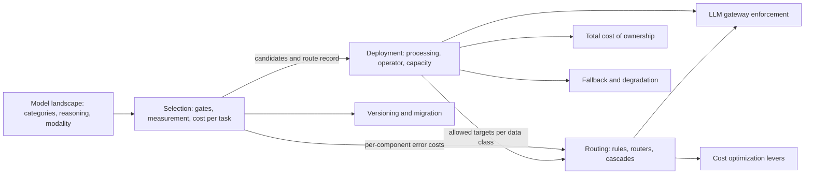
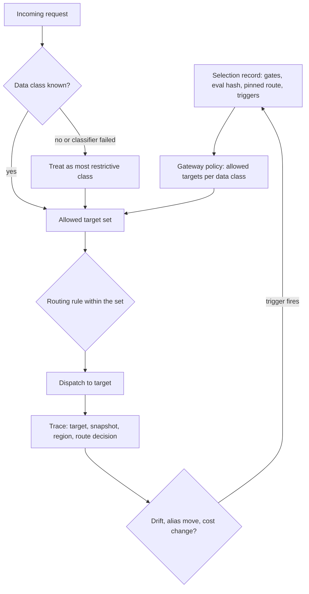

The previous chapter describes what kinds of models exist; this one turns that description into a production decision for one component. Three questions make up that decision, and they are answered at different times. Which model configuration serves the component is decided once, on measured evidence, and revisited when that evidence goes stale. Where its prompts are processed, who operates the stack, and what capacity stands behind the endpoint is decided per data class and per load profile. Which of several permitted models answers a particular request is decided at run time, by a rule, a router, or a cascade. Each answer narrows the next: selection produces the candidates a deployment can host, and deployment fixes the set of targets a router may choose from.

The tension running through the chapter is between constraints and objectives. Some properties of a component cannot be traded for anything: a data class that may not leave the institution, a license that forbids the intended use, a version that must outlive a provider's retirement schedule. Others are meant to be traded: accuracy against cost, latency against capacity, a cheaper model against a slightly higher error rate. Every page in the chapter makes the same structural move. It checks the constraints first, as gates or invariants that no score can override, and only then optimizes inside the space they leave, with cost per successful task as the common unit wherever errors have a price. The characteristic failures of the chapter are the ones where that order is reversed: a weighted spreadsheet that lets quality buy back a residency violation, an overflow path that sends restricted data to whatever target is up, a router score that outranks a context-length limit.

The chapter describes decision methods, not product recommendations. Provider deployment scopes, deprecation policies, and managed routers appear in the topic pages as dated examples verified at writing time; the method, the boundaries, and the invariants hold for LLM-based systems as of November 2026.

## How the Three Decisions Depend on Each Other

The three pages form a sequence. Each consumes what the previous one produced, and each hands a different concern to a later part of the handbook.

*How the chapter's three decisions feed one another and the parts of the handbook that implement or price them. Edge labels name what one page hands to the next.*

Selection comes first because it produces two things the others need: a set of candidates that passed the gates and thresholds, and a record of what each configuration costs per successful task on this component. Deployment takes those candidates and asks where each can run; its central output is the allowed-target set per data class, which is a constraint the router must respect rather than a preference it may weigh. Routing then optimizes within that set, and its economics rest directly on selection's cost-of-error reasoning, because a router is only worth building when the per-request saving exceeds the accuracy it gives up times what an error costs. All three converge on the gateway, the one place where the record, the policy, and the routing rule are applied to each request.

## The Topics

[Model Selection Criteria: A Multi-Criteria Method](/ai-systems-architecture/en/model-strategy/selection-and-deployment/selection-criteria/) answers how to choose the model configuration that serves one component, on your data, in a way that survives an audit and can be re-run. It separates gates from measurable objectives, puts error costs into a cost per successful task, shows why min-max weighted sums can change their winner when a losing candidate is added, and tests whether a measured gap is larger than the noise and the break-even point. It matters because a selection made on a leaderboard, a demo, or a spreadsheet usually looks right at launch and goes stale without any error being raised.

[Hosted API vs. Self-Hosted vs. Hybrid Deployment](/ai-systems-architecture/en/model-strategy/selection-and-deployment/hosted-vs-self-hosted/) answers where a chosen model runs, who operates it, and what capacity stands behind it. It replaces "API versus self-hosted" with three independent boundaries (processing location, operator, and capacity contract), states the invariant every hybrid must hold on overflow, fallback, and retry paths, and sizes a baseline with hosted overflow for the day an owned replica fails. It matters because a deployment scope chosen by default can process regulated data outside the assumed geography with no symptom until an audit, and because provider-side quality bugs reach a hosted component without an error.

[Multi-Model Strategy and Model Routing](/ai-systems-architecture/en/model-strategy/selection-and-deployment/model-routing/) answers when to use more than one model inside a product and how to pick one per request. It distinguishes predictive routers, which decide before generation, from cascades, which generate cheaply, check the result, and escalate. It works out the break-even error cost and the latency tail of each design, and covers drift, cascade false accepts, and cost attacks on routers. It matters because every routing decision is a prediction, and a misrouted request produces a worse answer that nothing in the response marks as misrouted.

| Topic | Question it answers | Open it when |
|---|---|---|
| Model Selection Criteria: A Multi-Criteria Method | Which model configuration should serve this component, and is the winner real? | Choosing or replacing a model; a provider deprecates a snapshot; a reviewer asks why this model was chosen; two candidates are close |
| Hosted API vs. Self-Hosted vs. Hybrid Deployment | Where is each prompt processed, who operates the stack, and what capacity backs it? | Data residency or retention applies; deciding whether to self-host; designing overflow or failover between providers; sizing provisioned capacity |
| Multi-Model Strategy and Model Routing | Should requests be split across models, and by a router, a cascade, or a fixed rule? | The token bill is dominated by easy traffic; difficulty varies within one component; evaluating a managed router; strong-model share rises unexpectedly |

## One Route, Decided at Three Times

Read together, the pages describe one route configuration whose fields are set at design time, enforced at dispatch time, and reopened when monitoring shows that their assumptions no longer hold. Each page owns its part of this cycle in full; the diagram only shows where the parts meet.

*The life of one route across the chapter. The selection record and the data-class policy are fixed before traffic arrives; the routing rule acts only inside the allowed set; every response is logged so that the record can be reopened.*

The first shared conclusion is that constraints are enforced at the point of dispatch, not in a document. The selection page checks gates before spending a single eval item, the deployment page evaluates the allowed-target policy at the moment each request is sent so that no overflow branch can bypass it, and the routing page applies hard constraints before any score. When a request's data class cannot be determined, the deployment page maps it to the most restrictive class, and the routing page's constraint layer inherits that fail-closed rule.

The second is that money is the unit that makes trade-offs comparable, and that it changes the answer by component. The selection page shows a candidate with the largest token bill being the cheapest component once errors cost dollars, the routing page shows a router that saves tokens and loses more than that in errors, and the deployment page sizes hosted overflow by the degraded peak rather than by the average day. In each case the intuitive choice reverses once the cost of an error, or of the bad day, is written down.

The third is that what is selected, hosted, and routed is a configuration, not a model name. A snapshot, an effort level, a serving engine, a processing region, and a prompt version all change outputs. Each page therefore records the full route, logs the fields that the provider reports per response, and treats a change to any of them as a release that runs the evals again. The selection record's re-evaluation triggers, the hybrid's paired prompt versions per target, and the router's re-derived thresholds are three forms of the same discipline.

## Suggested Reading Order

Read the pages in sidebar order. The selection page comes first because it supplies the vocabulary the others use: gates versus objectives, cost per successful task, the paired comparison, and the selection record. The deployment page comes second because it introduces the routing invariant, which the routing page assumes rather than re-derives; a router built without that invariant can optimize cost straight into a residency violation. The routing page comes last because it combines both: its break-even calculation is the selection page's cost-of-error reasoning applied per request, and its constraint layer is the deployment page's allowed-target set.

Two shortcuts are reasonable. A reader facing a data-residency or self-hosting question can start with the deployment page, whose first section and decision guidance stand on their own. A reader looking at a token bill dominated by simple traffic can go to the routing page's worked example and its break-even tip, which settles in one division whether routing is worth building at all.

## Prerequisites and Where the Chapter Leads

The chapter assumes [The Model Landscape](/ai-systems-architecture/en/model-strategy/model-landscape/), in particular [Frontier, Open-Weight, and Small Language Models](/ai-systems-architecture/en/model-strategy/model-landscape/model-categories/), which settles which category a component may use before any candidate is measured, and [Reasoning Models and Test-Time Compute](/ai-systems-architecture/en/model-strategy/model-landscape/reasoning-models/), whose hidden-token tail is why the selection page load-tests latency instead of measuring single requests. From Foundations, [Capability vs. Reliability: Closing the Production Gap](/ai-systems-architecture/en/foundations/ai-component-model/capability-vs-reliability/) defines the repeated-trial success rate used as a quality objective, and [When AI Is the Wrong Solution: A Decision Framework](/ai-systems-architecture/en/foundations/failure-and-fit/when-not-to-use-ai/) is the question to answer before selecting any model. From the companion handbook, [SLO (Service Level Objective): The Art of Setting Targets](https://gorkemsari.github.io/distributed-systems/en/observability/slo-sla-error-budgets/slo/) is where the latency thresholds come from, and [Load Shedding: Which Requests to Drop and How](https://gorkemsari.github.io/distributed-systems/en/resilience/flow-control/load-shedding/) describes what a hybrid does with restricted traffic that has nowhere permitted to overflow.

The decisions made here are maintained and priced elsewhere. [Model Lifecycle and Adaptation](/ai-systems-architecture/en/model-strategy/lifecycle-and-adaptation/) handles what happens after selection: [Model Versioning, Deprecation, and Migration](/ai-systems-architecture/en/model-strategy/lifecycle-and-adaptation/versioning-migration/) turns an alias move into a deliberate release, and [Vendor Lock-in and the Abstraction Layer](/ai-systems-architecture/en/model-strategy/lifecycle-and-adaptation/vendor-lock-in/) keeps a re-selection a configuration change rather than a rewrite. [The LLM Gateway Pattern](/ai-systems-architecture/en/platform/ai-gateway/llm-gateway/) is where the allowed-target policy and the routing rule run, and [Fallback Chains and Graceful Degradation](/ai-systems-architecture/en/reliability/provider-failures/fallback-degradation/) owns failure routing, which should exist before any difficulty-based router does. The cost side is owned by [Self-Hosted vs. API: Total Cost of Ownership](/ai-systems-architecture/en/economics/understanding-cost/tco/) and [Cost Optimization Techniques: Routing, Caching, Batching, Trimming](/ai-systems-architecture/en/economics/optimization/cost-optimization/), and in a regulated institution the selection record becomes a validation artifact under [Model Risk Management for LLM Systems](/ai-systems-architecture/en/governance/risk-management/model-risk-management/).
