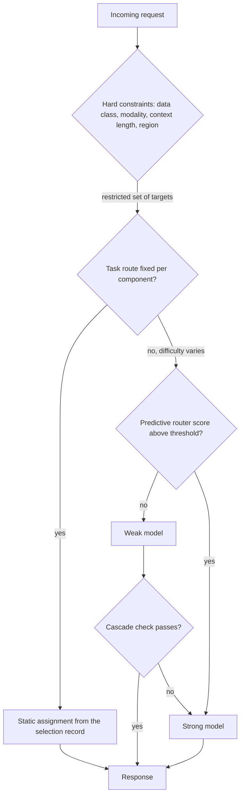
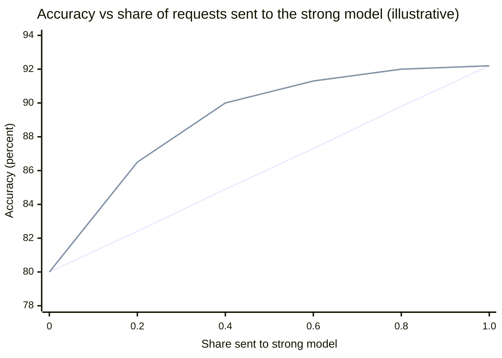
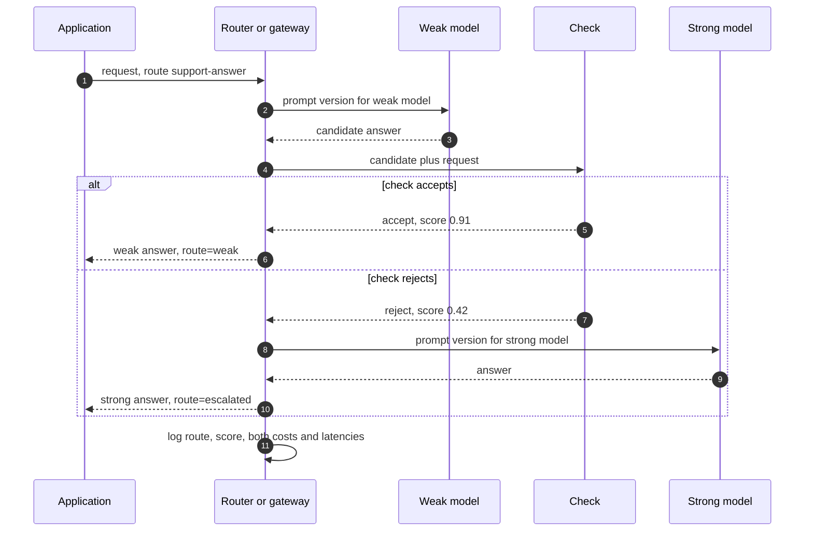
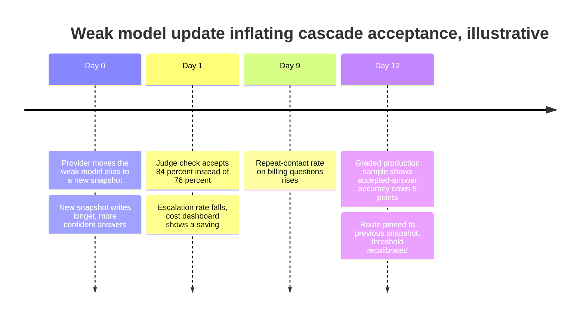

A multi-model strategy is the deliberate use of more than one model inside one product, with an explicit rule for which model serves which work. The rule can be fixed when the system is designed: the extraction component uses one model, the chat component another. Model routing makes the rule a run-time decision taken for each request: a router inspects the request, or a first attempt at answering it, and sends it to one of several models that differ in price, latency, and capability. The economic case is the spread of prices. Within one provider's catalog, the most capable and the cheapest text models often differ in token price by an order of magnitude or more, while a large share of real traffic is easy enough that the cheaper model's answer is as good as the expensive one's.

The core trade-off is that every routing decision is a prediction, and a wrong prediction is a new kind of error. A router that sends a hard request to a weak model produces a worse answer than either model alone would have produced on a system that always used the strong one, and nothing in the response marks it as misrouted. A router that sends easy requests to the strong model wastes the money that justified building it. The system also stops being one configuration: each model behind the router needs its own prompt, its own eval results, and its own failure analysis, and the router itself becomes a component with its own accuracy, drift, and attack surface.

There is a second, quieter trade-off between deciding before and after generation. A predictive router decides from the request alone, cheaply and with no added latency to speak of, but without seeing the answer. A cascade generates with the cheap model first and escalates when a check rejects the answer, which uses far more information but makes every escalated request pay for two generations and makes the check itself the component that determines quality.


*The layers of a per-request model decision. Constraints narrow the set of allowed targets first; difficulty-based routing and cascading only choose within that set.*

The order is the safety argument. Constraints that are not tradable, such as a data class that may only be processed on premises or an input longer than one model's context window, are applied before any cost-driven logic, so that no router score can send a request to a target it is not allowed to reach. That routing invariant, and how a hybrid deployment enforces it under load, is the subject of [Hosted API vs. Self-Hosted vs. Hybrid Deployment](/ai-systems-architecture/en/model-strategy/selection-and-deployment/hosted-vs-self-hosted/). Only within the permitted set does the router optimize.

## What Routing Decides, and What It Does Not

Several mechanisms are called "routing" in AI platforms, and they solve different problems. Static assignment picks one model per component from measured evidence; its method is [Model Selection Criteria: A Multi-Criteria Method](/ai-systems-architecture/en/model-strategy/selection-and-deployment/selection-criteria/), and this page assumes it has been done for each candidate. Difficulty-based routing, the subject of this page, picks a model per request among candidates that would all be acceptable for some requests. Failure routing sends a request to another model or provider when the first one is unavailable, throttled, or too slow; it is a reliability mechanism with different correctness rules, covered in [Fallback Chains and Graceful Degradation](/ai-systems-architecture/en/reliability/provider-failures/fallback-degradation/). Load distribution spreads requests across several deployments of the same model, which is ordinary load balancing as described in [Load Balancing Algorithms](https://gorkemsari.github.io/distributed-systems/en/communication/load-balancing/algorithms/), with token counts rather than request counts as the unit of load.

The guarantees differ. A load balancer may move any request to any healthy replica because all replicas compute the same function, and a fallback accepts a known, pre-evaluated quality loss in exchange for availability. A difficulty router makes a statistical claim, and its contract is stated as a measured bound, never as a property of individual requests: over the evaluated request distribution, routing reaches a stated fraction of the strong model's quality while sending a stated fraction of requests to it. It does not guarantee that any single request receives the answer the strong model would have given, it does not guarantee the bound after the traffic mix changes, and it does not guarantee anything about slices that were absent or small in the eval set.

## Predictive Routing: Deciding Before Generation

A predictive router computes, from the request alone, a score that estimates how much the strong model's answer would improve on the weak model's. If the score exceeds a threshold, the request goes to the strong model; otherwise it goes to the weak one. The router's behavior is fully determined by the scoring function and by the threshold that converts the score into a share of traffic.

Scoring functions range from rules to trained models. Rules use features an engineer can name: input length, the presence of code or tables, the tenant's plan, the product surface, a keyword that signals a request for analysis rather than lookup. They are transparent and brittle. Embedding-based routers place the request in an embedding space and look at labeled neighbors: if requests similar to this one were answered equally well by both models, the weak model suffices. Trained classifiers, typically a small encoder model fine-tuned on labeled pairs, output a probability that the strong model wins. An LLM-as-router asks a small language model to classify the request's difficulty or type, which is flexible and adds a generation to the critical path.

The most cited open study of trained routers is RouteLLM (Ong et al., ICLR 2025). It trains routers between one strong and one weak model on human preference data from Chatbot Arena, about 65,000 pairwise comparisons after pruning, augmented with labels from benchmark answers and from an LLM judge. It compares four router designs: a similarity-weighted ranking that needs no training, matrix factorization, a BERT-base classifier, and a classifier built on an 8-billion-parameter causal language model. To make routers comparable, it defines the performance gap recovered, PGR, as the router's quality minus the weak model's, divided by the strong model's quality minus the weak model's. A PGR of 80% means the router recovered four fifths of the difference between the two models. Plotting PGR against the fraction of calls sent to the strong model gives a curve, and the area under it, the average performance gap recovered (APGR), summarizes a router across all thresholds. The call-performance threshold CPT(x%) is the minimum share of strong-model calls needed to reach a PGR of x%.

The results vary in an instructive way. Against a GPT-4 baseline, the paper reports cost savings of 3.66 times on MT-Bench at the threshold that recovers 50% of the gap, but only 1.41 times on MMLU and 1.49 times on GSM8K. A conversational benchmark with many easy prompts routes well; a knowledge or arithmetic benchmark where the weak model fails on a large and hard-to-predict share of items routes poorly. The routers also transferred to other model pairs without retraining in the paper's experiments, which is evidence that "difficulty" is partly a property of the request and not only of the pair. The paper itself limits its claims to the two-model setting and notes that real distributions may differ from the benchmarks.

### Why a Router Can Work, and Where the Argument Fails

A router can beat a random split only if difficulty is predictable from the request. The mechanism is that the two models' errors are not independent of input features: long multi-constraint instructions, multi-step arithmetic, rare languages, and requests that require integrating several documents are where small models fail, and those features are visible before generation. The router exploits that correlation. Its quality is the weak model's quality on the requests it keeps, plus the strong model's quality on the requests it sends away, and its gain over a random split is exactly how well it concentrates the weak model's failures into the strong share.


*Two routers between a weak model at 80% and a strong model at 92.2% accuracy. The straight line is a random split; the curve is a router whose scores concentrate the weak model's failures. All values are illustrative.*

A random split buys a proportional share of the strong model's advantage, hence the straight line. A useful router bends above it: here, sending 40% of traffic to the strong model recovers about 80% of the gap. Beyond 60%, extra strong-model share buys almost nothing, because the remaining requests are ones the weak model already answered correctly. Choose the threshold on this curve as measured on your own traffic, never from a vendor default or a paper.

The argument fails in three places. When difficulty is not visible in the input, for example when the weak model fails because it lacks a fact rather than because the request is complex, no request-side feature predicts the failure, and the router's curve collapses toward the random line. When the traffic mix shifts toward a slice the router never saw, its scores are extrapolations, and the curve measured last month no longer describes the system. And when the router is trained on one population's judgments, such as public chat preferences, its notion of "the strong model is better" may not match the task's definition of correct, which is why the router's labels for production use should come from the task's own eval, as described in [Metric Design: Task Metrics and RAG Metrics](/ai-systems-architecture/en/evaluation/measuring-quality/metric-design/).

## Cascades: Generate, Check, Escalate

A cascade sends every request to the cheapest model first and decides afterwards whether its answer is good enough. If a check accepts the answer, it is returned; if not, the request is sent to the next, more expensive model. FrugalGPT (Chen, Zaharia, and Zou, 2023) popularized the pattern for LLMs as one of three cost strategies, alongside prompt adaptation and model approximation, and reported on its benchmarks that a learned cascade could match the best individual model with up to 98% lower cost, or improve on its accuracy by 4% at equal cost. Those are 2023 benchmark results; the structure is what transfers.


*One request through a two-stage cascade. The escalated branch (steps 7-9) pays for both generations and the check; the logged score in step 10 is what lets the threshold be recalibrated later.*

The check is the entire design. Deterministic checks are the strongest: a JSON schema, a required citation that must exist in the retrieved sources, a computed total that must match, a generated query that must parse, a unit test that must pass. They are cheap and their false-accept rate on the property they test is near zero, though they say nothing about properties they do not test. Output validation of this kind is owned by [Output Validation and Repair Loops](/ai-systems-architecture/en/reliability/output-reliability/output-validation/). Probabilistic checks cover what code cannot test: agreement between several samples of the weak model, token log-probabilities where the provider exposes them, a learned scorer trained on labeled answers, or a judge model asked whether the answer satisfies the request. Each of these has a calibrated precision only on the data it was calibrated on, and LLM judges in particular carry known biases toward length and style, covered in [LLM-as-Judge: Use, Bias, and Calibration](/ai-systems-architecture/en/evaluation/measuring-quality/llm-as-judge/).

The correctness argument of a cascade is a statement about the check's two error rates. A false reject sends a correct weak answer to the strong model, which costs money and latency and rarely hurts quality. A false accept returns a wrong weak answer, and it is the cascade's only path to quality loss. The cascade's error rate is therefore the weak model's error rate multiplied by the check's false-accept rate, plus the escalated share multiplied by the strong model's error rate on it. A cascade cannot be better than its check, and a check that is itself an LLM call has to be evaluated with the same rigor as the models it judges.

Cascades interact badly with streaming. A weak answer streamed to the user cannot be withdrawn when the check rejects it, so a streaming product must either buffer the weak answer until the check completes, losing most of the time-to-first-token advantage, or run the check on a prefix and accept that late errors pass. For interactive surfaces, a predictive router is often the only routing that fits the latency budget.

### Worked Example: Router and Cascade for a Support Assistant

Assume, for illustration, a support assistant serving one million requests a month. The strong model costs 1.0 cent per request and is correct on 92.2% of the eval set; the weak model costs 0.05 cents and is correct on 80.0%. The eval set shows two populations: 70% of requests are easy, where the weak model is right 95% of the time and the strong model 97%, and 30% are hard, where the weak model is right 45% of the time and the strong model 81%. Every number here is illustrative.

The predictive router, at the chosen threshold, sends 90% of hard requests and 15% of easy requests to the strong model, so 37.5% of traffic goes to the strong model; the router itself costs 0.01 cents per request. Its accuracy is the sum over the four routed groups: easy requests kept on the weak model contribute 0.595 times 0.95, easy requests sent up 0.105 times 0.97, hard requests sent up 0.27 times 0.81, and hard requests kept 0.03 times 0.45, for a total of 89.9%. The cost per request is 0.625 times 0.05 plus 0.375 times 1.0 plus 0.01, about 0.42 cents. The router recovers 81% of the gap between the two models at 42% of the strong model's token cost, which is about 4,160 dollars a month instead of 10,000.

Whether that is a saving depends on what an error costs. The router is 2.3 points less accurate than the strong model and 0.58 cents cheaper per request, so it breaks even at an error cost of 0.58 divided by 0.023, about 26 cents. If an unresolved support answer costs, say, 50 cents in a repeat contact, the expected cost per request is 4.90 cents for the strong model alone and 5.45 cents for the router: the router saves 5,800 dollars of tokens and loses more than that in errors. If an error costs 10 cents, the router wins, at 1.42 cents against 1.78.

The cascade sends every request to the weak model and checks the answer with a small judge costing 0.03 cents. Assume the check accepts 90% of correct weak answers and wrongly accepts 20% of incorrect ones. Of all requests, 72% are correct and accepted, 4% are wrong and accepted, and 24% are escalated. Assume the strong model is right on 80% of escalated requests, a little below its average because escalated requests are harder. Accuracy is 72% plus 0.24 times 80%, which is 91.2%, and the cost per request is 0.05 plus 0.03 plus 0.24 times 1.0, which is 0.32 cents. At 50 cents per error, the expected cost is 4.72 cents, lower than both the strong model alone and the router. The check sees the answer, so it isolates the weak model's failures better than a router that sees only the question.

The price is latency and a new silent error. Assume a weak generation takes 0.8 seconds, the check 0.4 seconds, and a strong generation 2.5 seconds. Because 24% of requests take the escalated path of 3.7 seconds, more than the 5% in the tail, the cascade's p95 latency is about 3.7 seconds against 2.5 for the strong model alone, while its median falls to about 1.2 seconds. And the 4% of requests answered wrongly by the weak model with the check's approval are errors that the strong model would often have avoided, invisible unless production answers are sampled and graded.

:::tip[Compute the break-even error cost before building a router]
Divide the per-request saving by the accuracy loss on your eval set. If the result is below the realistic cost of one wrong answer, the router is a loss however good its curve looks. This one division rules out routing for many high-consequence components and confirms it for high-volume, low-consequence ones.
:::

## Comparing Routing Designs and Managed Routers

| Design | Decision point | Added latency | Main quality risk | Evaluation burden | When to prefer |
|---|---|---|---|---|---|
| Static assignment per component | Design time | None | Wrong model for a whole component | One configuration per component | Difficulty is uniform within a component |
| Rule-based router | Before generation | Negligible | Rules miss hard requests with easy features | Each rule's slice measured | A few named features clearly separate hard from easy traffic |
| Embedding or classifier router | Before generation | A few to tens of milliseconds | Drift outside the training distribution | Router curve plus both models, per slice | High volume, latency-sensitive, labeled outcomes available |
| LLM-as-router | Before generation | One small-model generation | Router misreads intent; prompt-injectable | Router prompt is a versioned component | Routing by request type or intent with few labels |
| Cascade with deterministic check | After weak generation | Full weak generation, escalated requests pay twice | Properties the check does not test | Check coverage per property | Outputs with verifiable structure or constraints |
| Cascade with probabilistic check | After weak generation | Weak generation plus check | False accepts | Check precision per slice | Batch or async work where latency matters less than cost |
| Provider-managed router | Before generation, inside the provider | Provider-dependent | Routing tuned to the provider's data, not yours | Router version and pool are part of the configuration | Fast start, task close to general chat, pool within one provider |

Managed routers move the scoring function into the provider and make it a configuration choice. As of November 2026, Amazon Bedrock's intelligent prompt routing routes between exactly two models of the same family. The configuration names a fallback model that serves requests by default and a response quality difference: the router predicts each model's response quality for the request and switches away from the fallback only when the other model's predicted quality exceeds it by more than that margin. The documentation states that routing is optimized for English prompts and that the router cannot adjust its decisions based on application-specific performance data, and the response reports which model processed the request.

Microsoft Foundry's model router, per its documentation updated in November 2026, is a trained machine-learning model rather than an LLM. It selects from a pool of more than 40 models in three modes: Balanced, which considers models within a small quality band of the best candidate (the documentation gives 1-2% as an example) and picks the cheapest; Quality, which ignores cost; and Cost, which uses a wider band (5-6% in its example). An administrator can restrict the pool to an approved subset. The selected model is reported in the response's `model` field, the effective context window is the smallest among the models in the pool, the routing decision is based on text only even when images are attached, and optional parameters unsupported by the selected model are dropped. The router itself is versioned, with a generally available version dated 2025-11-18 as of this writing.

OpenAI's GPT-5 system card (August 2025) describes a real-time router in ChatGPT that chooses between a fast model and a reasoning model from conversation type, complexity, tool needs, and explicit intent, trained on signals including model switches by users, preference rates, and measured correctness. That is routing between effort levels, the dimension analyzed in [Reasoning Models and Test-Time Compute](/ai-systems-architecture/en/model-strategy/model-landscape/reasoning-models/), trained on the provider's population; your own router can instead be trained on the outcomes that define correctness for your task.

With a managed router, the evaluated configuration is the router version plus the pool plus the mode, and a silent change to any of them changes which models serve your traffic. Pin what can be pinned, log the returned model on every request, and treat a change in the per-model traffic share as a change event that triggers a re-evaluation.

## Configuring a Routed Component

Routing logic belongs in the gateway layer described in [The LLM Gateway Pattern](/ai-systems-architecture/en/platform/ai-gateway/llm-gateway/), not in application code, so that thresholds can change without a deployment and every decision is logged in one place. A route definition records the targets, the scoring and check components with their versions, the threshold, and the behavior when the router itself fails.

```yaml
route: support-answer
constraints: { data_class_max: internal, min_context_tokens: 32000 }
targets:
  weak:   { model: small-model-2026-09, prompt: support-weak@v7 }
  strong: { model: large-model-2026-08, prompt: support-strong@v5 }
router:
  kind: classifier
  version: difficulty-clf@2026-11-10   # trained on labeled outcomes of this route
  threshold: 0.38                      # chosen from the measured curve, re-checked monthly
  on_error: strong                     # router timeout or failure: fail toward quality
sticky: conversation                   # keep one target per conversation
budget: { max_strong_share_per_tenant: 0.6, window: 1h }
log: [route, score, target, model_returned, router_version, cost, latency]
```

Each target has its own prompt version, because a prompt tuned for one model understates the other and distorts the measured router curve. The registry that holds these versions together is described in [Prompt and Model Registry](/ai-systems-architecture/en/platform/internal-platform/prompt-model-registry/).

The `on_error` choice is a policy: failing toward the strong model keeps quality and spends money during a router incident, while failing toward the weak model silently degrades every hard request. The first is right for most components; the second only for batch work with a hard cost ceiling, with the degradation reported.

Stickiness matters for conversations. Switching models between turns changes tone, formatting, and tool-calling conventions, and it discards the provider-side prompt cache that a long conversation has accumulated, because a cache is specific to one model; the cost of that loss is covered in [Prompt Caching: Structure, Savings, and Invalidation](/ai-systems-architecture/en/context-engineering/production-prompting/prompt-caching/). Route per conversation, or at the first turn with escalation allowed but no downgrade; Foundry's model router offers session affinity as a preview feature for this reason.

The per-tenant cap on strong-model share is a security control as much as a cost control, as the next section explains; cost per route and tenant flows into [Cost Attribution and Chargeback](/ai-systems-architecture/en/economics/understanding-cost/cost-attribution/).

## Failure Modes and Operations

Routing failures are almost never errors: the response is well formed, and the quality loss appears only in aggregate, on a slice, or in cost reports.


*An illustrative incident. A change at the weak model shifted the distribution the check was calibrated on, and the only immediate signal looked like good news.*

The first visible signal was a cost improvement, the characteristic shape of routing incidents. The detection that would have shortened the gap is an alert on the escalation rate or strong-model share moving beyond a band in either direction, combined with a continuously graded sample of accepted weak answers. Pinning the weak model's snapshot rather than its alias would have turned day 0 into a planned change with an eval run, the discipline described in [Change Management for Prompts, Models, and Configuration](/ai-systems-architecture/en/llmops/operations/change-management/).

A cost attack exploits the router directly. Shafran, Schuster, Ristenpart, and Shmatikov showed in *Rerouting LLM Routers* (arXiv, January 2025) that short, query-independent token sequences, which they call confounder gadgets, can be prepended to any query to make routers send it to the strong model, in both white-box and black-box settings and against several commercial routers, without degrading the response. Against one commercial router in their experiments, the gadgets raised cost by a factor of about 1.7. They also found that gadgets can be optimized for low perplexity, so perplexity filtering is not an effective defense. The architectural response is to stop treating user-controlled text as the only routing signal for anything that costs money: cap the strong-model share per tenant and per key, alert on tenants whose share departs from their history, and include signals the user cannot write, such as the product surface or the account tier. The broader class of attacks through untrusted input is covered in [Prompt Injection: Direct and Indirect](/ai-systems-architecture/en/security/threats/prompt-injection/).

:::danger[A router score must never widen the set of allowed targets]
If difficulty routing and data-class routing share one decision function, a high difficulty score can send restricted data to a hosted model that the data class forbids, and the failure is a data transfer, not a quality loss. Apply the data-class constraint first, as a separate fail-closed step that the router cannot override, and verify in logs that no restricted request was ever served by a disallowed target.
:::

| Failure | Trigger | Symptom | Detection | Mitigation and recovery |
|---|---|---|---|---|
| Distribution drift | Traffic mix shifts toward slices the router never saw | Quality drops on a slice; strong share moves | Strong share per slice; graded sample per route | Retrain or recalibrate on recent labeled traffic; widen strong share temporarily |
| Underrepresented slice | Language or input type rare in the eval set | One slice consistently misrouted | Worst-slice accuracy on the routed configuration | Rule that sends the slice to the strong model until it is measured |
| Cascade false accepts | Check calibrated on other data, or weak model changes | Accepted answers wrong, escalation rate falls | Graded sample of accepted answers; acceptance-rate band | Pin snapshots; recalibrate check; deterministic checks where possible |
| Cost attack | Confounder text or deliberate "hard" phrasing | Strong share and cost per tenant rise | Strong share per tenant against baseline | Per-tenant caps, signals the user cannot write, rate limits |
| Router outage or latency | Router service slow or down | Added latency on every request, or wrong default | Router latency and error rate as a separate span | Timeout with an explicit `on_error` target |
| Mid-conversation switch | Per-turn routing in multi-turn chat | Style or tool-format changes; cache misses | Model changes per conversation; cache hit rate | Sticky routing per conversation; no downgrade within a conversation |
| Stale threshold | Price change or model update on one target | Router no longer at the intended point of the curve | Monthly re-measurement of the curve | Threshold as configuration, re-derived from the current curve |

The detection column assumes that every request's trace carries the route, the router score and version, the selected target, the model identifier the provider returned, and the cost and latency of each generation, including discarded cascade attempts. Those attributes fit the span model of [OpenTelemetry GenAI Semantic Conventions](/ai-systems-architecture/en/llmops/observability/otel-genai/), and the graded production sample that catches the silent failures is the mechanism of [Quality Monitoring and Drift Detection](/ai-systems-architecture/en/llmops/observability/quality-drift/).

:::caution[Evaluate the routed system, not the two models]
Two models that each pass the component's thresholds do not make a routed system that passes them. The routed configuration has its own accuracy, worst slice, and latency distribution, determined by the router's errors. Run the eval suite against the routed configuration as a whole, and before raising the weak share in production, test the new threshold on live traffic in shadow mode or as a canary, as in [Online Experimentation: A/B Tests, Shadow Mode, Canary](/ai-systems-architecture/en/evaluation/evals-in-delivery/online-experimentation/).
:::

Routing also has a governance cost. Each model behind a router is a model in production, so in a regulated institution each one is validated and inventoried, and an auditor asking why a customer received an answer needs to know which model produced it and why the router chose it. A logged score and router version answer both; an opaque managed router answers only the first, a reason to prefer an owned router for regulated decisions, as discussed in [Model Risk Management for LLM Systems](/ai-systems-architecture/en/governance/risk-management/model-risk-management/).

## When to Route, and When One Model Is Better

Route per request when four conditions hold together. The component carries enough volume that a fraction of the token bill is worth an engineering team's attention. Difficulty varies within it, which the eval set shows as a weak model that is good on most items and poor on an identifiable minority. The price ratio between the candidates is large, typically ten times or more, because a small ratio leaves little to recover once router cost and quality loss are paid. And the break-even error cost computed from the routed configuration is above the real cost of a wrong answer.

Prefer a cascade over a predictive router when outputs can be checked deterministically, when the work is batch or asynchronous so the escalation latency does not reach a user, or when difficulty is not visible in the request but is visible in the answer. Prefer a predictive router for interactive and streaming surfaces, and combine the two when a cheap classifier can send the clearly hard requests directly to the strong model, skipping a weak generation that would be thrown away.

Do not route a low-volume component: the eval and operations cost of a second configuration exceeds any saving. Do not route a component whose errors are expensive and unverifiable, such as a regulated decision or an agent step that takes an irreversible action; use the strong model and spend effort on reducing its cost by other means. Do not route when users expect consistency across interactions and the models differ visibly in style. Do not use a router to hide that the weak model fails a whole slice; route that slice deliberately with a rule, and record it. And do not build difficulty routing before failure routing: a system with a router and no fallback has added a dependency without adding resilience.

Adjacent topics live elsewhere. Answering repeated requests without any model call is [Semantic Caching](/ai-systems-architecture/en/platform/ai-gateway/semantic-caching/). Routing as one of several cost levers, weighed against caching, batching, and trimming, is in [Cost Optimization Techniques: Routing, Caching, Batching, Trimming](/ai-systems-architecture/en/economics/optimization/cost-optimization/). Training a small model to take over the easy share permanently, rather than routing to it, is a distillation decision covered in [Fine-Tuning and Distillation: An Integration Perspective](/ai-systems-architecture/en/model-strategy/lifecycle-and-adaptation/finetuning-distillation/). Keeping the targets interchangeable at the API level is the concern of [Vendor Lock-in and the Abstraction Layer](/ai-systems-architecture/en/model-strategy/lifecycle-and-adaptation/vendor-lock-in/).

## Further Reading

- Isaac Ong, Amjad Almahairi, Vincent Wu, Wei-Lin Chiang, Tianhao Wu, Joseph E. Gonzalez, M Waleed Kadous, and Ion Stoica, *RouteLLM: Learning to Route LLMs from Preference Data*, ICLR, 2025.
- Lingjiao Chen, Matei Zaharia, and James Zou, *FrugalGPT: How to Use Large Language Models While Reducing Cost and Improving Performance*, arXiv, 2023.
- Avital Shafran, Roei Schuster, Thomas Ristenpart, and Vitaly Shmatikov, *Rerouting LLM Routers*, arXiv, 2025.
- Amazon Web Services, *Understanding intelligent prompt routing in Amazon Bedrock*, Amazon Bedrock User Guide.
- Microsoft, *Model router for Microsoft Foundry* and *How model router works*, Microsoft Foundry documentation, 2026.
- OpenAI, *GPT-5 System Card*, 2025.
