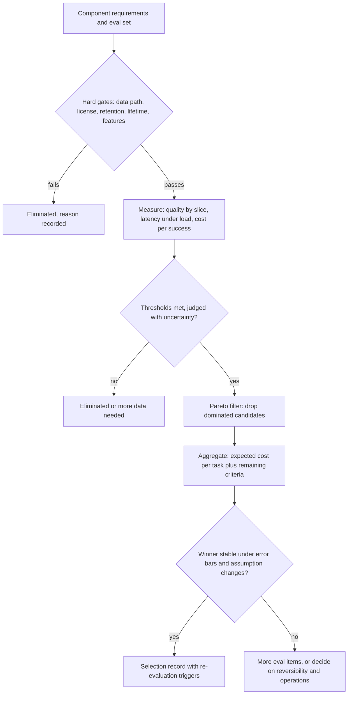
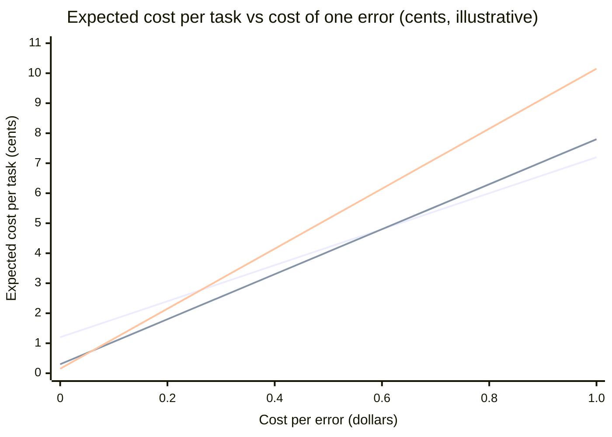
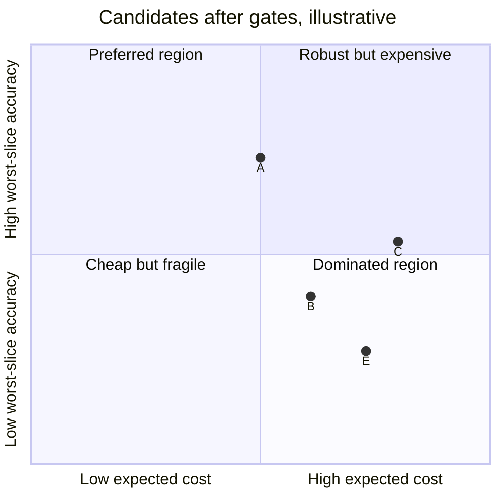
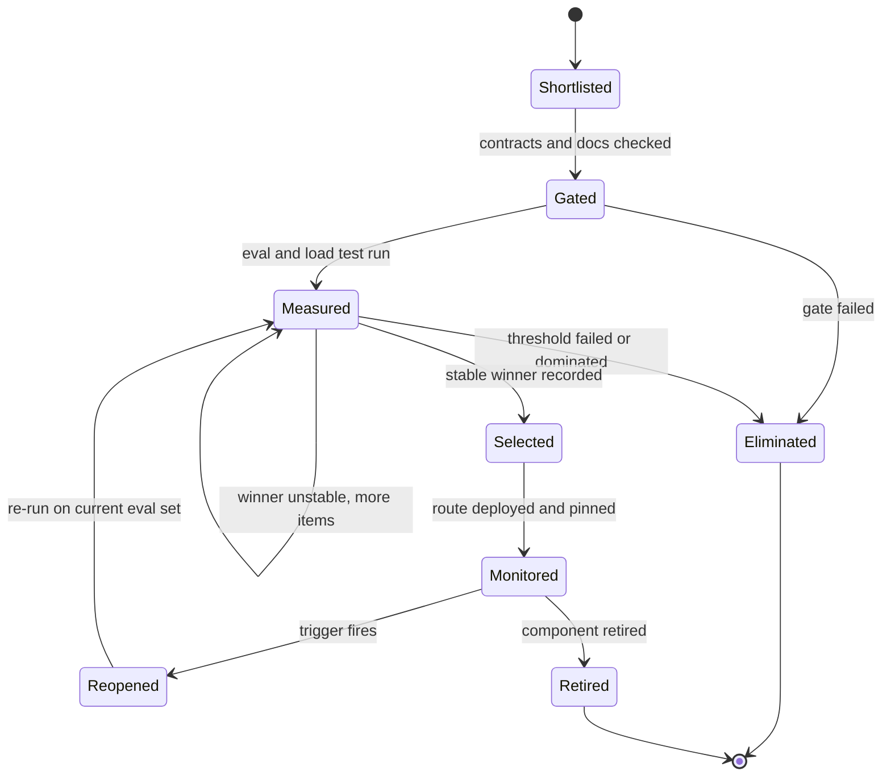
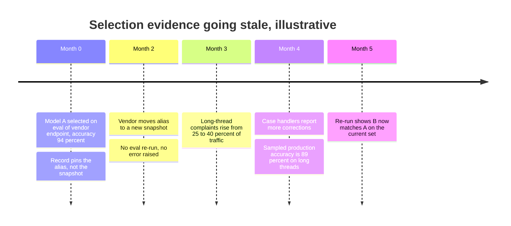

Model selection is the decision of which model, behind which endpoint and configuration, serves one component of a system. It is a multi-criteria decision: quality, latency, cost, data handling, licensing, version lifetime, and operational capacity all matter, they are measured in incompatible units, and they pull in different directions. The usual shortcuts each collapse that structure in a way that fails later. Picking the leaderboard leader measures someone else's task. Picking from a demo measures a handful of chosen inputs, the bias analyzed in [From Demo to Production: Why AI Prototypes Mislead](/ai-systems-architecture/en/foundations/failure-and-fit/demo-to-production/). Filling a spreadsheet with weighted scores produces a single number whose ranking can change when an irrelevant candidate is added to the sheet.

The method on this page replaces those shortcuts with five stages: hard gates, measurement on your own data with its uncertainty, thresholds, a Pareto filter, and an aggregation that converts whatever can be converted into one monetary unit, followed by a check of whether the winner survives the measurement error and plausible changes in the assumptions.

The core trade-off is between compensatory and non-compensatory reasoning. A compensatory method, such as a weighted sum, lets a strength on one criterion buy back a weakness on another, which is right for cost against quality and wrong for data residency against quality. A non-compensatory method, such as a gate or a threshold, refuses that trade, which is safe but blind to how much better one candidate is. A second trade-off runs alongside it: measurement precision costs eval items, and the number of items needed to separate two close candidates grows with the inverse square of the gap between them. The method is designed to spend that cost only where the decision actually depends on it.


*The five stages of the selection method. Each stage removes candidates for a reason that is written down, so the final record explains every elimination as well as the winner.*

The order is the correctness argument. Gates come first because they are cheap to check and not tradable, so measuring a candidate that will be excluded anyway wastes eval budget and, worse, sends production-shaped data to a vendor that may not be allowed to receive it. Thresholds come before aggregation because an aggregate score can otherwise reward a candidate that is unusable on one criterion. Dominance filtering comes before weighting because a dominated candidate can never be the right answer under any weights, and, as the aggregation section shows, its presence can still distort normalized scores. Sensitivity comes last because only at the end is it clear which assumptions the ranking depends on.

## Separating Constraints From Objectives

Each criterion is one of two kinds, and misfiling it is the most common structural error in selection. A constraint is a condition the component must satisfy to be legal, safe, or operable at all; it is checked once and passed or failed. An objective is a property where more (or less) is better and where a difference in degree matters; it is measured and traded.

The constraints for an LLM component are mostly questions about the data path and the contract, not about the model. Where prompts and outputs are processed and stored, and whether that location satisfies the data-residency rules that apply, including sector rules such as those described in [Turkish Regulation and Data Residency: KVKK and BDDK](/ai-systems-architecture/en/governance/regulation/turkish-regulation/). Whether the provider retains inputs, for how long, and whether it may use them for training, as stated in the contract rather than in a marketing page. Whether the license of an open-weight model permits the intended use, which [Frontier, Open-Weight, and Small Language Models](/ai-systems-architecture/en/model-strategy/model-landscape/model-categories/) covers for the common license families. Whether the model's announced lifetime covers the period the component must stay stable. And whether required features exist: the context length that the longest realistic input needs, structured output or tool calling, the input modalities, and the region in which the capacity is offered.

Version lifetime deserves a precise gate because it is usually treated as an afterthought. Providers publish deprecation schedules; Anthropic, for example, distinguishes a deprecated model ("still functional but no longer recommended", with an assigned retirement date) from a retired one whose requests fail, and commits to at least 60 days' notice before retiring a publicly released model (per its model-deprecations documentation as of November 2026). Sixty days is enough time to migrate a component with a working eval suite and not enough to re-run a model validation in a regulated institution whose review cycle is quarterly. The gate is therefore not "the model is current" but "the provider's documented minimum notice is longer than our migration lead time", and the migration process itself belongs to [Model Versioning, Deprecation, and Migration](/ai-systems-architecture/en/model-strategy/lifecycle-and-adaptation/versioning-migration/).

The objectives are four. Quality is the rate at which the component's output is correct by the task's own definition, reported per slice and, for components used repeatedly without supervision, as the all-attempts-succeed rate `pass^k` defined in [Capability vs. Reliability: Closing the Production Gap](/ai-systems-architecture/en/foundations/ai-component-model/capability-vs-reliability/). Latency is reported as time to first token and total time, at the percentiles the product's latency objective uses. Cost is reported per successful task, not per token. Operational fitness covers the error and throttling rate observed during the load test, the rate-limit headroom at expected peak, and the variance of the measurements between days.

### Thresholds: Where an Objective Becomes a Constraint

Most objectives have a floor below which no amount of savings helps: a worst-slice accuracy under which the product cannot ship, a p95 latency above which the interaction pattern breaks. A threshold turns that floor into a gate, but a gate applied to a measured, uncertain quantity needs a rule for uncertainty. Two rules are defensible. For high-consequence components, require the lower bound of the 95% confidence interval to clear the threshold, which is conservative and needs larger slices. For components where an error is recoverable, require the point estimate to clear it and record the interval, accepting that a candidate near the line may be misclassified. Choose the rule before the eval runs; choosing it afterwards moves the line toward the preferred candidate.

Latency thresholds come from the component's service level objective, whose construction is covered in [SLO (Service Level Objective): The Art of Setting Targets](https://gorkemsari.github.io/distributed-systems/en/observability/slo-sla-error-budgets/slo/). The LLM-specific part is what to measure. A provider's latency at a single idle request says little about latency at the component's peak concurrency, under its real input-length distribution, and, for reasoning models, under the tail of its hidden-token distribution described in [Reasoning Models and Test-Time Compute](/ai-systems-architecture/en/model-strategy/model-landscape/reasoning-models/). The measurement is a load test of the actual request shape against the actual endpoint and region, run with the methods in [Load and Performance Testing: k6, Locust, and Capacity Validation](https://gorkemsari.github.io/distributed-systems/en/deployment/distributed-testing/load-performance-testing/), repeated on at least two different days because shared provider capacity varies.

### Cost per Successful Task

Price per million tokens is an input to cost, not the cost. A component's cost per task is the expected spend to obtain one acceptable outcome, and it has three parts: the tokens of the calls themselves, including retries, repair loops, and reasoning tokens; the cost of the errors that are caught, such as an escalation to a human reviewer; and the cost of the errors that are not caught, such as rework, a complaint, or a regulatory finding. In compact form, with per-task probabilities measured on the eval set:

```text
expected_cost_per_task = call_cost * (1 + retry_rate)
                       + p_caught_error   * cost_per_caught_error
                       + p_uncaught_error * cost_per_uncaught_error
```

When an error costs a person minutes of work, the error terms dominate the call cost by one or two orders of magnitude, and a cheaper model with a slightly higher error rate is more expensive. When errors are cheap to detect and retry automatically, the call cost dominates and the cheapest adequate model wins. The same pair of candidates can therefore swap order between two components of one product, which is the strongest argument for selecting per component and the starting point for [Multi-Model Strategy and Model Routing](/ai-systems-architecture/en/model-strategy/selection-and-deployment/model-routing/). Token pricing mechanics, including cached input and hidden reasoning tokens, are owned by [Token Economics: Pricing, Reasoning Tokens, and Hidden Costs](/ai-systems-architecture/en/economics/understanding-cost/token-economics/); infrastructure cost for self-hosted candidates is owned by [Self-Hosted vs. API: Total Cost of Ownership](/ai-systems-architecture/en/economics/understanding-cost/tco/).

## Aggregating Criteria Measured in Different Units

After gates and thresholds, several candidates usually remain, each better on something. The first aggregation step needs no weights at all: remove every candidate that is dominated, meaning another candidate is at least as good on every criterion and strictly better on one. The candidates that remain form the Pareto front, and the choice among them is a genuine trade-off that requires a statement of preferences.

The common way to state preferences is a weighted sum. Each criterion is normalized to a 0-to-1 scale, multiplied by a weight, and summed. Normalization is where it fails. The usual normalization is min-max over the candidates in the sheet: the best candidate on a criterion gets 1, the worst gets 0. That makes every score depend on which other candidates are present. Consider three candidates scored on quality (accuracy, weight 0.5), cost per call (weight 0.3), and p95 latency (weight 0.2), with values A = 94.0%, 1.2 cents, 6.1 s; B = 92.5%, 0.3 cents, 3.0 s; C = 90.0%, 0.15 cents, 1.8 s (illustrative). Min-max scores are A 0.50, B 0.71, C 0.50, so B wins. Now add a fourth candidate D that nobody would pick, at 70.0% accuracy, 0.05 cents, and 1.0 s. D stretches the quality scale downward, so the gap between B and C on quality shrinks relative to their gaps on cost and latency. The scores become A 0.50, B 0.83, C 0.86, D 0.50: C now beats B, although nothing about B or C changed.

:::caution[Adding a losing candidate can change the winner]
Rank reversal under min-max normalization is not a rounding artifact. It is the same defect that Belton and Gear identified in the Analytic Hierarchy Process in 1983, and it affects any method that normalizes relative to the candidate set, including TOPSIS. If a selection sheet normalizes by the candidates present, adding or removing a candidate is enough to flip its recommendation, and a team that wants a particular outcome can obtain it by choosing the comparison set.
:::

Two repairs remove the defect. The first is fixed value functions: before any candidate is measured, define for each criterion the value of every possible level, anchored to the requirement rather than to the candidates. Quality might score 0 at the 85% threshold and 1 at 97%, latency 0 at the SLO limit and 1 at half of it. Weights are then set by swing weighting: for each criterion, ask how much it is worth to move from the worst acceptable level to the best plausible level, and rank those swings. A weight assigned this way means something concrete; a weight such as "quality 0.5" assigned without reference to ranges means only that quality was felt to be important, and its effect depends entirely on the arbitrary spread of the candidate set.

The second repair, and the one this handbook recommends wherever it applies, is to convert the criteria that have a monetary consequence into money and to stop weighting them. Error rates become money through the cost-per-task formula above. Latency becomes money when it has a measurable effect on conversion or on staff time, and otherwise stays a threshold. Data residency, licensing, and version lifetime never become money, because they are gates. What remains after conversion is usually one monetary objective plus one or two criteria that cannot be priced, such as vendor concentration or reversibility, and those can be weighed explicitly in the selection record without pretending to a precision that a weighted score implies.

| Method | How it combines criteria | Main weakness | When to prefer |
|---|---|---|---|
| Gates and thresholds only | Pass/fail per criterion, any passing candidate acceptable | Blind to how much better a candidate is | Early screening; components where every passing model is good enough |
| Pareto filter | Removes dominated candidates, no preferences needed | Usually leaves several candidates | Always, as the step before any weighting |
| Weighted sum, min-max normalized | Normalizes per candidate set, then weights | Rank reversal; weights without meaning | Avoid for selection decisions |
| AHP or TOPSIS | Pairwise judgments or distance to an ideal point | Rank reversal; judgments hard to audit | Group decisions where structured elicitation matters more than auditability |
| Fixed value functions with swing weights | Requirement-anchored scales, weights from ranges | Elicitation effort; still subjective | Criteria that cannot be priced but must be traded |
| Expected cost per task | Converts errors and retries into money | Needs an honest cost-of-error estimate | Any component whose errors have a measurable cost |

## Worked Example: Selecting a Model for Complaint Extraction

Assume, for illustration, a bank that extracts structured fields (product, amount, date, complaint category, requested remedy) from about 200,000 customer complaint messages a month. Messages are in Turkish and English, and some are long threads with quoted replies. An extracted record with a wrong field is caught later by a case handler, who corrects it; assume that correction costs 4 dollars of staff time. The component runs asynchronously, and its latency objective is p95 under 8 seconds. All numbers in this example are illustrative.

Five candidates are considered. The gates remove one immediately: candidate D, a frontier model with the highest public benchmark scores, is not offered in a region that satisfies the bank's data-residency rules under the provider's current contract, so it is eliminated without spending an eval item on it, and the reason goes into the record. Four candidates remain: A, a closed frontier model; B, a closed mid-tier model; C, an open-weight model self-hosted in the bank's data center; and E, an older closed model that the team has used before.

The eval set has 600 production messages with reference extractions, in three slices of Turkish, English, and long-thread messages, and a task counts as correct only when every field matches. Each candidate gets its own prompt, tuned with the same effort, because a prompt tuned for the incumbent biases the comparison toward it. Each is load-tested at the expected peak concurrency on two days.

| Candidate | Accuracy (n = 600) | Worst slice (n = 150) | p95 total latency | Call cost | Expected cost per task at 4 dollars per error |
|---|---|---|---|---|---|
| A, closed frontier | 94.0% (plus or minus 1.9) | 91.0% (long threads) | 6.1 s | 1.20 cents | 25.2 cents |
| B, closed mid-tier | 92.5% (plus or minus 2.1) | 86.0% (long threads) | 3.0 s | 0.30 cents | 30.3 cents |
| C, self-hosted open-weight | 90.0% (plus or minus 2.4) | 88.0% (Turkish) | 1.8 s | 0.15 cents | 40.2 cents |
| E, older closed model | 91.0% (plus or minus 2.3) | 84.0% (long threads) | 4.0 s | 0.60 cents | 36.6 cents |

The threshold is a worst-slice accuracy of 85% on the point estimate, because errors are caught downstream. E fails it at 84% and is also dominated by B, which is better on every column. A, B, and C all pass, although B's 86% on a 150-item slice has an interval of about plus or minus 5.5 points, so its pass is weak evidence; the record notes that the long-thread slice should grow before B could be adopted.

The expected cost per task follows the formula with no retries for simplicity: A costs 1.2 cents plus 6% of 4 dollars, which is 25.2 cents; B costs 0.3 cents plus 7.5% of 4 dollars, 30.3 cents; C costs 0.15 cents plus 10% of 4 dollars, 40.2 cents. At 200,000 tasks a month, the token bills are 2,400, 600, and 300 dollars, while the expected totals are about 50,400, 60,600, and 80,300 dollars. The model with the largest token bill is the cheapest component, by about 10,000 dollars a month against B.


*Expected cost per task for A (starts at 1.2), B (starts at 0.3), and C (starts at 0.15) as the cost of one error rises. C is cheapest below 6 cents per error, B between 6 and 60 cents, A above 60 cents.*

The answer depends on the component, not on the models. Each line starts at the call cost and rises with a slope equal to the error rate, so the lowest error rate wins once errors cost enough. The crossovers are simple ratios: A overtakes B where the 0.9-cent difference in call cost equals the 1.5-point difference in error rate times the cost of an error, at 60 cents per error, and B overtakes C at 6 cents. A classification step whose errors are retried automatically for a fraction of a cent sits at the far left of the chart and should use C; this extraction step, at 4 dollars per error, sits far off the right edge.

### Is the Winner Real or Noise?

A's advantage over B rests on a 1.5-point accuracy gap, and the individual intervals of plus or minus 1.9 and 2.1 points overlap. Comparing overlapping intervals is the wrong test, because both candidates ran on the same 600 items and their errors are correlated. The right test uses the paired differences, as Miller's *Adding Error Bars to Evals* (2024) recommends: on each item, record whether A was right and B wrong, or the reverse. Assume A was right where B was wrong on 30 items, and B right where A was wrong on 21. The paired estimate of the difference is 9 in 600, 1.5 points, with a 95% interval of about plus or minus 2.3 points, from minus 0.8 to plus 3.8. McNemar's test on the 51 discordant items gives a p-value of about 0.21. On the usual standard, A is not proven better than B.

Proving a 1.5-point difference would take far more data. With about 8.5% of items discordant, detecting the gap at 80% power and a 5% significance level needs roughly 3,000 items, five times the current set. The decision, however, does not need to establish that A is better; it needs to establish whether A's advantage exceeds the break-even point. At 4 dollars per error, A pays for its higher call cost if its true accuracy advantage is larger than 0.9 cents divided by 4 dollars, about 0.23 points. Most of the interval from minus 0.8 to plus 3.8 lies above that line, and the losses are asymmetric: if the true gap is 1.5 points, choosing B costs about 10,000 dollars a month; if the true gap is at its lower bound of minus 0.8 points, choosing A costs about 8,000 dollars a month more than B. The record states that, chooses A, and schedules a re-check of the comparison after 3,000 production items have been labeled.


*The four measured candidates on expected cost per task and worst-slice accuracy. On these two criteria A dominates the others; latency is the third criterion that keeps B and C on the Pareto front.*

On cost and worst-slice quality alone, A beats every other candidate, so no weighting is needed between those two. B and C survive only because they are faster, and the component's 8-second latency objective makes speed below 6.1 seconds worth nothing to this product. The decision would change if the same extraction ran inside a live chat, where a p95 of 6.1 seconds might fail the threshold and eliminate A before aggregation; the measurements would stay the same and the requirements would decide.

## Making the Measurements Comparable and the Decision Durable

Every measurement is of a configuration, not of a model name. The same open-weight weights served by two providers can behave differently because of the serving engine version, quantization, chat template, or how a parameter is mapped. Artificial Analysis showed this in August 2025 when it ran the same benchmark (AIME 2025, 32 runs per provider) against gpt-oss-120b on about a dozen hosting providers: scores initially ranged from 36.7% to 93.3%, and one provider's lower result was later traced to an older vLLM version that ignored the reasoning-effort setting, so requests defaulted to medium effort (as reported by Simon Willison on 15 and 20 August 2025). For closed models, the equivalent risk is an alias that a provider moves to a new snapshot. The selected item is therefore the full route configuration: provider, region, model snapshot, serving engine and quantization for self-hosted models, effort level, sampling parameters, prompt version, and output limits.

Public evidence enters the method only as a way to choose which candidates to measure. Leaderboards measure tasks that are not yours, can be contaminated by training data, and can be shaped by the submission process. Zhang et al. built GSM1k as a fresh counterpart to the GSM8k math benchmark and observed accuracy drops of up to 8% for some models (NeurIPS 2024 Datasets and Benchmarks), which is consistent with memorization of the public set. Singh et al., in *The Leaderboard Illusion* (2025), documented undisclosed private testing on Chatbot Arena, including 27 private variants tested by one provider before a major release, which lets providers publish only their best result. Multi-metric suites such as Stanford's HELM, which reports accuracy alongside calibration, robustness, and efficiency, are better shortlisting tools than single-number rankings, and they still do not replace measurement on your own messages.

The output of the method is a selection record that can be audited and re-run. It belongs in the prompt and model registry described in [Prompt and Model Registry](/ai-systems-architecture/en/platform/internal-platform/prompt-model-registry/), and its narrative form can follow [ADR Templates for AI Decisions](/ai-systems-architecture/en/reference/catalogs/adr-templates/). The essential fields are the ones needed to reproduce the comparison and to know when it expires:

```yaml
selection: complaint-extraction-v3
decided: 2026-11-24
route: { provider: vendor-a, region: eu-west, snapshot: model-a-2026-09-15, effort: low, temperature: 0 }
gates:
  residency: pass          # contract clause 7.2, reviewed by legal
  retention: zero-days
  notice_vs_migration_lead_time: "60d >= 45d"
eval: { set: complaints-gold-v5, sha256: 9f1c..., items: 600, slices: [tr, en, long_thread] }
results:
  model-a: { acc: 0.940, worst_slice: 0.910, p95_s: 6.1, cost_per_task_usd: 0.252 }
  model-b: { acc: 0.925, worst_slice: 0.860, p95_s: 3.0, cost_per_task_usd: 0.303 }
  paired_a_minus_b: { diff: 0.015, ci95: [-0.008, 0.038], break_even: 0.0023 }
eliminated: { model-d: "gate: residency", model-e: "threshold: worst_slice 0.84" }
reevaluate_when: [snapshot_change, error_cost_change, slice_drift, new_candidate_shortlisted, "2027-05-24"]
```

The record carries the eval set's hash because a selection made on one version of the golden set cannot be compared with a re-run on another; building and versioning that set is covered in [Designing and Maintaining Golden Datasets](/ai-systems-architecture/en/evaluation/measuring-quality/golden-datasets/), and the choice of a task metric, including when an LLM judge may score it, in [Metric Design: Task Metrics and RAG Metrics](/ai-systems-architecture/en/evaluation/measuring-quality/metric-design/) and [LLM-as-Judge: Use, Bias, and Calibration](/ai-systems-architecture/en/evaluation/measuring-quality/llm-as-judge/). It records the break-even point because that number, not the accuracy gap, tells a later reader how much the conclusion depends on the cost-of-error estimate.

:::tip[Re-run the selection as a pipeline, not as a project]
If the gates live as checks, the eval set as a versioned artifact, and the load test as a script, re-running the whole comparison when a new snapshot or candidate appears takes hours. Selections that were done as one-off spreadsheets are rarely repeated, so the system keeps a model chosen against a market that no longer exists. The quality-gate mechanics are covered in [Evals in CI/CD: Regression Suites and Quality Gates](/ai-systems-architecture/en/evaluation/evals-in-delivery/evals-in-cicd/).
:::

A selection decision has a lifecycle of its own, and the triggers that reopen it are part of its definition.


*Lifecycle of a selection decision. The loop from Monitored back to Measured is what keeps a selection valid after the market and the traffic change.*

The transitions out of `Monitored` are the ones teams omit. A selection is reopened when the provider announces a deprecation or moves an alias, when the cost-of-error assumption changes (for example, when a downstream check is automated and errors become cheap), when production quality monitoring shows that a slice's share or its error rate has drifted, as described in [Quality Monitoring and Drift Detection](/ai-systems-architecture/en/llmops/observability/quality-drift/), when a new candidate is credible enough to shortlist, and on a fixed date so that no decision lives forever by default. The self-loop on `Measured` is the honest outcome of an unstable comparison: add items to the deciding slices instead of declaring a winner the data does not support.

## Failure Modes of a Selection Decision

A bad selection rarely produces an error. It produces a system that is more expensive, slower, or less accurate than necessary, or one that was right on the day of the decision and is wrong six months later because its evidence silently stopped describing production.


*An illustrative incident in which two independent changes, an alias move and a traffic shift, invalidate a selection without any error being raised.*

The decision was sound on its evidence; what failed is the link between the decision and the conditions it assumed. Pinning the snapshot rather than the alias would have turned the month-2 change into a deliberate migration with an eval run. Monitoring slice shares would have flagged month 3 as a reason to reopen. Sampling production outputs for labeling would have shown the month-4 drop before staff complaints did. Each of these is a field in the record, not a recommendation in a document.

| Failure | Trigger | Symptom | Detection | Mitigation and recovery |
|---|---|---|---|---|
| Leaderboard selection | Candidate chosen on public scores | Quality below expectation on own traffic | First slice-level eval after launch | Use public scores only to shortlist; measure on own eval set |
| Incumbent bias | Prompt tuned for the current model reused for all | Challengers underperform by a margin that disappears with tuning | Gap shrinks when each candidate gets a tuned prompt | Equal prompt-tuning effort per candidate, recorded in the eval |
| Average hides the slice | Selection on overall accuracy | One language or input type degrades | Per-slice results, worst-slice threshold | Threshold on worst slice; grow small slices |
| Measured configuration differs from deployed | Eval on one provider, quantization, or effort; production on another | Quality or latency differs from the record | Compare route fields in traces with the record | Select and pin the full route configuration |
| Idle latency | Latency measured with single requests | p95 breaches at peak; throttling | Load test at peak concurrency on several days | Thresholds on load-tested percentiles |
| Price per token as cost | Cheapest token price chosen | Higher total cost through errors and retries | Expected cost per task including error handling | Cost per successful task as the objective |
| Post-hoc weights | Weights adjusted after results are seen | Record cannot be reproduced; reviewer distrust | Weights and value functions missing from pre-registration | Fix value functions, weights, and threshold rules before the eval |
| Stale decision | Alias moves, traffic shifts, new candidates | Gradual quality or cost drift, no errors | Re-evaluation triggers; production sampling | Pin snapshots; triggers in the record; scheduled re-run |

The detection column relies on route fields in every production trace, so that a mismatch with the selection record is a query, and on a continuous sample of labeled production outputs, the only signal that catches silent quality drift.

:::caution[Your eval set is production data]
A selection eval runs real customer messages through every shortlisted candidate. Sending them to a vendor before a contract with retention and residency terms is in place is a data transfer, and in a regulated institution it may be an unauthorized one. Check the gates before sending a single eval item, mask or synthesize data for vendors that have not yet passed them, see [PII and Sensitive Data: Masking, Tokenization, Redaction](/ai-systems-architecture/en/security/defenses/pii-handling/), and keep the eval set itself under the same access controls as the production data it came from.
:::

The governance implication runs in the other direction too. In a regulated environment the selection record is evidence: a model risk function will ask why this model was chosen, what alternatives were considered, how quality was measured, and when the decision will be reviewed. A record with gates, pre-registered criteria, paired comparisons, and triggers answers those questions directly, which is why [Model Risk Management for LLM Systems](/ai-systems-architecture/en/governance/risk-management/model-risk-management/) treats it as a validation artifact rather than as engineering paperwork.

## When the Full Method Pays Off

Run the full method when a component carries meaningful volume or consequence, its errors have an estimable cost, and at least two candidates pass the gates. It pays most where candidate prices differ by an order of magnitude, where a cost-of-error calculation most often reverses the intuitive choice, and in regulated settings, where the record is required anyway.

Use a reduced version when the component is low-volume and low-consequence, such as an internal drafting aid: check the gates, run a small eval on representative inputs to confirm a threshold, choose the cheapest passing candidate, and record the decision with a review date. The reduced version still needs the gates and the record; it drops the paired comparison and the load test, because a wrong choice there is cheap to reverse.

Do not run the method as a one-time procurement exercise for the whole organization. A single "approved model" chosen this way is the average of components with very different error costs, and the worked example shows that the right answer can differ by component. Do not run it to choose between components that could each use a different model behind a router; that problem is covered in [Multi-Model Strategy and Model Routing](/ai-systems-architecture/en/model-strategy/selection-and-deployment/model-routing/). And do not run it at all before establishing that the task belongs to a model, which is the question of [When AI Is the Wrong Solution: A Decision Framework](/ai-systems-architecture/en/foundations/failure-and-fit/when-not-to-use-ai/).

Several adjacent decisions are often folded into model selection. Which category of model a component may use is settled in [Frontier, Open-Weight, and Small Language Models](/ai-systems-architecture/en/model-strategy/model-landscape/model-categories/), and how a chosen model is operated in [Hosted API vs. Self-Hosted vs. Hybrid Deployment](/ai-systems-architecture/en/model-strategy/selection-and-deployment/hosted-vs-self-hosted/). System-wide trade-offs, rather than per-component ones, are in [The Quality-Latency-Cost Triangle](/ai-systems-architecture/en/economics/optimization/quality-latency-cost/). Assessing a third-party AI product whose model is hidden inside a vendor's application is covered in [Evaluating Third-Party AI Products](/ai-systems-architecture/en/governance/organization/vendor-evaluation/). Keeping a re-selection a configuration change rather than a rewrite depends on [Vendor Lock-in and the Abstraction Layer](/ai-systems-architecture/en/model-strategy/lifecycle-and-adaptation/vendor-lock-in/).

## Further Reading

- Ralph L. Keeney and Howard Raiffa, *Decisions with Multiple Objectives: Preferences and Value Tradeoffs*, Wiley, 1976.
- Valerie Belton and Tony Gear, *On a Short-coming of Saaty's Method of Analytic Hierarchies*, Omega, 1983.
- Percy Liang et al., *Holistic Evaluation of Language Models*, Transactions on Machine Learning Research, 2023.
- Evan Miller, *Adding Error Bars to Evals: A Statistical Approach to Language Model Evaluations*, arXiv, 2024.
- Hugh Zhang et al., *A Careful Examination of Large Language Model Performance on Grade School Arithmetic*, NeurIPS Datasets and Benchmarks, 2024.
- Shivalika Singh et al., *The Leaderboard Illusion*, arXiv, 2025.
