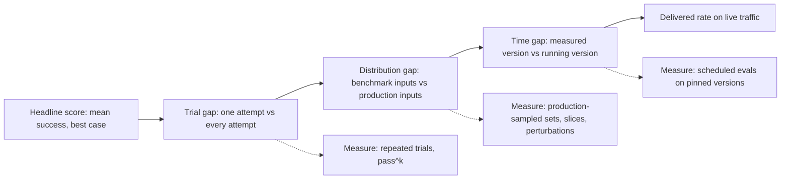
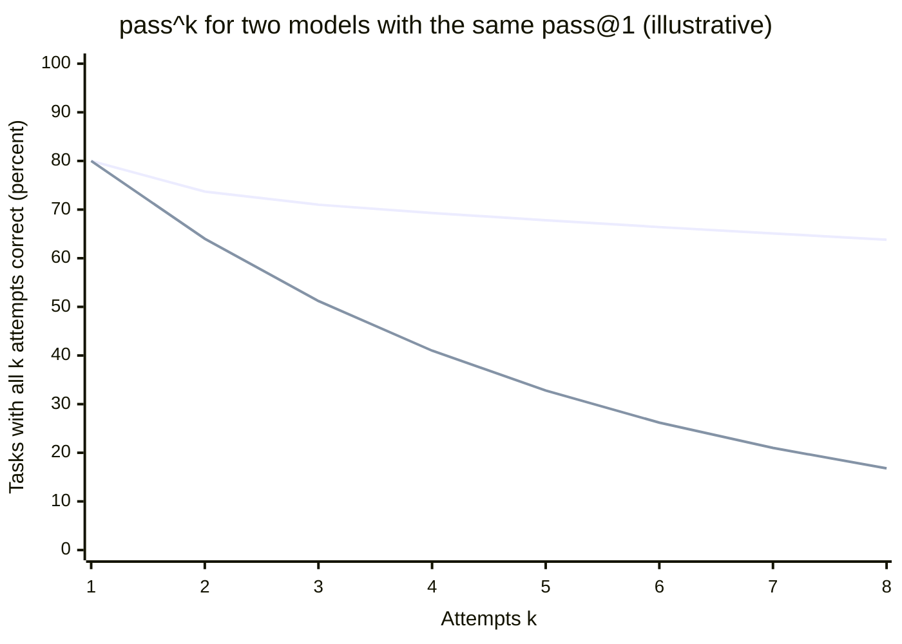
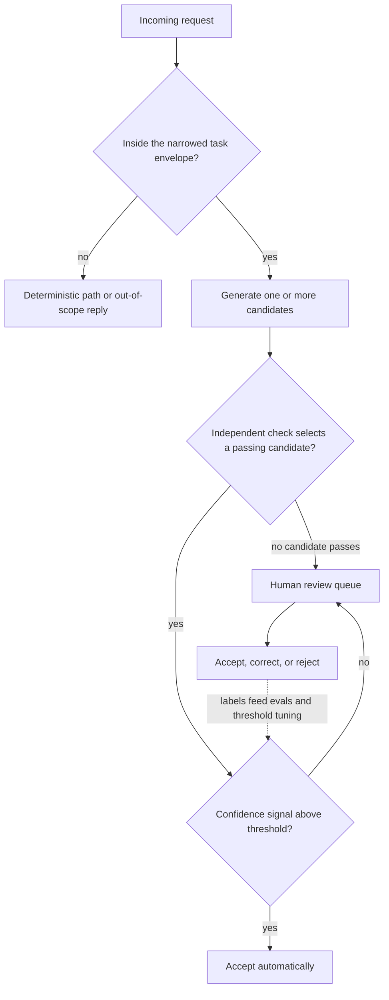
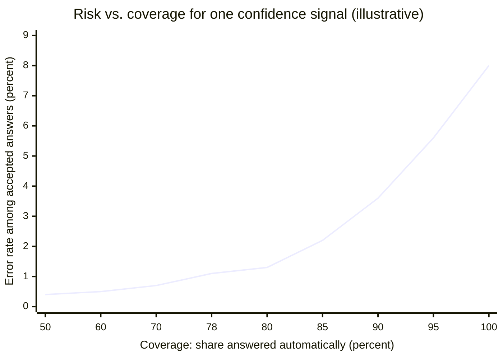
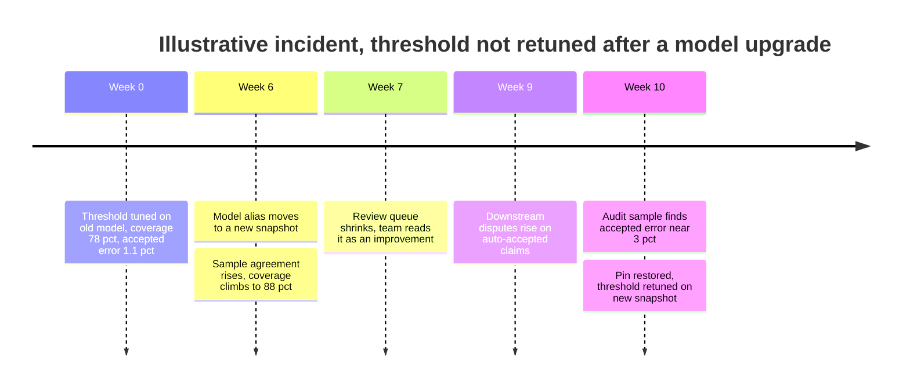

Yetenek (capability), bir modelin bir görev için kabul edilebilir bir çıktı üretebilme olasılığıdır: denemelerden birinde, ifadelerden birinde, birinin test etmeyi seçtiği girdiler üzerinde. Güvenilirlik (reliability) ise sistemin, işin ona dayandığı her seferde, kullanıcıların gerçekten gönderdiği girdiler üzerinde ve sistem çalıştığı sürece kabul edilebilir bir çıktı üretme olasılığıdır. Benchmark'lar, leaderboard'lar ve demolar birincisini ölçer. Bir hizmet seviyesi sözleşmesi (SLA), bir denetçi ya da bir müşteri ikincisini yaşar. NIST Yapay Zekâ Risk Yönetimi Çerçevesi'nin (AI RMF) benimsediği ISO/IEC TS 5723:2022 tanımı ayrımı netleştirir: güvenilirlik, "bir öğenin belirli koşullar altında, belirli bir zaman aralığı boyunca, arızasız olarak gerektiği gibi çalışabilme yeteneği"dir. Bu cümledeki her nitelik (gerektiği gibi, arızasız, zaman içinde, belirli koşullar altında) bir yetenek skorunun dışarıda bıraktığı bir şeydir.

İki sayı benchmark'lar dürüst olmadığı için değil, yapısal sebeplerle birbirinden ayrılır. Bir yetenek skoru başarıyı görevler üzerinden ortalar ve çoğu zaman birkaç denemeden biri başarılıysa görevi çözülmüş sayar. Production ise her denemenin başarılı olmasını ister; üstelik farklı ve daha geniş bir girdi dağılımında, zamanla değişen bir model sürümüyle. Bir benchmark'ın %80'ini çözen bir model, hatalarının nasıl dağıldığına bağlı olarak, tekrarlanan production kullanımında %80'den bu oranın yarısının epey altına kadar herhangi bir değer verebilir.

Temel trade-off şudur: güvenilirlik yetenekten satın alınır, yeteneğin üstüne eklenmez. Açığı kapatan dört kaldıracın hepsi bir şey harcar: görevi daraltmak kapsamı, doğrulama gecikme ve maliyeti, abstention (yanıt vermekten kaçınma) coverage'ı (sistemin kendi başına yanıtladığı isteklerin payı), insan incelemesi de insan emeğini harcar. Hiçbiri modelin yapabileceklerinin tavanını yükseltmez; her biri o tavanın bir kısmını güvenilebilir bir tabana çevirir. Model destekli her özellik için tasarım sorusu, yeteneğin ne kadarının güvenilirliğe dönüşmesi gerektiği ve iş tarafının bu dört para biriminden hangisini harcamayı göze alabileceğidir.

Bir modelin doğruluğunun neden bir oran olduğu, adım başına oranların nasıl birleştiği ve deterministik bir kabuğun katı kısıtları nasıl uyguladığı [Deterministik ve Olasılıksal Sistemler](/ai-systems-architecture/tr/foundations/ai-component-model/deterministic-vs-probabilistic/) sayfasında anlatılır. Bu sayfanın konusu, birinin ölçtüğü oran ile sistemin teslim ettiği oran arasındaki mesafedir.

## Bir Yetenek Skoru ile Teslim Edilen Oran Arasındaki Üç Açık

"Bir tool kullanım benchmark'ında %80" gibi bir manşet yetenek sayısı, production kullanıcısının gördüğü orana dönüşmeden önce üç filtreden geçer. Her filtrenin sebebi, ölçümü ve çaresi farklıdır.


*Bir yetenek skorundan teslim edilen orana giden yol. Her açığın kendi ölçümü vardır; birini atlamak, o kaybı kullanıcılar bildirene kadar görünmez bırakır.*

Sıra teşhis için önemlidir. Deneme açığı benchmark'ın kendi girdilerinde de vardır ve ortada hiç production verisi yokken ölçülebilir. Dağılım açığı production'a benzeyen girdiler ister; bunlar genellikle ancak bir pilottan sonra elde olur. Zaman açığı lansmandan sonra, provider, prompt ya da retrieval index'i her değiştiğinde açılır.

### Deneme Açığı: k Denemenin En İyisi, Her Seferi Demek Değildir

Chen ve arkadaşlarının 2021'de HumanEval kod benchmark'ıyla tanıttığı `pass@k` metriği, örneklenen k denemeden en az biri unit testlerini geçerse görevi çözülmüş sayar. Asıl amacı için doğru metriktir: birkaç öneriye bakıp çalışanı alan bir geliştirici. Tek bir denemeye göre hareket eden bir sistem için ise yanlış metriktir, çünkü iyi bir çıktının var olma olasılığını ölçer, elinizdekinin iyi olma olasılığını değil.

τ-bench benchmark'ı (Yao, Shinn, Razavi ve Narasimhan, 2024) tamamlayıcı metriği tanımladı: `pass^k`, aynı göreve yapılan k bağımsız denemenin hepsinin başarılı olma olasılığı. Aynı türden isteğin tekrar tekrar geldiği, müşteriye dönük bir agent'ın karşılaştığı durumu modeller. Makale, aralarında gpt-4o'nun da bulunduğu en gelişmiş function calling agent'larının görevlerin %50'sinden azında başarılı olduğunu ve retail alanında `pass^8` değerinin %25'in altına düşecek kadar tutarsız olduğunu raporladı. Bu sayılar 2024 ortası modellerini anlatır ve artık eskimiştir; yapısal sonuç ise eskimemiştir. Görev başına başarı olasılığı 1'in altında olduğu sürece `pass^k`, k ile birlikte düşer ve düşüş hızını ortalama değil, hataların görevlere nasıl dağıldığı belirler.

İki metrik de aynı görev başına başarı olasılıklarından türer. i görevi tek denemede p_i olasılıkla başarılıysa `pass@1`, p_i'lerin ortalamasıdır; `pass@k`, bir eksi k denemenin hepsinin başarısız olma olasılığının ortalamasıdır; `pass^k` ise p_i'nin k'inci kuvvetinin ortalamasıdır. Ortalama, hataları hangi görevlerin taşıdığını gizler ve sonrasındaki her şeyi bu dağılım belirler.

### Hesaplı Örnek: Aynı Ortalama, Zıt Mimariler

Örnek olsun diye, aynı 400 görev üzerinde, görev başına sekiz denemeyle değerlendirilen iki aday model varsayalım. İkisi de tek denemede %80 alır. Model A tekdüze biçimde vasattır: her görev zamanın %80'inde başarılı olur. Model B iki tepelidir (bimodal): görevlerin %75'inde zamanın %98'inde, kalan %25'inde ise yalnızca %26'sında başarılıdır. Ortalaması 0,75 çarpı 0,98 artı 0,25 çarpı 0,26'dır; bu da 0,80 eder.

`pass@4` açısından Model A çok daha iyi görünür: bir görevde dört denemenin hepsinin başarısız olma ihtimali 0,2'nin dördüncü kuvvetidir, dolayısıyla `pass@4` %99,8'dir. Model B ise yalnızca %92,5'e ulaşır, çünkü zayıf görevlerinde dört denemenin hepsi hâlâ yaklaşık %30 ihtimalle başarısız olur. `pass^4` açısından sıra tersine döner: Model A 0,8'in dördüncü kuvvetini, yani %41,0'ı verir; Model B ise 0,75 çarpı 0,98'in dördüncü kuvveti artı 0,25 çarpı 0,26'nın dördüncü kuvvetini, yaklaşık %69,3'ü verir.


*Üstteki çizgi: iki tepeli Model B. Alttaki çizgi: tekdüze Model A. İkisi de tek denemede %80 başarıyla başlar; k = 8'de tutarlılıkları neredeyse dört kat farklıdır.*

Grafik Model B'nin daha iyi olduğunu söylemez. İki modelin farklı mimariler gerektirdiğini söyler. Model A'nın hataları eşit dağılmıştır ve denemeler arasında bağımsız görünür; bu da tam olarak bir doğrulayıcı artı yeniden örneklemenin işe yaradığı koşuldur: bir kontrol iyi yanıtı tanıyabiliyorsa birkaç çekiliş çok yüksek bir orana ulaşır, %99,8'lik `pass@4` değerinin vaat ettiği de budur. Doğrulayıcı olmadan Model A, tekrarlanan ve gözetimsiz işler için kullanılamaz. Model B'nin hataları ise görevlerin dörtte birinde yoğunlaşır; orada yeniden örnekleme pek bir şey kazandırmaz, çünkü bu hatalar çekilişler arasında koreledir; [Deterministik ve Olasılıksal Sistemler](/ai-systems-architecture/tr/foundations/ai-component-model/deterministic-vs-probabilistic/) sayfası bunu korele hata hesabıyla gösterir. Model B için çare, zayıf görev sınıfını tespit edip başka bir yola yönlendirmektir: abstention'a, bir insana ya da başka bir modele. Tek bir manşet skoru, bir ekibe bu iki sistemden hangisini kurduğunu söyleyemez.

### Dağılım Açığı: Test Etmediğiniz Girdiler

Bir yetenek skoru, sabit bir girdi kümesi üzerindeki bir orandır. Production girdileri ifade, biçim, dil, uzunluk, gürültü ve zor vakaların payı bakımından farklıdır; model performansı da bir insanın önemsiz sayacağı farklara duyarlıdır. Sclar, Choi, Tsvetkov ve Suhr (2023), anlamca eşdeğer few-shot prompt biçimleri arasında LLaMA-2-13B için 76 puana varan doğruluk farkları ölçtü: ayırıcılar, büyük-küçük harf ve boşluklar; anlamla ilgili hiçbir şey değil. Mirzadeh ve arkadaşları (2024), ilkokul düzeyindeki matematik sorularını şablonlaştırarak GSM-Symbolic'i kurdu ve değerlendirilen tüm modellerin bir sorudaki yalnızca sayılar değiştiğinde doğruluk kaybettiğini, akla yatkın ama alakasız tek bir yan cümle eklemenin ise en gelişmiş modellerde performansı %65'e varan oranda düşürdüğünü buldu. Yeni modeller test edilenlerden daha az duyarlı olabilir; etkinin büyüklüğü her model için kendi girdileri üzerinde ölçülmelidir, yok sayılmamalıdır.

Benchmark kontaminasyonu açığı öbür taraftan genişletir. Benchmark öğeleri ya da onlara çok yakın kopyalar eğitim verisindeyse skor kısmen görülmüş öğelerin hatırlanmasını ölçer ve modelin hiç görmediği girdiler daha kötü performans verir. Hosted bir modelin eğitim verisi denetlenemediğine göre, açık benchmark skorlarını özel görevler için üst sınır olarak kabul edin.

Dağılım açığı yalnızca production'a benzeyen veri üzerinde ölçerek kapanır: gerçek trafikten örneklenen ve trafik değiştikçe bakımı yapılan bir golden set ([Golden Dataset Tasarımı ve Bakımı](/ai-systems-architecture/tr/evaluation/measuring-quality/golden-datasets/) sayfasında anlatılır), önemli segmentlere göre dilimlenmiş ve gerçek girdilerden üretilen pertürbasyonlarla (yeniden ifadeler, biçim varyantları, alakasız eklemeler) genişletilmiş olarak.

### Zaman Açığı: Bir Aralık Boyunca Güvenilirlik

ISO tanımı "belirli bir zaman aralığı boyunca" ifadesini içerir, çünkü güvenilirlik bir değerlendirme gününün değil, bir dönemin özelliğidir. Mart'ta ölçülen bir oran Mart'taki modeli, prompt'u ve index'i anlatır. Alias'ların arkasındaki provider güncellemeleri, serving değişiklikleri, prompt düzenlemeleri ve index yenilemelerinin her biri fonksiyonu değiştirir; bu, [Deterministik ve Olasılıksal Sistemler](/ai-systems-architecture/tr/foundations/ai-component-model/deterministic-vs-probabilistic/) sayfasında anlatılır. Zaman açığı, sürümleri sabitleyerek ve aynı güvenilirlik ölçümünü bir takvime bağlı olarak çalıştırarak yönetilir; bunu [Kalite İzleme ve Drift Tespiti](/ai-systems-architecture/tr/llmops/observability/quality-drift/) sayfası geliştirir.

Görev uzunluğu üç açığın hepsiyle etkileşir. METR'nin 2025 tarihli yazılım görevleri çalışması (Kwa, West ve arkadaşları), modellerin belirli bir olasılıkla başarılı olduğu görev uzunluğunu insan çalışma süresi cinsinden ölçtü. Claude 3.7 Sonnet için %50 zaman ufku yaklaşık 59 dakikaydı, %80 ufku ise yalnızca yaklaşık 15 dakika; modeller genelinde makale %80 ufuklarının %50 ufuklarından kabaca beş kat kısa olduğunu buldu. Makalenin kendi yorumu, zor görevlerde zaman zaman başarılı olan modellerin orta uzunluktaki görevleri hâlâ güvenilir biçimde yapamadığıdır. Mimari açıdan sonucu şudur: devredilen iş birimi yetenek ufkuna değil, güvenilirlik ufkuna göre boyutlandırılmalıdır. Modelin bir saatlik ölçekte "bazen" tamamladığı bir görev, devredilen her parça başarı oranının kabul edilebilir olduğu yere düşene kadar parçalanmalıdır.

## Yetenek Yerine Güvenilirliği Ölçmek

Güvenilirlik ölçümü bir yetenek eval'inden dört yönden ayrılır: her görevi tekrarlar, production'a benzeyen girdiler kullanır, ilgili en kötü dilimi raporlar ve bir güven aralığı ekler. Genel eval metodolojisi [Neden Eval](/ai-systems-architecture/tr/evaluation/testing-foundations/why-evals/) ve [Metrik Tasarımı](/ai-systems-architecture/tr/evaluation/measuring-quality/metric-design/) sayfalarındadır.

Bir eval'i yetenek ölçümünden güvenilirlik ölçümüne çeviren şey tekrardır. Görev başına n deneme çalıştırın (n, raporlayacağınız en büyük k kadar olsun), görev başına c başarıyı sayın ve `pass^k` için görev başına yansız tahmini, ortalamanın kuvvetini alarak değil, sayımlardan hesaplayın:

```text
for each task i with n attempts and c_i successes:
    pass_at_k_i  = 1 - C(n - c_i, k) / C(n, k)   # at least one of k succeeds
    pass_hat_k_i = C(c_i, k) / C(n, k)           # all k succeed
pass@k = mean(pass_at_k_i)     pass^k = mean(pass_hat_k_i)
# C(a, b) = binomial coefficient, 0 when b > a
# Report the distribution of c_i / n too: it shows A-type vs B-type failure
```

Görev başına başarı oranlarının histogramı, çalıştırmanın en bilgilendirici çıktısıdır. 1 civarında bir tepe ve 0 civarında ikinci bir küme Model B'dir: zayıf kümeyi tespit edip yönlendirin. Ortalama etrafında geniş bir tümsek Model A'dır: doğrulamaya yatırım yapın.

İkinci boyut dilimdir. Bir golden set üzerindeki ortalama, her segmenti setteki payı kadar ağırlıklandırır; oysa iş tarafı genellikle sonuç doğuran en kötü segmentle ilgilenir: iki dilli bir üründe Türkçe girdiler, bir extraction pipeline'ında taranmış belgeler, yüksek değerli müşteri segmenti, hukuki riski olan ticket kategorisi. Oranı dilim bazında raporlayın ve release kapısını ortalamaya değil, önemli olan en kötü dilime koyun. Üçüncü boyut pertürbasyondur: her production girdisi için yanıtı değiştirmemesi gereken birkaç varyant üretin ve tüm varyantların referansla uyuştuğu görevlerin payını raporlayın. Bu, örnekler yerine ifadeler üzerinden alınmış bir `pass^k`'dir ve tek bir ifadenin tekrar tekrar örneklenmesinin gizlediği girdi duyarlılığını açığa çıkarır.

Güven aralıkları en sona kalır ve küçük eval setlerinin yanılttığı yer de burasıdır. Görev başına tekrarlanan denemeler her görevin tahminindeki gürültüyü azaltır, ama görevlerin yalnızca bir kısmının örneklenmiş olmasından gelen belirsizliği azaltmaz. 400 görev ve ölçülmüş %75 oranla, normal yaklaşımlı %95 aralık yaklaşık artı eksi 4,2 puandır; %75 ile %78'i ayırt etmek bin görevin epey üstünü gerektirir. 40 görevlik bir dilimin aralığı artı eksi 13 puana yakındır ve yalnızca kaba ifadeleri destekler.

Ölçüm maliyeti, ekiplerin beklediği engel olmaktan nadiren öteye geçer. Örnek olsun diye, sekiz denemeli 400 görev, yani her biri kabaca 6.000 girdi ve 800 çıktı token'ı olan 3.200 çağrı varsayalım; milyon girdi ve çıktı token'ı başına örnek fiyatlar 3 ve 15 dolar olsun. Her çağrı girdi için yaklaşık 1,8 sent, çıktı için 1,2 sent tutar; tüm çalıştırma yaklaşık 96 dolardır. Bu, tek bir production olayının yanında önemsizdir ve güvenilirlik eval'lerini lansmandan önce bir kez değil, her model, prompt ya da index değişikliğinde çalıştırmanın sebebidir.

| Metrik | Yanıtladığı soru | Gizlediği | Ne zaman tercih edilir |
|---|---|---|---|
| `pass@1` (ortalama doğruluk) | Tek bir deneme ortalamada ne sıklıkla doğru? | Hangi görevlerin başarısız olduğu, tutarlılık, dilimler | Adayları aynı set üzerinde hızlıca karşılaştırmak |
| `pass@k` | k deneme arasında iyi bir çıktı var mı? | Onu seçip seçemeyeceğiniz; k denemenin maliyeti | Bir doğrulayıcı ya da insan k aday arasından seçiyor |
| `pass^k` | Aynı göreve yapılan k denemenin hepsi başarılı mı? | İfadeler arası girdi farklılığı | Gözetimsiz tekrarlanan kullanım: agent'lar, otomasyon, SLA'ler |
| Pertürbasyon tutarlılığı | Yanıt alakasız girdi değişikliklerine dayanıyor mu? | Tek bir ifade içindeki örnekleme farklılığı | Açık uçlu kullanıcı girdisi, düzenlenecek prompt'lar |
| En kötü dilim oranı | Önemli olan en kötü segment ne kadar kötü? | Genel ortalama | Regüle, çok dilli ya da kademeli müşteri yapısına sahip ürünler |
| Coverage'a göre doğruluk | Sistemin vermeyi seçtiği yanıtlar ne kadar doğru? | Abstention'a giden payın akıbeti | Abstention ya da insana escalation içeren sistemler |

Bir production güvenilirlik raporu tipik olarak tekrarlanan kullanıma uyan k'de `pass^k`'yi, en kötü dilim oranını ve abstention devreye girdiğinde çalışma coverage'ındaki doğruluğu içerir.

## Yeteneği Güvenilirliğe Çeviren Dört Kaldıraç

Daraltma modelin hata bölgesini küçültür, doğrulama bağımsız bir kontrolle iyi çıktıları seçer, abstention hatanın muhtemel olduğu girdileri geri çevirir, insan incelemesi de geriye kalanı ele alır. Sabit bir sırayla birleşirler, çünkü her biri bir sonrakine daha küçük ve daha iyi anlaşılmış bir artık bırakır.


*Model destekli bir kararın etrafındaki güvenilirlik zarfı. Her karar düğümü, bir sonraki çalışmadan önce bir muhtemel hata sınıfını ayıklar.*

Kapsam kontrolü ilk sırada çalışır, çünkü en ucuz ve en öngörülebilir olandır: eval'lerin kapsadığı zarfın dışındaki istekleri reddeden bir classifier ya da kural, dağılım açığının hiç açılmamasını sağlar. Doğrulama güven eşiğinden önce çalışır, çünkü başarısız olan katı bir kontrol kesin bir sinyaldir, güven skoru ise olasılıksal bir sinyal. İnsan kuyruğu iki tür artık alır: kontrollerden geçemeyen çıktılar ve kontrolleri geçip düşük güven skoru alan çıktılar. Noktalı kenar da tüm zarfı kalibre tutan şeydir: her insan kararı, bir sonraki eval çalıştırması ve bir sonraki eşik ayarı için etiketli bir örnektir.

### Görevi Daraltmak

Teslim edilen oranı yükseltmenin en güvenilir yolu, modele daha küçük bir karar vermektir. Bilinen bir belge türünden altı alan çıkarmak "bu belgeyi işle"den daha güvenilirdir; on iki kategoriden birini seçmek serbest metin bir sınıflandırma yazmaktan daha güvenilirdir; deterministik aşamalar arasındaki tek bir model adımı, kendi adımlarını planlayan açık bir agent döngüsünden daha güvenilirdir. Daraltma, hata türlerini yakalamak yerine ortadan kaldırdığı için işe yarar: daha az çıktı serbestlik derecesi, hataların birikeceği daha az adım ve bir eval setinin gerçekten kapsayabileceği daha küçük bir girdi uzayı. Bedeli kapsamdır: kullanıcılar daha az şey yapan bir özellik alır ve birinin etrafındaki deterministik aşamaları kurması gerekir. Sabit workflow'lardan otonom agent'lara uzanan mimari spektrum ve her ucun ne zaman karşılığını verdiği [Workflow ve Agent: Otonomi Spektrumu](/ai-systems-architecture/tr/agents/tools-and-protocols/autonomy-spectrum/) sayfasında ele alınır.

### Doğrulama: pass@k'yi Ulaşılabilir Kılmak

Bir sistem `pass@k` oranını ancak bir şey k adaydan hangisinin iyi olduğunu tespit edebiliyorsa teslim edebilir. Doğrulamanın açığı kapatmadaki rolü tam olarak budur. Kusursuz bir doğrulayıcı ve bağımsız hatalarla teslim edilen güvenilirlik, en fazla k üretim maliyetiyle `pass@k`'ye yaklaşır; doğrulayıcı yoksa, kaç aday çekilirse çekilsin teslim edilen güvenilirlik `pass@1`'dir. Bu iki uç arasında tavanı doğrulayıcının kendi hata oranları belirler: kötü çıktıların %5'ini kabul eden bir kontrol kazancı sınırlar, iyilerin %10'unu reddeden bir kontrol ise maliyeti ve escalation'ları artırır.

Doğrulayıcılar üreticiden ne kadar bağımsız olduklarına göre ayrılır ve onları işe yarar kılan da bu bağımsızlıktır. Deterministik kontroller (şemalar, checksum'lar, yeniden hesaplama, test çalıştırma, atıf kontrolü) tamamen bağımsızdır; bunları uygulayan deterministik kabuk deseni [Deterministik ve Olasılıksal Sistemler](/ai-systems-architecture/tr/foundations/ai-component-model/deterministic-vs-probabilistic/) ve [Çıktı Doğrulama ve Onarım Döngüleri](/ai-systems-architecture/tr/reliability/output-reliability/output-validation/) sayfalarında anlatılır. Self-consistency'nin (Wang ve arkadaşları, 2022) arkasındaki fikir olan örnekler arası uzlaşma, tek doğru yanıtı olan görevler için zayıf bir doğrulayıcıdır: beş bağımsız örnek aynı çıkarılmış tutarda birleşiyorsa, bu tutarın doğru olma ihtimali tek bir örneğinkinden yüksektir. Tam da Model B'nin başarısız olduğu yerde, yani modelin tutarlı biçimde yanıldığı girdilerde başarısız olur, çünkü o durumda uzlaşma yanlış yanıtı onaylar. Judge olarak kullanılan ikinci bir model ikisinin arasında durur; kör noktalarının üreticininkilerle ne ölçüde örtüştüğü ölçülmelidir; bu, [LLM-as-Judge: Kullanım, Bias ve Kalibrasyon](/ai-systems-architecture/tr/evaluation/measuring-quality/llm-as-judge/) sayfasında anlatılır.

### Abstention: Coverage Karşılığında Doğruluk

Geifman ve El-Yaniv'in (2017) sinir ağı sınıflandırıcıları için biçimselleştirdiği seçici tahmin (selective prediction), sisteme yanıt vermeme seçeneği tanır. Her çıktı bir güven skoru alır; eşiğin üstündeki çıktılar otomatik yanıtlanır, gerisi ertelenir. Coverage'ı düşürmek önce en düşük güvenli çıktıları ayıklar; böylece kabul edilen çıktılar arasındaki hata oranı, yani risk, düşer. Riskin coverage'a göre eğrisi, çalışma noktasını seçmenin aracıdır.


*Örnek bir risk-coverage eğrisi. Tam coverage'da sistemin hata oranı modelinkine eşittir; en düşük güvenli %22'den vazgeçmek kabul edilen hata oranını %8'den yaklaşık %1,1'e indirir.*

Örnek olsun diye, tek denemede %92 doğruluğa sahip, günde 20.000 hasar dosyası işleyen ve iş tarafının otomatik işlenen dosyalarda en fazla yaklaşık %1 hata istediği bir sigorta hasar triage özelliği varsayalım. Güven sinyali uzlaşmadır: dosya başına beş örnek, en az dördü uyuşursa otomatik kabul. Değerlendirmenin bu kuralın dosyaların %78'ini, aralarında %1,1 hatayla kabul ettiğini gösterdiğini varsayalım; hedefe yakın. Maliyet eğrinin öbür tarafında ortaya çıkar. Kalan %22, yani günde yaklaşık 4.400 dosya, insan incelemesine gider. İnceleme başına varsayılan iki dakikayla bu, günde yaklaşık 147 inceleme saati, kişi başı sekiz verimli saatle kabaca 18 tam zamanlı incelemeci demektir; buna dosya başına bir yerine beş üretim eklenir. Ertelenen pay aynı zamanda zordur: başlangıçtaki %8 hatanın yaklaşık 7,1 puanı burada yoğunlaşır; dolayısıyla model ertelenen dosyaların yalnızca yaklaşık üçte ikisinde doğrudur ve incelemeciler onun önerisini varsayılan kabul edemez.

Eğri, güven sinyalinin çıktıları doğru sıralaması kadar iyidir. Doğruyu yanlıştan ayırmayan bir sinyal düz bir eğri üretir: abstention riski düşürmeden coverage'ı düşürür. Kullanılabilir sinyaller, güvenilirliği kabaca azalan sırayla, doğrulayıcı sonuçları, bağımsız örnekler arası uzlaşma, çıktı özellikleri üzerinde eğitilmiş bir classifier, API'nin sunduğu yerlerde token log-probability'leri ve en son, modelin kendi çıktısına yazdığı bir güven değeridir.

:::caution[Modelin yazdığı bir güven değeri kalibre bir olasılık değildir]
Bir modelden "confidence: 0.92" yazmasını istemek, diğer her token gibi üretilmiş bir metin verir. Kadavath ve arkadaşları (2022), büyük pretrained modellerin belirli biçimlerde makul ölçüde kalibre olabildiğini buldu; GPT-4 Teknik Raporu (OpenAI, 2023) ise çoktan seçmeli bir benchmark'taki kalibrasyonun post-training'den sonra bozulduğunu gösterdi. Herhangi bir güven sinyalini, kendi etiketli veriniz üzerindeki bir risk-coverage eğrisi çıktıları sıraladığını gösterene kadar kalibre edilmemiş bir skor olarak ele alın ve her model ya da prompt değişikliğinden sonra yeniden kalibre edin.
:::

### Garanti Değil, Kapasite Olarak İnsan İncelemesi

İnsan incelemesi son çare kaldıracıdır ve kendi hata oranı olan bir kapasite kaynağıdır. İnceleme kuyruğunun büyüklüğü hacim çarpı bir eksi coverage'dır; dolayısıyla hesaplı örnekte görüldüğü gibi her abstention eşiği aynı zamanda bir kadro kararıdır. İncelemecilerin doğruluğu, öğe başına ayrılan süreye ve modelin önlerine gelen öğelerde ne sıklıkla doğru olduğuna bağlıdır: kuyruktaki öğelerin çoğu doğru olduğunda incelemeciler varsayılan olarak onaylamaya kayar; bu örüntü otomasyon yanlılığı (automation bias) olarak bilinir. Zamanın %95'inde doğru olan bir kuyruk, incelemecilerine kontrol etmeyi bırakmayı öğretir. Onay kapılarının ve escalation yollarının tasarımı [Human-in-the-Loop: Onay Kapıları ve Escalation](/ai-systems-architecture/tr/agents/reliable-execution/human-in-the-loop/) sayfasında ele alınır; güvenilirlik açığını kapatmaya özgü kısım, incelemeci doğruluğunun da ölçülmesi gerektiğidir; bu genellikle kuyruğa doğru yanıtı bilinen öğeler yerleştirilerek yapılır.

| Kaldıraç | Neyi ayıklar | Maliyet ekseni | Teslim edilen orana tipik etkisi | Ne zaman tercih edilir |
|---|---|---|---|---|
| Görevi daraltmak | Hata bölgeleri, biriken adımlar, değerlendirilmemiş girdiler | Kapsam, deterministik aşamaların mühendisliği | En büyük ve en kalıcı | Kararın etrafında kurallar ya da yapı var |
| Deterministik doğrulama | Kontrol edilebilir özellikleri ihlal eden çıktılar | Gecikme, hata durumunda ek üretimler | Kontrol edilen özelliklerde `pass@k`'ye yakın | Ucuz ve bağımsız bir kontrol var |
| Örnek uzlaşması | Rastgele, korele olmayan hatalar | k kat üretim maliyeti | Model A için güçlü, Model B için zayıf | Tek doğru yanıt, bağımsız görünen hatalar |
| Abstention eşiği | Düşük güvenli çıktılar | Coverage, inceleme yükü | Risk-coverage eğrisiyle belirlenir | Çıktıları sıralayan bir güven sinyali var |
| İnsan incelemesi | Diğer kaldıraçların ertelediği artık vakalar | İnsan emeği, kuyruk gecikmesi, incelemeci hatası | İncelemeci doğruluğuyla sınırlı | Sonuçlar kadroyu haklı çıkarıyor; hacim sınırlı |

Satırlar başvurulma sırasına göre dizilmiştir. İnsan incelemesiyle başlayan bir tasarım, daraltmanın küçülteceği bir problem için en yüksek bedeli öder.

## Yetenek Güvenilirlik Sanıldığında Ortaya Çıkan Hata Türleri

Bu hatalar yaşanırken yetenek metrikleriyle kurulmuş her dashboard sağlıklı görünür. Demodan lansmana çöküş [Demodan Production'a: AI Prototipleri Neden Yanıltır](/ai-systems-architecture/tr/foundations/failure-and-fit/demo-to-production/) sayfasında ele alınır; aşağıdaki hatalar lansmandan sonra, açığı kapatmak için tasarlanmış sistemlerin içinde yaşanır.

Sessiz coverage erozyonu en yaygın olanıdır. Bir abstention eşiği bir kez, tek bir model sürümüne göre ayarlanır. Bir model ya da prompt değişikliğinden sonra güven sinyalinin dağılımı kayar. Yeni model daha emin çıktılar üretiyorsa daha fazla çıktı eşiği geçer ve kabul edilen hata oranı, coverage alarmlarında hiçbir değişiklik olmadan yükselir; daha az emin çıktılar üretiyorsa coverage düşer ve inceleme kuyruğu hiçbir kalite kazancı olmadan büyür.


*Güven sinyalindeki bir kayma coverage'ı yükseltir ve hata oranındaki artışı gizler. Zaman çizelgesindeki hiçbir şey bir hata logu üretmez.*

Belirleyici an 7. haftadır. Yükselen coverage başarı gibi görünür; onu çürütecek tek sinyal olan kabul edilen çıktılardaki hata oranı ise ölçülmez, çünkü kabul edilen çıktılar tasarım gereği hiç incelenmez. Savunma, otomatik kabul edilen çıktılardan güven skorlarından bağımsız rastgele bir örneği her hafta denetlemek ve her model, prompt ya da alias değişikliğini, eşiğe yeniden güvenilmeden önce risk-coverage değerlendirmesinin yeniden çalıştırılmasını gerektiren bir olay olarak ele almaktır.

| Hata | Tetikleyici | Belirti | Tespit | Azaltma ve kurtarma |
|---|---|---|---|---|
| `pass@k`'den boyutlandırma | k'nin en iyisini seçen benchmark ya da demo, production'da doğrulayıcı yok | Teslim edilen oran `pass@1` civarında ya da altında | Lansmandan önce `pass^k` ve görev başına başarı histogramı | Doğrulama ya da daraltma etrafında yeniden planlayın; `pass@k` ile lansman yapmayın |
| Sessiz coverage erozyonu | Model ya da prompt değişikliği güven skorlarını kaydırır | Coverage değişir, kabul edilen hata görünmeden kayar | Otomatik kabul edilen çıktılardan rastgele bir örneğin haftalık denetimi | Her değişiklikte risk-coverage eğrisini yeniden çalıştırın; sürümleri sabitleyin |
| Kendinden emin yanlış uzlaşma | Zor bir girdi sınıfında korele hatalar | Yanlış bir yanıtta yüksek örnek uzlaşması | Etiketli veride, dilim bazında uzlaşma ile doğruluk karşılaştırması | Sınıfı incelemeye ya da başka bir yola yönlendirin; bağımsız bir kontrol ekleyin |
| Ortalama bir dilimi gizler | Bir segment eval setinde az temsil edilmiş | Şikâyetler tek bir dil, segment ya da biçimde yoğunlaşır | Güven aralıklarıyla dilim bazında oranlar | Release'leri önemli olan en kötü dilime göre kapılayın |
| İncelemecinin göstermelik onayı | Kuyrukta yüksek model doğruluğu, zaman baskısı | İnceleme onay oranı %100'e yakın, hatalar incelemeden geçer | Kuyruğa yerleştirilmiş, yanlış olduğu bilinen öğelerdeki yakalama oranı | Kuyruk boyutunu sınırlayın, incelemecileri döndürün, önce modelin yanıtını değil kanıtı gösterin |
| Fazla uzun devretme | Görev güvenilirlik ufkundan büyük | Demoda başarılı, hacimde başarısız agent çalıştırmaları | Görev uzunluğuna ya da adım sayısına göre başarı oranı | Adım başına oranı kabul edilebilir adımlara bölün |

:::tip[Yalnızca ertelenenleri değil, sistemin kabul ettiklerini de denetleyin]
İncelenen öğeler kendiliğinden etiket üretir; kabul edilen öğeler hiç üretmez. Otomatik kabul edilen çıktıların bilinçli ve rastgele bir denetimi olmadan, bir abstention tasarımındaki en önemli sayı, yani kabul edilen yanıtlardaki hata oranı, lansmandan sonra hiç ölçülmez. Denetimin bütçesini baştan ayırın ve güven aralığı, iş tarafının kabul edemeyeceğini söylediği hata oranını yakalayabilecek şekilde boyutlandırın.
:::

### Güvenlik ve Yönetişim Etkileri

Doğal trafikteki güvenilirlik, adversarial girdi altındaki güvenilirlik hakkında hiçbir şey söylemez: bir saldırgan girdileri bilerek en kötü kuyruktan seçer. Adversarial güvenilirlik ayrıca, red teaming yoluyla ölçülür; bu, [Red Teaming ve Jailbreak Testleri](/ai-systems-architecture/tr/security/defenses/red-teaming/) sayfasında anlatılır. Bu sayfadaki kaldıraçlar da saldırı yüzeyi yaratır. Bir abstention yolu iki yönde de kötüye kullanılabilir: hep ertelenmek üzere hazırlanmış girdiler inceleme kuyruğunu bir hizmet engelleme (denial-of-service) hedefine çevirir; güven sinyalini yükseltmek üzere, örneğin tutarlı bir uzlaşma tetikleyerek hazırlanmış girdiler ise yanlış çıktıları eşiğin ötesine iter. Savunmalar zarfın deterministik kısımlarına, yani kapsam kontrollerine ve bağımsız doğrulamaya aittir, çünkü bunlar girdi dağılımı manipüle edildiğinde yerinden oynamaz.

Yönetişim çerçeveleri yeteneği değil, ISO anlamında güvenilirliği ister. NIST AI RMF, "geçerli ve güvenilir" olmayı bir güvenilebilirlik özelliği olarak sayar. EU AI Act'in 15. maddesi, yüksek riskli yapay zekâ sistemlerinin uygun bir doğruluk ve sağlamlık düzeyine ulaşmasını, yaşam döngüleri boyunca tutarlı çalışmasını ve doğruluk düzeylerini ve ilgili metrikleri kullanım talimatlarında beyan etmesini şart koşar. Benchmark benzeri bir sette `pass@1` olarak ölçülmüş bir beyan edilen doğruluk, tam da tutmayacak olan sayıdır. Kasım 2026 itibarıyla, aktarıldığına göre Digital Omnibus değişikliği yüksek risk yükümlülüklerinin uygulanmasını Annex III sistemleri için 2 Aralık 2027'ye, Annex I kapsamındaki sistemler için 2 Ağustos 2028'e ertelemiştir; çerçevenin tamamı [Uluslararası Çerçeveler](/ai-systems-architecture/tr/governance/regulation/international-frameworks/) sayfasında, doğrulama pratiği ise [LLM Sistemleri için Model Risk Yönetimi](/ai-systems-architecture/tr/governance/risk-management/model-risk-management/) sayfasındadır.

:::caution[Ölçtüğünüz oranı, ölçtüğünüz popülasyonla birlikte beyan edin]
Popülasyonu, metriği ve model sürümü belirtilmemiş bir güvenilirlik sayısı kimsenin doğrulayabileceği bir iddia değildir. Bir oran bir sözleşmeye, bir SLA'ye ya da regülasyon dokümantasyonuna girdiğinde metriği (belirli bir k'de `pass^k` ya da belirli bir coverage'da doğruluk), değerlendirme setini ve dilimlerini, güven aralığını ve sabitlenmiş sürümleri belirtin. Bundan azı, bir sonraki model değişikliğini sessiz bir ihlale çevirir.
:::

## Bir Kullanım Senaryosunun Ne Kadar Güvenilirliğe İhtiyacı Olduğuna Karar Vermek

Güvenilirlik hedefi, tek bir hatanın sonucundan ve karar hacminden çıkar; tıpkı bir erişilebilirlik hedefinin kesinti maliyetinden çıkması gibi. Distributed Systems Handbook'taki SLO ve hata bütçesi yöntemi, gösterge başarılı yanıt oranı yerine bir kalite oranı olduğunda doğrudan uygulanır: kabul edilen çıktılardaki hata oranına bir hedef koyun, bütçeyi değişiklik üzerinde harcayın ve bütçe tükendiğinde değişiklikleri dondurun; bu, [Hata Bütçesi: Yenilik ve Güvenilirlik Dengesi](https://gorkemsari.github.io/distributed-systems/tr/observability/slo-sla-error-budgets/error-budget/) sayfasında anlatılır. Bileşenleri zincirlemenin aritmetiği, [RPO, RTO ve Erişilebilirlik Hesabı](https://gorkemsari.github.io/distributed-systems/tr/resilience/multi-region-dr/availability-math-rpo-rto/) sayfasında anlatılan çarpmanın aynısıdır; tek bir farkla: modelin aynı girdideki hataları denemeler arasında koreledir, dolayısıyla tekrarla sağlanan yedeklilik, bağımsız replikalarla sağlanan yedekliliğin çok altında kazanç getirir.

Bir kişi her çıktıyı normal işinin parçası olarak inceliyorsa ve kötü bir çıktının maliyeti birkaç saniyeyse yetenek düzeyindeki performansı kabul edin: taslak yazma, otomatik tamamlama, arama önerileri. Burada doğru metrik `pass@k`'dir, çünkü doğrulayıcı kullanıcının kendisidir.

Çıktılar öğe bazında incelenmeden tüketiliyor ama hatalar tespit edilebilir ve geri alınabilirse ölçüme ve doğrulamaya yatırım yapın: aşağı akışta kontrolleri olan bir sisteme yapılan extraction, işi yönlendiren sınıflandırma, okuyucunun kaynaklarına kadar izleyebildiği özetler. `pass^k`'yi ve en kötü dilim oranlarını ölçün, bağımsız kontrolleri kurun ve kabul edilen oran üzerine bir hata bütçesi koyun.

Hatalar maliyetli, tespit edilmesi zor ya da regüle ise tam zarfı şart koşun: daraltma, doğrulama, denetlenen bir eşikle abstention ve kadrosu kurulmuş inceleme. Kredi ve hasar kararları, para hareket ettiren aksiyonlar, tıbbi ya da hukuki triage, bir denetçinin örnekleyeceği her şey bu sınıftadır. Lansmana karar vermeden önce inceleme kuyruğunu risk-coverage eğrisinden boyutlandırın, çünkü %40 abstention gerektiren bir hedef bir model özelliği değil, bir kadro planıdır.

Gereken oran, ilgili en kötü dilimde ölçülen `pass^k`'nin alt güven sınırının üstündeyse, bağımsız bir kontrol yoksa ve hiçbir güven sinyali hedefe karşılanabilir bir coverage'da ulaşan bir eğri üretmiyorsa modeli o karara koymayın. Daha fazla prompt çalışması bu açığı kapatmaz; farklı bir tasarım kapatır ya da karar deterministik kalmalıdır; bu, [AI Ne Zaman Yanlış Çözümdür](/ai-systems-architecture/tr/foundations/failure-and-fit/when-not-to-use-ai/) sayfasında ele alınır. Açığı bir sonraki model neslinin kapatacağına da güvenmeyin: yeni bir modelde daha yüksek bir `pass@1`, varsayılacak bir güvenilirlik sonucu değil, yapılması gereken yeni bir ölçümdür.

Birkaç kavram bu sayfanın konusuyla sık sık karıştırılır. Provider erişilebilirliği, yani API'nin yanıt verip vermediği, [LLM Provider Hata Türleri](/ai-systems-architecture/tr/reliability/provider-failures/provider-failure-modes/) sayfasında ele alınan bir altyapı özelliğidir; bir model tamamen erişilebilir ve yine de güvenilmez olabilir. Determinizm doğru bir çıktı üretmekle değil, aynı çıktıyı yeniden üretmekle ilgilidir; bunu [Determinizm Kontrolü](/ai-systems-architecture/tr/reliability/output-reliability/determinism/) sayfası açıklar. Hallucination güvenilirliği düşüren hata sınıflarından biridir ve kendi azaltma yöntemleri [Hallucination Azaltma](/ai-systems-architecture/tr/reliability/output-reliability/hallucination-mitigation/) sayfasındadır. Neyin ne sıklıkla değil, neyin ters gittiğinin sınıflandırması [AI Hata Türlerinin Taksonomisi](/ai-systems-architecture/tr/foundations/failure-and-fit/failure-mode-taxonomy/) sayfasında, kalan belirsizliğin kullanıcılara nasıl sunulacağı ise [Belirsizliği ve Kaynağı İletmek](/ai-systems-architecture/tr/product-integration/product-surface/uncertainty-sources/) sayfasındadır.

## İleri Okuma

- Mark Chen et al., *Evaluating Large Language Models Trained on Code*, arXiv:2107.03374, 2021.
- Shunyu Yao, Noah Shinn, Pedram Razavi, and Karthik Narasimhan, *τ-bench: A Benchmark for Tool-Agent-User Interaction in Real-World Domains*, ICLR, 2025.
- Thomas Kwa, Ben West, et al., *Measuring AI Ability to Complete Long Tasks*, METR, arXiv:2503.14499, 2025.
- Melanie Sclar, Yejin Choi, Yulia Tsvetkov, and Alane Suhr, *Quantifying Language Models' Sensitivity to Spurious Features in Prompt Design*, ICLR, 2024.
- Yonatan Geifman and Ran El-Yaniv, *Selective Classification for Deep Neural Networks*, Advances in Neural Information Processing Systems (NeurIPS), 2017.
- National Institute of Standards and Technology, *Artificial Intelligence Risk Management Framework (AI RMF 1.0)*, NIST AI 100-1, 2023.
