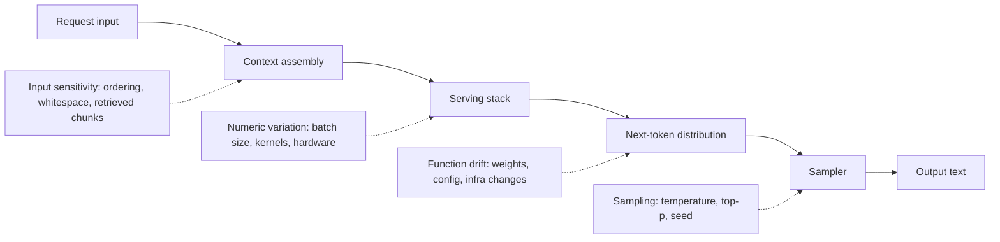
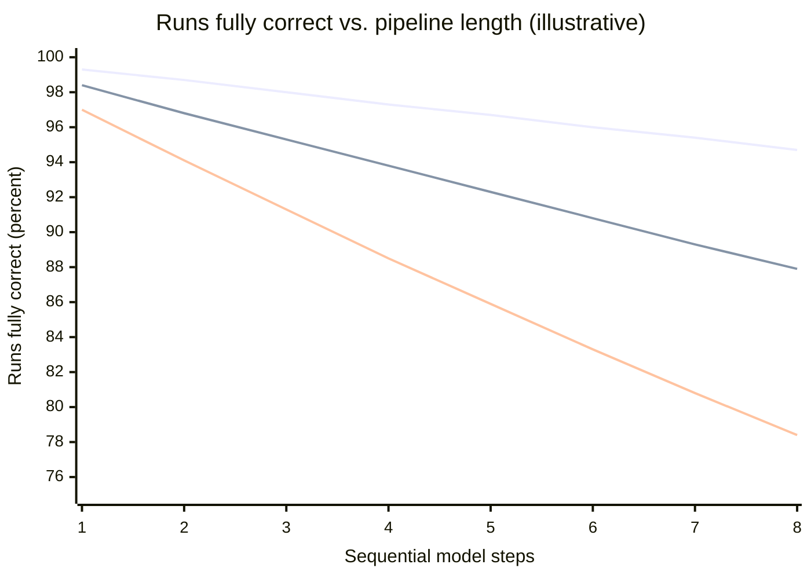
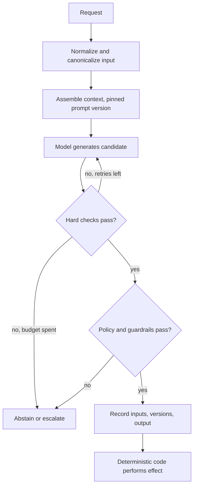
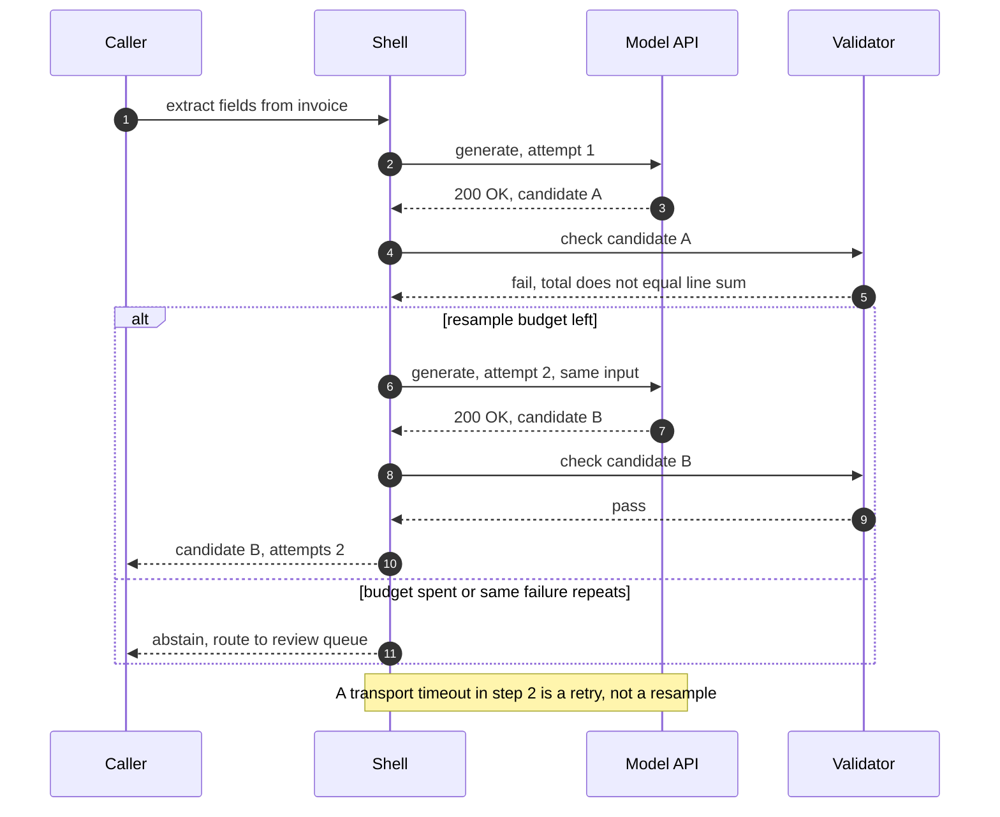
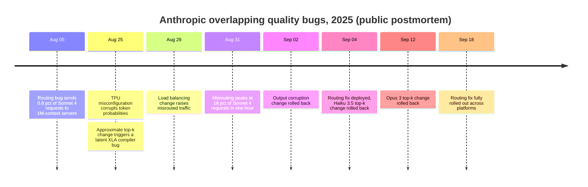

Deterministik bir bileşen bir girdiyi ve durumunu tek bir çıktıya eşler; doğruluğu her bir çağrının özelliğidir: `transfer(a, b, 100)` doğruysa her çalıştığında doğrudur. Olasılıksal bir bileşen ise bir girdiyi çıktılar üzerinde bir dağılıma eşler ve bu dağılımdan bir örnek döndürür. Doğruluğu dağılımın özelliğidir ve bir girdi popülasyonu üzerindeki bir oran olarak ifade edilir: "çıkarılan IBAN, bu tedarikçi karışımındaki faturaların %98,7'sinde dokümanla eşleşiyor". Bir büyük dil modeli (LLM) ikinci türdendir; istek yolunun üzerine bir model koyan her sistem de, kodunun geri kalanı nasıl görünürse görünsün, ikinci türden olur.

Backend mühendisliğinin alışkanlıklarının çoğu sessizce birinci türü varsayar. Bir unit test eşitlik doğrular. Bir retry aynı hesaplamayı tekrarlar ve aynı cevabı bekler. Bir cache, yapısı gereği taze bir çağrının üreteceği sonucun aynısı olan, saklanmış bir sonuç döndürür. Bir hata, stack trace'i olan bir exception'dır. API'sini koruyan bir bağımlılık davranışını da korur. Bu varsayımların her biri bir model için çöker ve çoğu hiçbir şey fırlatmadan çöker: sistem düzgün biçimli yanıtlar döndürmeye devam ederken yanlış olanların oranı kayar.

Temel trade-off, yetenek ile çağrı başına garanti arasındadır. Bir model, kimsenin numaralandırmadığı girdileri işler: serbest metinli şikâyetler, taranmış sözleşmeler, bir kod tabanı hakkındaki sorular. Deterministik kod bunu hiçbir bedelle yapamaz. Karşılığında hiçbir tekil çıktı garanti değildir ve mimari, çağrı başına bir hata oranını işin kabul edebileceği sistem düzeyinde bir riske dönüştürmek zorundadır. Bu dönüşümün bedeli gecikmeyle (doğrulama ve retry'lar), maliyetle (ek çağrılar) ve karmaşıklıkla (validator'lar, eval suite'leri, versiyon sabitleme, karar kayıtları) ödenir; ya da modelin karar vermesine izin verilen alan daraltılarak bu bedelden kaçınılır. Bu sayfa varyasyonun nereden geldiğini, çıktılar örnek olduğunda bir sözleşmenin neye benzediğini, hata oranlarının nasıl birleştiğini ve bunun sonucunda hangi mimari mekanizmaların değiştiğini anlatır.

Distributed Systems Handbook'taki [Deterministik ve Olasılıksal Hata Modelleri](https://gorkemsari.github.io/distributed-systems/tr/foundations/system-models/deterministic-vs-probabilistic/) sayfası hataların nasıl modellendiğiyle ilgilidir: `f` hatalık bir üst sınır ile hata oranlarının karşılaştırması. Buradaki konu ise bileşenin normal çıktısıdır. Hiçbir donanım arızalanmasa bile model olasılıksaldır, çünkü doğru çalışan bir model de belirli bir oranda yanlış cevap döndürür.

## Varyasyon Nereden Gelir

"Model deterministik değil" ifadesi dört ayrı mekanizmayı tek pakette toplar. Bunların sebepleri de çareleri de farklıdır; birbirine karıştırılmaları işe yaramayan düzeltmelere yol açar, örneğin temperature'ı sıfıra çekip tekrarlanabilir denetimler beklemek gibi.


*Tek bir üretim yolu boyunca dört varyasyon kaynağı. Bunlardan yalnızca sonuncusu istek parametreleriyle kontrol edilir.*

Sampling varyasyonu, kasıtlı olanıdır. Model her adımda bir sonraki token üzerinde bir olasılık dağılımı hesaplar ve sampler bu dağılımdan bir örnek çeker; temperature ve nucleus (top-p) parametreleri çekilişten önce dağılımın şeklini değiştirir. Mekanik [Bir Sistem Bileşeni Olarak LLM'in Anatomisi](/ai-systems-architecture/tr/foundations/ai-component-model/llm-anatomy/) sayfasında, kontroller ise [Determinizm Kontrolü: Temperature, Seed ve Caching](/ai-systems-architecture/tr/reliability/output-reliability/determinism/) sayfasında anlatılır. Her adımda en olası token'ı seçen greedy decoding, bu kaynağı prensipte ortadan kaldırır.

Sayısal varyasyon serving katmanından gelir. Kayan nokta toplaması birleşme özelliğine sahip değildir; dolayısıyla bir reduction'ın sonucu kısmi toplamların hangi sırayla birleştirildiğine bağlıdır. Inference kernel'leri batch boyutuna göre farklı reduction stratejileri seçer ve bir isteğin düştüğü batch, aynı anda başka hangi trafiğin geldiğine bağlıdır. Yani bir isteğin logit'leri komşularına bağlıdır. İki aday token neredeyse eşit olasılıktaysa son bitlerdeki bir fark seçimi değiştirir ve sonraki her token farklı bir önekten üretilir. Thinking Machines Lab bunu Eylül 2025'te gösterdi: vLLM ile sunulan Qwen3-235B üzerinde aynı prompt'un 1.000 greedy tamamlaması 80 farklı çıktı üretti; ilk 102 token'da aynıydılar, sonrasında ayrıştılar. Önerdikleri çözüm olan batch-invariant kernel'ler, bir throughput bedeli karşılığında 1.000 çıktının tamamını aynı hale getirdi; vLLM o zamandan beri beta özellik olarak batch-invariant bir mod sunuyor (Kasım 2026 itibarıyla). Hosted API'ler genellikle bu garantiyi vermez; örneğin OpenAI'ın `seed` parametresi "best effort" olarak belgelenir ve tekrarlanabilirliği bozan backend değişikliklerini göstermek için bir `system_fingerprint` alanı sunulur.

Fonksiyon kayması (drift), modelin kendisinin sabit bir ismin arkasında değişmesidir. Provider'lar alias'ların arkasındaki ağırlıkları günceller, serving konfigürasyonunu değiştirir ve hiçbir model değişikliği olmadan çıktıları etkileyen altyapı değişiklikleri yayınlar. Chen, Zaharia ve Zou, aynı isimli GPT-4 ve GPT-3.5 endpoint'lerinin Mart ve Haziran 2023 sürümleri arasında kod üretimi ve matematik soruları gibi görevlerde büyük davranış farkları ölçtü. Drift, varyasyonlar içinde bağımlılık yükseltmesine en çok benzeyenidir; tek farkı, sizin repository'nizde hiçbir changelog kaydı olmadan gelmesidir.

Girdi hassasiyeti ise hiç rastgelelik değildir. Deterministik olarak değerlendirilen bir model de, bir insana önemsiz görünen girdi değişiklikleri karşısında çıktısı süreksiz biçimde değişebilen bir fonksiyondur: getirilen pasajların sırası, sondaki bir boşluk, system prompt'taki bir tarih, sorunun farklı ama eşdeğer bir ifadesi. Mimari açıdan en önemli kaynak budur, çünkü her determinizm düzeltmesinden sağ çıkar. Kusursuz biçimde tekrarlanabilir bir model yalnızca byte düzeyinde aynı girdiler için tekrarlanabilirdir ve production girdileri neredeyse hiçbir zaman byte düzeyinde aynı değildir.

Bunun sonucu, sayfanın geri kalanı boyunca geçerli olan bir ayrımdır. Tekrarlanabilirlik, yani aynı byte'lar için aynı çıktıyı almak, bir debugging ve test özelliğidir. Doğruluk, yani kullanıcıların gerçekten gönderdiği girdiler için kabul edilebilir bir çıktı almak, istatistiksel bir özelliktir. Birincisine harcanan mühendislik emeği ikincisini satın almaz.

:::caution[Sıfır temperature bir determinizm garantisi değildir]
Greedy decoding yalnızca sampling varyasyonunu kaldırır, başka hiçbir şeyi değil. Batching kaynaklı sayısal varyasyon, provider tarafındaki drift ve girdi hassasiyeti yerinde kalır. Bazı reasoning model API'leri de sampling parametrelerini kısıtlar ya da yok sayar; örneğin OpenAI'ın GPT-5 reasoning model'lerinin 2025'ten beri varsayılan dışındaki temperature değerlerini reddettiği bildirilmiştir. Bir denetimi, bir test oracle'ını ya da bir cache tutarlılığı argümanını, aynı prompt'un sıfır temperature'da aynı metni döndüreceği varsayımı üzerine kurmayın.
:::

## Dağılım Olarak Sözleşmeler: Katı Kısıtlar ve Ölçülen Oranlar

Deterministik bir bileşenin sözleşmesi, her çağrıda geçerli olan bir sonkoşuldur. Olasılıksal bir bileşenin sözleşmesi ise ayrı ayrı tasarlanması gereken iki katmana ayrılır.

Katı katman, deterministik kod tarafından zorlandığı için her çağrıda geçerli olan özellikleri içerir. Çıktı bir şemaya uyan JSON olarak parse edilir; bir enum alanı beş değerden birini taşır; referans verilen doküman kimliği getirilen küme içinde vardır; bir tutar müşterinin limiti içindedir; çağıran taraf aksiyon için yetkilidir. Bunların bir kısmı üretim sırasında zorlanabilir: constrained decoding, bir grameri ihlal edecek token'ları maskeler ve böylece çıktının sözdizimsel olarak geçerli olması garanti edilir; bu konu [Structured Output](/ai-systems-architecture/tr/context-engineering/production-prompting/structured-output/) sayfasında anlatılır. Geri kalanlar üretimden sonra validator'larla zorlanır. Her iki durumda da garanti modelden değil, koddan gelir.

Esnek katman ise anlamla ilgili her şeyi içerir: çıkarılan tutar faturadaki tutardır, özet iptal maddesini atlamaz, seçilen kategori doğru kategoridir. Hiçbir mekanizma bunları çağrı başına zorlamaz. Bunlar tanımlı bir girdi popülasyonu üzerinde, bir eval ile ölçülen, bir eşik ve bir güven düzeyi içeren bir oran olarak ifade edilir: "2.000 ticket'lık golden set üzerinde kategori doğruluğu en az %95, %95 güven aralığının alt sınırı". Girdi popülasyonu olmadan sayı hiçbir şey ifade etmez, çünkü aynı model temiz faturalarda %99, el yazısı faturalarda %70 doğru olabilir.

```yaml
# Illustrative contract declaration for one model-backed component
component: invoice-extractor
hard:                      # enforced on every call; violation = rejected output
  schema: invoice_v3.json
  invariants: [total_equals_sum_of_lines, currency_in_iso4217, iban_checksum_valid]
soft:                      # measured, never enforced per call
  field_accuracy: { min: 0.97, eval_set: invoices-golden-2026q3, n: 1500 }
  abstain_rate:   { max: 0.05 }
pinned:
  model: provider-model-2026-08-snapshot   # never a moving alias
  prompt: invoice-extract@14
on_hard_violation: resample_once_then_queue_for_review
```

Yukarıdaki biçim bir standart değildir; bir ekibin bir yere yazmak zorunda olduğu şeyi gösterir. `hard` bölümü çalıştırılabilirdir. `soft` bölümü bir eval set'i ile desteklenen bir taahhüttür ve ancak o set ile production trafiği arasındaki uyum kadar geçerlidir. `pinned` bölümü vardır, çünkü esnek katmandaki sayılar belirli bir fonksiyona karşı ölçülmüştür; farklı bir model ya da prompt sürümü, oranları yeniden ölçülene kadar bilinmeyen farklı bir fonksiyondur. Çekimser kalma (abstention) oranı sözleşmenin parçasıdır, çünkü "bunu belirleyemiyorum" diyebilen bir bileşen bazı sessiz hataları açık, yönlendirilebilir sonuçlara dönüştürür.

Bu ayrım hatayı da tanımlar. Katı katmanın ihlali tespit edilebilir bir olaydır, bir exception'a eşdeğerdir: sistem çıktının kullanılamaz olduğunu bilir. Esnek katmanın tek bir çağrıda ihlali ise genellikle o anda tespit edilemez; yalnızca bir eval çalıştırmasında ya da sonradan incelenen production çıktısı örneklerinde bir oran olarak görünür. Olasılıksal bileşenler için mimari büyük ölçüde, deterministik bir kontrolün mümkün olduğu her yerde kontrolleri esnek katmandan katı katmana taşıma işidir.

### Çalışılmış Örnek: Adım Başına Hata Oranları Nasıl Birleşir

Örnekleme amacıyla, beş ardışık model adımı olan bir doküman işleme pipeline'ı varsayalım: dokümanı sınıflandır, alanları çıkar, normalize et, bir müşteri kaydıyla eşleştir ve bir yanıt taslağı hazırla. Her adım hedef popülasyonda zamanın %97'sinde kabul edilebilir bir çıktı üretiyor ve bir çalıştırma ancak beş adımın tamamı doğruysa doğru sayılıyor.

Hatalar bağımsız olsaydı uçtan uca oran 0,97'nin beşinci kuvveti, yani %85,9 olurdu. Her bileşen "%97 oranında çalışmasına" rağmen her yedi çalıştırmadan biri en az bir yanlış adım içerir. Adım başına %99'da aynı aritmetik %95,1 verir. Tek tek iyi model adımlarından oluşan uzun zincirler vasat sistemler üretir ve etki, bir agent'ın eklediği her adımla büyür.

Şimdi her adımdan sonra o adımın hatalarının %80'ini yakalayan deterministik bir validator (şema ihlalleri, checksum hataları, adı dokümanda geçmeyen bir müşteri eşleşmesi) ve validator tetiklendiğinde bir yeniden örnekleme (resample) ekleyelim. Adım başına çıktıların %3'ü yanlıştır; %0,6'sı validator'dan fark edilmeden geçer, %2,4'ü yakalanıp yeniden örneklenir. Yeniden örnekleme bağımsız bir çekilişse %3 oranında yanlıştır ve validator bunların da %80'ini yakalayıp insan kuyruğuna gönderir. Adım başına sessiz hata %0,6 artı 0,2 çarpı %0,072, yani yaklaşık %0,61'dir ve adım %99,33 oranında başarılı olur. Beş adım %96,7 tamamen doğru çalıştırma, çalıştırmaların yaklaşık %3,0'ında sessiz bir hata ve yaklaşık %0,3 eskalasyon verir. Beklenen maliyet, doğrulamaya ek olarak adım başına 1,024 üretimdir.


*Yukarıdan aşağıya: doğrulama ve bir bağımsız resample ile %97'lik adımlar; aynısı korelasyonlu hatalarla; doğrulamasız %97'lik adımlar. Üç seri de metindeki örnekleme amaçlı oranları kullanır.*

Zayıf nokta bağımsızlık varsayımıdır ve ortadaki çizgi nedenini gösterir. Model hataları yazı tura atışı değildir; bulanık bir tarama ya da muğlak bir ticket gibi, dağılımdan yapılan her çekilişin büyük olasılıkla yanlış olacağı zor girdilerde kümelenir. %3'lük hataların yarısının, resample'ın %80 oranında başarısız olduğu bu tür girdilerden, diğer yarısının ise resample'ın %3 oranında başarısız olduğu rastgele durumlardan geldiğini varsayalım. Yeniden denenen çıktılar artık %3 yerine yaklaşık %41,5 oranında yanlıştır. Adım %98,4 oranında başarılı olur, beş adım %92,3 verir, sessiz hatalar çalıştırmaların %3,9'una çıkar ve eskalasyonlar %0,3'ten %3,9'a yükselir. Resample, bağımsız modelin öngördüğünden çok daha azını kazandırdı; işin çoğunu yine validator yaptı.

Gerçek oranlar ne olursa olsun gerçek sistemlere taşınan iki sonuç vardır. Validator'ın yakalama oranı sessiz hata oranını sınırlar, çünkü resample ancak bir şey hatayı tespit ettikten sonra çalışır. Ve resample yalnızca hatanın rastgele kısmına yardımcı olur; korelasyonlu kısım daha güçlü bir model, farklı bir prompt, ek context ya da bir insan gibi farklı bir yolla ele alınmalıdır. Hangi kısmın baskın olduğunu ölçmek, yani bilinen hataları offline olarak yeniden örnekleyip ikinci çekilişin ne sıklıkla doğru olduğunu saymak ucuzdur ve retry'lara güvenme kararından önce yapılmalıdır.

## Olasılıksal Bir Çekirdeğin Etrafında Deterministik Bir Kabuk

Sözleşme ayrımından çıkan biçim deterministik bir kabuktur: modelin girdisini hazırlayan, neyi üretebileceğini kısıtlayan, ürettiğini kontrol eden ve herhangi bir etkiyi tek başına gerçekleştiren kod. Model önerir; neyin kabul edileceğine kabuk karar verir.


*Tek bir model çağrısının etrafındaki kabuk. Sistemin sunduğu her garantiyi, model olmayan bir dikdörtgen ya da eşkenar dörtgen üretir.*

Kabuğun her aşaması, varyasyon kaynaklarından birini ele almak için vardır. Normalizasyon girdi hassasiyetini hedefler: getirilen pasajları kararlı bir anahtara göre sıralamak, önemsiz boşlukları temizlemek, tarih biçimlerini sabitlemek ve istek kimlikleri gibi isteğe özgü gürültüyü prompt'tan çıkarmak, anlamca eşit girdileri daha sık byte düzeyinde eşit hale getirir. Bu, kullanıcılar arasındaki tutarlılığı artırır ve işe yarar her cache'in ön koşuludur. Prompt ve model sürümlerini sabitlemek, fonksiyonu açık hale getirerek drift'i hedefler. Katı kontroller, esnek özelliklerin olabildiğince fazlasını zorlanan özelliklere dönüştürür ve resample döngüsü ek üretimleri yalnızca tespit edilmiş hatalara harcar. Politika aşaması [Policy ve Kalite Guardrail'leri](/ai-systems-architecture/tr/reliability/output-reliability/guardrails/) sayfasında anlatılan kontrolleri uygular. Kayıt etkiden önce yapılır; böylece etki başarısız olsa bile neye karar verildiğinin kanıtı vardır.

Doğruluk argümanı, üretmek ile kontrol etmek arasındaki bir asimetriye dayanır. Pek çok görevde bir çıktıyı doğrulamak, onu üretmekten çok daha ucuz ve güvenilirdir: bir SQL sorgusu parse edilip bir read replica üzerinde çalıştırılabilir, kod derlenip test edilebilir, bir atıf getirilen kümede aranabilir, çıkarılan bir toplam çıkarılan satır kalemlerinden yeniden hesaplanabilir, bir IBAN'ın checksum'ı vardır. Böyle bir kontrolün olduğu yerde kabuk, kontrol edilen özellik için "muhtemelen yanlış" olanı "geçerli ya da reddedilmiş" hale getirir ve modelin o özellikteki hata oranı bir risk olmaktan çıkıp bir maliyete (daha fazla resample) dönüşür. Ucuz bir kontrolün olmadığı yerde, örneğin bir özetin sadakati ya da bir yanıtın tonu için, özellik esnek katmanda kalır ve geriye kalan seçenekler onu istatistiksel olarak ölçmek, bir insana inceletmek ya da bir kontrol mümkün olana kadar görevi daraltmaktır. [Yetenek ve Güvenilirlik](/ai-systems-architecture/tr/foundations/ai-component-model/capability-vs-reliability/) sayfası bu seçimi derinlemesine ele alır.

Diyagramdaki en önemli çizgi etki sınırıdır. Model hiçbir zaman bir aksiyon gerçekleştirmez; deterministik kodun yetkilendirme kurallarına göre doğruladığı ve [Tool Call Idempotency, Retry ve Compensation](/ai-systems-architecture/tr/agents/reliable-execution/idempotency-compensation/) sayfasında anlatıldığı gibi idempotency korumasıyla çalıştırdığı bir öneri üretir. Olasılıksal bir hatanın, ya da çıktı dağılımını bilerek kaydıran bir prompt injection'ın, geri alınamaz bir hataya dönüşmesini engelleyen budur.

:::tip[Bir kez karar verin, sonra kararı aktarın]
Sistemin iki parçası aynı girdi için modeli çağırırsa, örneğin bir ipucu göstermek için ticket'ı sınıflandıran bir frontend ve onu yönlendirmek için yeniden sınıflandıran bir backend, zaman zaman birbirleriyle çelişirler ve kullanıcı kendisiyle çelişen bir sistem görür. Tek bir çağrı yapın, sonucu kimliğiyle birlikte saklayın ve her tüketicinin onu okumasını sağlayın. Bileşenler arası tutarlılık garanti edebileceğiniz bir veri akışı özelliğidir; iki örnek arasındaki tutarlılık değildir.
:::

### Retry'lar Yeniden Örneklemeye Dönüşür

Deterministik bir sistemde retry aynı hesaplamayı tekrarlar ve yalnızca geçici hatalara karşı işe yarar: timeout'lar, kopan bağlantılar, aşırı yüklenmiş bir bağımlılık. Bunu güvenli şekilde yapmanın mekaniği Distributed Systems Handbook'taki [Üstel Geri Çekilme ve Jitter ile Yeniden Deneme](https://gorkemsari.github.io/distributed-systems/tr/resilience/protection-patterns/retry-exponential-backoff/) sayfasındadır. Bir model çağrısında da bu geçici hatalar vardır ve aynı şekilde ele alınırlar. Ancak bir model çağrısı yanlış ya da geçersiz bir cevapla başarıyla da dönebilir; bu durumda onu tekrarlamak dağılımdan yeniden çekmek demektir ve bu, farklı özelliklere sahip farklı bir işlemdir.


*Bir resample döngüsü. Provider 3. ve 7. adımlarda başarı bildirir; 3. adımın kullanılamaz bir cevap ürettiğini yalnızca validator bilir.*

Sekans, resample'ın transport retry'larından ayrı kendi politikasına neden ihtiyaç duyduğunu gösterir. 5. adımdaki tetikleyici, hiçbir HTTP istemcisinin ya da gateway'in göremeyeceği bir doğrulama hatasıdır; dolayısıyla döngü altyapıda değil, kabukta yaşar. Bütçesi küçük olmalıdır, çünkü yukarıdaki korelasyonlu hata aritmetiği kazancın çoğunun ilk resample'dan geldiğini gösterir. Her deneme tam olarak faturalanır; bu yüzden bir model regresyonu sırasında her istekte çalışan bir resample döngüsü, maliyeti tam da kalitenin en düşük olduğu anda katlar. 7. adımın 3. adımdan farklı bir cevap döndürmesi ise işin özüdür: kabuk, o anda tekrarlanabilir davranan bir provider üzerinde greedy decoding çalıştırıyorsa resample yine A adayını döndürür ve döngü bütçesini boşa yakar. Bazı ekipler resample sırasında girdiyi hafifçe değiştirir, örneğin validator'ın hata mesajını ekler; bu da kör yeniden örneklemeyi bir onarım döngüsüne çevirir. Bu teknik [Çıktı Doğrulama ve Onarım Döngüleri](/ai-systems-architecture/tr/reliability/output-reliability/output-validation/) sayfasında anlatılır.

### Caching, Versiyonlama, Test ve İzleme

Caching'in anlamı değişir. Deterministik bir fonksiyonun önündeki cache anlamsal olarak şeffaftır: bir hit, bir miss'in hesaplayacağı şeyi döndürür ve tek dertler bayatlık ile invalidation'dır; bunlar [Önbellek Stratejileri](https://gorkemsari.github.io/distributed-systems/tr/data-management/distributed-caching/cache-strategies/) sayfasında ele alınır. Bir modelin önündeki cache ise tek bir örneği dondurur. Sonraki her hit, yanlış olanlardan biri olsa bile o çekilişi sunar ve hata artık modelin hata oranıyla değil, hit oranıyla sunulur. Dondurulmuş örnek drift'i de gizler: bir model değişikliğinden önce doldurulmuş bir cache eski fonksiyonun çıktılarını sunmaya devam ederken yeni miss'ler yeni fonksiyondan gelir. Model çıktılarını cache'lemek maliyet ve kullanıcılar arası tutarlılık için yine de faydalıdır, ama bu seçilmiş bir örneği sunma kararıdır; cache'ler sabitlenmiş model ve prompt sürümleriyle anahtarlanmalı ve bunlardan biri değiştiğinde invalidate edilmelidir. [Semantic Caching](/ai-systems-architecture/tr/platform/ai-gateway/semantic-caching/), anahtar üzerinde bir benzerlik eşleşmesi olarak ikinci bir olasılıksal adım ekler. [Prompt Caching](/ai-systems-architecture/tr/context-engineering/production-prompting/prompt-caching/) ise yine farklıdır: provider içinde bir prompt önekinin hesaplamasını yeniden kullanır ve çıktıları dondurmaz.

Versiyonlamanın kapsamı değişir. API'sini koruyan ve testlerini geçen bir kütüphane bağımlılığı pratikte aynı bağımlılıktır. Değişmemiş bir API'nin arkasındaki bir model ise hiçbir contract test'in yakalayamayacağı şekillerde farklı davranabilir, çünkü önemli olan sözleşme esnek katmandır. Model kimliği, prompt sürümü, sampling parametreleri ve retrieval konfigürasyonu birlikte fonksiyonu tanımlar; bunlardan herhangi birindeki bir değişiklik, rollout'tan önce bir eval gerektiren bir production davranış değişikliğidir. Bu süreç [Model Versiyonlama, Deprecation ve Migration](/ai-systems-architecture/tr/model-strategy/lifecycle-and-adaptation/versioning-migration/) sayfasında anlatılır.

Test ikiye ayrılır. Modelin etrafındaki kod hâlâ deterministiktir ve kaydedilmiş ya da mock'lanmış model yanıtlarına karşı sıradan testlerle test edilir; bu, [Deterministik Test Katmanı](/ai-systems-architecture/tr/evaluation/testing-foundations/deterministic-tests/) sayfasında anlatılır. Model destekli davranış ise istatistiksel olarak test edilir: bir dataset çalıştırılır, bir oran hesaplanır ve bir güven aralığıyla bir eşikle karşılaştırılır. Üretilmiş metin üzerinde eşitlik doğrulaması flaky bir test üretir ve flaky testler devre dışı bırakılır. İstatistiksel taraf [Neden Eval: Olasılıksal Bir Sistemi Test Etmek](/ai-systems-architecture/tr/evaluation/testing-foundations/why-evals/) sayfasında geliştirilir.

İzlemenin sinyali değişir. Deterministik bir servis hatayı error'lar, gecikmeler ve doygunluk üzerinden bildirir; service level indicator'ları (SLI) çoğunlukla başarısız isteklerin sayımlarıdır ve [SLI (Servis Seviyesi Göstergesi)](https://gorkemsari.github.io/distributed-systems/tr/observability/slo-sla-error-budgets/sli/) sayfasında anlatılır. Model destekli bir servis bunların hepsinde tamamen sağlıklı görünürken çıktıları kötüleşebilir. Kalitenin, production çıktılarından örneklenip puanlanan kendi göstergelerine ihtiyacı vardır: validator ret oranı, resample oranı, çekimser kalma oranı, kullanıcı düzeltme oranı ve örneklenmiş trafik üzerindeki eval skorları. Bunların nasıl kurulacağı [Kalite İzleme ve Drift Tespiti](/ai-systems-architecture/tr/llmops/observability/quality-drift/) sayfasında ele alınır.

| Konu | Deterministik bileşen | Olasılıksal bileşen | Deterministik alışkanlığın hâlâ geçerli olduğu yer |
|---|---|---|---|
| Doğruluk birimi | Her çağrı | Bir girdi popülasyonu üzerinde bir oran | Kodla zorlanan katı katman özellikleri |
| Test oracle'ı | Eşitlik doğrulaması | Dataset, metrik, eşik, güven düzeyi | Kaydedilmiş yanıtlarla modelin etrafındaki kod |
| Retry | Hesaplamayı tekrarlar | Yeni bir örnek çeker | Transport hataları: timeout, 429, 5xx |
| Cache hit | Taze bir sonuca eşittir | Dondurulmuş tek bir örneği sunar | Katı kontrolleri geçmiş ve sürümlerle anahtarlanmış çıktılar |
| Bağımlılık yükseltmesi | API uyumluluğu yeterlidir | Davranış sabit bir API altında değişebilir | Model için asla; SDK'lar ve istemciler için hâlâ |
| Hata sinyali | Exception, durum kodu | Yanlış ama düzgün biçimli çıktı | Katı kontrol ihlalleri ve provider hataları |
| Debugging | Yeniden çalıştırıp tekrar üretmek | Kaydedilmiş girdileri ve çıktıyı okumak | Yalnızca batch-invariant self-hosted serving ile |

## Olasılıksal Bileşenlere Özgü Hata Türleri

Aşağıdaki hatalar nadiren bir error log'u üretir. Her biri birinin bakacağı bir sinyale ihtiyaç duyar, çünkü hiçbiri kendiliğinden alarm üretmez.

Olasılıksal bir bileşende sessiz kalite düşüşünün en net kamuya açık örneği, Anthropic'in Ağustos ve Eylül 2025'te üst üste binen üç altyapı hatasına ilişkin postmortem'idir. Hiçbiri model ağırlıklarını değiştirmedi; üçü de trafiğin bir kısmı için çıktı dağılımını değiştirdi.


*Anthropic'in postmortem'inde anlatıldığı şekliyle ilk hatadan son düzeltmeye altı hafta. Tarihler postmortem'den alınmıştır; belirtiler platforma ve modele göre değişti.*

Postmortem'in, tespitin neden yavaş olduğuna dair anlattıkları ders çıkarılacak kısımdır. Provider'ın eval'ları kalite düşüşünü yakalamadı; bunun bir sebebi, modelin tekil yanlış token'lardan çoğu zaman toparlanmasıydı. Her hata farklı platformlarda farklı oranlarda farklı belirtiler üretti; bu yüzden kullanıcı bildirimleri birbiriyle çelişiyor gibi göründü. Gizlilik kontrolleri, mühendislerin etkilenen konuşmalara erişimini sınırladı. Düzeltme listesi, olasılıksal sistem operasyonunun bir tarifi gibi okunur: kalite eval'larını yalnızca deployment öncesinde değil, production sistemleri üzerinde sürekli çalıştırmak; çıktıda beklenmeyen alfabeler gibi belirli belirtiler için kontroller eklemek ve gizliliği bozmadan kullanıcı geri bildirimini incelemeye yarayan araçlar geliştirmek. Hosted bir model kullanan bir ekip için ders şudur: provider'ın eval'ı sizin eval'ınız değildir; kendi trafiğiniz üzerindeki kendi kalite sinyalleriniz, sizin kullanım senaryonuzu kapsayan tek dedektördür.

| Hata | Tetikleyici | Belirti | Tespit | Azaltma ve kurtarma |
|---|---|---|---|---|
| Sessiz dağılım kayması | Provider güncellemesi, serving değişikliği, taşınan alias | Düzgün biçimli ama daha kötü çıktılar, artan şikâyetler | Sabit set üzerinde zamanlanmış eval; örneklenmiş trafikte kalite SLI'ları; `system_fingerprint` ya da model kimliği değişikliği | Snapshot'ları sabitleyin; yeni sürümleri canary ile açın; sabitlemeyi geri alın |
| Korelasyonlu retry amplifikasyonu | Zor girdiler ya da bir regresyon her çekilişi başarısız kılar | Resample oranı ve maliyet tırmanır, kalite toparlanmaz | Route başına resample oranı; ikinci çekiliş başarı oranı | Resample'ı bir ya da iki ile sınırlayın; tekrarlanan hataları farklı bir yola yönlendirin |
| Dondurulmuş yanlış cevap | Cache yanlış bir örneği saklar | O girdiye sahip her kullanıcıya aynı yanlış cevap | Tek bir cache key'inde kümelenen düzeltmeler | Yalnızca katı kontrolleri geçen çıktıları cache'leyin; sürüm anahtarlı invalidation |
| Kendisiyle çelişme | İki bileşen aynı kararı ayrı ayrı örnekler | UI ve backend uyuşmaz | Aynı girdinin tüketicileri arasındaki uyuşmazlık oranı | Bir kez karar verin, saklayın, aktarın |
| Flaky test suite | Üretilmiş metin üzerinde eşitlik doğrulamaları | Testler rastgele kırılır, sonra devre dışı bırakılır | Değişmemiş kodda %100'ün altında test geçme oranı | Unit test'lerde modeli mock'layın; anlamsal kontrolleri eval'lara taşıyın |
| Tekrar üretilemeyen incident | Debugging bir prompt'u yeniden çalıştırmaya dayanır | Yeniden çalıştırma iyi görünür, incident açıklanamaz | "Tekrar üretilemedi" diye kapatılan incident'lar | Karar anında tam girdileri, sürümleri, parametreleri ve çıktıyı kaydedin |

Tekrar üretilemeyen incident ayrı bir notu hak eder. Bir operatör bir şikâyetteki prompt'u yeniden çalıştırıp iyi bir cevap aldığında bu, kullanıcının ne gördüğü hakkında hiçbir şey kanıtlamaz: farklı bir batch, daha sonraki bir model revizyonu ya da biraz farklı bir context farklı bir çekiliş üretmiştir. Sistemin ne yaptığının tek güvenilir kanıtı, onu yaptığı anda kaydettiği şeydir. Bu kaydın span modeli ve alanları [LLM Observability Temelleri](/ai-systems-architecture/tr/llmops/observability/llm-observability/) sayfasında, prompt saklamanın gizlilik kısıtları ise [Gizlilik Kısıtları Altında Prompt ve Yanıt Loglama](/ai-systems-architecture/tr/llmops/observability/logging-privacy/) sayfasında anlatılır.

:::danger[Yeniden çalıştırma bir denetim izi değildir]
Bir kredi ön değerlendirmesi ya da şüpheli işlem işaretlemesi gibi düzenlemeye tabi bir kararda, "bu müşteri neden reddedildi" diye soran bir denetçiye modeli yeniden çalıştırarak cevap verilemez. Cevap kararı belirleyen cevaptan farklı olabilir ve bu, kanıtı sessizce değiştirir. Tam context'i, sabitlenmiş sürümleri, parametreleri, ham çıktıyı ve çıktının geçtiği kontrolleri karar anında ve kurcalanmaya karşı korumalı bir depolamada saklayın.
:::

### Güvenlik ve Yönetişim Etkileri

Olasılıksal bir bileşen, güvenlik muhakemesinde iki şeyi değiştirir. Birincisi, kötü davranışın yokluğuna dair bir ispat yoktur: deterministik bir parser kötü niyetli bir girdiyi ya kabul eder ya etmez; bir model ise enjekte edilmiş bir talimata bir çekilişte uyup bir sonrakinde onu yok sayabilir. Dolayısıyla hiçbir şey bulamayan bir red team turu, test edilen girdiler üzerinde bir oran belirler, bir garanti değil. Bu yüzden savunmalar deterministik kabukta, etki sınırındaki yetkilendirmede ve ele geçirilmiş bir çıktının erişebileceği alanı sınırlamada yer alır; bu konu [Prompt Injection](/ai-systems-architecture/tr/security/threats/prompt-injection/) sayfasında ele alınır. İkincisi, açıklanabilir ve tekrar üretilebilir kararlar bekleyen yönetişim çerçevelerinin gereklilikleri yeniden çalıştırma yerine kayıt ve istatistiksel doğrulama ile karşılanmalıdır. Olasılıksal bir bileşen için model risk yönetimi, ölçülen oranları temsili veriler üzerinde doğrulamak ve izlemek anlamına gelir; bu, [LLM Sistemleri için Model Risk Yönetimi](/ai-systems-architecture/tr/governance/risk-management/model-risk-management/) ve [Açıklanabilirlik ve Denetlenebilirlik](/ai-systems-architecture/tr/governance/regulation/explainability-auditability/) sayfalarının konusudur.

## Olasılıksal Sınırın Nereye Çekileceğine Karar Vermek

Mimari açıdan faydalı soru, bir sistemin model kullanıp kullanmadığı değil, hangi kararların bir modele devredildiği ve her kararın ne kadarının deterministik kabuk tarafından kontrol edilebildiğidir.

Girdi alanı açık uçlu olduğunda ve görev kabul edilebilir bir maliyetle kurallar olarak tanımlanamadığında modeli yolun üzerine koyun: serbest metin, yapılandırılmamış dokümanlar, doğal dilde sorgular ve kod. Bir hata ucuzsa (kullanıcının yok sayabileceği bir öneri), deterministik bir kontrolle tespit edilebiliyorsa (checksum'lar ve toplamlarla bir çıkarım) ya da etkisini göstermeden önce bir insan tarafından yakalanıyorsa (birinin onayladığı bir taslak) modeli oraya koyun. Bu koşullar altında çağrı başına hata oranı bir maliyete ya da bir inceleme yüküne dönüşür; ikisi de ölçülebilir ve bütçelenebilir.

Kurallar bilinen ve kararlı olduğunda, girdiler zaten yapılandırılmış olduğunda, aynı girdinin hukuki ya da adillik gerekçeleriyle her zaman aynı sonucu vermesi gerektiğinde ya da bir hata geri alınamaz olup hiçbir kontrol onu etkisini göstermeden yakalayamadığında kararı deterministik tutun. Faiz hesaplamak, yayımlanmış bir ücret tablosunu uygulamak, kesin tanımlayıcılar üzerinde bir yaptırım listesi eşleşmesini kontrol etmek ve bir yetkilendirme politikasını zorlamak bu kategoridedir. Bir model bunların etrafında yine yardımcı olabilir, örneğin deterministik bir kuralın girdilerini çıkararak; ama kuralın kendisi kodda kalır. [AI Ne Zaman Yanlış Çözümdür](/ai-systems-architecture/tr/foundations/failure-and-fit/when-not-to-use-ai/) sayfası bu koşulları bir karar prosedürüne dönüştürür.

İki uç arasında sınırı, kontrolleri taşıyarak hareket ettirin. Bir validator'a dönüştürülebilen her özellik esnek katmandan katı katmana geçer ve kararın gerçekten olasılıksal olan kısmını küçültür. Bir zincirden çıkarılabilen her model çağrısı uçtan uca oranı çarpımsal olarak iyileştirir; deterministik aşamalar arasında bir ya da iki model adımı olan bir workflow'un, aynı görevde daha güçlü bir modelle çalışan açık bir agent döngüsünden çoğu zaman daha iyi sonuç vermesinin sebebi budur. Bu seçimin trade-off'ları [Workflow ve Agent: Otonomi Spektrumu](/ai-systems-architecture/tr/agents/tools-and-protocols/autonomy-spectrum/) sayfasında ele alınır.

Bu işin yerine bit düzeyinde determinizmin peşine düşmeyin. Batch-invariant serving, self-host ettiğinizde ve tekrarlanabilir eval'lara, regresyon replay'lerine ya da reinforcement learning çalıştırmalarına ihtiyaç duyduğunuzda ve throughput bedeli kabul edilebilir olduğunda açmaya değer. Çıktıları doğru yapmaz, bir model ya da prompt değişikliğinden sağ çıkmaz ve kullanıcılar arasındaki production varyasyonunun çoğunun kaynağı olan girdi hassasiyetine karşı hiçbir şey yapmaz.

Bu sayfanın konusuyla en sık karıştırılan kavramlar başka yerlerde ele alınır: sampling'in mekaniği [Bir Sistem Bileşeni Olarak LLM'in Anatomisi](/ai-systems-architecture/tr/foundations/ai-component-model/llm-anatomy/) sayfasında, belirli determinizm kontrolleri [Determinizm Kontrolü](/ai-systems-architecture/tr/reliability/output-reliability/determinism/) sayfasında, neyin yanlış gittiğinin sınıflandırması [AI Hata Türlerinin Taksonomisi](/ai-systems-architecture/tr/foundations/failure-and-fit/failure-mode-taxonomy/) sayfasında, olasılıksal hata modelleri ise sayfanın başında bağlantısı verilen Distributed Systems Handbook sayfasında.

## İleri Okuma

- Horace He and Thinking Machines Lab, *Defeating Nondeterminism in LLM Inference*, Thinking Machines Lab: Connectionism, 2025.
- Anthropic, *A Postmortem of Three Recent Issues*, Anthropic Engineering, 2025.
- Lingjiao Chen, Matei Zaharia, and James Zou, *How Is ChatGPT's Behavior Changing over Time?*, Harvard Data Science Review, 2024.
- D. Sculley et al., *Hidden Technical Debt in Machine Learning Systems*, Advances in Neural Information Processing Systems (NeurIPS), 2015.
- OpenAI, *Reproducible Outputs with the Seed Parameter*, OpenAI Cookbook.
