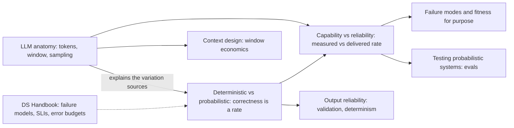
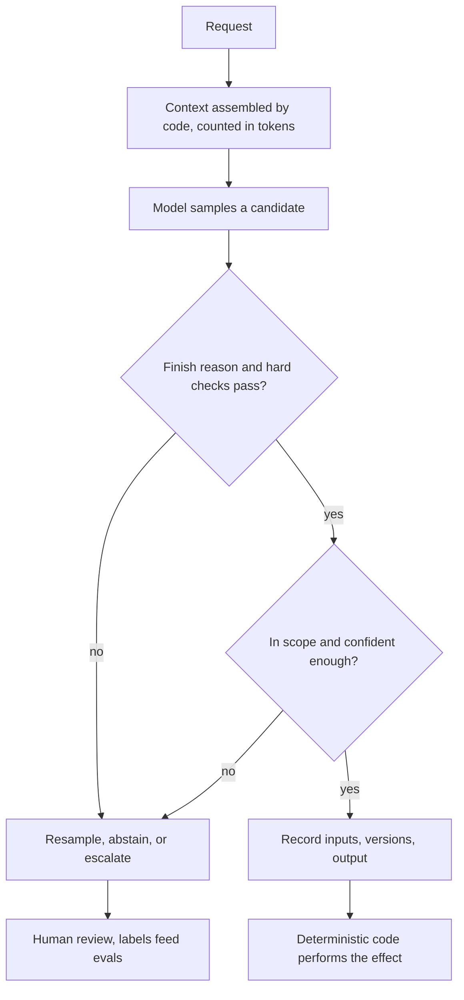

Bir AI sistemiyle ilgili her mimari karar, modelin nasıl bir bileşen olduğuna dayanır. Alışılmış cevap, yani "prompt alıp metin döndüren bir API", önemli olan üç özelliği dışarıda bırakır. Bileşenin doğruluğu tek bir çağrının özelliği değildir; her zaman bir girdi popülasyonu üzerindeki bir orandır. Tek girdisi, çağıranın her istekte baştan kurduğu, sınırlı uzunlukta bir token dizisidir; bu dizinin içinde ne bellek ne de yetki ayrımı vardır. Ve birinin onun için ölçtüğü oran, ister bir benchmark'ta, ister bir demoda, ister geçen çeyreğin model sürümünde ölçülmüş olsun, canlı trafikte teslim ettiği oran değildir. Bu bölüm bileşeni bu üç eksen üzerinden tanımlar; böylece handbook'un geri kalanı onun hakkında ortak bir modelin üzerine kurulabilir.

Üç konunun hepsinden geçen gerilim, yetenek ile garantiler arasındadır. Bir model, hiçbir deterministik kodun işleyemeyeceği açık uçlu girdileri işler; bunun bedelini çağrı başına doğruluktan, tekrarlanabilirlikten ve backend mühendislerinin güvendiği hata sinyallerinden vazgeçerek öder: model destekli bir servis, HTTP 200 ile düzgün biçimli ama yanlış bir cevap döndürerek bozulur. Bölümdeki her sayfa, mimarinin yetenekten vazgeçmeden garantileri nasıl geri kazandığının bir yüzünü gösterir: kontrol edilebilen her şeyi kodla zorlayarak, context window'u tasarlanmış ve bütçelenmiş bir yapı olarak ele alarak ve ölçülen yeteneği daraltma, doğrulama, abstention ve insan incelemesi yoluyla teslim edilen güvenilirliğe çevirerek.

Bölüm bilinçli olarak belirli bir modeli değil, bileşenin kendisini konu alır. Model adları, fiyatlar ve pencere boyutları konu sayfalarında tarihli örnekler olarak geçer; burada tanımlanan özellikler Kasım 2026 itibarıyla production'da kullanılan LLM'ler için geçerlidir ve sonraki bölümlerin varsaydığı şey de bunlardır.

## Üç Konu Birbirinin Üzerine Nasıl Kurulur

Konular kısa bir zincir ve bir çapraz bağlantı oluşturur. Birincisi kavram setini tanımlar, ikincisi onun arkasındaki mekanizmayı sağlar, üçüncüsü de ikisini bir tasarım yöntemine dönüştürür.

*Bölüm içindeki bağımlılıklar ve bölümden ana çıkışlar. Düz kenarlar "kavramlarını kullanır" anlamına gelir; kesikli kenar, eşlik eden handbook'tan varsayılan bilgiyi gösterir.*

Diyagramı ortadan okuyun. Olasılıksal sözleşme, diğer iki sayfanın dayandığı fikirdir: anatomi sayfası çıktı dağılımının fiziksel olarak nereden geldiğini açıklar, güvenilirlik sayfası ise doğruluğun bir oran olarak zaten anlaşıldığını varsayar. Anatomi sayfasının context tasarımına giden kendi çıkışı da vardır, çünkü orada tanıtılan token ve pencere aritmetiği o bölümdeki her bütçeleme kararının başlangıç noktasıdır. Güvenilirlik sayfası iki yere çıkar: neyin ters gittiğini sınıflandıran ve bir modelin ne zaman hiç kullanılmaması gerektiğine karar veren bir sonraki bölüme ve güvenilirlik sayfasının yalnızca çerçevesini çizdiği ölçüm yöntemlerinin sahibi olan değerlendirme bölümüne.

## Konular

[Deterministik ve Olasılıksal Sistemler: Mimaride Neler Değişir](/ai-systems-architecture/tr/foundations/ai-component-model/deterministic-vs-probabilistic/), bir bileşen hesaplanmış bir sonuç yerine bir dağılımdan çekilmiş bir örnek döndürdüğünde backend mühendisliği alışkanlıklarına ne olduğu sorusunu yanıtlar. Çıktı varyasyonunun dört kaynağını birbirinden ayırır; bir bileşenin sözleşmesini, kodun her çağrıda zorladığı katı bir katman ile yalnızca oran olarak ölçülebilen yumuşak bir katmana böler ve bunun sonucunda retry, cache, test, versiyonlama ve izlemenin her birinin anlamının nasıl değiştiğini gösterir. Önemlidir, çünkü AI sistemlerindeki sessiz production hatalarının çoğu olasılıksal bir parçaya uygulanmış deterministik bir varsayımdan doğar: yanlış bir örneği donduran bir cache ya da bir prompt'u yeniden çalıştırmaya dayanan bir denetim gibi.

[Bir Sistem Bileşeni Olarak LLM'in Anatomisi: Token, Context, Sampling](/ai-systems-architecture/tr/foundations/ai-component-model/llm-anatomy/), tek bir API çağrısının içinde gerçekte ne olduğunu bir mimarın ihtiyaç duyduğu düzeyde yanıtlar. Token her fiyatın, limitin ve latency'nin birimidir ve sayısı tokenizer'a ve dile bağlıdır; context window girdinin tamamıdır ve her çağrıda baştan kurulup yeniden faturalanır; sampling döngüsü ve finish reason ise çağırana hangi metnin ulaşacağını ve bu metnin tamam olup olmadığını belirler. Önemlidir, çünkü kapasite, maliyet ve kota planlamasının arkasındaki sayılar ve kesilmiş çıktılar ya da uzun oturumlarda pencereden düşen talimatlar gibi bir hata sınıfı doğrudan bu mekanizmadan çıkar.

[Yetenek ve Güvenilirlik: Production Açığını Kapatmak](/ai-systems-architecture/tr/foundations/ai-component-model/capability-vs-reliability/), bir benchmark'ta ya da demoda iyi skor alan bir modelin production'da neden daha azını teslim ettiğini ve aradaki farkı kapatmanın neye mal olduğunu yanıtlar. Bir yetenek skoru ile teslim edilen oran arasındaki üç açığı (tekrarlanan denemeler, girdi dağılımı ve zaman) adlandırır, yetenek yerine güvenilirliğin nasıl ölçüleceğini gösterir ve birini diğerine çeviren dört kaldıracı maliyetlerine göre sıralar. Önemlidir, çünkü bir yetenek skoruna göre boyutlandırılmış bir özellik yanlış sayıya göre boyutlandırılmıştır ve bu hata genellikle ancak lansmandan sonra ortaya çıkar.

| Konu | Yanıtladığı soru | Ne zaman açılmalı |
|---|---|---|
| Deterministik ve Olasılıksal Sistemler | Doğruluk çağrı başına bir özellik değil de bir oran olduğunda ne değişir? | Bir modelin etrafında sözleşme, retry, cache ya da test tasarlarken; "yeniden üretilemeyen" bir olayı açıklarken |
| LLM'in Anatomisi | Tek bir çağrı, token token, neyi tüketir, neyi hesaplar ve ne döndürür? | Maliyet ya da kapasite tahmin ederken; kesilme, context taşması ya da tokenizer kaynaklı maliyet sıçramalarını ayıklarken |
| Yetenek ve Güvenilirlik | Ölçülen oran teslim edilen orandan ne kadar uzaktır ve açığı ne kapatır? | Bir özelliği benchmark ya da pilot sonucuna göre boyutlandırırken; release kapıları, abstention eşikleri ya da inceleme kadrosu belirlerken |

## Bölüm Boyunca Tekrarlanan Fikirler

Üç sayfada birkaç kural tekrar eder; her biri doğduğu sayfada eksiksiz anlatılır, diğerlerinde uygulanır. Bunları bir arada tutmaya değer, çünkü birlikte, handbook'un geri kalanının ayrıntılandırdığı model destekli bir kararın biçimini tarif ederler.

*Bölümün tarif ettiği biçimiyle model destekli tek bir karar. İlk üç kutu anatomi sayfasına; katı kontroller, kayıt ve etki sınırı olasılıksal sözleşmeye; kapsam, güven ve inceleme ise güvenilirlik sayfasına aittir.*

Diyagram, tekrarlanan ilk kuralı görünür kılar: sistemin sunduğu her garanti, model olmayan bir kutudan gelir. Şemalar, checksum'lar, yetkilendirme, finish reason kapısı ve etkiden önce yazılan kayıt deterministiktir ve her çağrıda geçerlidir; modelin katkısı ise kalitesi yalnızca istatistiksel olarak bilinen bir adaydır. İkinci kural, başarılı yanıtların hiçbir kalite sinyali taşımadığıdır. Bölümün hata tablolarındaki her hata, sessiz kesilmeden bir model alias'ının arkasındaki kaymaya, artık hiçbir anlam taşımayan bir abstention eşiğine kadar, normal bir yanıt olarak gelir; dolayısıyla tespit, birinin bilinçli olarak kurduğu göstergelere bağlıdır: finish reason payları, validator ret oranları, kabul edilen çıktılardan denetlenen örnekler ve sabitlenmiş sürümler üzerinde zamanlanmış eval'ler.

Üçüncü kural, bir model hakkındaki bir sayının popülasyonu, metriği ve sürümü olmadan anlamsız olduğudur. Temiz İngilizce faturalarda ölçülen bir doğruluk, taranmış Türkçe faturalar hakkında hiçbir şey söylemez; bir tokenizer'la ölçülen token bütçesi bir geçişten sonra yanlıştır; best-of-k olarak ölçülen bir oran, gözetimsiz tekil denemeler hakkında hiçbir şey söylemez. Dördüncüsü, context window'un hem yeteneğin hem de riskin birimi olmasıdır: model yalnızca içindekini kullanabilir, içindeki her şey hiçbir yetki sınırı olmadan çıktıyı yönlendirebilir ve pencere, bir denetçinin bir çıktıyı sonradan açıklamak için ihtiyaç duyduğu kaydın ta kendisidir. Sonraki bölümlerin sabitlenmiş sürümlere, kaydedilmiş context'lere ve production biçimli veri üzerindeki eval'lere sürekli geri dönmesinin nedeni bu kurallardır.

## Önerilen Okuma Sırası

Üç sayfayı kenar çubuğundaki sırayla okuyun. Olasılıksal sözleşme önce gelir, çünkü diğer ikisinin yeniden tanımlamadan kullandığı kavram setini tanıtır: katı ve yumuşak katmanlar, deterministik kabuk, hata oranlarının birleşmesi ve retry'dan ayrı bir işlem olarak yeniden örnekleme. Anatomi sayfası ikinci gelir, çünkü bu kavramları mekanizmaya oturtur; token büyümesi ve sampling olasılıkları üzerine çalışılmış örnekleri soyutlamaları somutlaştırır. Güvenilirlik sayfası en sona kalır, çünkü ikisine de dayanır: `pass^k` aritmetiği oranları, kaldıraçları da kabuğu ve pencereyi varsayar.

İki kısayol makuldür. LLM'lerin istek düzeyinde nasıl çalıştığına yeni olan bir okur anatomi sayfasıyla başlayıp diğer ikisini sırayla okuyabilir; anatomi sayfasındaki hiçbir şey ilk sayfanın terminolojisine dayanmaz. Somut bir sorunla gelen okur doğrudan o sorunun sahibi olan sayfaya gitmelidir: bir maliyet ya da kesilme sorusu için anatomi sayfasına, flaky bir test ya da yeniden üretilemeyen bir olay için olasılıksal sözleşmeye, pilot skoruna dayanan bir lansman kararı için güvenilirlik sayfasına; bağlantıları da yalnızca gerektiği yerde geriye doğru izlemelidir.

## Ön Koşullar ve Bölümün Yönlendirdiği Yerler

Bölüm, handbook'un tamamının varsaydığı dağıtık sistem altyapısını varsayar; başlamadan önce eşlik eden handbook'taki üç sayfayı akılda tutmak faydalıdır. [Deterministik ve Olasılıksal Hata Modelleri](https://gorkemsari.github.io/distributed-systems/tr/foundations/system-models/deterministic-vs-probabilistic/), hataların oran olarak nasıl modellendiğini anlatır; bu, doğru çalışan bir bileşenin de belirli bir oranda yanlış çıktı döndürdüğü bu bölümün sorusundan farklı bir sorudur. [Service Level Indicator'lar](https://gorkemsari.github.io/distributed-systems/tr/observability/slo-sla-error-budgets/sli/) ve [Error Budget](https://gorkemsari.github.io/distributed-systems/tr/observability/slo-sla-error-budgets/error-budget/), gösterge başarılı yanıt oranı yerine bir kalite oranı olduğunda güvenilirlik sayfasının yeniden kullandığı yöntemi sağlar.

Doğrudan devamı, model destekli sistemlerde neyin ters gittiğini sınıflandıran ve bu bölümdeki koşulları, bir modelin belirli bir kararda yer alıp almaması gerektiğine dair bir karara dönüştüren [Hata Türleri ve Amaca Uygunluk](/ai-systems-architecture/tr/foundations/failure-and-fit/) bölümüdür. Oradan itibaren bileşen modeli dört yerde uygulanır. [Context Tasarımı](/ai-systems-architecture/tr/context-engineering/context-design/), pencere ve token aritmetiğinin üzerine kurulur ve [Context Window Ekonomisi](/ai-systems-architecture/tr/context-engineering/context-design/context-window-economics/) ile başlar. [Çıktı Güvenilirliği](/ai-systems-architecture/tr/reliability/output-reliability/), deterministik kabuğu [Çıktı Doğrulama ve Onarım Döngüleri](/ai-systems-architecture/tr/reliability/output-reliability/output-validation/) ve [Determinizm Kontrolü](/ai-systems-architecture/tr/reliability/output-reliability/determinism/) dahil olmak üzere ayrıntılı biçimde kurar. [Olasılıksal Sistemleri Test Etmek](/ai-systems-architecture/tr/evaluation/testing-foundations/), güvenilirlik sayfasının çerçevesini çizdiği istatistiksel ölçümün sahibidir ve [Neden Eval](/ai-systems-architecture/tr/evaluation/testing-foundations/why-evals/) ile başlar. [Kalite İzleme ve Drift Tespiti](/ai-systems-architecture/tr/llmops/observability/quality-drift/) ise lansmandan sonraki zaman açığını, yani çalışan bir sistemin altında provider'ın, prompt'un ya da index'in değiştiği durumu ele alır.
