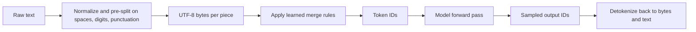
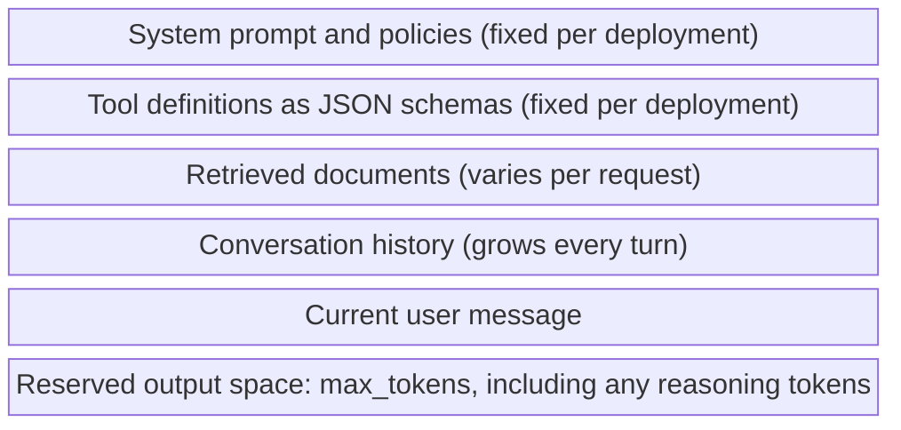
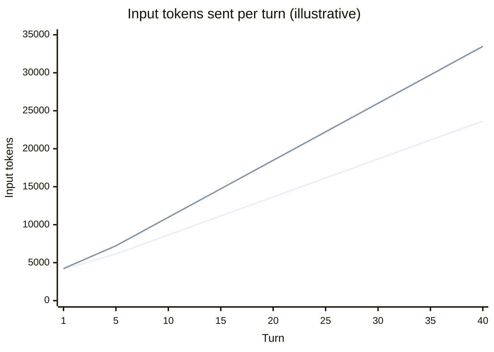
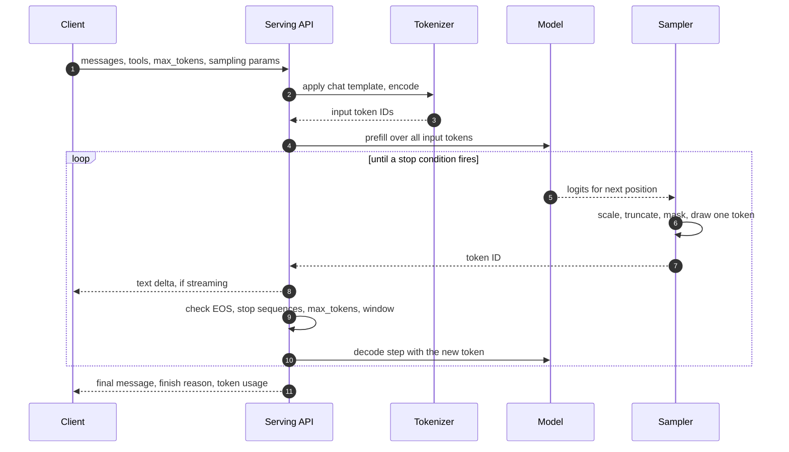
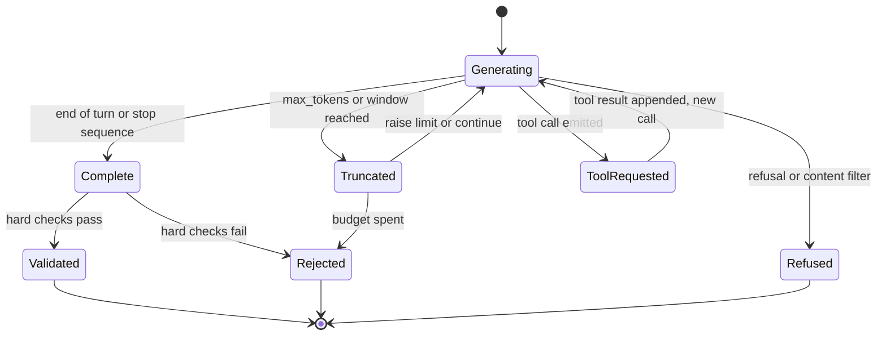
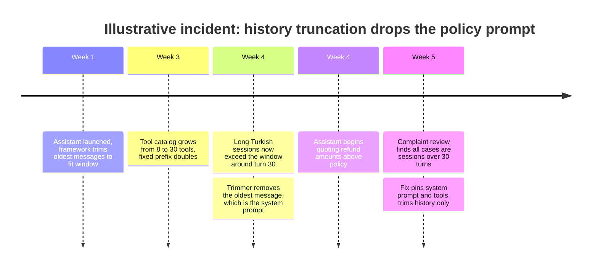

Çevresindeki sistemden bakıldığında büyük bir dil modeli (LLM, large language model), alışılmadık biçimde bir fonksiyondur. Tek girdisi, token adı verilen ve uzunluğu sınırlı bir tamsayı dizisidir. Doğrudan ürettiği tek çıktı, sıradaki token'ın ne olacağına dair bir olasılık dağılımıdır. Bir API çağrısının yapıyor göründüğü her şey, yani bir soruyu yanıtlamak, bir tool çağırmak ya da JSON üretmek, bu fonksiyonun dışındaki bir döngüyle üretilir: dağılımdan bir token çek, girdiye ekle, fonksiyonu yeniden çalıştır ve bir durma koşulu tetiklendiğinde dur. Bu yapının üç özelliği neredeyse her mimari sayıyı belirler: token'lar fiyatın, latency'nin ve limitlerin birimidir; context window girdinin tamamıdır ve her çağrıda baştan kurulur; sampling ise olası pek çok çıktıdan hangisinin çağırana ulaşacağını belirler.

Bunların hiçbiri tipik bir SDK'da görünmez. Bir chat API'si rolleri olan bir mesaj listesi alır, bir mesaj döndürür; tokenizer'ı, rollerin token'lara serialize edilmesini, çıktı için ayrılan alanı ve üretimin neden bittiğini gizler. Gizlenen her adım, production sistemlerin modelle ilgisizmiş gibi görünen biçimlerde bozulduğu bir yerdir: konuşma uzunluğunun karesiyle büyüyen bir fatura, İngilizce pilotundan üçte bir daha pahalıya mal olan bir Türkçe kurulum, yarım bir nesne alan bir JSON parser'ı, kırkıncı turda sessizce pencereden düşen bir politika talimatı.

Temel trade-off şudur: bileşenin ne belleği ne de yan kanalı vardır; dikkate alması gereken her şey her çağrıda, token olarak, pencerenin içinde olmalıdır. Context yetenek satın alır, çünkü model yalnızca kendisine verileni kullanabilir; bedeli input token'larıyla, prefill latency'siyle, küçülen çıktı rezerviyle ve büyüyen saldırı yüzeyiyle ödenir, çünkü pencerenin içindeki her şey model için aynı türden bir şeydir. Sampling ise çeşitlilik ile tutarlılık arasında ikinci ve daha küçük bir trade-off taşır; bu sayfa onu mekanizma düzeyinde ele alır. Bir modelin neden en baştan olasılıksal bir bileşen olduğu [Deterministik ve Olasılıksal Sistemler](/ai-systems-architecture/tr/foundations/ai-component-model/deterministic-vs-probabilistic/) sayfasında anlatılır.

## Token: Her Fiyatın, Limitin ve Latency'nin Birimi

Bir tokenizer metni, sabit bir vocabulary'den (kelime dağarcığı) alınan tamsayı kimliklerinden oluşan bir diziye dönüştürür; bu vocabulary tipik olarak on binlerle birkaç yüz bin arasında girdi içerir. Güncel tokenizer'ların çoğu byte-pair encoding (BPE) varyantıdır: tek tek byte'lardan başlayan bir eğitim süreci, en sık yan yana gelen çifti tekrar tekrar yeni bir vocabulary girdisine birleştirir; böylece yaygın kelimeler tek token olur, nadir kelimeler ise birkaç parçadan hecelenir. Temel alfabe byte'lar olduğu için her girdi kodlanabilir: emoji, ikili veriye benzeyen dizgeler ve vocabulary'nin hiç ayarlanmadığı diller de dahil. Değişen, bunların kaç token tuttuğudur.


*Tokenizer modelin iki tarafında da durur. Vocabulary'si ve birleştirme kuralları her model versiyonu için sabittir ve çağıran tarafından yapılandırılamaz.*

Bu pipeline'daki iki noktanın operasyonel sonuçları vardır. Birleştirme kuralları bir eğitim korpusundan öğrenilir, dolayısıyla vocabulary o korpusun istatistiklerini taşır: sık geçen İngilizce kelimeler birer token'a sıkışırken, eklerin köklere art arda eklendiği Türkçe gibi morfolojik olarak zengin bir dil aynı anlam için daha fazla parçaya bölünür. Detokenization ise karakterler üzerinde değil, byte'lar üzerinde çalışır: tek bir çıktı token'ı çok byte'lı bir UTF-8 karakterinin yalnızca bir kısmını taşıyabilir. Bu, self-hosted bir engine'den ham token stream eden herkesi ilgilendirir, çünkü naif bir decoder chunk sınırlarında yer değiştirme karakterleri üretir. Serving engine'ler ve hosted API'ler, metin delta'larını göndermeden önce tamamlanmamış byte dizilerini tamponlar; özel streaming kodunun da aynısını yapması gerekir.

### Ölçülmüş Örnek: Aynı Cümle İngilizce ve Türkçe

Aşağıdaki sayılar bu sayfa için Kasım 2026'da, OpenAI'ın GPT-4o ile tanıttığı `o200k_base` encoding'i ve açık kaynak `gpt-tokenizer` paketi kullanılarak ölçülmüştür. Başka modeller başka tokenizer'lar kullanır ve başka sayılar verir; önemli olan mutlak sayı değil, orandır.

| Metin | Kelime | Karakter | Token | Kelime başına token |
|---|---|---|---|---|
| The customer's refund request for the damaged product needs to be evaluated. | 12 | 76 | 14 | 1,17 |
| Müşterinin hasarlı ürün için yaptığı iade talebinin değerlendirilmesi gerekmektedir. | 9 | 84 | 21 | 2,33 |

Türkçe cümle aynı anlamı daha az kelimeyle ve %50 daha fazla token'la taşır. Tokenizer `değerlendirilmesi` kelimesini üç, `gerekmektedir` kelimesini üç, hatta `Müşterinin` kelimesini dört parçaya böldü. Petrov ve arkadaşları 2023'te bu etkiyi pek çok dil ve tokenizer üzerinde sistematik olarak ölçtü ve bazı dillerin paralel metin için İngilizcenin birkaç katı token gerektirdiğini buldu. Bir mimar için sonuçlar doğrudandır. Token başına her fiyat, anlam birimi başına daha yüksektir; her context window daha az konuşma tutar; her çıktının üretilmesi daha uzun sürer, çünkü üretim süresi çıktı token sayısıyla ölçeklenir; dakika başına token cinsinden ifade edilen rate limit'ler daha az isteğe izin verir. Token tabanlı quota'ların istek tabanlı olanlardan farklı davranmasının sebebi budur; bu konu [Token Tabanlı Rate Limiting ve Quota](/ai-systems-architecture/tr/platform/ai-gateway/token-rate-limiting/) sayfasında ele alınır.

Tokenization, akıl yürütme hatası gibi görünen bir model hatası sınıfını da açıklar. `değerlendirilmesi` kelimesini üç opak kimlik olarak gören bir modelin harflerine doğrudan erişimi yoktur; bu yüzden karakter saymak, dizgeleri ters çevirmek, kesin karakter uzunluklarına uymak ya da uzun rakam dizilerini karşılaştırmak gibi görevler, kod için ne kadar kolaylarsa model için o kadar kolay değildir. Sayılar, tokenizer'dan tokenizer'a değişen rakam gruplama kurallarıyla bölünür. Karakterlerde ya da rakamlarda kesinliğin önemli olduğu yerde doğru bileşen deterministik koddur; model bu koda girdi üretir ya da girdiyi çıkarır.

Tokenizer, model versiyonunun bir parçasıdır. Tokenizer'ını değiştiren bir provider, token başına fiyat aynı kalsa bile faturanızı değiştirir. Anthropic, Claude Opus 4.7 ile yeni bir tokenizer getirirken aynı metnin içerik türüne göre yaklaşık 1,0 ile 1,35 kat token üretebileceğini açıkladı; OpenRouter'ın Nisan 2026 analizi de production ölçeğindeki prompt'lar için native token sayılarının Opus 4.6'ya göre %32-34 arttığını ölçtü. Token cinsinden tutulan bütçeler, quota'lar ve context'e sığma kontrolleri bir model geçişinde yeniden ölçülmelidir; bu, [Model Versiyonlama, Deprecation ve Migration](/ai-systems-architecture/tr/model-strategy/lifecycle-and-adaptation/versioning-migration/) kontrol listesine aittir.

:::caution[Token'ları modelin kendi tokenizer'ıyla sayın]
"Token başına dört karakter" gibi sezgisel kurallar İngilizce düz metne göre kalibre edilmiştir ve Türkçe, kod, JSON, base64 ve tablolar için büyük katsayılarla yanlıştır. Yanlış tokenizer'a dayanan bir context'e sığma kontrolü ya sığacak istekleri reddeder ya da provider'ın çok uzun diye reddedeceği istekleri gönderir. Self-hosted modellerde tam tokenizer'la, hosted modellerde provider'ın token sayma endpoint'i ya da usage alanlarıyla sayın ve provider'ın bildirdiği sayıları her çağrıda kaydedin.
:::

## Context Window: Her Çağrıda Yeniden Kurulan Tek ve Sınırlı Bir Tampon

Context window, modelin tek bir çağrıda işlediği en fazla token sayısıdır ve girdi ile çıktı arasında paylaşılır: prompt ve üretilen her token birlikte sığmalıdır. Kasım 2026 itibarıyla hosted frontier modeller genellikle yaklaşık 200.000 ile bir milyonun üzerinde token arasında pencereler duyurur; self-hosted kurulumlar ise GPU belleğini sınırlamak için çoğu zaman çok daha küçük yapılandırılır. Duyurulan boyut bir kalite garantisi değil, katı bir sınırdır. Modelin farklı konum ve uzunluklardaki bilgiyi ne kadar güvenilir kullandığı ve pencerenin nasıl bütçeleneceği [Context Window Ekonomisi](/ai-systems-architecture/tr/context-engineering/context-design/context-window-economics/) sayfasının konusudur.

Bir chat API'si modele "mesaj" göndermez. System prompt'u, tool tanımlarını, önceki her mesajı ve yeni kullanıcı mesajını, her parçayı modelin tanımak üzere eğitildiği özel token'larla saran bir chat template kullanarak tek ve düz bir token dizisine serialize eder. Template model ailesine göre sabittir; open-weight modeller onu tokenizer'la birlikte dağıtır, hosted API'ler ise sunucu tarafında uygular.

```text
<|im_start|>system
You are a refund assistant. Never promise amounts above policy.<|im_end|>
<|im_start|>tools
[{"name": "get_order", "parameters": {...}}]<|im_end|>
<|im_start|>user
Where is my refund for A-1042?<|im_end|>
<|im_start|>assistant
```

Bu parça, herhangi bir provider'ın birebir formatı değil, sadeleştirilmiş ve temsili bir ChatML benzeri düzendir. Ondan iki sonuç çıkar. Birincisi, tool tanımları ve system prompt sıradan input token'larıdır; her çağrıda faturalanır ve pencereden düşülür. Büyük bir tool kataloğu, kullanıcının sorusundan daha fazla token tutabilir. İkincisi, roller bir biçimlendirmedir. Model, system işaretinden sonra gelen metni user işaretinden sonra gelenden farklı ağırlıklandırmak üzere eğitilmiştir ve ikisini ayıran tek şey bu eğitimdir. Pencerenin içinde bir yetki sınırı yoktur: talimat içeren bir retrieved doküman, system prompt'u işleyen fonksiyonun aynısı tarafından işlenir. [Prompt Injection](/ai-systems-architecture/tr/security/threats/prompt-injection/) probleminin kök nedeni budur.


*Tek bir çağrının context window'u, serialization sırasıyla yukarıdan aşağıya. Her bölge aynı token bütçesi için yarışır; yalnızca sonuncusu çıktıdır.*

En sık unutulan bölge en alttakidir. Girdisi pencereyi dolduran bir istek üretime yer bırakmaz; `max_tokens` ile belirlenen çıktı rezervi de çağıranın hiç görmediği token'ları kapsamalıdır: reasoning model'ler, çıktı olarak faturalanan ve aynı bütçeyi tüketen gizli reasoning token'ları üretir. Bu konu [Reasoning Model'ler ve Test-Time Compute](/ai-systems-architecture/tr/model-strategy/model-landscape/reasoning-models/) sayfasında anlatılır. Multimodal çağrılardaki görseller ve dokümanlar da token'a dönüştürülür ve aynı pencerede yer kaplar.

Model çağrılar arasında hiçbir durum tutmaz. Bir "konuşma" yalnızca istemci ya da onun adına çalışan bir framework her turda tüm geçmişi yeniden gönderdiği için vardır ve model her seferinde hepsinin üzerinden yeniden hesaplama yapar. Provider tarafındaki prompt caching ve serving engine'in key-value (KV) cache'i, özdeş bir prefix'i yeniden hesaplamanın maliyetini azaltır; bunlar [Prompt Caching](/ai-systems-architecture/tr/context-engineering/production-prompting/prompt-caching/) ve [Prefill, Decode ve KV Cache](/ai-systems-architecture/tr/inference/fundamentals/prefill-decode-kv-cache/) sayfalarında ele alınır. İkisi de bellek değildir: prefix'teki her değişiklik ikisini de geçersiz kılar ve hiçbiri modelin isteğin içermediği bir şeyi görmesini sağlamaz. Durumsuzluk bir avantajdır da: her replica her turu karşılayabilir ve bir istek veri olarak yeniden üretilebilir, çünkü girdinin tamamı isteğin içindedir.

### Hesaplamalı Örnek: Yirmi Turluk Bir Konuşmanın Maliyeti

Örnek olarak, 1.500 token'lık bir system prompt'u ve 2.500 token'lık tool tanımları olan, yani toplam 4.000 sabit token taşıyan bir destek asistanı varsayın. Her tur İngilizce olarak 150 token'lık bir kullanıcı mesajı ve 350 token'lık bir asistan yanıtı ekler. Temsili olarak milyon input token başına 3 USD, milyon output token başına 15 USD fiyat varsayın ve prompt caching olmasın.

Tur 1, 4.150 input token gönderir. Tur 10, sabit 4.000 token'a ek olarak önceki dokuz alışverişin 500'er token'ını ve yeni mesajı, yani 8.650 token gönderir. Tur 20, 13.650 token gönderir. Yirmi tur boyunca konuşma 178.000 input ve 7.000 output token tüketir: yaklaşık 0,53 USD input ve 0,11 USD output. Kullanıcı yaklaşık 3.000 token yazdı ve 7.000 token okudu; buna rağmen sistem kullanıcının kendi metninin 25 katından fazlasını işledi, çünkü her tur önceki tüm turları yeniden işler. Toplam input, tur sayısının karesiyle büyür.

Şimdi aynı konuşmayı Türkçe yürütün; yukarıda ölçülen 1,5 oranını yalnızca konuşma içeriğine uygulayın, system prompt'u ve tool tanımlarını İngilizce bırakın: kullanıcı mesajı başına 225, yanıt başına 525 token. Konuşma artık 227.000 input ve 10.500 output token tüketir; bu yaklaşık 0,84 USD eder, yani İngilizceden %31 fazla. Context sınırı da kayar. Temsili olarak 32.768 token'lık pencere ve 4.096 token'lık çıktı rezerviyle yapılandırılmış self-hosted bir modelde İngilizce konuşma 51. turda, Türkçe konuşma ise 34. turda artık sığmaz.


*Alt çizgi İngilizce, üst çizgi aynı konuşmanın Türkçesi. Tur başına input doğrusal büyür, dolayısıyla kümülatif input karesel büyür. 32.768 token'lık pencereden 4.096 token'lık çıktı rezervi düşüldüğünde kalan sınırı Türkçe çizgi 30. ile 35. turlar arasında aşar.*

Hesap, kaldıraçların nerede olduğunu gösterir. Prompt caching, 4.000 token'lık sabit prefix'in maliyetinin çoğunu ortadan kaldırır ama büyümeyi kaldırmaz. Summarization ve truncation büyümeyi sınırlar; bedeli ayrıntı kaybıdır. Bu konu [Konuşma Context'ini Yönetmek](/ai-systems-architecture/tr/context-engineering/production-prompting/conversation-context/) sayfasında ele alınır. Sabit talimatları İngilizce tutmak dil primini azaltır; ancak talimatların bir dilde, konuşmanın başka bir dilde olmasının yanıt kalitesini değiştirip değiştirmediği bir varsayım değil, kendi trafiğiniz üzerinde yapılacak bir eval'in sorusudur. Hesabın fiyatlandırma tarafı [Token Ekonomisi](/ai-systems-architecture/tr/economics/understanding-cost/token-economics/) sayfasında geliştirilir.

## Üretim Döngüsü: Dağılım, Örnekleme, Ekleme, Tekrar

Tek bir API çağrısı modeli birçok kez çalıştırır. İlk geçiş olan prefill, tüm input token'larını paralel işler ve ilk çıktı token'ı için dağılımı üretir. Sonraki her geçiş olan decode, yeni bir token işler ve ondan önceki her şey için önbelleğe alınmış ara sonuçları yeniden kullanır. Prefill maliyeti girdi uzunluğuyla büyür ve ilk token'a kadar geçen süreye (TTFT, time to first token) hakimdir; decode her çıktı token'ı için bir kez çalışır ve uzun yanıtlarda toplam latency'ye hakimdir. GPU düzeyindeki mekanik [Prefill, Decode ve KV Cache](/ai-systems-architecture/tr/inference/fundamentals/prefill-decode-kv-cache/), latency metrikleri ise [Latency Optimizasyonu](/ai-systems-architecture/tr/inference/fundamentals/latency-optimization/) sayfasındadır. Kapasite planlaması için işe yarayan yaklaşım şudur: latency, sabit bir ek yük artı input token'larıyla orantılı bir terim artı output token'larıyla orantılı daha büyük bir terimdir. Bu yüzden daha kısa yanıt isteyen bir istek, genellikle daha kısa prompt gönderen bir istekten daha fazla zaman kazandırır.


*Serving stack'in içinden görüldüğü haliyle tek bir çağrı. 5-10. adımlar her çıktı token'ı için bir kez tekrarlanır; son adımdaki finish reason, 9. adımdaki kontrollerden hangisinin döngüyü bitirdiğini kaydeder.*

6. ve 9. adımların sırası, çağıranları şaşırtan birkaç davranışı açıklar. Sampler her token'ı durma kontrolleri çalışmadan önce kesinleştirir; dolayısıyla model `max_tokens` sınırına sığmayı hiçbir zaman "planlamaz", sınırsızmış gibi üretir ve kesilir. Bir stop sequence üretilmiş metinle eşleştirilir ve bu metin birkaç token'a yayılabilir; bu yüzden streaming yapan bir istemci, API onu tanıyıp geri kalanını bastırmadan önce stop sequence'in başını alabilir. Streaming token'ları örneklendikleri anda iletir; bu algılanan latency'yi iyileştirir ama istemcinin çıktıyı, tam yanıt üzerinde çalışan doğrulama ya da moderasyondan önce görmesi anlamına gelir. Operasyonel tarafı [Timeout, Streaming ve İptal](/ai-systems-architecture/tr/reliability/provider-failures/timeouts-streaming/) sayfasında, genel timeout mantığı ise Distributed Systems Handbook'taki [Zaman Aşımları](https://gorkemsari.github.io/distributed-systems/tr/resilience/protection-patterns/timeouts/) sayfasında ele alınır.

### Sampler'ın İçi

Model, vocabulary'deki her girdi için logit adı verilen bir skor üretir. Sampler logit'leri sabit bir sırayla bir seçime dönüştürür. Temperature, logit'leri olasılığa çeviren softmax'tan önce her logit'i bir sabite böler: 1'in altında dağılımı en üstteki adaya doğru keskinleştirir, 1'in üstünde düzleştirir. Ardından budama, düşük olasılıklı adayları çıkarır: top-k en yüksek k adayı tutar, top-p (nucleus sampling) kümülatif olasılığı p'ye ulaşan en küçük kümeyi tutar, birçok açık kaynak engine'in sunduğu min-p ise olasılığı en üstteki adayın belirli bir oranından az olmayan adayları tutar. Sonra maskeler ve bias'lar gelir: constrained decoding gramere aykırı her token'ın olasılığını sıfıra çeker; [Structured Output](/ai-systems-architecture/tr/context-engineering/production-prompting/structured-output/) sözdizimini bu şekilde garanti eder. Logit bias ya da tekrar cezaları da belirli token'ları kaydırır. Son olarak kalanlardan bir token çekilir.

Örnek olarak, `Refund status:` metninden sonra modelin önde gelen dört adayının `approved`, `pending`, `rejected` ve `unknown` için 4,0, 3,0, 2,0 ve 0,5 logit'lerine sahip olduğunu varsayın ve vocabulary'nin geri kalanını yok sayın.

| Temperature | approved | pending | rejected | unknown | Top-p 0,9 ile kalanlar |
|---|---|---|---|---|---|
| 0,5 | %86,6 | %11,7 | %1,6 | %0,1 | approved, pending |
| 1,0 | %65,2 | %24,0 | %8,8 | %2,0 | approved, pending, rejected |
| 1,5 | %53,4 | %27,4 | %14,1 | %5,2 | approved, pending, rejected |

Temperature 1,0'da her üç çağrıdan biri en olası durumdan başka bir şey döndürür. 0,5'te yaklaşık sekizde biri hâlâ öyle yapar. Temperature'ın sıfıra giden limiti olan greedy decoding her zaman `approved` seçer. Tablo, temperature'ın neden bir doğruluk kontrolü olmadığını gösterir: bu sipariş için doğru yanıt `pending` ise düşük temperature sistemi kendinden emin ve tutarlı biçimde yanlış yapar, yüksek temperature ise onu dört seferden birinde doğru yapar. Sampling parametreleri olasılık kütlesini modelin dağılımı içinde kaydırır; modelin hiç kütle koymadığı yere kütle koyamaz. Dağılımı doğru kurmak context'in, model seçiminin ve değerlendirmenin işidir.

Budamanın var olma sebebi, kuyruğun belgelenmiş bir özelliğidir. Holtzman ve arkadaşları 2019'da tam dağılımdan saf örneklemenin tutarsız metin ürettiğini gösterdi, çünkü tek tek düşük olasılıklı binlerce token toplamda kayda değer bir olasılık oluşturur; greedy ve beam search ise tekrarlayan, dejenere metin üretir. Önerdikleri çözüm nucleus sampling'di: kuyruğu uyarlamalı biçimde kes, baştan örnekle. Production varsayılanlarının orta düzey bir temperature'ı top-p ile birleştirmesinin ve uzun, açık uçlu çıktılarda greedy decoding'in tekrar döngülerine yatkın olmasının sebebi budur.

| Parametre | Dağılıma etkisi | Production önerisi | Dikkat edilecek nokta |
|---|---|---|---|
| `temperature` | 1'in altında keskinleştirir, üstünde düzleştirir | Extraction ve sınıflandırmada düşük, taslak üretiminde orta | Bazı modeller yok sayar ya da reddeder |
| `top_p` | Kümülatif kütle p'nin ötesindeki kuyruğu atar | Varsayılanda bırakın ya da ayarlayın, temperature ile birlikte ikisini birden değil | Bazı API'ler ikisini birlikte reddeder |
| `top_k` | Yalnızca en olası k token'ı tutar | Top-p varken nadiren gerekir | Her API sunmaz |
| `max_tokens` | Kaliteyi değil çıktı uzunluğunu sınırlar | Ölçülen çıktı dağılımına pay ekleyerek belirleyin | Reasoning model'lerde gizli reasoning token'larını da kapsar |
| `stop` | Eşleşen bir dizgede üretimi bitirir | Güvenlik için değil, sınırlandırma için kullanın | Stop metni genellikle döndürülmez |
| `seed` | Rastgele çekimi sabitler | Eval'lerde yararlı, garanti değil | Hosted API'lerde best-effort |
| Logit bias, cezalar | Belirli token'ları yükseltir ya da düşürür | Bir token'ı yasaklamak gibi dar kullanımlar | Token düzeyinde olduğu için tokenizer'a bağımlı |

Bu parametrelerin provider desteği model nesilleri arasında değişir; bu da onları kararlı bir API'nin değil, model sözleşmesinin parçası yapar. OpenRouter'ın Claude Opus 4.7 migration rehberi `temperature`, `top_p` ve `top_k` parametrelerinin artık desteklenmediğini ve sessizce yok sayıldığını belirtir; daha önceki birkaç Claude modelinin de `temperature` ile `top_p` birlikte gönderildiğinde isteği reddettiği bildirilmiştir (ikisi de 2026 itibarıyla). OpenAI'ın reasoning model'lerinin de sampling parametrelerini kısıtladığı bildirilmiştir. Bu kontrollerin yeniden üretilebilirlik tarafı, yani seed'ler ve sıfır temperature'ın sınırları, [Determinizm Kontrolü](/ai-systems-architecture/tr/reliability/output-reliability/determinism/) sayfasında ele alınır.

## Finish Reason: Çıktı Sözleşmesinin Çağıranların Atladığı Kısmı

Her yanıt döngünün neden bittiğini kaydeder ve bu alan, çağıranın metinle neler yapabileceğini değiştirir. Modelin tur sonu token'ını üretmesi, çıktının model açısından tamamlandığı anlamına gelir. Bir stop sequence, çağıranın sınırlayıcısının üretimi bitirdiği anlamına gelir. `max_tokens` sınırına ya da context window'a ulaşmak, çıktının neye benzediğinden bağımsız olarak yarıda kesildiği anlamına gelir. Tool call ile bitiş, metnin bir yanıt değil, çağıranın harekete geçmesi için bir istek olduğunu gösterir. Refusal ya da content filter ile bitiş, bir politika katmanının araya girdiğini gösterir.

| Bitiş | Anthropic `stop_reason` | OpenAI Chat Completions `finish_reason` | Çağıranın yapması gereken |
|---|---|---|---|
| Turun doğal sonu | `end_turn` | `stop` | Doğrula ve kullan |
| Çağıranın stop sequence'i | `stop_sequence` | `stop` | Doğrula; stop metni dahil değildir |
| Çıktı sınırına ulaşıldı | `max_tokens` | `length` | Kesilmiş say; asla tamamlanmış gibi parse etme |
| Pencere doldu | `model_context_window_exceeded` | `length` | Kesilmiş say; girdiyi küçült |
| Tool istendi | `tool_use` | `tool_calls` | Tool'u çalıştır, sonucu gönder, yeniden çağır |
| Politika müdahalesi | `refusal` | `content_filter` | Körlemesine retry yapma; yönlendir ya da açıkla |
| Server-tool döngüsü duraklatıldı | `pause_turn` | yok | Devam etmek için yeniden gönder |

Anthropic değerleri Kasım 2026 itibarıyla stop reason dokümantasyonundan, OpenAI değerleri ise Chat Completions API'sinden alınmıştır. Eşleme yaklaşıktır ve bu, provider'ları normalize eden her soyutlama katmanını ilgilendirir: OpenAI'ın `stop` değeri iki Anthropic durumunu, `length` değeri de iki durumu kapsar. Bunları "başarılı" diye tek bir boolean'a indiren bir gateway, bu bölümün geri kalanının dayandığı sinyali çöpe atar.


*Çağıranın bir yanıtı finish reason'ına göre nasıl ele alması gerektiği. Validated durumuna yalnızca Complete yolu ulaşabilir; kesilmiş bir yanıt asla bütünmüş gibi bir parser'a verilmez.*

Diyagram, geniş bir sessiz hata sınıfını önleyen tek bir kuralı kodlar: finish reason doğrulamanın kapısıdır. Kesilmiş bir JSON yanıtı genellikle parse edilemez ve yakalanır; ama kesilmiş bir düz metin yanıt, kesilmiş bir aksiyon listesi ya da tesadüfen geçerli olan kesilmiş bir SQL ifadesi her sözdizimsel kontrolden geçer. `ToolRequested` durumundan `Generating` durumuna dönen döngü de dikkat çekicidir: tool kullanan bir asistanın kullanıcıya görünen tek bir turu, her biri tüm context'i yeniden gönderen birkaç API çağrısıdır; dolayısıyla hesaplamalı örnekteki aritmetik tur başına değil, çağrı başına geçerlidir. Bu döngünün protokolü [Tool Calling Mekanikleri](/ai-systems-architecture/tr/agents/tools-and-protocols/tool-calling/) sayfasındadır.

:::tip[Finish reason'ı birinci sınıf bir alan yapın]
Her çağrıda finish reason'ı ve provider'ın bildirdiği input ve output token sayılarını loglayın; route başına `max_tokens` ya da `length` bitişlerinin payı için alarm kurun. Bu tek oran; çok düşük ayarlanmış çıktı sınırlarını, büyüyen prompt'ları, ayrıntı düzeyini ya da tokenization'ı değiştiren model geçişlerini ve yanıt vermeden bütçeyi harcayan reasoning model'leri yakalar.
:::

## Token, Context ve Sampling Katmanlarındaki Hata Türleri

Bu hatalar nadiren exception fırlatır. Provider HTTP 200 ve düzgün biçimli bir metin döndürür; kusur, kesilen, düşürülen ya da çekilen şeydedir.


*Belirli bir kamuya açık olay değil, temsili bir dizi. Her değişiklik tek başına güvenliydi; hata yalnızca pencere büyümesinin, dilin ve naif bir kırpma kuralının buluştuğu yerde ortaya çıktı.*

Bu olay kalıbı genellenebilir. Pencere sınırını en eski mesajları düşürerek uygulayan bir framework, aksi söylenmedikçe system prompt'u da sıradan bir mesaj gibi ele alır ve yanıttaki hiçbir şey talimatların gittiğini göstermez. Tespit sinyali, çağrı başına context kullanımının pencereye oranıdır; bu oran oturum uzunluğuna ve dile göre kırılmalı, context'i kuran kodda da politika prefix'inin giden her istekte bulunduğunu doğrulayan bir kontrol olmalıdır.

| Hata | Tetikleyici | Belirti | Tespit | Azaltma ve kurtarma |
|---|---|---|---|---|
| Sessiz çıktı kesilmesi | Çok düşük `max_tokens`, uzayan girdiler, daha ayrıntılı bir model versiyonu | Yarım kalan metin, eksik listeler, parse edilemeyen JSON | Route başına `max_tokens`/`length` bitişlerinin payı | Doğrulamayı finish reason'a bağlayın; sınırı ölçülen çıktı uzunluklarından belirleyin |
| Talimatların kırpılması | Prefix'i sabitlemeyen geçmiş kırpma | Yalnızca uzun oturumlarda politika ihlalleri | Pencereye yakın kullanım; prefix varlık kontrolü | System prompt'u ve tool'ları sabitleyin; yalnızca geçmişi özetleyin ya da kırpın |
| Token sayısı uyuşmazlığı | Başka bir tokenizer ya da sezgisel kuralla tahmin | Provider istekleri çok uzun diye reddeder ya da bütçeler aşılır | Context uzunluğu nedeniyle retler; tahmin ile bildirilen sayı arasındaki sapma | Modelin tokenizer'ı ya da provider'ın sayma endpoint'iyle sayın |
| Geçişte tokenizer değişikliği | Yeni vocabulary'li yeni model versiyonu | Trafik değişmeden maliyet ve quota kullanımı sıçrar | Geçiş öncesi ve sonrası route başına istek başına token | Bütçeleri ve quota'ları geçiş eval'lerinin parçası olarak yeniden ölçün |
| Tekrar döngüsü | Uzun açık uçlu çıktılarda greedy ya da çok düşük temperature | Çıktı sınıra kadar bir ifadeyi tekrarlar | Tekrarlanan n-gram oranı; kısa görevlerde `length` bitişleri | Top-p ile orta temperature; destekleniyorsa tekrar cezası; çıktı sınırı |
| Yok sayılan sampling parametreleri | Desteği sessizce kaldıran model nesli | Determinizm ya da yaratıcılık ayarlarının etkisi olmaz | Parametre değişikliğinden sonra çıktı çeşitliliği değişmez | Parametreleri model sözleşmesinin parçası sayın; versiyon başına doğrulayın |
| Stop sequence çakışması | Stop dizgesi geçerli çıktıda doğal olarak geçer | Yanıtlar erken, cümle ortasında biter | Kısa çıktılarla gelen `stop_sequence` bitişleri | İçerikte geçemeyecek sınırlayıcılar ya da structured output kullanın |
| Karakter ortasında stream bölünmesi | Self-hosted bir engine'den ham token streaming | Stream edilen Türkçe ya da emoji metninde yer değiştirme karakterleri | Stream katmanında geçersiz UTF-8 sayısı | Tamamlanmamış byte dizilerini göndermeden önce tamponlayın |

Bileşenin tasarlandığı gibi davranıp davranmadığını ölçmek, çoğu istek logunda bulunmayan sinyaller gerektirir. Çağrı başına input token'larını, output token'larını, bildiriliyorsa reasoning token'larını, finish reason'ı, model versiyonunu ve pencerenin oranı olarak context kullanımını kaydedin. Route başına yalnızca ortalamayı değil, her birinin dağılımını izleyin: pencereye doğru sürünen bir p99 input boyutu kırpma hatasının, artan bir `length` payı da kesilmenin öncü göstergesidir. Dil başına karakter başına token'ı izleyin, çünkü bir dil ekleyen kurulum hiçbir kod değişikliği olmadan maliyet ve kapasite eğrisini değiştirir. Bunların dashboard'lara ve maliyet atamasına nasıl aktığı [LLM Observability Temelleri](/ai-systems-architecture/tr/llmops/observability/llm-observability/) sayfasında anlatılır.

:::caution[Bir refusal'ı ya da kesilmeyi retry etmek çözüm değildir]
Bir transport hatası, her dağıtık sistemde olduğu gibi backoff ile yeniden denenir. Aynı sınırla yeniden denenen bir `max_tokens` bitişi tam maliyetle yeniden kesilir; değiştirilmeden yeniden denenen bir refusal genellikle yeniden reddedilir ve biri geçene kadar varyasyon göndermek, bir denetçinin politika katmanını atlatma girişimi olarak okuyacağı bir davranıştır. Her finish reason kendi işleme yolunu alır ve bu yol kodda belirlenir.
:::

### Güvenlik ve Yönetişim Etkileri

Anatomi, sonraki bölümlerin üzerine kurulduğu üç güvenlik özelliğini tanımlar. Pencerede yetki ayrımı yoktur; dolayısıyla ona ulaşan her metin, kullanıcı girdisi, retrieved dokümanlar, tool sonuçları ya da bellek, çıktıyı yönlendirebilir ve savunmaların modelin dışında durması gerekir. Pencere aynı zamanda modele verilen şeyin tam kaydıdır, bu da onu denetlenebilirliğin birimi yapar: bir çıktıyı sonradan açıklamanın tek yolu yalnızca kullanıcının mesajını değil, serialize edilmiş context'in tamamını loglamaktır ve bu log pencereye giren her kişisel veriyi içerir. Bu da [Gizlilik Kısıtları Altında Prompt ve Yanıt Loglama](/ai-systems-architecture/tr/llmops/observability/logging-privacy/) sayfasında anlatılan gizlilik yükümlülüklerini getirir. Son olarak hosted bir modele gönderilen her şey, iç sistemleri tarif edebilecek system prompt'ları ve tool şemaları dahil, provider'ın altyapısında işlenir; neyin sınırınızın dışına çıkabileceği bir veri yerelleştirme kararıdır ve Türk mevzuatı açısından [KVKK ve BDDK](/ai-systems-architecture/tr/governance/regulation/turkish-regulation/) sayfasında ele alınır.

## Anatomiyi Hesaba Katarak Tasarlamak

İlk tasarım dokümanından itibaren token cinsinden düşünün. İstek ya da kelime cinsinden yazılmış bütçeler, quota'lar ve kapasite planları, trafik karışımı dil, doküman türü ya da konuşma uzunluğu bakımından değişen her sistem için yanlıştır. Bir model ya da context stratejisi seçmeden önce, hesaplamalı örnekte olduğu gibi her route için sabit prefix'i, tur başına büyümeyi ve çıktı dağılımını tahmin edin.

Pencereyi, olan biten her şeyin yalnızca eklenen bir logu olarak değil, kodun bilinen bir sırayla ve açık önceliklerle kurduğu tasarlanmış bir yapı olarak ele alın. Her zaman bulunması gerekeni sabitleyin, büyüyeni sınırlayın ve çıktı rezervini açık tutun. Görev aynı anda büyük bir bilgi kütlesine ihtiyaç duyuyorsa ve çağrı başına maliyet kabul edilebilirse uzun bir pencere kullanın; onu neyin ilgili olduğunu seçmenin yerine koymayın. Bu trade-off [Long Context ve Retrieval](/ai-systems-architecture/tr/context-engineering/context-design/long-context-vs-retrieval/) sayfasında incelenir.

Sampling parametrelerini görev başına belirleyin ve onları modeli ve prompt'u da sabitleyen versiyonlu konfigürasyonda tutun. Düşük temperature, yanıtın birkaç dizgeden biri olduğu extraction ve sınıflandırmaya uyar; top-p ile orta temperature taslak üretimine uyar. Sampling parametrelerini yanlış yanıtları düzeltmek, format dayatmak ya da determinizm elde etmek için kullanmayın: birincisi daha iyi context ya da farklı bir model, ikincisi constrained decoding ya da doğrulama gerektirir, üçüncüsü ise sampler'la değil serving stack'le sınırlıdır.

Finish reason'ları her türlü parse işleminden önce, kodda ele alın ve provider'ların üzerine kurduğunuz her soyutlama katmanında kesilmeyi, tool isteklerini ve refusal'ları ayrı sonuçlar yapın. Bunları tek bir sonuca indiren bir gateway ya da SDK sarmalayıcısını benimsemeyin.

Bu sayfanın konusuyla sıkça karıştırılan birkaç kavram vardır. Context window bellek değildir; kalıcı bellek, retrieval üzerine kurulan bir uygulama özelliğidir ve [Agent State ve Memory Yönetimi](/ai-systems-architecture/tr/agents/agent-patterns/state-and-memory/) sayfasında ele alınır. KV cache ve prompt caching durum değil, yeniden hesaplama optimizasyonlarıdır. Sıfır temperature determinizm değildir. `max_tokens` context window değil, bir çıktı sınırıdır. Token'lar kelime değildir ve aralarındaki oran sabit değil, tokenizer'ın ve dilin bir özelliğidir. Bu anatomi anlaşıldıktan sonra modelin hata oranının sistem tasarımı için ne anlama geldiği [Yetenek ve Güvenilirlik](/ai-systems-architecture/tr/foundations/ai-component-model/capability-vs-reliability/) sayfasının konusudur.

## İleri Okuma

- Rico Sennrich, Barry Haddow ve Alexandra Birch, *Neural Machine Translation of Rare Words with Subword Units*, Proceedings of ACL, 2016.
- Ari Holtzman, Jan Buys, Li Du, Maxwell Forbes ve Yejin Choi, *The Curious Case of Neural Text Degeneration*, International Conference on Learning Representations (ICLR), 2020.
- Aleksandar Petrov, Emanuele La Malfa, Philip H. S. Torr ve Adel Bibi, *Language Model Tokenizers Introduce Unfairness Between Languages*, Advances in Neural Information Processing Systems (NeurIPS), 2023.
- Nelson F. Liu et al., *Lost in the Middle: How Language Models Use Long Contexts*, Transactions of the Association for Computational Linguistics, 2024.
- Anthropic, *Handling stop reasons*, Claude API dokümantasyonu.
- Hugging Face, *Chat Templates*, Transformers dokümantasyonu.
