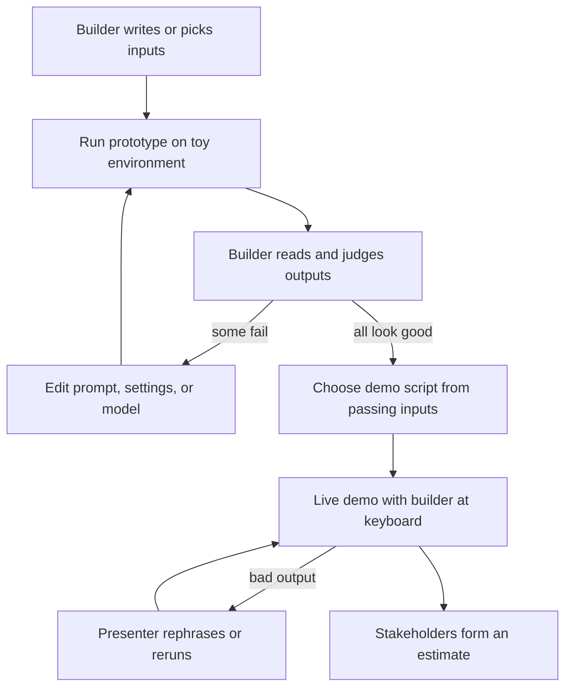
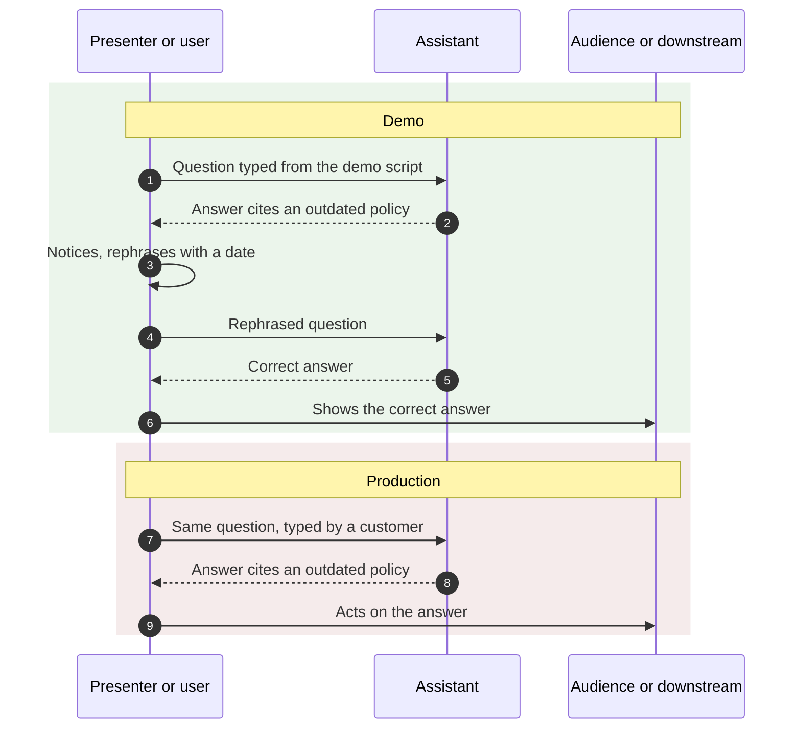
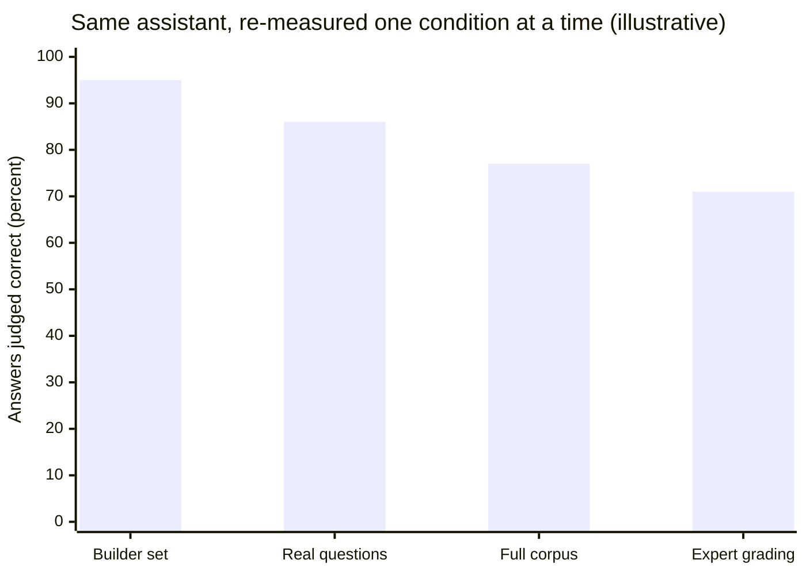
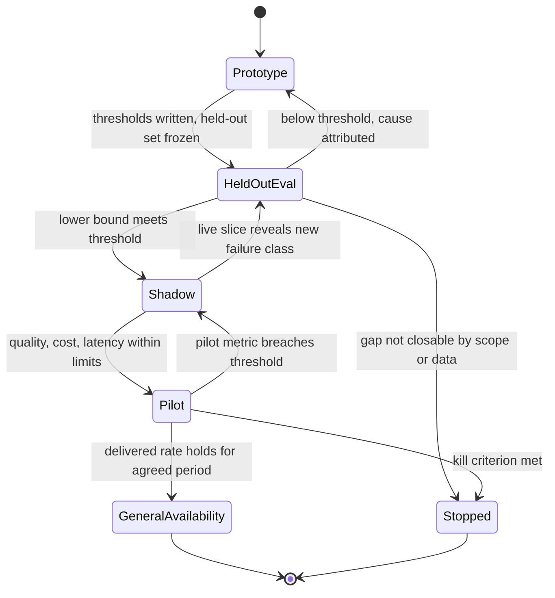
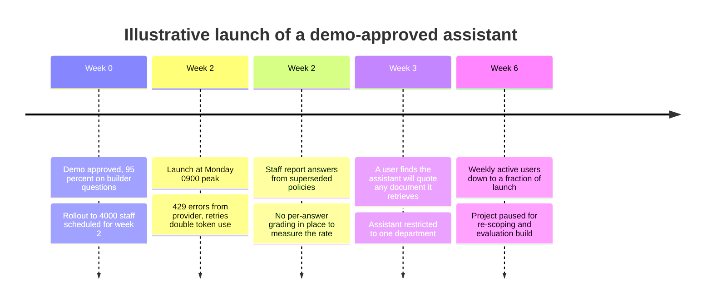

AI prototipi, bir görevin yapılabildiğini göstermek için hızla kurulmuş, model destekli çalışan bir sistemdir: birkaç yüz doküman üzerinde çalışan bir retrieval asistanı, sandbox'ta rezervasyon tamamlayan bir agent, yirmi örnek faturayı okuyan bir extractor. Genellikle ikna edicidir, çünkü ikna edici olsun diye kurulmuştur. Sorun prototiplerin dürüst olmaması değildir. Sorun, prototipi üreten sürecin onun kanıtını da üretmesi ve bu sürecin her adımının kanıtı aynı yöne itmesidir: girdileri onu kuranlar seçer, prompt'u bu girdiler geçene kadar ayarlar, çıktıları kendileri değerlendirir, basitleştirilmiş bir ortamda çalıştırır ve sonucu, hataları sessizce toparlayan birinin klavye başında olduğu bir sunumla gösterirler. Ortaya çıkan sayı ya da izlenim, kimsenin üst sınır diye etiketlemediği bir üst sınırdır.

Geleneksel yazılımda bir prototip çoğunlukla efor konusunda yanıltır: mutlu yol çalışır; hata yönetimi, ölçek ve güvenlik eksiktir ama eksik oldukları bilinir. AI prototipi ise özelliğin kendisi hakkında yanıltır. Sistemin doğru cevap verip vermediği, [Deterministik ve Olasılıksal Sistemler](/ai-systems-architecture/tr/foundations/ai-component-model/deterministic-vs-probabilistic/) sayfasının gösterdiği gibi, bir girdi dağılımı üzerindeki bir orandır; prototip bu oranı yanlış dağılımda, yanlış değerlendiriciyle ve yanlış koşullarda ölçer. Bu yüzden bir ekip çalışan bir demoya bakıp yalnızca production'ın ne kadar süreceği konusunda değil, production'a ulaşılıp ulaşılamayacağı konusunda da yanılabilir.

Temel trade-off, öğrenme hızı ile kanıtın geçerliliği arasındadır. Hızlı bir prototip, bir görevin akla yatkın olup olmadığını çabuk öğrenir; model seçilmiş girdilerde bile yapamıyorsa görev peşinden gitmeye değmez. Aynı prototipi görevin güvenilir biçimde yapılabildiğine dair kanıta dönüştürmek ise kuranla ölçeni ayırmayı, girdileri üzerlerinde ayar yapmadan önce dondurmayı ve production koşullarını yeniden üretmeyi gerektirir; bu da prototipin tasarruf etmek için kurulduğu zamana mal olur. Bir yetenek skorunun teslim edilen orandan genel olarak nasıl ayrıştığı, `pass^k` metriği ve bir oranın zaman içinde kayması dahil, [Yetenek ve Güvenilirlik](/ai-systems-architecture/tr/foundations/ai-component-model/capability-vs-reliability/) sayfasında ele alınır. Bu sayfa, prototipleme sürecinin bu açığı hangi özel yolla yarattığını ve onun yerini hangi kanıtın aldığını ele alır.

## Bir Prototip İyimser Kanıtı Nasıl Üretir

Prototip bir döngü içinde kurulur: geliştirici bir avuç girdi yazar, sistemi çalıştırır, çıktıları okur, prompt'u, retrieval ayarlarını ya da modeli değiştirir ve çıktılar iyi görünene kadar yeniden çalıştırır. Ardından sistem paydaşlara, çoğu zaman canlı olarak, aynı avuçtan çekilmiş girdilerle gösterilir.


*Prototip döngüsü. Bir döngüyü kapatan her kenar (D'den B'ye, G'den F'ye) bir hatayı sistemden değil, kanıttan siler.*

Bu döngüde dört ayrı bias bulunur: girdileri geliştiriciler seçer, sistemi tam bu girdiler üzerinde ayarlar, çıktıları kendileri değerlendirir ve klavye başındaki kişi dahil, production'ın sağlamayacağı bir ortamda çalışırlar. Her birinin kendi mekanizması ve kendi çaresi vardır.

### Seçilmiş Girdiler: Geliştiricinin Dağılımı

Geliştirici girdileri görevi düşündüğü biçimde yazar: düzgün kurulmuş, dokümantasyonun terimleriyle, her seferinde tek bir soru, sistemin kapsadığını bildiği konular hakkında. Gerçek kullanıcılar ise yarım cümleler yazar, dilleri karıştırır, metnin ekran görüntüsünü yapıştırır, tek mesajda iki soru sorar, ürünlerin kurum içi lakaplarını kullanır ve sistemin hiç kapsamaması gereken konuları sorar. Geliştiricinin yazdığı girdilerle değerlendirilen bir prototip, oranı geliştiricinin dağılımında ölçer; bu da sistemin göreceği en kolay dağılımdır.

Etki, geliştiriciler temsil edici olmaya çalıştığında bile vardır. Recht, Roelofs, Schmidt ve Shankar (2019), CIFAR-10 ve ImageNet için orijinal toplama sürecini özenle tekrarlayarak yeni test setleri topladılar ve geniş bir model yelpazesinde CIFAR-10'da %3 ile %15, ImageNet'te %11 ile %14 arasında doğruluk düşüşü buldular. Analizleri düşüşü test setinin tekrar tekrar kullanılmasından doğan overfitting'e değil, modellerin orijinal setlerdekinden biraz daha "zor" görüntülere genelleme yapamamasına bağlar. Bir örnekleme sürecinin bilinçli ve özenli bir tekrarı çift haneli bir düşüş üretiyorsa, sistemi kuran ekibin yazdığı kırk soruluk gayriresmi bir setin daha büyük bir düşüş üretmesi beklenmelidir. Çalışma LLM'leri değil, 2019'daki görüntü sınıflandırıcılarını konu alır; aktarılabilir sonuç şudur: girdilerin toplanma biçimindeki küçük ve ölçülmemiş farklar, ölçülen oranı çoğu ekibin hata payından daha fazla oynatır.

### Test Üzerinde Ayar: Adaptif Overfitting

Yukarıdaki diyagramdaki döngü, seçilmiş girdiler geçene kadar tekrar eder. Her prompt düzenlemesi, o girdilerdeki çıktılara bakıldıktan sonra verilmiş bir karardır; dolayısıyla nihai prompt onlara uydurulmuştur. İstatistikçiler buna adaptif veri analizi der: sonraki adımın seçimi aynı verinin sonuçlarına bağlı olduğunda, o veri artık yansız bir test işlevi göremez. Dwork, Feldman, Hardt, Pitassi, Reingold ve Roth (2015) problemi formalize etti ve bir holdout setinin bile, güvenceler olmadan adaptif olarak sorgulandığında geçerliliğini yitirdiğini gösterdi.

Bir prompt mühendisliği döngüsünde etki somuttur. Geliştirici 17 numaralı sorunun, model bir tarihi göz ardı ettiği için başarısız olduğunu görür, prompt'a "yürürlük tarihlerine dikkat et" ekler ve 17 numaralı soru geçer. Bu talimat genel olarak yardımcı olabilir, yalnızca 17 numaralı soruda yardımcı olabilir ya da 17 numaralı soruda yardımcı olurken setin dışındaki bir soru sınıfına zarar verebilir. Geliştirici bunu ayırt edemez, çünkü elindeki tek ölçüm değişikliğe sebep olan settir. Otuz böyle düzenlemeden sonra set, prompt'un sete ne kadar iyi uydurulduğunu ölçer.

:::caution[Geliştirme seti eğitim verisine dönüşür]
Geliştiricinin prompt'u düzenlerken baktığı her girdi artık bir test girdisi değildir; prompt'un uydurulduğu spesifikasyonun parçasıdır. İlk prompt düzenlemesinden önce bir held-out set dondurun, geliştiricilerin görüşünden uzak tutun ve prototipin oranını onu kurmakta kullanılan girdilerde değil, bu sette raporlayın. Böyle bir seti kurma ve bakımını yapma yöntemi [Golden Dataset Tasarımı ve Bakımı](/ai-systems-architecture/tr/evaluation/measuring-quality/golden-datasets/) sayfasındadır.
:::

### Hoşgörülü Değerlendirme: Hakem Olarak Geliştirici

Bir prototipte değerlendirici genellikle geliştiricinin kendisidir; sistemin ne söylemesi gerektiğini bilir, iyi niyetle okur ve çoğunlukla doğru bir cevabı doğru sayar. Kısmi cevaplar, doğru olup yanlış dokümana atıf yapan cevaplar, geçen yılın politikasına göre doğru olan cevaplar ve teknik olarak isabetli olup bir müşteriyi yanıltacak cevaplar, okuyan kişi sistemin çalışmasını istediğinde kolayca geçer. Cevabı müşteriye gidecekmiş gibi onaylaması gereken bir alan uzmanı daha katı bir standart uygular ve iki standart aynı çıktılar üzerinde birçok puan farklılaşabilir.

Değerlendirme hoşgörüsü prototipin kanıtında görünmez, çünkü değerlendirme kriterleri hiç yazıya geçirilmemiştir. Çaresi, kabul kriterlerini değerlendirmeden önce yazmak, bunları geliştirici dışında birine uygulatmak ve değerlendiriciler arası uyumu ölçmektir; yöntem [İnsan Değerlendirmesi ve Annotation](/ai-systems-architecture/tr/evaluation/measuring-quality/human-evaluation/) sayfasında anlatılır. İnsanın yerini otomatik bir hakem alırsa onun kendi bias'ı ve kalibrasyonu ölçümün parçası olur; bunu [LLM-as-Judge](/ai-systems-architecture/tr/evaluation/measuring-quality/llm-as-judge/) ele alır.

### Oyuncak Ortam ve Gizli Operatör

Dördüncü bias, modelin etrafındaki her şeydedir. Bir prototip tipik olarak tüm doküman varlığı yerine küçük ve temiz bir corpus üzerinde çalışır; kullanıcı bazlı yetkilendirme yerine her şeyi okuyabilen geliştirici credential'larını kullanır; gerçek gecikmesi ve gerçek hataları olan sistemler yerine mock'lanmış ya da sandbox'taki tool'ları çağırır; rate limit olmadan tek seferde tek kullanıcıya hizmet verir ve hiçbir saldırganla karşılaşmaz. Her basitleştirme ölçülen kaliteyi yükseltir ya da ölçülen maliyeti düşürür. Elle seçilmiş 300 doküman üzerindeki bir retrieval sisteminde birbirine çok benzeyen dikkat dağıtıcı dokümanlar azdır; aynı politikanın beş versiyonunu içeren 120.000 doküman üzerinde ise retriever yanlış versiyonu daha sık döndürür. Yönetici credential'larıyla okuyan bir sistem, cevap kullanıcının göremediği bir dokümanda olduğu için asla başarısız olmaz; böyle bir dokümanı asla sızdırmaz da.

En büyük sonucu doğuran basitleştirme klavye başındaki kişidir. Canlı bir demoda sunucu hangi girdilerin yazılacağına karar verir, her çıktıyı izleyiciler yorumlamadan önce görür ve hatalardan yeniden ifade ederek, yeniden çalıştırarak ya da geçerek toparlanır. Bu kişi döngünün içindeki bir insan doğrulayıcıdır ve izleyiciler onu sistemin parçası olarak saymaz.


*Gizli operatör. Demoda 2-4. adımlar izleyicilerin hiç görmediği bir insan doğrulaması ve retry'dır; production'da 8. adımdaki aynı hata doğrudan 9. adıma gider.*

Demo doğrulayıcısı olan bir sistemi gösterir; production ise doğrulayıcısı olmayan bir sistemi teslim eder. Beş sorudan birini yeniden ifade eden bir sunucu, %20'lik bir ilk deneme hata oranını gizlemiştir; geliştiricinin adımları onayladığı ya da yeniden denediği agent demoları için de aynısı geçerlidir.

:::tip[Yeniden çalıştırmaları sayın]
Her prototip ve demo etkileşimini oturum, girdi, çıktı ve operatörün yeniden ifade edip etmediği, yeniden deneyip denemediği ya da atlayıp atlamadığı bilgisiyle loglayın. İlk denemede başarıların nihai başarılara oranı, kalitenin operatör tarafından sağlanan payıdır. Bu oran birden uzaksa, kimsenin yeniden çalıştırmadığı production'da teslim edilen oran ilk deneme sayısına daha yakın olacaktır.
:::

### Bias'lar Neden Birbirini Katlar

Dört bias birbirinin yerine geçmez; her biri kanıttan farklı bir hata kümesini siler. Seçilmiş girdiler zor ve olağandışı vakaları, ayar tek bir prompt değişikliğinin düzeltebileceği hataları siler; hoşgörülü değerlendirme kalanların bir kısmını başarı olarak yeniden etiketler; ortam ve operatör de ölçeğe, yetkilere, gerçek tool'lara ya da ikinci bir denemenin yokluğuna bağlı hataları siler. Farklı hatalar üzerinde etki ettikleri için kayıpları bir pipeline'daki aşama başarı oranları gibi çarpılır ve bir sistem ilk kullanıcısıyla karşılaşmadan ölçülen kalitesinin dörtte birini kaybedebilir.

## Hesaplanmış Örnek: Bir Politika Asistanını Yeniden Ölçmek

Örnek olarak, bir bankanın operasyon ekibinin personelin prosedür sorularını politika dokümanları üzerinde retrieval ile cevaplayan kurum içi bir asistanın prototipini kurduğunu varsayalım. Prototip ekibin seçtiği 300 doküman üzerinde çalışır, hepsine erişimi olan tek bir servis hesabı kullanır ve onu kuran iki mühendis tarafından değerlendirilir. Mühendislerin yazdığı 40 soruluk sette, doğru saydıkları 38 cevap üretir: %95. Yönetim canlı bir demo izler ve 4.000 personele yayılmayı onaylar.

Yayılmadan önce ikinci bir ekip, her kaybın bir sebebe bağlanabilmesi için koşulları birer birer değiştirerek production koşullarında yeniden ölçüm yapar. Aşağıdaki tüm sayılar gerçek bir sistemin ya da modelin ölçümleri değil, örnek amaçlı varsayımlardır.

İlk sorun istatistikseldir. 40'ta 38 %95'tir, ama bu sonucun %95 Wilson güven aralığı yaklaşık %83,5 ile %98,6 arasındadır. Kırk soru, zamanın %85'inde doğru olan bir sistemi zamanın %98'inde doğru olandan ayırt edemez ve demodaki hiçbir şey bu aralığın varlığına işaret etmemiştir.

İkinci ekip ardından geliştiricilerin yazdığı 40 soruyu, son çeyreğin kurum içi yardım masası ticket'larından örneklenmiş ve yalnızca kişisel verileri çıkarmak için yeniden yazılmış 400 soruyla değiştirir ve bunları aynı 300 dokümanlık corpus üzerinde aynı hoşgörülü değerlendirmeyle çalıştırır. Oran %86'ya düşer: gerçek sorular daha belirsizdir, ürünlerin kurum içi lakaplarına atıf yapar ve 300 dokümanın kapsamadığı konuları sorar. Sonra corpus, politikaların yürürlükten kalkmış versiyonları dahil, tam 120.000 dokümana büyür ve retrieval her soranın yetkilerine göre filtrelenir. Oran %77'ye düşer; bunun başlıca sebebi retriever'ın bir politikanın eski versiyonunu döndürmesi ve modelin ona sadık kalarak cevap vermesidir. Son olarak iki uyum (compliance) personeli çıktıları yazılı kriterlere göre değerlendirir: doğru, güncel, geçerli dokümana atıflı ve yanıltıcı değil. Oran %71'e düşer; 400 soruda %95 aralığı yaklaşık %66 ile %75 arasıdır.


*Her çubuk, bir öncekinden yalnızca bir koşulu değiştirir. Dört adımın hiçbiri modeli, prompt'u ya da kodu değiştirmemiştir.*

Bu ayrıştırma teşhis amaçlıdır. 95'ten 86'ya düşüş, görev tanımının ekibin varsaydığından geniş olduğunu söyler ve çare kapsamdır: asistanın hangi soru tiplerini cevaplayacağına karar verip gerisini yönlendirmek. 86'dan 77'ye düşüş bir retrieval ve veri problemidir, yani politika dokümanlarının versiyon kontrolüdür; hiçbir prompt değişikliği bunu düzeltmez; konu [Güncellik ve Artımlı Indexleme](/ai-systems-architecture/tr/retrieval/ingestion-indexing/incremental-indexing/) sayfasına ve veri sahiplerine aittir. 77'den 71'e düşüş, sistemin doğru cevap kavramının işin kavramından farklı olduğunu söyler; çare, geliştiricilerin üzerinde iterasyon yapacağı yazılı bir değerlendirme rubriğidir. Yalnızca "demoda %95, pilotta %71" gören bir ekip modelleri karşılaştırmaya başlar; bu da üç sebebin hiçbirine dokunmaz.

### Gerçek Yük Altında Maliyet ve Throughput

Aynı yeniden ölçüm maliyet ve kapasite için de geçerlidir. Prototipte tipik bir istek yaklaşık 4.000 input token (system prompt, soru, retrieve edilmiş dört chunk) taşıyor ve yaklaşık 300 output token üretiyordu. Milyon input token başına 3 $ ve milyon output token başına 15 $ fiyat varsayalım; bunlar Kasım 2026 itibarıyla herhangi bir provider'ın liste fiyatı değil, yer tutucu değerlerdir. Bir prototip isteği bu durumda 0,012 artı 0,0045, yaklaşık 0,0165 $ tutar.

%71'e ulaşan production konfigürasyonu, büyüyen corpus'u telafi etmek için on iki chunk retrieve eder, yaklaşık 1.500 input ve 100 output token'lık bir query rewriting çağrısı ekler ve atıflı, daha uzun, yaklaşık 500 output token'lık cevaplar üretir. Ana çağrı artık yaklaşık 12.000 input token taşır. İstek ana çağrı için 0,036 artı 0,0075, rewriting için 0,0045 artı 0,0015, toplamda yaklaşık 0,0495 $ tutar; prototip rakamının üç katı. Varsayılan iş günü başına 20.000 soruyla günlük maliyet, demoya dayalı bir tahminin vereceği 330 $ yerine yaklaşık 990 $ olur. Output token'larının, retry'ların ve gizli çağrıların bu tür bütçelere neden hâkim olduğu [Token Ekonomisi](/ai-systems-architecture/tr/economics/understanding-cost/token-economics/) sayfasında ele alınır.

Throughput da aynı yönde değişir. 20.000 soru çoğunlukla sekiz saatlik bir günde ve ortalamanın üç katı bir tepeyle gelirse, tepe yaklaşık saniyede 2 sorudur. Her soru iki çağrısında toplam yaklaşık 13.500 input token taşır; dolayısıyla tepe talep dakikada yaklaşık 1,6 milyon input token'dır. Tek bir API key üzerinde, örneğin dakikada bir milyon token limitiyle rahatça çalışan bir prototip ilk yoğun saatte throttle edilir ve throttling, prototipin hiç üretmediği HTTP 429 hataları olarak gelir. Provider tarafındaki mekanikler [LLM Provider Hata Türleri](/ai-systems-architecture/tr/reliability/provider-failures/provider-failure-modes/) sayfasında, token bütçelerini tüketici tarafında uygulamak ise [Token Tabanlı Rate Limiting ve Quota](/ai-systems-architecture/tr/platform/ai-gateway/token-rate-limiting/) sayfasındadır.

Latency token sayısını izler ve sakin bir saatte tek kullanıcıyla ölçülmüş bir demo, provider kuyruklanmasının üretim süresine eklendiği kuyruğun (tail) hiçbir kısmını raporlamaz. Dağıtık bir sistemi gerçekçi eşzamanlılık altında yük testine tabi tutmanın genel yöntemi [Yük ve Performans Testi](https://gorkemsari.github.io/distributed-systems/tr/deployment/distributed-testing/load-performance-testing/) sayfasındadır; bir LLM sisteminde yük profili yalnızca istek oranını değil, gerçek isteklerin token dağılımını da yeniden üretmelidir.

## Production ile Karşılaşınca Ayakta Kalan Kanıt

Her bias'ın onu ortadan kaldıran bir kanıt türü vardır; her tür bir maliyetle ve projenin belli bir aşamasında elde edilir. Yapılması gereken, her türün hangi soruyu cevapladığını bilmek ve en ucuz olanı hepsinin cevabı saymayı bırakmaktır.

| Kanıt | Neyi gösterebilir | Neyi gösteremez | Göreli maliyet | Ne zaman tercih edilir |
|---|---|---|---|---|
| Canlı demo | Görev seçilmiş girdilerde akla yatkındır | Herhangi bir oran; operatör gizlidir | Çok düşük | Gerçek bir değerlendirme kurmak için zaman kazanmak, fazlası değil |
| Geliştirici geliştirme seti | Prompt düzenlemelerinin bilinen vakalarda işe yarayıp yaramadığı | Yansız bir oran; üzerinde ayar yapılmıştır | Düşük | İterasyon sırasında, regresyon kontrolü olarak |
| Gerçek girdilerden örneklenmiş, uzmanlarca değerlendirilmiş, dondurulmuş held-out set | Production biçimli girdilerde güven aralıklı bir oran | Yük altındaki davranış, gerçek tool'lar, saldırganlar, drift | Orta | İlk devam ya da dur kararı |
| Canlı trafikte shadow mode | Kullanıcı etkisi olmadan gerçek dağılımda kalite ve maliyet | Kullanıcı tepkisi; çıktılara göre hareket etmenin etkileri | Orta-yüksek | Hiçbir kullanıcı çıktı görmeden önce, çıktılar loglanıp değerlendirilebiliyorsa |
| Sınırlı pilot ya da canary | Teslim edilen oran, kullanıcı davranışı, operasyonel yük, saldırgan kullanım | Uzun vadeli drift; küçük hacimde nadir dilimlerin davranışı | Yüksek | Genel kullanıma açılmadan önceki son kapı |

Dönüm noktası dondurulmuş held-out settir. İlk üç bias'ı aynı anda ele alan ilk kanıttır: girdiler seçilmemiş, örneklenmiştir; geliştiriciler ayar yaparken onları hiç görmemiştir ve değerlendiriciler yazılı kriterler uygular. Yine de offline bir ortamda çalışır; dolayısıyla oyuncak ortam bias'ı yalnızca değerlendirme harness'ının gerçek corpus'u, gerçek yetkileri ve gerçek tool davranışını kullandığı ölçüde ortadan kalkar. Bunu yapan bir harness'ı erken kurmaya değer, çünkü sonraki her aşama onu yeniden kullanır.

Shadow mode, ortam bias'ını kullanıcı riski olmadan ortadan kaldırır. Aday sistem canlı trafiğin bir kopyasını alır; çıktıları loglanır ve değerlendirilir ama asla gösterilmez; maliyeti ve latency'si gerçek yükte ölçülür. Desen, [Gölge Dağıtım](https://gorkemsari.github.io/distributed-systems/tr/deployment/deployment-patterns/shadow-deployment/) sayfasında anlatılan geleneksel sistemlerdekiyle aynıdır; farkı, çıktıların değerlendirilmesi gerekmesidir. Bir cevabın yanlış olduğunu söyleyen bir yanıt kodu olmadığı için bir örneklem uzman incelemesine ya da kalibre edilmiş bir hakeme gönderilir. Shadow mode kullanıcıların cevaplara nasıl tepki verdiğini göstermez ve değeri yan etkilerde olan agent'lar için mümkün değildir: bir gölge agent gerçek bir transfer yapamaz, dolayısıyla trajectory'si yalnızca ilk etkili adıma kadar değerlendirilebilir.

Kullanıcıların küçük bir kısmına [Canary Sürümü](https://gorkemsari.github.io/distributed-systems/tr/deployment/deployment-patterns/canary-release/) ile açılan sınırlı bir pilot, saldırgan kullanıcıların, gerçek takip davranışının ve inceleme kuyruğunun operasyonel yükünün ortaya çıktığı tek aşamadır. Zayıflığı istatistikseldir: küçük hacimde nadir dilimler ölçülecek kadar örnek üretmez. Bu online aşamaların AI'a özgü tasarımı [Online Deneyler: A/B Test, Shadow Mode, Canary](/ai-systems-architecture/tr/evaluation/evals-in-delivery/online-experimentation/) sayfasındadır.


*Bir state machine olarak kanıt yolu. Her ileri geçiş, aşama başlamadan önce yazılmış bir eşiğe bağlıdır; her geri geçiş tespit edilmiş bir neden taşır.*

İki özellik bu yolun, prototip döngüsünün üretemediği sağlam kararları üretmesini sağlar. Birincisi, eşikler onları test eden aşamadan önce yazılır; böylece sonuç sonradan yeniden yorumlanamaz. %71'i görmeden önce "held-out sette en az %85" eşiğini koyan bir ekip ya sebebe bağlanmış nedenleri düzeltmek ya da durmak zorundadır; eşik koymayan bir ekip %71'in neden kabul edilebilir olduğuna dair bir gerekçe bulur. EU AI Act yüksek riskli sistemler için aynı ilkeyi kodlar: Madde 9(8), testlerin amaçlanan kullanıma uygun "önceden tanımlanmış metrikler ve olasılıksal eşikler" karşısında yapılmasını şart koşar; Madde 9(7) de Madde 57 veya 60'taki koşullar altında gerçek dünya koşullarında test yapılmasına izin verir. İkincisi, geri geçişler tasarımın parçasıdır. Yeni bir hata sınıfı ortaya çıkaran bir shadow çalışması, sistemi o sınıf sete eklenmiş olarak held-out aşamasına geri gönderir; ekip production'ın neye benzediğini öğrendikçe setin temsil edici kalmasının yolu budur.

```yaml
# Illustrative readiness gate, written before the held-out evaluation starts
use_case: internal-policy-assistant
held_out_set:
  source: helpdesk tickets, last full quarter, sampled
  size: 400
  frozen_on: 2026-11-02        # before the first prompt edit on it
  graders: compliance staff, written rubric v3
gate_heldout:
  metric: correct_current_cited   # all three criteria per answer
  threshold_lower_bound_95: 0.85  # Wilson lower bound, not point estimate
  worst_slice_min: 0.75           # per question category with n >= 40
gate_shadow:
  cost_per_request_p95_usd: 0.08
  latency_p95_seconds: 12
kill_criteria:
  - lower bound below 0.80 after two attributed fix rounds
```

Held-out setin kaynağını ve dondurulma tarihini yazmak, adaptiflik bias'ını denetlenebilir kılar. Eşiği nokta tahmini yerine alt güven sınırı olarak ifade etmek, küçük bir setin şans eseri geçmesini engeller. En kötü dilim alt sınırı, iyi bir ortalamanın başarısız bir kategoriyi gizlemesini engeller; durdurma kriteri de durmayı politik bir olay olmaktan çıkarıp planlanmış bir sonuca dönüştürür. Bu kapıların bir teslimat hattında otomatik kontrollere nasıl dönüştüğü [CI/CD'de Eval](/ai-systems-architecture/tr/evaluation/evals-in-delivery/evals-in-cicd/) sayfasındadır.

### Prototipin Yapmadığı İşi Tahmin Etmek

Prototip efor konusunda da yanıltır ve bu yanlış değerlendirme, herhangi bir değerlendirme çalışmadan önce bütçeleri ve teslim tarihlerini şekillendirir. Sculley ve arkadaşları (2015), klasik makine öğrenmesi sistemleri için gerçek bir sistemin yalnızca küçük bir kısmının model kodu olduğunu, geri kalanının veri toplama, doğrulama, serving, izleme ve konfigürasyon olduğunu gözlemledi. Bir LLM sistemi de aynı yapıdadır, kendi bileşenleriyle: değerlendirme harness'ı ve held-out set, corpus için ingestion ve versiyonlama, retrieval anında yetkilendirme, modelin etrafındaki deterministik kontroller, çekimser kalınmış ya da işaretlenmiş çıktılar için inceleme kuyruğu, prompt'ları, retrieve edilmiş context'i ve istek başı maliyeti kaydeden observability, quota uygulayan bir gateway ve prompt'lar ile model versiyonları için değişiklik yönetimi. Bir prototip bunların neredeyse hiçbirini içermez.

Pratik bir tahmin prototipten değil, bu listeden başlar. Ekip her bileşen için kurumun platformunda var olup olmadığını, konfigürasyon gerekip gerekmediğini ya da sıfırdan kurulması gerekip gerekmediğini belirtir. Kurum içi bir AI platformu gateway'i, tracing'i ve değerlendirme harness'ını sağlıyorsa kalan iş çoğunlukla veri ve değerlendirmedir; sağlamıyorsa takvime platform bileşenleri hâkim olur. [Paved Road](/ai-systems-architecture/tr/platform/internal-platform/paved-road/) sayfası, her yeni kullanım senaryosunun bunu yeniden kurmaması için böyle bir platformun neler sağlaması gerektiğini anlatır.

## Planı Demo Belirlediğinde Ortaya Çıkan Hata Türleri

Aşağıdaki hatalar, kararlar prototip kanıtına dayanarak alındığında ortaya çıkar. Kaçırılmış bir lansman, kamuya açık bir olay ya da yayına alınıp sessizce terk edilen bir sistem olarak kendini gösterirler. Gartner Temmuz 2024'te, üretken AI projelerinin en az %30'unun 2025 sonuna kadar proof of concept'ten sonra terk edileceğini öngördü ve sebep olarak düşük veri kalitesini, yetersiz risk kontrollerini, artan maliyetleri ya da belirsiz iş değerini gösterdi; Haziran 2025'te de agentic AI projelerinin %40'tan fazlasının 2027 sonuna kadar iptal edileceğini öngördü. Bunlar ölçülmüş sonuçlar değil analist öngörüleridir ve metodolojileri kamuya açık değildir; burada anılmalarının sebebi, adını koydukları nedenlerin bir prototipin ölçmediği nedenler olmasıdır.

| Hata | Tetikleyici | Belirti | Tespit | Azaltma ve kurtarma |
|---|---|---|---|---|
| Demoya çapalanmış lansman tarihi | Plan ve bütçe demodan belirlenir | Pilot kalitesi demonun çok altında; takvim tekrar tekrar kayar | Güven aralıklı held-out oranının demo rakamıyla birlikte raporlanması | Taahhütleri held-out sonuçlarına bağlamak; sebebe bağlanmış açıktan yeniden planlamak |
| Overfit olmuş prompt | Prompt değerlendirme setine karşı düzenlenir | Held-out ve shadow oranları geliştirme oranının çok altında | Geliştirme seti ile dondurulmuş set oranları arasındaki fark | Setleri düzenlemelerden önce dondurmak; her sürümde taze örnekler eklemek |
| Model alışverişi | Açık, veri ya da kapsam yerine modele yüklenir | Birkaç model değişikliği, az iyileşme | Koşul bazlı ayrıştırma kayıpların generation dışında olduğunu gösterir | Modeli değiştirmeden önce kayıpları koşullara bağlamak |
| Kapasite sürprizi | Token hacmi prototip isteklerinden tahmin edilir | İlk yoğun saatte 429 hataları ve latency sıçramaları | Tepedeki dakika başı token'ın provider limitleriyle karşılaştırılması | Gerçek token dağılımlarıyla yük testi; gateway'de quota ve kuyruklama |
| Yetki açığı | Prototip her şeye erişen bir kimlikle okur | Kullanıcının göremediği dokümanlara dayanan cevaplar ya da yeni "bulunamadı" hataları | Kullanıcı başına atıf yapılan dokümanların retrieval denetimi | İlk held-out çalışmasından itibaren kullanıcı bazlı retrieval yetkilendirmesi |
| Saldırganla ilk temas | Prototipte saldırgan yoktur | Sistemin söz verdiği, küfrettiği ya da sızdırdığı kamuya açık ekran görüntüleri | Red team bulguları; lansman sonrası işaretlenen çıktılarda sıçrama | Pilottan önce red teaming; çıktı politikaları; kapsamı daraltılmış yetenekler |
| Sessiz terk | Sistem kullanıcıların güvenmediği bir oranla yayına alınır | Lansmandan sonra herhangi bir olay olmadan kullanım düşer | Haftalık aktif kullanıcı, tekrar kullanım ve escalation oranı | Benimsenmeyi lansman sonrası bir umut değil, bir pilot kapısı olarak ele almak |

Saldırgan satırının kamuya açık örnekleri vardır. Aralık 2023'te, Kaliforniya Watsonville'deki bir Chevrolet bayisinin web sitesindeki ChatGPT tabanlı satış chatbot'u, bir kullanıcı tarafından 2024 model bir Tahoe'yu 1 $'a satmayı kabul etmeye ve bunu "yasal olarak bağlayıcı bir teklif" (a legally binding offer) olarak nitelemeye yönlendirildi; AI Incident Database bunu 622 numaralı olay olarak kaydeder. Ocak 2024'te kargo şirketi DPD, bir müşteri müşteri hizmetleri sohbetini küfretmeye ve şirketi eleştirmeye yönlendirdikten sonra sohbetin AI bileşenini devre dışı bıraktı; DPD bunu "bir sistem güncellemesinden sonra oluşan bir hataya" bağladı. İki olay da sofistike bir saldırı gerektirmedi ve iki davranış da bir demoda ortaya çıkmazdı, çünkü demo izleyicilerinden hiçbiri sistemi kötü davranmaya zorlamaya çalışmaz. DPD olayı zaman boyutunu da gösterir: kabul edilebilir davranan bir sistem değiştirildi ve değişiklik yeniden değerlendirilmedi; bu, [Yetenek ve Güvenilirlik](/ai-systems-architecture/tr/foundations/ai-component-model/capability-vs-reliability/) sayfasının zaman açığı dediği kaymadır.


*Örnek amaçlı bir hata zaman çizelgesi. İçindeki her olay, prototipin yeniden üretmediği koşullardan öngörülebilirdi.*

Lansmandaki kapasite hatası yukarıdaki token aritmetiğinden gelir; token kullanımını ikiye katlayan retry davranışı, [Retry Fırtınaları ve Metastabil Hatalar](https://gorkemsari.github.io/distributed-systems/tr/resilience/flow-control/retry-storms-metastable-failures/) sayfasında anlatılan retry fırtınası dinamiğidir. Eski politika şikâyetleri tam corpus düşüşüdür; onları bir orana dönüştürecek bir değerlendirme hattı olmadığı için anekdot olarak gelirler. 3. haftadaki ifşa yetki açığıdır. 6. haftadaki düşüş en az görünür sondur: hiçbir olay yoktur, yalnızca personelin, kontrol etmesi kullanmamaktan uzun sürdüğü için kullanmayı bıraktığı bir sistem vardır. Bunu tespit etmek, lansmandan önce tanımlanmış benimsenme metrikleri gerektirir; örneğin haftalık aktif kullanıcılar ve ardından bir insana escalation gelen cevapların payı.

:::danger[Prototip kimliği asla pilota ulaşmamalı]
Prototipler genellikle corpus'taki her dokümanı okuyabilen bir servis hesabıyla retrieval yapar. Bu kimlik pilota taşınırsa her kullanıcı yetkisi olmayan dokümanlardan içerik alabilir ve sızıntı doğru, düzgün atıflı bir cevap gibi görünür. Ekip dışından herhangi bir kullanıcı sisteme dokunmadan önce, [Retrieval'da Yetkilendirme ve Tenant İzolasyonu](/ai-systems-architecture/tr/retrieval/rag-architecture/retrieval-authorization/) sayfasında anlatıldığı gibi retrieval anında kullanıcı bazlı yetkilendirmeyi uygulayın.
:::

### Güvenlik ve Yönetişim Etkileri

Bir prototipin tehdit modeli yoktur ve kanıtı saldırgan davranış hakkında hiçbir şey söylemez. Prototipten pilota geçiş; kullanıcı girdisi ve retrieve edilmiş içerik üzerinden prompt injection'ın, tool call'lar üzerinden veri sızdırmanın ve politika ihlal eden çıktıların mümkün hale geldiği noktadır ve her birinin açılmadan önce kendi testine ihtiyacı vardır; bunlar [Prompt Injection: Doğrudan ve Dolaylı](/ai-systems-architecture/tr/security/threats/prompt-injection/) ve [Red Teaming ve Jailbreak Testleri](/ai-systems-architecture/tr/security/defenses/red-teaming/) sayfalarında ele alınır. Prototipler, demoyu ikna edici kıldığı için çoğu zaman gerçek veri üzerinde de kurulur; production dokümanlarını ya da müşteri kayıtlarını bir prototip ortamına kopyalamak başlı başına bir veri işleme olayıdır, diğer her kullanım gibi onay gerektirir ve regüle bir kurumda ilk prototip çalışmasından önce KVKK ya da GDPR kapsamında belgelenmiş bir hukuki dayanak gerektirebilir.

Yönetişim tarafında demo rakamı onay belgesindeki sayıya dönüşme eğilimindedir; dolayısıyla "testte %95 doğruluk" ile bir sistemi onaylayan bir risk komitesi, geliştiricilerin girdilerinin ve değerlendirmesinin bir tarifini onaylamış olur. Onay kaydı; held-out oranını, aralığını, ölçüldüğü popülasyonu ve değerlendirme kriterlerini ve tarihi taşımalıdır ki iddia sonradan kontrol edilebilsin; daha geniş pratik [LLM Sistemleri için Model Risk Yönetimi](/ai-systems-architecture/tr/governance/risk-management/model-risk-management/) sayfasındadır.

## Bir Prototipin Neyi Kanıtlamasına İzin Verilir

Prototipi fizibilite sorusunu cevaplamak için kullanın: model, makul bir eforla, ekibin anladığı girdilerde bu görev için kabul edilebilir çıktılar üretebiliyor mu. Kendi seçilmiş girdilerinde başarısız olan bir prototip güçlü bir kanıttır, çünkü her bias onun lehineydi. Prototipi ayrıca production sisteminin neye ihtiyaç duyduğunu keşfetmek için kullanın; hangi dokümanların eksik olduğu, hangi soruların belirsiz olduğu ve hangi tool'ların kafa karıştırıcı hatalar döndürdüğü gibi. Bu keşifleri gereksinim olarak yazıya geçirin.

Prototipi güvenilirlik, maliyet, kapasite ya da güvenlik sorularını cevaplamak için kullanmayın. Bu sorular sırasıyla gerçek girdilerden örneklenmiş ve yazılı kriterlere göre değerlendirilmiş dondurulmuş bir held-out set, gerçek token dağılımlı bir yük profili ve saldırgan testleri gerektirir; ayrıca ölçümden önce yazılmış eşikler gerektirir. Bir demonun lansman tarihini, bütçeyi ya da kadroyu belirlemesine izin vermeyin; bunun yerine kendi eşiği ve durdurma kriteri olan bir sonraki kanıt aşamasını taahhüt edin. Demo ile held-out sonuçları arasındaki bir açığa, kayıp girdilere, veriye, değerlendirmeye ya da generation'a bağlanmadan modeli değiştirerek cevap vermeyin; çünkü yeniden ölçümlerin çoğunda kaybın büyük bir kısmı modelin dışındadır.

Aşamalı yolu yalnızca hatalar ucuz ve görünür olduğunda atlayın. Her çıktısı kullanılmadan önce kullanıcısı tarafından okunup düzenlenen kurum içi bir taslak aracı, daha hafif bir kanıtla prototipten sınırlı yayına geçebilir; çünkü kullanıcı tasarım gereği doğrulayıcıdır ve inceleme adımı gizli bir operatör değil, ürünün parçasıdır. Bu istisna, çıktılara incelemeden göre hareket eden, müşterilere cevap veren ya da regüle kararlara dokunan sistemleri kapsamaz; bu tür sistemlerin model kullanıp kullanmaması gerektiği [AI Ne Zaman Yanlış Çözümdür](/ai-systems-architecture/tr/foundations/failure-and-fit/when-not-to-use-ai/) sayfasının sorusudur.

Bu sayfanın konusuyla sıkça karıştırılan birkaç komşu kavram vardır. Bir yetenek skoru ile teslim edilen oran arasındaki genel açık, tekrarlı deneme metrikleri ve lansman sonrası drift dahil, [Yetenek ve Güvenilirlik](/ai-systems-architecture/tr/foundations/ai-component-model/capability-vs-reliability/) sayfasının konusudur. Değerlendirmenin bulduğu hataları sınıflandırmak [AI Hata Türlerinin Taksonomisi](/ai-systems-architecture/tr/foundations/failure-and-fit/failure-mode-taxonomy/) sayfasındadır. Önce değerlendirmeyi kurup ona karşı iterasyon yapma disiplini [Eval-Driven Development](/ai-systems-architecture/tr/evaluation/testing-foundations/eval-driven-development/) sayfasındadır. Herhangi bir dağıtık sistem için bir test ortamının production'a ne kadar benzemesi gerektiği genel sorusu [Staging Aslına Uygunluğu](https://gorkemsari.github.io/distributed-systems/tr/deployment/distributed-testing/staging-fidelity/) sayfasındadır.

## İleri Okuma

- Benjamin Recht, Rebecca Roelofs, Ludwig Schmidt ve Vaishaal Shankar, *Do ImageNet Classifiers Generalize to ImageNet?*, Proceedings of ICML, 2019.
- Cynthia Dwork, Vitaly Feldman, Moritz Hardt, Toniann Pitassi, Omer Reingold ve Aaron Roth, *The Reusable Holdout: Preserving Validity in Adaptive Data Analysis*, Science, 2015.
- D. Sculley ve diğerleri, *Hidden Technical Debt in Machine Learning Systems*, Advances in Neural Information Processing Systems (NeurIPS), 2015.
- (AB) 2024/1689 sayılı Tüzük (Yapay Zekâ Yasası), Madde 9, Risk yönetim sistemi, Avrupa Birliği Resmî Gazetesi, 2024.
- Gartner, *Gartner Predicts 30% of Generative AI Projects Will Be Abandoned After Proof of Concept By End of 2025*, basın bülteni, Temmuz 2024.
