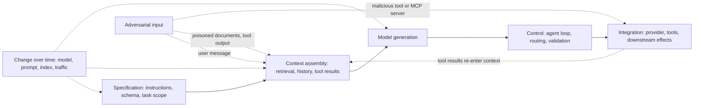
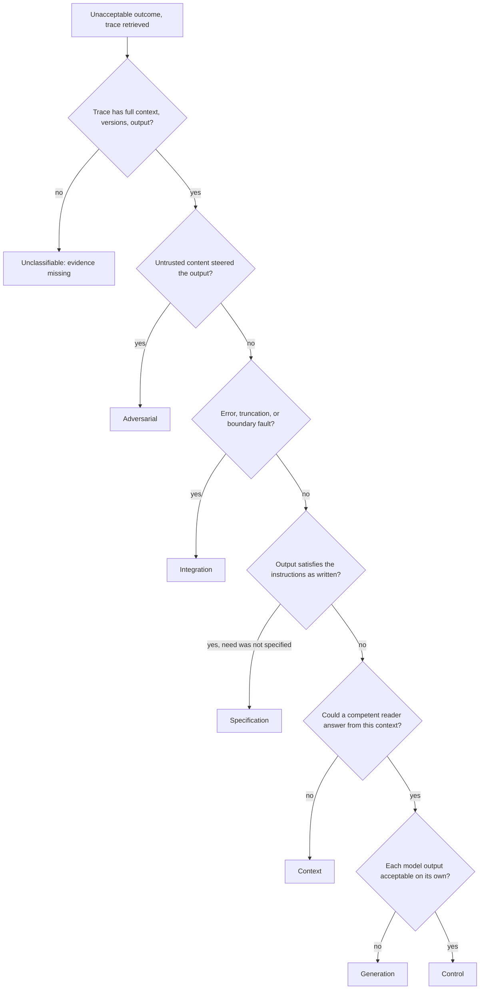
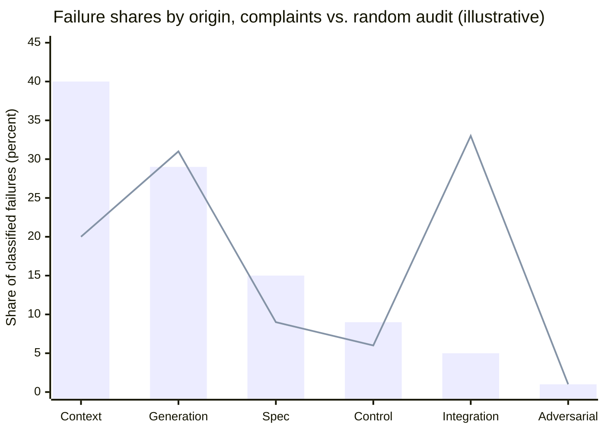
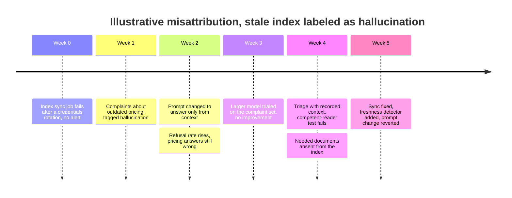

Bir AI sistemi için hata türü taksonomisi, model destekli bir sistemin kabul edilemez bir sonuç üretme yollarının sınıflandırılmasıdır; her sınıf iki operasyonel soruyu cevaplayacak biçimde kurulur: hatayı hangi sinyal yakalar ve düzeltme sistemin hangi katmanına aittir. Çözdüğü problem sıradan ama pahalıdır. Taksonomi yoksa her kötü cevaba aynı etiket yapışır, çoğunlukla "hallucination", ve çözüm en görünür katmana gider, çoğunlukla prompt'a ya da model seçimine. Retrieval index'i sessizce senkronize olmayı bırakmışken üç hafta boyunca prompt yeniden yazan bir ekibin emeği eksik değildir; eksik olan, bir olguyu uyduran model ile o olgu kendisine hiç gösterilmemiş modeli birbirinden ayırmanın bir yoludur.

Dağıtık sistem mühendisliğinin onlarca yıldır böyle bir sözlüğü var. Distributed Systems Handbook'taki [Hata Modelleri: Crash-Stop, Crash-Recovery, Omission](https://gorkemsari.github.io/distributed-systems/tr/foundations/system-models/failure-models/) sayfasında anlatılan crash, omission, timing ve keyfi (arbitrary) hatalar, bir mühendise algoritmanın neyi tolere etmesi gerektiğini söyler. Bir modelin tipik hatası bu iyi huylu (benign) modellerin hiçbirine uymaz: bileşen çalışmaya devam eder, zamanında yanıt verir ve iyi biçimlendirilmiş ama yanlış bir çıktı döndürür. Bu, [Bizans Hataları](https://gorkemsari.github.io/distributed-systems/tr/foundations/system-models/byzantine-faults/) sayfasındaki keyfi davranışa en yakın olanıdır; ancak ortada ne bir saldırgan ne de karşısında oylama yapılacak replikalar vardır, bu yüzden klasik tolerans teknikleri buraya taşınmaz. AI sisteminin, kusurun istek yolunun neresinde durduğu ve nasıl görünür hale geldiği etrafında kurulmuş kendi sınıflandırmasına ihtiyacı vardır.

Temel trade-off, çözünürlük ile uzlaşma arasındadır. "Model hatası ile sistem hatası" gibi kaba bir taksonomiyi her inceleyici tutarlı biçimde uygular, ama hiçbir şeyi yönlendirmez; çünkü iki kovada da düzeltmesi birbirinin tersi olan hatalar vardır. Kırk mekanizmalı ince bir taksonomi ilke olarak hassas yönlendirir, pratikte ise başarısız olur: inceleyiciler hangi yaprağın geçerli olduğunda anlaşamaz, yaprak başına sayılar trend çıkarmaya yetmeyecek kadar küçük kalır ve taksonomiyi sonunda en güçlü fikre sahip kişi uygular. İkinci bir trade-off birincisini keser. Belirtiye göre (kullanıcının ne gördüğüne göre) sınıflamak triage anında yalnızca çıktıya bakarak mümkündür; nedene göre (hangi katmanın kusurlu olduğuna göre) sınıflamak kaydedilmiş girdileri ve context'i gerektirir ve kimseye neyi değiştirmesi gerektiğini söyleyen tek etiket de budur. Kullanılabilir bir taksonomi ikisini de ayrı alanlar olarak taşır.

## Köken Katmanları: Kusur İstek Yolunun Neresinde Durur

Ürün ne olursa olsun, model destekli her istek aynı katman dizisinden geçer: bir spesifikasyon sistemin ne yapması gerektiğini söyler, context assembly modelin neyi göreceğine karar verir, model üretir, kontrol mantığı çıktıyla ne yapılacağına karar verir ve bir entegrasyon katmanı provider'lara, tool'lara ve downstream sistemlere giden çağrıları taşır. Bir saldırgan bu noktaların birkaçından içeri girebilir. Taksonominin birincil ekseni, kusurun ortaya çıktığı katmandır.


*Model destekli bir isteğin beş köken katmanı, adversarial girdinin içeri girdiği noktalar ve zaman içinde değişen katmanlar. Her hata tam olarak bir kökene atanır.*

Diyagramın soldan sağa çizilmesinin sebebi, sıranın kanıt sırası olmasıdır. Yukarı akıştaki bir katmanda oluşan kusur aşağı akıştaki her şeyi kirletir: eksik bir context verilmiş model eksik bir cevap üretir ve bu cevap bir generation hatasıyla birebir aynı görünür. İki şey bilinçli olarak katman sayılmamıştır. Adversarial girdi ayrı bir kökendir, çünkü girdi dağılımını hatayı tetiklemeye çalışan biri seçmiştir; bu da kimin müdahale edeceğini ve nasıl edeceğini değiştirir. Zaman içindeki değişim ise bir köken değil, bir özniteliktir: index yeniden oluşturulduktan sonra ortaya çıkan bir retrieval regresyonu yine bir context hatasıdır ve onu bir değişikliğin getirdiği bilgisi ayrı bir başlangıç (onset) alanına yazılır.

### Altı Köken Sınıfı

Spesifikasyon hataları, sistemin kendisine söyleneni yaptığı ama söylenenin yanlış ya da eksik olduğu hatalardır. Prompt, belirli bir eşiğin üzerindeki iadelerin onay gerektirdiğini hiç belirtmemiştir; çıktı şemasında "bulunamadı" demenin bir yolu yoktur, bu yüzden model bir alanı makul görünen bir değerle doldurur; kapsam, sistemin cevaplamak için hiç tasarlanmadığı ya da değerlendirilmediği soruları kabul eder. Model spesifikasyona uygun davranmıştır. Bu sınıf, suçun en sık modele atıldığı ve daha güçlü bir modelin en az düzelttiği sınıftır, çünkü daha güçlü bir model yanlış talimatları daha sadık biçimde izler. Aşağıda ele alınan, çok agent'lı sistem hataları için ampirik olarak türetilmiş bir taksonomi olan MAST, en büyük kategorisini spesifikasyon ve sistem tasarımı düzeyine yerleştirir; bu da production triage'ının genellikle bulduğu şeyle örtüşür.

Context hataları, doğru bir çıktı için gereken bilginin gönderildiği haliyle context window'da bulunmadığı ya da hiçbir okuyucunun kullanamayacağı bir biçimde bulunduğu hatalardır. Retrieval yanlış pasajları döndürmüş ya da hiçbir şey döndürmemiştir; index bayattır; konuşma geçmişi kırpılmış ve kullanıcının üçüncü turda belirttiği kısıtı düşürmüştür; bir tool sonucu boyut sınırında kesilmiştir; geri getirilen iki doküman, hangisinin güncel olduğuna dair hiçbir işaret olmadan birbiriyle çelişmektedir. Bunların çoğuna yol açan bütçeleme ve sıralama kararları [Context Window Ekonomisi](/ai-systems-architecture/tr/context-engineering/context-design/context-window-economics/) sayfasında, retrieval tarafının teşhisi ise [RAG Hatalarını Teşhis Etmek: Retrieval mı Generation mı?](/ai-systems-architecture/tr/retrieval/rag-architecture/rag-failure-diagnosis/) sayfasında ele alınır.

Generation hataları, doğru bir spesifikasyona ve yeterli bir context'e rağmen kabul edilemez bir çıktının üretildiği hatalardır. Alt sınıflar, çıktının neye karşı ölçüldüğüne göre ayrılır. Sadık olmayan (unfaithful) bir çıktı, kendisine verilen context'le çelişir ya da onun ötesine geçer. Desteksiz (unsupported) bir çıktı, context içinde ya da dışında hiçbir kaynağın desteklemediği bir şey iddia eder; uydurmanın dar anlamı budur ve [Hallucination Azaltma](/ai-systems-architecture/tr/reliability/output-reliability/hallucination-mitigation/) sayfasında anlatıldığı gibi azaltılır. Bir akıl yürütme hatası doğru olguları kullanır ama bir hesabı, karşılaştırmayı ya da çıkarımı yanlış yapar. Talimata uymama, uzunluk, dil ya da yasaklı konu gibi belirtilmiş bir kısıtı yok sayar. Format ihlali çıktı sözleşmesini bozar; [Structured Output](/ai-systems-architecture/tr/context-engineering/production-prompting/structured-output/) bu sınıfı sözdizimi açısından ortadan kaldırabilir. Reddetme hataları iki yönde ortaya çıkar: meşru bir isteği geri çevirmek ve politikanın geri çevrilmesini gerektirdiği bir isteği cevaplamak. Son alt sınıf olan kararsızlık, aynı girdiye farklı draw'larda ya da eşdeğer ifadelerde farklı cevap verilmesidir; [Yetenek ve Güvenilirlik](/ai-systems-architecture/tr/foundations/ai-component-model/capability-vs-reliability/) sayfası bu özelliği tekrarlanan denemelerle ölçer.

Kontrol hataları, her model çıktısının tek başına kabul edilebilir olduğu ama etrafındaki mantığın bunları yanlış bir sonuca birleştirdiği hatalardır. Bir agent döngüsünde bu; yanlış tool'u seçmek, modelin hiç görmediği argümanları geçirmek, ilerleme kaydetmeden döngüye girmek, hedefe varmadan durmak ya da kontrol etmeden başarı ilan etmek ve belirsiz bir sonuçtan sonra aynı etkiyi iki kez göndermek demektir. Bir workflow'da yanlış dala yönlendirmek ya da reddetmesi gereken bir çıktıyı kabul eden bir validator demektir. Çok agent'lı sistemlerde bir agent'ın başka bir agent'ın çıktısını yok sayması ya da üzerine yazması da bu sınıfa girer. Mekanizmaların sahibi [Agent Döngü Desenleri](/ai-systems-architecture/tr/agents/agent-patterns/agent-loops/), [Durma Koşulları ve Bütçe Kontrolü](/ai-systems-architecture/tr/agents/reliable-execution/stopping-budget/) ve [Tool Call Idempotency, Retry ve Compensation](/ai-systems-architecture/tr/agents/reliable-execution/idempotency-compensation/) sayfalarıdır.

Entegrasyon hataları; provider'lar, tool'lar ve downstream sistemlerle olan sınırda oluşur: rate limit ve aşırı yük, timeout, cevabın ortasında kesilen bir stream, çıktı token sınırı yüzünden kırpılan bir yanıt, yeni bir snapshot'a taşınmış bir model alias'ı, çıktı dağılımını değiştiren bir serving tarafı bug'ı ve downstream bir sistemin güvensiz biçimde yorumladığı çıktı, örneğin HTML olarak render edilen üretilmiş metin. Bunların çoğu gürültülü ve tanıdıktır; AI'a özgü biçimleri [LLM Provider Hata Türleri](/ai-systems-architecture/tr/reliability/provider-failures/provider-failure-modes/) sayfasında, çağıranların yok saydığı finish reason'lar için ise [Bir Sistem Bileşeni Olarak LLM'in Anatomisi](/ai-systems-architecture/tr/foundations/ai-component-model/llm-anatomy/) sayfasında anlatılır. Tehlikeli olanlar sessiz olanlardır: [Deterministik ve Olasılıksal Sistemler](/ai-systems-architecture/tr/foundations/ai-component-model/deterministic-vs-probabilistic/) sayfasında ele alınan, Anthropic'in üç örtüşen altyapı bug'ına dair 2025 postmortem'inde kullanıcılar belirtileri generation hatası olarak yaşadı; kusur ise routing ve derleme katmanındaydı.

Adversarial hatalar, birinin girdiyi sonuca yol açacak biçimde şekillendirdiği hatalardır: doğrudan ve dolaylı prompt injection, jailbreak, retrieval kaynaklarının ya da agent memory'sinin zehirlenmesi, tool call'lar ya da render edilen linkler üzerinden veri sızdırma ve token'ları ya da bütçeleri tüketmek için hazırlanmış girdiler. Mekanizmalar, [AI Tehdit Modellemesi](/ai-systems-architecture/tr/security/threats/threat-modeling/) ve [Prompt Injection: Doğrudan ve Dolaylı](/ai-systems-architecture/tr/security/threats/prompt-injection/) sayfalarıyla başlayan güvenlik bölümüne aittir. Bu taksonomide tek bir köken sınıfıdır ve başarılı bir saldırının asla bir kalite kusuru gibi sayılmaması, trend'lenmemesi ve önceliklendirilmemesi için ayrı tutulur.

:::caution[Hallucination bir neden değil, bir belirtinin adıdır]
"Model uydurdu" çıktının neye benzediğini anlatır ve onu en az dört köken üretir: cevabın olmadığı yerde cevap vermeye zorlayan bir spesifikasyon, olguyu içermeyen ya da yanlış sıralayan bir context, yeterli bir context'in ötesine geçen bir generation ve zehirlenmiş bir kaynak. Her birinin düzeltmesi de sahibi de farklıdır. Triage'a yardımcı oluyorsa belirtiyi kaydedin, ama hiçbir incident'ı neden olarak "hallucination" yazıp kapatmayın.
:::

### Kökenleri Kesen Öznitelikler

Köken, kusurun nerede olduğunu söyler. Dört öznitelik daha hatanın nasıl davrandığını söyler ve her biri müdahaleyi değiştirir. Tespit edilebilirliğin üç değeri vardır: gürültülü (loud) hatalar bir hata fırlatır ya da her çağrıda çalışan bir kontrolden geçemez; kontrol edilebilir (checkable) hatalar, var olan ama her çağrıda çalışmayan bir kontrolle, örneğin offline bir groundedness eval'iyle yakalanabilir; sessiz (silent) hatalar iyi biçimlendirilmiş, makul ve yanlıştır ve yalnızca örneklemeli denetimlerde ya da kullanıcı bildirimlerinde ortaya çıkar. Sonuç (consequence), hatanın neye ulaştığını kaydeder: bir kişiye gösterilen bilgi, bir sistemde kaydedilen bir karar ya da dünyada gerçekleştirilen bir etki, ve bu etkinin geri alınabilir olup olmadığı. Korelasyon, aynı girdi yeniden örneklendiğinde hatanın tekrarlanıp tekrarlanmadığını kaydeder. İkinci draw'da kaybolan hata rastgeledir ve yeniden örnekleme işe yarar; tekrarlanan hata girdiye bağlıdır ve farklı bir yol gerektirir; bunu [Deterministik ve Olasılıksal Sistemler](/ai-systems-architecture/tr/foundations/ai-component-model/deterministic-vs-probabilistic/) sayfasındaki korelasyonlu hata aritmetiği gösterir. Başlangıç (onset), hatanın tasarımda gizli mi olduğunu, bir değişiklikle mi geldiğini, yoksa trafikte ya da veride drift yoluyla mı ortaya çıktığını kaydeder.

Taksonomiyi operasyonel yapan bu özniteliklerdir. Geri alınamaz sonucu olan, sessiz ve girdiye bağlı bir context hatası, örneğin bayat bir politika dokümanına göre hareket eden bir agent, bir güncellik dedektörü ve bir onay kapısı gerektirir. Bilgi düzeyinde sonucu olan, gürültülü ve rastgele bir generation hatası, örneğin bozuk bir JSON taslağı, bir validator ve tek bir yeniden örnekleme gerektirir. İkisine de "model yanlış yaptı" denebilir; çözümlerinde ise hiçbir ortak nokta yoktur.

## Triage: Kaydedilmiş Trace'ten Köken Atamak

Bir taksonominin değeri sınıf listesine değil, sınıflandırma prosedürüne bağlıdır. Aynı kötü cevaba bakan iki mühendis aynı kökene varmalı ve oraya sezgiyle değil kanıtla varmalıdır. Aşağıdaki prosedür soruları istek yolunun sırasıyla sorar ve her soru, isteğin yapıldığı anda kaydedilmiş trace'ten cevaplanır; asla isteği yeniden çalıştırarak değil. Çünkü yeniden çalıştırma, muhtemelen farklı bir model sürümünden yeni bir örnek çeker ve olan biten hakkında hiçbir şey kanıtlamaz.


*Triage prosedürü. Her karar düğümü kaydedilmiş kanıttan cevaplanır; sıra, bir hata modele atfedilmeden önce yukarı akıştaki nedenleri eler.*

İlk kapı kanıtla ilgilidir. Birleştirilmiş context'i, sabitlenmiş model ve prompt sürümlerini ve ham çıktıyı içermeyen bir trace nedene göre sınıflanamaz; ona zorla etiket yapıştırmak kendinden emin bir gürültü üretir. Bu trace'ler kendi etiketlerini alır ve oranları observability açığını ölçer; bu açığın nasıl kapatılacağını [LLM Observability Temelleri](/ai-systems-architecture/tr/llmops/observability/llm-observability/) sayfası gösterir.

Adversarial soru ikinci sırada gelir, çünkü cevabı yalnızca etiketi değil süreci de değiştirir: başarılı bir injection kendi aciliyeti ve gizliliğiyle güvenlik müdahalesine gider. Soru trace'ten cevaplanabilir: context, sistemin güvenmediği bir kaynaktan (geri getirilmiş bir doküman, bir tool sonucu, bir e-posta gövdesi) gelen talimatlar içeriyor mu ve çıktı ya da aksiyon bunları izliyor mu? Entegrasyon semantik sorulardan önce gelir, çünkü kontrol etmesi ucuz ve mekaniktir: `stop` dışında bir finish reason, bir provider hatası, kesilmiş bir stream ya da sabitlenmiş olandan farklı bir model kimliği meseleyi kapatır.

Spesifikasyon sorusu, ekiplerin atladığı sorudur. Çıktının, talimatlar tam olarak yazıldıkları haliyle okunduğunda uyumlu olup olmadığını sorar. Uyumluysa ve kullanıcı yine de yanlış sonucu aldıysa, gereksinim hiç yazılmamıştır ve ne modeldeki ne de context'teki bir değişiklik bunu düzeltir.

Context sorusu, yetkin okuyucu testi denebilecek bir yöntem kullanır: tam olarak birleştirilmiş context'i, başka hiçbir şey olmadan, alanı bilen ama cevabı bilmeyen bir kişiye verin ve bundan doğru bir çıktı üretip üretemeyeceğini sorun. Olgu yoksa, bayatsa, kırpılmışsa ya da çözümsüz biçimde çelişiyorsa ve okuyucu bu yüzden üretemiyorsa, köken context'tir. Üretebiliyorsa context yeterlidir ve modelin onu kullanamaması bir generation hatasıdır. Bu test çoğu triage'da bir düşünce deneyidir, yüksek riskli incelemelerde ise gerçek bir annotation adımıdır. Uzun bir context'in ortasına gömülmüş ama orada bulunan bir olguyu bilinçli olarak generation hatası sayar, çünkü bilgi oradadır; kayıt yine de en ucuz çözümün context'i yeniden sıralamak olduğunu not edebilir. Etiket kusurun nerede olduğunu söyler, en ucuz çözümün nerede olduğunu değil; ikisi ayrı kaydedilir.

Son ayrım, çok adımlı çalıştırmalarda generation'ı kontrolden ayırır. Trace'teki tek tek model çıktılarından biri kabul edilemezse, bu çıktıların en erkeni köken olur. Her adım yerel olarak makulse ve birleşim yanlışsa, örneğin döngünün bir kenara attığı doğru bir tool sonucu ya da bir adımın doğrulama yapılmadan "bitti" demesinin ardından duran bir çalıştırma, köken kontroldür.

### Bu Sıra Neden Kararlı Etiketler Verir

Prosedür, her etiketin yukarı akıştaki tüm katmanların elenmiş olmasına bağlı olacağı şekilde sıralanmıştır; bu da sınıfları yapısı gereği birbirini dışlayan hale getirir. Bu sıra olmadan tek bir hata meşru olarak birkaç sınıfa aittir: bayat bir doküman yanlış bir cevaba yol açmış, validator da onu yakalayamamış, ardından bir döngü bu cevaba göre hareket etmiştir. Hatayı en erken kusurlu katmana atamak ona tek bir köken verir; onu durduramayan aşağı akıştaki katmanlar ise savunma derinliğine dair ikincil bulgular olur. Bu, Distributed Systems Handbook'taki [Postmortem Kültürü: Suçsuz Retrospektif](https://gorkemsari.github.io/distributed-systems/tr/observability/alerting-incident-response/blameless-postmortems/) sayfasında anlatılan suçsuz incident analizindeki kök neden ile katkıda bulunan faktör ayrımının karşılığıdır.

Sıralama, etiketleri nedensel kaldıraçla da hizalar. Yalnızca spesifikasyon ve context'in yeterli olduğu gösterildikten sonra atanan bir generation etiketi, model hakkında, bir model değişikliğinin makul olarak düzeltebileceği bir ifadedir. Bu kontroller yapılmadan atanan bir generation etiketi ise çoğunlukla yukarı akıştaki kusurların ne sıklıkla model davranışı sanıldığını ölçer.

```yaml
# Illustrative failure record attached to a trace; field names are not a standard
failure:
  trace_id: 7f3c-...            # links to the recorded context, versions, output
  symptom: unsupported_claim     # what the user saw
  origin: context                # spec | context | generation | control | integration | adversarial | unclassifiable
  mechanism: stale_index         # leaf within the origin, from a controlled list
  detectability: silent          # loud | checkable | silent
  consequence: decision_recorded # information | decision_recorded | effect_reversible | effect_irreversible
  correlated: true               # failed again on resample of the recorded input
  onset: regression              # latent | regression | drift
  change_ref: index-sync-2026-10 # the change that introduced it, if onset = regression
  detected_by: user_report       # which signal found it
  labeled_by: [reviewer_a, reviewer_b]
  agreement: true
```

Kayıt belirtiyi ve kökeni ayrı alanlarda tutar; böylece şikâyet dashboard'u kullanıcıya dönük kategorilerini korurken mühendislik nedenleri trend'leyebilir. `mechanism` alanı her köken için kontrollü bir listeden beslenir, bu da yaprak düzeyinin serbest metne dağılmasını önler. `detected_by` alanı çoğu ekibin atladığı alandır ve kapsama boşluklarını ortaya çıkaran alan da odur: hataları hep kullanıcı bildirimleriyle tespit edilen bir kökenin kendine ait bir dedektörü yoktur.

## Hesaplanmış Örnek: Etiketler Neyi Değiştirir

Örnek olarak, bir ürün bilgi tabanı üzerinde çalışan ve haftada 40.000 konuşma işleyen bir müşteri destek asistanı varsayın. Ekibin iki veri kaynağı vardır. Kullanıcı şikâyetleri haftada yaklaşık 210 adet gelir ve destek ekibi tarafından etiketlenir. Bundan ayrı olarak haftalık bir denetim rastgele 1.500 konuşma örnekler ve iki inceleyici her hatayı triage prosedürüyle sınıflar. Denetim 96 kabul edilemez çıktı bulur; hata oranı %6,4'tür.

İki kaynak neyin yanlış gittiği konusunda keskin biçimde ayrışır.


*Çubuklar: rastgele denetim; çizgi: şikâyetle etiketlenmiş hatalar. Paylar yuvarlanmış ve örnek amaçlıdır; denetim, sınıflanamayan iki vakasını dışarıda bırakır.*

Denetimin 96 hatası 38 context, 27 generation, 14 spesifikasyon, 9 kontrol, 5 entegrasyon, 1 adversarial ve 2 sınıflanamayan olarak dağılır. Şikâyetler buna hiç benzemez, çünkü şikâyetler görünürlüğe göre örneklenir. Yarıda kesilmiş bir cevap ya da bir timeout her kullanıcı için barizdir ve bildirilir; bayat bir dokümana dayanan akıcı bir cevaba ise inanılır ve bildirilmez. Entegrasyon hataları şikâyetlerin üçte birini, denetlenen hataların ise yaklaşık %5'ini oluşturur. Neredeyse tamamı sessiz olan context hataları denetlenen en büyük sınıftır ve şikâyetlerde yarı oranında temsil edilir. Şikâyetlere göre önceliklendiren bir ekip önce provider entegrasyonunu sağlamlaştırırdı; bu önemlidir, ama yanlış cevapların en büyük kaynağına dokunulmadan kalır.

Etiketler, akla gelen ilk çözümün tahminini de değiştirir. Daha güçlü bir modelin generation hatalarını yarıya indireceğinin beklendiğini varsayın; bu iyimser bir varsayımdır. Generation 96 hatanın 27'sidir, yani yaklaşık %28,1; dolayısıyla hata oranı %6,4'ten, 6,4 çarpı bir eksi 0,141'e, yaklaşık %5,5'e düşer. Bunun yerine retrieval çalışmasıyla context hatalarını yarıya indirmek 96'nın 19'unu, yaklaşık %19,8'ini ortadan kaldırır ve oran yaklaşık %5,1'e düşer; üstelik genellikle daha büyük bir modelden daha düşük bir tekrarlayan maliyetle. Köken etiketleri olmadan bu tahminlerin hiçbiri görünmez ve ikisi de bu değişikliklerin hiçbirinin dokunmadığı, toplamın yaklaşık %15'ini oluşturan spesifikasyon hatalarıyla sınırlıdır.

Bu payların hassasiyetini denetlenen konuşma sayısı değil, hata sayısı belirler. 96 hatayla, %39,6'lık context payının normal yaklaşımla %95 güven aralığı yaklaşık artı eksi 9,8 puan, kabaca %30 ile %49 arasıdır; %28,1'lik generation payınınki ise yaklaşık artı eksi 9,0 puan, kabaca %19 ile %37 arasıdır. Aralıklar örtüşür: tek haftalık bir denetim "context ve generation en büyük iki sınıftır" ifadesini destekler, ama ikisi arasında kendinden emin bir sıralamayı desteklemez. Aralık genişliğini yarıya indirmek dört kat daha fazla hata gerektirir; bu hata oranında yaklaşık 6.000 denetlenmiş konuşma ya da birleştirilmiş dört haftalık denetim demektir, olağan uzlaşma da budur.

Denetimin raporlaması gereken ikinci sayı, inceleyiciler arasındaki uzlaşmadır. İki inceleyicinin 96 hatanın 78'ine aynı kökeni atadığını, yani gözlenen uzlaşmanın %81,3 olduğunu varsayın. Etiket paylarından, karelerinin toplamı olarak hesaplanan şans eseri uzlaşma yaklaşık %26,9'dur; dolayısıyla Cohen's kappa, 0,813 eksi 0,269'un bir eksi 0,269'a bölümü, yaklaşık 0,74'tür. Bu kullanılabilir bir değerdir ve MAST yazarlarının tanımlarını yinelemeli olarak iyileştirdikten sonra raporladığı 0,88'in altındadır. Anlaşmazlıklar teşhis değeri taşır: 18 anlaşmazlığın çoğu context-generation sınırındaysa, yetkin okuyucu testi tutarsız uygulanıyordur ve etiketleme kılavuzunda daha fazla sınıfa değil, hesaplanmış örneklere ihtiyaç vardır.

:::tip[Sınıflanamayan etiketini koruyun ve oranını izleyin]
Her hatayı bir neden sınıfına zorlamak taksonomiyi eksiksiz gösterir ve sayılarını yanlış yapar. Kanıtı eksik trace'lere ayrılmış, görünür bir sınıflanamayan etiketi observability açığını doğrudan ölçer. Bu pay yüzde birkaçı aştığında sıradaki yatırım sınıf listesini inceltmek değil, context'i ve sürümleri kaydetmektir.
:::

## Yayımlanmış Taksonomiler ve Her Birinin Kapsadığı Alan

Birkaç kamuya açık taksonomi vardır ve hiçbiri bir production sisteminin mühendislik indeksi olmak için kurulmamıştır. Her biri farklı bir soru etrafında düzenlenmiştir ve bu soru neyi gördüğünü ve neyi kaçırdığını belirler.

Kumar, O'Brien, Albert, Viljöen ve Snover'ın *Failure Modes in Machine Learning* çalışması (Microsoft, 2019), bu sayfanın koruduğu üst düzey ayrımı ortaya koydu: bir saldırganın neden olduğu kasıtlı hatalar ve sistemin biçimsel olarak doğru ama güvensiz bir sonuç ürettiği kasıtsız hatalar. LLM sistemlerinden öncesine aittir ve kasıtsız sınıfı reward hacking ve dağılım kayması gibi klasik ML problemlerini kapsar.

OWASP Top 10 for LLM Applications, güvenlik risk kategorilerinin sıralı bir listesidir. 2025 sürümü Prompt Injection'dan Unbounded Consumption'a uzanır; OWASP GenAI Security Project'in Ağustos 2026'da yayımladığı güncel sürümün aynı on kategoriyi koruduğu, sıralarını değiştirdiği ve System Prompt Leakage'ı Hidden Context Exposure olarak genişlettiği bildirilmektedir (Kasım 2026 itibarıyla ikincil kaynakların aktardığı şekliyle). Aralık 2025'te yayımlanan OWASP Top 10 for Agentic Applications; hedef ele geçirme (goal hijacking), tool'un kötüye kullanımı, memory ve context zehirlenmesi ve zincirleme hatalar (cascading failures) gibi agent'a özgü riskleri ekler. İki liste de tasarımı gereği adversarial'dır. Misinformation bir kategori olarak yer alır, ama OWASP listeleri bir retrieval ıskasını bir uydurmadan ayırmaz, çünkü onların sorusu güvenliktir. MITRE ATLAS ise bunları, MITRE ATT&CK örnek alınarak hazırlanmış, AI sistemlerine karşı saldırgan taktik ve tekniklerinin bilgi tabanı olarak tamamlar ve sistemin katmanlarına göre değil, saldırganın yaşam döngüsüne göre düzenlenmiştir. Bunların mimariye eşlenmesi [AI Tehdit Modellemesi](/ai-systems-architecture/tr/security/threats/threat-modeling/) sayfasının konusudur.

AI Risk Yönetimi Çerçevesi'nin Generative AI Profili olan NIST AI 600-1 (Temmuz 2024), üretken AI'ın yarattığı ya da ağırlaştırdığı on iki riski listeler; aralarında confabulation (konfabulasyon), veri gizliliği, bilgi bütünlüğü, bilgi güvenliği ve değer zinciri ile bileşen entegrasyonu vardır. Bir yönetişim aracıdır: kategorileri kişilere ve kurumlara verilen zararları tarif eder, bir risk kaydının ihtiyaç duyduğu da budur; ama bir sistemin hangi katmanının değiştirileceğini söylemez.

Microsoft AI Red Team, Nisan 2025'te iki sütun, güvenlik ve emniyet (safety), etrafında düzenlenmiş ve agent'lara özgü yeni hata türleri ile agent'ların büyüttüğü mevcut hata türleri olarak ayrılmış bir *Taxonomy of Failure Modes in Agentic AI Systems* yayımladı. Bir yıllık red team çalışmalarına dayanan Haziran 2026 güncellemesi, aralarında agentic tedarik zinciri ele geçirilmesi, hedef ele geçirme, agent'lar arası güven yükseltme ve oturum context'i kirlenmesinin bulunduğu yedi kategori ekledi; yazarları onu bir uyum kontrol listesi değil, bir tehdit modelleme aracı olarak tanımlıyor.

Cemri ve arkadaşlarının *Why Do Multi-Agent LLM Systems Fail?* (arXiv, 2025) çalışmasından gelen MAST, bir mühendislik taksonomisine en yakın olanıdır. Yazarlar, yedi çok agent'lı framework'ten alınan 150 trace'ten üç kategoride, sistem tasarımı sorunları, agent'lar arası uyumsuzluk ve görev doğrulama, 14 hata türü türetti; annotator'lar arasında 0,88 Cohen's kappa'ya ulaştı ve daha sonra 1.600'ü aşkın annotate edilmiş trace'ten oluşan bir dataset yayımladı. Kapsamı çok agent'lı çalıştırmalardır; bu sayfanın spesifikasyon ve kontrol kökenlerine eşlenir, retrieval ya da entegrasyon hakkında ise az şey söyler.

Hallucination taksonomileri tek bir kökeni alt bölümlere ayırır. Ji ve arkadaşlarının taraması (ACM Computing Surveys, 2023), hallucination'ları kaynakla çelişen intrinsic ve kaynaktan doğrulanamayan extrinsic olarak ayırdı; Huang ve arkadaşlarının taraması (ACM Transactions on Information Systems, 2025) ise factuality (olgusallık) ve faithfulness (sadakat) hallucination'larını birbirinden ayırır. Bunlar generation'ın desteksiz ve sadık olmayan alt sınıflarına eşlenir ve groundedness eval'leri tasarlamak için doğru sözlüktür.

| Taksonomi | Kapsam | Düzenleyici soru | Kör nokta | Ne zaman tercih edilmeli |
|---|---|---|---|---|
| Köken katmanları (bu sayfa) | Model destekli her sistem | Hangi katman kusurlu, nasıl görünür hale geliyor? | Toplumsal zarar kategorileri | Mühendislik triage'ı, incident trend'leri, eval tasarımı |
| Kumar ve ark. 2019 | ML sistemleri | Bir saldırgan var mıydı? | LLM'e özgü katmanlar | Üst düzey kasıtlı/kasıtsız ayrımı |
| OWASP LLM ve Agentic Top 10 | LLM uygulamaları ve agent'lar | Bir saldırgan neyi istismar edebilir? | Adversarial olmayan kalite hataları | Güvenlik incelemeleri, denetim eşlemesi |
| MITRE ATLAS | Saldırı altındaki AI sistemleri | Saldırgan hangi aşamada ne yapıyor? | Saldırgan içermeyen her şey | Red team planlaması, tespit mühendisliği |
| NIST AI 600-1 | Üretken AI kullanımları | Yönetişim hangi zararları yönetmeli? | Hangi bileşenin değişeceği | Risk kayıtları, politika, regülasyon eşlemesi |
| Microsoft agentic taksonomisi | Agent sistemleri | Güvenlik mi emniyet mi, yeni mi büyütülmüş mü? | Retrieval ve entegrasyon kusurları | Agent tasarımları için tehdit modellemesi |
| MAST | Çok agent'lı çalıştırmalar | Koordinasyon nerede çöküyor? | Retrieval, serving, adversarial | Çok agent'lı trace'lerin teşhisi |
| Hallucination taramaları | Generation çıktısı | Çıktı kaynağıyla nasıl ilişkili? | Diğer tüm kökenler | Groundedness eval tasarımı |

Bu el kitabının pozisyonu, birincil indeks olarak tek bir köken tabanlı taksonomi işletmek, çünkü bir hatayı bir sahibe yönlendiren tek tür budur, ve dış çerçeveleri ikincil etiketler olarak taşımaktır. Adversarial bir hata OWASP kategorisiyle, kişilere zarar veren bir hata NIST AI 600-1 riskiyle etiketlenir. Etiketler güvenlik, yönetişim ve denetim ekiplerinin aynı hata kayıtlarını, mühendisleri farklı bir soru için kurulmuş bir sözlükle triage yapmaya zorlamadan kullanmasını sağlar.

## Taksonominin Kendi Hata Türleri

Bir taksonomi, tarif ettiği sistemle aynı biçimde sessizce bozulur: dashboard'lar dolu kalırken etiketler bir anlam taşımayı bırakır. En yaygın kalıp, bir ekibi yanlış katmana gönderen yanlış atıftır.


*Bir context hatası için generation katmanında harcanan dört hafta. Meseleyi ilk gün çözecek kanıt, yani kaydedilmiş context, baştan beri mevcuttu.*

İkinci haftadaki prompt değişikliği işleri, etiketlerin gösteremeyeceği bir biçimde kötüleştirdi: modele yalnızca context'ten cevap vermesini söylemek bazı yanlış cevapları reddetmeye çevirdi; bu bir "hallucination" metriğinde ilerleme gibi görünür, kullanıcılar için ise yeni bir hatadır. Üçüncü haftadaki model denemesi pahalı adımdır ve hesaplanmış örneğin öngördüğü sebeple başarısız oldu: bir model, context'inde olmayan dokümanları kullanamaz. Çözüm, ekibin atladığı triage sorusundan, yani bir okuyucunun modele verilenden cevap çıkarıp çıkaramayacağı sorusundan geldi.

| Hata | Tetikleyici | Belirti | Tespit | Azaltma ve kurtarma |
|---|---|---|---|---|
| Belirtiye çökme | Tüm kötü cevaplar için tek etiket ("hallucination", "model hatası") | Düzeltmeler nedenden bağımsız olarak prompt'ları ve modelleri hedefler | Yalnızca belirtiyle etiketlenen hataların payı | Belirti ve köken alanlarını ayırın; köken için trace kanıtı şart koşun |
| Görünürlükle örneklenmiş sayımlar | Sınıf paylarının şikâyetlerden hesaplanması | Gürültülü sınıflar baskın, sessiz olanlar görünmez | Şikâyet paylarını rastgele bir denetimle karşılaştırın | Payların kaynağı olarak rastgele denetim; şikâyetler bir tespit kanalı olarak |
| Etiket kayması | Yeni inceleyiciler, belirsiz sınıf tanımları | Sınıf trend'leri sistemle değil, kadroyla değişir | Çift etiketlenmiş örneklerde zaman içindeki kappa | Sınır vakaları hesaplanmış örneklerle gösteren etiketleme kılavuzu; periyodik yeniden kalibrasyon |
| Kanıt boşluğu | Context'i ya da sürümleri olmayan trace'ler | İnceleyiciler tahmin eder; sınıflanamayanlar diğer sınıflarda gizlenir | Sınıflanamayan oranı; context'i eksik trace'ler | Context'i ve sürümleri karar anında kaydedin |
| Dedektör boşluğu | Kendine ait dedektörü olmayan kökenler | Sınıfı yalnızca kullanıcılar bulur | Bir sınıf için `detected_by` değerinin kullanıcı bildirimi olması | Sınıf başına bir dedektör ekleyin, örneğin index güncellik kontrolü |
| Aşırı ince yapraklar | Köken başına düzinelerce mekanizma | Düşük uzlaşma, yaprak başına tek haneli sayılar | Düzey başına kappa; çeyrekte bir avuçtan az vakası olan yapraklar | Yaprakları birleştirin; önce kökeni, sonra mekanizmayı sınıflayın |
| Kalite backlog'unda güvenlik | Injection'ın generation hatası olarak etiketlenmesi | Saldırı kusur olarak trend'lenir, güvenlik müdahalesi olmaz | Red team bulgularına rağmen sıfıra yakın adversarial köken oranı | Triage'da adversarial soru önce; eşleşmede güvenliğe yönlendirin |

Dedektör boşluğu özel bir pratiği hak eder. Her köken için, hatalarını bir kullanıcıya ihtiyaç duymadan yakalayan sinyali listeleyin: entegrasyon ve format için validator red oranı ve finish reason oranları, context için retrieval recall ve index güncelliği, generation için örneklenmiş trafik üzerinde groundedness eval'leri, kontrol için adım ve döngü sayaçları, adversarial için injection sınıflandırıcıları ve canary token'lar; spesifikasyon hataları için ise büyük ölçüde denetim, çünkü hiçbir otomatik mekanizma hiç yazılmamış olanı bilemez. `detected_by` dağılımı çoğunlukla kullanıcı bildirimlerinden oluşan her köken bir boşluktur ve onu görünür kılan araç taksonomidir. Bu sinyallerin kurulması [Kalite İzleme ve Drift Tespiti](/ai-systems-architecture/tr/llmops/observability/quality-drift/) sayfasında, etiketleri kullanan incident süreci ise [AI Incident Yönetimi](/ai-systems-architecture/tr/llmops/operations/incident-management/) sayfasında ele alınır.

:::danger[Başarılı bir injection bir kalite kusuru değil, bir güvenlik incident'ıdır]
Adversarial soru atlandığında, bir agent'ın verileri dış bir adrese göndermesine yol açan dolaylı bir prompt injection "model talimatları yok saydı" diye etiketlenir, format hatalarıyla yan yana trend'lenir ve bir prompt düzenlemesiyle "düzeltilir". Veri sistemden çoktan çıkmış olabilir ve aynı saldırı farklı bir ifadeyle yeniden işe yarar. Adversarial soruyu her kalite sorusundan önce sorun ve eşleşme olduğunda trace'i, tam context'i korunmuş halde güvenlik müdahalesine yönlendirin.
:::

### Güvenlik ve Yönetişim Etkileri

Taksonominin kendisi de yükümlülükler doğurur. Hata kayıtları prompt'ları, geri getirilmiş dokümanları ve çıktıları içeren trace'lere bağlıdır, bunlarda çoğu zaman kişisel veri bulunur; dolayısıyla triage iş akışı [Gizlilik Kısıtları Altında Prompt ve Yanıt Loglama](/ai-systems-architecture/tr/llmops/observability/logging-privacy/) sayfasında anlatılan erişim ve saklama kurallarını devralır. Yetkin okuyucu testini uygulayan inceleyiciler gerçek müşteri içeriğini görür ve bunu gören herkesle aynı yetkiye ihtiyaç duyar.

Yönetişim tarafında sınıflandırma, raporlamanın ön koşuludur. EU AI Act'in 73. maddesi, yüksek riskli AI sistemlerinin sağlayıcılarının ciddi incident'ları, farkına vardıktan sonra en geç 15 gün içinde piyasa gözetim otoritelerine bildirmesini şart koşar; yaygın ihlaller ve kritik altyapının ciddi biçimde aksaması için iki günlük, bir ölüm halinde ise on günlük daha kısa süreler vardır. Yüksek risk yükümlülüklerinin, Digital Omnibus değişikliğinden sonra sistem kategorisine göre Aralık 2027 ya da Ağustos 2028'den itibaren uygulanacağı bildirilmektedir (Kasım 2026 itibarıyla); çerçevenin tamamı [Uluslararası Çerçeveler](/ai-systems-architecture/tr/governance/regulation/international-frameworks/) sayfasındadır. Bu süreler içinde bir sonucun AI sistemi tarafından mı ve nasıl oluşturulduğuna karar vermek, tutarlı bir sınıflandırma ve kaydedilmiş kanıt olmadan mümkün değildir. Bankacılıkta model risk yönetimi fonksiyonları iç validasyon için aynı soruyu sorar; bu [LLM Sistemleri için Model Risk Yönetimi](/ai-systems-architecture/tr/governance/risk-management/model-risk-management/) sayfasında anlatılır.

## Bir Sistem için Taksonominin Derinliğini Seçmek

Herhangi bir model destekli özelliğin production'daki ilk haftasından itibaren köken katmanını her hata kaydında zorunlu bir alan olarak benimseyin. Altı köken ve bir sınıflanamayan etiketi, bu sayfayı okumuş her mühendisin uygulayabileceği kadar kabadır ve düzeltmesi birbirinin tersi olan hataları şimdiden ayırır. Hatalar herhangi bir biçimde incelenmeye başlandığı anda tespit edilebilirlik, sonuç, korelasyon ve başlangıç özniteliklerini ekleyin; çünkü müdahaleye bunlar karar verir ve her biri yalnızca bir alana mal olur.

Bir köken, trend çıkarmaya yetecek kadar hata taşıdığında, kabaca çeyrekte düzinelerce denetlenmiş hata ürettiğinde ve yapraklar farklı sahiplere ya da farklı azaltma yöntemlerine yönlendirecekse, köken başına mekanizma yaprakları ekleyin. Context hataları doğal olarak retrieval ıskası, bayatlık, kırpılma ve çelişki olarak ayrışır, çünkü her birinin kendi çözümü vardır. Hiçbir kararın dayanmadığı yaprakları eklemeyin.

Etiketler önceliklendirmeyi, release kapılarını ya da regülasyon raporlamasını yönlendiriyorsa, çift etiketleme ve uzlaşma ölçümü kullanın. Yaklaşık 0,6'nın altına düşen bir kappa, taksonominin fikir ürettiği anlamına gelir; trend'lere güvenmeden önce tanımları düzeltin. Agent ve çok agent'lı sistemlerde MAST'i ikinci bir taksonomi olarak benimsemek yerine kategorilerini spesifikasyon ve kontrol kökenlerinin altında mekanizma yaprakları olarak ödünç alın. Güvenlik incelemelerinde OWASP ve ATLAS'ı doğrudan kullanın ve kimliklerini adversarial kayıtlarda etiket olarak taşıyın.

Trace'i olmayan bir prototip için ayrıntılı bir taksonomi kurmayın. Nedene göre sınıflandırma kaydedilmiş context'i gerektirir ve onu geri getiremeyen bir ekip emeğini önce kayda harcamalıdır. Model ya da vendor adına göre sınıflamayın: "bir GPT hatası" ya da "bir Claude hatası" bir neden değildir, hiçbir migration'dan sağ çıkmaz ve hesaplanmış örnekteki hataların çoğunun herhangi bir modelde tekrarlanacağı gerçeğini gizler. Taksonominin ekipleri suçlamak için bir skor tablosuna dönüşmesine izin vermeyin; kökenler sahiplere eşlendiğinde kusurları düzeltmek yerine etiketleri tartışma eğilimi gerçektir ve bunu önleyen, kök nedeni katkıda bulunan faktörlerden ayıran suçsuz pratiktir.

Birkaç komşu konu bu konuyla sık karıştırılır. Kapsama ve zamanlamaya göre eval taksonomisi farklı bir sınıflandırmadır ve [Eval Taksonomisi: Bileşen, Uçtan Uca, Offline, Online](/ai-systems-architecture/tr/evaluation/testing-foundations/eval-taxonomy/) sayfasında ele alınır; bu sayfadaki kökenler ona neyi ölçeceğini söyler. Hataları olası kılan tasarım kararları olan mimari düzeydeki anti-pattern'ler [AI Mimari Anti-Pattern Kataloğu](/ai-systems-architecture/tr/reference/catalogs/anti-pattern-catalog/) sayfasında listelenir. Hataların ne türden değil, ne sıklıkla olduğu [Yetenek ve Güvenilirlik](/ai-systems-architecture/tr/foundations/ai-component-model/capability-vs-reliability/) sayfasının konusudur; hata sınıfları tespit edilemediği ya da tolere edilemediği için bir görevde hiç model kullanılmaması gerektiğine karar vermek ise [AI Ne Zaman Yanlış Çözümdür](/ai-systems-architecture/tr/foundations/failure-and-fit/when-not-to-use-ai/) sayfasının konusudur.

## İleri Okuma

- Ram Shankar Siva Kumar, David O'Brien, Kendra Albert, Salomé Viljöen, and Jeffrey Snover, *Failure Modes in Machine Learning*, Microsoft, 2019.
- Mert Cemri, Melissa Z. Pan, Shuyi Yang, et al., *Why Do Multi-Agent LLM Systems Fail?*, arXiv:2503.13657, 2025.
- Microsoft AI Red Team, *Taxonomy of Failure Modes in Agentic AI Systems*, Microsoft, 2025 (updated 2026).
- National Institute of Standards and Technology, *Artificial Intelligence Risk Management Framework: Generative Artificial Intelligence Profile*, NIST AI 600-1, 2024.
- OWASP GenAI Security Project, *OWASP Top 10 for LLM Applications* and *OWASP Top 10 for Agentic Applications*, OWASP Foundation, 2025-2026.
- Lei Huang et al., *A Survey on Hallucination in Large Language Models: Principles, Taxonomy, Challenges, and Open Questions*, ACM Transactions on Information Systems, 2025.
