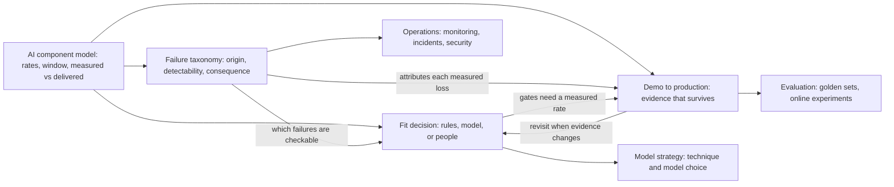
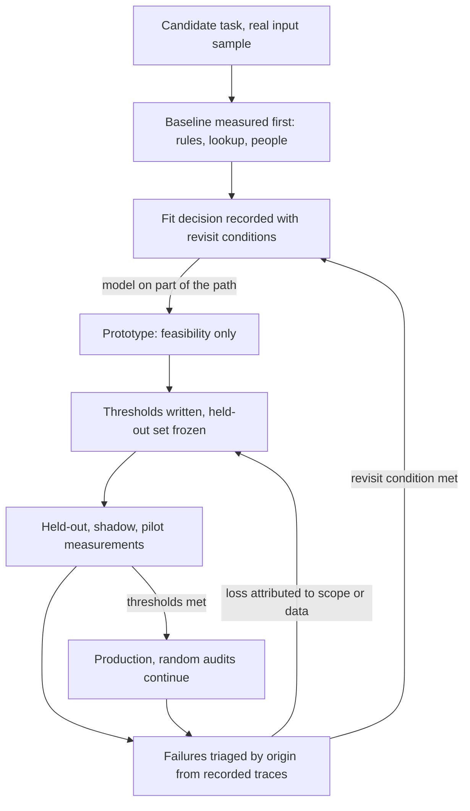

Bir model production'daki bir kararın üzerine konmadan önce üç soru izlenimle değil kanıtla cevaplanmalıdır: sistem hangi tür hataları üretecek ve her biri nereden doğacak, görev hiç model kullanmalı mı ve çalıştığını gösteren kanıt göründüğü şeyi gerçekten söylüyor mu. Bu bölüm bu soruları cevaplar. Önceki bölüm bileşeni tanımladı: doğruluğu bir oran olan, girdisi her seferinde yeniden kurulan bir token dizisi olan ve ölçülen oranı teslim ettiği oran olmayan bir parça. Bu bölüm o tanımı, bir ekibin lansmandan önce ve lansman etrafında verdiği kararlara uygular. Burada yanlış bir cevabın bedeli tek bir kötü çıktı değil; yanlış katmana, yanlış tekniğe ya da yanlış sayıya harcanmış aylardır.

Üç konunun hepsinden geçen gerilim, ekibin oluşturduğu güven ile elinde gerçekten bulunan kanıt arasındadır. Model destekli bir sistem akıcı, düzgün biçimli ama yanlış bir cevap döndürerek bozulur; bu yüzden hataları kolayca yanlış okunur. Bir demo, modelin bir görevi yapabildiğini gösterir; bu yüzden alternatifler onunla nadiren karşılaştırılır. Bir prototipi de onu kuranlar, kendi seçtikleri ve üzerinde ayar yaptıkları girdilerle ölçer; bu yüzden sonucu etiketsiz bir üst sınırdır. Bölümdeki her sayfa, bir tür güveni kanıt üreten bir yöntemle değiştirir: her hatayı ona yol açan katmana atayan bir triage sırası, ispat yükünü modele yükleyen kapılı bir karar ve eşikleri ölçümden önce yazılan aşamalı bir kanıt yolu.

Bölüm herhangi bir sağlayıcıyı değil, kararları ve kanıtı konu alır. Ürünler, düzenlemeler ve olaylar konu sayfalarında tarihli örnekler olarak geçer; yöntemlerin kendisi Kasım 2026 itibarıyla LLM tabanlı sistemler için geçerlidir ve sonraki bölümler bir hata kökeninden, bir uygunluk kararından ya da bir hazırlık kapısından söz ettiğinde varsaydıkları şey bunlardır.

## Üç Konu Birbirine Nasıl Bağlıdır

Konular, biri bitmeden diğerinin başlamadığı bir zincir değildir. Ortak girdileri vardır ve ikisi üçüncüsünü besler.

*Bölümdeki konular arasındaki bağımlılıklar ve bölümden ana çıkışlar. Kenar etiketleri, bir sayfanın diğerine ne sağladığını adlandırır.*

Taksonomi diğer iki sayfanın akış yukarısında durur. Uygunluk kararı ona denetlenebilirlik kapısında ihtiyaç duyar; çünkü bağımsız bir kontrolün modelin hatalarını yakalayıp yakalayamayacağı, görevin hangi hata sınıflarını ürettiğine ve her birinin ne kadar tespit edilebilir olduğuna bağlıdır. Demodan production'a sayfası ise yeniden ölçümdeki her kaybı bir nedene bağlamak için ona ihtiyaç duyar; yalnızca "model kötüleşti" diye etiketlenen bir düşüş, kapsamı, veriyi ya da değerlendirmeyi düzeltmek yerine model değiştirmeye götürür. Uygunluk kararı ile kanıt yolu bir döngü oluşturur: kararın güvenilirlik ve maliyet kapıları ancak production'a benzeyen kanıtla cevaplanabilir ve bu kanıt değiştiğinde, kararın kayıtlı yeniden değerlendirme koşulları onu yeniden açar. Üç çıkış, handbook'un her cevaba göre harekete geçen kısımlarına götürür.

## Konular

[AI Hata Türlerinin Taksonomisi](/ai-systems-architecture/tr/foundations/failure-and-fit/failure-mode-taxonomy/), kabul edilemez bir sonucun, sınıflandırma birine neyi değiştireceğini söyleyecek biçimde nasıl sınıflanacağı sorusunu yanıtlar. Kaydedilmiş trace'e uygulanan bir triage sırasıyla her hatayı altı köken katmanından birine atar; tespit edilebilirlik, sonuç, korelasyon ve başlangıç (onset) özelliklerini ayrı alanlar olarak taşır ve OWASP, NIST, MITRE, Microsoft ile MAST yazarlarının yayımladığı taksonomileri her birinin hangi soru için kurulduğuna göre konumlar. Önemlidir, çünkü "hallucination" en az dört farklı kökenin ürettiği bir belirtinin adıdır ve bunları birbirinden ayıramayan bir ekip emeğini kusurlu katmana değil, en görünür katmana harcar.

[AI Ne Zaman Yanlış Çözümdür: Bir Karar Çerçevesi](/ai-systems-architecture/tr/foundations/failure-and-fit/when-not-to-use-ai/), bir görevin model mi, kural mı, klasik makine öğrenmesi mi yoksa insan mı kullanması gerektiği ve model kullanılacaksa kararın hangi kısmında kullanılacağı sorusunu yanıtlar. Cevabı görevin altı özelliğinden türetir, bunları sabit bir sırayla kapılar olarak sorar ve önce kuralların çalışıp kalan kısma (residue) modelin uygulandığı ya da modelin deterministik bir kural için girdileri çıkardığı hibrit tasarımları bir uzlaşma değil, olağan sonuç olarak ele alır. Önemlidir, çünkü bu karar genellikle hiç açıkça verilmez: bir demoda gösterilen yetenek çözüm sayılır ve daha ucuz, daha öngörülebilir tasarım onunla hiç karşılaştırılmaz.

[Demodan Production'a: AI Prototipleri Neden Yanıltır](/ai-systems-architecture/tr/foundations/failure-and-fit/demo-to-production/), ikna edici biçimde çalışan bir prototipin neden taşınmayan bir kanıt ürettiği ve onun yerini hangi kanıtın aldığı sorusunu yanıtlar. Prototip döngüsündeki dört yanlılığı belirler: seçilmiş girdiler, test üzerinde ayar yapmak, hoşgörülü değerlendirme ve gizli bir operatörün bulunduğu oyuncak bir ortam. Ardından dondurulmuş bir held-out set'ten shadow mode'a ve sınırlı bir pilota uzanan, her aşaması önceden yazılmış eşiklerle kapılanan aşamalı bir yol çizer. Önemlidir, çünkü bir demo sonucuna bağlanmış bir lansman tarihi, bütçe ya da onay belgesi aslında kuranların sürecinin bir tarifine bağlanmıştır ve hata ancak taahhütler verildikten sonra ortaya çıkar.

| Konu | Yanıtladığı soru | Ne zaman açılmalı |
|---|---|---|
| AI Hata Türlerinin Taksonomisi | Bu hataya hangi katman yol açtı ve onu hangi sinyal yakalamalıydı? | Kötü çıktıları ya da olayları triage ederken; hata etiketleri, denetimler ya da dedektörler kurarken; bulguları OWASP ya da NIST'e eşlerken |
| AI Ne Zaman Yanlış Çözümdür | Bu karar model mi, kural mı, klasik ML mi, insan mı kullanmalı? | Yeni bir AI özelliğinin kapsamını çizerken; model gerektirmeyebilecek bir tasarımı incelerken; hacim, kapsam ya da yükümlülükler değiştiğinde |
| Demodan Production'a | Elimizdeki kanıt bir lansmanı destekliyor mu, hangi kanıt destekler? | Bir demo ya da pilot sonucu tarih, bütçe ya da onay belirlemek üzereyken; bir prototip için değerlendirme yolunu planlarken |

## Üç Sayfada Tek Bir Disiplin

Üç sayfa aynı disiplini farklı nesnelere uygular. Bunu bir arada tutmak, sonraki bölümlerin neden sürekli kayıtlı trace, baseline ve yazılı eşik istediğini açıklar. Her sayfa kendi versiyonunu eksiksiz geliştirir; buradaki özet yalnızca bunların bir özelliğin ömrü boyunca nasıl birbirine bağlandığını gösterir.

*Bölümün yöntemleri, tek bir özelliğin ömrü boyunca. Önceki bir kutuya dönen her ok, taze bir izlenimi değil, nedeni belirlenmiş bir kaybı ya da kayıtlı bir koşulu taşır.*

Ortak ilk kural, kanıtın yeniden çalıştırmaktan ya da hatırlamaktan değil, kayıtlardan gelmesidir. Taksonomi bir hatayı istek anında kaydedilen context, sürümler ve çıktıdan sınıflar, çünkü yeniden çalıştırmak yeni bir örnek çeker. Uygunluk kararı, kapıları bir örnekleme, ölçülmüş bir orana ve bir maliyet modeline dayanan yazılı bir kayıttır. Hazırlık kapısı da held-out set'inin kaynağını ve dondurulma tarihini adıyla belirtir. Bunları kaydetmeyen bir ekip üç sayfanın hiçbirini uygulayamaz; observability bölümünün kaydı bir özellik değil, bir ön koşul olarak ele almasının nedeni budur.

İkinci kural, karşılaştırmanın sonuçtan önce gelmesidir. Uygunluk kararı modeli değerlendirmeden önce deterministik baseline'ı çalıştırır, çünkü %94'lük bir model, kuralın kapsadığı trafikte %97'lik bir kurala kaybedebilir. Prototip sayfası, kapıladığı ölçümden önce bir eşik ister, çünkü önce görülen bir sayı her zaman yeniden yorumlanır. Taksonominin örnek denetimi, önceliklendirmeden önce şikâyet paylarını rastgele bir örneklemle karşılaştırır, çünkü şikâyetler görünürlüğe göre örneklenir ve sessiz hataları sistematik olarak gizler.

Üçüncü kural, her sayının popülasyonunu ve nedenini taşımasıdır. Rastgele bir örneklemi olmayan bir hata payı, aralığı ve değerlendirme kriterleri olmayan bir oran ve gerçek token dağılımları olmadan yapılmış bir maliyet tahmini, sistem hakkında değil, bir süreç hakkında birer ifadedir. Sayfalar birlikte tek bir argüman kurar: bir model bir kararın üzerinde ancak hataları sınıflandırılmışsa, alternatifleri ölçülmüşse ve oranı production'a benzeyen girdilerde biliniyorsa yer alır; bu koşulların her biri de sistem, trafik ya da model değiştiğinde geçerliliğini yitirir.

## Önerilen Okuma Sırası

Sayfaları kenar çubuğundaki sırayla okuyun. Taksonomi önce gelir, çünkü diğer iki sayfa onun kavram setini kullanır: uygunluk kararının denetlenebilirlik kapısı tespit edilebilirliğe ve sonuca dayanır, prototip sayfasının yeniden ölçümü de her kaybı bir kökene bağlar. Uygunluk kararı ikinci gelir, çünkü bir prototipin ne işe yaradığının çerçevesini çizer: bir ekip kararın hangi kısmının modele ait olması gerektiğini bildiğinde, prototip yalnızca o kısmın yapılabilirliğini test eder. Demodan production'a sayfası en son gelir, çünkü kanıt yolu uygunluk kararının sonraki kapılarının gerektirdiği ölçülmüş oranları sağlar ve bağımlılık diyagramındaki döngüyü kapatır.

Üç kısayol makuldür. Yeni bir özelliğin kapsamını çizen bir okur uygunluk kararıyla başlayabilir ve denetlenebilirlik kapısı zor soru haline geldiğinde taksonomiyi okuyabilir. Elinde bir demo sonucu ve bir lansman talebi olan bir okur, örnek yeniden ölçümü kendi başına anlaşılabilen demodan production'a sayfasıyla başlamalıdır. Bir olayı triage eden ya da bir hata denetimi kuran bir okurun yalnızca taksonomiye ihtiyacı vardır; triage yöntemi diğer ikisi olmadan uygulanabilir.

## Ön Koşullar ve Bölümün Yönlendirdiği Yerler

Bölüm doğrudan [AI Bileşen Modeli](/ai-systems-architecture/tr/foundations/ai-component-model/) bölümünün üzerine kurulur ve onun iki sayfası tam anlamıyla ön koşuldur. [Deterministik ve Olasılıksal Sistemler](/ai-systems-architecture/tr/foundations/ai-component-model/deterministic-vs-probabilistic/), uygunluk kararının bir modelin etrafına yerleştirdiği deterministik kabuğu ve taksonominin korelasyon özelliği için kullandığı korelasyonlu hata aritmetiğini tanımlar. [Yetenek ve Güvenilirlik](/ai-systems-architecture/tr/foundations/ai-component-model/capability-vs-reliability/), uygunluk kararının güvenilirlik kapısının ve prototip sayfasının dayandığı tekrarlı deneme oranını ve zaman açığını tanımlar. Eşlik eden handbook'tan [Hata Modelleri: Crash-Stop, Crash-Recovery, Omission](https://gorkemsari.github.io/distributed-systems/tr/foundations/system-models/failure-models/) taksonominin çıkış noktası olan sınıflandırmadır; [Suçlamasız Postmortem'ler](https://gorkemsari.github.io/distributed-systems/tr/observability/alerting-incident-response/blameless-postmortems/) triage sırasının yansıttığı kök neden ve katkıda bulunan etken ayrımını sağlar; [Gölge Dağıtım](https://gorkemsari.github.io/distributed-systems/tr/deployment/deployment-patterns/shadow-deployment/) ise hem baseline karşılaştırmasının hem de kanıt yolunun yeniden kullandığı desendir.

Bölümün kararları dört yerde uygulamaya geçer. Bir model yola konduktan sonra hangi tekniğin ve hangi modelin kullanılacağına [Model Stratejisi & Seçimi](/ai-systems-architecture/tr/model-strategy/) karar verir; başlangıç noktası [Prompting, RAG ve Fine-Tuning: Bir Karar Çerçevesi](/ai-systems-architecture/tr/model-strategy/lifecycle-and-adaptation/prompting-rag-finetuning/) sayfasıdır. Kanıt yolu, held-out set'lerin, online deneylerin ve release kapılarının ayrıntılı ele alındığı [Olasılıksal Sistemleri Test Etmek](/ai-systems-architecture/tr/evaluation/testing-foundations/) ve [Teslimat Hattında Eval](/ai-systems-architecture/tr/evaluation/evals-in-delivery/) bölümlerinde hayata geçirilir. Saldırgan kökenin sahibi [Tehditler ve Saldırı Yüzeyleri](/ai-systems-architecture/tr/security/threats/) bölümüdür; başlangıç noktası [AI Tehdit Modellemesi](/ai-systems-architecture/tr/security/threats/threat-modeling/) sayfasıdır. Taksonominin etiketlerini de operasyon tarafı kullanır: köken başına dedektörler için [Kalite İzleme ve Drift Tespiti](/ai-systems-architecture/tr/llmops/observability/quality-drift/), müdahale süreci için [AI Incident Yönetimi](/ai-systems-architecture/tr/llmops/operations/incident-management/) ve düzenlemeye tabi dağıtımların onayı için [LLM Sistemleri için Model Risk Yönetimi](/ai-systems-architecture/tr/governance/risk-management/model-risk-management/).
