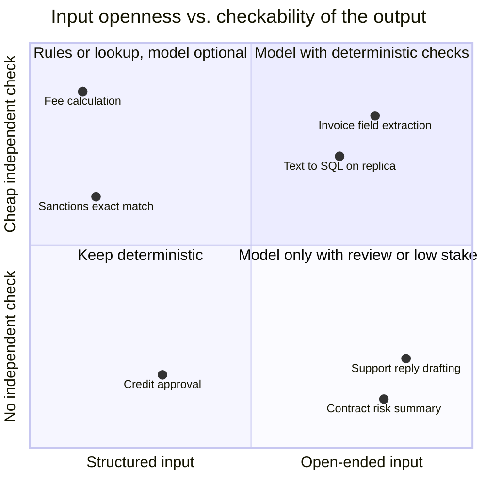
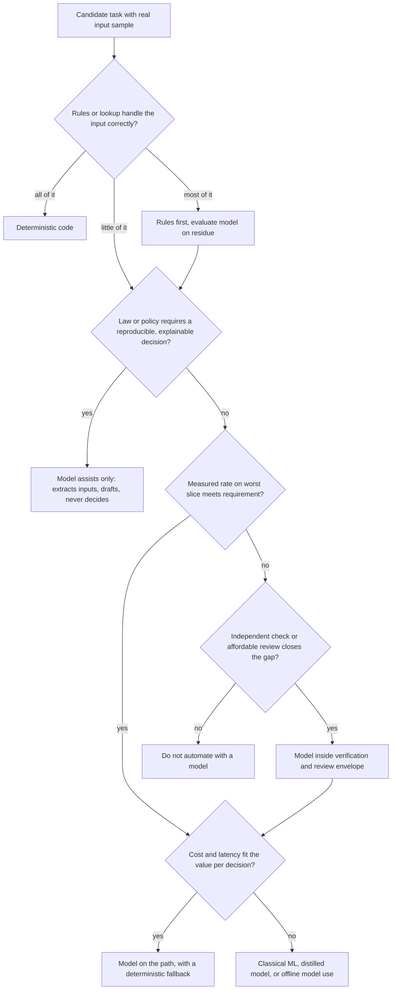
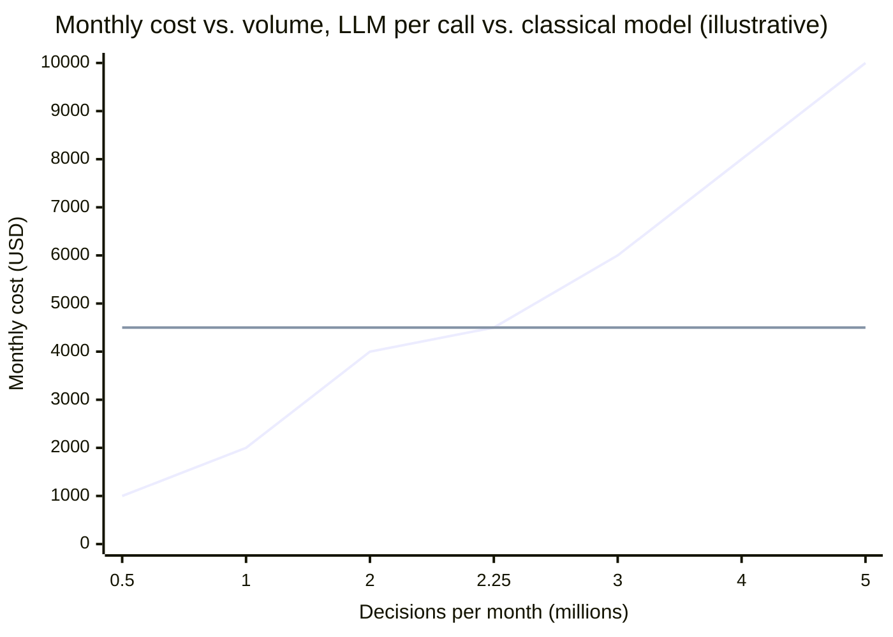
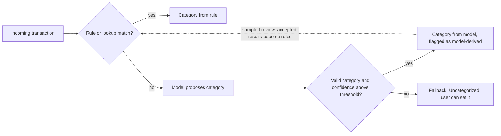
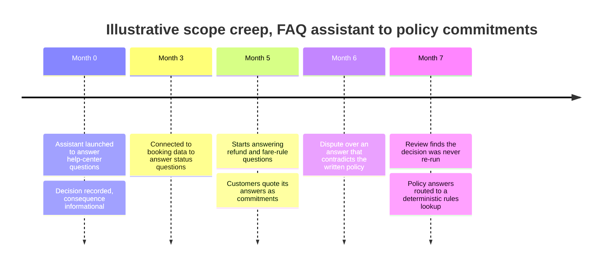

Bir görevde dil modeli kullanılmamasına karar vermek, veritabanı seçmekle aynı ağırlıkta bir mimari karardır: coşkudan ya da "AI ekleyin" talimatından değil, görevin ifade edilip kontrol edilebilen özelliklerinden çıkar. Bir model, istek yolunda yer almayı iki koşulda hak eder. Girdi, kuralların kabul edilebilir maliyetle kapsayamayacağı kadar açık uçlu olmalıdır; sistem de modelin hata oranını kaldırabilmelidir. Bunun yolu ya hataların ucuz olması, ya bağımsız bir mekanizmanın onları yakalaması, ya da her çıktıyı bir insanın gözden geçirmesidir. Bu koşulların hiçbiri sağlanmıyorsa model; bir lookup tablosunun, bir kural motorunun, klasik bir sınıflandırıcının ya da bir formun deterministik olarak çözeceği bir göreve varyans, maliyet, gecikme, saldırı yüzeyi ve denetim sorunu ekler.

Bu sayfanın ele aldığı sorun, kararın genellikle hiç açıkça verilmemesidir. Bir demo, modelin görevi yapabildiğini gösterir; yetenek çözüm gibi görünür ve alternatifler onunla karşılaştırılmaz. Aylar sonra ekip, trafiğin %85'inin bir avuç kurala uyduğunu, kalan %15'in zaten insan incelemesi gerektirdiğini ve modelin kural biçimli kısımdaki cevaplarının kuralların vereceği cevaplardan daha az tutarlı olduğunu fark eder. Hiçbir şey gürültülü biçimde bozulmamıştır. Sistem yalnızca daha pahalıya mal olmuş, daha az öngörülebilir davranmış ve hiç değerlendirilmemiş tasarıma göre daha zor açıklanır hale gelmiştir.

Temel trade-off, açık girdiyi kapsama gücü ile garantiler arasındadır. Model kimsenin öngörmediği girdileri işler ve doğal dili kabul eder; bedeli, garanti edilmiş bir sonuç yerine ölçülmüş bir hata oranı, hacimle ölçeklenen çağrı başı maliyet ve tamamen açıklanamayan bir karar yoludur. Deterministik kod bunun tersini sunar: yazıldığı girdilerde kesin, tekrarlanabilir, denetlenebilir davranış ve geri kalanlarda işe yarar hiçbir şey. Production tasarımlarının çoğu ikisinin arasında bir yere düşer; yararlı soru "AI mı, değil mi" değil, kararın hangi kısmının modele, hangi kısmının koda ait olduğudur.

## Uygunluğu Belirleyen Altı Özellik

Bir modelin bir göreve ait olup olmadığı görevin altı özelliğinden çıkar ve her biri tek bir prompt yazılmadan önce değerlendirilebilir. İkisi model lehine, üçü aleyhine konuşur; biri ekonomiktir.

Girdi açıklığı, model lehine ilk argümandır. Girdileri serbest metin, yapılandırılmamış doküman, görsel ya da kullanıcının keyfi ifadeleri olan bir görevin girdi uzayını kurallar sayıp bitiremez; girdileri zaten yapılandırılmış alanlar, kodlar ya da sonlu bir seçenek kümesi olan bir görevin onları yorumlamak için modele ihtiyacı yoktur. Test somuttur: bir haftalık gerçek girdiyi alın ve makul büyüklükte bir kural kümesinin ya da lookup'ın bunların ne kadarını doğru işleyeceğini sayın. Büyük kısmıysa, model yalnızca kalan kısım için adaydır.

Kural kararlılığı ikinci argümandır. Doğru çıktının bilinen, yazılı ve kararlı kurallardan çıktığı yerlerde, örneğin bir ücret tarifesinde, bir vergi tablosunda, bir uygunluk politikasında ya da bir yetkilendirme matrisinde, kuralların kendisi spesifikasyondur ve onları kodla uygulamak tam olarak belirtilen davranışı üretir. Genel metin üzerinde eğitilmiş ve politikayla prompt'lanmış bir model ise bunun hata oranlı bir yaklaşımını üretir. Model ancak kurallar bilinmiyorsa, örtükse ya da yazıp bakımını yapmak model hatalarını tolere etmekten pahalıya gelecek kadar çoksa çekici hale gelir: ton sınıflandırma, yüzlerce ifade biçimi üzerinden niyet tespiti, özetleme.

Model aleyhine konuşan üç özelliğin hepsi hatalarla ilgilidir. Gereken güvenilirlik, işin ihtiyaç duyduğu orandır ve trafiğin en kötü ilgili dilimi üzerinde ölçülür; [Yetenek ve Güvenilirlik](/ai-systems-architecture/tr/foundations/ai-component-model/capability-vs-reliability/) sayfası, bir modelin production girdilerinde tekrar tekrar sağladığı oranın benchmark ya da demo oranının neden altında, çoğu zaman çok altında kaldığını açıklar. Denetlenebilirlik, doğru bir çıktıyı yanlışından ayırabilen bağımsız ve daha ucuz bir yöntemin olup olmadığıdır: çıkarılmış bir toplam yeniden hesaplanabilir, bir SQL sorgusu bir replica üzerinde çalıştırılabilir, bir atıf aranıp bulunabilir; buna karşılık bir kredi kararının adilliğinin ya da bir özetin sadakatinin ucuz bir kontrolü yoktur. Sonuç ise tek bir yakalanmamış hatanın neye ulaştığıdır: bir kişinin okuyup görmezden gelebileceği bilgiden, kaydedilmiş bir karara, oradan da para, sağlık ya da hukuki durum üzerinde geri alınamaz bir etkiye kadar.

Ekonomik özellik, karar başına maliyetin karar başına değerle karşılaştırılması ve gecikme bütçesidir. Bir model çağrısı token'lara ve yüzlerce milisaniyeden saniyelere uzanan bir süreye mal olur; bir kural mikrosaniyelere. Bu fark, günde birkaç yüz kez kullanılan bir taslak asistanı için önemsizdir; her kart provizyonunda çalışan bir fraud kontrolü için belirleyicidir.

Bu özellikler birbirini etkiler ve nadiren tek başına karar verir. En önemli etkileşim girdi açıklığı ile denetlenebilirlik arasındadır, çünkü ikisi birlikte modelin hatalarının sınırlanıp sınırlanamayacağını belirler.


*Örnek görevlerin, girdilerinin ne kadar açık olduğuna ve ucuz bağımsız bir kontrol bulunup bulunmadığına göre konumu. Konumlar temsilidir ve somut sisteme göre değişir.*

Sağ üst bölge, modelin en iyi oturduğu yerdir: girdinin yorumlanması gerekir ve bir kontrol, modelin hatalarını olaya değil yeniden denemeye dönüştürür; [Deterministik ve Olasılıksal Sistemler](/ai-systems-architecture/tr/foundations/ai-component-model/deterministic-vs-probabilistic/) sayfasındaki deterministik kabuk deseni bunu anlatır. Sol üst bölgede, tam olarak tanımlandıkları için denetlenebilen görevler durur; kodun bunları yapabilmesinin sebebi de budur ve bir model orada en fazla girdileri çıkararak yardım edebilir. Sol alt bölge en net "kullanmayın" bölgesidir: yapılandırılmış girdi, kontrol yok ve tipik olarak açıklanabilir olması gereken bir karar, örneğin kredi onayı. Sağ alt bölge tartışmalı bölgedir. Bir destek yanıtının taslağını yazmak ya da bir sözleşmeyi özetlemek modele ihtiyaç duyar ve sonucu ucuza doğrulayan hiçbir şey yoktur; bu nedenle model ancak her çıktıyı etkisini göstermeden önce bir insan okuyorsa ya da bir hatanın sonucu küçükse kabul edilebilir.

## Kapılı Bir Karar Yöntemi

Altı özellik, sabit bir sırayla sorulduğunda ve her kapı değerlendirmeyi bitirebildiğinde bir yönteme dönüşür. Sıra önemlidir, çünkü ilk kapıları cevaplamak ucuzdur ve modelin gereksiz olduğu durumları eler; sonraki kapılar ölçüm gerektirir ve yalnızca elemeden geçen görevlere uygulanır.


*Karar yöntemi. Her kapı kanıttan cevaplanır: gerçek girdilerden bir örneklem, yazılı bir yükümlülük listesi, ölçülmüş bir oran, bir maliyet modeli.*

İlk kapı, aday kuralları gerçek girdilerden bir örneklem üzerinde çalıştırıp sayarak cevaplanır, sezgiyle değil. Ortadaki dal pratikte en sık çıkan sonuçtur: bir lookup ya da bir kural kümesi trafiğin büyük kısmını işler ve model yalnızca kalan kısım için değerlendirilir. Bu dal sonraki her kapıyı değiştirir, çünkü modelin ölçülmüş oranı, maliyeti ve inceleme yükü artık bütünden daha küçük ve daha zor bir kalıntıya uygulanır.

İkinci kapı, kaliteyi ölçmeden önce yükümlülükleri kontrol eder; çünkü hiçbir ölçülmüş oran yanlış türden bir yükümlülüğü karşılamaz. Bir regülasyon, bir sözleşme ya da bir iç politika aynı girdilerin her zaman aynı kararı üretmesini ve kararın faktör faktör açıklanabilmesini gerektiriyorsa, örneklenmiş bir çıktı ne kadar isabetli olursa olsun bu şartı sağlamaz. Model yine de yardım edebilir: taranmış bir dokümanı bir puanlama kuralının yapılandırılmış girdilerine dönüştürebilir ya da bir insanın onaylayacağı açıklamanın taslağını yazabilir. Ancak karar kodda ya da bir insanda kalır.

Üçüncü ve dördüncü kapılar güvenilirlik testidir. Ölçülen oran, trafiğin önemli olan en kötü dilimi üzerinde `pass^k` ya da eşdeğer bir tekrarlı deneme oranıdır, güven aralığıyla birlikte; tanımı [Yetenek ve Güvenilirlik](/ai-systems-architecture/tr/foundations/ai-component-model/capability-vs-reliability/) sayfasındadır. Oran yetersiz kaldığında soru, bir verifier'ın ya da bir inceleme kuyruğunun farkı işin kabul ettiği bir maliyetle kapatıp kapatamayacağıdır. Bu kapıdaki "hayır", yöntemin verdiği en net olumsuz cevaptır: görev modelin sağlamadığı bir güvenilirlik ister, hiçbir bağımsız mekanizma onun hatalarını yakalayamaz ve her şeyi gözden geçirmek, işi elle yapmak kadar pahalıdır.

Beşinci kapı ekonomiktir ve en sonda çalışır, çünkü dördüncü kapıdaki inceleme ve doğrulama maliyetleri bilinmeden anlamsızdır. Kalite hedefini ancak kararların %30'unu insanlara göndererek tutturan bir tasarımın karar başı maliyetinde token'lar değil insanlar baskındır.

### Bu Sıra Neden Sağlam Kararlar Üretir

Yöntem ispat yükünü modele yükler. Deterministik kod varsayılandır, çünkü onun özellikleri, yani tekrarlanabilirlik, yazılı bir spesifikasyona tam uyum, ihmal edilebilir marjinal maliyet ve eksiksiz açıklanabilirlik, birer garantidir; modelinkiler ise her model, prompt ya da trafik değişikliğinden sonra tekrarlanması gereken ölçümlerdir. Geçerli kalmak için sürekli yeniden ölçüm gerektiren bir tasarım tercihi, bu süregelen maliyeti bunu gerektirmeyen bir alternatife karşı gerekçelendirmek zorundadır.

Sıralama en yaygın akıl yürütme hatasını da önler: modeli hiçbir şeyle karşılaştırmadan değerlendirmek. %94 isabetli bir model, aynı örneklemde kural tabanlı baseline'ın kapsadığı %85'lik trafikte %97 isabetli olduğu ortaya çıkana kadar iyi görünür. Önce baseline'ı çalıştırmak, modelin neyi ve trafiğin hangi kısmında geçmesi gerektiğini ortaya koyar. Aynı fikir, Martin Zinkevich'in Google'ın *Rules of Machine Learning* dokümanındaki ilk kuralının da temelidir; o kural, heuristik'ler yeterliyse ürünü makine öğrenmesi olmadan yayına almayı önerir. LLM'ler için bu kural daha da güçlü geçerlidir, çünkü hataları, sabit bir çıktı uzayına sahip eğitilmiş bir sınıflandırıcınınkinden daha az öngörülebilirdir.

Son olarak sıra, farklı sahipler gerektiren soruları birbirinden ayırır. Birinci ve beşinci kapılar mühendislik sorularıdır. İkinci kapı hukuk, uyum ya da risk fonksiyonlarına aittir ve mühendislik yargısıyla değil yazılı yükümlülüklerden cevaplanmalıdır. Üçüncü ve dördüncü kapılar bir eval setine ve ölçülmüş bir orana ihtiyaç duyar; bu yüzden [Demodan Production'a](/ai-systems-architecture/tr/foundations/failure-and-fit/demo-to-production/) geçişteki açık, bu kapılar sorulmadan önce verilmiş bir kararı çoğu zaman geçersiz kılar.

Cevapları kayda geçirmek, model, fiyat ya da trafik değiştiğinde kararı sonradan gözden geçirilebilir kılar.

```yaml
# Illustrative decision record; field names are not a standard
decision: transaction-categorization
evaluated: 2026-11-16
sample: 20000 production transactions, 4 weeks, all channels
gate_rules_coverage: 0.88          # share handled by MCC map + merchant table
gate_rules_accuracy: 0.995         # on the covered share, audited sample
gate_obligations: none_binding     # informational feature, no decision on customer
gate_model_rate_residue: 0.93      # worst slice: card-not-present, foreign merchants
gate_review_needed: false          # errors user-correctable, low consequence
gate_cost_per_month_usd: 70        # residue calls only, illustrative prices
outcome: hybrid_rules_then_model
fallback: category "Uncategorized" on model timeout or low confidence
revisit_when: [rules_coverage < 0.80, model_or_prompt_change, volume x2]
```

`revisit_when` alanı, sonucun kendisi kadar önemlidir. Bir ölçüm kümesi altında alınan karar, o ölçümler değiştiğinde geçerliliğini yitirir; kayıt da hangi değişikliklerin kararı yeniden açması gerektiğini önceden söyler.

## Hesaplanmış Örnek: Kart İşlemlerini Kategorize Etmek

Temsili olarak, müşterilerine harcamalarını kategori bazında göstermek isteyen bir perakende banka varsayalım. Banka ayda 3.000.000 kart işlemi işliyor ve her birine 40 kategoriden biri atanmalı. Her işlem, kart ağının atadığı bir merchant category code (MCC), ham bir üye işyeri tanımlayıcı metni, bir tutar ve bir ülke taşıyor. Tanımlayıcılar dağınık metin olduğu için model bariz bir uyum gibi görünüyor.

İlk kapı ölçümle cevaplanır. Ekibin MCC'leri kategorilere eşlediğini ve en sık görülen üye işyerleri için bir tablo eklediğini, dört haftalık bir örneklemde bunun işlemlerin %88'ini %99,5 denetlenmiş isabetle kapsadığını varsayalım. Kalan %12, yani ayda yaklaşık 360.000 işlem, genel MCC'lere, bilinmeyen üye işyerlerine ya da gerçek üye işyerini gizleyen pazar yeri ve ödeme kolaylaştırıcısı tanımlayıcılarına sahip.

Şimdi aynı varsayımlar üzerinde üç tasarımı karşılaştıralım.

Yalnızca model tasarımı her işlemi küçük bir modele gönderir. Çağrı başına 350 girdi token'ı (talimatlar, kategori listesi, işlem) ve 10 çıktı token'ı, temsili olarak milyon girdi token'ı başına 0,50 USD ve milyon çıktı token'ı başına 2,00 USD fiyat varsayalım. Bir çağrı 350 çarpı 0,0000005 artı 10 çarpı 0,000002, yani yaklaşık 0,000195 USD tutar; ay yaklaşık 585 USD'ye mal olur. Sorun maliyet değildir. Sorun kalitedir: modelin kural biçimli %88'de %96, zor kalıntıda %93 isabetli olduğunu varsayalım. Hatalar 2.640.000 çarpı 0,04 artı 360.000 çarpı 0,07, yani 105.600 artı 25.200, ayda 130.800 eder; hata oranı yaklaşık %4,4'tür.

Hibrit tasarım önce kuralları çalıştırır ve modeli yalnızca kalıntı için çağırır. Hatalar 2.640.000 çarpı 0,005 artı 25.200, yani 13.200 artı 25.200, ayda 38.400 eder; yaklaşık %1,3. Model faturası 360.000 çağrıya, yaklaşık 70 USD'ye düşer. Hibrit, yalnızca model tasarımından her eksende daha iyidir ve bunun sebebi seçilen sayıların bir yan ürünü değil, yapısaldır: kuralların kapsadığı girdilerde kurallar modelden daha isabetlidir; bu yüzden modele yönlendirilen her böyle girdi hata ekler.

Üçüncü tasarım modeli istek yolundan çıkarır. Kalıntının büyük kısmı tekrar tekrar görülen üye işyerlerinden gelir. Ayda 40.000 farklı yeni tanımlayıcı olduğunu varsayalım. Model her farklı tanımlayıcıyı bir kez kategorize eder, sonuçların bir örneklemi gözden geçirilir ve kabul edilen sonuçlar üye işyeri tablosuna kural olarak yazılır. Çağrılar 40.000'e, ayda yaklaşık 8 USD'ye düşer ve o üye işyerinden gelen sonraki her işlem mikrosaniyeler içinde lookup ile kategorize edilir. Tutarlılık da iyileşir: hibrit tasarımda aynı kahveci bir hafta "Kahve", sonraki hafta "Restoranlar" olarak kategorize edilebilir, çünkü her işlem yeni bir örneklemdir; öğrenilmiş bir kural ise her seferinde aynı cevabı verir. Model artık kural yazmak için bir araçtır ve bu, onu kullanmanın en etkili yollarından biridir.

:::tip[Girdi tekrarlanıyorsa modeli tasarım zamanında kullanın]
Aynı girdiler tekrar ediyorsa, örneğin üye işyerleri, ürün adları, doküman şablonları ya da hata mesajları, modeli her farklı girdi için bir kez çalıştırın, çıktılarının bir örneklemini gözden geçirin ve kabul edilen çıktıları deterministik kodun okuduğu veri olarak saklayın. İstek başı yol bir lookup'a dönüşür, istekler arası tutarlılık garanti altına girer ve modelin hata oranı her istek için değil, her farklı girdi için bir kez ödenir.
:::

### Hacim Cevabı Değiştirdiğinde

Ekonomi, farklı alternatifler için farklı hacimlerde tersine döner. Etiketli örneklerle eğitilmiş klasik bir sınıflandırıcının kurulum ve işletme için sabit bir maliyeti, tahmin başına ise sıfıra yuvarlanan bir marjinal maliyeti vardır; bir LLM çağrısının kurulum maliyeti yoktur ama çağrı başına marjinal bir maliyeti vardır. Temsili olarak, kurulumu 30.000 USD tutan ve 12 aya amorti edilen, işletme ve yeniden eğitim için ayda 2.000 USD harcanan, toplamda ayda yaklaşık 4.500 USD'lik klasik bir model varsayalım. Görev için çağrı başı 0,002 USD'lik daha büyük bir LLM gerektiğini varsayalım. Aylık LLM maliyeti hacim çarpı 0,002'dir; dolayısıyla ikisi 4.500 bölü 0,002, yani ayda 2.250.000 çağrıda kesişir.


*Yükselen çizgi, varsayılan çağrı başı 0,002 USD ile LLM'i; düz çizgi, varsayılan ayda 4.500 USD ile klasik modeli gösterir. Ayda yaklaşık 2,25 milyon kararda kesişirler.*

Kesişimin altında LLM daha ucuz ve daha hızlı devreye alınır, etiketli eğitim verisi de gerektirmez. Üstünde ise klasik model, her ek kararla büyüyen bir farkla daha ucuzdur ve gecikmesi tipik olarak yüzlerce değil tek haneli milisaniyelerdir. Kesişim noktası iki varsayımla birlikte kayar ve bir sistemin ömrü boyunca iki etki onu zıt yönlere iter. Düşen token fiyatları onu sağa iter. Büyüyen trafik ise sistemi soldan onun ötesine taşır. Klasik modelin etiketlere de ihtiyacı vardır ve bunları bir model üretebilir: bir eğitim setini LLM ile etiketleyip üzerinde daha küçük bir model eğitmek, [Fine-Tuning ve Distillation](/ai-systems-architecture/tr/model-strategy/lifecycle-and-adaptation/finetuning-distillation/) sayfasında ele alınan distillation'ın bir biçimidir. Ayda 500.000 kararda kaydedilmiş bir kararın 3.000.000'da yeniden açılması gerekir; hacmin kaydın yeniden değerlendirme koşulları arasında yer almasının sebebi budur. Çağrı başı fiyatların nasıl oluştuğu, fiyat listesinde görünmeyen maliyetler dahil, [Token Ekonomisi](/ai-systems-architecture/tr/economics/understanding-cost/token-economics/) sayfasındadır.

:::caution[İnceleme kuyruğu, AI seçeneğinin maliyetinin parçasıdır]
Kalite hedefini yalnızca çıktıların bir kısmını insanlar gözden geçirdiği için tutturan bir tasarımın karar başı maliyeti büyük ölçüde emektir. İnceleme başına varsayılan 2 dakika ve günlük 100.000 kararın %20'sinin ertelenmesiyle inceleme kuyruğu günde yaklaşık 667 saat gerektirir; bu bir kalem değil, bir departmandır. AI seçeneğini alternatiflerle karşılaştırmadan önce kuyruğu fiyatlayın ve işin tamamını insanların yapmasının maliyetiyle kıyaslayın; hata düzeltme de hesaba katıldığında bu maliyet bazen daha düşüktür.
:::

## Alternatifler ve Her Birinin Kazandığı Durum

"Model değil" tek bir alternatif değildir. Aşağıdaki seçeneklerin her birinin kendi garantileri, maliyet profili ve hata davranışı vardır; production sistemlerinin çoğu, aynı kararın farklı kısımlarında bunlardan iki ya da üçünü birleştirir.

| Seçenek | Garanti | Marjinal maliyet ve gecikme | Temel zayıflık | Ne zaman tercih edilir |
|---|---|---|---|---|
| Kurallar, lookup'lar, karar tabloları | Kesin, tekrarlanabilir, açıklanabilir | İhmal edilebilir, mikrosaniyeler | Yalnızca öngörülmüş girdileri kapsar; kural kümelerinin bakımı zorlaşır | Kurallar bilinir ve kararlıdır; girdiler yapılandırılmıştır; kararlar açıklanmalıdır |
| Tam metin ya da yapılandırılmış arama | Var olan kayıtları döndürür, uydurmaz | Düşük, milisaniyeler | Cevap değil doküman döndürür | Kullanıcıların zaten var olan bir şeyi bulması gerekir |
| Klasik ML sınıflandırıcı ya da sıralayıcı | Sabit çıktı uzayı, ölçülebilir, yeniden eğitimler arasında kararlı | Çağrı başı sıfıra yakın, milisaniyeler | Etiketli veri ve yeniden eğitim gerektirir; yeni sınıflarda başarısız olur | Yüksek hacim, dar görev, etiketler mevcut ya da elde edilebilir |
| Formlar ve yapılandırılmış arayüz | Girdi giriş anında doğrulanır | Yok | Kullanıcılar yapıya uymak zorundadır | Girdi sonludur ve "AI" yalnızca serbest metni ayrıştırmak için oradaydı |
| LLM çıkarır, kod karar verir | Çıkarılan girdiler üzerinde karar kesindir | Yalnızca çıkarım için çağrı başı | Çıkarım hataları doğru bir kurala taşınır | Girdiler yapılandırılmamıştır; karar kurallara bağlıdır |
| İstek yolunda LLM | Ölçülmüş oran, kontrollerle sınırlanmış | Çağrı başı token, yüzlerce ms ile saniyeler | Varyans, drift, injection yüzeyi | Açık girdi, tolere edilebilir ya da denetlenebilir hatalar, karar başı değer maliyeti aşar |
| İnsanlar | Muhakeme, hesap verebilirlik | Karar başı dakikalar | Verim, gözden geçirenler arası tutarlılık | Düşük hacim, yüksek sonuç ya da çıtayı başka hiçbir seçenek karşılamaz |

"LLM çıkarır, kod karar verir" satırı en sık gözden kaçandır ve yapılandırılmamış girdi üzerindeki regüle kararlar için genellikle doğru cevaptır. Bir kredi başvurusu taranmış maaş bordroları ve banka ekstreleri olarak gelir. Bir model geliri, işvereni ve düzenli yükümlülükleri yapılandırılmış alanlara çıkarır; deterministik ve dokümante edilmiş bir puanlama kuralı kararı bu alanlardan hesaplar; bir insan ya da deterministik bir kontrol, kararı en çok etkileyen çıkarılmış değerleri teyit eder. Model açık girdiyi, kod yükümlülüğü üstlenir ve denetim izi, hangi çıkarılmış değerin hangi sonuca yol açtığını tam olarak gösterir. Çıkarım adımının hâlâ bir hata oranı vardır ve bir çıkarım hatası artık titiz görünen bir karara akar; bu yüzden çıkarılan alanların [Çıktı Doğrulama ve Onarım Döngüleri](/ai-systems-architecture/tr/reliability/output-reliability/output-validation/) sayfasında anlatıldığı gibi kendi doğrulamasına ihtiyacı vardır.

Model yola girdikten sonra kalan mimari tercihler başka sayfalara aittir. Prompting'in mi, retrieval'ın mı, fine-tuning'in mi kullanılacağına [Prompting, RAG ve Fine-Tuning](/ai-systems-architecture/tr/model-strategy/lifecycle-and-adaptation/prompting-rag-finetuning/) sayfasında; adımları sabit bir workflow'un mu yoksa otonom bir agent'ın mı yürüteceğine [Workflow ve Agent: Otonomi Spektrumu](/ai-systems-architecture/tr/agents/tools-and-protocols/autonomy-spectrum/) sayfasında; hangi modelin kullanılacağına [Model Seçim Kriterleri](/ai-systems-architecture/tr/model-strategy/selection-and-deployment/selection-criteria/) sayfasında karar verilir. Bu sayfa yalnızca modelin karara hiç ait olup olmadığına, aitse hangi kısmına ait olduğuna karar verir.


*Hesaplanmış örnekteki hibrit yol. Model yalnızca kalıntıyı görür, çıktısı doğrulanır ve kabul edilen çıktılar zamanla deterministik katmana taşınır.*

Bu biçimin üç özelliği başka görevlere de taşınır. Deterministik yol önce çalışır ve eşleştiğinde bağlayıcıdır; böylece model hiçbir zaman bir kuralı ezmez. Modelin çıktısı saklandığı her yerde model kaynaklı olarak işaretlenir; bu, denetim izini dürüst tutar ve sonraki bir gözden geçirenin, bir modelin etkilediği her kararı bulmasını sağlar. Noktalı kenar, modelin payını zamanla küçültür: gözden geçirilmiş çıktılar kurala dönüştükçe kalıntı daralır ve sistem olgunlaştıkça daha az değil daha çok deterministik hale gelir. Fallback bir hata değil, tanımlı ve güvenli bir değerdir; bu, [Fallback Stratejileri](https://gorkemsari.github.io/distributed-systems/tr/resilience/protection-patterns/fallback-strategies/) sayfasındaki genel deseni izler. Buradaki fark, fallback'in yalnızca hata durumunda değil düşük güven durumunda da tetiklenmesidir.

## Kararın Kendi Hata Türleri

Model kullanma ya da kullanmama kararı karakteristik biçimlerde bozulur ve bunların çoğu sistem dashboard'larında görünmez; çünkü sistem çalışmaya devam ederken arkasındaki karar doğru olmaktan çıkar.

En zarar verici kalıp kapsam kaymasıdır: düşük sonuçlu bir görev için onaylanmış bir model, karar yeniden çalıştırılmadan giderek daha yüksek sonuçlu bir görevi üstlenir. Her adım küçük ve makuldür; son durum ise yöntemin reddedeceği bir durumdur.


*Her adım asistanın sonuç sınıfını bilgiden taahhüde doğru genişletti. Biri kontrol etseydi, orijinal karar kaydı beşinci ayı işaretlerdi.*

Bu kalıbın kamuya açık emsali *Moffatt v. Air Canada* (2024 BCCRT 149) kararıdır. British Columbia Civil Resolution Tribunal, Air Canada'nın web sitesindeki chatbot'un bir müşteriye, havayolunun yayımlanmış politikasına aykırı olarak yas indirimli bileti geriye dönük talep edebileceğini söylemesi üzerine Air Canada'yı ihmalkâr yanlış beyandan sorumlu tuttu ve chatbot'un kendi beyanlarından kendisinin sorumlu olduğu argümanını reddetti; müşteriye 650,88 Kanada doları tazminat artı faiz ve masraflar ödenmesine hükmedildi. Bir ay sonra, Mart 2024'te, The Markup, Microsoft'un Azure AI servisleri üzerine kurulmuş New York City MyCity işletme chatbot'unun işletme sahiplerine çalışanların bahşişlerinden pay alabileceklerini, nakit kabul etmeyebileceklerini ve Section 8 konut kuponlarını reddedebileceklerini söylediğini bildirdi; bunların hepsi şehir yasasına aykırıydı. Her iki vakada da bir model, doğru cevabı yazılı bir kural olan soruları cevapladı; bu, uygunluk diyagramının sol üst bölgesidir: politika metninin bir lookup'ı ya da deterministik bir karar tablosu her seferinde doğru cevabı verirdi.

| Hata | Tetikleyici | Belirti | Tespit | Azaltım ve kurtarma |
|---|---|---|---|---|
| Kuralların yettiği yerde model | Karar hiçbir zaman bir baseline'a karşı değerlendirilmemiş | Kural biçimli trafikte kurallardan yüksek hata oranı ve maliyet | Kuralları aynı trafikte shadow olarak çalıştırıp dilim bazında karşılaştırmak | Kuralın kapsadığı girdileri koda yönlendirmek; modeli yalnızca kalıntıda kullanmak |
| Kapsam kayması | Yeniden inceleme olmadan bağlanan yeni niyetler, tool'lar ya da veriler | Model, cevabı bir politika ya da taahhüt olan soruları cevaplar | Niyet karışımında drift; regüle konulardaki cevapların payı | Karar kaydında yeniden değerlendirme koşulları; politika niyetlerini lookup'a yönlendirmek |
| Gizli inceleme maliyeti | Kalite yalnızca insan incelemesiyle tutturulmuş | İnceleme birikimi büyür, gözden geçirenler varsayılan olarak onaylar | Kuyruk boyutu, kalem başı süre, eklenmiş hataların yakalanma oranı | Kuyruğu baştan fiyatlamak; kapsamı daraltmak ya da deterministik kontroller kullanmak |
| Bayatlamış ekonomi | Karardan bu yana hacim büyümüş ya da fiyatlar değişmiş | Fatura tek bir yüksek hacimli göreve boğulur | Klasik baseline'a karşı karar başı maliyet trendi | Kesişim noktasının ötesinde distill etmek ya da klasik model eğitmek |
| Aşırı reddetme | Açık girdili bir görevde model alışkanlıkla dışlanmış | Kural kümesinin bakımı imkânsızlaşır, kapsam düşmeye devam eder | Kural sayısı artışı; hiçbir kuralla eşleşmeyen girdilerin payı | Birinci kapıyı yeniden çalıştırmak; kalıntıya model eklemek |
| Geç fark edilen yükümlülük | Açıklanabilirlik ya da itiraz şartı lansmandan sonra bulunmuş | Model tarafından verilen kararlar bir denetçiye açıklanamaz | Karar loguna karşı uyum incelemesi | Kararı koda taşımak; model yalnızca girdileri çıkarır |

Bunlardan ikisinin tespiti ayrı bir not hak ediyor. "Kuralların yettiği yerde model", baseline'ı production trafiğinde shadow olarak çalıştırarak tespit edilir; bu teknik [Shadow Deployment](https://gorkemsari.github.io/distributed-systems/tr/deployment/deployment-patterns/shadow-deployment/) sayfasında anlatılır ve hata oranları dilim bazında karşılaştırılır. Baseline olmadan modelin kaybettiğini kimse göremez. Aşırı reddetme bunun ayna görüntüsü olan hatadır ve aynı ölçüde gerçektir: modelleri prensip gereği reddeden bir ekip, serbest metin niyetleri için binlerce girdilik bir kural kümesinin bakımını yapar ve kullanıcılar yeni ifade biçimleri buldukça kapsam her ay düşer. Kural sayısının artış hızı ve eşleşmeyen girdilerin payı onun sinyalleridir.

:::danger[Güvenilmeyen girdi, özel veri ve dışarıya açılan bir kanal bir arada]
Simon Willison'ın "lethal trifecta" (ölümcül üçlü, Haziran 2025) kavramı, bir LLM özelliğini tasarımı gereği istismar edilebilir kılan birleşimi adlandırır: özel veriye erişim, güvenilmeyen içeriğe maruz kalma ve dışarıyla iletişim kurabilme. Müşteri e-postalarını okuyan, hesap verilerini görebilen ve mesaj gönderebilen ya da URL çekebilen bir model, enjekte edilmiş bir talimatla bu veriyi dışarı göndermeye yönlendirilebilir ve hiçbir prompt bunu güvenilir biçimde engellemez. Bir görev üçüne birden ihtiyaç duyuyorsa ya birini mimari olarak kaldırın ya da görevi model için uygunsuz kabul edin; bkz. [Prompt Injection: Doğrudan ve Dolaylı](/ai-systems-architecture/tr/security/threats/prompt-injection/).
:::

### Güvenlik ve Yönetişim Etkileri

Bir kararı modele vermek, deterministik bir uygulamanın yaratmadığı yükümlülükler doğurur. İlki saldırı yüzeyidir: context'e ulaşan her güvenilmeyen metin çıktı dağılımını kaydırabilir; yukarıdaki üçlünün yalnızca bir güvenlik kontrolü değil bir uygunluk kriteri olmasının sebebi budur. Bu yüzeyin haritalanması [AI Tehdit Modellemesi](/ai-systems-architecture/tr/security/threats/threat-modeling/) sayfasının konusudur.

İkincisi sorumluluktur. *Moffatt*, en azından bir Kanada tribunali için, bir şirketin chatbot'unun söylediklerinden web sitesinin geri kalanından olduğu gibi sorumlu olduğunu ortaya koyar. Fiyatlar, sözleşmeler ya da uygunluk hakkındaki soruları cevaplayan bir model, şirket adına ölçülmüş bir hata oranıyla beyanda bulunuyordur.

Üçüncüsü otomatik karar kurallarıdır ve bazı yargı alanlarında bunlar modeli karar rolünden tamamen dışlar. GDPR'ın 22. maddesi, kişilere hukuki ya da benzer ölçüde önemli etkiler doğuran ve yalnızca otomatik işlemeye dayanan bir karara tabi olmama hakkı tanır; Avrupa Birliği Adalet Divanı da *SCHUFA* kararında (C-634/21, 7 Aralık 2023), bir kredi veren kuruluş belirleyici biçimde dayandığında otomatik üretilmiş bir kredi skorunun kendisinin de böyle bir karar olabileceğine hükmetti. Türkiye'de Kişisel Verilerin Korunması Kanunu (KVKK, 6698 sayılı Kanun) 11. maddesinin (1)(g) bendinde ilgili kişiye, işlenen verilerin münhasıran otomatik sistemler vasıtasıyla analiz edilmesi suretiyle kendisi aleyhine bir sonucun ortaya çıkmasına itiraz etme hakkı tanır. EU AI Act, 5. maddesi kapsamında bir dizi uygulamayı 2 Şubat 2025'ten bu yana doğrudan yasaklar; bunlar arasında sosyal puanlama ve dar istisnalarla işyerlerinde ve eğitimde duygu tanıma vardır. Kredi skorlama ve istihdam kararlarını da kapsayan yüksek risk yükümlülüklerinin ise Digital Omnibus değişikliği sonrasında kategoriye göre Aralık 2027'den ya da Ağustos 2028'den itibaren uygulanacağı bildirilmektedir (Kasım 2026 itibarıyla). Bunların her biri ikinci kapının bir cevabıdır: modelin kötü performans gösterdiğini söylemez; örneklenmiş, açıklanması zor bir çıktının kararı taşıyamayacağını söyler. Regülasyon ayrıntıları [Uluslararası Çerçeveler](/ai-systems-architecture/tr/governance/regulation/international-frameworks/), [Türkiye Regülasyonu](/ai-systems-architecture/tr/governance/regulation/turkish-regulation/) ve [Açıklanabilirlik ve Denetlenebilirlik](/ai-systems-architecture/tr/governance/regulation/explainability-auditability/) sayfalarındadır. Bu özet hukuki tavsiye değildir; belirli bir sistem için bağlayıcı yorum hukuk danışmanından gelir.

## Çerçeveyi Uygulamak: Kullanın, Kullanmayın, Yeniden Değerlendirin

Modeli şu durumda yola koyun: girdi açık uçludur, ölçülmüş bir kural baseline'ı girdinin çok azını kapsar, hiçbir yükümlülük tekrarlanabilir ve açıklanabilir bir karar gerektirmez ve modelin en kötü dilimdeki ölçülmüş oranı, gerekirse deterministik kontrollerle yükseltilmiş haliyle, gereksinimi kararın değerinin altında bir karar başı maliyetle karşılar. Taslak yazma, kaynakları kontrol eden bir okuyucu için özetleme, işi insanlara yönlendiren triage, checksum ve yeniden hesaplamalı çıkarım, arama sorgusu yorumlama ve testli kod üretimi tipik olarak bu koşulları sağlar.

Girdi yapılandırılmamış ama karar kurallara bağlı ya da regüle olduğunda modeli deterministik bir karara yardımcı olarak kullanın. Model çıkarır, sınıflar ya da taslak yazar; kod kuralı uygular; bir insan ya da bir kontrol sonucu etkileyen girdileri teyit eder. Kredi, hasar, uygunluk ve uyum workflow'ları için varsayılan budur.

Girdiler tekrarlanıyorsa modeli offline kullanın: kural yazmak, eğitim verisi etiketlemek, bir kataloğu kategorize etmek ya da test vakaları üretmek için; sonuçları gözden geçirip saklayın. Modelin esnekliği bir kez kullanılır ve varyansını kullanıcılar hiç görmez.

Şu durumlarda modeli karara koymayın: kurallar bilinir ve kararlıdır, girdi yapılandırılmıştır; aynı girdinin hukuki, adillik ya da sözleşmesel sebeplerle her zaman aynı sonucu üretmesi gerekir ve yardımcı bir role ihtiyaç yoktur; bir hata geri alınamaz, bağımsız bir kontrol yoktur ve her çıktıyı gözden geçirmek işi yapmak kadar pahalıdır; gecikme bütçesi birkaç milisaniyedir; ya da görev özel veriyi, güvenilmeyen girdiyi ve ayrılamayan bir dış kanalı birleştirir. Bir formun yapılandırılmış olarak toplayabileceği girdi için modeli ayrıştırıcı olarak kullanmayın; bu, bir doğrulama garantisini bir hata oranıyla değiştirir.

Kararın dayandığı herhangi bir koşul değiştiğinde kararı yeniden değerlendirin: kural kapsamı düşer, yeni bir niyet ya da tool bağlanır, model ya da prompt değişir, hacim klasik bir alternatifle kesişim noktasını geçer ya da yeni bir yükümlülük devreye girer. Yeniden değerlendirme koşulu olmayan bir karar, sessizce eskiyecek bir karardır. Geri dönüşü de ucuz tutun: deterministik yolu [Feature Flag'ler](https://gorkemsari.github.io/distributed-systems/tr/deployment/deployment-patterns/feature-flags/) sayfasında anlatıldığı gibi bir flag arkasında deploy edilebilir halde tutmak, "model yanlış seçimdi" durumunu bir yeniden yazımdan bir konfigürasyon değişikliğine dönüştürür.

Bazı komşu sorular bu soruyla sık karıştırılır. Model seçildikten sonra hangi AI tekniğinin kullanılacağı [Prompting, RAG ve Fine-Tuning](/ai-systems-architecture/tr/model-strategy/lifecycle-and-adaptation/prompting-rag-finetuning/) sayfasının konusudur. Model destekli bir sürecin ne kadar otonomiye sahip olması gerektiği [Workflow ve Agent](/ai-systems-architecture/tr/agents/tools-and-protocols/autonomy-spectrum/) sayfasının konusudur. Bir demoda her kapıdan geçen bir prototipin production'da neden kaldığı [Demodan Production'a](/ai-systems-architecture/tr/foundations/failure-and-fit/demo-to-production/) sayfasının konusudur. Model destekli bir sistemin ne tür hatalar ürettiği, ki dördüncü kapı denetlenebilirliği değerlendirmek için buna ihtiyaç duyar, [AI Hata Türlerinin Taksonomisi](/ai-systems-architecture/tr/foundations/failure-and-fit/failure-mode-taxonomy/) sayfasının konusudur. Regüle bir süreçte bir modelin kullanılması kararını kimin onaylayacağı organizasyonel sorusu ise [LLM Sistemleri için Model Risk Yönetimi](/ai-systems-architecture/tr/governance/risk-management/model-risk-management/) kapsamındadır.

## İleri Okuma

- Martin Zinkevich, *Rules of Machine Learning: Best Practices for ML Engineering*, Google, 2017.
- D. Sculley, Gary Holt, Daniel Golovin, et al., *Hidden Technical Debt in Machine Learning Systems*, Advances in Neural Information Processing Systems (NeurIPS), 2015.
- Civil Resolution Tribunal of British Columbia, *Moffatt v. Air Canada*, 2024 BCCRT 149, 2024.
- Court of Justice of the European Union, *OQ v Land Hessen (SCHUFA Holding)*, Case C-634/21, judgment of 7 December 2023.
- Simon Willison, *The lethal trifecta for AI agents: private data, untrusted content, and external communication*, simonwillison.net, 2025.
- European Parliament and Council, *Regulation (EU) 2024/1689 (Artificial Intelligence Act)*, Official Journal of the European Union, 2024.
