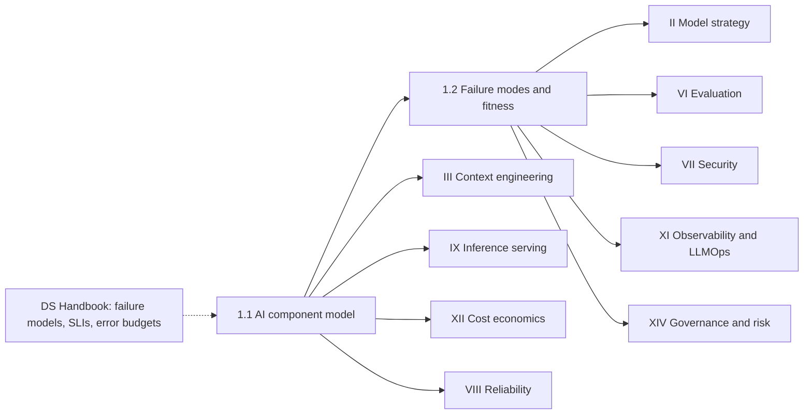
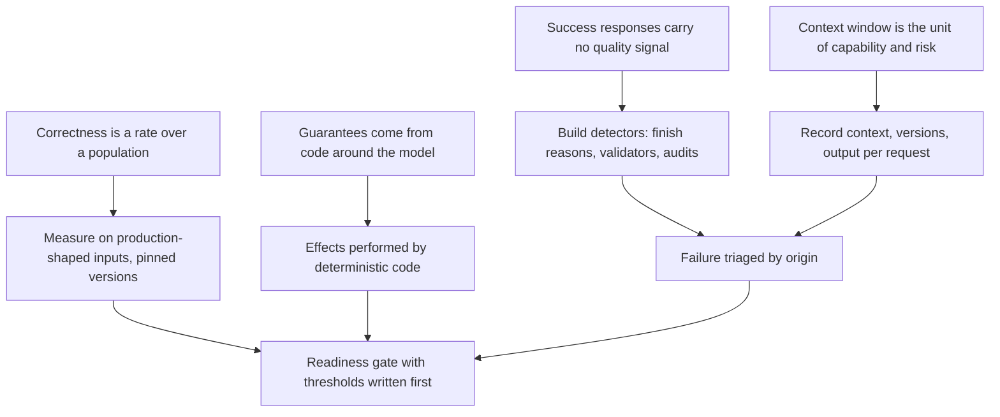

Bu bölüm, bir sistem büyük dil modelini (LLM) çağırdığında mimarın neyi entegre ettiğini ve o model production'daki bir kararın üzerine konmadan önce nelere karar verilmesi gerektiğini tanımlar. Handbook'un en kısa bölümüdür ve diğer bütün bölümler ona dayanır; çünkü kitabın geri kalanı üç şeyi burada çözülmüş kabul eder: model destekli bir bileşen her çağrıda değil, bir girdi popülasyonu üzerinde belli bir oranla doğrudur; hataları normal cevaplar olarak gelir ve herhangi bir şey düzeltilmeden önce bir katmana atanmaları gerekir; bir modeli bir göreve koymanın kanıtı ise bilinçli olarak, production'a benzeyen girdilerle ve ölçülmüş bir alternatife karşı üretilmelidir.

Bölümün çözdüğü gerilim, bir modelin yapabildikleri ile bir sistemin vaat edebildikleri arasındadır. Yetenek gerçektir: model, deterministik kodun işleyemediği açık uçlu girdileri işler. Bedeli de aynı ölçüde gerçektir: çağrı başına doğruluk yoktur, yeniden çalıştırarak tekrarlanabilirlik yoktur, yanlış bir cevapta hata sinyali yoktur ve ölçülmüş bir kalite rakamı production'daki sistemden çok ölçümün koşullarını anlatır. Sonraki bölümler garantileri validation, retrieval, eval, izolasyon ve yönetişim yoluyla geri kazanır; bu bölüm ise bu mekanizmaların her birine neden ihtiyaç duyulduğunu ve neyi geri getirip neyi getiremeyeceğini ortaya koyar.

Bölüm en başta durur, çünkü kelime dağarcığı yeniden tanımlanmadan her yerde kullanılır: bir bileşen sözleşmesinin sert ve yumuşak katmanları, modelin etrafındaki deterministik kabuk, ölçülen oran ile teslim edilen oran, hata kökeni, uygunluk kararı ve hazırlık kapısı. Bu bölümü atlayan bir okur sonraki herhangi bir sayfayı yine de kullanabilir, ama bu terimlerle buraya geri dönen bağlantılar olarak karşılaşır. Ürünler, modeller ve düzenlemeler konu sayfalarında yalnızca tarihli örnekler olarak geçer; bu bölümde tanımlanan özellikler ve yöntemler Kasım 2026 itibarıyla production'da kullanılan LLM tabanlı sistemler için geçerlidir.

## Bölüm Handbook'un Geri Kalanına Nasıl Bağlanır

Bölümün iki alt bölümü vardır. İlki bileşeni tanımlar; ikincisi bu tanımı bir lansmandan önce ve lansman etrafında verilen kararlara uygular. Sonraki her bölüm bunlardan birini ya da ikisini kullanır.

*Bölümün iki alt bölümü ve her birinin üzerine doğrudan inşa edilen bölümler. Kesikli kenar, yardımcı handbook'tan varsayılan bilgiyi gösterir.*

Diyagramdaki ayrım, her alt bölümün ne sağladığını izler. Bileşen modeli mekaniktir: token'lar, context window, sampling ve olasılıksal sözleşme. Bu yüzden tek bir çağrının ne tükettiği ve ne döndürdüğüyle ilgilenen bölümleri besler: context engineering, inference serving, maliyet ekonomisi ve çıktı güvenilirliği. Hata türleri ve amaca uygunluk alt bölümü ise kararlar ve kanıtla ilgilidir: hataları kökenlerine göre sınıflamak, model ile alternatifleri arasında seçim yapmak ve production'a taşınan kanıt üretmek. Bu yüzden karar veren, ölçen, savunan, işleten ve onaylayan bölümleri besler. Kenarlar tek bağımlılıklar değil, en güçlü bağımlılıklardır; handbook'taki neredeyse her sayfa bir noktada olasılıksal sözleşmeye geri döner.

## Alt Bölümler

[AI Bileşen Modeli](/ai-systems-architecture/tr/foundations/ai-component-model/), bir LLM'in, mimarın sözleşmeler, maliyet ve hatalar hakkında akıl yürütebileceği düzeyde nasıl bir bileşen olduğu sorusunu yanıtlar. Doğruluğun çağrı başına bir özellik değil bir oran olduğunu gösterir ve bir bileşenin sözleşmesini, kodun her çağrıda zorladığı sert bir katman ile yalnızca ölçülebilen yumuşak bir katmana ayırır; tek bir API çağrısını token, context ve sampling düzeyinde adım adım izler, finish reason'ın dönen metnin tamamlanıp tamamlanmadığını nasıl belirlediği de dahil; ve bir yetenek skorunu teslim edilen güvenilirlikten ayırarak aradaki tekrarlı deneme, dağılım ve zaman açıklarını adlandırır. Önemlidir, çünkü kitabın ilerleyen kısımlarındaki sessiz hataların neredeyse hepsi bu bileşene uygulanmış deterministik bir varsayımla ya da yanlış sayıya göre boyutlandırılmış bir özellikle başlar.

[Hata Türleri ve Amaca Uygunluk](/ai-systems-architecture/tr/foundations/failure-and-fit/), bir lansmandan önce kanıtla çözülmesi gereken üç soruyu yanıtlar: belirli bir hataya hangi katman yol açtı, bir görev model mi, kural mı, klasik makine öğrenmesi mi yoksa insan mı kullanmalı ve ikna edici bir prototip göründüğü şeyi gerçekten söylüyor mu. Kaydedilmiş trace'ler üzerinde işleyen bir triage sırasıyla birlikte bir hata taksonomisi, ispat yükünü modele yükleyen ve hibrit tasarımları olağan sonuç sayan kapılı bir uygunluk kararı ve dondurulmuş bir held-out set'ten shadow mode üzerinden sınırlı bir pilota uzanan, eşikleri ölçümden önce yazılan aşamalı bir kanıt yolu sunar. Önemlidir, çünkü AI projelerindeki en pahalı hatalar kötü çıktılar değil; yanlış katmana, yanlış tekniğe ya da production oranı sanılan bir demo rakamına harcanan aylardır.

| Alt bölüm | Yanıtladığı soru | Ne zaman açılmalı |
|---|---|---|
| AI Bileşen Modeli | Model destekli bir bileşen neyi garanti eder, neyi tüketir, neyi teslim eder? | Bir model etrafında sözleşme, retry, cache ya da test tasarlarken; maliyet ya da kapasite tahmin ederken; bir özelliği benchmark'a göre boyutlandırırken |
| Hata Türleri ve Amaca Uygunluk | Ne ters gitti, burada model kullanılmalı mı ve kanıt bir lansmanı destekliyor mu? | Kötü çıktıları ya da olayları triage ederken; yeni bir AI özelliğinin kapsamını çizerken; bir demo ya da pilot sonucu tarih ya da bütçe belirlemek üzereyken |

## Kitabın Geri Kalanının Üzerine Kurulduğu Fikirler

Bu bölümdeki dört fikir sonraki neredeyse her alt bölümde yeniden karşımıza çıkar. Her biri kendi kanonik sayfasında eksiksiz geliştirilir; burada bir araya getirilmelerinin amacı, sonraki bir sayfa onları tek bir cümle ve bir bağlantıyla kullandığında okurun tanıyabilmesidir.

*Bölümün tekrar eden dört fikri ve zorunlu kıldıkları uygulamalar. Sağdaki uygulamalar, sonraki bölümlerin ayrıntılı olarak hayata geçirdiği şeylerdir.*

İlk fikir, yani doğruluğun bir oran olması, sonraki bölümlerin neden canlı trafiğe benzeyen eval set'lerinde, sabitlenmiş model versiyonlarında ve tek örnekli testler yerine istatistiksel testlerde ısrar ettiğini açıklar. İkincisi, yani başarılı cevapların hiçbir kalite sinyali taşımaması, bu handbook'ta izlemenin neden yalnızca hata oranı ve gecikme değil, birinin bilerek kurduğu kalite göstergeleri anlamına geldiğini açıklar: finish reason payları, validator ret oranları ve kabul edilmiş çıktılardan alınan denetlenmiş örnekler. Üçüncüsü, yani context window'un hem modelin kullanabildiği hem de onu yönlendirebilen şey olması, context derlemenin neden tasarlanmış ve bütçelenmiş bir yapı olarak ele alındığını, retrieval ile gelen içeriğin neden güvenilmeyen girdi sayıldığını ve her isteğin context'inin denetim ve triage için neden kaydedildiğini açıklar. Dördüncüsü, yani her garantinin modelden değil deterministik koddan gelmesi, her referans tasarımda şemaların, yetkilendirme kontrollerinin ve yan etkilerin neden modelin dışında kaldığını açıklar.

Diyagram fikirlerin nasıl birleştiğini de gösterir. Kökene göre triage, kaydedilmiş context'e ihtiyaç duyar; hazırlık kapısı ise hem triage edilmiş hatalara hem de sabitlenmiş versiyonlar üzerinde yapılmış ölçümlere ihtiyaç duyar. Hata türleri ve amaca uygunluk alt bölümünün bileşen modelinden sonra gelmesinin nedeni budur: her isteğin ne gördüğünü ve çıktıyı hangi versiyonun ürettiğini kaydetmeyen bir ekip bu alt bölümün yöntemlerini uygulayamaz.

## Bölümü Okumak

İki alt bölümü sırayla okuyun. Bileşen modeli, hata türleri ve amaca uygunluk alt bölümünün yeniden tanımlamadan kullandığı kelime dağarcığını tanıtır ve üç konu sayfası tek oturuşta okunabilecek kadar kısadır. Her alt bölümün genel bakış sayfası bir okuma sırası önerir ve belirli bir problemle gelen okur için makul olan kısa yolları adlandırır.

Bölümün tamamını okumayacak okurlar için üç giriş noktası bilinmeye değer. Maliyet, kapasite ya da kota ihtiyaçlarını tahmin eden bir okur, token ve window aritmetiği kendi başına ayakta duran [Bir Sistem Bileşeni Olarak LLM'in Anatomisi](/ai-systems-architecture/tr/foundations/ai-component-model/llm-anatomy/) sayfasıyla başlayabilir. Bir olayı triage eden ya da hata etiketleri kuran bir okur [AI Hata Türlerinin Taksonomisi](/ai-systems-architecture/tr/foundations/failure-and-fit/failure-mode-taxonomy/) ile başlayabilir. Elinde bir pilot sonucu ve bir lansman talebi olan okur [Demodan Production'a](/ai-systems-architecture/tr/foundations/failure-and-fit/demo-to-production/) sayfasını okumalı ve aritmetik gerektirdiğinde oradaki bağlantıları izleyerek [Yetenek ve Güvenilirlik](/ai-systems-architecture/tr/foundations/ai-component-model/capability-vs-reliability/) sayfasına dönmelidir.

## Ön Koşullar ve Fikirlerin Uygulandığı Yerler

Bölümün bu handbook içinde ön koşulu yoktur. Kitabın tamamının varsaydığı dağıtık sistemler altyapısını varsayar ve yardımcı handbook'taki üç sayfa doğrudan ilgilidir. [Deterministik ve Olasılıksal Hata Modelleri](https://gorkemsari.github.io/distributed-systems/tr/foundations/system-models/deterministic-vs-probabilistic/), oran olarak modellenen arızaları ele alır; bu, bu bölümün konusundan farklıdır: doğru çalışan ama yine de belli bir oranla yanlış çıktı döndüren bir bileşen. [Hata Modelleri: Crash-Stop, Crash-Recovery, Omission](https://gorkemsari.github.io/distributed-systems/tr/foundations/system-models/failure-models/), hata taksonomisinin çıkış noktası olan sınıflandırmadır. [SLI (Servis Seviyesi Göstergesi)](https://gorkemsari.github.io/distributed-systems/tr/observability/slo-sla-error-budgets/sli/), gösterge bir kalite oranına dönüştüğünde güvenilirlik sayfasının yeniden kullandığı yöntemi sağlar.

Fikirler sonraki neredeyse her bölümde uygulanır ve en doğrudan devamı beş yerdedir. [Model Stratejisi & Seçimi](/ai-systems-architecture/tr/model-strategy/), yol üzerine bir model konduktan sonra uygunluk kararına göre hareket eder ve [Prompting, RAG ve Fine-Tuning](/ai-systems-architecture/tr/model-strategy/lifecycle-and-adaptation/prompting-rag-finetuning/) ile başlar. [Context Engineering](/ai-systems-architecture/tr/context-engineering/), window ve token aritmetiği üzerine kurulur ve [Context Window Ekonomisi](/ai-systems-architecture/tr/context-engineering/context-design/context-window-economics/) ile başlar. [Güvenilirlik & Dayanıklılık](/ai-systems-architecture/tr/reliability/), [Çıktı Doğrulama ve Onarım Döngüleri](/ai-systems-architecture/tr/reliability/output-reliability/output-validation/) dahil olmak üzere deterministik kabuğu inşa eder. [Evaluation & Kalite Mühendisliği](/ai-systems-architecture/tr/evaluation/), bir yeteneği bilinen bir teslim oranına dönüştüren ölçümün sahibidir ve [Neden Eval](/ai-systems-architecture/tr/evaluation/testing-foundations/why-evals/) ile başlar. [Observability & LLMOps](/ai-systems-architecture/tr/llmops/) ise taksonominin sınıfladığı şeyi [Kalite İzleme ve Drift Tespiti](/ai-systems-architecture/tr/llmops/observability/quality-drift/) ile [AI Incident Yönetimi](/ai-systems-architecture/tr/llmops/operations/incident-management/) üzerinden işletir.

İki bölüm daha, hata türleri ve amaca uygunluk alt bölümüne daha katı bir anlamda bağlıdır. [AI Güvenliği](/ai-systems-architecture/tr/security/), [AI Tehdit Modellemesi](/ai-systems-architecture/tr/security/threats/threat-modeling/) ile başlayarak düşmanca hata kökenini ele alır ve savunmaları, context window içinde hiçbir yetki sınırı bulunmadığı kuralını varsayar. [Yönetişim, Risk & Uyum](/ai-systems-architecture/tr/governance/), uygunluk kararını ve hazırlık kapısını [LLM Sistemleri için Model Risk Yönetimi](/ai-systems-architecture/tr/governance/risk-management/model-risk-management/) üzerinden regüle edilen deployment'lar için onay belgelerine dönüştürür.
