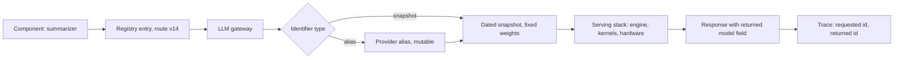
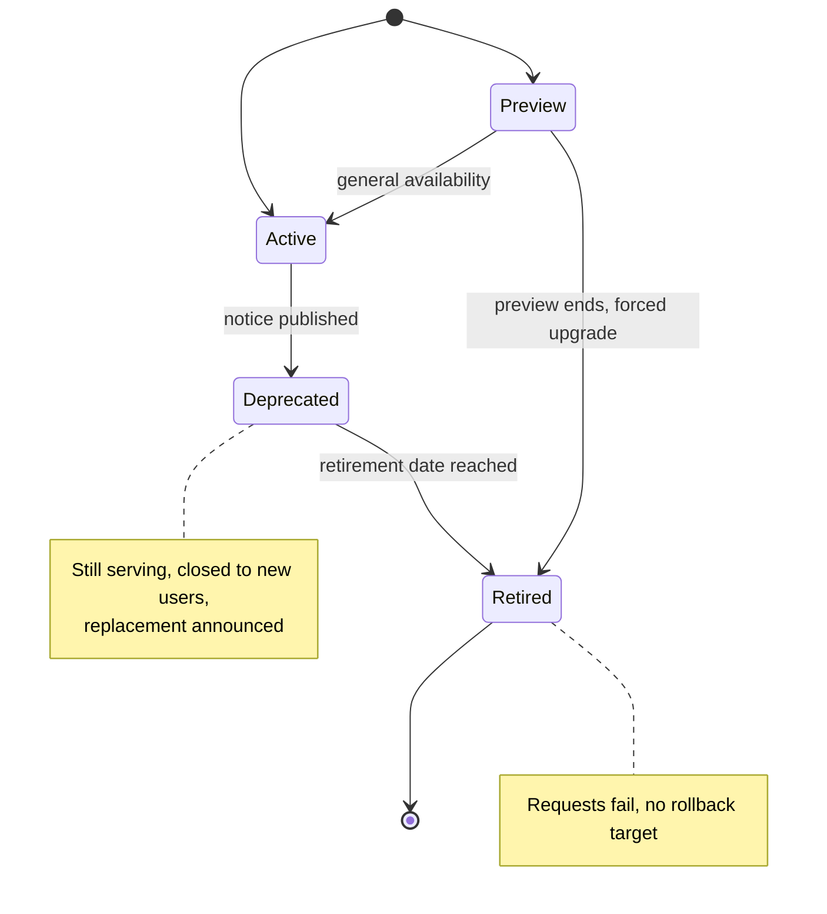
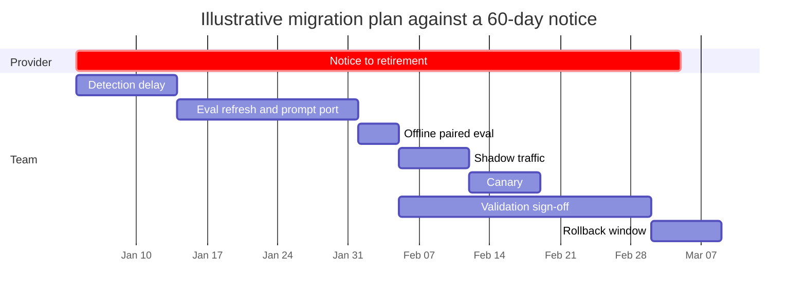
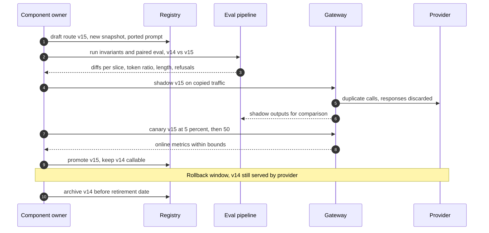
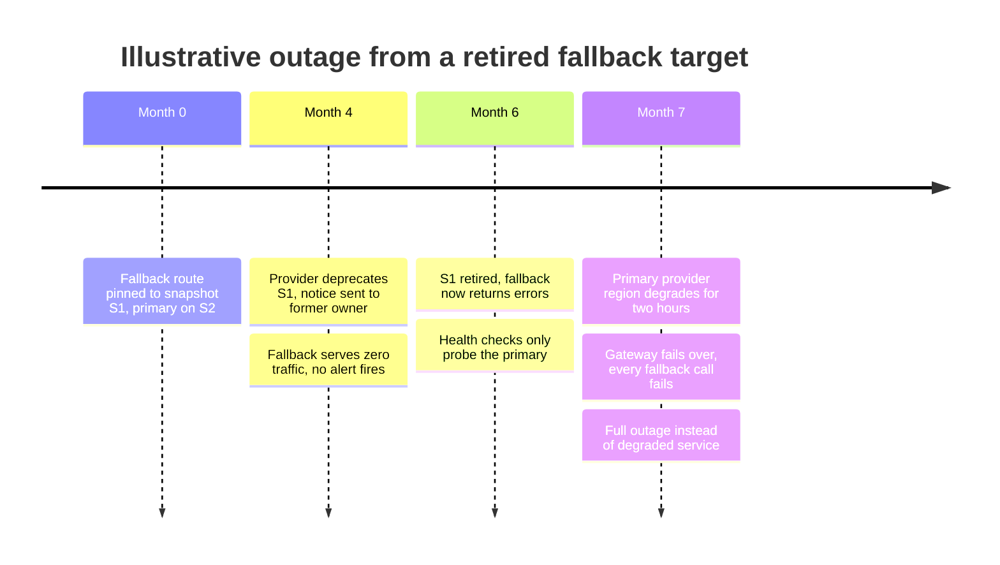

Model versiyonu, bir isteğe hangi eğitilmiş ağırlıkların, hangi tokenizer'ın ve hangi varsayılan davranışın yanıt vereceğini belirleyen tanımlayıcıdır. Hosted provider'lar bunu iki seviyede sunar: tek bir sabit release'i adlandıran tarihli ya da numaralı bir snapshot ve provider'ın o an varsayılan kabul ettiği snapshot'a yönlendirdiği daha kısa bir isim olan alias. Deprecation, provider'ın bir snapshot'ın belirtilen bir tarihte hizmetten kalkacağını duyurmasıdır; retirement ise o tarihin kendisidir ve sonrasında istekler başarısız olur. Migration, bir bileşeni sistemin geri kalanının dayandığı davranışı bozmadan bir model konfigürasyonundan diğerine taşıma işidir.

Sorun şudur: model, bir AI sisteminde arayüzü aynen kalırken davranışı değişebilen ve kullanım ömrünün sonunu başkasının belirlediği tek bağımlılıktır. Bir kütüphane yükseltmesi siz merge ettiğinizde gerçekleşir. Alias'ın taşınması provider karar verdiğinde olur; retirement da eval'leriniz hazır olsun ya da olmasın provider'ın tarihinde gelir. Açık bir versiyon yönetimi olmadan production'daki bir bileşen sizin tarafınızda hiçbir deploy yokken davranış değiştirir ya da ekipte kimsenin takviminde olmayan bir tarihte çalışmayı bırakır.

Temel trade-off, değişikliğin zamanlamasının kimde olduğudur. Bir snapshot'ı pin'lemek her davranış değişikliğini test ettiğiniz bilinçli bir release'e dönüştürür, ama sizi provider'ın saatine göre, kendi release döngünüzün değil onun bildirim süresinin belirlediği bir hızda migration yapmaya zorlar. Bir alias'ı takip etmek migration işini ortadan kaldırır ve iyileştirmeleri otomatik getirir, ama her alias taşınması test edilmemiş bir production değişikliğidir. Open-weight bir modeli self-host etmek saati tamamen geri alır; bedeli serving stack'ini ve modelin runtime'ının güvenlik yamalarını sahiplenmektir. Hiçbir seçenek migration'ı ortadan kaldırmaz; her biri migration'ın planlı mı, zorunlu mu, yoksa sessiz mi olacağını belirler.

## Bir Model Tanımlayıcısı Neyi Sabitler, Neyi Serbest Bırakır

Hosted bir modele giden istek, herhangi bir GPU çalışmadan önce birkaç isimlendirme katmanından geçer. Uygulama "özetleyici" gibi mantıksal bir yetenek ister. Bir registry ya da konfigürasyon bunu bir provider model tanımlayıcısına eşler. Tanımlayıcı bir alias ise provider onu bir snapshot'a çözümler. Snapshot da provider'ın işlettiği ve kendi takvimiyle değiştirdiği bir serving stack üzerinde (inference engine, donanım, sayısal kernel'ler, sampling implementasyonu) çalışır.


*Bir model çağrısının çözümlenmesi. Snapshot'ın solundaki her şey sizin kontrolünüzdedir; alias işaretçisi ve serving stack değildir.*

Bu yoldaki üç şey davranışı değiştirir ve her birinin kendi kontrolü gerekir. Registry kaydı ekibiniz değiştirdiğinde değişir; bu, [Prompt ve Model Registry](/ai-systems-architecture/tr/platform/internal-platform/prompt-model-registry/) sayfasında ele alınan normal release yoludur. Alias işaretçisi provider onu taşıdığında değişir; snapshot pin'lemek bu kaynağı ortadan kaldırır. Serving stack ise pin'lenmiş bir snapshot'ın altında değişir ve sizin kontrol ettiğiniz hiçbir tanımlayıcı bunu engellemez. Anthropic'in Eylül 2025 postmortem'i, [Hosted API, Self-Hosted ve Hibrit Deployment](/ai-systems-architecture/tr/model-strategy/selection-and-deployment/hosted-vs-self-hosted/) sayfasında tartışıldığı gibi, hiçbir model değişikliği olmadan bazı isteklerde çıktı kalitesini düşüren altyapı hatalarını anlatıyordu. Dolayısıyla pin, ağırlıkların ve tokenizer'ın test ettiğiniz ağırlıklar ve tokenizer olduğunu garanti eder; çıktı dağılımının test ettiğiniz dağılım olduğunu garanti etmez.

İstenen ve dönen tanımlayıcı çiftinin loglanması, ilk iki kaynağı gözlemlenebilir kılan şeydir. Çoğu provider API'si çözümlenmiş model adını yanıt gövdesinde döndürür. Yalnızca ne istediğini loglayan bir bileşen, bir incident'tan sonra provider'ın beklediği snapshot'ı sunup sunmadığını söyleyemez. İkisini birden loglayan bir bileşen ise dönen tanımlayıcısı pin'lenmiş olandan farklı olan ilk yanıtta alarm üretebilir; bu da sessiz bir alias taşınmasını dakikalar içinde bir page'e dönüştürür.

Davranışın sabit bir ismin arkasında değiştiğine dair kanıt anekdot düzeyinde değildir. Chen, Zaharia ve Zou, aynı ürün adı altında sunulan GPT-4'ün Mart 2023 ve Haziran 2023 versiyonlarını karşılaştırdı ve asal ile bileşik sayıları ayırt etmedeki doğruluğun %84'ten %51'e düştüğünü, hem GPT-4'ün hem GPT-3.5'in Haziran'da üretilen kodda daha fazla biçim hatası yaptığını ve GPT-4'ün chain-of-thought prompting'i daha az güvenilir biçimde izlediğini buldu (arXiv 2307.09009, Ekim 2023 tarihli v3). Aynı aralıkta bazı görevler iyileşti. Buradan çıkan ders yeni versiyonların daha kötü olduğu değildir; bir versiyon değişikliğinin pek çok davranışı aynı anda ve farklı yönlerde oynattığı, tek bir toplu skorun da hangilerinin oynadığını göstermediğidir.

### Satın Alabileceğiniz Üç Sözleşme

Provider'lar bir tanımlayıcının ne anlama geldiğine dair farklı sözleşmeler sunar ve değişiklik kontrolünün ne kadarının sizde kalacağını bu sözleşme belirler.

Floating bir alias bir arayüzü ve provider'ın o anki önerdiği modeli garanti eder. Hiçbir davranışın günler boyunca kararlı kalmasını garanti etmez. Pin'lenmiş bir snapshot, yayımlanmış retirement tarihine kadar sabit ağırlıkları garanti eder; o tarihten sonra da başarısızlığı garanti eder. Bazı platformlar üçüncü, yönetilen bir seçenek ekler: deployment pin'lenmiştir ve platform onu belirtilmiş bir politikaya göre yükseltir. Örneğin Azure OpenAI, bir deployment üzerinde üç değer alan bir `versionUpgradeOption` sunar: `OnceNewDefaultVersionAvailable` yeni bir varsayılan versiyon belirlendiğinde yükseltir, `OnceCurrentVersionExpired` yalnızca mevcut versiyon retire olduğunda yükseltir, `NoAutoUpgrade` ise hiç yükseltmez ve deployment retirement'ta çalışmayı bırakır. Standard deployment'lar bölge bölge ilerleyen bir takvimle yükseltilir; provisioned deployment'lar otomatik yükseltilmez (Microsoft'un 24 Temmuz 2026'da güncellenen model retirement dokümantasyonuna göre).

`OnceCurrentVersionExpired` çoğu zaman güvenli bir orta yol olarak seçilir ve kalite sözleşmesi olan bir bileşen için üçünün en kötüsüdür. Davranışı retirement tarihine kadar sabit tutar, sonra arada hiçbir eval olmadan tam o tarihte değiştirir; üstelik bu, ekibin bitirmiş olması gereken ama artık başlatmak için bir sebebi kalmayan migration'ın tam zamanıdır. Kullanılacaksa, tarihten çok önce bitmesi planlanmış bir migration'ın arkasında son çare güvenlik ağı olarak kullanılmalıdır.

## Deprecation Yaşam Döngüleri ve Migration Saati

Her hosted provider aynı durum makinesinin bir versiyonunu işletir: model kullanıma açılır, sonra artık önerilmeyen ya da yeni kullanıcılara kapalı olarak işaretlenir ve en sonunda kaldırılır. İsimler ve garanti edilen süreler farklıdır; bu süreler de migration planınızın girdileridir.


*Genelleştirilmiş bir provider yaşam döngüsü. `Deprecated` ile `Retired` arasındaki aralık, eski ve yeni snapshot'ları yan yana çalıştırabileceğiniz tek zamandır.*

Diyagram en önemli özelliği gizler: bir snapshot retire olduğunda artık rollback hedefi olamaz. Her güvenli migration tekniği (shadow trafik, canary, anında rollback) eski ve yeni snapshot'ların aynı anda çağrılabilir olmasını gerektirir. Bu yüzden deprecation penceresi "eskisi bozulana kadar geçen süre" değil, "güvenli bir migration'ın mümkün olduğu süre"dir. O pencerenin son haftasında başlayan bir migration, rollback'i olmayan bir migration'dır.

Aşağıdaki tablo üç provider'ın dokümante edilmiş yaşam döngülerini kaydeder. Bunlar mekanizmanın örnekleridir ve zamanla değişir; bunlara göre plan yapmadan önce güncel dokümantasyonu kontrol edin.

| Provider (Kasım 2026 itibarıyla) | Durumlar | Garanti edilen bildirim ve ömür | Retirement sonrası | Dikkat çeken kısıt |
|---|---|---|---|---|
| Anthropic API | Active, deprecated, retired | Herkese açık yayımlanmış bir modeli retire etmeden önce en az 60 gün bildirim | İstekler başarısız olur | Deprecated, hâlâ çalışan ama artık önerilmeyen ve retirement tarihi atanmış model anlamına gelir |
| Azure OpenAI | Preview, GA, deprecated, opsiyonel legacy, retired | GA retirement tarihi lansmanda 18 ay sonraya ayarlanır (bazı partner modellerde 12 ay); 12. ayda yeni müşterilere kapanır; GA için en az 60 gün, preview için en az 30 gün bildirim | İstekler `410 Gone` döner | Retirement tarihleri uzatılamaz; güvenlik veya uyumluluk sebebiyle kısaltılmış bildirimle acil retirement mümkündür |
| Amazon Bedrock (7 Eylül 2026 ve sonrasında yayımlanan modeller) | Active, Legacy, End-of-Life | Model kartında "EOL no sooner than" tarihi bulunur; çoğu model için 6 ay, bazıları için 45 günlük Legacy dönemi | Model tüm Region'lardan kaldırılır, istekler başarısız olur, otomatik migration yoktur | Legacy'de mevcut müşteriler 15 günlük hareketsizlikten sonra erişimi kaybedebilir; yeni Provisioned Throughput veya fine-tuning işi oluşturulamaz |

Kaynaklar: Anthropic model deprecation dokümantasyonu, Microsoft Azure OpenAI model deprecation ve retirement sayfası (24 Temmuz 2026'da güncellendi), AWS Bedrock User Guide "Model lifecycle". Daha eski Bedrock modelleri burada özetlenmeyen ayrı bir legacy yaşam döngüsü sayfasını izler.

İki satır ikinci bir okumayı hak ediyor. Azure'un retirement tarihlerinin uzatılamayacağını belirtmesi, bir account ekibiyle yapılacak pazarlığın migration planı olmadığı anlamına gelir. Bedrock'un hareketsizlik kuralı ise yalnızca fallback hedefi olarak kullanılan, yani tasarımı gereği haftalarca trafik almayan bir Legacy modelin end-of-life tarihinden önce erişimini kaybedebileceği anlamına gelir; arıza, primary'nin çöktüğü ve fallback'in nihayet çağrıldığı gün ortaya çıkar.

:::caution[Boşta duran bir fallback ilk bozulan şey olabilir]
Fallback route'ları, felaket kurtarma bölgeleri ve çeyrekte bir çalışan batch işleri modellerini nadiren çağırır. Aktiviteye bağlı yaşam döngüsü kuralları, acil retirement'lar ve yalnızca aktif deployment'ı olan subscription'lara gönderilen bildirimler önce bu route'ları vurur. Geçen ay sıfır istek almış olanlar dahil her route'un envanterini çıkarın ve her fallback hedefinden düzenli olarak sentetik bir istek geçirin; böylece retire olmuş ya da erişilemeyen bir hedef gerçek bir incident yerine bir health check'te başarısız olur.
:::

### Lead Time Eşitsizliği

Bir migration, rollback penceresi dahil, eski snapshot retire olmadan bittiğinde güvenlidir. Provider'ın garanti ettiği bildirim süresine `N`, bildirimin yayımlanmasından bileşenin sahibinin harekete geçmesine kadar geçen süreye `D` (tespit gecikmesi), migration lead time'ına `L` ve cutover sonrasında istediğiniz rollback penceresine `R` deyin. Koşul `D + L + R <= N`'dir. `N` dışındaki her terim sizindir ve `N` provider'ın tipik değeri değil, asgari değeridir.

Bu eşitsizlik, [Model Seçim Kriterleri: Çok Kriterli Bir Yöntem](/ai-systems-architecture/tr/model-strategy/selection-and-deployment/selection-criteria/) sayfasında anlatıldığı gibi, model seçiminin versiyon ömrünü neden bir kapı olarak ele aldığını açıklar: dürüstçe hesaplanmış `L` değeriniz provider'ın asgari `N` değerinden uzunsa, her zorunlu migration aceleye gelir ve tek çözümler `L`'yi kısaltmak, migration'lara herhangi bir bildirim gelmeden başlamak ya da daha uzun garanti ömrü olan bir provider veya deployment seçeneği seçmektir. `D`'nin neden önemli olduğunu da açıklar. Kimsenin okumadığı ortak bir posta kutusuna ya da bileşen sahibi yerine subscription sahibine giden bir bildirim, iş başlamadan 60 günlük bir pencerenin üçte birini tüketebilir.

### Hesaplamalı Örnek: Altmış Gün Yeterli mi?

Örnek olarak, bir bankada asgari 60 günlük bildirimi yayımlayan bir provider'ın snapshot'ına pin'lenmiş bir doküman özetleme bileşeni varsayalım. Ekip lead time'ını gerçekten yürüttüğü adımlardan tahmin eder: eval setini güncel production örnekleriyle yenilemek (5 iş günü), prompt'u yerine geçecek modele taşıyıp ayarlamak (8), offline eşleştirilmiş değerlendirme ve inceleme (3), bir haftalık iş döngüsü boyunca shadow trafik (7 takvim günü), aşamalı bir canary (7 takvim günü) ve bu kurumda bir model değişikliği için gereken, 25 takvim günü süren model risk doğrulama onayı. Takvim günü cinsinden, 16 iş günü yaklaşık 22 gün sayıldığında, `L` yaklaşık 22 + 7 + 7 + 25 = 61 gündür; bu tek başına bildirim süresinden uzundur. Ekip tam cutover sonrasında 7 günlük bir rollback penceresi `R` istemektedir.


*Plan sığmıyor: doğrulama shadow ve canary ile paralel yürüdüğü halde rollback penceresi yine retirement tarihinden sonra bitiyor.*

Doğrulayıcı offline sonuçları ve gelen shadow verisini inceleyebildiği için genellikle kabul edilebilir olan, doğrulamayı shadow ve canary ile paralel yürütme yaklaşımı, kritik yolu iş başladıktan sonra 18 + 4 + 25 = 47 güne indirir. 10 günlük bir tespit gecikmesiyle cutover 57. güne denk gelir ve 7 günlük rollback penceresi 64. günde, yani retirement'tan dört gün sonra biter. Provider yaşam döngüsü bildirimlerini bileşen sahibine yönlendirip yaşam döngüsü durumunu programatik olarak sorgulayarak `D` 2 güne indirildiğinde cutover 49. güne denk gelir, pencere 56. günde biter ve plan dört günlük payla sığar. Sayılar örnek amaçlıdır; yapı geneldir. Regüle bir kurumda `L`'ye genellikle doğrulama hakim olur, mühendislik eforuyla sıkıştırılamaz ve geriye kalan tek güvenilir kaldıraç `D` ya da migration'a bildirim geldiğinde değil, yerine geçecek model kullanıma açıldığında başlamaktır.

Aynı bileşen, bir migration'ın neden bir eval skorundan ibaret olmadığını da gösterir. Yerine geçecek modelin tokenizer'ının bankanın Türkçe ve İngilizce dokümanları için yaklaşık 1,2 kat daha fazla token ürettiğini varsayalım (örnek amaçlı; gerçek oran, [Bir Sistem Bileşeni Olarak LLM'in Anatomisi](/ai-systems-architecture/tr/foundations/ai-component-model/llm-anatomy/) sayfasında anlatıldığı gibi ölçülmelidir). Context bütçesi 120.000 input token'dır ve birleştirilmiş input'ların 99. yüzdeliği bugün 104.000 token'dır. Yeni tokenizer ile bu yaklaşık 125.000 olur; dolayısıyla isteklerin en üstteki kabaca %1-2'si artık bütçeyi aşar ve ya provider tarafından reddedilir ya da context assembler tarafından kırpılıp dokümanın sonunu kaybeder. Token başına fiyat değişmese bile aynı trafik yaklaşık %20 daha pahalıya gelir. Bu etkilerin hiçbiri, item'ları production'daki uzun kuyruktan kısa olan bir offline eval'de görünmez; ikisi de bileşenin kalite skoru yerine invariant'larını yeniden ölçerek bulunur.

## Model Değişikliğini Bir Release Olarak Yürütmek

Bir migration ister retirement'ın zorlamasıyla ister daha iyi bir model çıktığı için seçilmiş olsun aynı şekle sahiptir: bileşenin neye dayandığını belirleyin, adayı buna göre ölçün, eski snapshot hâlâ varken onu production'a kademeli olarak açın ve neyin değiştiğini kaydedin. Prompt, model ve konfigürasyon için genel değişiklik süreci [Prompt, Model ve Konfigürasyon için Değişiklik Yönetimi](/ai-systems-architecture/tr/llmops/operations/change-management/) sayfasına aittir; bu bölüm modelin kendisini değiştirmeye özgü olanı ele alır.


*Kapılı adımlar dizisi olarak bir migration. 4-8. adımlar yalnızca provider eski snapshot'ı hâlâ sunarken mümkündür.*

1. adım mevcut route'u düzenlemek yerine yeni bir route versiyonu oluşturur. Route; snapshot'ı, prompt versiyonunu, sampling ve effort parametrelerini, çıktı limitlerini ve varsa tool şemalarını bir arada paketler, çünkü yeni bir model eski prompt'la nadiren iyi çalışır ve bir rollback'in hepsini birlikte geri getirmesi gerekir. Prompt'lar belirli bir modelin eğilimlerine göre ayarlanır: bir modelin bir formatı izlemesi için gereken vurgu bir sonrakini katılaştırabilir, bir modelin alışkanlığını düzelten örnekler de bir başkası için gereksiz ya da zararlı olabilir. Prompt'u taşımak migration'ın parçasıdır ve eski ile yeni prompt'lar snapshot'larıyla çift olarak versiyonlanır.

2. adım iki farklı şeyi ölçer. Invariant'lar sistemin geri kalanının varsaydığı özelliklerdir: yeni tokenizer altında istek başına token sayıları, yüksek yüzdeliklerde context'e sığma, çıktı uzunluğu ve reasoning token dağılımları (bunlar latency'yi, timeout'ları ve maliyeti belirler; [Reasoning Model'ler ve Test-Time Compute](/ai-systems-architecture/tr/model-strategy/model-landscape/reasoning-models/) sayfasındaki reasoning uzunluğu incident'ı bunu gösterir), structured output geçerliliği, tool call argüman formatları, reddetme oranı ve dil davranışı. Bunlar tercih için karşılaştırılmaz, bütçelere göre kontrol edilir. Kalite karşılaştırması ise eski ve yeni route'ların aynı item'lar üzerinde, slice bazında kırılmış eşleştirilmiş bir değerlendirmesidir, çünkü bir versiyon değişikliği farklı davranışları farklı yönlerde oynatır. Eşleştirilmiş karşılaştırmanın ve quality gate'lerin istatistiği [CI/CD'de Eval: Regression Suite'leri ve Quality Gate'ler](/ai-systems-architecture/tr/evaluation/evals-in-delivery/evals-in-cicd/) sayfasında ele alınır.

4-8. adımlar, Distributed Systems Handbook'un [Gölge Dağıtım: Prodüksiyon Trafiğini Klonlamak](https://gorkemsari.github.io/distributed-systems/tr/deployment/deployment-patterns/shadow-deployment/) ve [Canary Sürümü: Aşamalı Trafik Kaydırma](https://gorkemsari.github.io/distributed-systems/tr/deployment/deployment-patterns/canary-release/) sayfalarında anlattığı deployment desenlerini uygular. Bir model için iki şey farklıdır. Shadow trafik gerçek para tutar, çünkü kopyalanan her çağrı faturalanan bir inference'tır; bu yüzden shadow genellikle tam değil örneklenmiş olarak yapılır. Shadow çıktıları da eşitlikle karşılaştırılamaz; offline eval'in kullandığı aynı judge'lar ve kontroller ile invariant'lar üzerinden karşılaştırılır, gateway'in onları eval pipeline'ına geri göndermesinin sebebi budur. Online karşılaştırma yöntemleri ve istatistikleri [Online Deneyler: A/B Test, Shadow Mode, Canary](/ai-systems-architecture/tr/evaluation/evals-in-delivery/online-experimentation/) sayfasına aittir.

9. adım yeni route'u eskisini kaldırmadan terfi ettirir. Rollback penceresi ancak v14 çağrılabilir kaldığı sürece gerçektir ve provider bunu yalnızca retirement'a kadar garanti eder. 10. adım eski route'u açıkça arşivler; böylece hiçbir fallback, batch işi ya da unutulmuş ortam hizmetten kalkmak üzere olan bir snapshot'a referans vermeye devam etmez.

### Eski Modele Bağlı Kalan Diğer Şeyler

Bir model değişikliği route'tan fazlasını geçersiz kılar. Birkaç artefakt, onları üreten snapshot'a sessizce bağlıdır ve yalnızca route'u kapsayan bir migration kontrol listesi bunları geride bırakır.

Model versiyonu olmadan anahtarlanmış yanıt cache'leri cutover sonrasında eski modelin çıktılarını sunar, tek bir bileşende iki davranışı karıştırır ve migration'ı izlemeden gizler; cache'ler pin'lenmiş model ve prompt versiyonlarıyla anahtarlanır ve cutover'da [Semantic Caching](/ai-systems-architecture/tr/platform/ai-gateway/semantic-caching/) sayfasında anlatıldığı gibi temizlenir ya da ayrı bir namespace'e alınır. Fine-tune edilmiş modeller belirli bir base snapshot'tan türetilir ve base retire olduğunda fine-tune da genellikle onunla gider; yerine geçecek olan, kendi eval'i olan yeni bir base üzerinde yeni bir eğitim çalışmasıdır ve [Fine-Tuning ve Distillation: Entegrasyon Perspektifi](/ai-systems-architecture/tr/model-strategy/lifecycle-and-adaptation/finetuning-distillation/) sayfasında ele alınır. Embedding modelleri ise tamamen farklı bir durumdur: iki embedding modelinin ürettiği vektörler karşılaştırılamaz, dolayısıyla birini değiştirmek corpus'u yeniden embed etmek demektir; bu bir route değişikliği değil, [Embedding Model Seçimi ve Yeniden Indexleme Maliyeti](/ai-systems-architecture/tr/retrieval/ingestion-indexing/embedding-models/) sayfasına ait bir yeniden indexleme projesidir. LLM-as-judge değerlendiricileri de modeldir; migration sırasında judge'ın snapshot'ı değişirse eval artık yalnızca adayı ölçmez.

:::tip[Judge'ı adaydan ayrı migrate edin]
Eval judge'ı ve production modeli aynı provider'ı paylaştığında ikisi de aynı bildirimle deprecate edilebilir. Judge'ı kendi snapshot'ına pin'leyin, insan etiketlerine karşı kendi uyum kontrolü olan ayrı bir değişiklikle migrate edin ve judge'ı ile değerlendirilen modeli asla aynı release'te değiştirmeyin: oynayan bir skor ikisinden birinden gelebilir ve release size hangisi olduğunu söyleyemez.
:::

## Pin'leme Stratejilerinin Karşılaştırması

Versiyonlama sözleşmesi bileşen bazında; bileşenin kaliteye duyarlılığına, değişiklik kontrolü yükümlülüklerine ve ekibin `L`'yi kısa tutabilme kapasitesine göre seçilir.

| Strateji | Davranış kararlılığı | Değişikliğin zamanlamasını kim belirler | Süregelen iş | Kullanım ömrü sonunda ne olur | Ne zaman tercih edilir |
|---|---|---|---|---|---|
| Floating alias | Günler boyunca yok; her alias taşınması bir değişikliktir | Provider | Bir şey bozulana kadar yok | Alias ilerler; sert bir arıza olmaz | Prototipler, kalite sözleşmesi olmayan iç araçlar, en yeni modelin gereksinim olduğu bileşenler |
| Pin'lenmiş snapshot, planlı migration | Retirement'a kadar sabit ağırlıklar | Siz, provider'ın bildirim süresi içinde | Envanter, yaşam döngüsü izleme, her retirement için bir migration | Migration gecikirse sert arıza | Kalite, güvenlik veya uyumluluk sözleşmesi olan her production bileşeni |
| Pin'li, süre dolunca auto-upgrade | Retirement'a kadar sabit, sonra eval olmadan değişir | Provider'ın retirement tarihi | Düşük | Retirement tarihinde test edilmemiş davranış değişikliği | Yalnızca planlı bir migration'ın arkasında güvenlik ağı olarak, asla plan olarak değil |
| Pin'li, yeni varsayılanda auto-upgrade | Provider her yeni varsayılan belirlediğinde değişir | Provider | Düşük | Retirement'tan çok önce yükseltilmiş olur | Floating alias ile aynı durumlar, platform alias sunmadığında |
| Self-hosted open-weight | Ağırlıklar süresiz sabit; serving engine ve sürücüler yine değişir | Siz | Serving stack, güvenlik yamaları, kapasite | Dış retirement yok; ne zaman değiştireceğinizi siz seçersiniz | Uzun doğrulama döngüleri, data residency kısıtları veya yıllarca değişmeden kalması gereken bileşenler |

Self-hosted satırı migration'dan muaf değildir. Open-weight modeller retire olmaz, ama serving engine yükseltmeleri sayısal davranışı ve parametre işlemeyi değiştirir; ağırlıkların doğrulandığı donanım nesli de eninde sonunda filodan çıkar. Fark, zamanlamayı sizin seçmenizdir; doğrulama bir çeyrek sürüyorsa bu operasyonel maliyete değebilir. Ekonomisi [Self-Hosted ve API: Toplam Sahip Olma Maliyeti](/ai-systems-architecture/tr/economics/understanding-cost/tco/) sayfasındadır.

### Yaşam Döngüsünü Route'a Kaydetmek

Bir migration'ı planlanabilir kılan alanlar bir tabloda değil, tanımladıkları snapshot'ın yanında, route tanımında yer alır. Asgari bir şekil:

```yaml
route: summarizer
version: 15
model:
  provider: vendor-a
  snapshot: model-b-2026-10-01      # never an alias in production
  retires_no_earlier_than: 2028-04-01
  lifecycle_source: provider_api    # polled daily, not read from email
rollback:
  route_version: 14                 # must stay callable during the window
  window_days: 7
prompt_version: summarizer-prompt-31  # ported for model-b, paired with snapshot
invariants:
  p99_input_tokens_max: 115000      # measured with the new tokenizer
  p95_output_tokens_max: 1200
  refusal_rate_max: 0.01
owner: team-docs-ai                 # receives lifecycle notices
eval_suite: summarizer-golden-v9
```

Her alan hesaplamalı örnekteki boşluklardan birini kapatır. `retires_no_earlier_than`, zamanlanmış bir işin her route için `N` eksi geçen süreyi hesaplamasını ve kalan pencere ekibin kayıtlı `L` değerinin altına düştüğünde alarm üretmesini sağlar. `lifecycle_source`, bazı provider'ların yaşam döngüsü durumunu programatik olarak sunduğunu yansıtır; bu da `D`'yi "birisi e-postayı okuduğunda"dan bir güne indirir. `owner`, bildirimleri işi yapacak kişilere yönlendirir. `invariants` bloğu, migration'ın 2. adımının kontrol ettiği şeydir ve eşikleri yeni modelin tokenizer'ıyla ölçülmüştür. Alan adları örnek amaçlıdır; bunları saklayan registry [Prompt ve Model Registry](/ai-systems-architecture/tr/platform/internal-platform/prompt-model-registry/) sayfasında, bir migration'ı konfigürasyon değişikliği olarak tutan provider'dan bağımsız arayüz ise [Vendor Lock-in ve Abstraction Katmanı](/ai-systems-architecture/tr/model-strategy/lifecycle-and-adaptation/vendor-lock-in/) sayfasında anlatılır.

Versiyon tanımlayıcıları denetim için de önemlidir. Regüle bir sistem, belirli bir çıktıyı hangi snapshot'ın ürettiğini aylar sonra söyleyebilmelidir; bu yüzden dönen model tanımlayıcısı ve route versiyonu, [AI Çıktıları için Data Lineage ve Provenance](/ai-systems-architecture/tr/data-governance/quality-provenance/lineage-provenance/) sayfasında anlatıldığı gibi trace'e ve çıktı kaydına girer. LLM'i model risk yönetişimi altında bir model olarak ele alan kurumlarda snapshot değişikliği bir doğrulama olayıdır ve migration kanıtları (eşleştirilmiş eval, invariant kontrolleri, shadow sonuçları), [LLM Sistemleri için Model Risk Yönetimi](/ai-systems-architecture/tr/governance/risk-management/model-risk-management/) sayfasında anlatıldığı gibi doğrulama dosyasının kendisidir. Güvenlik davranışı da oynayan şeylerin arasındadır: reddetme sınırları, prompt injection'a direnç ve kişisel verinin işlenmesi snapshot'lar arasında değişebilir; bu yüzden [Red Teaming ve Jailbreak Testleri](/ai-systems-architecture/tr/security/defenses/red-teaming/) sayfasındaki red-team ve injection suite'leri aday üzerinde canary'den önce çalışır, sonra değil.

## Hata Türleri ve Operasyon

Versiyon arızaları iki gruba ayrılır. Sert arızalar bir tarihte olur: retire olmuş bir snapshot hata döner ve bileşen durur. Yumuşak arızalar davranış her oynadığında olur: hiçbir şey hata vermez, kalite, maliyet veya latency kayar. Sert olanların tespiti kolay, kaçırılmaları pahalıdır; yumuşak olanlar istek başına ucuzdur ve haftalarca sürebilir.


*Doğru bir fallback tasarımının, hedefi boştayken retire olduğu için başarısız olduğu örnek amaçlı bir incident.*

Zincirin üç halkası vardır ve herhangi birini kırmak kesintiyi önler. Bildirim artık route'un sahibi olmayan bir kişiye ulaştı, dolayısıyla `D` sınırsızdı. Fallback hiç trafik almıyordu, dolayısıyla retirement normal işleyişte hata üretmedi. Health check'ler yalnızca primary'yi yokluyordu, dolayısıyla bozuk fallback ancak absorbe etmek için kurulduğu incident ile fark edildi. Fallback tasarımının kendisi [Fallback Zincirleri ve Graceful Degradation](/ai-systems-architecture/tr/reliability/provider-failures/fallback-degradation/) sayfasında ele alınır; versiyona özgü savunmalar route seviyesinde sahiplik, boşta olanlar dahil her route için programatik yaşam döngüsü sorgulaması ve her fallback hedefinden geçen sentetik yoklamalardır.

Yumuşak arızaların, bir provider'ın kendi testlerinin sizinkilerin yerini neden tutmadığını gösteren herkese açık bir örneği vardır. OpenAI, 24-25 Nisan 2025'te ChatGPT'deki GPT-4o'ya modeli belirgin biçimde dalkavuk hale getiren bir güncelleme yaydı; güncellemeyi 28 Nisan'da geri almaya başladı ve tam rollback yaklaşık 24 saat sürdü. OpenAI devam yazısında, özellikle davranışı test eden offline değerlendirmelerinin genel olarak iyi göründüğünü, A/B testlerinin modeli deneyen az sayıdaki kullanıcının onu beğendiğine işaret ettiğini ve offline eval'lerinin bu davranışı yakalayacak kadar geniş ya da derin olmadığını yazdı; diğer değişikliklerin yanında davranış sorunlarının lansmanı durduran sorunlar olarak ele alınacağını ve deployment'a sycophancy değerlendirmelerinin ekleneceğini duyurdu (OpenAI, "Expanding on what we missed with sycophancy", 2 Mayıs 2025). Yazı pin'lenmiş bir API snapshot'ını değil ChatGPT'yi konu alıyor, ama ders aktarılabilir: bir provider'ın eval'leri provider'ın önceliklerini ölçer ve bileşeninizin dayandığı davranışı yalnızca sizin eval suite'iniz ölçer.

| Arıza | Tetikleyici | Belirti | Tespit | Azaltma ve kurtarma |
|---|---|---|---|---|
| Sessiz alias taşınması | Provider bir alias'ı başka snapshot'a yönlendirir | Yerel deploy olmadan kalite, uzunluk veya reddetme kayması | Dönen model id beklenenden farklı; sürekli eval | Snapshot pin'leyin; taşınmayı bir migration olarak ele alın; [Kalite İzleme ve Drift Tespiti](/ai-systems-architecture/tr/llmops/observability/quality-drift/) |
| Kaçırılan retirement | Bildirim görülmez ya da gereği yapılmaz | Tek bir route'ta ani sert hatalar | Route ve model id bazında hata oranı; kalan pencere alarmı | Yaşam döngüsü sorgulama; route başına sahip; kısaltılmış shadow ile acil migration |
| Retire olmuş veya erişilemeyen fallback | Boştaki hedef retire olur ya da erişimi kaybeder | Provider incident'ı sırasında failover başarısız olur | Her fallback'ten geçen sentetik yoklamalar | Düzenli yoklama; fallback'leri primary'lerle birlikte migrate edin |
| Tokenizer şişmesi | Yeni snapshot farklı tokenize eder | Uzun input'larda context taşması; değişmeyen fiyatta maliyet artışı | Replay edilen trafikte token oranı; p99 input token | Bütçeleri yeniden ölçün; cutover'dan önce context birleştirmeyi ayarlayın |
| Çıktı uzunluğu kayması | Farklı ayrıntı düzeyi veya reasoning uzunluğu | Timeout'lar, kesilmiş JSON, maliyet sıçraması | Route başına p95 çıktı ve reasoning token | Migration kapısında invariant bütçeleri; limitleri ve timeout'ları ayarlayın |
| Taşınmamış prompt | Eski prompt yeni modelde kullanılır | Belirli slice'larda regresyon, format kayması | Slice bazında eşleştirilmiş eval | Prompt'u snapshot ile versiyonlayın; canary'den önce taşıyıp ayarlayın |
| Karışık versiyonlu cache | Cache anahtarında model versiyonu yok | Eski ve yeni çıktılar yan yana sunulur | Cutover sonrası cache hit payı; çıktı versiyon etiketleri | Cache'leri model ve prompt versiyonuyla anahtarlayın; cutover'da temizleyin |
| Sahipsiz kalan fine-tune | Base snapshot retire olur | Fine-tune endpoint'i başarısız olur veya kaldırılmak üzere planlanır | Envanterde base modellerin yaşam döngüsü | Yeni base üzerinde erken yeniden eğitin; eğitim verisi ve eval'i hazır tutun |
| Rollback hedefi yok | Migration retirement'a yakın bitti | Regresyon eski snapshot gittikten sonra bulunur | `R`'den kısa rollback penceresi | Migration'lara yerine geçecek model çıktığında başlayın; başka bir provider route'una fallback yapın |
| Pin altında serving tarafı değişikliği | Provider altyapı değişikliği | Model id aynıyken kalite kayması | Production örnekleri üzerinde sürekli eval | Kanıtla provider'a escalate edin; sürdüğü müddetçe fallback ile etrafından dolaşın |

Tespit sütunu, sıradan servis telemetrisinin taşımadığı iki sinyale dayanır: provider'ın her yanıtta döndürdüğü model tanımlayıcısı ve örneklenmiş production trafiğinin sürekli değerlendirmesi. İkisiyle birlikte bir versiyon değişikliği etkilenen ilk istekte, kalite etkisi de bir gün içinde görünür hale gelir. Bunlar olmadan ilk sinyal genellikle bir kullanıcı şikayeti ya da bir finans raporudur.

:::danger[Retire olmuş bir snapshot geri getirilemez]
Retirement, rollback hedefini kalıcı olarak ortadan kaldırır. Bir migration'ın regresyonu eski snapshot retire olduktan sonra bulunursa dönülecek bir versiyon yoktur ve geriye kalan her seçenek (aceleyle yapılmış bir prompt düzeltmesi, farklı bir provider, özelliği kapatmak) test edilmemiş yeni bir değişikliktir. Cutover'ı tam rollback penceresi dahil retirement tarihinden önce bitirin; bu mümkün değilse başka bir model üzerinde alternatif bir route'u tarihten sonra değil, önce hazırlayın.
:::

## Ne Zaman Pin'lemeli, Ne Zaman Floating Kullanmalı, Ne Zaman Erken Migrate Etmeli

Çıktısı bir karara, bir müşteriye, downstream bir parser'a ya da bir denetim kaydına giden her production bileşeni için tarihli bir snapshot pin'leyin. Bedeli her retirement için bir migration'dır; kazancı, her davranış değişikliğinin test ettiğiniz bir değişiklik olmasıdır. Pin'leyip unutmayın: yaşam döngüsü izlemesi olmayan bir pin, sessiz bir değişikliği bir tarihteki sert arızaya dönüştürür; bu da ancak birisi o tarihi izliyorsa daha iyidir.

Bir alias'ı yalnızca en yeni modelin gereksinim olduğu ve hiçbir şeyin kararlı davranışa dayanmadığı yerlerde floating kullanın: prototipleme, keşif amaçlı iç asistanlar ve çıktıları kullanılmadan önce bir insanın incelediği offline işler. Structured output, tool call veya regüle kararlar içeren bir bileşende floating kullanmayın; ilk alias taşınması planlanmamış bir release'e dönüşür.

Süre dolunca platform auto-upgrade'ini yalnızca planlı bir migration'ın arkasında bir ağ olarak kullanın. Plan olarak kullanmayın: davranış değişikliğinin retirement tarihinde ve eval olmadan gerçekleşmesini garanti eder, ki pin'lemenin önlemek istediği sonuç tam olarak budur.

Bileşenin lead time'ı provider'ın garanti ettiği bildirim süresine yakınsa ya da ondan uzunsa, kısaltamayacağınız bir doğrulama döngüsü varsa veya fallback'i ve judge'ı ile aynı provider'ı paylaşıyorsa, erken migrate edin: deprecation bildirimi geldiğinde değil, yerine geçecek model kullanıma açıldığında. Erken migration, zorunlu hale gelmeden önce efor harcar; karşılığında provider'ın takviminin elinizden alamayacağı bir rollback penceresi kazanırsınız.

Herhangi bir hosted provider'ın garanti ettiğinden daha uzun süre değişmeden kalması gereken ya da doğrulama döngüsü provider'ın bildirim süresini geniş bir farkla aşan bileşenler için, ekip serving stack'ini sahiplenebiliyorsa self-hosted open-weight modelleri tercih edin. Yalnızca migration'dan kaçmak için self-host etmeyin: serving engine, sürücüler ve donanım yine değişir ve bu değişiklikler de aynı eval kapısını gerektirir.

Bazı komşu konular bununla sık karıştırılır. Kendi API'nizi istemcileriniz için versiyonlamak, yani çağıranların sözleşme versiyonları arasında geçebilmesi farklı bir problemdir ve [API Versiyonlama Stratejileri](https://gorkemsari.github.io/distributed-systems/tr/communication/synchronous-protocols/api-versioning/) sayfasında ele alınır; bir model migration'ı API'nizin istemcilerine görünmez olmalıdır. Yerine geçecek modeli seçmek bir seçim kararıdır, [Model Seçim Kriterleri](/ai-systems-architecture/tr/model-strategy/selection-and-deployment/selection-criteria/) sayfasına aittir ve bu sayfa o kararın verilmiş olduğunu varsayar. Production kalitesindeki drift'i sebebinden bağımsız olarak tespit etmek [Kalite İzleme ve Drift Tespiti](/ai-systems-architecture/tr/llmops/observability/quality-drift/) sayfasına aittir.

## İleri Okuma

- Lingjiao Chen, Matei Zaharia ve James Zou, *How Is ChatGPT's Behavior Changing over Time?*, arXiv:2307.09009, 2023.
- OpenAI, *Expanding on what we missed with sycophancy*, OpenAI blog, 2025.
- Microsoft, *Azure OpenAI model deprecations and retirements*, Microsoft Learn dokümantasyonu, 2026.
- Amazon Web Services, *Model lifecycle*, Amazon Bedrock User Guide.
- Anthropic, *Model deprecations*, Claude platform dokümantasyonu.
- D. Sculley vd., *Hidden Technical Debt in Machine Learning Systems*, Advances in Neural Information Processing Systems (NeurIPS), 2015.
