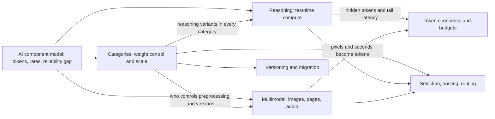
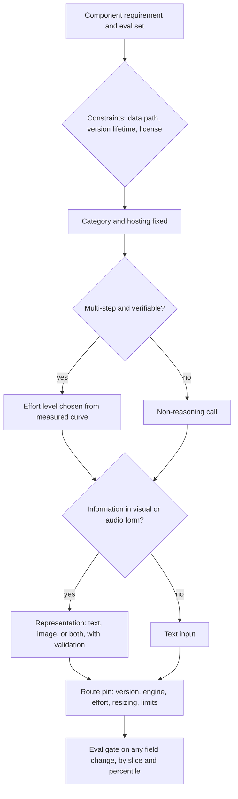

Bir ekip bir bileşen için model seçmeden önce her model ailesinin nasıl bir bileşen olduğunu bilmek zorundadır: onu kim kontrol eder, bir çağrı ne kadar tutar ve ne kadar sürer, içine ne girebilir ve hataları nerede ortaya çıkar. Bu bölüm bu soruyu birbirinden bağımsız üç eksen üzerinden yanıtlar. Birinci eksen ağırlıkları kimin tuttuğu ve modelin ne kadar büyük olduğudur; versiyon kontrolünü, veri yolunu ve maliyet yapısını bu belirler. İkinci eksen modelin cevap vermeden önce istek başına ne kadar hesaplama harcadığıdır; çağrı başına latency'yi ve maliyeti bu belirler. Üçüncü eksen token dizisine hangi modalitelerin girdiğidir; algılama hatalarının nerede yaşadığını ve bir girdinin neye mal olduğunu bu belirler. Production'daki her model aynı anda üç eksende de bir noktadır: küçük bir open-weight model multimodal olabilir, kapalı bir frontier model genişletilmiş reasoning ile ya da onsuz çalıştırılabilir ve her kategoride bir reasoning varyantı bulunur.

Bölüm boyunca süren gerilim, bir modelin satıldığı etiket ile gerçekte sunduğu sözleşme arasındadır. "Frontier", "reasoning" ve "multimodal" birer yetenek iddiası gibi okunur ve ekipler yeteneğe göre seçer. Oysa her etiket, bir mimarın bütçelemesi, izlemesi ve savunması gereken bir şeyi de değiştirir: sabit bir isim altında alias'ı taşıyabilen bir vendor, görünen cevap uzunluğunu maliyetin ve latency'nin zayıf bir göstergesine çeviren gizli output token'ları, ve bilgiyle değil piksellerle ölçeklenen görsel token'lar; üstelik yanlış okunmuş bir rakam akıcı ve şemaya uygun bir metin olarak geri döner. Bölümdeki her sayfa etiketin yerine sözleşmeyi koyar: kategori, reasoning modu ya da modalite neyi garanti eder, neyi etmez ve bunun sizin trafiğinizde tutup tutmadığını hangi ölçüm gösterir.

Bölüm ürünleri sıralamaz, model ailelerini anlatır. Belirli modeller, fiyatlar ve sağlayıcı limitleri konu sayfalarında, yazım sırasında doğrulanmış tarihli örnekler olarak geçer; eksenler ve onların üzerine kurulan akıl yürütme Kasım 2026 itibarıyla LLM tabanlı sistemler için geçerlidir ve model stratejisi bölümünün geri kalanı bir kategoriden, bir effort seviyesinden ya da bir girdi temsilinden söz ettiğinde bunları varsayar.

## Üç Konu Birbiriyle Nasıl İlişkilenir

Üç sayfa ardışık değil paraleldir: her biri bir ekseni ele alır ve diğerleri okunmadan okunabilir. Aynı temellerden beslenir ve aynı kararlara girdi sağlarlar.

*Bölümdeki konuların temellerle ve onlara dayanarak karar veren bölümlerle bağlantısı. Kenar etiketleri bir sayfanın diğerine ne sağladığını gösterir.*

Kategoriler sayfası diğer ikisinin biraz önünde durur, çünkü ortaya koyduğu kontrol olguları her reasoning ve multimodal model için de geçerlidir. Bir reasoning model'in davranışını tam olarak sabitleyip sabitleyemeyeceğiniz ya da bir sağlayıcının görselleri yeniden boyutlandırma biçimini değiştirmesini engelleyip engelleyemeyeceğiniz, modelin hangi kategoride olduğuna bağlıdır; reasoning ve multimodal sayfalarının ikisi de tam bu nedenle versiyon pinleme önerir. Reasoning ve multimodal girdi, maliyet yönetimine açılan ortak bir çıkışı paylaşır, çünkü ikisi de bir çağrının maliyetinin prompt'unda ve cevabında görünür olduğu varsayımını bozar: biri çağıranın hiç görmediği token'larla, diğeri piksel ve saniyeyle sayılan token'larla. Üçü de somut bir modelin seçildiği, barındırıldığı ve route edildiği bir sonraki bölüme açılır; kategoriler sayfası ayrıca yaşam döngüsü bölümüne de açılır, çünkü kategoriler arasında en çok farklılaşan özellik versiyon kontrolüdür.

## Konular

[Frontier, Open-Weight ve Small Language Model'ler](/ai-systems-architecture/tr/model-strategy/model-landscape/model-categories/), her kategorinin neyi teslim edip neyi elinde tuttuğu sorusunu yanıtlar. Üç etiketin birbirine karıştırdığı iki ekseni, ağırlık kontrolünü ve ölçeği birbirinden ayırır; istek yolunun her aşamasını kimin işlettiğini, GPU belleğinin parametre sayısını ve context uzunluğunu nasıl throughput'a ve birim maliyete çevirdiğini, indirilen ağırlıklara lisansların ve EU AI Act'in neler bağladığını ve her kategorinin nasıl bozulduğunu ele alır. Önemlidir, çünkü kategori kararı hiçbir prompt'un ya da eval'in sonradan geri alamayacağı kısıtları sabitler: verinin ağdan çıkıp çıkamayacağını, bir versiyonun vendor'ın emeklilik tarihinden sonra da sabit tutulup tutulamayacağını ve maliyetin trafikle mi yoksa boşta bekleyen GPU'larla mı ölçeklendiğini.

[Reasoning Model'ler ve Test-Time Compute](/ai-systems-architecture/tr/model-strategy/model-landscape/reasoning-models/), istek başına daha fazla hesaplama harcamanın ne zaman doğruluk kazandırdığı ve bu harcamanın sistemin geri kalanına ne yaptığı sorusunu yanıtlar. Ardışık reasoning'i, oylama ya da verifier ile yapılan paralel örneklemeden ayırır; daha uzun üretimlerin çok adımlı ve doğrulanabilir görevlerde neden işe yarayıp bilgi hatırlamada neden yaramadığını açıklar; effort ayarları, gizli token'lar ve tool döngülerindeki opak reasoning state'inden oluşan istek sözleşmesini anlatır ve reasoning'i ortadan kaldırdığı hatalara karşı fiyatlar. Önemlidir, çünkü görünen output uzunluğundan türetilen her timeout, kota ve maliyet tahmini bu modeller için yanlıştır ve hata bir error olarak değil, reasoning uzunluğu dağılımının kuyruğunda ortaya çıkar.

[Multimodal Model'ler: Görsel, Doküman ve Ses](/ai-systems-architecture/tr/model-strategy/model-landscape/multimodal-models/), bir görselin, doküman sayfasının ya da ses akışının bir OCR veya ASR (otomatik konuşma tanıma) aşamasından geçmek yerine doğrudan modele ne zaman gitmesi gerektiği sorusunu yanıtlar. Encoder'ların pikselleri ve dalga formlarını nasıl token'a çevirdiğini, sağlayıcıların bunları nasıl farklı hesapladığını, görselin genel anlamda neden güvenilir, küçük puntolu kesin bilgide neden güvenilmez olduğunu ve native ile zincirlenmiş ses mimarilerinin latency'yi denetlenebilir bir transkriptle nasıl takas ettiğini açıklar. Önemlidir, çünkü algılamayı modelin içine taşımak doğrulanabilecek ara artefaktı ortadan kaldırır; bu yüzden modelden bağımsız bir kontrol yoksa yanlış okunmuş bir tutar sessiz bir veri bozulmasına dönüşür.

| Konu | Yanıtladığı soru | Ne zaman açılmalı |
|---|---|---|
| Frontier, Open-Weight ve Small Language Model'ler | Bu bileşen hangi model kategorisini kullanabilir ve bu kategori hangi kontrolü ve maliyet yapısını getirir? | Veri ağdan çıkamıyorsa; bir versiyon yıllarca sabit kalmalıysa; küçük bir modelin ya da self-hosting'in uygulanabilirliğine karar verirken; bir model lisansını incelerken |
| Reasoning Model'ler ve Test-Time Compute | İstek başına ek hesaplama bu route'ta kendini amorti ediyor mu ve nasıl sınırlanır? | Bir route çok adımlı görevlerde başarısız oluyorsa; trafik değişmeden maliyet ya da latency artıyorsa; bir reasoning model için timeout, kota ya da effort seviyesi belirlerken |
| Multimodal Model'ler: Görsel, Doküman ve Ses | Bu girdi modele piksel ya da ses olarak mı, çıkarılmış metin olarak mı, yoksa ikisi birden mi ulaşmalı? | Doküman çıkarma ya da ses akışları tasarlarken; görsel token maliyetleri şaşırttığında; bir model güncellemesinden sonra tek bir girdi kaynağında doğruluk kaydığında |

## Üç Etiketin Ardındaki Tek Sözleşme

Birlikte okunduğunda üç sayfa, production'da bir "model"in ne olduğu konusunda aynı argümanı kurar ve her biri kendi parçasını eksiksiz geliştirir. Buradaki özet yalnızca bu parçaların tek bir route yapılandırmasında nasıl birleştiğini gösterir.

*Tek bir route'un bölümün üç ekseni boyunca yapılandırılması. Önce kısıtlar, sonra optimizasyonlar gelir ve seçilen her şey tek bir pinlenmiş kayıtta toplanır.*

Ortak sonuçların ilki, bir modelin kimliğinin adından ibaret olmadığıdır. Kategoriler sayfası aynı açık ağırlıkların başka bir serving engine'de, başka bir quantization ile ya da başka bir chat template ile farklı davrandığını gösterir; reasoning sayfası buna effort seviyesini ve output limitini ekler; multimodal sayfası da sağlayıcıya gerçekte ulaşan görsel boyutlarını ve çözünürlük ayarını. Bu alanların her biri çıktıyı değiştirir; bu yüzden her biri pinlenmiş route kaydına aittir ve herhangi birindeki değişiklik eval'i yeniden çalıştıran bir release'tir.

İkincisi, her eksenin karakteristik hatasının bir versiyon değişikliğinden sonraki sessiz kayma olmasıdır. Üç sayfa da aynı biçimde bir olay gösterir: bir vendor alias'ı taşır ya da bir route daha yeni bir versiyona geçer, hiçbir error oluşmaz ve hasar sonradan ortaya çıkar. Bu hasar kesilmiş özetler olabilir, timeout'lara, retry'lara ve kota tükenmesine dönüşen bir reasoning uzunluğu artışı olabilir ya da yalnızca telefon fotoğraflarıyla sınırlı bir yanlış okuma oranı olabilir. Ortak savunma; pinlenmiş versiyonları çağırmak, her cevabın bildirdiği versiyonu ve token sayılarını loglamak ve bir migration'ı bilinçli bir release olarak ele almaktır.

Üçüncüsü, ortalamanın hatayı gizlemesidir. Küçük bir model girdi dağılımının kenarında bozulur, bir reasoning model'in maliyet ve latency sorunları reasoning token'larının p95 ve p99 değerlerinde yaşar ve bir görsel regresyonu suite ortalaması yerinde dururken tek bir girdi kaynağıyla sınırlı kalabilir. Bu yüzden her sayfa dilime ve persentile göre ölçüm ister ve bir sonraki bölümdeki seçim yöntemi bu gereksinimi devralır.

## Önerilen Okuma Sırası

Sayfaları sidebar sırasıyla okuyun. Kategoriler sayfası önce gelir, çünkü diğer ikisinin kullandığı kontrol ve maliyet sözlüğünü o sağlar: reasoning sayfasının snapshot pinleme önerisi de multimodal sayfasının ön işlemeyi sahiplenme önerisi de okurun her kategoride bir modelin versiyonlarını kimin kontrol ettiğini bildiğini varsayar. Reasoning ikinci gelir, çünkü temel dersi olan "görünen output maliyeti ya da latency'yi öngörmez" ilkesi, multimodal sayfasındaki görsel ve ses token'larının içerikle değil medya boyutuyla ölçeklendiği gözlemine genellenir. Multimodal sayfası en son gelir, çünkü ikisini birleştirir: yeniden boyutlandırmayı kimin kontrol ettiğini kategori belirler, bir sayfanın ya da bir dakikalık sesin neye mal olduğunu ise token hesabı.

İki kısayol makuldür. Doküman çıkarma ya da bir ses agent'ı tasarlayan okur doğrudan multimodal sayfasına gidebilir; oradaki maliyet örneği ve hata tablosu kendi başına yeterlidir. Reasoning model kullanan bir route'ta maliyetin ya da latency'nin aniden artmasını araştıran okurun ise yalnızca reasoning sayfasına, hata bölümünden başlayarak bakması yeterlidir.

## Ön Koşullar ve Bölümün Yönlendirdiği Yerler

Bölüm [Temeller](/ai-systems-architecture/tr/foundations/) üzerine kuruludur. [Bir Sistem Bileşeni Olarak LLM'in Anatomisi: Token, Context, Sampling](/ai-systems-architecture/tr/foundations/ai-component-model/llm-anatomy/), her kategorinin, reasoning modunun ve modalitenin sonunda beslediği token dizisini tanımlar. [Yetenek ve Güvenilirlik: Production Açığını Kapatmak](/ai-systems-architecture/tr/foundations/ai-component-model/capability-vs-reliability/) ise bir benchmark skorunun ya da yetenek etiketinin, her sayfanın ölçmenizi istediği tekrarlı deneme oranı hakkında neden çok az şey söylediğini açıklar. [Prefill, Decode ve KV Cache](/ai-systems-architecture/tr/inference/fundamentals/prefill-decode-kv-cache/), kategoriler sayfasındaki bellek hesabı ve reasoning token'larının latency'yi neden doğrusal olarak uzattığı için faydalı bir arka plandır. Kardeş el kitabındaki [Retry Fırtınaları ve Metastabil Hatalar](https://gorkemsari.github.io/distributed-systems/tr/resilience/flow-control/retry-storms-metastable-failures/), reasoning sayfasındaki olay zaman çizelgesinin ardındaki büyüme örüntüsünü anlatır.

Bölümün ortaya koyduğu olgular üç yerde karara dönüşür. [Model Seçimi ve Deployment Modelleri](/ai-systems-architecture/tr/model-strategy/selection-and-deployment/), kategoriyi, effort'u ve modaliteyi somut bir seçime çevirir: [Model Seçim Kriterleri: Çok Kriterli Bir Yöntem](/ai-systems-architecture/tr/model-strategy/selection-and-deployment/selection-criteria/) adayları sizin verinizde ölçer, [Hosted API, Self-Hosted ve Hibrit Deployment](/ai-systems-architecture/tr/model-strategy/selection-and-deployment/hosted-vs-self-hosted/) kategorilerin operasyonel tarafını sahiplenir ve [Multi-Model Strateji ve Model Routing](/ai-systems-architecture/tr/model-strategy/selection-and-deployment/model-routing/) her isteği ona uyan modele ya da effort seviyesine gönderir. [Model Yaşam Döngüsü ve Uyarlama](/ai-systems-architecture/tr/model-strategy/lifecycle-and-adaptation/), sessiz kayma hatasını [Model Versiyonlama, Deprecation ve Migration](/ai-systems-architecture/tr/model-strategy/lifecycle-and-adaptation/versioning-migration/) üzerinden ele alır. Gizli reasoning token'larının ve medya token'larının maliyet sonuçlarının sahibi ise [Token Ekonomisi: Fiyatlandırma, Reasoning Token'ları ve Gizli Maliyetler](/ai-systems-architecture/tr/economics/understanding-cost/token-economics/) sayfasıdır; yüksek hacimli doküman senaryosu da baştan sona [Referans Mimari: Yüksek Hacimli Doküman İşleme](/ai-systems-architecture/tr/reference/reference-architectures/document-processing/) sayfasında işlenir.
