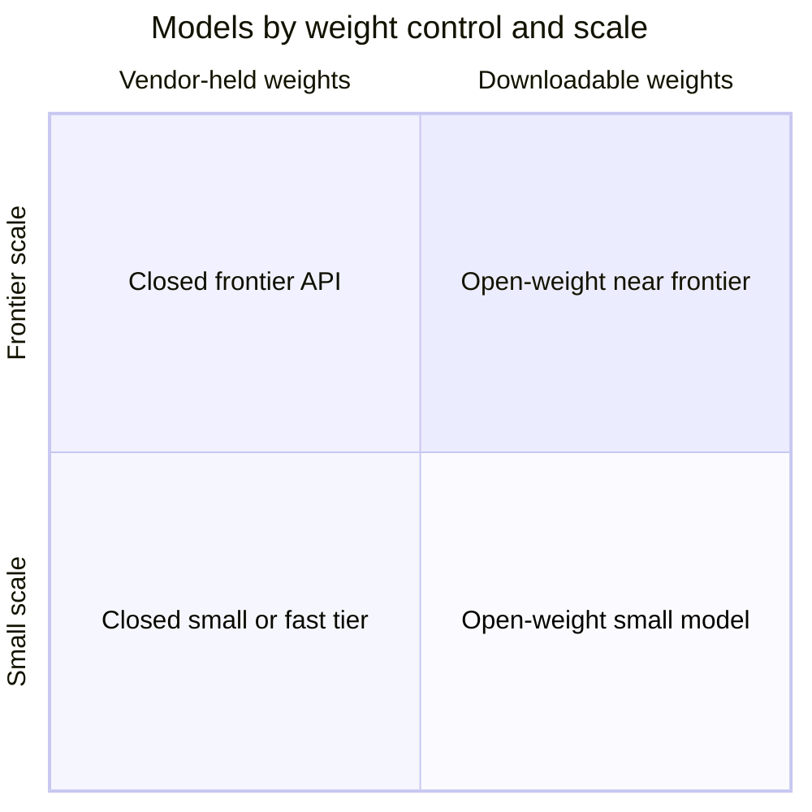
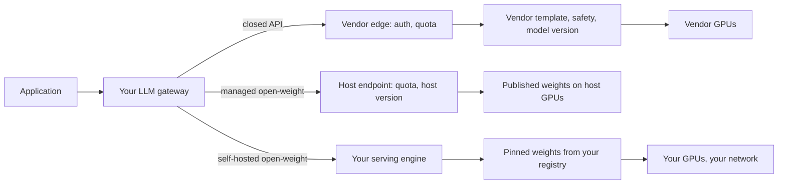
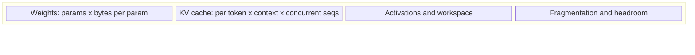
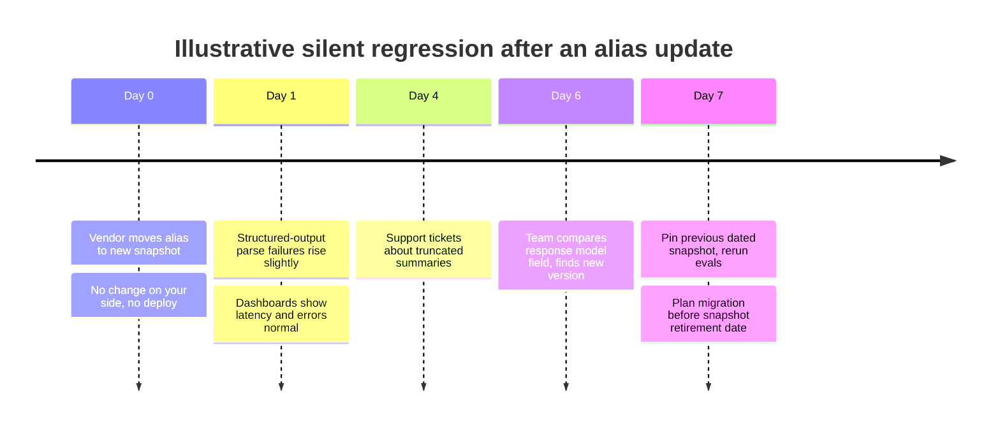
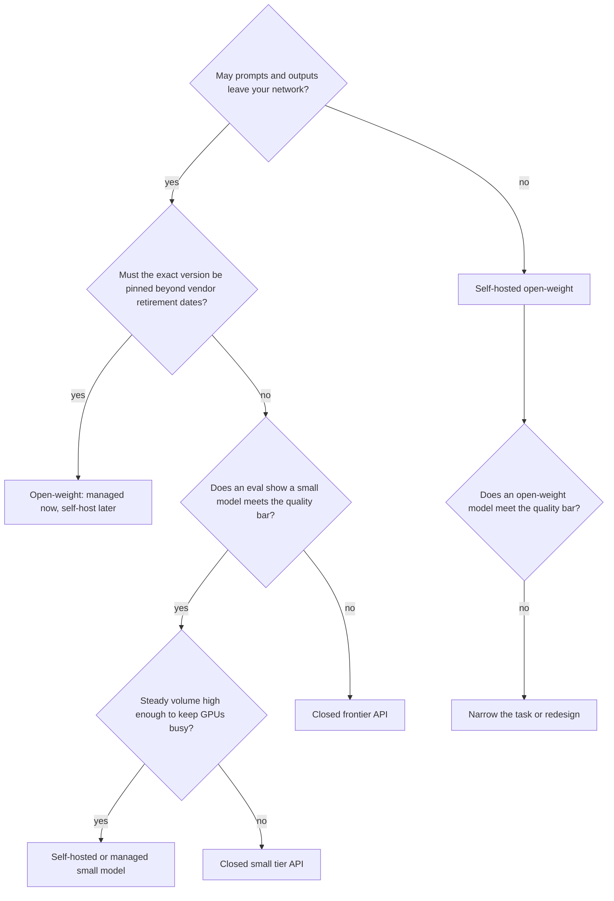

Bu sayfanın başlığındaki üç etiket tek bir sınıflandırmaymış gibi kullanılır, ama değildir. "Frontier" yetenek eğrisi üzerindeki bir konumu anlatır: belirli bir anda erişilebilen en yetenekli modeller; bu küme birkaç ayda bir değişir. "Open-weight" bir dağıtım modelini anlatır: eğitilmiş parametreler, bir lisans altında, herkesin çalıştırabileceği indirilebilir bir artifact olarak yayımlanır. "Small language model" (SLM, küçük dil modeli) ölçeği anlatır: tek bir sıradan GPU'da, bir CPU sunucusunda ya da bir cihazda çalışabilecek kadar küçük, tipik olarak birkaç milyardan yaklaşık on beş milyar parametreye kadar bir model. Bir model bu etiketlerin herhangi bir bileşiminde yer alabilir. Hosted kapalı bir model küçük olabilir; open-weight bir model frontier'a yakın olabilir; bir frontier model, üreticisi tarafından yalnızca bir API üzerinden sunulabilir.

Bir mimar için önemli olan ayrım etiket değil, her kategorinin neyi teslim edip neyi elinde tuttuğudur. API üzerinden erişilen kapalı bir frontier model en yüksek yetenek tavanını verir ve kontrolü alır: ağırlıklar, serving stack'i, güvenlik katmanı, versiyon yaşam döngüsü ve veri yolu üreticinindir. Open-weight bir model bu kontrolü geri verir; bir versiyonu sonsuza kadar sabitleme ve her token'ı kendi ağınızın içinde tutma hakkı da buna dahildir. Bunun bedelini operasyonel sorumlulukla ve genellikle bir miktar yetenek kaybıyla ödersiniz. Küçük bir model, bilgi ve akıl yürütme genişliğinden, bir ila iki büyüklük mertebesi daha düşük olabilen maliyet ve latency karşılığında vazgeçer; bu yalnızca görev, o genişliğe ihtiyaç duyulmayacak kadar dar olduğunda karşılığını verir.

Temel trade-off bu yüzden bir yanda kontrol ve birim maliyet, öbür yanda yetenek tavanı ve operasyonel sadeliktir. Belirli bir iş yükü için belirli bir model seçmek ayrı ve çok kriterli bir prosedürdür; [Model Seçim Kriterleri: Çok Kriterli Bir Yöntem](/ai-systems-architecture/tr/model-strategy/selection-and-deployment/selection-criteria/) sayfasında ele alınır. Bu sayfa o prosedürün başlangıç noktası olan kategori düzeyindeki olguları verir.

## İki Eksen, Üç Etiket

Birinci eksen ağırlıkları kimin tuttuğudur. Kapalı bir modelin ağırlıkları üreticiden hiç çıkmaz; bir endpoint'e token gönderir, token geri alırsınız ve bu iki olayın arasındaki her şey üreticinin işidir. Open-weight bir modelin ağırlıkları ise indirebileceğiniz, hash'ini alabileceğiniz, artifact registry'nizde saklayabileceğiniz ve seçtiğiniz bir serving engine'e yükleyebileceğiniz bir dosyadır. İkisinin arasında yaygın bir melez durur: bir bulut sağlayıcısının ya da bir inference şirketinin managed endpoint olarak sunduğu open-weight modeller. Örneğin Kasım 2026 itibarıyla OpenAI'ın open-weight modeli gpt-oss-120b hem Hugging Face'te indirilebilir bir model olarak hem de Google Cloud Vertex AI'da, Microsoft'un Azure AI model kataloğunda ve NVIDIA NIM kataloğunda managed bir model olarak listelenir. Ağırlıklar açıktır; ama bu endpoint'lerden birini çağırıyorsanız operasyonel sözleşme sizin değil, hosting sağlayıcısınındır.

İkinci eksen ölçektir. Parametre sayısı bir mimarın önemsediği üç şeyi belirler: ağırlıkları tutmak için gereken GPU belleği, üretilen token başına compute ve kabaca bilgi genişliği ile uzun, açık uçlu görevlerdeki güvenilirlik. "Frontier" bu eksenin belirli bir andaki tepesi hakkında, "küçük" ise dibi hakkında bir ifadedir. İkisinin de sabit bir sayısal sınırı yoktur ve ikisi de kayar: iki yıl önce frontier olan bir model bugün çoğu zaman onun küçük bir kesri büyüklüğündeki bir modelle yakalanır.


*Birbirinden bağımsız iki eksen. Her çeyrek gerçek bir ürün kategorisidir; "frontier", "open-weight" ve "small" etiketlerinin her biri yalnızca tek bir ekseni anlatır.*

Grafiği kalitenin değil, kontrol yüzeylerinin haritası olarak okuyun. Sol üst çeyrek yeni yeteneğin ilk ortaya çıktığı yerdir. Sol alt çeyrek, yani kapalı üreticilerin küçük ya da hızlı katmanları, küçük model ekonomisini küçük model kontrolü olmadan verir: ağırlıkları yine sabitleyemez, kendi donanımınızda çalıştıramazsınız. Yalnızca sağ alt çeyrek bir dizüstü bilgisayarda, bir telefonda ya da GPU cluster'ı olmayan air-gapped bir sunucuda çalışabilir.

:::note[Open-weight, open source demek değildir]
Open Source Initiative'in Open Source AI Definition 1.0'ı (Ekim 2024) ağırlıklara, modeli eğitmek ve çalıştırmak için kullanılan koda ve yetkin bir kişinin esasen eşdeğer bir sistem kurabilmesine yetecek ayrıntıda eğitim verisi bilgisine erişim ister. "Açık" LLM'lerin çoğu yalnızca ağırlıkları ve inference kodunu yayımlar; birçoğu da kullanım alanı ya da ölçek kısıtlaması içeren lisanslar kullanır. Elinize geçeni doğru anlatan terim "open-weight"tir; ne yapabileceğinizi etiket değil, lisans belirler.
:::

### Küçük Modellerin Kaybetmeyi Bıraktığı Yer

Production görevlerinin büyük bir sınıfında parametre sayısı sezginin düşündürdüğünden daha az önemlidir. Bir modelin parametreleri iki tür şey depolar: genel beceriler (ayrıştırma, talimat izleme, metin dönüştürme, geçerli yapılandırılmış çıktı üretme) ve dünya hakkında ezberlenmiş bilgi. Sınıflandırma, bilgi çıkarma, routing, yeniden biçimlendirme ve verilmiş bir dokümanı özetleme çoğunlukla birinci türü kullanır, çünkü cevabın ihtiyaç duyduğu bilgi ağırlıklarda değil context'tedir. Açık uçlu soru cevaplama, tanıdık olmayan alanlarda çok adımlı planlama ve uzun agentic görevler ikisini birden kullanır ve hataları birçok adım boyunca biriktirir; ek ölçeğin en net görüldüğü yer burasıdır.

Dar ve yüksek hacimli bileşenler için küçük, açık uçlu bileşenler için frontier model kullanan yaygın production deseninin arkasındaki sezgi budur. İki kanıt onu destekler. Scaling law literatürü (Hoffmann vd., 2022), önceki pratiğin varsaydığından çok daha fazla veriyle eğitilen modellerin belirli bir loss değerine çok daha küçük boyutlarda ulaştığını gösterdi; yeni küçük modellerin çok daha büyük eski modelleri geçmesinin nedeni budur. Yayımlanmış küçük model raporları da (örneğin Microsoft'un Phi-3 raporu, 2024) performanslarının büyük kısmını ölçeğe değil, seçilmiş ve sentetik eğitim verisine bağlar. Kanıt bir noktada üreticilerin söylediğinden zayıftır: kısa ve iyi tanımlanmış görevlerdeki benchmark skorları, küçük bir modelin gerçek girdilerin uzun kuyruğundaki davranışını olduğundan iyi gösterir; bu açık [Yetenek ve Güvenilirlik: Production Açığını Kapatmak](/ai-systems-architecture/tr/foundations/ai-component-model/capability-vs-reliability/) sayfasında tartışılır. Küçük bir modelin dağılım dışı bir girdideki başarısızlığı çoğu zaman büyük bir modelinkinden daha ani olur.

Mixture-of-experts (MoE) mimarileri ölçek eksenini daha da bulanıklaştırır. Bir MoE katmanı birçok expert alt ağı ve her token'ı bunların yalnızca birkaçından geçiren bir router içerir; böylece modelin toplam parametre sayısı büyük, token başına aktif parametre sayısı küçüktür. Ağustos 2025'te Apache 2.0 lisansıyla yayımlanan gpt-oss-120b, model kartına göre 117 milyar toplam ve 5,1 milyar aktif parametreye sahiptir; gpt-oss-20b'nin 21 milyar toplam ve 3,6 milyar aktif parametresi vardır. Serving açısından bu iki sayı farklı şeyler anlatır: bellek toplam parametreyle ölçeklenir, çünkü her expert bellekte durmak zorundadır; token başına compute ise kabaca aktif parametreyle ölçeklenir. Bu yüzden bir MoE modelin bellek ayak izi büyük bir modelinki, decode maliyeti ise küçük bir modelinkine daha yakındır.

## Her Kategorinin Size Teslim Ettikleri

Her LLM çağrısı aynı aşamalardan geçer: kimlik doğrulama ve kota, mesajları token'lara serialize eden bir chat template ([Bir Sistem Bileşeni Olarak LLM'in Anatomisi: Token, Context, Sampling](/ai-systems-architecture/tr/foundations/ai-component-model/llm-anatomy/) sayfasında anlatılır), bir hızlandırıcı üzerindeki forward pass'ler, bir sampler ve genellikle bir güvenlik ya da moderasyon katmanı. Her aşamayı kimin işlettiğini kategori belirler.


*Aynı çağrı üç işletim modelinden geçerken. Diyagramda aşağı indikçe istek yolunun daha fazla aşaması sizin kontrolünüze ve sizin nöbetinize geçer.*

Kapalı yolda, bir model alias'ına gönderilen isteğe tam olarak hangi model versiyonunun cevap vereceğine, chat template'in ne olduğuna, güvenlik katmanının neyi reddedeceğine, log'ların nasıl saklanacağına ve GPU'ların hangi bölgede durduğuna, üreticinin sunduğu sözleşme seçenekleri dahilinde üretici karar verir. Üretici en zor operasyonel problemleri de üstlenir: kapasite planlaması, GPU arızaları ve serving engine yükseltmeleri. Managed open-weight yolda ağırlıklar yayımlandıkları haliyle sabittir, yani modelin kendisi sessizce değişemez; ama quantization'ı, serving engine versiyonunu, context limitlerini ve endpoint'in ömrünü hâlâ host kontrol eder ve "aynı" modeli sunan iki host ölçülebilir biçimde farklı çıktılar döndürebilir. Self-hosted yolda, sahip olmak istemeyecekleriniz de dahil her aşama sizindir; operasyonel taraf [Hosted API, Self-Hosted ve Hibrit Deployment](/ai-systems-architecture/tr/model-strategy/selection-and-deployment/hosted-vs-self-hosted/) sayfasının konusudur.

### Her Kategorinin Sunduğu Sözleşme

Kapalı bir API bir arayüzü ve bir hizmet sözleşmesinde erişilebilirlik ile veri işleme koşullarını garanti eder. Aynı prompt'un zaman içinde aynı çıktı dağılımını döndüreceğini garanti etmez. Kayan bir alias'ın arkasındaki davranış, üretici alias'ı taşıdığında değişebilir; tarihli ya da versiyonlu bir snapshot ise yalnızca yayımlanmış emeklilik tarihine kadar kararlıdır, sonrasında migration yapmanız gerekir. Tam token log-probability'leri ya da gizli reasoning gibi iç verilere erişimi de garanti etmez; üreticiler bunları seçici olarak açar.

Open-weight bir artifact, hash'ini aldığınız byte'ların sunduğunuz byte'lar olduğunu, sonsuza kadar, ve kimsenin modeli elinizden emekliye ayıramayacağını garanti eder. Serving engine'ler, quantization seviyeleri ya da donanımlar arasında aynı davranışı garanti etmez: kernel'lerdeki ve batching'deki sayısal farklar çıktıları değiştirir; [Determinizm Kontrolü: Temperature, Seed ve Caching](/ai-systems-architecture/tr/reliability/output-reliability/determinism/) sayfası bunu açıklar. Ağırlıklara eğitimle yerleştirilmiş olanın ötesinde bir güvenlik katmanıyla gelmez ve hiçbir kapasite garantisi vermez: throughput, GPU'larınız ne veriyorsa odur.

Küçük bir model, küçük olduğu için hiçbir şeyi garanti etmez. Sunduğu şey, bazı mimarileri mümkün kılan bir maliyet ve latency profilidir: her mesajda bir sınıflandırıcı çalıştırmak ya da inference'ı internete hiç bağlanmayan bir cihazda tutmak gibi. Sizin görevinizdeki kalitesi kategorinin bir özelliği değil, ölçülen bir orandır.

### Yetenek Açığı Ne Kadar Büyük

Açık ile kapalı modeller arasındaki açık eskisinden dardır ve çok değişkendir. Modelleri birçok benchmark'tan oluşan bileşik bir endeks olan Epoch Capabilities Index (ECI) üzerinde izleyen Epoch AI, Mayıs 2026'da, Ocak 2026'dan bu yana en iyi open-weight modellerin en iyi kapalı modellerin ortalama yaklaşık dört ay, ya da kabaca 8 ECI puanı gerisinde kaldığını raporladı; aynı grubun Ekim 2025 tarihli bir analizi bu gecikmeyi yaklaşık üç ay olarak vermişti. Epoch ayrıca açığın önemli ölçüde değiştiğini ve zaman zaman tamamen kapandığını not eder. Bu sayıları bir kararda kullanmadan önce iki çekince geçerlidir. Bileşik bir endeks görevlerin ortalamasını alır; sizin görevinizdeki açık sıfır da olabilir, çok daha büyük de. Ve "en iyi open-weight model" yüzlerce milyar toplam parametreli bir model olabilir; bu, lisans açısından açık ama maliyet açısından küçük olmayan bir modeldir.

Mimari açısından pratik okuma şudur: kapalı modeller lehine yetenek argümanı en uç noktada, en zor açık uçlu ve agentic görevlerde ve yeni bir yetenek ortaya çıktıktan sonraki ilk aylarda en güçlüdür. Görevi iyi tanımlanmış ve girdileri sınırlı bir bileşen için kategori kararını genellikle yetenek değil maliyet, latency, verinin yeri ve yaşam döngüsü kontrolü belirler; bu karar da bir leaderboard'la değil, kendi verinizdeki bir eval ile verilmelidir.

## Ölçeğe Göre Bellek, Throughput ve Birim Maliyet

Ölçek paraya önce GPU belleği üzerinden dönüşür. Bir modeli sunmak için ağırlıklarını ve eşzamanlı her sekans için KV cache'ini, yani o sekansın context'indeki her token'ın attention key ve value'larını bellekte tutmanız gerekir; bu, [Prefill, Decode ve KV Cache](/ai-systems-architecture/tr/inference/fundamentals/prefill-decode-kv-cache/) sayfasında açıklanır. Ağırlık belleği, parametre sayısı çarpı parametre başına byte'tır; KV cache belleği ise token başına iki (key ve value) çarpı katman sayısı, çarpı key-value head sayısı, çarpı head boyutu, çarpı değer başına byte'tır.


*Bir inference sunucusunda GPU belleği. Ağırlıklar model başına sabittir; KV cache context uzunluğu ve eşzamanlılıkla büyür ve ağırlıklar sığdıktan sonra throughput'u sınırlayan odur.*

Bu yerleşim ölçek ekseninin neden iki kez önemli olduğunu açıklar. Daha büyük bir model ağırlıklar için daha fazla bellek tüketir; bu KV cache'e daha az yer bırakır; bu da eşzamanlı decode edilebilecek sekans sayısını sınırlar, GPU başına throughput'u düşürür ve token başına maliyeti artırır. Quantization, yani ağırlıkları daha az bitle saklamak, doğrudan ilk bloğa saldırır; kalite trade-off'ları [Quantization ve Model Sıkıştırma](/ai-systems-architecture/tr/inference/fundamentals/quantization/) sayfasında ele alınır.

### Hesaplamalı Örnek: Tek Bir 80 GB GPU'da Üç Boyut

80 GB'lık bir hızlandırıcı varsayın ve belleğin yaklaşık %10'unun activation'lara, çalışma alanına ve fragmentasyona gittiğini, ağırlıklar ile KV cache için kabaca 72 GB kaldığını kabul edin. Aşağıdaki model konfigürasyonları, kaynak belirtilmedikçe, açıklama amaçlıdır.

16-bit hassasiyette 70 milyar parametreli dense bir model yalnızca ağırlıklar için 70 × 10⁹ × 2 byte = 140 GB ister. Tek bir GPU'ya sığmaz; en az iki, KV cache'e yer bırakmak için pratikte daha fazla GPU gerekir. 4 bit'e (parametre başına 0,5 byte) quantize edildiğinde ağırlıkları yaklaşık 35 GB'a iner ve KV cache için yaklaşık 37 GB kalır; bedeli quantization'ın kalite maliyetidir.

16-bit hassasiyette 8 milyar parametreli dense bir model ağırlıklar için 16 GB ister ve KV cache'e yaklaşık 56 GB bırakır. Bu boyuttaki modeller için yaygın bir şekil olan 32 katman, 8 key-value head ve 128 head boyutu varsayın. Token başına KV cache 2 × 32 × 8 × 128 × 2 byte = 131.072 byte, yani 128 KiB'dir. 8.000 token'lık context'e sahip bir sekans bu yüzden yaklaşık 1 GiB KV cache tutar ve 56 GB kabaca 50 böyle sekansı eşzamanlı taşır. 32.000 token'lık context'te her sekans yaklaşık 4 GiB ister ve eşzamanlılık 13 civarına düşer. Sınır artık parametre sayısı değil, context uzunluğudur.

gpt-oss-120b, model kartına göre, MoE ağırlıkları 4-bit'lik bir format olan MXFP4 ile, diğer ağırlıkları 16-bit ile saklandığı için tek bir 80 GB GPU'ya sığar. 117 milyar parametreli bir modelin bellek ayak izine ve kabaca 5 milyar aktif parametrenin token başına compute'una sahiptir; bu yüzden tek bir GPU'da çok daha fazla parametre taşırken çok daha küçük bir dense modelin decode hızına yaklaşabilir.

Şimdi belleği birim maliyete çevirin. Yalnızca açıklama amacıyla bir GPU'nun saatte 3 $ tuttuğunu ve 8B modelin sizin trafik şeklinizde eşzamanlı sekansları boyunca toplam saniyede 2.500 output token sürdürdüğünü varsayın. Bu saatte 9 milyon output token, tam kullanımda milyon output token başına yaklaşık 0,33 $ eder. Ani sıçramalı interaktif trafikte yaygın olan %30 ortalama kullanımda efektif maliyet milyon başına yaklaşık 1,11 $'dır. Milyon output token başına 0,60 $ fiyatlı varsayımsal bir hosted küçük katman API'siyle karşılaştırın: self-hosting, mühendislik ve nöbet süresi hesaba katılmadan önce, yüksek ve istikrarlı kullanımda kazanır, düşük kullanımda kaybeder. Ders sayılarda değil hesabın yapısındadır: self-hosted token maliyetine kullanım oranı hakimdir, hosted token maliyeti ise sabittir. Personel, yedeklilik ve boşta kapasite dahil tam karşılaştırma [Self-Hosted ve API: Toplam Sahip Olma Maliyeti](/ai-systems-architecture/tr/economics/understanding-cost/tco/) sayfasında, bir filonun nasıl boyutlandırılacağı ise [GPU Kapasite Planlaması](/ai-systems-architecture/tr/inference/production-serving/gpu-capacity-planning/) sayfasındadır.

## Kategorilerin Production'da Karşılaştırılması

Trade-off'lar her eksende farklı yere düşer. Tablo bunları dört pratik işletim noktası için özetler; "managed open-weight" ayrı listelenmiştir, çünkü özellikleri bir karışımdır ve ekipler çoğu zaman onun self-hosting özelliklerine sahip olduğunu varsayar.

| İşletim noktası | Yetenek tavanı | Versiyon kontrolü | Veri yolu | Birim maliyet ve latency | Operasyonel yük | Ne zaman tercih edilmeli |
|---|---|---|---|---|---|---|
| Kapalı frontier API | En yüksek, yeni yeteneklere ilk sahip olan | Üretici kontrolünde; snapshot'lar takvime göre emekliye ayrılır | Ağınızdan çıkar; üreticinin koşulları ve bölgeleri | Token başına en yüksek; boşta maliyet yok | En düşük | En zor açık uçlu ya da agentic görevler; düşük ya da öngörülemeyen hacim; hızlı iterasyon |
| Kapalı küçük katman API | Orta | Üretici kontrolünde | Ağınızdan çıkar | Token başına düşük; boşta maliyet yok | En düşük | Verinin çıkabildiği ve kontrolün gerekmediği yüksek hacimli dar görevler |
| Managed open-weight endpoint | Modele bağlı, tipik olarak frontier'ın aylarca gerisinde | Ağırlıklar sabit; engine, quantization ve endpoint ömrü host'ta | Ağınızdan host'a çıkar | Düşük ile orta arası; boşta maliyet yok | Düşük | Host'lar arası taşınabilirlik, ileride self-hosting'e bir yol, fallback için ikinci kaynak |
| Self-hosted open-weight (her boyut) | Modele bağlı; küçük modellerde dar | Tamamen sizde, hash ile sabitlenmiş | Air-gapped dahil ağınızda kalır | Kullanıma bağlı; boştaki GPU para yakar | Yüksek: kapasite, yükseltmeler, nöbet | Çıkmaması gereken veri, regülasyon kaynaklı residency, istikrarlı yüksek hacim, süresiz sabitleme ihtiyacı |

Managed open-weight endpoint, ileride self-host etmeyi bekleyen bir ekip için çoğu zaman en iyi ilk adımdır: prompt'lar ve eval'ler daha sonra kurum içinde çalışacak olan ağırlıkların tam kendisine karşı kurulur ve self-hosting kararı hacim onu haklı çıkarana kadar bekler. Self-hosted satır, hiçbir prompt'un ya da completion'ın kurumun ağından asla çıkmaması gibi katı bir gereksinimi karşılayan tek satırdır; bankacılık ve kamu sistemlerinde bu bazen bir tercih değil, bir zorunluluktur. Türkiye için regülasyon tarafı [Türkiye Regülasyonu ve Data Residency: KVKK ve BDDK](/ai-systems-architecture/tr/governance/regulation/turkish-regulation/) sayfasında ele alınır.

### Ağırlıklara Bağlı Lisanslar ve Regülasyon

Ağırlıkları indirmek bir lisansı kabul etmek demektir ve lisanslar mimari açıdan önemli biçimlerde farklılaşır. Yayımlandıkları haliyle gpt-oss ve Qwen3 ailesi Apache 2.0, DeepSeek-R1 ise MIT lisansıyla yayımlandı: kullanım alanı ya da kullanıcı sayısı kısıtlaması olmayan permissive lisanslar. Meta'nın Llama 4 Community License'ı (Nisan 2025'ten itibaren geçerli) ise özel bir lisanstır: ürünleri bir önceki takvim ayında 700 milyondan fazla aylık aktif kullanıcıya sahip olan bir lisans sahibi ayrı bir lisans talep etmek zorundadır ve Meta bunu tamamen kendi takdirine göre verebilir; türev modellerin adı "Llama" ile başlamalıdır; ürünler de "Built with Llama" ibaresini belirgin biçimde göstermelidir. Lisans ayrıca bir kabul edilebilir kullanım politikasını atıf yoluyla içerir; yani izin verilen kullanımlar, lisans dosyası değişmeden değişebilir. Özel lisanslar kullanılamaz değildir, ama hukuki inceleme gerektirir ve fine-tune edilmiş bir türev, temel modelinin lisansını devralır.

Regülasyon da modele bağlanır. EU AI Act kapsamında genel amaçlı AI modeli (GPAI) sağlayıcılarına yönelik yükümlülükler 2 Ağustos 2025'ten itibaren uygulanır ve Avrupa Komisyonu bunları para cezaları dahil 2 Ağustos 2026'dan itibaren denetlediğini belirtir. 10²⁵'ten fazla floating-point işlemiyle eğitilmiş modellerin sistemik risk taşıdığı varsayılır; Komisyon bu eşiğin gözden geçirildiğini belirtir. Modelleri ağırlıkları açık, ücretsiz ve açık kaynak bir lisansla yayımlayan sağlayıcılar bazı dokümantasyon yükümlülüklerinden muaftır; ama telif hakkı politikası ile eğitim verisi özetinden muaf değildir ve model sistemik risk taşıyorsa hiçbir muafiyet yoktur. Komisyonun yönergeleri (Temmuz 2025, hukuken bağlayıcı değil), bir modeli değiştiren ya da fine-tune eden downstream bir şirketin ancak değişiklik orijinal modelin eğitim compute'unun üçte birinden fazlasını kullandığında o modelin sağlayıcısı haline geldiğini söyler. Modelleri entegre eden ya da hafifçe fine-tune eden kurumların çoğu için GPAI sağlayıcı yükümlülükleri bu yüzden modeli yayımlayandadır; onlara ulaşan yükümlülükler, [Uluslararası Çerçeveler: EU AI Act, NIST AI RMF, ISO/IEC 42001](/ai-systems-architecture/tr/governance/regulation/international-frameworks/) sayfasında anlatıldığı gibi, kurdukları sistem üzerinden gelir.

### Her Kategorinin Güvenlik Etkileri

Her kategori saldırı yüzeyini başka bir yere taşır. Kapalı bir API'de yeni ana maruziyet veri yoludur: kişisel ya da gizli veri içerebilen prompt'lar ve completion'lar bir güven sınırını aşarak üreticinin sistemlerine girer; kontroller sözleşmeseldir (saklama süresi, eğitimde kullanım, bölge) ve göndermeden önce maskelediğiniz her şeydir. Maskeleme [PII ve Hassas Veri: Masking, Tokenization, Redaction](/ai-systems-architecture/tr/security/defenses/pii-handling/) sayfasında anlatılır.

Open weight'lerde veri yolu evde kalır ve bir tedarik zinciri ortaya çıkar. Model dosyaları başkasının ürettiği artifact'lardır ve yüklendiğinde rastgele kod çalıştırabilen Python pickle gibi formatlar kullanıyorlarsa bir kod çalıştırma riskidir; safetensors formatı tensörleri çalıştırılabilir içerik olmadan saklamak için vardır. Bazı modeller ayrıca, yükleyiciye uzak kod çalıştırma izni açıkça verildiğinde çalıştırılan özel model kodu da getirir. Bu yüzden ağırlıklar kuruma diğer tüm üçüncü taraf artifact'lar gibi girmelidir: doğrulanmış bir kaynaktan, taranmış, hash'lenmiş ve kendi registry'nizde saklanmış olarak; uygulamalar [Tedarik Zinciri Güvenliği: SLSA Çerçevesi ve Sigstore](https://gorkemsari.github.io/distributed-systems/tr/security/secrets-management/supply-chain-security/) ve [Artifact Yönetimi: OCI Registry ve Helm Charts](https://gorkemsari.github.io/distributed-systems/tr/deployment/gitops-cicd/artifact-management/) sayfalarındadır. Davranışını bir dosya taramasının tespit edemeyeceği zehirlenmiş ya da arka kapılı ağırlıklar dahil AI'a özgü kısım [AI Tedarik Zinciri Güvenliği: Model, Dataset, MCP Server](/ai-systems-architecture/tr/security/defenses/supply-chain/) sayfasında ele alınır.

:::caution[Ağırlıkları yalnızca kendi registry'nizden yükleyin]
Başlangıçta bir modeli public bir hub'dan repository adıyla çeken bir deployment'ın sabitlenmiş bir versiyonu, bütünlük kontrolü yoktur ve üçüncü taraf bir servise katı bir bağımlılığı vardır. Dosyaların tam kendilerini artifact registry'nize kopyalayın, SHA-256 hash'lerini kaydedin, safetensors'ı tercih edin, uzak kod çalıştırmayı kapalı tutun ve serving engine'in hash ile yüklemesini sağlayın. Bir denetçinin belirli bir cevabı hangi modelin ürettiğini tespit etmek için ihtiyaç duyduğu kayıt da budur.
:::

Az miktarda konfigürasyon bu sabitlemeyi kayda geçirir. Kaydın amacı, serving engine ve quantization dahil her alanın modelin kimliğinin bir parçası olmasıdır: herhangi birini değiştirirseniz eval yeniden çalışmalıdır.

```yaml
# Illustrative model pin record; field names are not a standard
model_id: summarizer-small
weights:
  source: internal-registry/models/example-8b-instruct
  revision: 3f9c2a1            # upstream commit the files were mirrored from
  sha256: 9b1e...c04d          # hash of each file is recorded; one shown
  format: safetensors
  license: apache-2.0
serving:
  engine: vllm
  engine_version: pinned       # record the exact version in use
  quantization: none           # any change here requires a new eval run
  max_context_tokens: 16384
eval:
  suite: summarizer-golden-v12
  last_pass: 2026-11-12
```

## Her Kategori Nasıl Bozulur

Model kategorilerine özgü hatalar nadiren hata üretir; biraz daha kötü, biraz farklı ya da hukuken açıkta kalan cevaplar üretir.

Hosted bir model sabit bir adın arkasında değişir. Kapalı bir üretici bir alias'ı daha yeni bir snapshot'a taşır ya da bir snapshot'ı emekliye ayırır ve istemci alias'a geri düşer. Latency ve hata oranları değişmez; ama çıktı uzunluğu, reddetme oranı, biçimlendirme ya da tool calling davranışı kayar. Belirti, sizin tarafınızda hiçbir deploy olmadan gelen bir kalite gerilemesidir. Tespit için API'nin her yanıtta döndürdüğü model versiyon string'ini loglamak ve değişiminde alarm üretmek, ayrıca [Kalite İzleme ve Drift Tespiti](/ai-systems-architecture/tr/llmops/observability/quality-drift/) sayfasında anlatıldığı gibi sürekli eval çalıştırmak gerekir. Önlem, production'da alias'ları değil tarihli snapshot'ları çağırmak ve snapshot değişikliğini bir release olarak ele almaktır; migration süreci [Model Versiyonlama, Deprecation ve Migration](/ai-systems-architecture/tr/model-strategy/lifecycle-and-adaptation/versioning-migration/) sayfasındadır.


*Açıklama amaçlı bir olay zaman çizelgesi. 0. ile 6. gün arasındaki süre, sistemin kimsenin değerlendirmediği bir modelle çalıştığı süredir; dönen model versiyonunu loglamak bu sürenin çoğunu kapatır.*

Değişiklik üreticide olur ve ilk sinyaller hata değil, istatistikseldir. Dönen versiyon string'i loglanıp değişiminde alarm üretildiğinde tespit 0. güne çekilir; golden set üzerinde gecelik bir eval ile gerileme 1. gün sayısallaştırılır. Önceki snapshot'ı sabitlemek yalnızca o snapshot'ın emeklilik tarihine kadar bir kurtarmadır; bu yüzden olay sabitlemeyle değil, planlanmış bir migration ile kapanır.

Küçük bir model yetenek uçurumuna çarpar. Model, ekibin topladığı girdilerdeki eval'i geçmiştir ve bunların dışındaki girdilerde sert biçimde başarısız olur: daha uzun dokümanlar, başka bir dil, yeni bir ürün hattı. Genellikle kademeli bozulan büyük bir modelin aksine, küçük bir model çoğu zaman kendinden emin, iyi biçimlendirilmiş ve yanlış çıktı üretir. Tespit, slice düzeyinde metrikler (dile, uzunluğa ve girdi kaynağına göre) ve sürekli puanlanan bir production örneklemi gerektirir; önlem, ucuz bir sınıflandırıcıyla ya da güven sinyalleriyle tespit edilen dağılım dışı girdileri [Multi-Model Strateji ve Model Routing](/ai-systems-architecture/tr/model-strategy/selection-and-deployment/model-routing/) sayfasındaki gibi daha büyük bir modele yönlendirmektir.

"Aynı model" aynı değildir. Bir ekip open-weight bir modeli bir host'ta değerlendirir ve başka bir host'ta deploy eder, ya da 16-bit'ten 4-bit quantize edilmiş bir sürüme geçer, ya da serving engine'i yükseltir. Ağırlıkların adı değişmemiştir; davranış ise özellikle uzun context'lerde, aritmetikte ve yapılandırılmış çıktıda değişmiştir. Serving stack'in mesajları modelin eğitildiği template'ten farklı biçimlendirdiği chat template uyuşmazlığı bunun uç örneğidir: model yine yanıt verir, ama talimat izleme ve tool calling ciddi biçimde bozulur. Tespit, sabitleme kaydındaki her değişiklikte çalışan bir eval kapısıdır; kurtarma, değerlendirilmiş konfigürasyona geri dönmektir.

Bir lisans kısıtı geç fark edilir. Özel lisanslı bir model bir prototip için benimsenir, ürün büyür ve bir lansman ya da satın alma öncesindeki hukuki inceleme ürünün karşılamadığı bir adlandırma, atıf, kullanıcı sayısı ya da kabul edilebilir kullanım koşulu bulur. Tespitin yeri girişin kendisidir: lisans, sabitleme kaydında ve [Prompt ve Model Registry](/ai-systems-architecture/tr/platform/internal-platform/prompt-model-registry/) sayfasında anlatılan model registry'de bir alandır ve ilk production kullanımından önce incelenir.

| Hata | Kategori | Belirti | Tespit | Önlem ve kurtarma |
|---|---|---|---|---|
| Alias taşındı ya da snapshot emekliye ayrıldı | Kapalı API | Yerel deploy olmadan kalite kayması | Dönen model versiyonu loglanır ve alarmlanır; sürekli eval | Tarihli snapshot'ları sabitleyin; değişiklikleri release olarak ele alın; emeklilikten önce migrate edin |
| Yetenek uçurumu | Küçük model | Yeni girdi türlerinde kendinden emin yanlış çıktı | Slice metrikleri; puanlanmış production örneklemi | Dağılım dışı girdileri daha büyük modele yönlendirin; eğitim ya da eval verisini genişletin |
| Konfigürasyon kayması | Open-weight (hosted ya da self) | Uzun context, matematik ve yapılandırılmış çıktıda ince farklar | Ağırlık, engine, quantization ve template'teki her değişiklikte eval kapısı | Değerlendirilmiş konfigürasyona dönün; yeniden baseline alın |
| Template uyuşmazlığı | Open-weight | Zayıf talimat izleme, bozuk tool call'lar | Token'lara ayrılmış prompt incelemesi; tool call geçerlilik oranı | Modelle gelen template'i kullanın; CI'da test edin |
| Kurcalanmış ya da güvensiz artifact | Open-weight | Yüklemede kod çalışması ya da gizli davranış | Hash doğrulama; format ve uzak kod politikası; red team eval'leri | Yalnızca registry'den yükleme; safetensors; uzak kodu kapatın |
| Lisans ihlali | Open-weight | Hukuki bulgu, zorunlu platform değişikliği | Registry'de lisans alanı; girişte inceleme | Kritik yollarda permissive lisans seçin; yerine geçecek modeli planlayın |
| Kapasite tükenmesi | Self-hosted | Zirvede kuyruklanma, timeout'lar | Kuyruk derinliği, KV cache kullanımı, time to first token | Kapasite payı; taşmayı hosted bir endpoint'e aktarın |

:::tip[Fallback olarak ikinci bir kategori tutun]
Kategoriler birbirinden bağımsız bozulur. Bir üretici kesintisi self-hosted modelinizi etkilemez, sizin GPU sıkıntınız da üreticiyi etkilemez. Baştan hem kapalı bir API'de hem managed open-weight bir modelde çalışacak şekilde tasarlanmış, prompt'ları ve eval'leri ikisi için de bakımı yapılan bir bileşenin sıcak tutması ucuz, test edilmiş bir fallback'i vardır; mekanik [Fallback Zincirleri ve Graceful Degradation](/ai-systems-architecture/tr/reliability/provider-failures/fallback-degradation/) sayfasındadır.
:::

## Bileşen Bazında Kategori Seçmek

Kategori kurum bazında değil, bileşen bazında seçilir: tek bir ürün planlama agent'ı için kapalı bir frontier model, özetleme için kapalı bir küçük katman ve ağdan çıkmaması gereken veriyi sınıflandırmak için self-hosted küçük bir model kullanabilir. Baştaki sorular kısıt, sondakiler optimizasyondur.


*Bileşen bazında bir karar sırası. Verinin yeri ve versiyon kontrolü kısıttır ve önce gelir; kalite ve maliyet bu kısıtların içinde optimize edilir.*

Sırayı tersine çevirmek klasik hatayı üretir: bir ekip leaderboard'un liderini seçer, ürünü kurar ve ardından verinin ağdan çıkamayacağını ya da modelin bir yıl içinde emekliye ayrılacağını öğrenir. Son düğüm, kısıtlar kalite çıtasını karşılayan her modeli dışarıda bıraktığında verilecek dürüst sonuçtur: görev daraltılmalı, parçalara ayrılmalı ya da [AI Ne Zaman Yanlış Çözümdür: Bir Karar Çerçevesi](/ai-systems-architecture/tr/foundations/failure-and-fit/when-not-to-use-ai/) ile yeniden değerlendirilmelidir.

Görev açık uçlu, uzun soluklu ya da agentic olduğunda ve bir eval daha küçük modellerin yetersiz kaldığını gösterdiğinde; hacim düşük ya da öngörülemez olduğu için boştaki GPU'lar maliyete hakim olacağında; ekip hızlı iterasyona ihtiyaç duyduğunda ve veri dışarı çıkabildiğinde kapalı bir frontier API kullanın. Onu her bileşen için varsayılan yapmayın: frontier bir model üzerindeki yüksek hacimli dar görevler, LLM sistemlerinde maliyet patlamalarının yaygın bir kaynağıdır; bu [Token Ekonomisi: Fiyatlandırma, Reasoning Token'ları ve Gizli Maliyetler](/ai-systems-architecture/tr/economics/understanding-cost/token-economics/) sayfasında incelenir.

Veri ağınızda kalmak zorunda olduğunda, bir versiyonu herhangi bir üreticinin destek süresinden daha uzun sabitlemeniz gerektiğinde (regüle sektörlerde model risk yönetimi bunu sıkça ister, bkz. [LLM Sistemleri için Model Risk Yönetimi](/ai-systems-architecture/tr/governance/risk-management/model-risk-management/)), fine-tune edip sonucuna sahip olmanız gerektiğinde ya da aynı model için iki host istediğinizde open-weight modeller kullanın. Bir kullanım tahmini ve bir nöbet planı olmadan, yalnızca token başına daha ucuz göründüğü için self-host etmeyin; özel lisanslı bir modeli hukuki inceleme olmadan kritik bir yola almayın.

Görev dar olduğunda, girdileri sınırlı ve izleniyor olduğunda ve kendi verinizdeki bir eval çıtayı karşıladığını gösterdiğinde küçük bir model kullanın; özellikle her istekte çalışan sınıflandırma, bilgi çıkarma, routing ve guardrail kontrolleri için. Küçük modeller ayrıca daha büyük bir modelden distillation'ın olağan hedefidir; bu [Fine-Tuning ve Distillation: Entegrasyon Perspektifi](/ai-systems-architecture/tr/model-strategy/lifecycle-and-adaptation/finetuning-distillation/) sayfasında anlatılır. Girdi dağılımını sınırlayamadığınız bir görev için küçük model kullanmayın ve küçük bir modelin benchmark skorunu kendi trafiğinizdeki slice düzeyinde eval'lerin yerine kabul etmeyin.

Bu konuyla sıkça karıştırılan iki komşu konu vardır. Cevap vermeden önce ek token üreten reasoning modeller, üç kategoriyi de kesen bir yetenek ve maliyet profilidir ve [Reasoning Model'ler ve Test-Time Compute](/ai-systems-architecture/tr/model-strategy/model-landscape/reasoning-models/) sayfasında ele alınır. Bir üreticinin modeline değil API biçimine bağımlılık ise [Vendor Lock-in ve Abstraction Katmanı](/ai-systems-architecture/tr/model-strategy/lifecycle-and-adaptation/vendor-lock-in/) sayfasında ele alınan bir taşınabilirlik problemidir.

## İleri Okuma

- Open Source Initiative, *The Open Source AI Definition 1.0*, 2024.
- Jordan Hoffmann vd., *Training Compute-Optimal Large Language Models*, NeurIPS, 2022.
- Marah Abdin vd., *Phi-3 Technical Report: A Highly Capable Language Model Locally on Your Phone*, Microsoft, 2024.
- OpenAI, *gpt-oss-120b and gpt-oss-20b Model Card*, arXiv 2508.10925, 2025.
- Epoch AI, *Open models lag state-of-the-art closed models by 4 months*, Epoch AI data insight, 2026.
- European Commission, *Guidelines on the scope of obligations for providers of general-purpose AI models under the AI Act*, 2025.
