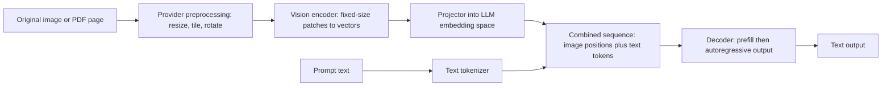
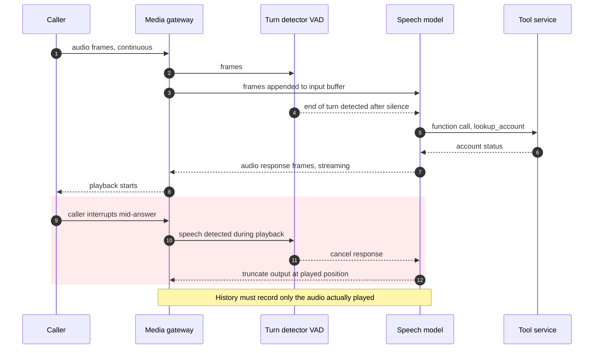
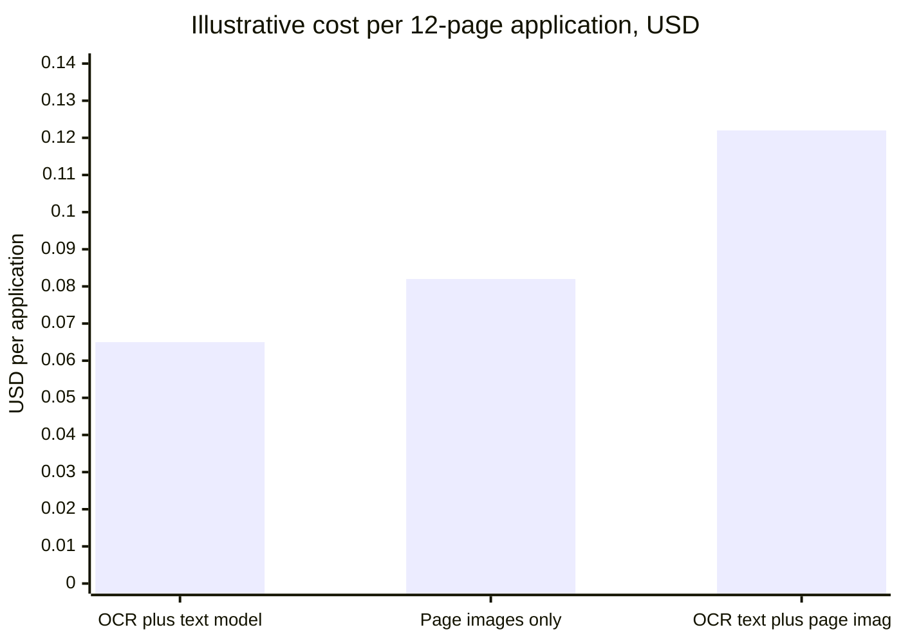
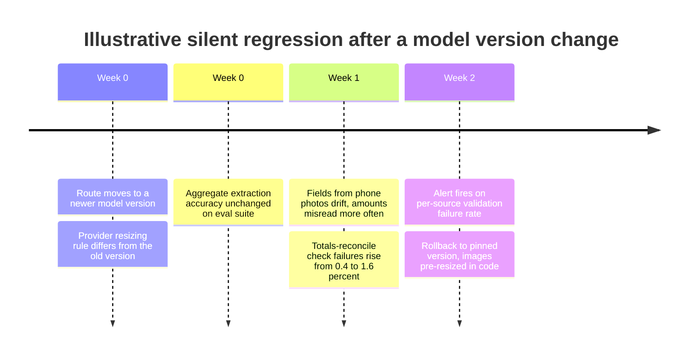

Multimodal model, metin dışındaki girdileri, tipik olarak görselleri, doküman sayfalarını, sesi ve bazen videoyu kabul eden, bazı durumlarda metnin yanında ses de üreten bir modeldir. Mimari açıdan hâlâ bir dizi modelidir: metin olmayan her girdi, özel bir encoder tarafından metin token'larıyla aynı dizide yer alan bir embedding vektörü dizisine dönüştürülür ve decoder bu birleşik diziden, yalnızca metinden üretiyormuş gibi üretim yapar. Sampling, context limitleri ya da olasılıksal çıktı açısından hiçbir şey değişmez. Değişen şey, taranmış bir faturanın, bir telefon ekran görüntüsünün ya da bir müşteri görüşmesinin artık onu önce metne çeviren bir OCR (optical character recognition, optik karakter tanıma) ya da ASR (automatic speech recognition, otomatik konuşma tanıma) servisinden geçmeden doğrudan modele girmesidir.

Bunun çözdüğü problem, kurumların işlediği bilginin büyük kısmının hiçbir zaman metin olmamasıdır. Sözleşmeler tarama olarak, hasar talepleri fotoğraf olarak, destek talepleri telefon görüşmesi olarak gelir; bir operasyon dashboard'u ise bir ekran görüntüsüdür. Klasik cevap bir pipeline'dır: özelleşmiş bir algılama bileşeni (OCR, layout parser, ASR engine) metin üretir ve bir metin modeli bunun üzerinde akıl yürütür. Bu pipeline, metin temsilinin taşıyamadığı her şeyi kaybeder: hangi sayının hangi sütuna ait olduğunu söyleyen yerleşim, işaretlenmiş bir onay kutusu, eksik bir imza ya da arayanın sesindeki tereddüt. Native bir multimodal model ham sinyali görür ve bu bilgiyi korur.

Temel trade-off, algılama hatalarının nerede oluştuğu ve onları görüp göremeyeceğinizdir. Bir pipeline'da algılama incelenebilir bir ara çıktı üretir: çoğu zaman kelime başına güven skoru olan bir transkript ya da OCR metin katmanı. Bu çıktı, herhangi bir akıl yürütme başlamadan önce doğrulanabilir, loglanabilir ve düzeltilebilir. Native bir multimodal çağrıda ise algılama ve akıl yürütme tek bir olasılıksal bileşenin içinde gerçekleşir; yanlış okunmuş bir rakam, kontrol edilecek hiçbir ara çıktı olmadan akıcı ve kendinden emin bir metin olarak dışarı çıkar. Native girdi bilgiyi korur ve mimariyi sadeleştirir; pipeline'lar ise denetlenebilirliği korur ve her aşamanın ayrı ayrı ölçülüp değiştirilebilmesini sağlar. Maliyet, göründüğünden daha az açık olan üçüncü eksendir: görsel ve ses token'ları girdinin taşıdığı bilgi miktarıyla değil, piksel ve saniyeyle ölçeklenir; boş bir sayfa yoğun bir sayfa kadar tutabilir.

## Pikseller, Sayfalar ve Ses Dalgaları Nasıl Token'a Dönüşür

Büyük vision-language model'lerin hepsi, özgün Vision Transformer çalışmasında (Dosovitskiy vd., 2021) ve LLaVA (Liu vd., 2023) gibi açık tasarımlarda anlatılan aynı genel tarifi izler. Görsel önce bir ön işleme adımında yeniden boyutlandırılır ve gerekirse tile'lara bölünür. Bir vision encoder her tile'ı, örneğin 14 ile 32 piksel kenarlı, sabit boyutlu patch'lerden oluşan bir ızgaraya ayırır ve her patch'i bir vektöre çevirir. Küçük bir projeksiyon ağı bu vektörleri dil modelinin embedding uzayına eşler ve projekte edilmiş vektörler, görselin prompt'ta göründüğü konumda token dizisine yerleştirilir. Bu noktadan sonra decoder, görsel konumları ile metin konumları üzerinde aynı şekilde attention uygular.


*Bir vision-language model'in girdi yolu. Ön işleme kutusu modelden önce çalışır ve genellikle çağıran tarafından değil, provider tarafından kontrol edilir.*

Bu yolun üç özelliği neredeyse her production kararını belirler. Birincisi, model sizin özgün görselinizi hiçbir zaman görmez; ön işleme adımının çıktısını görür. Bu adım 3.000 piksel genişliğindeki bir taramayı token bütçesine sığdırmak için küçültürse, tam boyutta bir insan için okunaklı olan metin encoder'a ulaştığında karakter başına yalnızca birkaç piksel kaplayabilir. İkincisi, görsel konumlarının sayısı yalnızca yeniden boyutlandırılmış piksel boyutlarının bir fonksiyonudur. Aynı boyuttaki beyaz bir sayfa ile altı puntoluk dipnotlarla dolu bir sayfa aynı maliyeti çıkarır. Üçüncüsü, görsel konumları sıradan context konumlarıdır: context window'u tüketir, prefill'i (modelin ilk token'ı üretmeden önce tüm girdiyi işlediği aşama; [Prefill, Decode ve KV Cache](/ai-systems-architecture/tr/inference/fundamentals/prefill-decode-kv-cache/) sayfasında ele alınır) uzatır ve input token olarak faturalanır.

### Token Hesabı Provider'a Göre Değişir

Piksellerden faturalanan token'lara dönüşüm provider'a özgü bir formüldür ve formüller model nesilleriyle birlikte değişir. Kasım 2026 itibarıyla en büyük üç API provider'ı şunları belgeliyor.

OpenAI iki yöntem belgeliyor. Yeni modeller patch tabanlı hesap kullanır: görsel 32 piksellik patch'lere bölünür, patch sayısı `ceil(width/32) x ceil(height/32)` olarak hesaplanır, seçilen detay seviyesi için modelin patch bütçesini aşarsa görsel küçültülür (birçok güncel modelde `high` detayda 2.500 patch) ve patch sayısı modele özgü bir katsayıyla çarpılır (güncel modellerin çoğunda 1,2; bazı küçük modellerde daha yüksek). GPT-4o gibi eski modeller tile tabanlı hesap kullanır: görsel 2.048'e 2.048'e sığacak şekilde ölçeklenir, ardından kısa kenarı 768 piksele indirilir ve maliyet 85 baz token artı 512 piksellik her tile için 170 token olur. Bir `detail` parametresi `low`, `high`, `auto` ya da destekleyen modellerde `original` seçer; dokümantasyon, bazı modellerde `low`'un `high`'dan daha az token kullanmadığı konusunda uyarır.

Anthropic 28 piksellik patch'lerle patch tabanlı hesap belgeliyor; bir görsel `ceil(width/28) x ceil(height/28)` visual token tutar ve modelin limitlerini aşan görseller en-boy oranı korunarak küçültülür. PDF'lerde her sayfa bir görsele çevrilir ve sayfanın çıkarılmış metni yanına eklenir; dokümantasyon sayfa başına 1.500 ile 3.000 metin token'ı öngörür ve her sayfa görselini en fazla 1.568 visual token ile sınırlar. Google, Gemini için her iki boyutu en fazla 384 piksel olan bir görselin 258 token tuttuğunu, daha büyük görsellerin her biri 258 token olan 768'e 768 tile'lara kırpılıp ölçeklendiğini, PDF sayfalarının görsel gibi token'landığını, sesin saniyede 32 token, videonun ise saniyede 263 token tuttuğunu belgeliyor; yeni Gemini nesilleri bu bütçeleri değiştiren bir `media_resolution` ayarı ekliyor.

Mimari sonuç şudur: "Bu sayfa kaç token" sorusunun taşınabilir bir cevabı yoktur. Bir doküman iş yükünü provider'lar arasında taşıyan bir routing ya da fallback katmanı, [Multi-Model Strateji ve Model Routing](/ai-systems-architecture/tr/model-strategy/selection-and-deployment/model-routing/) sayfasında anlatıldığı gibi, prompt birebir aynı olsa bile modelin gördüğü etkin çözünürlüğü ve onunla birlikte küçük metindeki hata oranını değiştirir. Bu input token'larının metin ve output token'larına göre nasıl fiyatlandığı [Token Ekonomisi: Fiyatlandırma, Reasoning Token'ları ve Gizli Maliyetler](/ai-systems-architecture/tr/economics/understanding-cost/token-economics/) sayfasında ele alınır.

### Görsel Girdi Neden Özette İşe Yarar, Kesinlikte Başarısız Olur

Bir vision encoder, dilde nasıl betimlendikleriyle hizalı patch vektörleri üretmek üzere çok büyük görsel-metin çifti koleksiyonlarıyla eğitilir. Bu hedef, bir görselin ne hakkında olduğunu yakalamayı ödüllendirir: bir formun yerleşimi, grafiğin türü, bir ekran görüntüsünün özü, net basılmış metnin okunması. Kesin uzamsal hesabı ise doğrudan ödüllendirmez. Çok sayıda küçük nesneyi saymak, bir eksenden koordinat okumak, neredeyse aynı iki çizgiden hangisinin daha uzun olduğunu söylemek ya da bir diyagramda ince bir bağlantı çizgisini takip etmek, patch embedding'lerinin bulanıklaştırdığı ince konum ayrıntısına dayanır. Provider dokümantasyonları Kasım 2026 itibarıyla bu zayıflıkları açıkça listeliyor: OpenAI küçük metni, döndürülmüş metni, Latin olmayan alfabeleri, uzamsal akıl yürütmeyi, saymayı ve farklı çizgi stilleri olan grafikleri sayıyor; Anthropic düşük kaliteli, döndürülmüş ya da çok küçük görselleri, yaklaşık saymayı ve yaklaşık konumlandırmayı sayıyor. Rahmanzadehgervi vd. (2024), *Vision Language Models Are Blind* gibi bağımsız çalışmalar, o dönemin güçlü modellerinin insanların zahmetsizce çözdüğü, çizgi kesişimlerini saymak gibi basit geometrik görevlerde başarısız olduğunu gösterdi.

Hatanın biçimi hata oranından daha önemlidir. Bir bölge ön işlemeden sonra okunaksız kaldığında decoder hata üretmez; en makul devamı üretmeyi sürdürür ve bulanık bir fatura toplamı için bu, makul görünen bir sayıdır. Dolayısıyla algılama hataları exception olarak değil, [Hallucination Azaltma: Grounding, Doğrulama, Abstention](/ai-systems-architecture/tr/reliability/output-reliability/hallucination-mitigation/) sayfasında anlatılan sessiz hata sınıfıyla aynı biçimde, uydurulmuş içerik olarak ortaya çıkar. Metin pipeline'ının özelliği bunun ayna görüntüsüdür: bir bölgeyi okuyamayan OCR engine genellikle anlamsız karakterler ya da düşük güven skoru üretir ve bunu bir validator yakalayabilir.

### Dokümanlar: Metin Katmanı, Sayfa Görseli ya da İkisi Birden

Bir PDF modele üç yoldan ulaşabilir ve bu yollar farklı biçimlerde başarısız olur. Metin katmanı çıkarımı, dijital olarak üretilmiş bir PDF'e gömülü karakterleri okur; var olduğu yerde kesindir, ucuzdur, ama yazılmak yerine çizilmiş her şeye, hiç metin katmanı olmayan taranmış sayfalar ve grafikler dahil, kördür. Sayfa görseli girdisi her sayfayı render eder ve vision yolundan geçirir; yerleşimi, kaşeleri, onay kutularını ve el yazısını, token bütçesinin izin verdiği çözünürlükte görür. Anthropic'in Kasım 2026 itibarıyla PDF'lerde kullandığı birleşik mod hem çıkarılmış metni hem de sayfa görselini gönderir; böylece model kesin karakterleri metin katmanından okuyup yapıyı görselden alabilir. Birleşik mod en çok token'ı tüketir ve karışık dokümanlarda en iyi sonucu verir, ama yeni bir hata da doğurur: metin katmanı ile görsel çeliştiğinde, örneğin bir tarama upstream bir sistem tarafından kötü bir OCR katmanıyla kaplandığında, model ikisinden herhangi birini izleyebilir.

Dokümanların retrieval index'leri için nasıl parse edilip zenginleştirildiği, kendi kanonik sayfası olan ayrı bir konudur: [Ingestion Pipeline'ları: Parsing, OCR, Temizleme ve Zenginleştirme](/ai-systems-architecture/tr/retrieval/ingestion-indexing/ingestion-pipeline/). Bu sayfa, inference anında hangi temsilin gönderileceğine dair model tarafındaki kararı ele alır.

### Ses: Zincirleme Pipeline'lar ve Native Konuşma

Ses iki mimariden biriyle girer. Zincirleme mimari, transkript üretmek için ASR'ı, yanıt üretmek için bir metin modelini ve yanıtı seslendirmek için TTS'i (text-to-speech, metinden konuşmaya) çalıştırır. Her aşama değiştirilebilir ve gözlemlenebilirdir, transkript bir denetim artefaktıdır ve metin modeli herhangi bir model olabilir. Bedeli latency'dir, çünkü aşamalar sırayla çalışır ve her biri kendi gecikmesini ekler; ayrıca transkriptin taşımadığı her şey kaybolur: ton, vurgu, üst üste binen konuşmalar ve arka plan olayları. Örneğin OpenAI'ın Realtime API'si (Ağustos 2025'ten beri genel kullanımda; WebRTC, WebSocket ve SIP telefon bağlantılarıyla) tarafından sunulan native mimari, ses token'larını doğrudan ses token'ı üreten bir modele verir. Kullanıcı cümlesini bitirirken yanıt verebilir, sözün kesilmesini yönetebilir ve prozodiye göre koşullanabilir. Bir transkript istiyorsanız bu bir yan çıktıdır ve modelin duyduğuyla birebir örtüşmeyebilir.


*Native speech-to-speech bir oturumda, sözün kesildiği (barge-in) tek bir tur. Tur tespiti, iptal ve kırpma modelin değil, protokolün parçasıdır.*

Mimari yükü 4. adım ile 11-13. adımlar taşır. Bir voice activity detector (VAD, ses etkinliği dedektörü) arayanın ne zaman bitirdiğine karar verir ve sessizlik eşiği, hızlı yanıt vermek ile insanların sözünü cümle ortasında kesmek arasında bir denge kurar. Arayan sözü kestiğinde sistem üretimi iptal etmeli ve konuşma geçmişine yanıtın yalnızca gerçekten çalınan kısmını kaydetmelidir; aksi halde modelin bir sonraki turu, arayanın hiç duymadığı bir cümleyi duyduğunu varsayar. Altta yatan transport uzun ömürlü, çift yönlü bir stream'dir; genel özellikleri [WebSocket ve Server-Sent Events: Gerçek Zamanlı İletişim](https://gorkemsari.github.io/distributed-systems/tr/communication/synchronous-protocols/websocket-sse/) sayfasında ele alınır. Ürün tarafındaki streaming konuları ise [Streaming Altyapısı: SSE, WebSocket ve Proxy'ler](/ai-systems-architecture/tr/product-integration/product-surface/streaming-infrastructure/) sayfasındadır.

## Hesaplı Örnek: Çözünürlük, Token ve Para

Bir kredi kuruluşunun, A4 kağıda 200 DPI ile taranmış, sayfa başına yaklaşık 1.650'ye 2.340 piksel olan 12 sayfalık kredi başvurularından on iki alan çıkardığını ve ayda 200.000 başvuru işlediğini varsayalım. Aşağıdaki fiyatların hepsi hesap için örnek varsayımlardır, herhangi bir provider'ın liste fiyatı değildir: milyon token başına input için 3 dolar, output için 15 dolar ve 1.000 sayfa başına 1,50 dolarlık bir yönetilen OCR servisi.

28 piksellik patch hesabıyla tam çözünürlükteki bir sayfa `ceil(1650/28) x ceil(2340/28)`, yani 59'a 84, toplam 4.956 patch eder. Sayfa başına 1.568 visual token sınırıyla sayfa, yaklaşık 1.568 bölü 4.956'nın karekökü, yani 0,56'lık bir doğrusal katsayıyla, kabaca 930'a 1.320 piksele küçültülür. 200 DPI'da yaklaşık 25 piksel yüksekliğindeki 9 puntoluk bir gövde metni satırı yaklaşık 14 piksele iner; yaklaşık 17 piksel yüksekliğindeki, yıllık maliyet oranını (APR) açıklayan 6 puntoluk bir dipnot ise yaklaşık 9 piksele iner. Bu, provider dokümantasyonlarının küçük metin konusunda uyardığı aralıktır. On iki sayfa yaklaşık 18.800 görsel token'ı tutar. Buna 1.000 token'lık talimat ve şema ile 1.500 output token'ı eklendiğinde input yaklaşık 19.800 token, yani 0,059 dolar; output 0,023 dolar eder; başvuru başına toplam yaklaşık 0,082 dolar.

Pipeline alternatifi 12 sayfanın tamamında 0,018 dolara OCR çalıştırır ve metni, sayfa başına 600 token varsayarak, bir metin modeline gönderir: 7.200 artı 1.000 input token'ı 0,025 dolar, aynı 1.500 output token'ı 0,023 dolar tutar; toplam yaklaşık 0,065 dolar. OCR metni artı sayfa görsellerinden oluşan birleşik mod, kabaca iki girdinin toplamına, yani yaklaşık 27.000 input token'ı artı OCR'a, aşağı yukarı 0,12 dolara mal olur.


*Yukarıdaki örnek fiyatlarla üç temsil için başvuru başına maliyet. Ayda 200.000 başvuruda fark kabaca 13.000 ile 24.400 dolar arasındadır.*

Grafiğin dersi, maliyet farklarının mütevazı, hata farklarının ise öyle olmadığıdır. 200.000 başvuruda en pahalı seçenek en ucuzundan ayda yaklaşık 11.000 dolar fazla tutar. Yalnızca görsel kullanan yol APR dipnotunu başvuruların yalnızca %0,5'inde (örnek olarak varsayılmış bir oran) yanlış okusa bile bu, ayda yanlış düzenlenmiş bir rakam içeren 1.000 başvuru demektir ve her biri bir maliyet kalemi değil, bir uyum (compliance) incident'ıdır. Dolayısıyla karar, alan türüne göre ölçülmüş alan düzeyindeki hataya göre verilir; maliyet yalnızca eşitliği bozan ölçüttür. Hesabı temsil seçiminden daha çok değiştiren iki ucuz iyileştirme vardır: yalnızca on iki alanı içeren sayfaları (çoğu zaman on iki sayfanın üçü ya da dördü) kırpıp gönderin ve dipnot bölgesini küçültülmüş tam sayfa yerine ayrı, yüksek çözünürlüklü bir kırpıntı olarak gönderin.

Latency de aynı yönde hareket eder. Yaklaşık 20.000 input token'lık görsel prefill'i ve dolayısıyla ilk token'a kadar geçen süreyi uzatır; bu, arka ofis batch işinde pek önemli değildir, etkileşimli bir yükleme akışında ise çok önemlidir. Ses de aynı saniye bazlı mantığı izler: saniyede 32 token'la 10 dakikalık bir görüşme, tek bir talimat kelimesinden önce 19.200 input token'ı eder; bu yüzden uzun görüşmeler, konuşma bitmeden çok önce bir oturumun context bütçesini tüketebilir. OpenAI'ın kendi geliştirici notları, bu yazının yazıldığı tarihte, realtime modeli için yaklaşık 32.000 token'lık bir context window'dan ve dolduğunda eski mesajların otomatik olarak düşürülmesinden söz ediyor. Bu, [Konuşma Context'ini Yönetmek: Summarization, Truncation, Sliding Window](/ai-systems-architecture/tr/context-engineering/production-prompting/conversation-context/) sayfasında ele alınan türden bir konuşma hafızası meselesidir.

## Native Multimodal Girdi ve Özelleşmiş Pipeline'lar

Seçenekler tek model ile çok model arasında değildir; her biri hataların farklı bir yerde ortaya çıktığı bir temsiller kümesidir.

| Yaklaşım | Modelin gördüğü | Güçlü yanları | Zayıf yanları | Ne zaman tercih edilir |
|---|---|---|---|---|
| Metin katmanı çıkarımı | Gömülü karakterlerin kendisi | En ucuz, kesin, denetlenebilir | Taramalara, grafiklere, onay kutularına, yerleşime kör | Yerleşimin anlam taşımadığı, dijital doğmuş PDF'ler |
| OCR ya da layout parser, ardından metin modeli | Yapı işaretlemeli tanınmış metin | Kelime başına güven skoru, değiştirilebilir aşamalar, temiz baskıda güçlü | Görsel ipuçlarını kaybeder, tablo yapısı hataları birikir | Sabit şablonlu, katı denetim gereksinimli yüksek hacimli formlar |
| Native sayfa görselleri | Küçültülmüş pikseller | Yerleşimi, kaşeleri, el yazısını, grafikleri okur | Sessiz yanlış okumalar, çözünürlük provider tarafından sınırlı | Çeşitli, yapılandırılmamış dokümanlar ve ekran görüntüleri |
| Metin katmanı ya da OCR artı sayfa görseli | İkisi yan yana | Karışık dokümanlarda en iyi doğruluk, çapraz kontrole imkan verir | En yüksek token maliyeti, ikisi arasında çelişki | Hem maliyetin hem hatanın önemli olduğu regüle çıkarım |
| ASR, metin modeli, TTS | Transkript | Denetim kaydı olarak transkript, herhangi bir metin modeli, dakika başına daha ucuz | Aşama başına ek latency, tonu ve örtüşmeyi kaybeder | Çağrı analitiği, uyum kaydı, etkileşimsiz ses |
| Native speech-to-speech | Ses token'ları | En düşük konuşma latency'si, barge-in, prozodi | Denetlemesi daha zor, daha az model seçeneği, context hızla dolar | Latency'nin ürünü tanımladığı etkileşimli ses agent'ları |

İki satır bir pozisyonu hak ediyor. Yanlış bir sayının bedeli olan doküman çıkarımında doğru varsayılan birleşik temsildir: metin katmanını ya da OCR çıktısını sayfa görseliyle birlikte gönderin ve modelden her alanın hangi kaynaktan geldiğini belirtmesini isteyin. Bu örtüşme, iki temsilin hiçbirinin tek başına sağlamadığı bir çapraz kontrol verir. Ses tarafında ise regüle olan her şey için doğru varsayılan zincirleme mimari olmayı sürdürür, çünkü denetimin, itiraz yönetiminin ve kalite incelemesinin ihtiyaç duyduğu kayıt transkripttir. Native speech-to-speech, konuşma latency'si ürünün kendisi olduğunda yerini hak eder ve o durumda bile kayıt için ayrı bir ASR transkripti üretmelidir.

:::tip[İkisini birden gönderin ve çelişkilerini sinyal olarak kullanın]
OCR metni ile modelin sayfa görselini okuması bir alanda çeliştiğinde, bu çelişki elinizdeki en ucuz ve yüksek isabetli hata dedektörüdür. Çelişen alanları ikinci bir geçişe ya da bir insan kuyruğuna yönlendirin ve çelişki oranını alan ve doküman kaynağı bazında izleyin. Bu oranda ani bir değişiklik, çoğu zaman upstream bir tarayıcının, bir şablonun ya da bir provider'ın yeniden boyutlandırma kuralının değiştiğinin ilk işaretidir.
:::

Modaliteyle birlikte güvenlik de değişir. Her görsel, sayfa ve ses kaydı talimat taşıyabilen güvenilmez bir girdidir: bir görsele render edilmiş metin, bir PDF sayfasında beyaz üstüne beyaz metin ya da kaydedilmiş bir görüşmede sözlü bir talimat. Trail of Bits, Ağustos 2025'te bir görselin, prompt injection yalnızca provider'ın küçültme adımından sonra ortaya çıkacak ve tam çözünürlüklü yüklemeye bakan bir insana görünmeyecek şekilde hazırlanabileceğini gösterdi ve Gemini CLI ile diğer Google ürünleri üzerinden veri sızdırmayı gösterdi. Önerdikleri önlemler, yükleme boyutlarını sınırlamak, kullanıcılara modelin gerçekte aldığı şeyin bir önizlemesini göstermek ve bir görselin içindeki içeriğin açık bir onay olmadan hassas bir tool call tetiklemesine asla izin vermemektir. Genel savunma tasarımı [Prompt Injection: Doğrudan ve Dolaylı](/ai-systems-architecture/tr/security/threats/prompt-injection/) sayfasındadır. Görseller ve ses, metin redaction'ının görmediği kişisel veriler de taşır: yüzler, kimlik kartları, imzalar, sesler ve ekranında secret bulunan ekran görüntüleri. Maskeleme, [PII ve Hassas Veri: Masking, Tokenization, Redaction](/ai-systems-architecture/tr/security/defenses/pii-handling/) sayfasında anlatıldığı gibi, model çağrısından önce pikseller ya da ses üzerinde yapılmalıdır; loglanan girdiler de [Gizlilik Kısıtları Altında Prompt ve Yanıt Loglama](/ai-systems-architecture/tr/llmops/observability/logging-privacy/) sayfasında anlatılan, metin prompt'larıyla aynı saklama kurallarına tabidir. Regüle ortamlarda ses ve yüz verisi KVKK ve GDPR kapsamında biyometrik ya da özel nitelikli veri olabilir; AB Yapay Zeka Yasası (EU AI Act) ise Şubat 2025'ten beri, tıbbi ve güvenlik amaçlı kullanımlar dışında, iş yerlerinde ve eğitim kurumlarında duygu tanıma sistemlerini yasaklıyor. Temsilcinin ya da arayanın duygusunu puanlayan bir ses agent'ı, yayına alınmadan önce hukuki incelemeden geçmelidir (bkz. [Türkiye Regülasyonu ve Data Residency: KVKK ve BDDK](/ai-systems-architecture/tr/governance/regulation/turkish-regulation/)).

## Production'da Multimodal Route'ları Yapılandırmak

Önemli olan parametreler, modelin gerçekte ne gördüğünü kontrol edenlerdir ve bunların çoğu provider'ın varsayılanlarında değil, sizin kodunuzda olmalıdır. Görselleri ölçtüğünüz bir boyuta kendiniz küçültün ve kırpın; böylece provider'ın ön işlemesi etkisiz hale gelir ve provider tarafındaki bir yeniden boyutlandırma kuralı değişikliği doğruluğunuzu sessizce değiştiremez. Göndermeden önce EXIF yönlendirmesini uygulayın, çünkü dönme bayrağıyla yan kaydedilmiş bir telefon fotoğrafı encoder'a döndürülmüş olarak ulaşabilir. Göndermeden önce sayfa seçin: on iki sayfalık bir dokümanın ilgili üç sayfasını seçen bir sınıflandırıcı ya da ucuz bir metin katmanı araması maliyeti düşürür ve dikkat dağıtıcıları ortadan kaldırır. Her sayfanın çözünürlüğünü artırmak yerine, küçük baskı olduğu bilinen bölgelerin yüksek çözünürlüklü kırpıntılarını gönderin. Provider öneriyorsa görselleri prompt'ta sorudan önce koyun; örneğin Anthropic dokümantasyonu, modellerinin görseller metinden önce yerleştirildiğinde en iyi sonucu verdiğini belirtiyor.

```yaml
# Illustrative route policy; field names are this platform's, not a provider's
route: loan-application-extract
input:
  pages: classify-and-select      # send only pages that hold target fields
  representation: text-plus-image # OCR text and page image together
  image:
    resize_to_long_edge_px: 1560  # pre-resize so provider resizing is a no-op
    apply_exif_rotation: true
    crops:
      - region: apr-footnote      # small print sent as a separate crop
        min_px_per_text_line: 20
  max_images_per_request: 8
validation:
  cross_check: ocr-vs-model       # field disagreement goes to review
  checks: [iban_checksum, totals_reconcile, date_range]
pin:
  model_version: pinned           # resolution rules change with versions
```

Multimodal çıkarımın güveni kazandığı yer validation bloğudur. Birçok doküman alanının model olmadan kontrol edilebilecek bir yapısı vardır: IBAN ve kart checksum'ları, bir toplama eşit olması gereken kalemler, bir aralıkta kalması gereken tarihler, kontrol hanesi olan bir kimlik numarası. Bu kontroller, modelin kendinden emin metin olarak sunduğu yanlış okumaları tam olarak yakalar. Şemaya bağlı çıkarım ve onarımın daha geniş mekaniği [Structured Output: JSON Schema, Constrained Decoding ve Tool Tabanlı Extraction](/ai-systems-architecture/tr/context-engineering/production-prompting/structured-output/) ve [Çıktı Doğrulama ve Onarım Döngüleri](/ai-systems-architecture/tr/reliability/output-reliability/output-validation/) sayfalarında ele alınır.

Ölçüm kendi eval setini gerektirir. Production kaynaklarından gerçek doküman ya da ses kayıtları toplayın, bunları kaliteye göre katmanlayın (temiz dijital, iyi tarama, telefon fotoğrafı, eğik, fakslanmış; ses için sessiz hat, gürültülü hat, aksanlı konuşma, üst üste konuşan kişiler) ve ground truth'u alan düzeyinde etiketleyin. Toplu bir değer yerine alan türü başına tam eşleşme doğruluğunu raporlayın, çünkü bir model isimlerde %99, tutarlarda %94 doğru olabilir ve önemli olan tutarlardır. Ses için kelime hata oranını ve ayrıca söylenmemiş içerik eklenmesini ölçün, çünkü toplu kelime hata oranı hallucination ile uydurulmuş cümleleri gizler. Bir regresyon, genel ortalama neredeyse kıpırdamazken tek bir katmanda, çoğu zaman düşük kaliteli olanda, bir düşüş olarak görünür. Veri seti tasarımı [Golden Dataset Tasarımı ve Bakımı](/ai-systems-architecture/tr/evaluation/measuring-quality/golden-datasets/), metrik seçimi ise [Metrik Tasarımı: Görev Metrikleri ve RAG Metrikleri](/ai-systems-architecture/tr/evaluation/measuring-quality/metric-design/) sayfasında ele alınır.

Self-hosted vision modellerinde vLLM gibi serving engine'ler vision encoder'ı prefill'den önce ek bir aşama olarak çalıştırır ve prompt başına görsel sayısını konfigürasyonla sınırlar. Encoder hesaplaması ve ek prefill uzunluğu, aynı istek hızındaki yalnızca metin trafiğine kıyasla GPU başına throughput'u düşürür ve bu, kapasite planlamasına yansıtılmalıdır (bkz. [GPU Kapasite Planlaması](/ai-systems-architecture/tr/inference/production-serving/gpu-capacity-planning/)). Büyük doküman batch'leri, provider'ların indirimli fiyat sunduğu asenkron batch arayüzlerine aittir; bu konu [Online ile Async ve Batch Inference İş Yükleri](/ai-systems-architecture/tr/inference/production-serving/online-vs-batch/) sayfasında tartışılır. İşlenmesi tekrar tekrar başarısız olan bir doküman, örneğin şifreli ya da bozuk bir PDF, [Dead Letter Queues ve Poison Message Yönetimi](https://gorkemsari.github.io/distributed-systems/tr/communication/async-messaging/dlq-poison-messages/) sayfasında anlatıldığı gibi, süresiz yeniden denenmek yerine kenara alınmalıdır.

## Multimodal Sistemler Nasıl Başarısız Olur

Multimodal hataların çoğu makul görünen çıktı üretir. Hata loglarında değil, mutabakat raporlarında, müşteri itirazlarında ve denetim örneklemlerinde ortaya çıkar; bu yüzden her biri önceden tasarlanmış bir dedektöre ihtiyaç duyar.


*Örnek amaçlı bir incident. Eval suite ortalaması tek bir girdi katmanıyla sınırlı bir regresyonu gizledi; onu yapısal bir doğrulama metriği yakaladı.*

Zaman çizelgesi, toplu doğruluğun vision iş yükleri için neden yanlış bir guardrail olduğunu gösteriyor. Yeni versiyon telefon fotoğraflarını farklı bir etkin çözünürlükte gördü ve bu yalnızca bir girdi kaynağını etkiledi. Eval suite'e temiz dijital PDF'ler hakimdi, bu yüzden ortalaması sabit kaldı. Modelden bağımsız bir kural olan toplam mutabakat kontrolü tek bir kaynakta dört kat arttı ve tek sinyal oydu. Kurtarmanın iki parçası vardı: sabitlenmiş versiyona geri dönmek ve görselleri kodda küçülterek provider ön işlemesine olan bağımlılığı ortadan kaldırmak. Versiyon sabitleme ve migration testleri [Model Versiyonlama, Deprecation ve Migration](/ai-systems-architecture/tr/model-strategy/lifecycle-and-adaptation/versioning-migration/) sayfasında ele alınır.

| Hata | Tetikleyici | Belirti | Tespit | Azaltma ve kurtarma |
|---|---|---|---|---|
| Sessiz yanlış okuma | Küçültmeden sonra küçük, bulanık ya da döndürülmüş metin | Kendinden emin yanlış rakam ya da isim | Checksum ve mutabakat hataları; OCR ile model arasındaki çelişki oranı | Önceden küçültme, küçük baskı için kırpıntılar, birleşik temsil, çelişkide insan incelemesi |
| Okunaksız bölgelerde uydurulmuş içerik | Teslim edilen çözünürlükte okunamayan bölge | İnsanın leke gördüğü yerde makul bir değer | OCR güveninin düşük olduğu yerde doldurulmuş alanlar | Şemada açık bir "okunamıyor" değeri zorunlu kılmak; OCR güven tabanının altındaki doldurmaları reddetmek |
| Tablo ve yerleşim karışması | Çok sütunlu sayfalar, birleşik hücreler, döndürülmüş tablolar | Değerlerin yanlış satıra ya da sütuna kayması | Mutabık olmayan satır toplamları | Tabloya özgü kırpıntılar; bilinen şablonlar için layout parser |
| Provider yeniden boyutlandırma değişikliği | Model ya da API versiyon güncellemesi | Tek bir girdi kaynağıyla sınırlı doğruluk düşüşü | Suite ortalamaları değil, kaynak bazında doğrulama oranları | Versiyon sabitleme; kodda küçültme; katman bazında eval kapıları |
| Görsel kaynaklı prompt injection | Görsele render edilmiş ya da küçültmeyle ortaya çıkan talimatlar | Kullanıcının istemediği tool call'lar ya da çıktılar | Tool call anomali alarmları; render edilmiş girdide içerik taramaları | Görselleri güvenilmez veri saymak; hassas tool call'larda onay; modelin gördüğünün önizlemesi |
| ASR hallucination'ı | Sessizlik, uzun duraklamalar, gürültü | Transkriptte hiç söylenmemiş cümleler | Etiketli seste eklenmiş kelime oranı; konuşma süresine göre transkript uzunluğu | ASR'dan önce VAD ile sessizliği kırpmak; konuşma saniyesi başına metni yüksek olan transkriptleri işaretlemek |
| Tur alma hataları | Çok kısa VAD eşiği ya da modelin kendi sesinin yankısı | Agent kullanıcıların sözünü keser ya da kendine yanıt verir | Görüşme başına söz kesme oranı, üst üste konuşma oranı | Kanal başına sessizlik eşiği ayarı; yankı engelleme; geçmişe yalnızca çalınan sesi kaydetmek |
| Maliyet patlaması | Sınırsız görsel sayısı, tam uzunlukta video, saatlerce ses | İstek başına token harcamasında sıçrama | İstek başına görsel token'ı, istek başına medya saniyesi | Route başına görsel, sayfa ve medya saniyesi sınırları; gateway'de bütçeler |

ASR satırının güçlü kamuya açık kanıtı var. Koenecke vd. (2024), *Careless Whisper*, çalışmalarında OpenAI'ın Whisper modelinin ürettiği transkriptlerin kabaca %1'inin seste bulunmayan, baştan sona uydurulmuş ifadeler ya da cümleler içerdiğini, bu hallucination'ların %38'inin uydurulmuş şiddet ya da sahte otorite gibi açık zararlar içerdiğini ve hallucination'ların afazinin yaygın bir belirtisi olan, sessiz süreleri daha uzun konuşmacılarda orantısız biçimde ortaya çıktığını buldu. Mekanizma tek bir modelin ötesine genellenir: sessizlik ya da gürültü verilen üretken bir decoder yine de en makul metni üretir, dolayısıyla transkript boşlukları akıcı uydurmalarla doldurur. Zincirleme bir ses sisteminde bu uydurulmuş cümle, metin modelinin üzerinde akıl yürüttüğü girdi ve bir denetçinin okuduğu kayıt haline gelir.

:::danger[Çıkarım pipeline'ında yanlış okunmuş bir sayı sessiz veri bozulmasıdır]
Bir tutar alanında 8'i 3 olarak okuyan bir vision modeli, iyi biçimlendirilmiş, şemaya uygun bir kayıt üretir. Bu kayıt modelden bağımsız bir kontrol olmadan bir ledger'a, bir kredi kararına ya da bir regülasyon raporuna akarsa, hata bir müşteri ya da denetçi onu bulana kadar doğru veriden ayırt edilemez. Görsellerden ya da sesten çıkarılan her sayısal alan, bir kayıt sistemine yazılmadan önce yapısal bir doğrulamadan (checksum, mutabakat, aralık ya da kaynaklar arası uyum) geçmelidir.
:::

Maliyet patlamaları ayrı bir operasyonel notu hak eder, çünkü koddan değil kullanıcılardan gelir. Tek ekran görüntüleri için tasarlanmış bir sohbet akışına 40 sayfalık taranmış bir sözleşme ya da bir saatlik bir toplantı kaydı yükleyen bir kullanıcı, istek maliyetini iki büyüklük mertebesi artırabilir; bir timeout sonrası retry bunu bir kez daha ikiye katlar. Medya sınırları, model çağrısından önce uygulanmak üzere, [Token Tabanlı Rate Limiting ve Quota](/ai-systems-architecture/tr/platform/ai-gateway/token-rate-limiting/) sayfasında anlatılan token tabanlı limitlerle birlikte gateway'de yer alır.

:::caution[Modelin ne gördüğünü size provider'ın söylemesine güvenmeyin]
Provider'lar görselleri encoder'dan önce yeniden boyutlandırır, tile'lara böler ve bazen kırpar; kurallar model versiyonuna ve detay ayarına göre değişir. Gönderdiğiniz boyutları, detay ya da çözünürlük ayarını ve görsel başına raporlanan input token sayısını loglayın; girdiler değişmediği halde görsel başına token'ın değişmesi bir yeniden boyutlandırma değişikliğidir. Doğruluk çözünürlüğe bağlıysa küçültmeyi kendiniz yapın ve bunu versiyonlanan route konfigürasyonunun parçası haline getirin.
:::

## Multimodal Model Ne Zaman Doğru Bileşendir

Bilgi görsel biçimin kendisinde yaşıyorsa native görsel ya da sayfa girdisi kullanın: anlam atayan yerleşim (hangi kutunun işaretli olduğu, bir sayının hangi sütunda olduğu), el yazısı, kaşeler ve imzalar, grafikler ve kullanıcı arayüzü ekran görüntüleri. Doküman formatları şablonlar için fazla çeşitliyse, yani şablon başına bir OCR konfigürasyonu hiçbir zaman bitmeyecekse kullanın. Yapısı olan her alan için bir doğrulama katmanıyla ve yanlış bir değerin bedeli olduğunda birleşik metin artı görsel temsiliyle kullanın.

Metin katmanı bilgiyi zaten taşıyan dijital doğmuş dokümanlar için native görsel girdi kullanmayın; metin katmanından çıkarım kesindir ve bir büyüklük mertebesi daha ucuzdur. Modelden bağımsız bir kontrol olmadan, küçük baskının, yoğun tabloların ya da para veya regülasyon kararlarını besleyen sayıların tek okuyucusu olarak kullanmayın. Belgelenmiş zayıflıkların geçerli olduğu sayma, ölçme ya da hassas konumlandırma görevlerinde kullanmayın; orada, [AI Ne Zaman Yanlış Çözümdür: Bir Karar Çerçevesi](/ai-systems-architecture/tr/foundations/failure-and-fit/when-not-to-use-ai/) sayfasındaki mantığı izleyerek klasik bilgisayarlı görü ya da deterministik parsing kullanın. Tıbbi görüntü yorumlama için kullanmayın; provider dokümantasyonları Kasım 2026 itibarıyla tanısal taramaları açıkça kapsam dışı bırakıyor.

Konuşma latency'si ürünü tanımlıyorsa, örneğin etkileşimli bir telefon agent'ında, native speech-to-speech kullanın ve yine de denetim için ayrı bir ASR transkripti yakalayın. Transkript kaydın kendisiyse, akıl yürütme ya da uyum için belirli bir metin modeline ihtiyacınız varsa ya da ses çağrı analitiğinde olduğu gibi hiç etkileşimli değilse zincirleme ASR, metin modeli, TTS mimarisini kullanın. Uzun kayıtları native bir oturuma tek girdi olarak vermeyin; onları bölümlere ayırın, transkribe edin ve metin üzerinde akıl yürütün.

Bu modaliteleri sunan model kategorileri ve her kategorinin versiyonlar ile veri yolları üzerinde verdiği kontrol [Frontier, Open-Weight ve Small Language Model'ler](/ai-systems-architecture/tr/model-strategy/model-landscape/model-categories/) sayfasında ele alınır. Multimodal bir route için somut modeller arasında seçim [Model Seçim Kriterleri: Çok Kriterli Bir Yöntem](/ai-systems-architecture/tr/model-strategy/selection-and-deployment/selection-criteria/) sayfasındaki yöntemi izler; yüksek hacimli doküman işleme için eksiksiz bir mimari ise [Referans Mimari: Yüksek Hacimli Doküman İşleme](/ai-systems-architecture/tr/reference/reference-architectures/document-processing/) sayfasında yer alır.

## İleri Okuma

- Alexey Dosovitskiy et al., *An Image is Worth 16x16 Words: Transformers for Image Recognition at Scale*, ICLR, 2021.
- Haotian Liu, Chunyuan Li, Qingyang Wu, and Yong Jae Lee, *Visual Instruction Tuning*, NeurIPS, 2023.
- Alec Radford et al., *Robust Speech Recognition via Large-Scale Weak Supervision*, ICML, 2023.
- Allison Koenecke, Anna Seo Gyeong Choi, Katelyn X. Mei, Hilke Schellmann, and Mona Sloane, *Careless Whisper: Speech-to-Text Hallucination Harms*, ACM FAccT, 2024.
- Trail of Bits, *Weaponizing Image Scaling Against Production AI Systems*, Trail of Bits Blog, 2025.
- OpenAI, *Images and vision*; Anthropic, *Vision* and *PDF support*, official API documentation.
