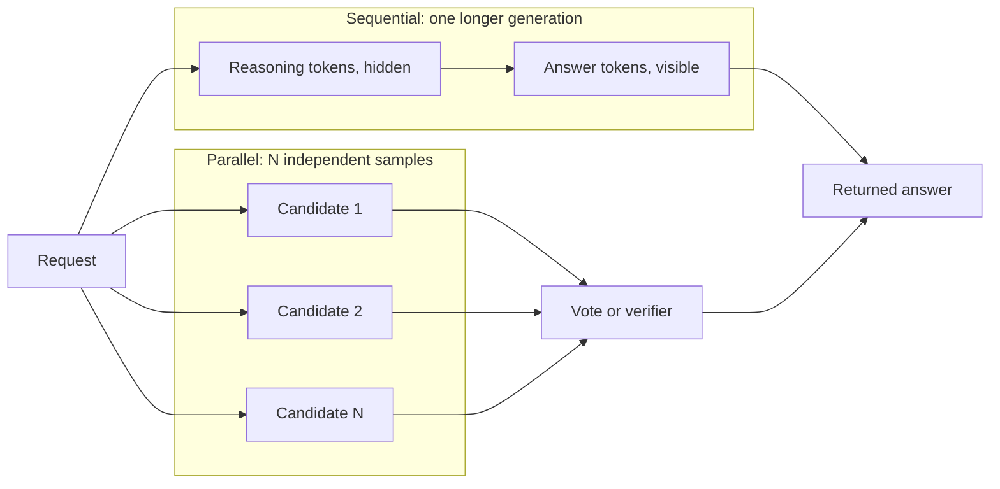
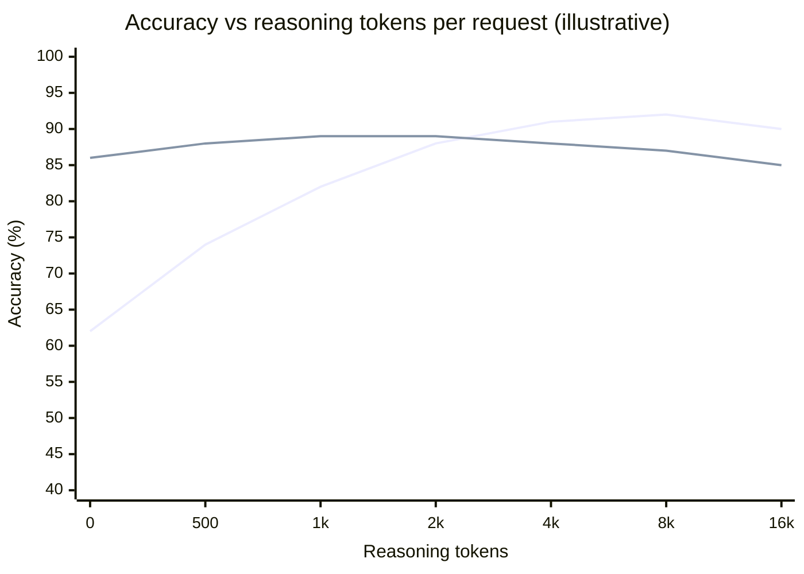
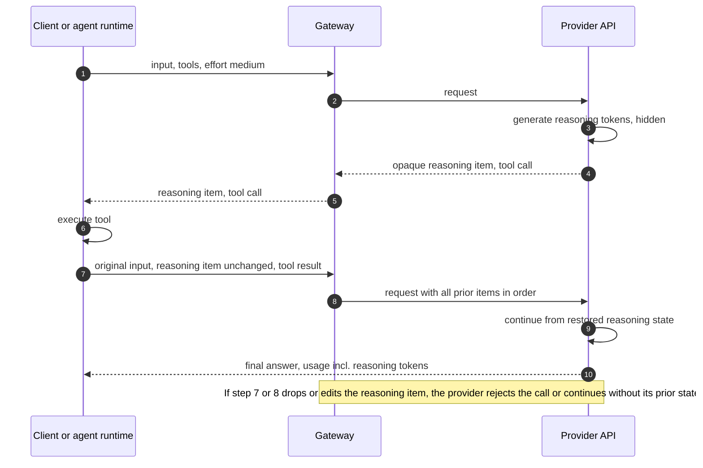
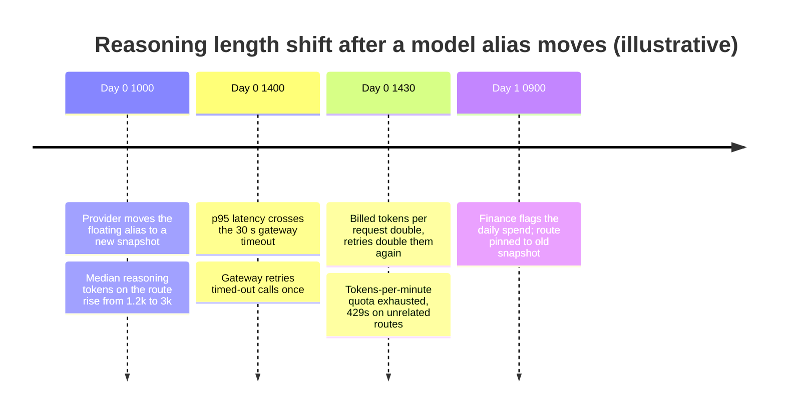

Reasoning model, cevabı üretmeden önce uzun bir ara token dizisi üretecek şekilde eğitilmiş ve bu dizi genellikle çağıran taraftan gizlenerek sunulan bir dil modelidir. Arkasındaki daha geniş fikir test-time compute'tur: doğruluğu yalnızca daha büyük bir modelle satın almak yerine, inference anında istek başına satın almak. Bu, modele daha fazla token ürettirerek, birden fazla aday örnekleyip birini seçerek ya da ikisini birlikte yaparak olur. Vendor'lar ara diziye "reasoning" ya da "thinking" der. Bu sayfada bu kelimeler tek bir şey anlatır: input'a koşullu üretilen, final cevabı koşullayan ve output olarak faturalanan token'lar. İnsani anlamda modelin muhakeme ettiği anlamına gelmezler; sayfanın ilerleyen bölümlerindeki kanıtların gösterdiği gibi, dizinin metni cevabın nasıl üretildiğine dair güvenilir bir anlatım da değildir.

Mimari sonuç şudur: görünen output artık bir çağrının maliyetini ve latency'sini belirlemez. 150 token'lık bir cevap döndüren istek oraya varmak için 300 ya da 15.000 token üretmiş olabilir; bu sayıyı çağıranın koyduğu kaba bir sınır içinde, çalışma anında model belirler. Görünen output uzunluğundan türetilmiş her fiyat, timeout, rate limit ve kapasite tahmini bu modeller için yanlıştır, hem de genellikle olayların yaşandığı kuyrukta.

Temel trade-off, çok adımlı problemlerdeki doğruluğa karşı latency, maliyet, maliyet varyansı ve şeffaflıktır. Matematik, kod, kısıt çözme ve çok adımlı planlama gibi, ara sonuçları kontrol edilebilen adımlara ayrışan görevlerde ek test-time compute doğruluğu ölçülebilir biçimde artırır. Bilgi hatırlama, kısa sınıflandırma ya da akıcı metin gerektiren görevlerde ise çoğu zaman latency ve maliyet ekler, başka pek bir şey eklemez; belli bir noktadan sonra doğruluğu düşürebilir de. Her route'un bu eğrinin neresinde durduğuna karar vermek ve bu kararı bütçelerle uygulamak, bu sayfanın anlattığı iştir.

## Inference Anında Compute Harcamanın İki Yolu

Tek bir isteğe daha fazla inference compute harcamanın birbirinden bağımsız iki yolu vardır ve production'da farklı davranırlar. Birincisi sıralıdır: tek bir üretim daha uzun sürer ve cevaptan önce ara token'lar üretir. İkincisi paraleldir: birkaç bağımsız üretim aynı anda çalışır ve bir seçim adımı, ya final cevaplar üzerinde bir oylama ya da her adayı puanlayan bir verifier, bunlardan birini döndürür. Eğitilmiş reasoning model'ler birincinin ürünleşmiş halidir; ikincisi herhangi bir modelin etrafına kurulabilir.


*Sıralı ve paralel test-time compute. Sıralı harcama ek token'larla orantılı latency ekler; paralel harcama N ile orantılı maliyet ekler ama kabaca tek bir çağrının latency'si içinde çalışır.*

İki yol farklı yerlerde başarısız olur. Sıralı yol bütün ek token'ları isteğin kritik yoluna koyar; decode her seferinde tek token ürettiği için latency reasoning uzunluğuyla doğrusal büyür. Bunun neden pahalı olduğu GPU seviyesinde [Prefill, Decode ve KV Cache](/ai-systems-architecture/tr/inference/fundamentals/prefill-decode-kv-cache/) sayfasında anlatılır. Paralel yol, adaylar eşzamanlı üretildiği için latency'yi tek çağrıya yakın tutar, ama bir seçim kuralı ister. Çoğunluk oylaması yalnızca cevaplar ayrık ve karşılaştırılabilir olduğunda işe yarar: bir etiket, bir sayı, seçenekler arasından bir tercih. Verifier ise yalnızca varsa işe yarar: kod için unit test'ler, kısıtlar için bir solver, extraction için bir şema ve iş kuralları. İkisi de yoksa N aday, aralarından seçme imkânı olmadan N kat maliyettir.

### Daha Uzun Üretimler Doğruluğu Neden Artırır

Bir transformer, üretilen her token için sabit miktarda hesaplama harcar. Tek bir forward pass'in sağladığından fazla sıralı hesaplama gerektiren bir problem, model ne kadar büyük olursa olsun kısa bir cevapta çözülemez; ama birçok token'a yayılarak çözülebilir, çünkü üretilen her token bir sonraki pass'in input'u olur. Context'e yazılan ara sonuçlar, modelin üzerine koşullanabileceği bir çalışma belleğidir. Reasoning model'ler ortaya çıkmadan çok önce, non-reasoning bir modele "adım adım düşün" diye prompt vermenin, yani chain-of-thought prompting'in (Wei ve diğerleri, 2022), aritmetik ve çok adımlı sorularda doğruluğu artırmasının sebebi budur.

Reasoning model'ler bunu prompt'tan eğitime taşır. Kamuya açık en ayrıntılı anlatım DeepSeek-R1 raporudur (DeepSeek-AI, Ocak 2025): bir matematik cevabının referansla eşleşip eşleşmediği ya da kodun testleri geçip geçmediği gibi otomatik hesaplanabilen ödüllere karşı yapılan reinforcement learning, modelin ara sonuçları yeniden kontrol ettiği, yaklaşımları bırakıp alternatif denediği daha uzun üretimler ortaya çıkarmıştır; R1-Zero varyantında bu davranışlar hiçbir denetimli reasoning örneği verilmeden ortaya çıkmıştır. Kapalı vendor'lar eğitimlerini daha az ayrıntıyla anlatır. OpenAI, o1 modellerinin duyurusunda (Eylül 2024) doğruluğun hem eğitim compute'u hem de test-time compute ile arttığını bildirmiştir; Snell ve diğerleri (2024) ise test-time compute'u prompt başına uyarlamalı dağıtmanın, orta zorluktaki problemlerde birkaç kat büyük bir modelle eşleşebildiğini, en zor problemlerde ise büyük modelin hâlâ önde olduğunu göstermiştir.

Kanıtın net bir sınırı vardır ve mimari açıdan önemlidir. Bu eğitimin arkasındaki ödüller doğrulanabilir olduğu için kazanımlar cevapların doğrulanabildiği yerlerde yoğunlaşır. Gema ve diğerleri (*Inverse Scaling in Test-Time Compute*, 2025), daha uzun reasoning'in doğruluğu düşürdüğü görevler kurgulamıştır: ilgisiz bilgiyle dikkatin dağılması, tanıdık problem kalıplarına aşırı uyum ve makul önsel varsayımlardan uzaklaşma yoluyla. Bilgi yoğun sorular üzerine yapılan çalışma (*Test-Time Scaling in Reasoning Models Is Not Effective for Knowledge-Intensive Tasks Yet*, 2025) da aynı yönü gösterir: daha fazla üretilen reasoning, modelde olmayan bilgiyi sağlamaz. Savunulabilir okuma şudur: reasoning uzunluğu, her görev için bir optimumu olan bir ayar parametresidir; yükseldikçe hep daha iyi olan bir kadran değildir.


*İki temsili görev profili. Yükselen çizgi, cevapları doğrulanabilen çok adımlı bir görevdir; düz çizgi bir hatırlama ya da sınıflandırma görevidir. Hiçbir eğri belirli bir modelin ölçümü değildir.*

Önemli olan sayılar değil, şekillerdir. Çok adımlı görev başta hızla kazanır, sonra düzleşir ve en uzun bütçelerde hafifçe düşer. Hatırlama görevi neredeyse hiç kıpırdamaz ve reasoning uzadıkça düşer. Kendi eğrilerinizi elde etmenin geçerli tek yolu, route'un eval setini provider'ın sunduğu her effort seviyesinde çalıştırıp her ayar için doğruluğu, reasoning token'larını ve latency'yi kaydetmektir. Bu ölçüm prosedürü [Model Seçim Kriterleri: Çok Kriterli Bir Yöntem](/ai-systems-architecture/tr/model-strategy/selection-and-deployment/selection-criteria/) sayfasının özüdür; hangi ayarın ya da modelin kullanılacağına istek başına karar vermek ise [Multi-Model Strateji ve Model Routing](/ai-systems-architecture/tr/model-strategy/selection-and-deployment/model-routing/) sayfasına aittir.

## İstek Sözleşmesi: Effort Ayarları, Gizli Token'lar, Opak State

Reasoning, [Bir Sistem Bileşeni Olarak LLM'in Anatomisi: Token, Context, Sampling](/ai-systems-architecture/tr/foundations/ai-component-model/llm-anatomy/) sayfasında anlatılan API sözleşmesinin üç parçasını değiştirir: output uzunluğunun nasıl kontrol edildiğini, çağıranın neyi gördüğünü ve çağrılar arasında hangi state'in taşınması gerektiğini.

Uzunluk kesin bir sınırla değil, kaba bir ayarla kontrol edilir. Kasım 2026 itibarıyla OpenAI'ın Responses API'si `reasoning.effort` alır; desteklenen değerler modele bağlıdır ve `none`, `minimal`, `low`, `medium`, `high`, `xhigh` ve `max` arasından gelir. Güncel modellerin birkaçı bu değerlerin bazılarını HTTP 400 ile reddeder ve varsayılanlar modele göre değişir. Anthropic'in Messages API'si token bütçesinden effort seviyesine geçmiştir: `type: "enabled"` ve `budget_tokens` içeren eski `thinking` nesnesi (en az 1.024, `max_tokens` değerinin altında, belgelerde kesin bir tavan değil hedef olarak tanımlanır) deprecated durumdadır ve Anthropic'in belgelerine göre Claude 4.7 ve sonraki modeller bunu 400 ile reddeder. Yerine `type: "adaptive"` olan `thinking` ile `output_config` içindeki bir effort ayarı gelir; bu modda ne kadar üretileceğini model seçer. Google'ın Gemini 3 modelleri bir `thinking_level` alır ve Google bunu token garantisi değil göreli bir yönerge olarak tanımlar. vLLM gibi engine'lerle sunulan open-weight reasoning model'lerinde, model böyle bir ayarla eğitilmediyse effort ayarı yoktur; uzunluğu yalnızca output limiti sınırlar.

Dolayısıyla ayarın garanti ettiği şey sınırlıdır. Reasoning uzunluğunun dağılımını kaydırır; tek bir isteği sınırlamaz. Tek kesin sınır, reasoning ve görünen token'ları birlikte sayan output token limitidir (`max_output_tokens`, `max_tokens`). Bu limite reasoning sırasında ulaşılırsa OpenAI, `status` değeri `incomplete` ve sebebi `max_output_tokens` olan bir yanıt döndürür; belgeleri bunun tek bir görünür token üretilmeden önce de olabileceği, input ve reasoning token'larının yine de faturalanacağı konusunda uyarır. Gemini aynı davranışı belgeler. OpenAI'ın rehberi, bu modellerle başlarken reasoning ve output için en az 25.000 token ayrılmasını önerir (Kasım 2026 itibarıyla).

Çağıranın gördüğü şey ya bir özettir ya da hiçbir şey. OpenAI, reasoning token'larının API üzerinden görünmediğini belirtir ve sayılarını `usage.output_tokens_details.reasoning_tokens` alanında raporlar; isteğe bağlı reasoning özeti ayrı ve daha kısa bir metindir. Google, yalnızca özet dönse bile Gemini fiyatlandırmasının tüm thought token'ları üzerinden yapıldığını belirtir. Anthropic, thinking token'larını faturalanan output'un parçası olarak raporlar. İstisna open-weight deployment'lardır: vLLM'in `--reasoning-parser` seçeneği (örneğin `deepseek_r1`) ham izi yanıtta ayrı bir `reasoning` alanına ayırır; bu alanın eski adı `reasoning_content` idi (vLLM belgeleri, Aralık 2025). Böylece tam iz operatörün elindedir; bunun loglama sonuçları aşağıdaki güvenlik bölümünde ele alınır.

Çağrılar arasında taşınması gereken şey opak state'tir. Tool kullanan bir turda, bir tool call'a yol açan reasoning, model tool sonucunu aldığında ihtiyaç duyduğu şeyin parçasıdır. Provider'lar bu state'i, istemcinin değiştirmeden geri göndermesi gereken opak, çoğu zaman şifreli bir öğe olarak döndürür.


*Reasoning model ile tool kullanan bir tur. 4. adımdaki opak reasoning öğesi, 7. ve 8. adımlarda her katmandan geçerek geri dönmek zorundadır.*

4 ile 8 arasındaki adımlar, production'da en sık kırılan kısıtı taşır. OpenAI'ın reasoning rehberi, çağıranlardan reasoning öğelerini tool output'larıyla birlikte, önceki bütün output öğelerini orijinal sıralarında tutarak geri göndermelerini ister; stateless kullanımda (`store` false olduğunda ya da Zero Data Retention altında) öğeler, istemcinin saklayıp geri döndürdüğü şifreli içerik taşır. Google, Gemini 3'te function calling için eşdeğerini zorunlu kılar: mevcut turda eksik bir thought signature 400 döndürür; function calling dışında ise eksik signature'lar hata vermeden kaliteyi düşürür. Anthropic'in belgeleri de tool kullanımı sırasında thinking bloklarının korunmasını şart koşar ve turlar arasında thinking yapılandırmasının değiştirilmesinin prompt cache breakpoint'lerini geçersiz kıldığını not eder; bu da [Prompt Caching: Yapı, Kazanım ve Geçersizleşme](/ai-systems-architecture/tr/context-engineering/production-prompting/prompt-caching/) sayfasındaki ekonomiyi doğrudan etkiler. Mesajları metinden yeniden kuran, geçmişi kırpan ya da provider formatlarını ortak bir şekle normalize eden her gateway, framework veya konuşma deposu bu öğeleri bozmadan taşımak zorundadır; bu, [Vendor Lock-in ve Abstraction Katmanı](/ai-systems-architecture/tr/model-strategy/lifecycle-and-adaptation/vendor-lock-in/) sayfasındaki taşınabilirlik probleminin somut bir örneğidir.

| Boyut | OpenAI Responses API | Anthropic Messages API | Gemini API (Gemini 3) | vLLM üzerinde open-weight |
|---|---|---|---|---|
| Uzunluk kontrolü | `reasoning.effort`, değerler modele bağlı | Adaptive thinking ve effort; manuel `budget_tokens` deprecated | `thinking_level`, göreli bir yönerge | Model kendi kontrolünü sunmuyorsa yalnızca output limiti |
| Kesin sınır | `max_output_tokens`, reasoning dahil | `max_tokens`, thinking dahil | `max_output_tokens`, thought'lar dahil | `max_tokens` |
| Görünen iz | İsteğe bağlı özet | Özetlenmiş thinking | İsteğe bağlı özet | `reasoning` alanında ham iz |
| Geri taşınacak state | Reasoning öğeleri, stateless'ta şifreli | Thinking blokları | Thought signature'lar, function calling'de eksikse 400 | Çağıranın tercihi |
| Bu şekil ne zaman tercih edilir | Açık effort seviyeleriyle stateless, ZDR uyumlu bir akış gerekiyorsa | Reasoning'in istek başına model tarafından boyutlandırılması isteniyorsa | Zaten Gemini çalıştırılıyor ve kaba seviyeler kabul ediliyorsa | İzi görmek ve saklamak ya da davranışı kalıcı olarak sabitlemek gerekiyorsa |

*Kasım 2026'da belgelendiği haliyle provider davranışı. Parametre adları ve kabul edilen değerler model nesilleriyle değişir; bir route'u yapılandırmadan önce model bazında doğrulayın.*

### Bir Reasoning Route'unu Yapılandırmak

Önemli parametreler azdır ve her birinin production etkisi adının ima ettiğinden fazladır. Effort seviyesi maliyet ve latency dağılımını belirler ve her route için eval verisinden seçilmelidir. Output limiti tek kesin maliyet sınırıdır ve reasoning artı cevap uzunluğunun yüksek persentillerinin üzerinde durmalıdır; aksi halde route boş, incomplete yanıtlar döndürür. İstek timeout'u ortalamayı değil reasoning'in latency kuyruğunu karşılamalı ve output limitiyle tutarlı olmalıdır; limite kadar üretim için gereken süreden kısa bir timeout, sınırlamak istediği harcamayı boşa çıkarır. Streaming modu algılanan latency'yi yalnızca görünen kısım için değiştirir; reasoning sırasında stream ya sessizdir ya da özet event'leri taşır.

```yaml
# Illustrative route policy; field names are this platform's, not a provider's
route: invoice-dispute-triage
model_pin: provider-x/reasoning-model-2026-10-01
reasoning:
  effort: medium            # chosen from eval: accuracy plateau starts here
  max_output_tokens: 24000  # above p99 of reasoning + answer on the eval set
timeouts:
  request_seconds: 300      # covers p99 decode of 24k tokens at measured speed
  retry_on_timeout: false   # a timed-out reasoning call has already been billed
alerts:
  incomplete_ratio: 0.5%    # status incomplete or finish reason length
  p95_reasoning_tokens: 9000
```

Olayların çoğunu önleyen iki satır, `timeouts` ve `alerts` bloklarının son satırlarıdır. Timeout'a düşen bir reasoning çağrısını retry etmek işin en pahalı kısmını tekrarlar; bu yüzden retry yalnızca üretim başlamadan önce oluşan hatalara aittir. Timeout'lar ve retry bütçeleri hakkındaki genel akıl yürütme Distributed Systems Handbook'taki [Zaman Aşımları: Yapılandırması Neden Bu Kadar Zor](https://gorkemsari.github.io/distributed-systems/tr/resilience/protection-patterns/timeouts/) sayfasındadır. Incomplete oranı ve reasoning token persentili, bir model güncellemesi reasoning davranışını değiştirdiğinde ilk hareket eden iki sinyaldir.

## Hesaplı Örnek: Reasoning'i Ortadan Kaldırdığı Hatalara Karşı Fiyatlamak

Örnek olarak, ayda 1.000.000 istek alan bir fatura itirazı triage route'u varsayalım. Her istekte 1.500 input token'ı ve 150 token'lık görünen bir cevap vardır: bir kategori, bir öncelik ve tek cümlelik bir gerekçe. İki model için de milyon input token'ı başına 2 dolar, milyon output token'ı başına 10 dolar fiyat, saniyede 80 token decode hızı ve decode başlamadan önce ilk token'a kadar 0,5 saniye varsayalım. Bütün sayılar temsili varsayımlardır; hiçbir provider'ın fiyatı ya da hızı değildir.

Reasoning olmadan bir çağrının maliyeti 1.500 × 0,000002 + 150 × 0,00001 = 0,003 + 0,0015 = 0,0045 dolardır ve yaklaşık 0,5 + 150 / 80 ≈ 2,4 saniye sürer. Aylık maliyet 4.500 dolardır.

Medium effort'ta reasoning ile, eval'in medyan 1.200, ortalama 2.000, p95 6.000 ve p99 14.000 reasoning token'ı ölçtüğünü varsayalım. Medyanda çağrı 1.350 output token'ı faturalar: 0,003 + 0,0135 = 0,0165 dolar; görünen cevap yaklaşık 0,5 + 1.200 / 80 = 15,5 saniye sonra başlar ve yaklaşık 17,4 saniyede biter. p95'te çağrı 6.150 output token'ı, yani 0,0645 dolar faturalar ve yaklaşık 77 saniye sürer. p99'da 14.150 token, 0,1445 dolar faturalar ve yaklaşık 177 saniye sürer. Aylık maliyeti ortalama belirler: çağrı başına 0,003 + 2.150 × 0,00001 = 0,0245 dolar, yani ayda 24.500 dolar; non-reasoning route'un 5,4 katı.

Kalite tarafı da temsilidir: route'un eval setinde non-reasoning model isteklerin %91'inde, reasoning model %96'sında doğrudur. Bu, ayda 90.000'e karşı 40.000 yanlış yönlendirilmiş itiraz demektir; reasoning, fazladan 20.000 dolar karşılığında 50.000 hatayı ortadan kaldırır, yani önlenen hata başına 0,40 dolar. Yanlış yönlendirilmiş bir itiraz, temsilci işlemi ve gecikme olarak ortalama 3 dolara mal oluyorsa reasoning route'u maliyetini yaklaşık yedi kat çıkarır. Her itirazı zaten bir insan yeniden triage ettiği için 0,20 dolara mal oluyorsa çıkarmaz. Karar token başına fiyatla değil, bu birimle, önlenen hata başına maliyetle verilir; reasoning token'larının provider'lar arasındaki faturalama mekaniği ve bu hesabın arkasındaki maliyet modeli [Token Ekonomisi: Fiyatlandırma, Reasoning Token'ları ve Gizli Maliyetler](/ai-systems-architecture/tr/economics/understanding-cost/token-economics/) sayfasındadır.

Aynı sayılardan üç sonuç daha çıkar. Birincisi, entegrasyon desenini latency kuyruğu belirler: neredeyse üç dakikalık bir p99, 30 saniyelik gateway timeout'u olan, kullanıcıya dönük bir isteğin arkasında senkron çağrıyı dışlar ve durum callback'i olan asenkron bir job'a işaret eder. 30 saniyelik bir timeout'ta yaklaşık 2.350 reasoning token'ını aşan her istek, ki bu dağılımda trafiğin kabaca dörtte biridir, faturalanır ve çöpe gider. İkincisi, cevap ayrık bir kategori olduğu için paralel alternatif burada rekabetçidir: çoğunluk oylamalı beş non-reasoning örnek 5 × 0,0045 = 0,0225 dolar tutar, reasoning ortalamasından biraz azdır ve yaklaşık 2,4 saniye sürer. Oylamanın %96'ya ulaşıp ulaşmadığı ampirik bir sorudur ve aynı eval setinde çalıştırılarak cevaplanır. Üçüncüsü, maliyet kuyruğu rate limit'ler için de önemlidir, çünkü her gizli token provider'ın dakika başına token quota'sından düşer. Görünen token'lardan boyutlandırılmış bir route, burada planlanandan yaklaşık 14 kat hızlı quota tüketir (çağrı başına 150 görünen token'a karşı 2.150 faturalanan token); bu problem [Token Tabanlı Rate Limiting ve Quota](/ai-systems-architecture/tr/platform/ai-gateway/token-rate-limiting/) sayfasında ele alınır.

:::tip[Reasoning kuyruğuna para ödemeden önce oylamayı deneyin]
Bir route'un output'u bir etiket, bir sayı ya da seçenekler arasından bir tercih olduğunda, birkaç non-reasoning örnek üzerinde çoğunluk oylaması çoğu zaman benzer bir doğruluk kazancını latency'nin küçük bir kısmıyla ve çok daha dar bir maliyet dağılımıyla sağlar. Bir reasoning model'e geçmeden önce ikisini aynı eval setinde ölçün; oylama ayrıca bedava bir güven sinyali, yani uzlaşma oranını verir ve bu sinyal [Yetenek ve Güvenilirlik: Production Açığını Kapatmak](/ai-systems-architecture/tr/foundations/ai-component-model/capability-vs-reliability/) sayfasında anlatıldığı gibi çekimser kalmayı (abstention) yönetebilir.
:::

## Doğruluk Satın Almanın Yollarını Karşılaştırmak

Reasoning model'ler, zor bir route'ta doğruluğu artırmanın birkaç yolundan biridir ve her yol farklı bir kaynak harcar.

| Yaklaşım | Neyi harcar | Latency etkisi | Maliyet öngörülebilirliği | Ne zaman tercih edilir |
|---|---|---|---|---|
| Non-reasoning model, tek çağrı | Her şeyin en azını | En düşük, görünen output belirler | Yüksek | Route kalite hedefini zaten tutturuyorsa ya da görev hatırlama, kısa sınıflandırma veya metin üretimiyse |
| Reasoning model, low effort | Bir miktar gizli token | Orta, küçük kuyruk | Orta | Sıkı latency bütçeli çok adımlı görevler |
| Reasoning model, high effort | Çok sayıda gizli token | Yüksek, uzun kuyruk | Düşük | Kullanıcının kritik yolu dışındaki zor, doğrulanabilir görevler: kod, analiz, planlama, offline batch |
| Oylamalı paralel örnekler | N kat çağrı | Yaklaşık tek çağrı | Yüksek | Uzlaşmanın anlamlı olduğu ayrık cevaplar |
| Verifier'lı paralel örnekler | N çağrı artı doğrulama | Tek çağrı artı verifier | Yüksek | Deterministik bir denetleyici varsa: testler, solver'lar, şema ve iş kuralları |
| Ayrıştırılmış workflow | Mühendislik zamanı, birkaç küçük çağrı | Adımların toplamı | Yüksek | Adımlar önceden biliniyor ve tek tek kontrol edilebiliyorsa |
| Daha büyük non-reasoning model | Daha yüksek token fiyatı | Düşük | Yüksek | Açık, çok adımlı hesaplamada değil, bilgi ya da dil genişliğindeyse |

İki satır özellikle vurgulanmayı hak eder. Deterministik kodun her adım için modeli çağırıp her ara sonucu kontrol ettiği ayrıştırılmış bir workflow, reasoning model'in örtük olarak yaptığı şeyin açık ve denetlenebilir halidir; adımlar biliniyorsa geliştirme süresi dışındaki her eksende daha iyi kontrol sağlar. Daha büyük bir model ya da retrieval ise hata eksik bilgiden kaynaklanıyorsa doğru kaldıraçtır, çünkü ne kadar reasoning üretilirse üretilsin ağırlıklarda veya context'te olmayan bir bilgi eklenmez. Bir agent içinde reasoning doğru kaldıraç olduğunda genellikle döngüdeki her çağrıya değil planlama adımına aittir; döngü tasarımı [Agent Döngü Desenleri: ReAct, Plan-and-Execute, Reflection](/ai-systems-architecture/tr/agents/agent-patterns/agent-loops/) sayfasında ele alınır.

Trade-off'un bir yönetişim ekseni de vardır. Bir reasoning model'in ara output'u bir açıklamaya benzer ve onu açıklama olarak saklamak caziptir. Chen ve diğerleri (*Reasoning Models Don't Always Say What They Think*, Anthropic, Nisan 2025), değerlendirme prompt'larına ipuçları yerleştirmiş ve modeller cevap vermek için bir ipucunu kullandığında, Claude 3.7 Sonnet'in vakaların %25'inde, DeepSeek R1'in ise %39'unda reasoning'inde bu ipucundan bahsettiğini bulmuştur. Bir reward hacking düzeneğinde modeller yerleştirilmiş açığı vakaların %99'undan fazlasında kullanmış, senaryoların çoğunda ise %2'den azında bundan bahsetmiştir. Dolayısıyla görünen iz, ve bundan da öte vendor'ın ürettiği özeti, hesaplama hakkında bir kanıttır; hesaplamanın kaydı değildir.

:::caution[Reasoning izi kararın açıklaması değildir]
Bir denetçinin, regülatörün ya da müşterinin açıklamanızı isteyebileceği bir kararın gerekçesi olarak reasoning metnini veya özetini saklamayın. İzlerin cevabı gerçekten belirleyen faktörü atlama oranı ölçümlerde yüksektir ve özetler sizin kontrol etmediğiniz ayrı bir süreç tarafından üretilir. Input'ları, getirilen kanıtları, model versiyonunu ve final output'u kaydedin; gereken açıklamayı bunlardan üretin. Bu yaklaşım [Açıklanabilirlik ve Denetlenebilirlik](/ai-systems-architecture/tr/governance/regulation/explainability-auditability/) sayfasında anlatılır.
:::

Kalan güvenlik ve veri sonuçları somuttur. Gizli reasoning, getirilen dokümanlardaki ya da tool sonuçlarındaki enjekte edilmiş talimatlar dahil bütün context'i işler ve reasoning bir modeli [prompt injection](/ai-systems-architecture/tr/security/threats/prompt-injection/) saldırılarına dayanıklı kılmaz; yukarıdaki yerleştirilmiş açık sonucu, modelin enjekte edilmiş bir hedefi bunu söylemeden takip edebileceğini düşündürür. Open-weight deployment'larda olduğu gibi ham izin erişilebilir olduğu yerde iz, kişisel veriler dahil input'un yeniden ifade edilmiş kopyalarını içerir ve prompt'larla aynı saklama ve maskeleme kurallarına tabi tutulmalıdır; bu kurallar [Gizlilik Kısıtları Altında Prompt ve Yanıt Loglama](/ai-systems-architecture/tr/llmops/observability/logging-privacy/) sayfasında ele alınır. Stateless akışlar için istemci tarafında saklanan şifreli reasoning öğeleri, provider'ın okuyabildiği konuşma state'idir ve konuşmanın geri kalanıyla birlikte veri envanterine girmelidir.

## Hata Modları ve Operasyon

Reasoning hataları çoğunlukla çökme değil, ekonomik ve zamansal hatalardır: hiç gelmeyen bir cevap, şekli değişen bir fatura, retry fırtınasına dönüşen bir timeout. İstek sayıları ve görünen output uzunluğu üzerine kurulmuş dashboard'larda görünmezler; bu yüzden tespit, her çağrıda üç alanın loglanmasıyla başlar: faturalanan output token'ları, reasoning token'ları ve tamamlanma durumu ya da finish reason.


*Temsili bir olay. Model değişikliğinin kendisi hiçbir hata üretmez; hata, eski uzunluk dağılımına göre boyutlandırılmış timeout'lar, retry'lar ve paylaşılan bir quota'dan doğar.*

Bu akış, reasoning uzunluğundaki değişimlerin neden bu modellerin karakteristik hatası olduğunu gösterir. Model güncellemesi meşrudur, hatta doğruluğu artırıyor bile olabilir; zararı eski dağılıma göre kalibre edilmiş kontroller verir. Timeout uzun çağrıları faturalanmış hatalara çevirir, retry her birinin en pahalı kısmını tekrarlar, paylaşılan quota da etkiyi hiç değişmemiş route'lara yayar. Bu büyüme deseni [Retry Fırtınaları ve Metastabil Hatalar: İş Amplifikasyonu ve Retry Bütçeleri](https://gorkemsari.github.io/distributed-systems/tr/resilience/flow-control/retry-storms-metastable-failures/) sayfasında anlatılandır. Savunmalar şunlardır: davranışın yalnızca bilinçli bir migration ile değişmesi için route başına sabitlenmiş bir model snapshot'ı ([Model Versiyonlama, Deprecation ve Migration](/ai-systems-architecture/tr/model-strategy/lifecycle-and-adaptation/versioning-migration/)); başlamış bir üretim için timeout'ta retry yapılmaması; ve maliyetten saatler önce hareket eden reasoning token persentili üzerine bir alarm.

| Hata | Tetikleyici | Belirti | Tespit | Önlem ve kurtarma |
|---|---|---|---|---|
| Boş incomplete yanıt | Reasoning sırasında output limitine ulaşılması | Görünen cevap yok, faturanın tamamı var | `incomplete` ya da `length` bitişlerinin payı; sıfır görünen token | Limiti p99'un üzerine çıkarın ya da effort'u düşürün; incomplete output'u asla parse etmeyin |
| Faturalanmış timeout | Reasoning kuyruğunun altında kalan istemci ya da gateway timeout'u | 504'ler, cevapsız harcama | Route başına timeout oranının p95 reasoning latency'siyle karşılaştırılması | Timeout'ları kuyruktan boyutlandırın; asenkron job'lara geçin; başlamış üretimde retry yok |
| Sessiz uzunluk kayması | Model ya da alias güncellemesi, prompt değişikliği, input karışımının değişmesi | Maliyet ve latency artar, hata yok | Route başına p50 ve p95 reasoning token'larının baseline ile karşılaştırılması | Snapshot sabitleyin; migration'ları doğruluğun yanında reasoning token dağılımına da bağlayın |
| Aşırı reasoning | Effort'un görevin optimumundan yüksek ayarlanması | Doğruluk sabit ya da düşük, latency yüksek | Effort seviyesi başına eval doğruluğu; effort'a göre production kalitesi | Effort'u eğriden seçin; hatırlama ve sınıflandırma için düşürün |
| Kaybolan reasoning state'i | Gateway, framework ya da geçmiş deposunun opak öğeleri düşürmesi veya değiştirmesi | Tool döngülerinde 400'ler ya da çok adımlı kalitede düşüş | Tool sonucu turlarındaki hata oranı; çok turlu akışlarda agent görev eval'i | Reasoning öğelerini değiştirmeden geçirin; gateway'i tool döngüleriyle test edin |
| Quota açlığı | Gizli token'ların paylaşılan dakika başına token limitlerinden düşmesi | Diğer route'larda 429'lar | Route bazında quota tüketimi, faturalanan ve görünen token karşılaştırması | Reasoning route'ları için ayrı quota'lar; effort üzerinde admission control |
| İzin doğru kabul edilmesi | Reasoning metninin gerekçe olarak loglanması ya da kullanıcıya gerekçe diye gösterilmesi | Gerçek belirleyiciyle çelişen açıklamalar | Denetim örneklemesi; red-teaming'de sadakat kontrolleri | Gerekçe olarak izleri değil kanıtları ve output'ları saklayın |

Ölçüm tablodan çıkar. Her route'un eval çalıştırması, kullanılan her effort seviyesi için doğruluğu, tekrarlanan denemeler üzerinde `pass^k` değerini, p50, p95 ve p99'da reasoning token'larını ve aynı persentillerde latency'yi kaydeder; regresyon, yalnızca doğruluğun değil bunlardan herhangi birinin toleransın ötesine kaymasıdır. Production'da, faturalanan token'lardan ve örneklenmiş kalite değerlendirmelerinden hesaplanan doğru cevap başına maliyet, hem kalite düşüşünü hem maliyet artışını yakalayan tek sayıdır. Reasoning token sayılarını taşıyan span attribute'ları [OpenTelemetry GenAI Semantic Convention'ları](/ai-systems-architecture/tr/llmops/observability/otel-genai/) sayfasının konusudur; reasoning model'leri döngü içinde çağıran agent'lar için run başına toplam token'a konan kesin tavan ise [Durma Koşulları ve Bütçe Kontrolü](/ai-systems-architecture/tr/agents/reliable-execution/stopping-budget/) sayfasında anlatılır.

:::caution[Effort bir bütçe değildir]
Bir effort seviyesi ortalamayı kaydırır ve kuyruğu output limitine kadar sınırsız bırakır. Harcamayı kontrol etmek için "low effort" ayarına güvenen bir route, uzun reasoning tetikleyen input'lar için hiçbir maliyet kontrolüne sahip değildir; bu input'lar da çoğu zaman saldırgan ya da bozuk olanlardır. Çağrı başına kesin sınır olarak output limitini, onun üstünde de tenant ya da run başına bir token bütçesini ayarlayın.
:::

## Reasoning Model Ne Zaman Doğru Bileşendir

Dört koşul birlikte sağlandığında reasoning model kullanın. Görev, ara sonuçları cevabı kısıtlayan adımlara ayrışıyordur: kod üretimi ve onarımı, veri analizi, çok kısıtlı zamanlama, sözleşme maddesi karşılaştırması, bir agent'ın adımlarını planlama. Route'un eval'i, effort seviyesi başına ölçüldüğünde, non-reasoning bir modele göre tekrarlanan denemelerde de korunan bir kazanç gösteriyordur. Latency bütçesi, çağrı asenkron olduğu için ya da kullanıcılar bu işlem için onlarca saniyeyi kabul ettiği için ölçülen kuyruğu karşılıyordur. Ve hesaplı örnekteki gibi hesaplanan önlenen hata başına maliyet, ortadan kaldırdığı hataların maliyetinin altındadır.

Kullanıcıların her token'ı beklediği etkileşimli turlarda, hedefini zaten tutturan kısa sınıflandırma ve extraction route'larında ve birkaç puanlık doğruluğun maliyetin katlarını karşılamadığı yüksek hacimli batch işlerde düşük effort seviyesini ya da non-reasoning bir modeli tercih edin. Cevaplar ayrık ya da kontrol edilebilir olduğunda ve latency önemli olduğunda oylamalı ya da verifier'lı paralel örneklemeyi tercih edin. Adımlar biliniyorsa, tek tek denetlenmesi gerekiyorsa ya da aralarında deterministik kontroller çalışması gerekiyorsa ayrıştırılmış bir workflow'u tercih edin.

Eksik bilgiyi telafi etmek için reasoning kullanmayın; retrieval ya da daha geniş bilgili bir model kullanın, çünkü olmayan bilgiler üzerinde daha uzun üretim, daha uzun ve daha kendinden emin hatalar üretir. Regüle kararlarda reasoning output'unu kayıtlı açıklama olarak kullanmayın. Bir ürünün bütün isteklerini "güvenli olsun diye" reasoning model'e yönlendirmeyin; ölçülen zorluğa göre yönlendirin ve yalnızca fayda gören dilimi gönderin; bu desen [Multi-Model Strateji ve Model Routing](/ai-systems-architecture/tr/model-strategy/selection-and-deployment/model-routing/) sayfasındadır.

Bu konuyla sık karıştırılan iki komşu konu vardır. Bir modelin kapalı, open-weight ya da küçük olması, reasoning yapıp yapmamasından ayrı bir eksendir; reasoning varyantları her kategoride bulunur ve [Frontier, Open-Weight ve Small Language Model'ler](/ai-systems-architecture/tr/model-strategy/model-landscape/model-categories/) sayfasında karşılaştırılır. Bir sistemin route'ları genelinde kalite, latency ve maliyet arasındaki genel denge ise, effort seviyesi bunun yalnızca bir kaldıracıdır, [Kalite-Latency-Maliyet Üçgeni](/ai-systems-architecture/tr/economics/optimization/quality-latency-cost/) sayfasında ele alınır.

## İleri Okuma

- Jason Wei et al., *Chain-of-Thought Prompting Elicits Reasoning in Large Language Models*, NeurIPS, 2022.
- Xuezhi Wang et al., *Self-Consistency Improves Chain of Thought Reasoning in Language Models*, ICLR, 2023.
- Charlie Snell, Jaehoon Lee, Kelvin Xu, and Aviral Kumar, *Scaling LLM Test-Time Compute Optimally Can Be More Effective than Scaling Model Parameters*, arXiv, 2024.
- DeepSeek-AI, *DeepSeek-R1: Incentivizing Reasoning Capability in LLMs via Reinforcement Learning*, arXiv, 2025.
- Yanda Chen et al., *Reasoning Models Don't Always Say What They Think*, Anthropic, 2025.
- Aryo Pradipta Gema et al., *Inverse Scaling in Test-Time Compute*, arXiv, 2025.
