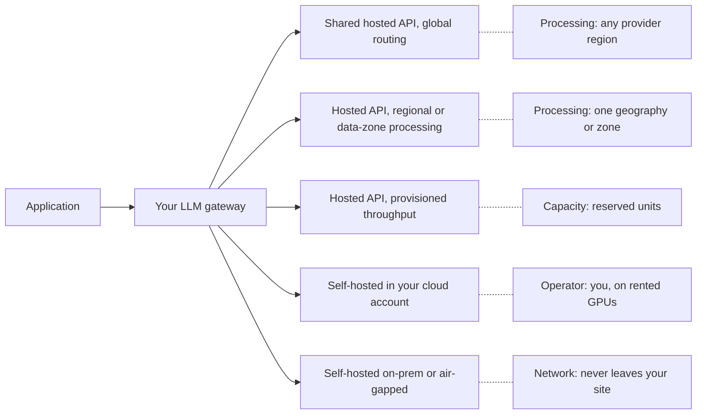
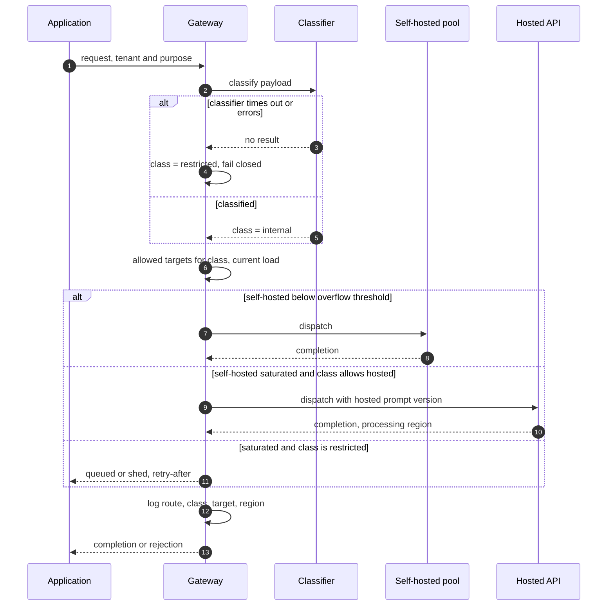
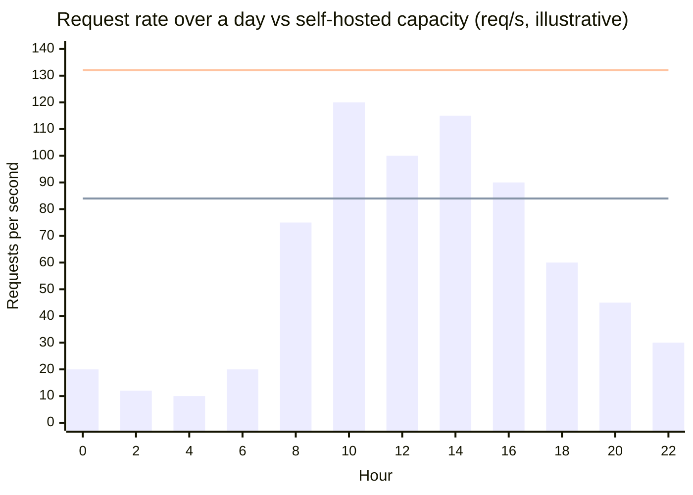
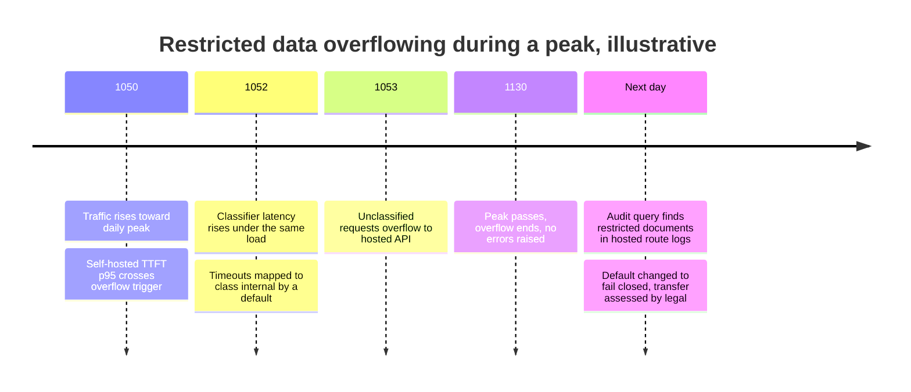

Bir deployment modeli, bir LLM bileşeni hakkında model seçiminin belirlemediği üç şeyi belirler: her prompt'un ve her yanıtın byte'larının nerede işlendiğini, bunları işleyen yığını kimin işlettiğini ve endpoint'in arkasında ne tür bir kapasitenin durduğunu. Hosted API, istekleri modeli kendi veri merkezlerinde paylaşımlı ya da rezerve kapasite üzerinde çalıştıran bir provider'a gönderir. Self-hosted deployment, open-weight bir modeli sizin işlettiğiniz hızlandırıcılarda, kendi cloud hesabınızda ya da kendi veri merkezinizde çalıştırır. Hibrit deployment aynı ürün için ikisini birden kullanır ve asıl mühendislik, hangi isteğin nereye gideceğine karar veren kurallarda yatar.

Bu seçim genellikle token başına maliyet olarak çerçevelenir ve bu çerçeve kararı gizler. Maliyetin sahibi [Self-Hosted ve API: Toplam Sahip Olma Maliyeti](/ai-systems-architecture/tr/economics/understanding-cost/tco/) sayfasıdır; bu sayfa ise maliyetin geri satın alamayacağı özelliklerle ilgilenir. Hosted paylaşımlı kapasite esnektir ve başka hiçbir işle uğraşmayan ekiplerce işletilir; ama best-effort'tur, hesap başına rate limit'e tabidir ve kalite hataları dahil arızaları provider açıklayana kadar görünmez. Sahip olunan kapasite her byte'ı sizin sınırınızın içinde, her versiyonu sizin kontrolünüzde tutar; ama boyutlandırmanız, yamalamanız ve gece 3'te birini uyandırmanız gereken sabit bir saniye başına istek sayısıdır.

Dolayısıyla temel trade-off, bir yanda kontrol ve veri yerelliği, diğer yanda esneklik ve operasyon yüküdür. İki seçenek birlikte kullanılmaya başlandığı anda ikinci bir trade-off ortaya çıkar: hibrit, bağımsız hata alanları ve ani yük kapasitesi kazanır; bunun bedelini ise değerlendirilmesi gereken iki konfigürasyonla, bir isteği verisinin ulaşmasına izin verilmeyen bir hedefe asla göndermemesi gereken bir routing politikasıyla ve hosted tarafta ortalama bir güne göre değil, self-hosted tarafın çöktüğü güne göre boyutlandırılmış bir kapasite sözleşmesiyle öder.


*Tek bir gateway'in arkasında beş çalışma noktası. Listede aşağı indikçe işleme sınırının, kapasitenin ve nöbet yükünün daha büyük bir kısmı sizin tarafınıza geçer.*

Liste tek bir ölçek değildir. Bölgesel işleme, modeli kimin işlettiğini değiştirmeden verinin gittiği yeri daraltır. Provisioned throughput ne konumu ne de operatörü değiştirir; yalnızca kapasite sözleşmesini değiştirir. Bir cloud hesabında self-hosting operatörü size taşır, ama donanım ve cloud provider'ın kendi işleme garantileri hâlâ başkasına aittir. Hiçbir prompt'un sizin kontrolünüzdeki ağdan çıkmaması gerekliliğini yalnızca son satır karşılar. Bu boyutları "API'ye karşı self-hosted" ikiliğine indiren ekipler ya ihtiyaç duymadıkları kontrol için ödeme yapar ya da almadıkları bir garantiyi varsayar.

## Bir Deployment Modelini Tanımlayan Üç Sınır

### İşleme Sınırı: Prompt'lar Nerede Çözülür

Data residency kuralları genellikle kişisel ya da gizli verinin nerede işlendiği ve saklandığı üzerinden ifade edilir. Bir LLM çağrısı için işleme, isteğin şifresinin çözüldüğü, token'lara ayrıldığı, hızlandırıcı belleğinde KV cache olarak tutulduğu ve yanıta dönüştürüldüğü yerdir; buna provider'ın log, kötüye kullanım izleme kaydı ya da önbelleğe alınmış prompt yazdığı her yer de eklenir. Büyük provider'lar yükü dengelemek için inference'ı bölgeler arasında yönlendirdiğinden, endpoint'in host adı bu yer hakkında çok az şey söyler.

Microsoft'un model deployment'larına ilişkin Azure dokümantasyonu bu ayrımı açıkça yapar (sayfanın son güncellemesi Ağustos 2026). Global deployment türlerindeki veri "herhangi bir Azure bölgesinde işlenebilir"; Data Zone türleri yalnızca Microsoft'un belirlediği bir bölge grubu (ABD, AB veya Asya Pasifik) içinde işlenir; Standard ve Regional Provisioned türleri müşterinin belirttiği Azure coğrafyası içinde işlenir; tüm türlerde de durağan haldeki (at rest) veri belirlenen coğrafyada kalır. Yani aynı model üç farklı işleme sınırı altında sunulur ve dokümantasyon global ile data zone standard türlerini en yüksek quota'lı ve en düşük fiyatlı seçenekler olarak tanımlar; hızlı bir kurulumda en geniş kapsamın varsayılana dönüşmesinin sebebi tam olarak budur.

Amazon Bedrock aynı seçimi inference profile'lar üzerinden sunar (Kasım 2026 itibarıyla kullanıcı kılavuzuna göre). Coğrafi bir cross-Region profile, istekleri ABD ya da AB gibi tek bir coğrafya içindeki listelenmiş bölgeler arasında yönlendirir; global bir profile ise istekleri dünya genelindeki desteklenen herhangi bir ticari bölgede işleyebilir ve coğrafi profile'a göre yaklaşık %10 daha düşük token fiyatı sunar. CloudTrail ve CloudWatch kayıtları kaynak bölgede kalır ve CloudTrail, her isteği fiilen işleyen bölgeyi `inferenceRegion` alanına yazar. Bir denetçinin isteyeceği kanıt bu alandır ve genel kuralı gösterir: işleme sınırı konfigürasyondan çıkarılmaz, her istek için provider'ın kendi telemetrisinden doğrulanır.

Sözleşme tarafı sınırı tamamlar. Saklama süreleri, kötüye kullanım izleme erişimi, eğitimde kullanım ve alt işleyenler endpoint'in değil anlaşmanın konusudur; tüketici ürünleri, standart API koşulları ve kurumsal anlaşmalar arasında farklılık gösterir. Kişisel verinin yurt dışına aktarımı dahil Türkiye'ye özgü düzenleyici sonuçlar [Türkiye Regülasyonu ve Data Residency: KVKK ve BDDK](/ai-systems-architecture/tr/governance/regulation/turkish-regulation/) sayfasında ele alınır.

### Operasyon Sınırı: Arızayı İlk Kim Görür

Hosted API, serving yığınının işletimini devreder: hızlandırıcı arızaları, serving engine yükseltmeleri, kernel ve derleyici değişiklikleri, yük dengeleme ve kapasite planlaması. Görünürlüğü de devreder. Bu yığında bir şey hata üretmeden çıktı kalitesini düşürdüğünde müşteri yalnızca yanıtlarda istatistiksel bir kayma görür.

Anthropic'in Eylül 2025 tarihli postmortem'i bunun en açık kamuya açık örneğidir. Ağustos ile Eylül 2025 başı arasında üç bağımsız altyapı hatası yanıtları bozdu: kısa context'li bazı Sonnet 4 isteklerini 1M token'lık context için yapılandırılmış sunuculara gönderen ve en kötü saatinde, 31 Ağustos'ta, Sonnet 4 isteklerinin %16'sına ulaşan bir routing hatası; İngilizce yanıtların içinde ara sıra Tayca ya da Çince karakterler gibi token'lar üreten bir TPU sunucu yanlış konfigürasyonu; ve yaklaşık top-k sampling değişikliğinin tetiklediği, uzun süredir fark edilmemiş bir XLA derleyici hatası. Hatalar farklı platformlarda farklı modelleri farklı oranlarda etkiledi; aynı modelleri kendi altyapılarında sunan Amazon Bedrock ve Google Vertex AI ilk hatadan çok daha düşük oranlarda etkilendi, diğer ikisinden ise hiç etkilenmedi. Anthropic, eval'lerinin bu bozulmayı yakalamadığını ve production sistemlerinde sürekli çalışan, daha hassas değerlendirmelere geçtiğini yazdı.

Buradan her hosted deployment'a iki ders taşınır. Farklı platformlarda sunulan aynı model adı aynı konfigürasyon değildir; [Model Seçim Kriterleri: Çok Kriterli Bir Yöntem](/ai-systems-architecture/tr/model-strategy/selection-and-deployment/selection-criteria/) sayfasının bir modeli değil tam bir route'u seçmesinin sebebi budur. Hosted API tüketicisinin de kendi sürekli kalite sinyaline ihtiyacı vardır, çünkü provider'ın izlemesi sizin trafiğinizin ortaya çıkardığını kaçırabilir; mekanizması [Kalite İzleme ve Drift Tespiti](/ai-systems-architecture/tr/llmops/observability/quality-drift/) sayfasındadır.

Self-hosting bu sınırı tersine çevirir. Bu hata sınıflarının her biri, yanlış yönlendirilmiş bir istek, yanlış yapılandırılmış bir hızlandırıcı havuzu, bir derleyici ya da engine regresyonu, artık sizin sebep olacağınız, tespit edeceğiniz ve düzelteceğiniz bir şeydir. [Frontier, Open-Weight ve Small Language Model'ler](/ai-systems-architecture/tr/model-strategy/model-landscape/model-categories/) sayfasının açıkladığı gibi serving engine, quantization ve chat template modelin kimliğinin parçasıdır; işletim bilgisi [Serving Engine'leri: vLLM, TGI, TensorRT-LLM, SGLang, llama.cpp](/ai-systems-architecture/tr/inference/production-serving/serving-engines/) ve [Kubernetes Üzerinde LLM Serving: GPU Scheduling ve Autoscaling](/ai-systems-architecture/tr/inference/production-serving/kubernetes-serving/) sayfalarındadır. Kazanç, arızayı görebilmenizdir: self-hosted bir ekip engine versiyonlarını karşılaştırabilir ve trafiği yeniden oynatabilir; hosted bir müşteri bunu yapamaz.

### Kapasite Sınırı: Bir İsteğin Arkasında Ne Durur

Üç kapasite sözleşmesi vardır ve her biri farklı biçimde başarısız olur. Paylaşımlı, token başına ödemeli kapasite best-effort'tur: provider istekleri dakika başına istek ve token cinsinden ifade edilen hesap başına bir quota'ya kadar kabul eder; bunun üzerinde ya da paylaşımlı havuz doyduğunda throttling hatası veya daha yüksek latency ile yanıt verir. Provisioned kapasite, bir dönem için throughput birimleri rezerve eder; Azure bunu provisioned throughput unit'lerle (PTU) ölçer ve provisioned türlerin, best-effort olarak nitelediği standard türlere göre garanti edilmiş throughput ve daha düşük latency varyansı sağladığını belirtir. Sahip olunan kapasite, hızlandırıcılarınızın latency hedefinizde sağladığı kapasite neyse odur; başkası yüzünden sizi asla throttle etmez, ama ihtiyaç duyduğunuzda da asla büyümez.

| Kapasite sözleşmesi | Neyi garanti eder | Neyi etmez | Aşırı yükte nasıl başarısız olur | Ne zaman tercih edilir |
|---|---|---|---|---|
| Paylaşımlı, token başına ödemeli | Hesap quota'sına kadar kabul, sözleşmede varsa erişilebilirlik SLA'sı | Tepe yükte throughput, latency varyansı, global türlerde işleme bölgesi | Throttling hataları, provider genelindeki talepte latency sıçramaları | Düşük ya da ani değişen hacim, hızlı iterasyon, fallback kapasitesi |
| Provisioned birimler | Rezerve throughput, daha düşük latency varyansı | Rezervasyonun üzerindeki kapasite; satın alınanın kullanım oranı | Rezervasyonu aşan istekler başka yere yönlendirilmezse reddedilir | Hosted bir modelde latency hedefi olan, sürekli yüksek hacim |
| Sahip olunan hızlandırıcılar | Veri yerelliği, versiyon kontrolü, dış quota yok | Esneklik; filonun ölçülmüş kapasitesinin ötesindeki her şey | Kuyruklanma, artan time to first token, ardından timeout | Kısıtlı veri, sabitlenmiş versiyonlar, GPU'ları meşgul tutan sürekli hacim |

Tablo, "provisioned" ile "self-hosted"ın neden sıklıkla karıştırıldığını açıklar: ikisi de boyutlandırılması gereken sabit kapasitedir ve ikisi de boşta kaldığında para harcatır. Diğer iki sınırda ayrışırlar. Provisioned bir deployment'ı hâlâ provider işletir ve veri provider'ın koşulları altında işlenir; self-hosted bir deployment ise her iki açıdan da sizindir.

:::caution[Bölgesel bir endpoint işleme garantisi değildir]
Deployment türü ya da inference profile bölgeler arası yönlendirmeye izin veriyorsa, bir AB bölgesindeki endpoint'i çağırmak isteğin orada işlendiği anlamına gelmez. İşleme kapsamını deployment türünde ya da profile'da açıkça seçin, provider destekliyorsa daha geniş kapsamları organizasyon politikasıyla engelleyin ve telemetride dönen işleme bölgesini her istek için kaydedin. Varsayılanlar sizin residency yükümlülüklerinize göre değil, quota ve fiyata göre seçilir.
:::

## Hibrit Mimariler ve Routing Değişmezi

Hibrit bir deployment üç sebepten biri için vardır ve routing kuralını bu sebep belirler. Veri sınıfına göre ayırma, kısıtlı veriyi self-hosted kapasiteye, geri kalan her şeyi hosted bir API'ye gönderir; çünkü kısıtlı pay, tüm trafiği self-host etmeyi haklı çıkaramayacak kadar küçüktür ya da sunulması o kadar zordur. Taban artı ani yük, sürekli yükü sahip olunan ya da provisioned kapasitede sunar ve tepeleri paylaşımlı hosted kapasiteye gönderir; çünkü tepe yüke göre boyutlandırılmış sahip olunan kapasite günün büyük kısmında boşta kalır. Birincil artı fallback, her şeyi bir tarafta sunar ve diğerini yalnızca ilki başarısız olduğunda kullanır; çünkü iki taraf birbirinden bağımsız başarısız olur. Gerçek hibritlerin çoğu ilk ikisini birleştirir: sınıflandırma bir isteğin hangi hedefleri kullanabileceğine, yük ise bunlardan hangisini kullanacağına karar verir.

Bir hibritin doğruluğu tek bir değişmeze dayanır: veri sınıfı C olan bir istek, overflow, fallback, retry ve degraded modlar dahil hiçbir yolda C için izin verilen kümenin dışındaki bir hedefe gönderilmez. Maliyet ve latency dahil geri kalan her şey bu değişmezin içinde yapılan bir optimizasyondur. Değişmezi ifade etmek de bozmak da kolaydır, çünkü overflow ve fallback mantığı erişilebilirlik için yazılır ve erişilebilirlik mantığı doğal olarak ayakta olan hedefe uzanır.

Değişmezi dört tasarım kuralı korur. Sınıflandırma routing'den önce yapılır ve istek üzerinde açık bir sınıf üretir; eksik ya da başarısız bir sınıflandırma asla varsayılan, izin verici bir sınıfa değil, en kısıtlayıcı sınıfa eşlenir. İzin verilen hedef kümesi bir kod yolunun özelliği değil, gateway'in gönderim anında değerlendirdiği bir politikadır; böylece bir overflow ya da fallback dalı onu atlayamaz. Bu, [Kod Olarak Politika: OPA, Gatekeeper ve Kyverno](https://gorkemsari.github.io/distributed-systems/tr/security/zero-trust/policy-as-code/) anlamında politikanın kod olarak yönetilmesidir. Hosted provider'lara ağ çıkışı (egress) olan tek bileşen gateway'dir; bir servis provider'ı doğrudan çağırmaya kalkarsa, [Mikro-Segmentasyon: En Az Ayrıcalık Ağ Modeli](https://gorkemsari.github.io/distributed-systems/tr/security/zero-trust/micro-segmentation/) sayfasında anlatıldığı gibi ağ katmanında başarısız olur. Ve bir sınıf için izin verilen hedeflerin tamamı erişilemez ya da dolu olduğunda istek kuyruğa alınır, degrade edilir ya da düşürülür, asla başka yere yönlendirilmez; hangi isteklerin düşürüleceğinin nasıl seçileceği [Yük Atma: Hangi İstekler Düşürülür ve Nasıl](https://gorkemsari.github.io/distributed-systems/tr/resilience/flow-control/load-shedding/) sayfasında ele alınır.


*Sınıflandırma artı overflow kullanan bir hibritte gönderim. Erişilebilirlik baskısının routing değişmezini bozmaya çalıştığı yerler, sınıflandırıcının hata yolu (adım 4) ve doygunluk anındaki kısıtlı sınıf dalıdır.*

Çoğu uygulamanın yanlış yaptığı satır 4. adımdır. Overflow'u tetikleyen aynı tepe yük altında timeout'a düşen bir sınıflandırıcı uç durum değil, olağan durumdur; çünkü ikisinin sebebi aynı trafik sıçramasıdır. Timeout "internal"a eşlenirse tepe yük, en çok trafiğin aktığı anda sınıflandırılmamış kısıtlı veriyi hosted API'ye gönderir. Son dal kuralın diğer yarısıdır: doygunluk anındaki kısıtlı trafik bekler ya da bir yeniden deneme ipucuyla reddedilir; bu, işin önceden kabul etmesi gereken görünür bir erişilebilirlik bedelidir. Son log satırı değişmezi bir tasarım iddiasından kanıta dönüştürür: her istek kendi sınıfını, onu sunan hedefi ve hosted hedefler için provider'ın bildirdiği işleme bölgesini taşır.

Bir hibritin daha az belirgin ikinci bir gereksinimi vardır: iki hedef, bileşenin iki konfigürasyonu olarak değerlendirilmelidir. Hosted bir frontier modelin yanıtladığı bir overflow isteği ile self-hosted open-weight bir modelin yanıtladığı bir taban isteği kalite, format, ret davranışı ve uzunluk bakımından farklılaşabilir; bir kullanıcı sabah aldığı yanıtla öğleden sonra aldığı yanıt arasındaki farkı fark edebilir. Bu yüzden her hedef eşit emekle ayarlanmış kendi prompt versiyonunu alır ve ikisi de bileşenin eval eşiklerini geçmelidir. İkisi birden geçemiyorsa bileşen yük tabanlı overflow için aday değildir ve hibriti açık bir degraded modla fallback'e sınırlanır. Amaç, yüke ya da veri sınıfına göre değil zorluğa göre istek başına model seçmekse konu [Multi-Model Strateji ve Model Routing](/ai-systems-architecture/tr/model-strategy/selection-and-deployment/model-routing/) sayfasıdır.

### Hesaplı Örnek: Hosted Overflow ile Bir Taban Kapasiteyi Boyutlandırmak

Örnek olarak bir bankadaki doküman asistanı bileşenini ele alalım. Trafiği gece saniyede 10 istekten öğleye doğru tepe noktada 120 isteğe çıkan günlük bir profil izler; ortalaması saniyede yaklaşık 58 istek, günlük toplamı yaklaşık 5 milyon istektir. Her istek ortalama 2.000 girdi ve 300 çıktı token'ı taşır. İsteklerin yüzde otuzu kısıtlı olarak sınıflandırılır ve yalnızca kurum içinde sunulabilir; geri kalanı bankanın sözleşmesi altında AB data zone işlemesi kullanan hosted bir API'ye gidebilir. Self-hosted konfigürasyonun yük testi, bir replikanın, yani modelin bir kopyasını sunan sabit bir GPU grubunun, p95 time to first token'ı bileşenin hedefi içinde tutarak saniyede 12 istek kaldırdığını gösterir. Buradaki tüm rakamlar ölçüm değil, örnek amaçlı varsayımlardır.

A seçeneği self-hosted filoyu tepe yüke göre, bir yedekle boyutlandırır: saniyede 120 istek için 10 replika, bir replika arızası için bir tane daha, toplam 11 replika ve saniyede 132 isteklik kapasite. Hiçbir istek kurumun dışına çıkmaz. Gün boyunca ortalandığında filo 132'lik kapasiteye karşı saniyede 58 istek sunar; kullanım oranı yaklaşık %44'tür.

B seçeneği filoyu 7 replikaya, yani saniyede 84 isteğe boyutlandırır ve bu çizginin üzerindeki kısıtlı olmayan trafiği hosted API'ye taşırır. Günlük profil bu çizgiye karşı işletildiğinde trafik 8 saat boyunca saniyede 84 isteği aşar, taşan pay günlük isteklerin yaklaşık %13,4'ü olur ve tepe overflow saniyede 36 istektir. Filonun kullanım oranı yaklaşık %60'a çıkar, GPU sayısı 11 replikadan 7'ye, yaklaşık %36 azalır. Bunun para kazandırıp kazandırmadığı hosted token fiyatlarına, personel ve tesis maliyetlerine bağlıdır; bu hesap [Self-Hosted ve API: Toplam Sahip Olma Maliyeti](/ai-systems-architecture/tr/economics/understanding-cost/tco/) sayfasındadır. Aşağıdaki kapasite mantığı fiyatlardan bağımsız olarak geçerlidir.


*Örnek profilin iki saatte bir değerleri, B seçeneğinin saniyede 84 isteklik çizgisine ve A seçeneğinin saniyede 132 isteklik çizgisine karşı. Alt çizginin üzerindeki çubuklar overflow'dur; üst çizginin altında kalan boşluk A seçeneğindeki atıl kapasitedir.*

Grafik her seçeneğin maliyetinin nerede oturduğunu gösterir. A seçeneği gün boyunca çubuklarla üst çizgi arasındaki alan için ödeme yapar. B seçeneği ise günün yaklaşık üçte birinde alt çizgiyi aşan çubuklar için hosted fiyatlarla ödeme yapar. Kısıtlı pay B seçeneğinin altına bir taban koyar: kısıtlı tepe 120'nin %30'u, yani saniyede 36 istektir ve bir replika arızalandığında bile kurum içinde sunulmalıdır. Yedi replikadan biri devre dışıyken kapasite saniyede 72 istektir; 36 kısıtlı ve 36 diğer istek için yeterlidir, taban payla birlikte korunur.

B seçeneğinin genellikle eksik tasarlanan yeri hosted quota'dır. Quota, sağlıklı bir gündeki ortalama overflow'u değil, degrade durumdaki tepe overflow'u karşılamalıdır. Tepe anında bir replika devre dışıyken overflow saniyede 36'dan 48 isteğe çıkar. İstek başına 2.000 girdi token'ıyla bu 48 × 60 × 2.000, yani dakikada yaklaşık 5,8 milyon girdi token'ı ve buna ek olarak dakikada yaklaşık 0,86 milyon çıktı token'ı eder. Quota'yı saniyede 36 isteklik sağlıklı tepeye, dakikada yaklaşık 4,3 milyon girdi token'ına göre talep etmiş bir ekip bu açığı, bir replika ilk kez saat 11'de arızalandığında, hosted API absorbe etmesi beklenen overflow'u throttle etmeye başladığında keşfeder. Throttling davranışı ve retry tehlikeleri [LLM Provider Hata Türleri: Rate Limit, Aşırı Yük, Kısmi Yanıt](/ai-systems-architecture/tr/reliability/provider-failures/provider-failure-modes/) sayfasında, kendi tarafınızdaki quota uygulaması ise [Token Tabanlı Rate Limiting ve Quota](/ai-systems-architecture/tr/platform/ai-gateway/token-rate-limiting/) sayfasında ele alınır.

Erişilebilirlik de aynı yapıyı izler. Aylık erişilebilirliği %99,5 olan tek bir kurum içi saha ve %99,9 olan hosted bir API varsayalım. Kısıtlı olmayan trafik iki taraftan biriyle sunulabilir; arızaları bağımsız olsaydı yalnızca ikisi birden çöktüğünde, zamanın yaklaşık %0,0005'inde erişilemez olurdu. Bu rakam faydanın üst sınırıdır: ortak bir gateway, ortak bir DNS bağımlılığı ya da ortak bir kimlik sağlayıcısı iki tarafı birbirine bağlar ve birleşik erişilebilirliği o ortak bileşeninkiyle sınırlar. Kısıtlı trafiğin izin verilen tek bir hedefi vardır; erişilebilirliği sahanın %99,5'idir ve B seçeneği onun için hiçbir şey yapmaz. Kısıtlı trafiğin tek bir sahanın sağlayabileceğinden daha iyisine ihtiyacı varsa cevap bir overflow kuralı değil, sınırın içinde ikinci bir sahadır.

## Deployment Seçeneklerinin Karşılaştırılması

Seçenekler üç sınırın üçünde birden farklılaşır ve her birinin size devrettiği arıza, sunduğu özellik kadar önemlidir. Bir host'un yayımlanmış ağırlıkları kendi GPU'larında sunduğu managed open-weight endpoint'ler hosted ve self-hosted satırlarının arasında durur; versiyon ve taşınabilirlik özellikleri [Frontier, Open-Weight ve Small Language Model'ler](/ai-systems-architecture/tr/model-strategy/model-landscape/model-categories/) sayfasında ele alınır.

| Seçenek | İşleme sınırı | Kapasite sözleşmesi | Operatör | Devraldığınız arıza | Ne zaman tercih edilir |
|---|---|---|---|---|---|
| Hosted, global routing | Herhangi bir provider bölgesi; saklama koşullara göre | Paylaşımlı, quota ile sınırlı | Provider | Residency varsayımlarının sessizce bozulması; provider genelinde kesintiler | Hassas olmayan veri, en yüksek quota, en düşük fiyat |
| Hosted, bölgesel ya da data zone | Tek bir coğrafya ya da bölge grubu | Paylaşımlı ya da provisioned | Provider | Global'e göre daha düşük quota; göremediğiniz provider tarafı kalite hataları | Ağdan çıkabilen ama yargı alanından çıkamayan kişisel veri |
| Hosted, provisioned | Deployment kapsamına göre | Bir dönem için rezerve birimler | Provider | Boşta kalan birimlere ödeme; rezervasyonun üzerinde ret | Kapalı bir modelde düşük latency varyansı isteyen sürekli hacim |
| Self-hosted, cloud hesabı | Sizin hesabınız ve bölgeniz; cloud koşulları geçerli | Sizin GPU'larınız, bölgedeki GPU bulunabilirliğine bağlı | Siz | Kapasite planlaması, engine yükseltmeleri, bölgedeki GPU kıtlıkları | Sabitlenmiş open weights, fine-tune edilmiş modeller, on-prem tesis yokluğu |
| Self-hosted, on-prem ya da air-gapped | Yalnızca sizin ağınız | Sizin donanımınız, sabit | Siz | Tedarik süreleri, tek saha erişilebilirliği, tüm operasyon | Kurumdan çıkamayan veri; düzenleyici ya da sözleşmesel zorunluluk |
| Hibrit | Veri sınıfına göre, gateway tarafından uygulanır | Sahip olunan taban artı hosted overflow ya da fallback | İkisi birden | Routing değişmezi ihlalleri; değerlendirilecek iki konfigürasyon | Karışık veri sınıfları, tepeli yük ya da bağımsız hata alanı ihtiyacı |

Ekiplerin en çok yanlış değerlendirdiği satır self-hosted cloud satırıdır. Operatörü ve model versiyonunu sizin tarafınıza taşır; ama belirli bir bölgedeki GPU instance'ları kendi kıtlıkları olan bir pazardır ve rezervasyonsuz bir filo, en çok ihtiyaç duyduğu anda ölçeklenemeyebilir. Ayrıca cloud provider'ı bir altyapı operatörü olarak işleme sınırının içinde tutar; bu çoğu residency kuralını karşılar, verinin kurumun kendi tesislerinde kalmasını şart koşan bir kuralı ise karşılamaz.

:::tip[Hosted tarafı, sahip olunan tarafın çöktüğü güne göre boyutlandırın]
Her hibritte hosted kapasite sözleşmesi, ister quota ister provisioned birimler olsun, ani yük tamponu olduğu kadar bir felaket kurtarma rezervasyonudur. Onu, sahip olunan kapasitedeki en büyük makul kayıpla birlikte tepe overflow'dan hesaplayın, önceden talep edin ve tepe saatte planlı bir failover tatbikatıyla test edin. Quota artışlarını insanlar günler içinde onaylar; bir olay ise saatler sürer.
:::

## Route'u ve Filoyu Yapılandırmak

Bir hibritin davranışı büyük ölçüde gateway'deki konfigürasyondur; gateway [LLM Gateway Deseni](/ai-systems-architecture/tr/platform/ai-gateway/llm-gateway/) sayfasında anlatılır. Önemli parametreler azdır ve her birine bağlı bir hata türü vardır.

```yaml
# Illustrative gateway route; field names are not a standard
route: doc-assistant
classes:
  restricted: { allowed: [onprem-pool] }
  internal:   { allowed: [onprem-pool, hosted-eu-datazone] }
  public:     { allowed: [onprem-pool, hosted-eu-datazone, hosted-global] }
classification: { timeout_ms: 150, on_failure: restricted }   # fail closed
targets:
  onprem-pool:        { prompt: doc-assist-oss-v7, max_inflight: 336 }
  hosted-eu-datazone: { prompt: doc-assist-api-v7, quota_tpm_in: 6000000 }
overflow:
  trigger: { ttft_p95_ms: 1200, queue_depth: 40 }   # leading signals, not errors
  enter_after_s: 30
  exit_after_s: 300                                  # hysteresis against flapping
on_no_allowed_target: { action: shed, retry_after_s: 20 }
log: [class, target, prompt_version, provider_region, overflow_state]
```

Overflow tetikleyicisi öncü sinyalleri, yani self-hosted havuzdaki p95 time to first token'ı ve kuyruk derinliğini kullanır; çünkü hatalar göründüğünde kuyruktaki istekler latency hedeflerini çoktan kaçırmıştır. Giriş ve çıkış gecikmeleri bilerek asimetriktir: overflow'a hızlı girmek latency'yi korur, ondan yavaş çıkmak ise route'un birkaç saniyede bir hedefler arasında gidip gelmesini önler; aksi halde tek bir konuşmanın içinde iki konfigürasyon karışır. `max_inflight` havuzdaki eşzamanlı sequence sayısını sınırlar; böylece overflow'a ne zaman geçileceğine serving engine'in iç kuyruğu değil admission control karar verir. Eşzamanlılık, KV cache belleği ve latency arasındaki ilişki [GPU Kapasite Planlaması](/ai-systems-architecture/tr/inference/production-serving/gpu-capacity-planning/) sayfasının konusudur. Prompt versiyonu, yukarıda verilen değerlendirme sebebiyle route'un değil hedefin özelliğidir. Birden fazla tura yayılan konuşmalar, veri sınıfı izin veriyorsa ilk turu sunan hedefe sabitlenmelidir; böylece tek bir alışveriş iki konfigürasyon tarafından yanıtlanmaz.

Self-hosted tarafta deployment modeli açısından en önemli kararlar kapasite payı (headroom) ve değişiklik kontrolüdür. Kapasite payı, replika arızaları ve autoscaler'ın replika eklemesi için gereken süre boyunca tutulan yedek kapasitedir; büyük modellerde bu süre onlarca gigabaytlık ağırlığın yüklenmesini de içerir. Hosted overflow varsa bu payın bir kısmı, yalnızca kısıtlı olmayan trafik için, boşta bekleyen GPU olarak tutulmak yerine quota olarak satın alınabilir. Değişiklik kontrolü, serving engine versiyonunun, quantization'ın ve chat template'in sabitlenmesi ve yalnızca bir eval kapısından geçerek değiştirilmesi demektir; çünkü bunların her biri hata üretmeden çıktıları değiştirebilir.

## Hata Türleri ve Operasyon

Deployment modeli hataları nadiren kesinti gibi görünür. Bir denetimde bulunan residency ihlali, ilgisiz bir olay sırasında çıkan bir throttling fırtınası ya da bir hibritin bir tarafında biraz kötüleşmiş yanıtlar gibi görünürler.


*Doğru görünen iki mekanizmanın, yüke bağlı overflow'un ve izin verici bir sınıflandırma varsayılanının, hiçbir bileşenin hata olarak bildirmediği bir veri aktarımına dönüştüğü örnek bir olay.*

Bu zaman çizelgesinde olağan anlamda hiçbir şey başarısız olmaz. Overflow çalıştı, hosted API istekleri sundu ve latency hedefinin içinde kaldı. İhlal yalnızca gateway her isteğin sınıfını ve hedefini logladığı ve biri bu logları sorguladığı için görünür hale gelir; o alan olmasaydı aktarımın hiçbir kaydı olmazdı. Önlem, route konfigürasyonundaki fail-closed varsayılan, sınıflandırdığı trafikle birlikte bozulmayacak şekilde boyutlandırılmış ve izole edilmiş bir sınıflandırıcı ve sınıfının izin verilen kümesi dışındaki bir hedefin sunduğu her istek için bir alarmdır; bu durum imkânsız olmalıdır, bu yüzden bir nöbet çağrısıdır.

:::danger[Overflow ve fallback yolları veri sınıfı politikasını uygulamalıdır]
Veri sınıfını birincil yolda kontrol edip overflow, fallback ya da retry yolunda kontrol etmeyen bir hibrit, yük altında ya da bir olay sırasında kısıtlı veriyi ulaşmasına hiç izin verilmemiş bir hedefe gönderir. İzin verilen hedef politikasını her gönderimde değerlendirin, sınıflandırma hatalarını en kısıtlayıcı sınıfa eşleyin ve izin verilen kümesinin dışında sunulan her isteği bir routing hatası olarak değil, bir güvenlik olayı olarak ele alın.
:::

Diğer hata türleri de aynı yapıdadır: bir sınırın sağladığı varsayılan bir özellik ve sağlamadığını gösteren bir sinyal.

| Hata | Tetikleyici | Belirti | Tespit | Önlem ve kurtarma |
|---|---|---|---|---|
| Varsayılan sınırın dışında işleme | Global deployment türü ya da profile'ın varsayılan olarak kullanılması | Bir denetime kadar belirti yok | Provider telemetrisinden istek başına işleme bölgesi | Açık deployment kapsamı; daha geniş kapsamları engelleyen organizasyon politikası |
| Provider tarafı kalite hatası | Provider altyapısında ya da sampling'de değişiklik | Bozuk ya da yanlış dilde çıktıda hafif artış, hata yok | Sürekli production eval'leri; hedef başına çıktı geçerlilik oranları | Eval'leri geçiyorsa diğer tarafa failover; örneklerle provider'a bildirim |
| Provider genelinde kesinti | Provider control plane ya da kapasite arızası | O provider'a giden tüm istekler başarısız | Hedef başına hata oranı; provider durum sayfası | İzin verilen hedefler içinde fallback; alternatifi olmayan kısıtlı sınıfları düşürme |
| Overflow quota'sının tükenmesi | Sağlıklı tepeye göre boyutlanmış quota, sahip olunan replika kaybı | Tam da sahip olunan taraftaki olay sırasında throttling | Overflow hedefinde 429 oranı; tepede quota payı | Quota'yı degrade tepeye göre boyutlandırma; tepe saatte failover tatbikatları |
| Self-hosted kapasitenin tükenmesi | Trafik artışı, daha uzun girdiler, replika kaybı | Artan TTFT, kuyruklanma, ardından timeout | TTFT p95, kuyruk derinliği, KV cache kullanımı | Admission control; izin verilen sınıflar için overflow; paylı kapasite planı |
| Konfigürasyon ayrışması | Prompt ya da modelin yalnızca bir hedefte değişmesi | Yanıt kalitesinin günün saatine göre değişmesi | Hedef başına eval skorları; overflow payına karşı şikâyet oranı | Hedef başına eşleştirilmiş prompt versiyonları; ikisini de kapsayan eval kapısı |
| Route'un gidip gelmesi | Simetrik ya da hiç olmayan overflow histerezisi | Tek konuşma içinde değişen hedefler | Konuşma başına hedef değişimi; dakika başına overflow durum değişimi | Asimetrik giriş ve çıkış gecikmeleri; konuşmaları ilk hedefe sabitleme |
| Self-hosted değişiklik regresyonu | Engine, quantization ya da template yükseltmesi | Uzun girdilerde ya da tool call'larda ince çıktı değişiklikleri | Pin kaydı değişikliklerinde eval kapısı; canary karşılaştırması | Değerlendirilmiş konfigürasyona geri dönüş; kademeli yükseltme |

Provider genelindeki kesintiler varsayımsal değildir. OpenAI'ın 11 Aralık 2024 tarihli kamuya açık raporu ChatGPT'yi, API'yi ve Sora'yı etkileyen, yaklaşık 4 saat 22 dakika süren bir olayı anlatır: yeni deploy edilen bir telemetri servisi büyük Kubernetes cluster'larındaki her node'un pahalı API sunucusu işlemleri çalıştırmasına yol açtı, control plane'ler çöktü ve onlara bağımlı olan DNS tabanlı servis keşfi çalışmaz hale geldi. Bir müşteri için ders Kubernetes ile ilgili değildir; o konuyu Distributed Systems Handbook [DNS Tabanlı Keşif: Kubernetes DNS](https://gorkemsari.github.io/distributed-systems/tr/microservice-patterns/service-discovery/dns-based-discovery/) sayfasında ele alır. Ders şudur: tek bir provider, sunduğu her model için tek bir hata alanıdır ve aynı provider'ın başka bir modeline fallback, hata alanları arasında bir fallback değildir. Fallback zincirlerinin kendisi [Fallback Zincirleri ve Graceful Degradation](/ai-systems-architecture/tr/reliability/provider-failures/fallback-degradation/) sayfasında ele alınır.

Güvenlik ve yönetişim yükümlülükleri sınırları izler. Hosted bir route provider'ı bir veri işleyen yapar ve saklama, eğitimde kullanım, alt işleyenler ve işleme konumu hakkında sözleşme koşullarının yanı sıra, [PII ve Hassas Veri: Masking, Tokenization, Redaction](/ai-systems-architecture/tr/security/defenses/pii-handling/) sayfasında anlatıldığı gibi çağrıdan önce yapılan maskelemeyi gerektirir. Self-hosted bir route, [AI Tedarik Zinciri Güvenliği: Model, Dataset, MCP Server](/ai-systems-architecture/tr/security/defenses/supply-chain/) sayfasında ele alınan bir model tedarik zinciri ekler ve aksi halde provider'ın tutacağı logların, saklama ve silme süreçleri dahil, sorumluluğunu size verir. Hibrit ise routing log'unu bir denetim artefaktı olarak ekler: her yanıt için hangi hedefin, hangi konfigürasyonun ve hangi işleme bölgesinin onu ürettiği. [Açıklanabilirlik ve Denetlenebilirlik](/ai-systems-architecture/tr/governance/regulation/explainability-auditability/) sayfasının dayandığı kayıt budur.

## Bileşen Başına Deployment Modeli Seçmek

Kararı bileşen başına verin ve kısıtları optimizasyonlardan önce belirleyin. İlk soru, bileşenin en hassas veri sınıfının hangi işleme sınırına izin verdiğidir. Herhangi bir sınıf kurumdan çıkamıyorsa o sınıf maliyetten bağımsız olarak self-hosted kapasiteye ihtiyaç duyar; geriye kalan soru diğer sınıfların ona katılıp katılmayacağı ya da hosted bir API'ye gidip gitmeyeceğidir. Veri ağdan çıkabiliyor ama yargı alanından çıkamıyorsa varsayılan, istek başına doğrulanan bölgesel ya da data zone işlemeli hosted bir API'dir.

Paylaşımlı hosted API'yi hacim düşük, ani değişen ya da bilinmez olduğunda, bileşen kapalı bir modelin yeteneğine ihtiyaç duyduğunda ve ekibin kıt kaynağı mühendislik zamanı olduğunda kullanın. Residency kurallarının kapsadığı hiçbir veri için global işleme kapsamını kullanmayın ve yüksek sonuçlu bir bileşeni kendi sürekli kalite izlemeniz olmadan hosted bir API üzerinde çalıştırmayın; çünkü provider'ın kalite hataları size hata üretmeden ulaşır.

Provisioned hosted kapasiteyi, hacim rezervasyonu meşgul tutacak kadar sürekli ve yüksek olduğunda ve latency hedefi paylaşımlı kapasitenin tepe yükte sağlayabileceğinden sıkı olduğunda kullanın. Bir residency problemini çözmek için provisioned birim satın almayın; bu birimler işleme sınırını değil, kapasite sözleşmesini değiştirir.

Self-hosting'i, bir veri sınıfı kurumdan çıkamadığında, bir versiyonun herhangi bir provider'ın emeklilik takviminden daha uzun süre sabit tutulması gerektiğinde, sahibi olduğunuz fine-tune edilmiş ya da distill edilmiş bir modeli sunduğunuzda veya sürekli hacim hızlandırıcıları meşgul tuttuğunda ve ekip GPU altyapısını bir nöbet rotasyonuyla işletebildiğinde kullanın. Bir kullanım oranı tahmini ve bir personel planı olmadan para tasarrufu için self-host etmeyin; kalite çıtasını yalnızca kapalı bir frontier modelin karşıladığı bir bileşeni de self-host etmeyin, çünkü eval'den kalan open-weight bir model yerel olduğu için kabul edilebilir hale gelmez.

Hibriti, bileşen izin verilen sınırları farklı olan birden fazla veri sınıfı taşıdığında, yük tepeye göre boyutlandırılmış sahip olunan kapasitenin çoğunlukla boşta kalacağı kadar tepeli olduğunda ya da gerçekten bağımsız hata alanlarına ihtiyaç duyduğunuzda kullanın. İki hedefi birden bileşenin eval'lerini geçemeyen bir hibrit kurmayın ve gateway izin verilen hedef politikasını her yolda uygulayıp sonucunu loglayabilir hale gelmeden hibrit kurmayın.

Bitişik birkaç karar sıklıkla bu kararın içine katlanır. Hangi kategoride model kullanılacağı [Frontier, Open-Weight ve Small Language Model'ler](/ai-systems-architecture/tr/model-strategy/model-landscape/model-categories/) sayfasında belirlenir. Tam maliyet karşılaştırması [Self-Hosted ve API: Toplam Sahip Olma Maliyeti](/ai-systems-architecture/tr/economics/understanding-cost/tco/) sayfasına aittir. Provider'ı değiştirilebilir tutmak [Vendor Lock-in ve Abstraction Katmanı](/ai-systems-architecture/tr/model-strategy/lifecycle-and-adaptation/vendor-lock-in/) sayfasının konusudur; regüle bir kurum için eksiksiz bir on-prem tasarım ise [Referans Mimari: Regüle Ortamda On-Prem AI Platformu](/ai-systems-architecture/tr/reference/reference-architectures/on-prem-regulated/) sayfasındadır.

## İleri Okuma

- Microsoft, *Deployment types* (Foundry Models documentation), Microsoft Learn, 2026.
- Amazon Web Services, *Increase throughput with cross-Region inference*, Amazon Bedrock User Guide, 2026.
- Anthropic, *A postmortem of three recent issues*, Anthropic Engineering, 2025.
- OpenAI, *Incident write-up for the 11 December 2024 outage of API, ChatGPT, and Sora*, OpenAI status page, 2024.
- Woosuk Kwon et al., *Efficient Memory Management for Large Language Model Serving with PagedAttention*, SOSP, 2023.
