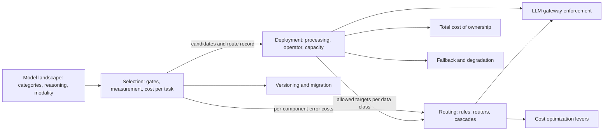
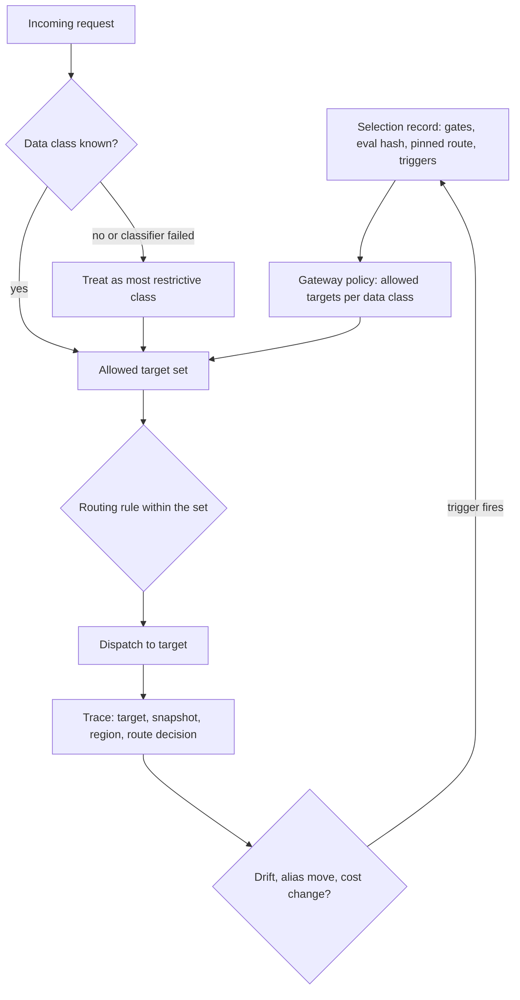

Önceki bölüm hangi tür modellerin var olduğunu anlatır; bu bölüm o tarifi tek bir bileşen için production kararına çevirir. Bu karar üç sorudan oluşur ve her biri farklı bir zamanda yanıtlanır. Bileşene hangi model yapılandırmasının hizmet edeceğine bir kez, ölçülmüş kanıta dayanarak karar verilir ve bu kanıt eskidiğinde karar yeniden açılır. Prompt'ların nerede işleneceği, stack'i kimin işleteceği ve endpoint'in arkasında hangi kapasitenin durduğu veri sınıfı ve yük profili başına belirlenir. İzin verilen birden çok modelden hangisinin belirli bir isteği yanıtlayacağı ise çalışma anında, bir kural, bir router ya da bir cascade tarafından belirlenir. Her yanıt bir sonrakinin alanını daraltır: seçim, bir deployment'ın barındırabileceği adayları üretir; deployment da bir router'ın aralarından seçim yapabileceği hedef kümesini sabitler.

Bölüm boyunca süren gerilim, kısıtlar ile hedefler arasındadır. Bir bileşenin bazı özellikleri hiçbir şeyle takas edilemez: kurumun dışına çıkamayacak bir veri sınıfı, amaçlanan kullanımı yasaklayan bir lisans, bir sağlayıcının emekliye ayırma takviminden daha uzun yaşaması gereken bir versiyon. Diğerleri ise zaten takas edilmek içindir: doğruluğa karşı maliyet, kapasiteye karşı latency, biraz daha yüksek hata oranına karşı daha ucuz bir model. Bölümdeki her sayfa aynı yapısal hamleyi yapar. Önce kısıtları, hiçbir skorun geçersiz kılamayacağı kapılar ya da invariant'lar olarak kontrol eder; ancak ondan sonra, kısıtların bıraktığı alanın içinde optimizasyon yapar ve hataların bir bedeli olduğu her yerde ortak birim olarak başarılı görev başına maliyeti kullanır. Bölümün karakteristik hataları bu sıranın tersine döndüğü durumlardır: kalitenin bir veri yerleşimi ihlalini telafi etmesine izin veren ağırlıklı bir tablo, kısıtlı veriyi o an ayakta olan herhangi bir hedefe gönderen bir overflow yolu, bir context uzunluğu limitinin önüne geçen bir router skoru.

Bölüm ürün önermez, karar yöntemlerini anlatır. Sağlayıcıların deployment kapsamları, deprecation politikaları ve yönetilen router'lar konu sayfalarında yazım sırasında doğrulanmış tarihli örnekler olarak geçer; yöntem, sınırlar ve invariant'lar Kasım 2026 itibarıyla LLM tabanlı sistemler için geçerlidir.

## Üç Karar Birbirine Nasıl Bağlıdır

Üç sayfa bir sıra oluşturur. Her biri bir öncekinin ürettiğini kullanır ve her biri farklı bir konuyu el kitabının sonraki bir bölümüne devreder.

*Bölümün üç kararının birbirini ve onları uygulayan ya da fiyatlayan el kitabı bölümlerini nasıl beslediği. Kenar etiketleri bir sayfanın diğerine ne devrettiğini adlandırır.*

Seçim ilk sıradadır, çünkü diğerlerinin ihtiyaç duyduğu iki şeyi üretir: kapıları ve eşikleri geçen bir aday kümesi ve her yapılandırmanın bu bileşende başarılı görev başına neye mal olduğunun kaydı. Deployment bu adayları alır ve her birinin nerede çalışabileceğini sorar; temel çıktısı veri sınıfı başına izin verilen hedef kümesidir ve bu, router'ın tartabileceği bir tercih değil, uyması gereken bir kısıttır. Routing ardından bu kümenin içinde optimizasyon yapar ve ekonomisi doğrudan seçimin hata maliyeti akıl yürütmesine dayanır: bir router, ancak istek başına tasarruf, kaybettirdiği doğruluk ile bir hatanın maliyetinin çarpımını aştığında kurulmaya değer. Üçü de gateway'de birleşir; kayıt, politika ve routing kuralı her isteğe tek bir yerde, orada uygulanır.

## Konular

[Model Seçim Kriterleri: Çok Kriterli Bir Yöntem](/ai-systems-architecture/tr/model-strategy/selection-and-deployment/selection-criteria/), bir bileşene hizmet edecek model yapılandırmasının sizin verinizde, bir denetimden geçebilecek ve yeniden çalıştırılabilecek biçimde nasıl seçileceğini yanıtlar. Kapıları ölçülebilir hedeflerden ayırır, hata maliyetlerini başarılı görev başına maliyete katar, min-max normalize edilmiş ağırlıklı toplamların kaybeden bir aday eklendiğinde kazananı neden değiştirebildiğini gösterir ve ölçülen bir farkın gürültüden ve başa baş noktasından büyük olup olmadığını test eder. Önemlidir, çünkü bir leaderboard'a, bir demoya ya da bir tabloya dayanan seçim genellikle lansmanda doğru görünür ve hiçbir hata üretmeden eskir.

[Hosted API, Self-Hosted ve Hibrit Deployment](/ai-systems-architecture/tr/model-strategy/selection-and-deployment/hosted-vs-self-hosted/), seçilen bir modelin nerede çalıştığını, onu kimin işlettiğini ve arkasında hangi kapasitenin durduğunu yanıtlar. "API mi, self-hosted mı" ikiliğinin yerine birbirinden bağımsız üç sınır koyar (işleme konumu, işletici ve kapasite sözleşmesi), her hibritin overflow, fallback ve retry yollarında koruması gereken invariant'ı tanımlar ve hosted overflow'lu bir taban kapasiteyi, sahip olunan bir replika çöktüğü gün için boyutlandırır. Önemlidir, çünkü varsayılan olarak seçilmiş bir deployment kapsamı regüle veriyi varsayılan coğrafyanın dışında işleyebilir ve bu bir denetime kadar hiçbir belirti vermez; ayrıca sağlayıcı tarafındaki kalite hataları hosted bir bileşene hata üretmeden ulaşır.

[Multi-Model Strateji ve Model Routing](/ai-systems-architecture/tr/model-strategy/selection-and-deployment/model-routing/), bir ürünün içinde ne zaman birden fazla model kullanılacağını ve istek başına birinin nasıl seçileceğini yanıtlar. Üretimden önce karar veren predictive router'ları, önce ucuz modelle üretip sonucu kontrol eden ve gerekirse üst modele yükselten cascade'lerden ayırır. Her tasarımın başa baş hata maliyetini ve latency kuyruğunu hesaplar; drift'i, cascade'in yanlış kabullerini ve router'lara yönelik maliyet saldırılarını ele alır. Önemlidir, çünkü her routing kararı bir tahmindir ve yanlış route edilmiş bir istek, yanıtta hiçbir şeyin yanlış route edildiğini göstermediği daha kötü bir cevap üretir.

| Konu | Yanıtladığı soru | Ne zaman açılmalı |
|---|---|---|
| Model Seçim Kriterleri: Çok Kriterli Bir Yöntem | Bu bileşene hangi model yapılandırması hizmet etmeli ve kazanan gerçekten kazanan mı? | Bir model seçerken ya da değiştirirken; sağlayıcı bir snapshot'ı deprecate ettiğinde; bir denetçi bu modelin neden seçildiğini sorduğunda; iki aday birbirine yakın olduğunda |
| Hosted API, Self-Hosted ve Hibrit Deployment | Her prompt nerede işleniyor, stack'i kim işletiyor ve arkasında hangi kapasite var? | Veri yerleşimi ya da saklama kuralları geçerliyse; self-hosting'e karar verirken; sağlayıcılar arasında overflow ya da failover tasarlarken; provisioned kapasiteyi boyutlandırırken |
| Multi-Model Strateji ve Model Routing | İstekler modeller arasında bölünmeli mi; bölünecekse bir router ile mi, bir cascade ile mi, sabit bir kuralla mı? | Token faturasına kolay trafik hâkimse; zorluk tek bir bileşen içinde değişiyorsa; yönetilen bir router değerlendirilirken; güçlü modelin payı beklenmedik biçimde arttığında |

## Tek Route, Üç Ayrı Zamanda Verilen Karar

Birlikte okunduğunda sayfalar, alanları tasarım zamanında belirlenen, dispatch anında uygulanan ve izleme varsayımlarının artık tutmadığını gösterdiğinde yeniden açılan tek bir route yapılandırmasını anlatır. Bu döngüde her sayfa kendi parçasının tamamına sahiptir; diyagram yalnızca parçaların nerede buluştuğunu gösterir.

*Bölüm boyunca tek bir route'un yaşamı. Seçim kaydı ve veri sınıfı politikası trafik gelmeden önce sabitlenir; routing kuralı yalnızca izin verilen kümenin içinde çalışır; kaydın yeniden açılabilmesi için her yanıt loglanır.*

Ortak ilk sonuç, kısıtların bir dokümanda değil dispatch noktasında uygulandığıdır. Seçim sayfası tek bir eval öğesi harcamadan önce kapıları kontrol eder; deployment sayfası, hiçbir overflow dalının onu atlayamaması için izin verilen hedef politikasını her isteğin gönderildiği anda değerlendirir; routing sayfası da herhangi bir skordan önce kesin kısıtları uygular. Bir isteğin veri sınıfı belirlenemediğinde deployment sayfası onu en kısıtlayıcı sınıfa eşler; routing sayfasının kısıt katmanı da bu fail-closed kuralını devralır.

İkincisi, trade-off'ları karşılaştırılabilir kılan birimin para olduğu ve cevabı bileşene göre değiştirdiğidir. Seçim sayfası, hatalar dolar düzeyinde maliyet taşıdığında token faturası en yüksek adayın en ucuz bileşen olduğunu gösterir; routing sayfası token'dan tasarruf edip hatalarda bundan fazlasını kaybeden bir router'ı gösterir; deployment sayfası da hosted overflow'u ortalama güne göre değil, bozulmuş tepe yüke göre boyutlandırır. Her durumda bir hatanın ya da kötü günün maliyeti yazıya döküldüğünde sezgisel seçim tersine döner.

Üçüncüsü, seçilen, barındırılan ve route edilen şeyin bir model adı değil, bir yapılandırma olduğudur. Bir snapshot, bir effort seviyesi, bir serving engine, bir işleme bölgesi ve bir prompt versiyonu çıktıyı değiştirir. Bu yüzden her sayfa route'un tamamını kaydeder, sağlayıcının her yanıtta bildirdiği alanları loglar ve bunlardan herhangi birindeki değişikliği eval'lerin yeniden çalıştırıldığı bir sürüm olarak ele alır. Seçim kaydının yeniden değerlendirme tetikleyicileri, hibritin hedef başına eşleştirilmiş prompt versiyonları ve router'ın yeniden türetilen eşikleri aynı disiplinin üç biçimidir.

## Önerilen Okuma Sırası

Sayfaları sidebar sırasıyla okuyun. Seçim sayfası ilk sıradadır, çünkü diğerlerinin kullandığı kavramları sağlar: hedeflere karşı kapılar, başarılı görev başına maliyet, eşleştirilmiş karşılaştırma ve seçim kaydı. Deployment sayfası ikinci sıradadır, çünkü routing sayfasının yeniden türetmeden varsaydığı routing invariant'ını ortaya koyar; bu invariant olmadan kurulmuş bir router, maliyeti optimize ederken doğrudan bir veri yerleşimi ihlaline varabilir. Routing sayfası en sondadır, çünkü ikisini birleştirir: başa baş hesabı, seçim sayfasının hata maliyeti akıl yürütmesinin istek başına uygulanmasıdır; kısıt katmanı da deployment sayfasındaki izin verilen hedef kümesidir.

İki kestirme makuldür. Veri yerleşimi ya da self-hosting sorusuyla karşı karşıya olan bir okur deployment sayfasından başlayabilir; ilk bölümü ve karar rehberi tek başına okunabilir. Basit trafiğin hâkim olduğu bir token faturasına bakan bir okur ise routing sayfasının çalışılmış örneğine ve başa baş ipucuna gidebilir; bu ipucu, routing'in kurulmaya değip değmeyeceğini tek bir bölme işlemiyle netleştirir.

## Ön Koşullar ve Bölümün Yönlendirdiği Yerler

Bölüm [Model Ekosistemi](/ai-systems-architecture/tr/model-strategy/model-landscape/) bölümünü varsayar; özellikle, herhangi bir aday ölçülmeden önce bir bileşenin hangi kategoriyi kullanabileceğini netleştiren [Frontier, Open-Weight ve Small Language Model'ler](/ai-systems-architecture/tr/model-strategy/model-landscape/model-categories/) sayfasını ve gizli token kuyruğu nedeniyle seçim sayfasının latency'yi tekil isteklerle ölçmek yerine yük testiyle ölçtüğü [Reasoning Model'ler ve Test-Time Compute](/ai-systems-architecture/tr/model-strategy/model-landscape/reasoning-models/) sayfasını. Temeller bölümünden [Yetenek ve Güvenilirlik: Production Açığını Kapatmak](/ai-systems-architecture/tr/foundations/ai-component-model/capability-vs-reliability/), kalite hedefi olarak kullanılan tekrarlı deneme başarı oranını tanımlar; [AI Ne Zaman Yanlış Çözümdür: Bir Karar Çerçevesi](/ai-systems-architecture/tr/foundations/failure-and-fit/when-not-to-use-ai/) ise herhangi bir model seçmeden önce yanıtlanması gereken sorudur. Kardeş el kitabındaki [SLO (Servis Seviyesi Hedefi): Hedef Belirleme Sanatı](https://gorkemsari.github.io/distributed-systems/tr/observability/slo-sla-error-budgets/slo/) latency eşiklerinin kaynağıdır; [Yük Atma: Hangi İstekler Düşürülür ve Nasıl](https://gorkemsari.github.io/distributed-systems/tr/resilience/flow-control/load-shedding/) ise bir hibritin, overflow için izin verilen hiçbir hedefi olmayan kısıtlı trafiğe ne yaptığını anlatır.

Burada verilen kararların bakımı ve fiyatlandırması başka yerlerde yapılır. [Model Yaşam Döngüsü ve Uyarlama](/ai-systems-architecture/tr/model-strategy/lifecycle-and-adaptation/), seçimden sonra olanları ele alır: [Model Versiyonlama, Deprecation ve Migration](/ai-systems-architecture/tr/model-strategy/lifecycle-and-adaptation/versioning-migration/) bir alias taşınmasını bilinçli bir sürüme dönüştürür; [Vendor Lock-in ve Abstraction Katmanı](/ai-systems-architecture/tr/model-strategy/lifecycle-and-adaptation/vendor-lock-in/) ise yeniden seçimin bir yeniden yazım değil, bir yapılandırma değişikliği olarak kalmasını sağlar. [LLM Gateway Deseni](/ai-systems-architecture/tr/platform/ai-gateway/llm-gateway/), izin verilen hedef politikasının ve routing kuralının çalıştığı yerdir; [Fallback Zincirleri ve Graceful Degradation](/ai-systems-architecture/tr/reliability/provider-failures/fallback-degradation/) ise zorluk tabanlı herhangi bir router'dan önce var olması gereken hata routing'inin sahibidir. Maliyet tarafının sahibi [Self-Hosted ve API: Toplam Sahip Olma Maliyeti](/ai-systems-architecture/tr/economics/understanding-cost/tco/) ve [Maliyet Optimizasyon Teknikleri: Routing, Caching, Batching, Kırpma](/ai-systems-architecture/tr/economics/optimization/cost-optimization/) sayfalarıdır; regüle bir kurumda seçim kaydı, [LLM Sistemleri için Model Risk Yönetimi](/ai-systems-architecture/tr/governance/risk-management/model-risk-management/) kapsamında bir validasyon artefaktına dönüşür.
