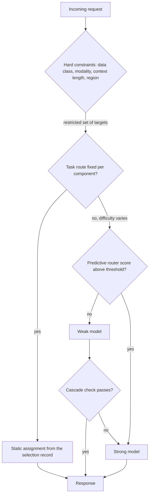
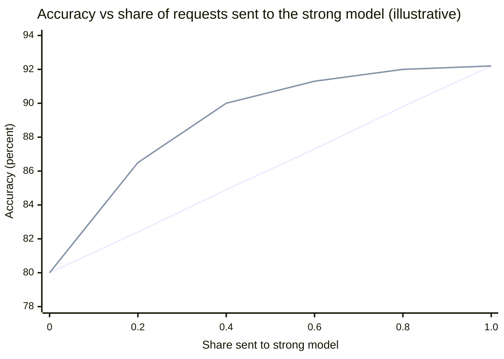
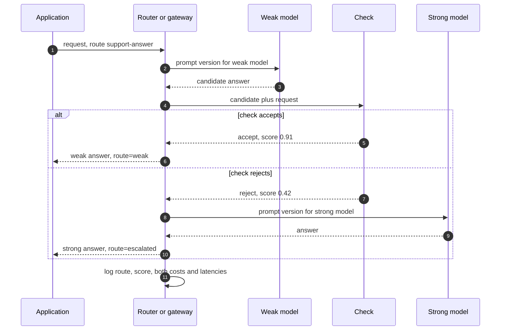
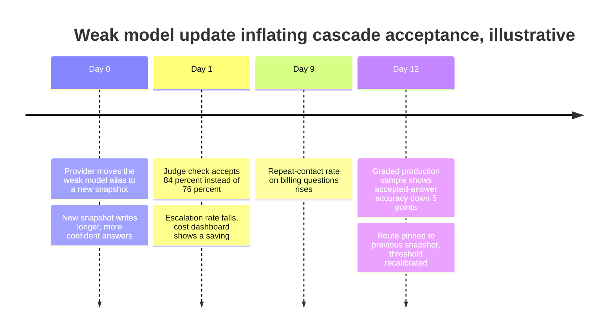

Multi-model strateji, tek bir ürünün içinde birden fazla modeli bilinçli olarak kullanmak ve hangi işi hangi modelin göreceğini açık bir kurala bağlamaktır. Kural sistem tasarlanırken sabitlenebilir: extraction bileşeni bir modeli, sohbet bileşeni başka bir modeli kullanır. Model routing ise kuralı her istek için çalışma anında verilen bir karara dönüştürür: bir router isteği ya da isteğe verilmiş ilk yanıt denemesini inceler ve onu fiyat, latency ve yetenek bakımından farklı birkaç modelden birine gönderir. Ekonomik gerekçe fiyat farkıdır. Aynı provider'ın kataloğunda en yetenekli ve en ucuz metin modelleri arasındaki token fiyatı farkı çoğu zaman on kat ya da daha fazladır; gerçek trafiğin büyük bir kısmı ise ucuz modelin yanıtının pahalı modelinki kadar iyi olacağı kadar kolaydır.

Temel trade-off şudur: her routing kararı bir tahmindir ve yanlış bir tahmin yeni türden bir hatadır. Zor bir isteği zayıf modele gönderen router, her zaman güçlü modeli kullanan bir sistemin vereceğinden daha kötü bir yanıt üretir ve yanıtta isteğin yanlış yönlendirildiğini gösteren hiçbir işaret yoktur. Kolay istekleri güçlü modele gönderen router ise onu kurmayı haklı çıkaran parayı boşa harcar. Sistem ayrıca tek bir konfigürasyon olmaktan çıkar: router'ın arkasındaki her modelin kendi prompt'u, kendi eval sonuçları ve kendi hata analizi gerekir; router'ın kendisi de kendi doğruluğu, drift'i ve saldırı yüzeyi olan bir bileşen haline gelir.

İkinci ve daha sessiz bir trade-off, kararın üretimden önce mi sonra mı verildiğidir. Tahmine dayalı bir router yalnızca isteğe bakarak, ucuza ve kayda değer bir latency eklemeden karar verir, ama yanıtı görmez. Cascade önce ucuz modelle üretir ve bir kontrol yanıtı reddederse bir üst modele çıkar; çok daha fazla bilgi kullanır, ama yükseltilen her istek iki üretimin bedelini öder ve kaliteyi belirleyen bileşen kontrolün kendisi olur.


*İstek başına model kararının katmanları. Kısıtlar önce izin verilen hedef kümesini daraltır; zorluğa dayalı routing ve cascade yalnızca bu kümenin içinden seçim yapar.*

Sıralama güvenlik argümanının kendisidir. Takas edilemeyen kısıtlar, örneğin yalnızca kurum içinde işlenebilecek bir veri sınıfı ya da bir modelin context window'undan uzun bir girdi, maliyet odaklı her mantıktan önce uygulanır; böylece hiçbir router skoru bir isteği ulaşmasına izin verilmeyen bir hedefe gönderemez. Bu routing değişmezi ve hibrit bir deployment'ın onu yük altında nasıl koruduğu [Hosted API, Self-Hosted ve Hibrit Deployment](/ai-systems-architecture/tr/model-strategy/selection-and-deployment/hosted-vs-self-hosted/) sayfasının konusudur. Router yalnızca izin verilen kümenin içinde optimizasyon yapar.

## Routing Neye Karar Verir, Neye Vermez

AI platformlarında "routing" adı birkaç farklı mekanizmaya verilir ve bunlar farklı problemleri çözer. Statik atama, ölçülmüş kanıta dayanarak bileşen başına tek bir model seçer; yöntemi [Model Seçim Kriterleri: Çok Kriterli Bir Yöntem](/ai-systems-architecture/tr/model-strategy/selection-and-deployment/selection-criteria/) sayfasındadır ve bu sayfa, her aday için bunun yapılmış olduğunu varsayar. Bu sayfanın konusu olan zorluğa dayalı routing, bazı istekler için hepsi kabul edilebilir olan adaylar arasından istek başına bir model seçer. Hata routing'i, ilk model ya da provider erişilemez, throttle edilmiş ya da fazla yavaş olduğunda isteği başka bir modele veya provider'a gönderir; farklı doğruluk kurallarına sahip bir güvenilirlik mekanizmasıdır ve [Fallback Zincirleri ve Graceful Degradation](/ai-systems-architecture/tr/reliability/provider-failures/fallback-degradation/) sayfasında ele alınır. Yük dağıtımı, istekleri aynı modelin birkaç deployment'ına yayar; bu, [Algoritmalar: Round Robin, En Az Bağlantı, Ağırlıklı, Consistent Hashing](https://gorkemsari.github.io/distributed-systems/tr/communication/load-balancing/algorithms/) sayfasında anlatılan sıradan load balancing'dir, yalnızca yükün birimi istek sayısı yerine token sayısıdır.

Garantiler farklıdır. Bir load balancer herhangi bir isteği herhangi bir sağlıklı replikaya taşıyabilir, çünkü tüm replikalar aynı fonksiyonu hesaplar; bir fallback ise erişilebilirlik karşılığında bilinen ve önceden değerlendirilmiş bir kalite kaybını kabul eder. Zorluğa dayalı bir router istatistiksel bir iddiada bulunur ve sözleşmesi tek tek isteklerin bir özelliği olarak değil, ölçülmüş bir sınır olarak ifade edilir: değerlendirilen istek dağılımı üzerinde routing, isteklerin belirtilen bir oranını güçlü modele gönderirken güçlü modelin kalitesinin belirtilen bir oranına ulaşır. Herhangi bir isteğin güçlü modelin vereceği yanıtı alacağını garanti etmez, trafik karışımı değiştikten sonra bu sınırı garanti etmez ve eval set'inde bulunmayan ya da küçük kalan slice'lar hakkında hiçbir şey garanti etmez.

## Tahmine Dayalı Routing: Üretimden Önce Karar

Tahmine dayalı bir router, yalnızca istekten yola çıkarak güçlü modelin yanıtının zayıf modelinkini ne kadar iyileştireceğini tahmin eden bir skor hesaplar. Skor eşiği aşarsa istek güçlü modele, aşmazsa zayıf modele gider. Router'ın davranışı tamamen skorlama fonksiyonu ve skoru bir trafik payına çeviren eşik tarafından belirlenir.

Skorlama fonksiyonları kurallardan eğitilmiş modellere kadar uzanır. Kurallar bir mühendisin adını koyabileceği özellikleri kullanır: girdi uzunluğu, kod ya da tablo varlığı, tenant'ın planı, ürün yüzeyi, arama yerine analiz istendiğini gösteren bir anahtar kelime. Şeffaf ve kırılgandırlar. Embedding tabanlı router'lar isteği bir embedding uzayına yerleştirir ve etiketli komşulara bakar: buna benzeyen istekler iki model tarafından eşit derecede iyi yanıtlandıysa zayıf model yeterlidir. Eğitilmiş sınıflandırıcılar, genellikle etiketli çiftler üzerinde fine-tuning yapılmış küçük bir encoder modeli, güçlü modelin kazanma olasılığını üretir. LLM-as-router ise küçük bir dil modelinden isteğin zorluğunu ya da türünü sınıflandırmasını ister; esnektir ve kritik yola bir üretim ekler.

Eğitilmiş router'lar üzerine en çok atıf alan açık çalışma RouteLLM'dir (Ong vd., ICLR 2025). Çalışma, bir güçlü ve bir zayıf model arasında router'ları Chatbot Arena'nın insan tercih verisiyle eğitir: ayıklama sonrasında yaklaşık 65.000 ikili karşılaştırma, benchmark yanıtlarından ve bir LLM judge'dan gelen etiketlerle zenginleştirilmiş olarak. Dört router tasarımını karşılaştırır: eğitim gerektirmeyen benzerlik ağırlıklı bir sıralama, matrix factorization, BERT-base bir sınıflandırıcı ve 8 milyar parametreli causal bir dil modeli üzerine kurulmuş bir sınıflandırıcı. Router'ları karşılaştırılabilir kılmak için kapatılan performans farkını (performance gap recovered, PGR) tanımlar: router'ın kalitesi eksi zayıf modelinki, bölü güçlü modelin kalitesi eksi zayıf modelinki. %80'lik bir PGR, router'ın iki model arasındaki farkın beşte dördünü kapattığı anlamına gelir. PGR'yi güçlü modele giden çağrı oranına karşı çizmek bir eğri verir; eğrinin altındaki alan olan ortalama kapatılan performans farkı (APGR), bir router'ı tüm eşikler boyunca özetler. Call-performance threshold CPT(x%) ise %x'lik bir PGR'ye ulaşmak için gereken en düşük güçlü model çağrı payıdır.

Sonuçlar öğretici biçimde değişkendir. Makale, GPT-4 referansına göre MT-Bench'te farkın %50'sini kapatan eşikte 3,66 kat maliyet tasarrufu raporlar; MMLU'da ise yalnızca 1,41 kat, GSM8K'de 1,49 kat. Çok sayıda kolay prompt içeren sohbet benchmark'ı iyi route edilir; zayıf modelin maddelerin büyük ve öngörülmesi zor bir kısmında başarısız olduğu bilgi ya da aritmetik benchmark'ları kötü route edilir. Makalenin deneylerinde router'lar yeniden eğitilmeden başka model çiftlerine de taşınabilmiştir; bu, "zorluğun" yalnızca çiftin değil, kısmen isteğin bir özelliği olduğuna dair bir kanıttır. Makale iddialarını iki modelli kurguyla sınırlar ve gerçek dağılımların benchmark'lardan farklı olabileceğini not eder.

### Bir Router Neden İşe Yarayabilir ve Argüman Nerede Çöker

Bir router rastgele bir bölüşümü ancak zorluk istekten öngörülebiliyorsa geçebilir. Mekanizma, iki modelin hatalarının girdi özelliklerinden bağımsız olmamasıdır: çok kısıtlı uzun talimatlar, çok adımlı aritmetik, nadir diller ve birkaç dokümanı birleştirmeyi gerektiren istekler küçük modellerin başarısız olduğu yerlerdir ve bu özellikler üretimden önce görülebilir. Router bu korelasyondan yararlanır. Kalitesi, zayıf modelin elde tuttuğu isteklerdeki kalitesi artı güçlü modelin kendisine gönderilen isteklerdeki kalitesidir; rastgele bölüşüme karşı kazancı da tam olarak zayıf modelin hatalarını güçlü paya ne kadar iyi topladığıdır.


*Doğruluğu %80 olan zayıf bir model ile %92,2 olan güçlü bir model arasında iki router. Düz çizgi rastgele bölüşümdür; eğri, skorları zayıf modelin hatalarını bir araya toplayan bir router'dır. Tüm değerler örnek amaçlıdır.*

Rastgele bir bölüşüm, güçlü modelin üstünlüğünün orantılı bir payını satın alır; düz çizgi bundandır. İşe yarayan bir router bu çizginin üstüne doğru bükülür: burada trafiğin %40'ını güçlü modele göndermek farkın yaklaşık %80'ini kapatır. %60'tan sonra ek güçlü model payı neredeyse hiçbir şey kazandırmaz, çünkü kalan istekler zayıf modelin zaten doğru yanıtladığı isteklerdir. Eşiği bu eğri üzerinde, kendi trafiğinizde ölçüldüğü haliyle seçin; asla bir vendor varsayılanından ya da bir makaleden almayın.

Argüman üç yerde çöker. Zorluk girdide görünmüyorsa, örneğin zayıf model istek karmaşık olduğu için değil bir bilgiye sahip olmadığı için başarısız oluyorsa, isteğe ait hiçbir özellik hatayı öngörmez ve router'ın eğrisi rastgele çizgiye doğru çöker. Trafik karışımı router'ın hiç görmediği bir slice'a kaydığında skorları birer ekstrapolasyondur ve geçen ay ölçülen eğri artık sistemi tarif etmez. Router bir popülasyonun yargılarıyla, örneğin kamuya açık sohbet tercihleriyle eğitildiğinde ise "güçlü model daha iyi" kavrayışı görevin doğru tanımıyla örtüşmeyebilir; router'ın production için etiketlerinin, [Metrik Tasarımı: Görev Metrikleri ve RAG Metrikleri](/ai-systems-architecture/tr/evaluation/measuring-quality/metric-design/) sayfasında anlatıldığı gibi görevin kendi eval'ından gelmesi gerekmesinin sebebi budur.

## Cascade: Üret, Kontrol Et, Yükselt

Cascade her isteği önce en ucuz modele gönderir ve yanıtının yeterince iyi olup olmadığına sonradan karar verir. Bir kontrol yanıtı kabul ederse yanıt döndürülür; etmezse istek bir sonraki, daha pahalı modele gönderilir. FrugalGPT (Chen, Zaharia ve Zou, 2023) bu deseni LLM'ler için prompt adaptation ve model approximation'ın yanında üç maliyet stratejisinden biri olarak yaygınlaştırdı ve kendi benchmark'larında öğrenilmiş bir cascade'in en iyi tekil modelle %98'e varan daha düşük maliyetle eşleşebildiğini ya da aynı maliyetle doğruluğunu %4 artırabildiğini raporladı. Bunlar 2023 benchmark sonuçlarıdır; aktarılabilir olan yapıdır.


*İki aşamalı bir cascade'den geçen tek bir istek. Yükseltilen kol (adım 7-9) iki üretimin ve kontrolün bedelini öder; adım 10'da loglanan skor, eşiğin daha sonra yeniden kalibre edilmesini mümkün kılar.*

Tasarımın tamamı kontroldür. Deterministik kontroller en güçlüleridir: bir JSON şeması, getirilen kaynaklarda bulunması gereken zorunlu bir atıf, tutması gereken hesaplanmış bir toplam, parse edilmesi gereken üretilmiş bir sorgu, geçmesi gereken bir unit test. Ucuzdurlar ve test ettikleri özellik üzerindeki yanlış kabul oranları sıfıra yakındır; ama test etmedikleri özellikler hakkında hiçbir şey söylemezler. Bu türden çıktı doğrulamanın sahibi [Çıktı Doğrulama ve Onarım Döngüleri](/ai-systems-architecture/tr/reliability/output-reliability/output-validation/) sayfasıdır. Olasılıksal kontroller kodun test edemediğini kapsar: zayıf modelin birkaç örneği arasındaki uyum, provider'ın sunduğu yerlerde token log-olasılıkları, etiketli yanıtlarla eğitilmiş bir skorlayıcı ya da yanıtın isteği karşılayıp karşılamadığı sorulan bir judge modeli. Bunların her birinin kalibre edilmiş kesinliği yalnızca kalibre edildiği veri üzerinde geçerlidir; LLM judge'lar özellikle uzunluğa ve üsluba yönelik bilinen bias'lar taşır ve bu konu [LLM-as-Judge: Kullanım, Bias ve Kalibrasyon](/ai-systems-architecture/tr/evaluation/measuring-quality/llm-as-judge/) sayfasında ele alınır.

Bir cascade'in doğruluk argümanı, kontrolün iki hata oranı hakkında bir ifadedir. Yanlış ret, doğru bir zayıf yanıtı güçlü modele gönderir; bu para ve latency'ye mal olur, kaliteye nadiren zarar verir. Yanlış kabul ise yanlış bir zayıf yanıtı döndürür ve cascade'in kalite kaybına giden tek yoludur. Dolayısıyla cascade'in hata oranı, zayıf modelin hata oranı çarpı kontrolün yanlış kabul oranı, artı yükseltilen pay çarpı güçlü modelin bu paydaki hata oranıdır. Bir cascade kontrolünden daha iyi olamaz; kendisi bir LLM çağrısı olan bir kontrol de değerlendirdiği modellerle aynı titizlikle değerlendirilmelidir.

Cascade'ler streaming ile kötü etkileşir. Kullanıcıya stream edilmiş bir zayıf yanıt, kontrol onu reddettiğinde geri alınamaz; bu yüzden streaming yapan bir ürün ya zayıf yanıtı kontrol bitene kadar tamponlayıp time-to-first-token avantajının çoğunu kaybeder ya da kontrolü bir önek üzerinde çalıştırıp geç gelen hataların geçmesini kabul eder. Etkileşimli yüzeylerde latency bütçesine sığan tek routing çoğu zaman tahmine dayalı router'dır.

### Hesaplanmış Örnek: Bir Destek Asistanı için Router ve Cascade

Örnek olarak, ayda bir milyon istek karşılayan bir destek asistanı varsayalım. Güçlü model istek başına 1,0 cent tutar ve eval set'inin %92,2'sinde doğrudur; zayıf model 0,05 cent tutar ve %80,0'ında doğrudur. Eval set'i iki popülasyon gösterir: isteklerin %70'i kolaydır, burada zayıf model %95, güçlü model %97 oranında doğrudur; %30'u zordur, burada zayıf model %45, güçlü model %81 oranında doğrudur. Buradaki her sayı örnek amaçlıdır.

Tahmine dayalı router, seçilen eşikte zor isteklerin %90'ını ve kolay isteklerin %15'ini güçlü modele gönderir; böylece trafiğin %37,5'i güçlü modele gider. Router'ın kendisi istek başına 0,01 cent tutar. Doğruluğu, yönlendirilen dört grubun toplamıdır: zayıf modelde tutulan kolay istekler 0,595 çarpı 0,95, yukarı gönderilen kolay istekler 0,105 çarpı 0,97, yukarı gönderilen zor istekler 0,27 çarpı 0,81, tutulan zor istekler 0,03 çarpı 0,45 katkı yapar; toplam %89,9'dur. İstek başına maliyet 0,625 çarpı 0,05 artı 0,375 çarpı 1,0 artı 0,01, yani yaklaşık 0,42 cent'tir. Router, iki model arasındaki farkın %81'ini güçlü modelin token maliyetinin %42'sine kapatır; bu da ayda 10.000 yerine yaklaşık 4.160 dolar demektir.

Bunun bir tasarruf olup olmadığı bir hatanın neye mal olduğuna bağlıdır. Router güçlü modelden 2,3 puan daha az doğru ve istek başına 0,58 cent daha ucuzdur; dolayısıyla 0,58 bölü 0,023, yani yaklaşık 26 cent'lik bir hata maliyetinde başa baş noktasına gelir. Çözülmemiş bir destek yanıtı tekrar eden bir başvuru olarak örneğin 50 cent'e mal oluyorsa, istek başına beklenen maliyet tek başına güçlü model için 4,90 cent, router için 5,45 cent'tir: router 5.800 dolarlık token tasarrufu yapar ve hatalarda bundan fazlasını kaybeder. Bir hata 10 cent'e mal oluyorsa router 1,78'e karşı 1,42 cent ile kazanır.

Cascade her isteği zayıf modele gönderir ve yanıtı 0,03 cent tutan küçük bir judge ile kontrol eder. Kontrolün doğru zayıf yanıtların %90'ını kabul ettiğini ve yanlış olanların %20'sini hatalı olarak kabul ettiğini varsayalım. Tüm isteklerin %72'si doğru ve kabul edilmiş, %4'ü yanlış ve kabul edilmiş, %24'ü yükseltilmiştir. Güçlü modelin yükseltilen isteklerin %80'inde doğru olduğunu varsayalım; yükseltilen istekler daha zor olduğu için bu oran ortalamasının biraz altındadır. Doğruluk %72 artı 0,24 çarpı %80, yani %91,2'dir; istek başına maliyet 0,05 artı 0,03 artı 0,24 çarpı 1,0, yani 0,32 cent'tir. Hata başına 50 cent'te beklenen maliyet 4,72 cent'tir; hem tek başına güçlü modelden hem de router'dan düşüktür. Kontrol yanıtı görür; bu yüzden zayıf modelin hatalarını yalnızca soruyu gören bir router'dan daha iyi ayıklar.

Bedeli latency ve yeni bir sessiz hatadır. Zayıf bir üretimin 0,8 saniye, kontrolün 0,4 saniye, güçlü bir üretimin 2,5 saniye sürdüğünü varsayalım. İsteklerin %24'ü, yani kuyruktaki %5'ten fazlası, 3,7 saniyelik yükseltilmiş yolu izlediği için cascade'in p95 latency'si, tek başına güçlü modelin 2,5 saniyesine karşı yaklaşık 3,7 saniyedir; medyanı ise yaklaşık 1,2 saniyeye düşer. Kontrolün onayıyla zayıf model tarafından yanlış yanıtlanan %4'lük istekler de güçlü modelin çoğu zaman önleyeceği hatalardır ve production yanıtları örneklenip puanlanmadıkça görünmez kalırlar.

:::tip[Router kurmadan önce başa baş hata maliyetini hesaplayın]
İstek başına tasarrufu, eval set'inizdeki doğruluk kaybına bölün. Sonuç, tek bir yanlış yanıtın gerçekçi maliyetinin altındaysa router'ın eğrisi ne kadar iyi görünürse görünsün bir kayıptır. Bu tek bölme işlemi, yüksek sonuçlu birçok bileşen için routing'i dışarıda bırakır ve yüksek hacimli, düşük sonuçlu bileşenler için onu doğrular.
:::

## Routing Tasarımlarını ve Yönetilen Router'ları Karşılaştırmak

| Tasarım | Karar noktası | Eklenen latency | Başlıca kalite riski | Değerlendirme yükü | Ne zaman tercih edilmeli |
|---|---|---|---|---|---|
| Bileşen başına statik atama | Tasarım zamanı | Yok | Bütün bir bileşen için yanlış model | Bileşen başına tek konfigürasyon | Bir bileşen içinde zorluk tekdüzeyse |
| Kural tabanlı router | Üretimden önce | İhmal edilebilir | Kurallar kolay özelliklere sahip zor istekleri kaçırır | Her kuralın slice'ı ölçülür | Adı konmuş birkaç özellik zor ve kolay trafiği net biçimde ayırıyorsa |
| Embedding ya da sınıflandırıcı router | Üretimden önce | Birkaç ila onlarca milisaniye | Eğitim dağılımının dışında drift | Router eğrisi ve iki model, slice başına | Yüksek hacim, latency'ye duyarlılık, etiketli sonuçlar mevcutsa |
| LLM-as-router | Üretimden önce | Küçük bir modelle bir üretim | Router niyeti yanlış okur; prompt injection'a açık | Router prompt'u versiyonlanan bir bileşendir | Az etiketle istek türüne ya da niyete göre routing |
| Deterministik kontrollü cascade | Zayıf üretimden sonra | Tam bir zayıf üretim, yükseltilen istekler iki kez öder | Kontrolün test etmediği özellikler | Özellik başına kontrol kapsamı | Doğrulanabilir yapıya ya da kısıtlara sahip çıktılar |
| Olasılıksal kontrollü cascade | Zayıf üretimden sonra | Zayıf üretim artı kontrol | Yanlış kabuller | Slice başına kontrol kesinliği | Latency'nin maliyetten daha az önemli olduğu batch ya da async işler |
| Provider tarafından yönetilen router | Üretimden önce, provider içinde | Provider'a bağlı | Routing sizin değil provider'ın verisine göre ayarlıdır | Router versiyonu ve havuz konfigürasyonun parçasıdır | Hızlı başlangıç, genel sohbete yakın görev, tek provider içinde havuz |

Yönetilen router'lar skorlama fonksiyonunu provider'ın içine taşır ve onu bir konfigürasyon seçimine dönüştürür. Kasım 2026 itibarıyla Amazon Bedrock'un intelligent prompt routing özelliği aynı aileden tam olarak iki model arasında routing yapar. Konfigürasyon, istekleri varsayılan olarak karşılayan bir fallback modeli ve bir response quality difference (yanıt kalitesi farkı) değeri belirtir: router istek için her modelin yanıt kalitesini tahmin eder ve fallback'ten ancak diğer modelin tahmin edilen kalitesi onu bu marjdan fazla aşıyorsa uzaklaşır. Dokümantasyon, routing'in İngilizce prompt'lar için optimize edildiğini ve router'ın kararlarını uygulamaya özgü performans verisine göre ayarlayamadığını belirtir; yanıt ise isteği hangi modelin işlediğini bildirir.

Microsoft Foundry'nin model router'ı, Kasım 2026'da güncellenen dokümantasyonuna göre bir LLM değil, eğitilmiş bir makine öğrenmesi modelidir. 40'tan fazla modelden oluşan bir havuzdan üç modda seçim yapar: en iyi adayın küçük bir kalite bandı içindeki modelleri değerlendirip (dokümantasyon örnek olarak %1-2 verir) en ucuzunu seçen Balanced; maliyeti yok sayan Quality; ve daha geniş bir bant kullanan Cost (örneğinde %5-6). Bir yönetici havuzu onaylı bir alt kümeyle sınırlayabilir. Seçilen model yanıtın `model` alanında bildirilir, efektif context window havuzdaki modellerin en küçüğüdür, görsel eklenmiş olsa bile routing kararı yalnızca metne dayanır ve seçilen modelin desteklemediği opsiyonel parametreler düşürülür. Router'ın kendisi de versiyonludur; bu yazı itibarıyla genel kullanıma açık versiyon 2025-11-18 tarihlidir.

OpenAI'ın GPT-5 system card'ı (Ağustos 2025), ChatGPT'de hızlı bir model ile bir reasoning modeli arasında konuşma türü, karmaşıklık, tool ihtiyacı ve açık niyete göre seçim yapan gerçek zamanlı bir router tarif eder; router, kullanıcıların model değiştirmesi, yanıt tercih oranları ve ölçülmüş doğruluk gibi sinyallerle eğitilir. Bu, [Reasoning Model'ler ve Test-Time Compute](/ai-systems-architecture/tr/model-strategy/model-landscape/reasoning-models/) sayfasında incelenen boyut olan effort seviyeleri arasında routing'dir ve provider'ın popülasyonu üzerinde eğitilmiştir; sizin router'ınız ise görevinizde doğruluğu tanımlayan sonuçlar üzerinde eğitilebilir.

Yönetilen bir router'da değerlendirilen konfigürasyon router versiyonu artı havuz artı moddur ve bunlardan herhangi birindeki sessiz bir değişiklik trafiğinizi hangi modellerin karşıladığını değiştirir. Sabitlenebilen her şeyi sabitleyin, dönen modeli her istekte loglayın ve model başına trafik payındaki bir değişikliği yeniden değerlendirmeyi tetikleyen bir değişiklik olayı olarak ele alın.

## Route Edilen Bir Bileşeni Konfigüre Etmek

Routing mantığı uygulama kodunda değil, [LLM Gateway Deseni](/ai-systems-architecture/tr/platform/ai-gateway/llm-gateway/) sayfasında anlatılan gateway katmanında yer alır; böylece eşikler deployment olmadan değişebilir ve her karar tek bir yerde loglanır. Bir route tanımı hedefleri, versiyonlarıyla birlikte skorlama ve kontrol bileşenlerini, eşiği ve router'ın kendisi başarısız olduğunda ne olacağını kaydeder.

```yaml
route: support-answer
constraints: { data_class_max: internal, min_context_tokens: 32000 }
targets:
  weak:   { model: small-model-2026-09, prompt: support-weak@v7 }
  strong: { model: large-model-2026-08, prompt: support-strong@v5 }
router:
  kind: classifier
  version: difficulty-clf@2026-11-10   # trained on labeled outcomes of this route
  threshold: 0.38                      # chosen from the measured curve, re-checked monthly
  on_error: strong                     # router timeout or failure: fail toward quality
sticky: conversation                   # keep one target per conversation
budget: { max_strong_share_per_tenant: 0.6, window: 1h }
log: [route, score, target, model_returned, router_version, cost, latency]
```

Her hedefin kendi prompt versiyonu vardır, çünkü bir model için ayarlanmış bir prompt diğerini olduğundan kötü gösterir ve ölçülen router eğrisini bozar. Bu versiyonları bir arada tutan registry [Prompt ve Model Registry](/ai-systems-architecture/tr/platform/internal-platform/prompt-model-registry/) sayfasında anlatılır.

`on_error` seçimi bir politikadır: güçlü modele doğru başarısız olmak, bir router olayı sırasında kaliteyi korur ve para harcar; zayıf modele doğru başarısız olmak ise her zor isteği sessizce kötüleştirir. Çoğu bileşen için doğru olan birincisidir; ikincisi yalnızca katı bir maliyet tavanı olan batch işler içindir ve kötüleşme raporlanmalıdır.

Konuşmalarda yapışkanlık (stickiness) önemlidir. Turlar arasında model değiştirmek üslubu, biçimlendirmeyi ve tool calling geleneklerini değiştirir; ayrıca uzun bir konuşmanın biriktirdiği provider tarafı prompt cache'i de çöpe atar, çünkü bir cache tek bir modele özgüdür. Bu kaybın maliyeti [Prompt Caching: Yapı, Kazanım ve Geçersizleşme](/ai-systems-architecture/tr/context-engineering/production-prompting/prompt-caching/) sayfasında ele alınır. Konuşma başına route edin ya da ilk turda route edip yükseltmeye izin verin ama düşürmeye izin vermeyin; Foundry'nin model router'ı bu sebeple session affinity'yi preview özelliği olarak sunar.

Tenant başına güçlü model payı üst sınırı, bir sonraki bölümün açıkladığı gibi, bir maliyet kontrolü olduğu kadar bir güvenlik kontrolüdür; route ve tenant başına maliyet [Maliyet Dağıtımı ve Chargeback](/ai-systems-architecture/tr/economics/understanding-cost/cost-attribution/) sürecine akar.

## Hata Modları ve Operasyon

Routing hataları neredeyse hiçbir zaman birer error değildir: yanıt düzgün biçimlidir ve kalite kaybı yalnızca toplamda, bir slice'ta ya da maliyet raporlarında görünür.


*Örnek amaçlı bir olay. Zayıf modeldeki bir değişiklik, kontrolün kalibre edildiği dağılımı kaydırdı ve hemen görülen tek sinyal iyi bir haber gibi görünüyordu.*

İlk görünen sinyal bir maliyet iyileşmesiydi; routing olaylarının karakteristik görünümü budur. Aradaki süreyi kısaltacak tespit, yükseltme oranının ya da güçlü model payının herhangi bir yönde bir bandın dışına çıkmasına dair bir alarm ile kabul edilen zayıf yanıtların sürekli puanlanan bir örneğinin birlikte kullanılmasıdır. Zayıf modelin alias'ı yerine snapshot'ını sabitlemek, 0. günü eval çalıştırılan planlı bir değişikliğe dönüştürürdü; bu disiplin [Prompt, Model ve Konfigürasyon için Değişiklik Yönetimi](/ai-systems-architecture/tr/llmops/operations/change-management/) sayfasında anlatılır.

Bir maliyet saldırısı router'ı doğrudan istismar eder. Shafran, Schuster, Ristenpart ve Shmatikov, *Rerouting LLM Routers* (arXiv, Ocak 2025) çalışmasında, confounder gadget adını verdikleri kısa ve sorgudan bağımsız token dizilerinin herhangi bir sorgunun başına eklenerek router'ların onu güçlü modele göndermesini sağlayabildiğini gösterdi; bu hem white-box hem black-box kurgularda ve birkaç ticari router'a karşı, yanıtı kötüleştirmeden işe yaradı. Deneylerindeki ticari router'lardan birine karşı gadget'lar maliyeti yaklaşık 1,7 kat artırdı. Ayrıca gadget'ların düşük perplexity için optimize edilebildiğini, dolayısıyla perplexity filtrelemenin etkili bir savunma olmadığını buldular. Mimari yanıt, para harcatan hiçbir şey için kullanıcının kontrol ettiği metni tek routing sinyali olarak görmemektir: güçlü model payını tenant ve key başına sınırlayın, payı kendi geçmişinden sapan tenant'lar için alarm kurun ve ürün yüzeyi ya da hesap seviyesi gibi kullanıcının yazamayacağı sinyalleri de dahil edin. Güvenilmeyen girdi üzerinden yapılan saldırıların geniş sınıfı [Prompt Injection: Doğrudan ve Dolaylı](/ai-systems-architecture/tr/security/threats/prompt-injection/) sayfasında ele alınır.

:::danger[Bir router skoru izin verilen hedef kümesini asla genişletmemeli]
Zorluğa dayalı routing ile veri sınıfına dayalı routing tek bir karar fonksiyonunu paylaşıyorsa, yüksek bir zorluk skoru kısıtlı veriyi veri sınıfının yasakladığı hosted bir modele gönderebilir ve bu hata bir kalite kaybı değil, bir veri aktarımıdır. Veri sınıfı kısıtını önce, router'ın geçersiz kılamayacağı ayrı ve fail-closed bir adım olarak uygulayın ve hiçbir kısıtlı isteğin izin verilmeyen bir hedef tarafından karşılanmadığını loglarda doğrulayın.
:::

| Hata | Tetikleyici | Belirti | Tespit | Azaltma ve kurtarma |
|---|---|---|---|---|
| Dağılım drift'i | Trafik karışımı router'ın hiç görmediği slice'lara kayar | Bir slice'ta kalite düşer; güçlü model payı oynar | Slice başına güçlü model payı; route başına puanlanan örnek | Yakın tarihli etiketli trafikle yeniden eğitme ya da kalibrasyon; güçlü payı geçici olarak artırma |
| Az temsil edilen slice | Eval set'inde nadir bir dil ya da girdi türü | Bir slice sürekli yanlış yönlendirilir | Route edilen konfigürasyonda en kötü slice doğruluğu | Slice ölçülene kadar onu güçlü modele gönderen bir kural |
| Cascade yanlış kabulleri | Kontrol başka veriyle kalibre edilmiş ya da zayıf model değişmiş | Kabul edilen yanıtlar yanlış, yükseltme oranı düşer | Kabul edilen yanıtların puanlanan örneği; kabul oranı bandı | Snapshot sabitleme; kontrolü yeniden kalibre etme; mümkün olan yerde deterministik kontroller |
| Maliyet saldırısı | Confounder metin ya da kasıtlı "zor" ifade | Tenant başına güçlü model payı ve maliyet artar | Tenant başına güçlü model payının referansa göre durumu | Tenant başına üst sınırlar, kullanıcının yazamayacağı sinyaller, rate limit |
| Router kesintisi ya da yavaşlığı | Router servisi yavaş ya da çökmüş | Her isteğe eklenen latency ya da yanlış varsayılan | Ayrı bir span olarak router latency'si ve hata oranı | Açık bir `on_error` hedefiyle timeout |
| Konuşma ortasında değişim | Çok turlu sohbette tur başına routing | Üslup ya da tool formatı değişir; cache miss'ler | Konuşma başına model değişimi; cache hit oranı | Konuşma başına yapışkan routing; konuşma içinde düşürme yok |
| Bayat eşik | Bir hedefte fiyat değişikliği ya da model güncellemesi | Router eğrinin hedeflenen noktasında değil | Eğrinin aylık yeniden ölçümü | Güncel eğriden yeniden türetilen, konfigürasyon olarak tutulan eşik |

Tespit sütunu, her isteğin trace'inin route'u, router skorunu ve versiyonunu, seçilen hedefi, provider'ın döndürdüğü model kimliğini ve atılan cascade denemeleri dahil her üretimin maliyetini ve latency'sini taşıdığını varsayar. Bu attribute'lar [OpenTelemetry GenAI Semantic Convention'ları](/ai-systems-architecture/tr/llmops/observability/otel-genai/) sayfasındaki span modeline uyar; sessiz hataları yakalayan puanlanmış production örneği ise [Kalite İzleme ve Drift Tespiti](/ai-systems-architecture/tr/llmops/observability/quality-drift/) sayfasının mekanizmasıdır.

:::caution[İki modeli değil, route edilen sistemi değerlendirin]
Bileşenin eşiklerini ayrı ayrı geçen iki model, bu eşikleri geçen bir route edilmiş sistem oluşturmaz. Route edilen konfigürasyonun, router'ın hatalarıyla belirlenen kendi doğruluğu, en kötü slice'ı ve latency dağılımı vardır. Eval suite'ini route edilen konfigürasyonun bütününe karşı çalıştırın ve production'da zayıf payı artırmadan önce yeni eşiği, [Online Deneyler: A/B Test, Shadow Mode, Canary](/ai-systems-architecture/tr/evaluation/evals-in-delivery/online-experimentation/) sayfasında olduğu gibi canlı trafikte shadow mode'da ya da canary olarak test edin.
:::

Routing'in bir yönetişim maliyeti de vardır. Router'ın arkasındaki her model production'daki bir modeldir; bu yüzden regüle bir kurumda her biri doğrulanır ve envantere girer, bir müşterinin neden belirli bir yanıt aldığını soran bir denetçinin de yanıtı hangi modelin ürettiğini ve router'ın onu neden seçtiğini bilmesi gerekir. Loglanmış bir skor ve router versiyonu iki soruyu da yanıtlar; opak bir yönetilen router ise yalnızca ilkini yanıtlar. Bu, [LLM Sistemleri için Model Risk Yönetimi](/ai-systems-architecture/tr/governance/risk-management/model-risk-management/) sayfasında tartışıldığı gibi, regüle kararlar için sahip olunan bir router'ı tercih etmenin bir sebebidir.

## Ne Zaman Route Etmeli, Ne Zaman Tek Model Daha İyi

Dört koşul birlikte sağlandığında istek başına route edin. Bileşen, token faturasının bir kısmının bir mühendislik ekibinin ilgisine değeceği kadar hacim taşır. Bileşen içinde zorluk değişkendir; eval set'i bunu, maddelerin çoğunda iyi ve tanımlanabilir bir azınlıkta zayıf olan bir zayıf model olarak gösterir. Adaylar arasındaki fiyat oranı büyüktür, tipik olarak on kat ya da daha fazla; çünkü küçük bir oran, router maliyeti ve kalite kaybı ödendikten sonra geri kazanılacak pek bir şey bırakmaz. Ve route edilen konfigürasyondan hesaplanan başa baş hata maliyeti, yanlış bir yanıtın gerçek maliyetinin üzerindedir.

Çıktılar deterministik olarak kontrol edilebiliyorsa, iş batch ya da asenkron olduğu için yükseltme latency'si kullanıcıya ulaşmıyorsa ya da zorluk istekte değil yanıtta görünüyorsa, tahmine dayalı bir router yerine cascade tercih edin. Etkileşimli ve streaming yüzeyler için tahmine dayalı bir router tercih edin; ucuz bir sınıflandırıcı açıkça zor olan istekleri doğrudan güçlü modele gönderip çöpe gidecek bir zayıf üretimi atlatabiliyorsa ikisini birleştirin.

Düşük hacimli bir bileşeni route etmeyin: ikinci bir konfigürasyonun eval ve operasyon maliyeti her türlü tasarrufu aşar. Hataları pahalı ve doğrulanamaz olan bir bileşeni, örneğin regüle bir kararı ya da geri alınamaz bir aksiyon alan bir agent adımını route etmeyin; güçlü modeli kullanın ve maliyetini başka yollarla düşürmeye emek harcayın. Kullanıcılar etkileşimler arasında tutarlılık bekliyorsa ve modeller üslup bakımından gözle görülür biçimde farklıysa route etmeyin. Zayıf modelin bütün bir slice'ta başarısız olduğunu gizlemek için router kullanmayın; o slice'ı bilinçli olarak bir kuralla route edin ve kaydedin. Ve hata routing'inden önce zorluğa dayalı routing kurmayın: router'ı olup fallback'i olmayan bir sistem dayanıklılık eklemeden bir bağımlılık eklemiş olur.

Komşu konular başka sayfalardadır. Tekrarlanan istekleri hiç model çağırmadan yanıtlamak [Semantic Caching](/ai-systems-architecture/tr/platform/ai-gateway/semantic-caching/) sayfasının konusudur. Routing'in caching, batching ve kırpma ile tartılan maliyet kaldıraçlarından biri olarak ele alınışı [Maliyet Optimizasyon Teknikleri: Routing, Caching, Batching, Kırpma](/ai-systems-architecture/tr/economics/optimization/cost-optimization/) sayfasındadır. Kolay payı ona route etmek yerine kalıcı olarak devralacak küçük bir modeli eğitmek bir distillation kararıdır ve [Fine-Tuning ve Distillation: Entegrasyon Perspektifi](/ai-systems-architecture/tr/model-strategy/lifecycle-and-adaptation/finetuning-distillation/) sayfasında ele alınır. Hedefleri API düzeyinde birbirinin yerine geçebilir tutmak [Vendor Lock-in ve Abstraction Katmanı](/ai-systems-architecture/tr/model-strategy/lifecycle-and-adaptation/vendor-lock-in/) sayfasının konusudur.

## İleri Okuma

- Isaac Ong, Amjad Almahairi, Vincent Wu, Wei-Lin Chiang, Tianhao Wu, Joseph E. Gonzalez, M Waleed Kadous ve Ion Stoica, *RouteLLM: Learning to Route LLMs from Preference Data*, ICLR, 2025.
- Lingjiao Chen, Matei Zaharia ve James Zou, *FrugalGPT: How to Use Large Language Models While Reducing Cost and Improving Performance*, arXiv, 2023.
- Avital Shafran, Roei Schuster, Thomas Ristenpart ve Vitaly Shmatikov, *Rerouting LLM Routers*, arXiv, 2025.
- Amazon Web Services, *Understanding intelligent prompt routing in Amazon Bedrock*, Amazon Bedrock User Guide.
- Microsoft, *Model router for Microsoft Foundry* ve *How model router works*, Microsoft Foundry dokümantasyonu, 2026.
- OpenAI, *GPT-5 System Card*, 2025.
