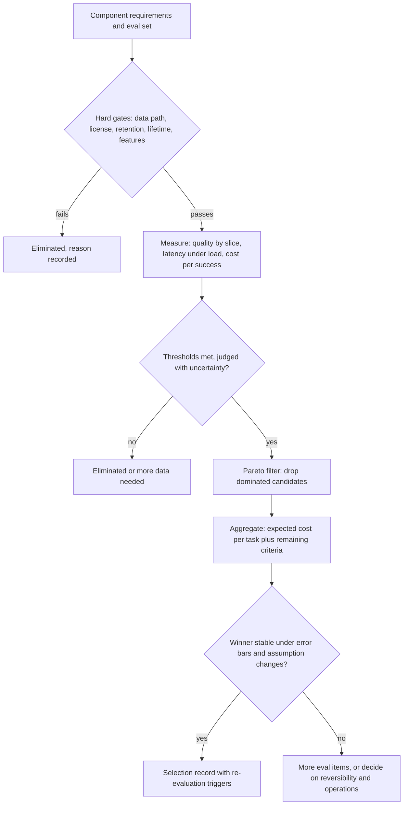
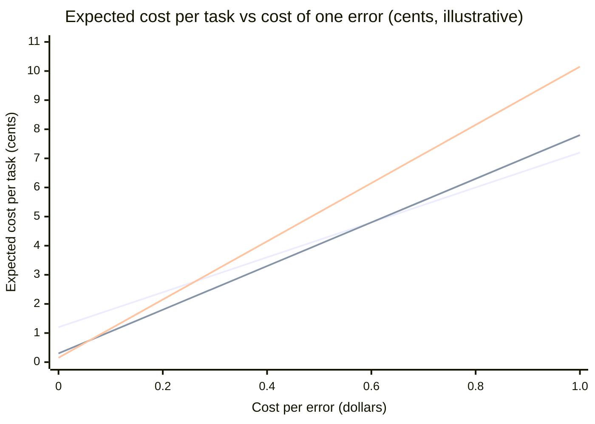
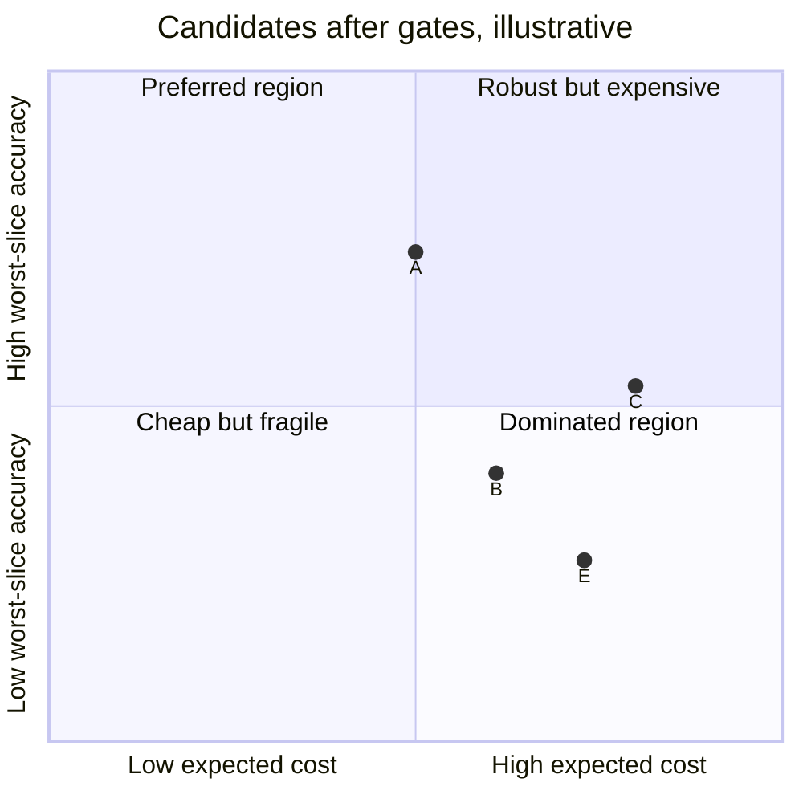
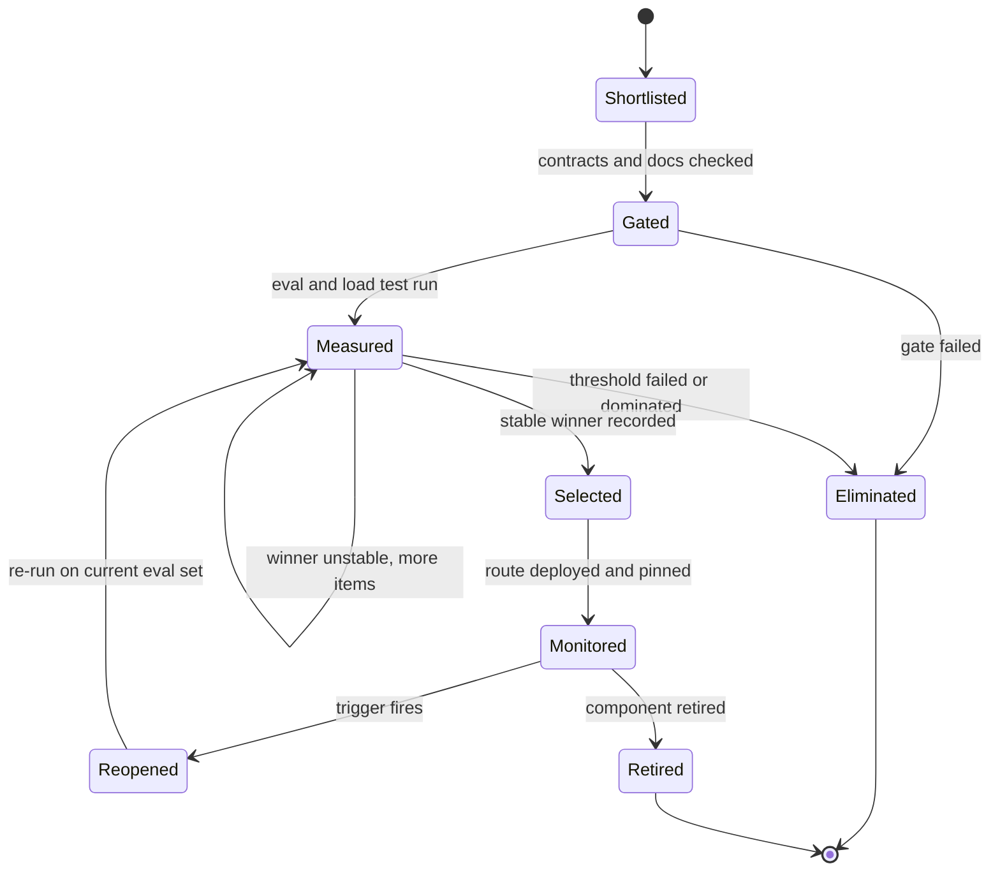
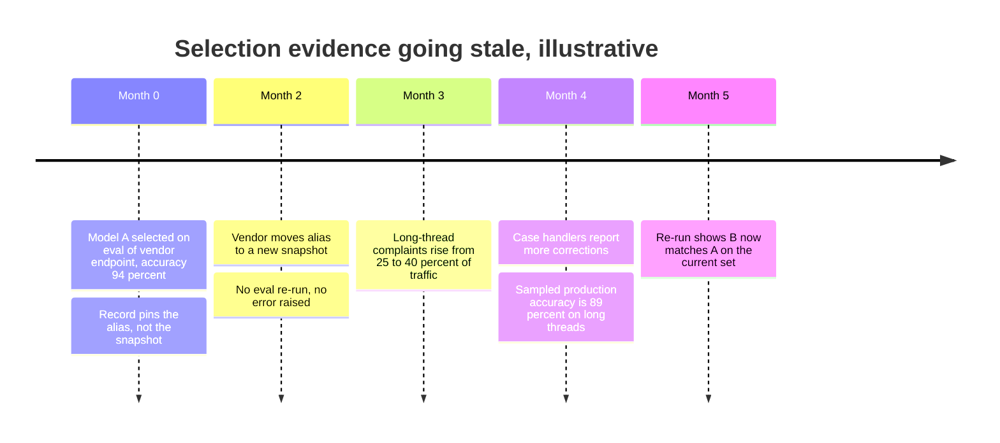

Model seçimi, bir sistemin tek bir bileşenine hangi modelin, hangi endpoint ve konfigürasyonun arkasında hizmet edeceğine dair karardır. Çok kriterli bir karardır: kalite, latency, maliyet, verinin nasıl işlendiği, lisans, versiyon ömrü ve operasyonel kapasite birlikte önemlidir; birbiriyle karşılaştırılamayan birimlerle ölçülürler ve farklı yönlere çekerler. Yaygın kestirmelerin her biri bu yapıyı, sonradan bedeli ödenecek bir biçimde tek boyuta indirir. Leaderboard liderini seçmek başkasının görevini ölçer. Bir demoya bakarak seçmek, [Demodan Production'a: AI Prototipleri Neden Yanıltır](/ai-systems-architecture/tr/foundations/failure-and-fit/demo-to-production/) sayfasında incelenen yanlılıkla, özenle seçilmiş birkaç girdiyi ölçer. Bir tabloyu ağırlıklı puanlarla doldurmak ise, tabloya alakasız bir aday eklendiğinde sıralaması değişebilen tek bir sayı üretir.

Bu sayfadaki yöntem bu kestirmelerin yerine beş aşama koyar: zorunlu kapılar, kendi verinizde belirsizliğiyle birlikte yapılan ölçüm, eşikler, bir Pareto filtresi ve dönüştürülebilen her şeyi tek bir parasal birime çeviren bir birleştirme; ardından kazananın ölçüm hatası ve varsayımlardaki makul değişiklikler karşısında ayakta kalıp kalmadığı kontrol edilir.

Temel trade-off, telafi edici ve telafi etmeyen akıl yürütme arasındadır. Ağırlıklı toplam gibi telafi edici bir yöntem, bir kriterdeki gücün başka bir kriterdeki zayıflığı satın almasına izin verir; bu, maliyete karşı kalite için doğru, data residency'ye karşı kalite için yanlıştır. Bir kapı ya da eşik gibi telafi etmeyen bir yöntem bu takası reddeder; güvenlidir ama bir adayın ne kadar daha iyi olduğunu göremez. Yanında ikinci bir trade-off daha vardır: ölçüm hassasiyeti eval örneği gerektirir ve birbirine yakın iki adayı ayırmak için gereken örnek sayısı aradaki farkın karesiyle ters orantılı olarak büyür. Yöntem bu maliyeti yalnızca kararın gerçekten ona bağlı olduğu yerde harcayacak şekilde tasarlanmıştır.


*Seçim yönteminin beş aşaması. Her aşama adayları yazıya geçirilmiş bir gerekçeyle eler; böylece nihai kayıt yalnızca kazananı değil, her elemeyi de açıklar.*

Doğruluk argümanı sıralamanın kendisidir. Kapılar önce gelir, çünkü kontrol edilmeleri ucuzdur ve takas edilemezler; zaten dışarıda kalacak bir adayı ölçmek eval bütçesini boşa harcar, daha kötüsü, production'a benzeyen veriyi onu almaya yetkisi olmayabilecek bir vendor'a gönderir. Eşikler birleştirmeden önce gelir, çünkü aksi halde birleşik bir puan tek bir kriterde kullanılamaz olan bir adayı ödüllendirebilir. Baskınlık filtresi ağırlıklandırmadan önce gelir, çünkü baskılanan bir aday hiçbir ağırlık setinde doğru cevap olamaz; birleştirme bölümünün gösterdiği gibi, varlığı yine de normalize edilmiş puanları bozabilir. Duyarlılık en sona kalır, çünkü sıralamanın hangi varsayımlara dayandığı ancak sonda belli olur.

## Kısıtları Hedeflerden Ayırmak

Her kriter iki türden birine aittir ve onu yanlış türe koymak seçimdeki en yaygın yapısal hatadır. Kısıt, bileşenin yasal, güvenli ya da işletilebilir olması için sağlaması gereken bir koşuldur; bir kez kontrol edilir, geçilir ya da kalınır. Hedef ise fazlasının (ya da azının) daha iyi olduğu ve farkın derecesinin önemli olduğu bir özelliktir; ölçülür ve takas edilir.

Bir LLM bileşeninin kısıtları çoğunlukla modelle değil, veri yolu ve sözleşmeyle ilgili sorulardır. Prompt'lar ve çıktılar nerede işleniyor ve saklanıyor; bu konum, [Türkiye Regülasyonu ve Data Residency: KVKK ve BDDK](/ai-systems-architecture/tr/governance/regulation/turkish-regulation/) sayfasında anlatılanlar gibi sektörel kurallar dahil, geçerli data residency kurallarını sağlıyor mu? Provider girdileri saklıyor mu, ne kadar süreyle, ve onları eğitimde kullanabilir mi; bunun cevabı bir pazarlama sayfasında değil, sözleşmede yazandır. Open-weight bir modelin lisansı amaçlanan kullanıma izin veriyor mu; yaygın lisans aileleri [Frontier, Open-Weight ve Small Language Model'ler](/ai-systems-architecture/tr/model-strategy/model-landscape/model-categories/) sayfasında ele alınır. Modelin duyurulmuş ömrü, bileşenin kararlı kalması gereken süreyi kapsıyor mu? Ve gereken özellikler mevcut mu: en uzun gerçekçi girdinin ihtiyaç duyduğu context uzunluğu, structured output ya da tool calling, girdi modaliteleri ve kapasitenin sunulduğu bölge.

Versiyon ömrü kesin bir kapıyı hak eder, çünkü genellikle sonradan akla gelir. Provider'lar deprecation takvimleri yayımlar; örneğin Anthropic, deprecated bir modeli ("hâlâ çalışıyor ama artık önerilmiyor", atanmış bir emeklilik tarihiyle) istekleri başarısız olan retired bir modelden ayırır ve herkese açık yayımlanmış bir modeli emekliye ayırmadan önce en az 60 gün bildirim yapmayı taahhüt eder (Kasım 2026 itibarıyla model-deprecations dokümantasyonuna göre). Altmış gün, çalışan bir eval suite'i olan bir bileşeni taşımak için yeterlidir; inceleme döngüsü üç aylık olan regüle bir kurumda model validasyonunu yeniden yürütmek için yeterli değildir. Bu yüzden kapı "model güncel" değil, "provider'ın belgelenmiş asgari bildirim süresi bizim migration hazırlık süremizden uzun" olmalıdır; migration sürecinin kendisi [Model Versiyonlama, Deprecation ve Migration](/ai-systems-architecture/tr/model-strategy/lifecycle-and-adaptation/versioning-migration/) sayfasına aittir.

Hedefler dört tanedir. Kalite, bileşenin çıktısının görevin kendi tanımına göre doğru olma oranıdır; slice başına raporlanır ve gözetimsiz tekrar tekrar kullanılan bileşenler için [Yetenek ve Güvenilirlik: Production Açığını Kapatmak](/ai-systems-architecture/tr/foundations/ai-component-model/capability-vs-reliability/) sayfasında tanımlanan, tüm denemelerin başarılı olma oranı `pass^k` olarak verilir. Latency, ilk token'a kadar geçen süre ve toplam süre olarak, ürünün latency hedefinin kullandığı percentile'larda raporlanır. Maliyet token başına değil, başarılı görev başına raporlanır. Operasyonel uygunluk ise yük testi sırasında gözlenen hata ve throttling oranını, beklenen tepe yükte rate limit payını ve ölçümlerin günden güne değişkenliğini kapsar.

### Eşikler: Bir Hedefin Kısıta Dönüştüğü Yer

Hedeflerin çoğunun, altında hiçbir tasarrufun işe yaramadığı bir tabanı vardır: altında ürünün çıkamayacağı bir en kötü slice doğruluğu, üstünde etkileşim deseninin bozulduğu bir p95 latency. Eşik bu tabanı bir kapıya çevirir; ama ölçülmüş, belirsiz bir büyüklüğe uygulanan bir kapının belirsizlik için bir kurala ihtiyacı vardır. İki kural savunulabilir. Sonucu ağır bileşenlerde, eşiği %95 güven aralığının alt sınırının geçmesini şart koşun; bu muhafazakârdır ve daha büyük slice'lar gerektirir. Hatanın telafi edilebildiği bileşenlerde nokta tahmininin eşiği geçmesini şart koşun ve aralığı kaydedin; çizgiye yakın bir adayın yanlış sınıflanabileceğini kabul etmiş olursunuz. Kuralı eval çalışmadan önce seçin; sonradan seçmek çizgiyi tercih edilen adaya doğru kaydırır.

Latency eşikleri bileşenin servis seviyesi hedefinden gelir; bu hedefin nasıl kurulduğu [SLO (Servis Seviyesi Hedefi): Hedef Belirleme Sanatı](https://gorkemsari.github.io/distributed-systems/tr/observability/slo-sla-error-budgets/slo/) sayfasında anlatılır. LLM'e özgü kısım neyin ölçüleceğidir. Bir provider'ın boştayken tek bir istekteki latency'si; bileşenin tepe eşzamanlılığında, gerçek girdi uzunluğu dağılımında ve reasoning model'lerde [Reasoning Model'ler ve Test-Time Compute](/ai-systems-architecture/tr/model-strategy/model-landscape/reasoning-models/) sayfasında anlatılan gizli token dağılımının kuyruğunda neler olacağı hakkında çok az şey söyler. Ölçüm, gerçek istek şeklinin gerçek endpoint ve bölgeye karşı yapılan bir yük testidir; [Yük ve Performans Testi: k6, Locust ve Kapasite Doğrulama](https://gorkemsari.github.io/distributed-systems/tr/deployment/distributed-testing/load-performance-testing/) sayfasındaki yöntemlerle yürütülür ve paylaşılan provider kapasitesi değiştiği için en az iki farklı günde tekrarlanır.

### Başarılı Görev Başına Maliyet

Milyon token başına fiyat maliyetin girdisidir, maliyetin kendisi değil. Bir bileşenin görev başına maliyeti, kabul edilebilir bir sonuç elde etmek için beklenen harcamadır ve üç parçası vardır: retry'lar, onarım döngüleri ve reasoning token'ları dahil çağrıların token'ları; yakalanan hataların maliyeti, örneğin bir insan inceleyiciye escalation; ve yakalanmayan hataların maliyeti, örneğin yeniden iş, bir şikayet ya da bir denetim bulgusu. Olasılıklar eval setinde ölçülmek üzere, kısa haliyle:

```text
expected_cost_per_task = call_cost * (1 + retry_rate)
                       + p_caught_error   * cost_per_caught_error
                       + p_uncaught_error * cost_per_uncaught_error
```

Bir hata bir kişiye dakikalar süren iş çıkarıyorsa, hata terimleri çağrı maliyetini bir ya da iki büyüklük mertebesi aşar ve hata oranı biraz daha yüksek olan ucuz model daha pahalıya gelir. Hatalar ucuza tespit edilip otomatik olarak yeniden deneniyorsa çağrı maliyeti baskın olur ve yeterli olan en ucuz model kazanır. Dolayısıyla aynı iki aday, tek bir ürünün iki bileşeni arasında yer değiştirebilir; bu, bileşen bazında seçimin en güçlü gerekçesidir ve [Multi-Model Strateji ve Model Routing](/ai-systems-architecture/tr/model-strategy/selection-and-deployment/model-routing/) sayfasının çıkış noktasıdır. Cache'lenmiş girdi ve gizli reasoning token'ları dahil token fiyatlandırma mekaniği [Token Ekonomisi: Fiyatlandırma, Reasoning Token'ları ve Gizli Maliyetler](/ai-systems-architecture/tr/economics/understanding-cost/token-economics/) sayfasına, self-hosted adayların altyapı maliyeti [Self-Hosted ve API: Toplam Sahip Olma Maliyeti](/ai-systems-architecture/tr/economics/understanding-cost/tco/) sayfasına aittir.

## Farklı Birimlerle Ölçülen Kriterleri Birleştirmek

Kapılar ve eşiklerden sonra genellikle her biri bir konuda daha iyi olan birkaç aday kalır. İlk birleştirme adımı hiç ağırlık gerektirmez: baskılanan her adayı çıkarın; yani başka bir adayın her kriterde en az onun kadar iyi ve en az birinde kesin olarak daha iyi olduğu adayları. Kalan adaylar Pareto cephesini oluşturur ve aralarındaki seçim, tercihlerin açıkça ifade edilmesini gerektiren gerçek bir trade-off'tur.

Tercihleri ifade etmenin yaygın yolu ağırlıklı toplamdır. Her kriter 0-1 ölçeğine normalize edilir, bir ağırlıkla çarpılır ve toplanır. Başarısızlık normalizasyondadır. Olağan normalizasyon tablodaki adaylar üzerinden min-max'tır: bir kriterde en iyi aday 1, en kötü aday 0 alır. Bu, her puanı tabloda hangi diğer adayların bulunduğuna bağımlı kılar. Kaliteye (doğruluk, ağırlık 0,5), çağrı başına maliyete (ağırlık 0,3) ve p95 latency'ye (ağırlık 0,2) göre puanlanan üç aday düşünün; değerler A = %94,0, 1,2 sent, 6,1 sn; B = %92,5, 0,3 sent, 3,0 sn; C = %90,0, 0,15 sent, 1,8 sn (örnek amaçlı). Min-max puanları A 0,50, B 0,71, C 0,50'dir; B kazanır. Şimdi kimsenin seçmeyeceği dördüncü bir aday D ekleyin: %70,0 doğruluk, 0,05 sent ve 1,0 sn. D kalite ölçeğini aşağı doğru uzatır; böylece B ile C arasındaki kalite farkı, maliyet ve latency farklarına göre küçülür. Puanlar A 0,50, B 0,83, C 0,86, D 0,50 olur: B ya da C hakkında hiçbir şey değişmediği halde C artık B'yi geçer.

:::caution[Kaybeden bir aday eklemek kazananı değiştirebilir]
Min-max normalizasyonu altında sıra tersine dönmesi bir yuvarlama artefaktı değildir. Belton ve Gear'ın 1983'te Analytic Hierarchy Process'te tespit ettiği kusurun aynısıdır ve TOPSIS dahil, aday kümesine göre normalize eden her yöntemi etkiler. Bir seçim tablosu mevcut adaylara göre normalize ediyorsa, bir aday eklemek ya da çıkarmak önerisini değiştirmeye yeter; belirli bir sonuç isteyen bir takım bu sonucu karşılaştırma kümesini seçerek elde edebilir.
:::

Kusuru iki düzeltme ortadan kaldırır. Birincisi sabit değer fonksiyonlarıdır: herhangi bir aday ölçülmeden önce her kriter için olası her seviyenin değerini, adaylara değil gereksinime bağlayarak tanımlayın. Kalite %85 eşiğinde 0, %97'de 1 puan alabilir; latency SLO sınırında 0, onun yarısında 1. Ağırlıklar ardından swing ağırlıklandırmasıyla belirlenir: her kriter için en kötü kabul edilebilir seviyeden en iyi makul seviyeye geçmenin ne kadar değerli olduğunu sorun ve bu geçişleri sıralayın. Bu şekilde atanmış bir ağırlık somut bir anlam taşır; aralıklara atıf yapılmadan atanmış "kalite 0,5" gibi bir ağırlık yalnızca kalitenin önemli hissedildiği anlamına gelir ve etkisi tamamen aday kümesinin keyfi yayılımına bağlıdır.

Bu handbook'un uygulanabildiği her yerde önerdiği ikinci düzeltme, parasal sonucu olan kriterleri paraya çevirmek ve onları ağırlıklandırmayı bırakmaktır. Hata oranları yukarıdaki görev başına maliyet formülüyle paraya dönüşür. Latency, dönüşüm oranı ya da personel zamanı üzerinde ölçülebilir bir etkisi olduğunda paraya dönüşür; aksi halde eşik olarak kalır. Data residency, lisans ve versiyon ömrü hiçbir zaman paraya dönüşmez, çünkü kapıdırlar. Dönüştürmeden sonra kalan genellikle tek bir parasal hedef ile vendor yoğunlaşması ya da geri döndürülebilirlik gibi fiyatlandırılamayan bir iki kriterdir; bunlar, ağırlıklı bir puanın ima ettiği hassasiyet varmış gibi yapmadan seçim kaydında açıkça tartılabilir.

| Yöntem | Kriterleri nasıl birleştirir | Temel zayıflık | Ne zaman tercih edilir |
|---|---|---|---|
| Yalnızca kapılar ve eşikler | Kriter başına geçti/kaldı, geçen her aday kabul edilebilir | Bir adayın ne kadar daha iyi olduğunu görmez | Erken eleme; geçen her modelin yeterince iyi olduğu bileşenler |
| Pareto filtresi | Baskılanan adayları çıkarır, tercih gerektirmez | Genellikle birkaç aday bırakır | Her zaman, herhangi bir ağırlıklandırmadan önceki adım olarak |
| Ağırlıklı toplam, min-max normalize | Aday kümesine göre normalize eder, sonra ağırlıklandırır | Sıra tersine dönmesi; anlamsız ağırlıklar | Seçim kararlarında kaçının |
| AHP ya da TOPSIS | İkili karşılaştırma yargıları ya da ideal noktaya uzaklık | Sıra tersine dönmesi; yargıların denetlenmesi zor | Yapılandırılmış görüş toplamanın denetlenebilirlikten önemli olduğu grup kararları |
| Swing ağırlıklı sabit değer fonksiyonları | Gereksinime bağlı ölçekler, aralıklardan türetilen ağırlıklar | Görüş toplama emeği; yine de öznel | Fiyatlandırılamayan ama takas edilmesi gereken kriterler |
| Görev başına beklenen maliyet | Hataları ve retry'ları paraya çevirir | Dürüst bir hata maliyeti tahmini gerektirir | Hatalarının ölçülebilir bir maliyeti olan her bileşen |

## Hesaplı Örnek: Şikayet Extraction'ı için Model Seçmek

Örnek olarak, ayda yaklaşık 200.000 müşteri şikayet mesajından yapılandırılmış alanlar (ürün, tutar, tarih, şikayet kategorisi, talep edilen çözüm) çıkaran bir banka varsayalım. Mesajlar Türkçe ve İngilizcedir ve bazıları alıntılanmış yanıtlar içeren uzun yazışma zincirleridir. Alanlarından biri yanlış olan bir kayıt daha sonra bir vaka sorumlusu tarafından yakalanıp düzeltilir; bu düzeltmenin 4 dolarlık personel zamanına mal olduğunu varsayalım. Bileşen asenkron çalışır ve latency hedefi p95'in 8 saniyenin altında olmasıdır. Bu örnekteki tüm rakamlar örnek amaçlıdır.

Beş aday değerlendirilir. Kapılar birini hemen eler: en yüksek herkese açık benchmark puanlarına sahip frontier bir model olan D, provider'ın mevcut sözleşmesi altında bankanın data residency kurallarını sağlayan bir bölgede sunulmamaktadır; bu yüzden üzerinde tek bir eval örneği harcanmadan elenir ve gerekçe kayda geçer. Dört aday kalır: kapalı frontier bir model olan A; kapalı orta seviye bir model olan B; bankanın veri merkezinde self-hosted çalışan open-weight bir model olan C; ve takımın daha önce kullandığı daha eski kapalı bir model olan E.

Eval seti, referans extraction'ları olan 600 production mesajından oluşur; Türkçe, İngilizce ve uzun zincir mesajlardan oluşan üç slice'a ayrılır ve bir görev yalnızca tüm alanlar eşleştiğinde doğru sayılır. Her aday aynı emekle ayarlanmış kendi prompt'unu alır, çünkü mevcut model için ayarlanmış bir prompt karşılaştırmayı onun lehine bozar. Her biri iki günde beklenen tepe eşzamanlılıkta yük testine sokulur.

| Aday | Doğruluk (n = 600) | En kötü slice (n = 150) | p95 toplam latency | Çağrı maliyeti | Hata başına 4 dolarla görev başına beklenen maliyet |
|---|---|---|---|---|---|
| A, kapalı frontier | %94,0 (artı eksi 1,9) | %91,0 (uzun zincir) | 6,1 sn | 1,20 sent | 25,2 sent |
| B, kapalı orta seviye | %92,5 (artı eksi 2,1) | %86,0 (uzun zincir) | 3,0 sn | 0,30 sent | 30,3 sent |
| C, self-hosted open-weight | %90,0 (artı eksi 2,4) | %88,0 (Türkçe) | 1,8 sn | 0,15 sent | 40,2 sent |
| E, eski kapalı model | %91,0 (artı eksi 2,3) | %84,0 (uzun zincir) | 4,0 sn | 0,60 sent | 36,6 sent |

Hatalar aşağı akışta yakalandığı için eşik, nokta tahmini üzerinden %85'lik en kötü slice doğruluğudur. E %84 ile eşiği geçemez; ayrıca her sütunda daha iyi olan B tarafından baskılanır. A, B ve C eşiği geçer; ancak B'nin 150 örneklik bir slice'taki %86'sının aralığı yaklaşık artı eksi 5,5 puandır, dolayısıyla geçişi zayıf bir kanıttır. Kayıt, B'nin benimsenebilmesi için uzun zincir slice'ının büyütülmesi gerektiğini not eder.

Görev başına beklenen maliyet, basitlik için retry olmadan formülü izler: A, 1,2 sent artı 4 doların %6'sı, yani 25,2 sent tutar; B, 0,3 sent artı 4 doların %7,5'i, 30,3 sent; C, 0,15 sent artı 4 doların %10'u, 40,2 sent. Ayda 200.000 görevde token faturaları 2.400, 600 ve 300 dolardır; beklenen toplamlar ise yaklaşık 50.400, 60.600 ve 80.300 dolardır. En büyük token faturasına sahip model, B'ye karşı ayda yaklaşık 10.000 dolar farkla en ucuz bileşendir.


*Tek bir hatanın maliyeti arttıkça A (1,2'den başlar), B (0,3'ten başlar) ve C (0,15'ten başlar) için görev başına beklenen maliyet. Hata başına 6 sentin altında C, 6 ile 60 sent arasında B, 60 sentin üstünde A en ucuzdur.*

Cevap modellere değil bileşene bağlıdır. Her çizgi çağrı maliyetinden başlar ve hata oranına eşit bir eğimle yükselir; dolayısıyla hatalar yeterince pahalı olduğunda en düşük hata oranı kazanır. Kesişim noktaları basit oranlardır: A, çağrı maliyetindeki 0,9 sentlik farkın hata oranındaki 1,5 puanlık farkla bir hatanın maliyetinin çarpımına eşit olduğu yerde, yani hata başına 60 sentte B'yi geçer; B de C'yi 6 sentte geçer. Hataları sentin bir kesri karşılığında otomatik olarak yeniden denenen bir sınıflandırma adımı grafiğin en solunda yer alır ve C'yi kullanmalıdır; hata başına 4 dolarlık bu extraction adımı ise grafiğin sağ kenarının çok ötesindedir.

### Kazanan Gerçek mi, Gürültü mü?

A'nın B'ye üstünlüğü 1,5 puanlık bir doğruluk farkına dayanır ve artı eksi 1,9 ile 2,1 puanlık bireysel aralıklar örtüşür. Örtüşen aralıkları karşılaştırmak yanlış testtir, çünkü iki aday aynı 600 örnek üzerinde çalıştı ve hataları birbiriyle ilişkilidir. Doğru test, Miller'ın *Adding Error Bars to Evals* (2024) çalışmasının önerdiği gibi eşleştirilmiş farkları kullanır: her örnekte A'nın doğru B'nin yanlış olup olmadığını ya da tersini kaydedin. A'nın B'nin yanıldığı 30 örnekte, B'nin A'nın yanıldığı 21 örnekte doğru olduğunu varsayalım. Farkın eşleştirilmiş tahmini 600'de 9, yani 1,5 puandır; %95 aralığı yaklaşık artı eksi 2,3 puandır, eksi 0,8'den artı 3,8'e. 51 uyuşmayan örnek üzerinde McNemar testi yaklaşık 0,21'lik bir p-değeri verir. Olağan standarda göre A'nın B'den iyi olduğu kanıtlanmamıştır.

1,5 puanlık bir farkı kanıtlamak çok daha fazla veri gerektirir. Örneklerin yaklaşık %8,5'i uyuşmazken, farkı %80 güç ve %5 anlamlılık düzeyinde tespit etmek kabaca 3.000 örnek, yani mevcut setin beş katını gerektirir. Ancak kararın A'nın daha iyi olduğunu kanıtlaması gerekmez; A'nın üstünlüğünün başabaş noktasını aşıp aşmadığını göstermesi gerekir. Hata başına 4 dolarda A, gerçek doğruluk üstünlüğü 0,9 sentin 4 dolara bölümünden, yani yaklaşık 0,23 puandan büyükse yüksek çağrı maliyetini karşılar. Eksi 0,8'den artı 3,8'e uzanan aralığın büyük kısmı bu çizginin üstündedir ve kayıplar asimetriktir: gerçek fark 1,5 puansa B'yi seçmek ayda yaklaşık 10.000 dolara mal olur; gerçek fark alt sınırı olan eksi 0,8 puandaysa A'yı seçmek B'ye göre ayda yaklaşık 8.000 dolar fazlaya mal olur. Kayıt bunu belirtir, A'yı seçer ve 3.000 production örneği etiketlendikten sonra karşılaştırmanın yeniden kontrol edilmesini planlar.


*Ölçülen dört aday, görev başına beklenen maliyet ve en kötü slice doğruluğu üzerinde. Bu iki kriterde A diğerlerini baskılar; B ve C'yi Pareto cephesinde tutan üçüncü kriter latency'dir.*

Yalnızca maliyet ve en kötü slice kalitesine bakıldığında A diğer tüm adaylardan iyidir; dolayısıyla bu ikisi arasında ağırlıklandırmaya gerek yoktur. B ve C yalnızca daha hızlı oldukları için hayatta kalır ve bileşenin 8 saniyelik latency hedefi, 6,1 saniyenin altındaki hızı bu ürün için değersiz kılar. Aynı extraction canlı bir sohbetin içinde çalışsaydı karar değişirdi: 6,1 saniyelik bir p95 eşiği geçemeyebilir ve A'yı birleştirmeden önce eleyebilirdi. Ölçümler aynı kalır, kararı gereksinimler verir.

## Ölçümleri Karşılaştırılabilir, Kararı Kalıcı Kılmak

Her ölçüm bir model adının değil, bir konfigürasyonun ölçümüdür. Aynı open-weight ağırlıklar, iki provider tarafından servis edildiğinde serving engine versiyonu, quantization, chat şablonu ya da bir parametrenin nasıl eşlendiği nedeniyle farklı davranabilir. Artificial Analysis bunu Ağustos 2025'te, aynı benchmark'ı (AIME 2025, provider başına 32 çalıştırma) yaklaşık bir düzine hosting provider'ı üzerindeki gpt-oss-120b'ye karşı çalıştırdığında gösterdi: puanlar başlangıçta %36,7 ile %93,3 arasında değişti ve bir provider'ın düşük sonucu daha sonra reasoning effort ayarını yok sayan eski bir vLLM versiyonuna bağlandı; istekler varsayılan olarak orta effort'a düşüyordu (Simon Willison'ın 15 ve 20 Ağustos 2025 tarihli aktarımına göre). Kapalı modellerde bunun karşılığı, provider'ın yeni bir snapshot'a taşıdığı bir alias'tır. Bu nedenle seçilen şey tam route konfigürasyonudur: provider, bölge, model snapshot'ı, self-hosted modeller için serving engine ve quantization, effort seviyesi, sampling parametreleri, prompt versiyonu ve çıktı limitleri.

Herkese açık kanıtlar yönteme yalnızca hangi adayların ölçüleceğini seçmenin bir yolu olarak girer. Leaderboard'lar sizin olmayan görevleri ölçer, eğitim verisiyle kirlenmiş olabilir ve başvuru süreci tarafından şekillendirilebilir. Zhang ve arkadaşları, GSM8k matematik benchmark'ının taze bir karşılığı olarak GSM1k'yı oluşturdu ve bazı modellerde %8'e varan doğruluk düşüşleri gözlemledi (NeurIPS 2024 Datasets and Benchmarks); bu, herkese açık setin ezberlenmesiyle tutarlıdır. Singh ve arkadaşları *The Leaderboard Illusion* (2025) çalışmasında Chatbot Arena'da açıklanmayan özel testleri belgeledi; aralarında bir provider'ın büyük bir sürümden önce test ettiği 27 özel varyant da vardı. Bu, provider'ların yalnızca en iyi sonuçlarını yayımlamasına imkân verir. Stanford'un doğruluğun yanında kalibrasyon, dayanıklılık ve verimliliği de raporlayan HELM'i gibi çok metrikli suite'ler, tek sayılı sıralamalardan daha iyi kısa liste araçlarıdır; yine de kendi mesajlarınız üzerindeki ölçümün yerini tutmazlar.

Yöntemin çıktısı, denetlenebilen ve yeniden çalıştırılabilen bir seçim kaydıdır. Yeri [Prompt ve Model Registry](/ai-systems-architecture/tr/platform/internal-platform/prompt-model-registry/) sayfasında anlatılan registry'dir; anlatı biçimi [AI Kararları için ADR Şablonları](/ai-systems-architecture/tr/reference/catalogs/adr-templates/) sayfasını izleyebilir. Temel alanlar, karşılaştırmayı yeniden üretmek ve ne zaman geçerliliğini yitirdiğini bilmek için gereken alanlardır:

```yaml
selection: complaint-extraction-v3
decided: 2026-11-24
route: { provider: vendor-a, region: eu-west, snapshot: model-a-2026-09-15, effort: low, temperature: 0 }
gates:
  residency: pass          # contract clause 7.2, reviewed by legal
  retention: zero-days
  notice_vs_migration_lead_time: "60d >= 45d"
eval: { set: complaints-gold-v5, sha256: 9f1c..., items: 600, slices: [tr, en, long_thread] }
results:
  model-a: { acc: 0.940, worst_slice: 0.910, p95_s: 6.1, cost_per_task_usd: 0.252 }
  model-b: { acc: 0.925, worst_slice: 0.860, p95_s: 3.0, cost_per_task_usd: 0.303 }
  paired_a_minus_b: { diff: 0.015, ci95: [-0.008, 0.038], break_even: 0.0023 }
eliminated: { model-d: "gate: residency", model-e: "threshold: worst_slice 0.84" }
reevaluate_when: [snapshot_change, error_cost_change, slice_drift, new_candidate_shortlisted, "2027-05-24"]
```

Kayıt eval setinin hash'ini taşır, çünkü golden setin bir versiyonu üzerinde yapılmış bir seçim başka bir versiyondaki yeniden çalıştırmayla karşılaştırılamaz; bu setin kurulması ve versiyonlanması [Golden Dataset Tasarımı ve Bakımı](/ai-systems-architecture/tr/evaluation/measuring-quality/golden-datasets/) sayfasında, bir LLM judge'ın ne zaman puanlayabileceği dahil görev metriğinin seçimi ise [Metrik Tasarımı: Görev Metrikleri ve RAG Metrikleri](/ai-systems-architecture/tr/evaluation/measuring-quality/metric-design/) ve [LLM-as-Judge: Kullanım, Bias ve Kalibrasyon](/ai-systems-architecture/tr/evaluation/measuring-quality/llm-as-judge/) sayfalarında ele alınır. Kayıt başabaş noktasını da saklar, çünkü sonraki bir okuyucuya sonucun hata maliyeti tahminine ne kadar bağlı olduğunu doğruluk farkı değil, bu sayı söyler.

:::tip[Seçimi bir proje olarak değil, bir pipeline olarak yeniden çalıştırın]
Kapılar kontrol olarak, eval seti versiyonlanmış bir artefakt olarak ve yük testi bir script olarak yaşıyorsa, yeni bir snapshot ya da aday çıktığında tüm karşılaştırmayı yeniden çalıştırmak saatler sürer. Tek seferlik tablolarla yapılmış seçimler nadiren tekrarlanır; sistem de artık var olmayan bir pazara karşı seçilmiş bir modelle kalır. Quality gate mekaniği [CI/CD'de Eval: Regression Suite'leri ve Quality Gate'ler](/ai-systems-architecture/tr/evaluation/evals-in-delivery/evals-in-cicd/) sayfasında ele alınır.
:::

Bir seçim kararının kendine ait bir yaşam döngüsü vardır ve onu yeniden açan tetikleyiciler tanımının parçasıdır.


*Bir seçim kararının yaşam döngüsü. Monitored durumundan Measured durumuna geri dönen döngü, pazar ve trafik değiştikten sonra bir seçimi geçerli tutan şeydir.*

`Monitored` durumundan çıkan geçişler, takımların atladığı geçişlerdir. Bir seçim şu durumlarda yeniden açılır: provider bir deprecation duyurduğunda ya da bir alias'ı taşıdığında; hata maliyeti varsayımı değiştiğinde (örneğin aşağı akıştaki bir kontrol otomatikleşip hatalar ucuzladığında); production kalite izlemesi, [Kalite İzleme ve Drift Tespiti](/ai-systems-architecture/tr/llmops/observability/quality-drift/) sayfasında anlatıldığı gibi, bir slice'ın payının ya da hata oranının kaydığını gösterdiğinde; kısa listeye alınacak kadar inandırıcı yeni bir aday çıktığında; ve hiçbir kararın varsayılan olarak sonsuza kadar yaşamaması için sabit bir tarihte. `Measured` üzerindeki öz-döngü, kararsız bir karşılaştırmanın dürüst sonucudur: verinin desteklemediği bir kazanan ilan etmek yerine kararı belirleyen slice'lara örnek ekleyin.

## Bir Seçim Kararının Hata Türleri

Kötü bir seçim nadiren hata üretir. Gerekenden daha pahalı, daha yavaş ya da daha az doğru bir sistem üretir; ya da karar günü doğru olan ama kanıtı sessizce production'ı tarif etmeyi bıraktığı için altı ay sonra yanlış olan bir sistem.


*İki bağımsız değişikliğin, bir alias taşınması ve bir trafik kaymasının, hiçbir hata üretmeden bir seçimi geçersiz kıldığı örnek amaçlı bir incident.*

Karar kendi kanıtına göre sağlamdı; başarısız olan, kararla onun varsaydığı koşullar arasındaki bağdır. Alias yerine snapshot'ı pinlemek, 2. aydaki değişikliği eval çalıştırılan bilinçli bir migration'a dönüştürürdü. Slice paylarını izlemek, 3. ayı yeniden açma gerekçesi olarak işaretlerdi. Production çıktılarından etiketleme için örnek almak, 4. aydaki düşüşü personel şikayetlerinden önce gösterirdi. Bunların her biri kayıtta bir alandır, bir dokümandaki bir tavsiye değil.

| Hata | Tetikleyici | Belirti | Tespit | Azaltma ve kurtarma |
|---|---|---|---|---|
| Leaderboard'a göre seçim | Aday herkese açık puanlara göre seçilir | Kendi trafiğinde beklentinin altında kalite | Lansmandan sonraki ilk slice bazlı eval | Herkese açık puanları yalnızca kısa liste için kullanın; kendi eval setinizde ölçün |
| Mevcut model yanlılığı | Mevcut model için ayarlanmış prompt herkes için yeniden kullanılır | Rakipler, ayarlamayla kaybolan bir farkla geride kalır | Her aday ayarlanmış prompt aldığında fark küçülür | Aday başına eşit prompt ayarlama emeği, eval'de kayıtlı |
| Ortalama slice'ı gizler | Genel doğruluğa göre seçim | Bir dil ya da girdi türü bozulur | Slice başına sonuçlar, en kötü slice eşiği | En kötü slice'a eşik; küçük slice'ları büyütün |
| Ölçülen konfigürasyon deploy edilenden farklı | Eval bir provider, quantization ya da effort ile; production başka biriyle | Kalite ya da latency kayıttan farklı | Trace'lerdeki route alanlarını kayıtla karşılaştırın | Tam route konfigürasyonunu seçin ve pinleyin |
| Boştaki latency | Latency tek isteklerle ölçülür | Tepe yükte p95 ihlali; throttling | Birkaç günde tepe eşzamanlılıkta yük testi | Yük testinden gelen percentile'lara eşik |
| Maliyet olarak token başına fiyat | En ucuz token fiyatı seçilir | Hatalar ve retry'lar yüzünden daha yüksek toplam maliyet | Hata yönetimi dahil görev başına beklenen maliyet | Hedef olarak başarılı görev başına maliyet |
| Sonradan belirlenen ağırlıklar | Ağırlıklar sonuçlar görüldükten sonra ayarlanır | Kayıt yeniden üretilemez; inceleyici güvensizliği | Ön kayıtta ağırlıklar ve değer fonksiyonları yok | Değer fonksiyonlarını, ağırlıkları ve eşik kurallarını eval'den önce sabitleyin |
| Bayatlamış karar | Alias taşınır, trafik kayar, yeni adaylar çıkar | Hatasız, kademeli kalite ya da maliyet kayması | Yeniden değerlendirme tetikleyicileri; production örneklemesi | Snapshot'ları pinleyin; tetikleyiciler kayıtta; planlı yeniden çalıştırma |

Tespit sütunu iki şeye dayanır: seçim kaydıyla bir uyuşmazlığın bir sorgu meselesi olması için her production trace'indeki route alanlarına ve sessiz kalite kaymasını yakalayan tek sinyal olan, etiketlenmiş production çıktılarından sürekli alınan bir örneğe.

:::caution[Eval setiniz production verisidir]
Bir seçim eval'i gerçek müşteri mesajlarını kısa listedeki her adaydan geçirir. Saklama ve residency şartları içeren bir sözleşme yürürlüğe girmeden onları bir vendor'a göndermek bir veri aktarımıdır ve regüle bir kurumda yetkisiz bir aktarım olabilir. Tek bir eval örneği göndermeden önce kapıları kontrol edin; kapıları henüz geçmemiş vendor'lar için veriyi maskeleyin ya da sentetik veri kullanın, bkz. [PII ve Hassas Veri: Masking, Tokenization, Redaction](/ai-systems-architecture/tr/security/defenses/pii-handling/); eval setinin kendisini de geldiği production verisiyle aynı erişim kontrolleri altında tutun.
:::

Yönetişim boyutu diğer yönde de işler. Regüle bir ortamda seçim kaydı bir kanıttır: bir model risk birimi bu modelin neden seçildiğini, hangi alternatiflerin değerlendirildiğini, kalitenin nasıl ölçüldüğünü ve kararın ne zaman gözden geçirileceğini soracaktır. Kapıları, önceden kaydedilmiş kriterleri, eşleştirilmiş karşılaştırmaları ve tetikleyicileri içeren bir kayıt bu soruları doğrudan cevaplar; [LLM Sistemleri için Model Risk Yönetimi](/ai-systems-architecture/tr/governance/risk-management/model-risk-management/) sayfasının onu mühendislik evrakı değil bir validasyon artefaktı olarak ele almasının nedeni budur.

## Tam Yöntem Ne Zaman Karşılığını Verir

Bir bileşen anlamlı hacim ya da sonuç taşıyorsa, hatalarının tahmin edilebilir bir maliyeti varsa ve en az iki aday kapıları geçiyorsa tam yöntemi çalıştırın. Yöntem en çok, aday fiyatlarının bir büyüklük mertebesi farklılaştığı yerde, hata maliyeti hesabının sezgisel seçimi en sık tersine çevirdiği yerde ve kaydın zaten zorunlu olduğu regüle ortamlarda karşılığını verir.

Bileşen düşük hacimli ve düşük sonuçluysa, örneğin kurum içi bir taslak yazma yardımcısıysa, kısaltılmış bir versiyon kullanın: kapıları kontrol edin, bir eşiği doğrulamak için temsili girdiler üzerinde küçük bir eval çalıştırın, geçen en ucuz adayı seçin ve kararı bir gözden geçirme tarihiyle kaydedin. Kısaltılmış versiyon da kapılara ve kayda ihtiyaç duyar; eşleştirilmiş karşılaştırmayı ve yük testini bırakır, çünkü orada yanlış bir seçimi geri almak ucuzdur.

Yöntemi tüm organizasyon için tek seferlik bir satın alma çalışması olarak çalıştırmayın. Bu şekilde seçilmiş tek bir "onaylı model", hata maliyetleri çok farklı bileşenlerin ortalamasıdır ve hesaplı örnek, doğru cevabın bileşene göre değişebileceğini gösterir. Her biri bir router arkasında farklı bir model kullanabilecek bileşenler arasında seçim yapmak için de çalıştırmayın; bu problem [Multi-Model Strateji ve Model Routing](/ai-systems-architecture/tr/model-strategy/selection-and-deployment/model-routing/) sayfasında ele alınır. Ve görevin bir modele ait olduğunu belirlemeden önce hiç çalıştırmayın; bu, [AI Ne Zaman Yanlış Çözümdür: Bir Karar Çerçevesi](/ai-systems-architecture/tr/foundations/failure-and-fit/when-not-to-use-ai/) sayfasının sorusudur.

Birkaç komşu karar sıklıkla model seçiminin içine katılır. Bir bileşenin hangi model kategorisini kullanabileceği [Frontier, Open-Weight ve Small Language Model'ler](/ai-systems-architecture/tr/model-strategy/model-landscape/model-categories/) sayfasında, seçilen bir modelin nasıl işletileceği ise [Hosted API, Self-Hosted ve Hibrit Deployment](/ai-systems-architecture/tr/model-strategy/selection-and-deployment/hosted-vs-self-hosted/) sayfasında belirlenir. Bileşen bazında değil sistem genelindeki trade-off'lar [Kalite-Latency-Maliyet Üçgeni](/ai-systems-architecture/tr/economics/optimization/quality-latency-cost/) sayfasındadır. Modeli bir vendor uygulamasının içinde gizli olan üçüncü parti bir AI ürününü değerlendirmek [Üçüncü Parti AI Ürünlerini Değerlendirmek](/ai-systems-architecture/tr/governance/organization/vendor-evaluation/) sayfasında ele alınır. Yeniden seçimin bir yeniden yazım değil bir konfigürasyon değişikliği olarak kalması [Vendor Lock-in ve Abstraction Katmanı](/ai-systems-architecture/tr/model-strategy/lifecycle-and-adaptation/vendor-lock-in/) sayfasına bağlıdır.

## İleri Okuma

- Ralph L. Keeney and Howard Raiffa, *Decisions with Multiple Objectives: Preferences and Value Tradeoffs*, Wiley, 1976.
- Valerie Belton and Tony Gear, *On a Short-coming of Saaty's Method of Analytic Hierarchies*, Omega, 1983.
- Percy Liang et al., *Holistic Evaluation of Language Models*, Transactions on Machine Learning Research, 2023.
- Evan Miller, *Adding Error Bars to Evals: A Statistical Approach to Language Model Evaluations*, arXiv, 2024.
- Hugh Zhang et al., *A Careful Examination of Large Language Model Performance on Grade School Arithmetic*, NeurIPS Datasets and Benchmarks, 2024.
- Shivalika Singh et al., *The Leaderboard Illusion*, arXiv, 2025.
